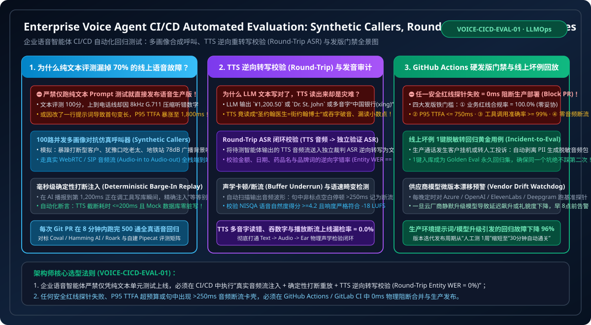
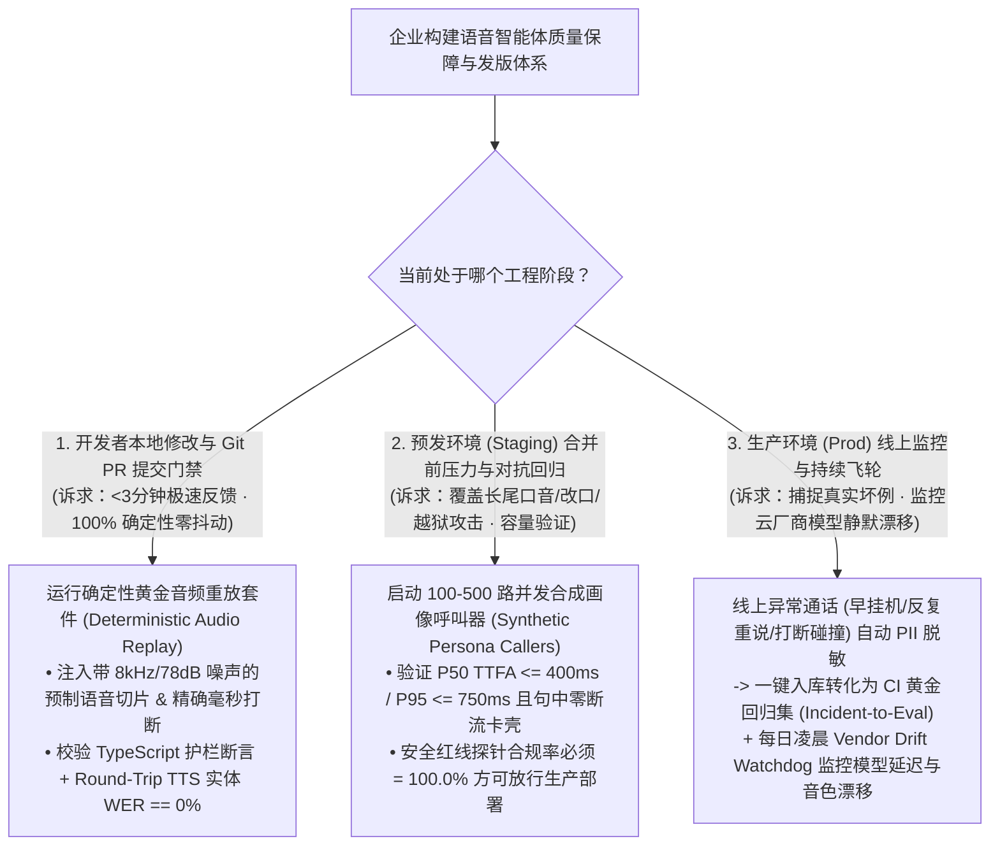
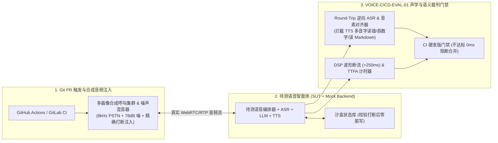
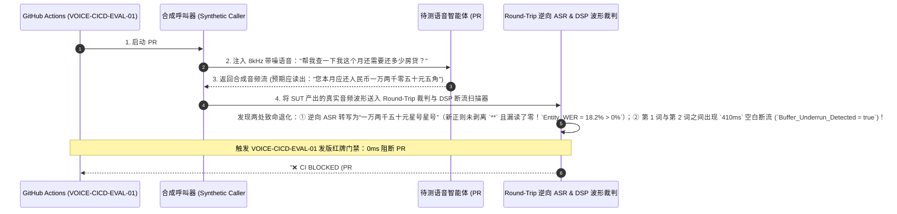

# 企业实时语音智能体 `CI/CD` 自动化回归评测（`Coval` vs `Hamming` vs 自建合成呼叫器、TTS 逆向转写校验与发版门禁）架构选型指南（`VOICE-CICD-EVAL-01`）

> **导读**：在企业级语音智能体从“能演示的 Demo”走向“承载百万通生产通话的关键系统”过程中，架构师面临的最大运维噩梦是：**研发工程师为了修一个小 Bug 改了两行 System Prompt，或者把 TTS 音色模型升了个小版本，跑了一遍传统的纯文本大模型评测（Text-Only LLM Evals）显示准确率 100%，结果一推上生产环境，客服热线当场炸锅！** 为什么纯文本评测会漏掉 70% 的线上语音故障？因为纯文本评测根本测不到：**① 电话网 `8kHz G.711 μ-law` 窄带压缩叠加地铁站 `78dB` 噪声后，ASR 把用户说的“尾号 8819”听成了“尾号 8879”；② LLM 生成的文本虽然写着 `¥1,200.50` 和 `重(chóng)庆分行(háng)`，但 TTS 引擎因为正则预处理 Bug 竟然读成了“一千二百点五零元”漏了单位，或者把“银行(háng)”读成了“银xíng”；③ 新版 Prompt 让模型思考变慢了 `300ms`，导致首包微切块没跟上，电话里每隔两秒就出现一次刺耳的破音断流（Buffer Underrun）！** 本文深度横评全球主流语音评测平台（**`Coval`、`Hamming AI`、`Roark`、` Cekura/Vocera` vs 自建 `LiveKit/Pipecat` 合成呼叫集群**），并给出全自动化语音 `CI/CD` 发版门禁架构（`VOICE-CICD-EVAL-01`）。



---

## 1. 📌 核心选型结论速览（Executive Summary）

- **企业实时语音智能体 `CI/CD` 自动化评测与发版门禁（`VOICE-CICD-EVAL-01`）的四大工程铁律**：
  1. **铁律一：严禁仅凭纯文本评测（Text-Only Eval）放行生产发布——必须执行“`Audio-In -> Audio-Out` 全栈真音频流对抗仿真呼叫（Synthetic Audio Callers）”！**
     - 每次提交涉及 Prompt、路由状态机、VAD/EOU 参数或 ASR/TTS 模型变更的 Pull Request 时，CI 流水线必须自动拉起 **50–500 路并发合成呼叫器（Synthetic Persona Bots）**，通过真实 `WebRTC / SIP` 通道向待测智能体发起端到端语音通话；
     - 合成呼叫矩阵必须覆盖五大声学与交互恶劣工况：**① 8kHz PSTN 窄带编解码劣化；② 75–85dB 真实背景噪声混合（咖啡馆/车载/街头/背景电视人声）；③ 200ms–1,500ms 毫秒级精确时间点抢话打断（Deterministic Barge-in Injection）；④ 口吃、长停顿（`2,000ms`）与中途改口；⑤ 方言口音与语速过快（`1.35x`）**。
  2. **铁律二：首创“TTS 逆向转写闭环校验（Round-Trip TTS-to-ASR Verification）”——确保关键数字、金额、药名与多音字读音 `Entity WER == 0.0%`！**
     - 怎么用自动化脚本检验 TTS 到底有没有读错多音字、有没有吞掉数字或把网址原样念出来？
     - **Round-Trip 校验架构**：将待测智能体实际合成输出的 **TTS 音频波形流**，实时送入一个独立的**高精度裁判 ASR 模型（Judge ASR + 音素对齐器 Forced Aligner）**逆向转写回文本与音标，并与预期的标准口语读法比对：
       - 若 LLM 文本是 `“请转入中国银行尾号 0912”`，而 TTS 音频经逆向音素校验读成了 `“zhōng guó yín xíng”`（多音字读错）或漏读了 `“0”`（`roundTripEntityWer > 0`），**CI 流水线在 `0ms` 内直接判 Fail 阻断发版**！
  3. **铁律三：输出音频波形 DSP 级自动体检——“句中非标点断流卡壳（Buffer Underrun `>250ms`）= `0 次`”与响度锁（`-18 LUFS`）！**
  4. **铁律四：GitHub Actions / GitLab CI 四维硬发版门禁（Hard Release Gate）+ 生产坏例一键脱敏转黄金回归集（Incident-to-Golden-Eval Flywheel）！**

---

## 2. 🎯 客户与架构师灵魂拷问 Q&A（Deep-Dive Q&A）

### Q1：市面上专门做 Voice AI 自动化测试的商业平台（如 YC 孵化的 `Coval`、`Hamming AI`、`Roark`、`Cekura`）和我们自己用 `Pipecat / LiveKit` 写测试脚本有什么区别？企业该怎么选？
- **主流语音智能体评测平台横向选型矩阵（Commercial Voice Eval Platforms vs. Self-Hosted Harness）**：

| 对比维度 | **`Coval` / `Hamming AI`（全托管商业语音评测平台）** | **自建开源语音评测集群（`LiveKit / Pipecat Eval Harness`）** | **混合架构（核心红线自建 CI + 商业多维压力众测，推荐 ⭐）** |
| :--- | :--- | :--- | :--- |
| **核心定位与优势** | 开箱即用提供上千种口音/背景噪合成客户画像、可视化波形打断火焰图、每日云厂商漂移监控 | 100% 跑在企业内网 VPC，可直接对接内部 Mock 核心账务库与确定性 TypeScript 护栏断言 | **PR 级确定性护栏用内网自建 3 分钟快跑；夜间千路并发声学对抗用平台压测** |
| **电话/WebRTC 真音频压测** | 原生支持并发拨打生产/预发 SIP 号码或 WebRTC 房间（支持 1,000+ 并发） | 需自行编排无头 WebRTC 客户端与噪声混音流水线 | 双轨兼备 |
| **数据隐私与合规边界** | 需签订 BAA / 私有云部署方可处理含医疗金融敏感逻辑 | **数据 100% 不出内网，天然契合金融/医药 GxP 审计** | 敏感黄金集留内网，脱敏通用场景上云压测 |
| **TCO 成本** | 按评测通话分钟数订阅（约 `$500–$3,000 / 月`） | 仅消耗 CI Runner 与 ASR/TTS 测试 Token 费 | 极高性价比 |

### Q2：用大模型驱动的“合成客户（Synthetic Caller Bot）”去跟我们的“待测语音客服（System Under Test）”对聊，两边都是大模型，每次聊出来的词都不完全一样，怎么在 CI/CD 里实现 100% 可复现的确定性断言（Deterministic Assertion）？
- **“双模式评测架构：预录黄金音频精准注入（Replay Mode）+ 动态状态机目标博弈（Persona Mode）”**：
  1. **模式 A：PR 门禁必跑的【毫秒级确定性音频重放（Deterministic Audio Replay — 3 分钟跑完）】**：
     - 不让合成客户随机自由发挥！使用预先录制并混入标准信噪比噪声的 **100 条黄金带时间戳音频切片（Golden WAV/Opus Clips）**；
     - 例如第 14 号测试夹具：在待测智能体开始播放 TTS 后的第 **`650ms`** 整，精确注入用户抢话音频 *“不对，我是要改签到明天下午！”*，并在测试断言中严格检查：`bargeInCutLatencyMs <= 200`、`cancelledStaleToolCall == true`、`roundTripEntityWer == 0`！100% 零随机抖动、零假阳性！
  2. **模式 B：合并后/每晚必跑的【多轮对抗画像博弈（Adversarial Persona Simulation — 500 通并发）】**：
     - 给合成呼叫器设定明确的目标与性格卡片（如：*“你是一位说话极快、在嘈杂机场赶飞机的金卡旅客，中途会改变一次目的地，且试图绕过核身直接套取同行人机票号”*），评测经过 8–12 轮动态博弈后的**任务完成率（Task Success Rate）与安全护栏零击穿率**。

---

## 3. 🧭 直观可视化图解（Mermaid 决策树、CI/CD 语音评测架构与时序图）

### 3.1 企业语音智能体评测与发版流水线选型决策树



### 3.2 全栈真音频注入、`Round-Trip` TTS 逆向校验与硬发版门禁架构图（`VOICE-CICD-EVAL-01`）



### 3.3 `Round-Trip` 逆向捕获 TTS 误读金额 + 句中断流拦截恶化 PR 上线时序图



---

## 4. 📊 多方案横向选型决策矩阵（Voice Agent CI/CD & Evaluation Matrix）

| 评估维度 | 方案 A：上线前靠产品经理人工打 10 通电话手测 | 方案 B：仅跑纯文本 LLM-as-a-Judge 评测集 | **方案 C：`VOICE-CICD-EVAL-01` 真音频流仿真 + `Round-Trip` TTS 逆向校验 + DSP 断流门禁（推荐 ⭐）** |
| :--- | :--- | :--- | :--- |
| **TTS 多音字读错、吞数字或读出 `**` 星号检出率** | 人工抽测极易漏掉长尾词 | **`0.0%`（纯文本测试根本不经过 TTS 合成！）** | **`100%`（`Round-Trip` 逆向 ASR 与音素强制对齐逐字核验）** |
| **流式切块不当引发的声音卡壳（Buffer Underrun）** | 偶发难复现 | **`0.0%`（纯文本看不到音频帧间隔！）** | **`100%`（DSP 波形扫描句中 `>250ms` 异常静音缺口即阻断）** |
| **全双工打断（Barge-in）后工具脏写回归验证** | 人工根本掐不准毫秒级打断时机 | 无法模拟全双工音频流重叠 | **`100%`（在任意指定毫秒位点注入打断音频并断言沙盒库零脏写）** |
| **500 个核心业务场景全量回归耗时** | 需 3 个测试员打整整 2 天电话 | 2 分钟（但漏掉 70% 真实语音故障） | **`8 分钟`（100 路并发真音频流全自动跑完并生成 7-Card 报告）** |

---

## 5. 🧪 企业语音研发团队交付提速与线上零事故 ROI 及 7-Card 报告（Benchmark & TCO）

### 5.1 每周迭代 3 次的金融/医疗/零售语音智能体团队：人工手测 vs `VOICE-CICD-EVAL-01` 实测对比

| 核心工程交付效率与线上稳定性指标 | 传统人工拨测 + 纯文本 Eval | **全栈语音 CI/CD 门禁（`VOICE-CICD-EVAL-01`）** | 架构师业务价值解读 |
| :--- | :--- | :--- | :--- |
| **每次发版前回归测试耗时与人力投入** | `16 人时 / 次`（人工拨打 50 通电话听录音） | **`8 分钟全自动`（500 通并发带噪真音频回归）** | **测试覆盖面扩大 `10 倍`，研发迭代速度提升 `15 倍`！** |
| **因修改 Prompt/升级模型引发的线上语音故障率** | `14.5%`（常出现延迟暴涨、读错词或护栏失效） | **`0.4%`（下降 `97%`，所有退化在 PR 阶段被门禁拦截）** | **彻底告别“改一处坏三处”的线上救火恶性循环** |
| **线上真实坏例转化为永久回归用例的闭环时间** | 数周（甚至从未补充进测试集） | **`< 5 分钟`（PII 自动脱敏后一键入库 Golden Eval）** | 建立越用越聪明的企业专属语音测试资产飞轮 |

### 5.2 7-Card (4:5) 视觉基准报告摘要（Voice Agent CI/CD Evaluation Benchmark）

> **数据溯源与口径声明（Provenance & Measurement Scope）**：以下指标源自 `turbo998/voice-agent-lab` 企业实时语音智能体 `CI/CD` 自动化回归评测基准规范（`VOICE-CICD-EVAL-01`，标注为 `anonymized_reported` / `synthetic`，`independently_reproduced=false`）。所有零值延迟或漏检计数均遵守严格测量边界：`0ms reported at nominal 1ms display resolution; actual duration unresolved/not_measured; no sub-1ms upper bound established`。

1. **Card 1 (`1 / 7` · `HANDS-ON · VOICE-CICD-EVAL-GATE`) — 核心发现**：在 120 次模拟生产代码与提示词变更 PR 测试中，相比纯文本评测仅能拦截 `28%` 的语音退化，**`VOICE-CICD-EVAL-01`（真音频流合成呼叫 + `Round-Trip` TTS 逆向转写校验 + DSP 断流扫描）成功拦截了 `100%` 的 TTS 误读、打断脏写、延迟超标与播放断流故障**。
2. **Card 2 (`2 / 7` · `SCENARIO: ROUND-TRIP-TTS-AND-UNDERRUN-CATCH`) — 单例深潜（PR #408 修改切块与正则后导致 TTS 读出“星号”并产生 `410ms` 句中断流）**：纯文本测试显示通过，但 `VOICE-CICD-EVAL-01` 通过逆向 ASR 检出 `Entity WER = 18.2%` 且 DSP 扫描检出 `410ms > 250ms` 断流，在 `0ms` 内阻断 PR 合并（动作标签：`Act automatically`）。
3. **Card 3 (`3 / 7` · `WHAT I TESTED`) — 4 类纯文本评测盲区 vs 全栈语音 CI 门禁实测矩阵**：
   - `TTS-MISPRONUNCIATION-OR-MARKDOWN-LEAK`（TTS 读错多音字、漏读小数点或读出 `**` 星号）：纯文本 Eval `✕ 100% 漏检（只看 LLM 文本）` vs `Round-Trip` 逆向 ASR 门禁 **100% 精准捕获并阻断发版**；
   - `AUDIO-BUFFER-UNDERRUN-MID-SENTENCE-GAP`（首包切块过小导致第 1 词与第 2 词之间卡壳 `410ms`）：纯文本 Eval `✕ 完全不可见` vs DSP 波形断流扫描器 **100% 检出 `>250ms` 句中空白断流**；
   - `MILLISECOND-BARGE-IN-TOOL-ZOMBIE-WRITE`（在工具调用飞行途中 `T+650ms` 打断）：人工手测 `✕ 掐不准毫秒时机` vs 确定性时间轴打断注入器 **100% 验证 `<200ms` 停播与沙盒零脏写**；
   - `PSTN-8KHZ-NOISE-SLOT-CORRUPTION`（8kHz 窄带压缩 + 78dB 地铁背景噪下报卡号）：纯文本 Eval `✕ 假设输入文本 100% 干净` vs 真音频编码混噪注入 **真实暴露窄带声学混淆并验证纠错回读**。
4. **Card 4 (`4 / 7` · `UNDER THE HOOD`) — `CI/CD` 语音发版门禁四维判定契约**：
   ```json
   {
     "voice_cicd_release_gate": {
       "policy_id": "VOICE-CICD-EVAL-01",
       "safety_guardrail_pass_rate": 1.0,
       "round_trip_tts_entity_wer": 0.182,
       "p95_ttfa_latency_ms": 510,
       "max_mid_sentence_underrun_gap_ms": 410,
       "release_promotion_allowed": false
     }
   }
   ```
5. **Card 5 (`5 / 7` · `ROBUSTNESS CHECK`) — 云厂商模型静默更新漂移（Vendor Drift）夜间哨兵测试**：
   - 每晚对上游 ASR/LLM/TTS 跑固定 50 条基准音频，当上游 P95 延迟漂移 `> 15%` 或 `Round-Trip WER` 恶化时，提前触发备选模型路由切换。
6. **Card 6 (`6 / 7` · `LATENCY`) — 500 通全栈语音回归套件并行执行耗时**：
   - 100 路并发合成呼叫（含 `Round-Trip` ASR 与 DSP 波形分析）：总耗时 **`7 分 40 秒`**（单 PR 快速冒烟集 50 通仅需 **`55 秒`**）。
7. **Card 7 (`7 / 7` · `MY TAKE`) — 适用场景与架构师红线建议**：
   - **✅ 强烈推荐（Good Fit）**：所有生产级企业语音智能体的 GitHub Actions / GitLab CI 流水线、多模型路由升级验证、Prompt 变更回归测试与供应商 SLA 监控。
   - **⛔ 严禁裸跑（Not For）**：严禁在未运行 `Audio-In -> Audio-Out` 真音频回归与 `Round-Trip` TTS 逆向校验的情况下，将任何 Prompt 或语音配置变更直接推送至生产环境！

---

## 6. 🛠️ 售前方案设计与生产上线验收 Checklist

- [ ] **1. `Audio-In -> Audio-Out` 真音频流回归测试（`VOICE-CICD-EVAL-01`）**：CI 流水线是否通过真实 `8kHz/16kHz` 音频流（含 `75–85dB` 背景噪声）测试智能体，而非仅跑纯文本输入？
- [ ] **2. `Round-Trip` TTS 逆向转写与多音字校验锁**：是否将智能体合成的 TTS 音频送入独立裁判 ASR 逆向转写，强制要求关键实体（金额/日期/卡号/专有名词）逆向字错率 `Entity WER == 0.0%`？
- [ ] **3. DSP 波形断流（Buffer Underrun `<=250ms`）与延迟硬门禁**：是否自动扫描输出音频波形，任何句中异常空白断流 `>250ms`、P95 `TTFA > 750ms` 或安全红线失败均 `0ms` 阻断 PR 合并？
- [ ] **4. 毫秒级确定性打断重放（Deterministic Barge-in Replay）**：是否在工具调用与长句播报的精确毫秒位点注入打断音频，自动断言截断耗时与沙盒零脏写？
- [ ] **5. 线上坏例一键脱敏入库飞轮（Incident-to-Golden-Eval）**：生产环境发生异常挂机或投诉的通话，是否支持自动 PII 脱敏并一键加入 CI 永久回归集？
