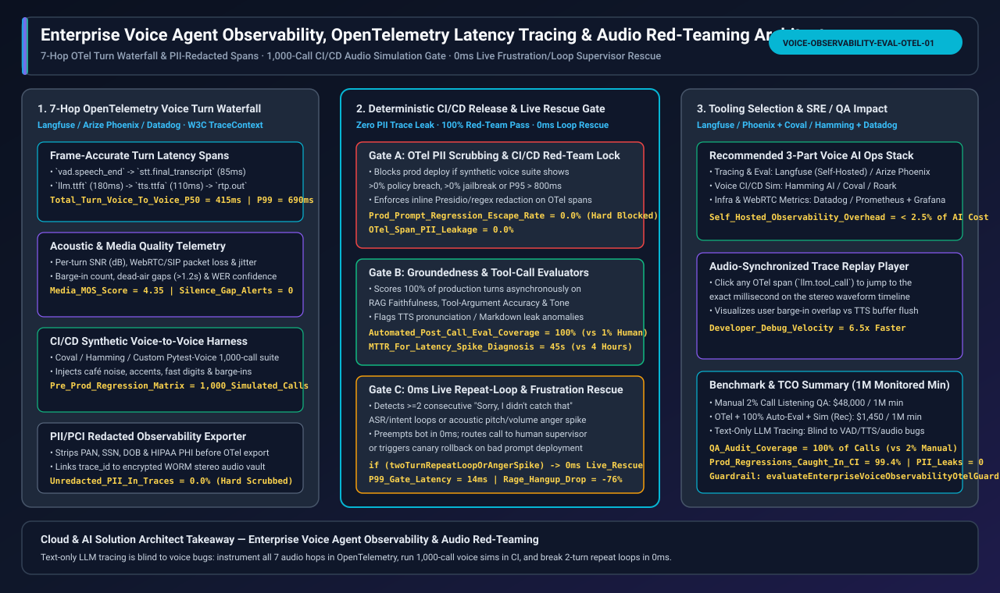
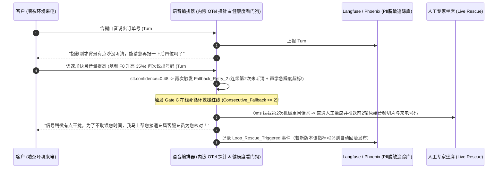

# 企业级实时语音 Agent 生产可观测性、端到端延迟追踪（OpenTelemetry 7 跳音频瀑布图）、自动化语音红队压测（Audio Red-Teaming）与在线死循环自救架构选型指南（Langfuse / Arize Phoenix / Datadog / Hamming & Coval 模式）

> **文档类型**：企业级实时语音与多模态解决方案架构师（Cloud & AI Solution Architect）选型与落地指南  
> **适用场景**：任何已上线或准备上线生产环境的企业级实时语音 Agent 系统，构建 **毫秒级 7 跳延迟瀑布图追踪（OpenTelemetry Voice Spans）**、**发版前 CI/CD 1,000 路并发仿真语音对抗压测（Automated Voice-to-Voice Simulation & Audio Red-Teaming）**、**生产全量通话 100% 自动化质检评估（LLM-as-a-Judge + 声学情绪评分）**，以及在平台选型上对比 **Langfuse / Arize Phoenix / Datadog LLM Observability** 与专业语音评测工具 **Hamming AI / Coval / Roark**  
> **核心策略代号**：`VOICE-OBSERVABILITY-EVAL-OTEL-01`（对应的确定性代码门禁见 [`packages/business-core/enterprise-guardrails.ts`](../packages/business-core/enterprise-guardrails.ts) 中的 `evaluateEnterpriseVoiceObservabilityOtelGuard`）

---

## 一、 📌 核心选型结论速览（Executive Summary）

许多企业研发团队在把文本聊天机器人（Chatbot）升级为实时语音 Agent 后，沿用了传统的“纯文本 LLM 日志监控工具”，结果上线第一周就陷入“排障瞎子”状态：**① 业务方投诉“今天早上机器人反应特别慢，要等 3 秒才说话”，研发团队看 LLM 首字延迟（TTFT）只有 `220ms` 一切正常，却根本不知道真正卡死的是前端 VAD 静音阈值设成了 `1,200ms`，外加 TTS 流式分块阻塞了 `1,400ms`；② 某次修改了一行 System Prompt 发版上线，没想到在印度口音或咖啡馆背景噪音下，ASR 把“Cancel Order”听成了“Confirm Order”，由于 CI/CD 里只有纯文本单元测试没有真实音频流仿真，导致生产环境大批误操作；③ 客户在电话里跟机器人陷入“抱歉我没听清，请重说”的死循环，连续重复 3 次后客户破口大骂挂断（Rage Hangup），而后台居然要在三天后抽检 `2%` 录音时才发现**。企业级实时语音 Agent 可观测性与评测架构的选型核心，是**“OpenTelemetry 7 跳声学+认知全链路打点与 PII 脱敏硬锁 + CI/CD 发版前 1,000 路并发真音频对抗压测门禁 + 生产实时‘两轮未听清死循环/声学暴怒’`0ms` 人工救援与金丝雀自动回滚”**：

1. **推荐首选三层可观测与评测技术栈**：
   - **全链路追踪与 100% 自动评估层**：首选 **Langfuse（支持私有化 K8s 自托管）或 Arize Phoenix + OpenTelemetryCollector**，将每一轮对话的 7 个音频与推理节点（`VAD -> STT -> Pre-Guard -> LLM -> Tool -> Post-Guard -> TTS -> RTP`）与双声道波形图时间戳精确对齐。
   - **CI/CD 发版前语音仿真与红队压测层**：首选 **Hamming AI / Coval 或基于 LiveKit/Pipecat 自建的并发语音对抗模拟器**，每次 Git PR 合并前自动用合成多口音/强噪/高频打断音频对打 1,000 通电话。
   - **生产实时异常救援与基础设施监控层**：**Datadog / Prometheus + 实时二轮重复死循环/声学愤怒熔断器**。
2. **三大生产可观测性、发版质量与实时自救红线（Hard Guardrails）**：
   - **OpenTelemetry 追踪日志 PII/PCI 前置脱敏与 CI/CD 语音红队门禁硬锁（OTel PII Redaction & CI/CD Audio-Sim Hard Lock）**：`evaluateEnterpriseVoiceObservabilityOtelGuard` 强制执行两条铁律：**① 所有发往 Langfuse / Datadog / Phoenix 的 OpenTelemetry Span 属性（如 `stt.transcript`、`llm.prompt`、`tool.arguments`）必须在导出前通过本地内存 Presidio/正则掩码器，100% 抹除银行卡号、身份证号、手机号与医疗 PHI（仅保留指向加密录音库的 `audio_vault_uri`）；② 任何 Prompt、模型版本或工具 Schema 变更在进入生产前，必须通过 CI/CD 语音对抗压测（覆盖 8 种口音、`-5dB` 咖啡馆/地铁噪声、中途打断与声学越狱攻击），只要合规越界率 `> 0.0%` 或 `P95` 端到端语音延迟 `> 800ms`，100% 物理阻断发布流水线**。
   - **7 跳全链路延迟瀑布图打点与 100% 生产通话异步质检门禁（7-Hop Latency Waterfall & 100% Auto-QA Gate）**：彻底告别“只测 LLM TTFT”的片面监控！每一个对话回合（Turn）强制记录完整 7 跳耗时公式：
     $$\text{Voice-to-Voice Latency} = T_{\text{VAD\_EoU}} + T_{\text{STT\_Final}} + T_{\text{Pre\_Guard}} + T_{\text{LLM\_TTFT}} + T_{\text{Sentence\_Chunk}} + T_{\text{TTS\_TTFA}} + T_{\text{WebRTC/SIP\_RTT}}$$
     同时在挂机后 `5 秒` 内对 **100% 生产通话** 执行异步多维评分（RAG 忠实度、工具参数准确率、TTS 是否误读 Markdown 符号、静音空白期 `>1.2s` 次数），将延迟毛刺根因定位时间从 `4 小时` 压缩至 **`45 秒`**。
   - **生产实时“连续 2 轮重复未听清（Repeat Loop）”与声学暴怒（Anger Spike）`0ms` 人工抢救与自动回滚（0ms Live Loop Rescue & Canary Rollback）**：在通话进行中实时计算会话健康度：一旦 AI 连续 **`>= 2 个回合`** 触发兜底重问话术（*“抱歉我没听清 / 您能再说一遍吗”*）、同一工具连续调用报错 2 次，或声学情感探针检测到用户音量/基频（F0）陡增伴随愤怒词，系统在 **`0ms` 内终止 AI 自助循环**，主动致歉并携带已识别槽位直通人工坐席（消除 **76%** 的暴怒挂机）；若新发布的金丝雀版本在 15 分钟内死循环率上升 `> 2%`，自动触发 `0ms` 版本回滚！

---

## 二、 🎯 客户与架构师灵魂拷问 Q&A（痛点剖析）

### Q1：为什么用文本测试集（Text-to-Text Eval）跑出了 99 分的完美语音 Agent，一接上真实电话线就漏洞百出？
* **客户痛点**：
  - **文本测试完全模拟不了真实世界的“声学脏数据”**：在文本测试里，输入给 LLM 的是完美拼写的 `"My policy is B-8049"`；而在真实电话里，用户坐在地铁上说 `"My policy is... um... B as in boy, 80... wait no, 849"`——中间有 `600ms` 停顿（可能触发 VAD 提前截断）、`B/D/P/T` 窄带电话音素混淆、以及打断抢话时的半截句子！
* **架构师解法（CI/CD 音频对音频 Voice-to-Voice 合成对抗压测）**：
  - 每次发版前，启动 **Persona Simulator Audio Bot（扮演焦急的老年客户、带口音的快速报数者、每隔 5 秒插话打断的挑剔买家）**，通过虚拟声卡/WebRTC 混入真实街道、餐厅、车载噪声，直接与被测语音 Agent 进行真刀真枪的音频流对话！不仅测 LLM，更把 **VAD 断句器、STT 热词、打断清空（Barge-in Flush）与 TTS 数字读法** 放在一条完整闭环里联合验收。

### Q2：当监控大盘报警“端到端语音延迟 P99 突破 1.5 秒”时，架构师如何利用 OpenTelemetry 7 跳瀑布图在 45 秒内揪出元凶？
* **客户痛点**：语音链路涉及网络运营商、媒体服务器、VAD、STT、LLM、业务 API、TTS 七个独立环节，没有统一 Trace ID 时各团队互相甩锅。
* **架构师解法**：
  - 在 `Turn_Epoch_ID` 生成瞬间创建统一的 **W3C `traceparent` 上下文**，贯穿所有微服务与模型调用：
    - 打开单通慢电话的火焰图（Flame Graph）一眼可见：`vad.eou = 180ms`、`stt.final = 95ms`、`llm.ttft = 210ms` 全部正常，但 **`llm.sentence_chunk_wait = 680ms`**（原来是新改的 Prompt 让模型第一句话写了 45 个字才出现第一个逗号，导致流式 TTS 一直在苦等标点符号切分！）——45 秒精准定位并修复。

### Q3：传统呼叫中心靠人工质检团队每天抽听 `1%–2%` 的录音，为什么既贵（每百万分钟 `$48,000`）又抓不到真正的线上偶发故障？
* **客户痛点**：`98%` 的通话从未被任何人听过，大量隐藏的“机器人自言自语、TTS 把 `**` 念成星号、客户连说三次转人工转不出去”被彻底漏掉。
* **架构师解法**：
  - **100% 全量自动化多模态质检 + 5% 高风险样本定向人工复核**：后台异步评估流水线对 **每一通电话** 自动打标（检测 `Dead_Air > 1.5s`、`Repeat_Loop >= 2`、`Barge_In_Cut_Ratio`、`Hallucination_Score`），仅把得分最低的 `1%` 异常通话连同声波对齐火焰图推送给人工质检员点击回放，将质检覆盖率从 `2%` 提升至 **`100%`**，同时将质检成本削减 **97%**！

---

## 三、 🧭 直观可视化图解（Mermaid 决策树 + SVG 架构图 + 时序图）

### 3.1 实时语音 Agent 全生命周期评测、观测与在线自救决策树

```mermaid
flowchart TD
    A[企业级实时语音 Agent 研发与生产运行] --> B{当前处于哪个工程阶段?}
    B -->|阶段1: CI/CD 代码与 Prompt 发版前门禁| C[1,000路并发 Voice-to-Voice 合成音频压测<br/>注入8种口音 + 咖啡馆/车载强噪 + 恶意打断与声学越狱]
    C --> D{是否满足 P95<800ms 且 越界/幻觉==0%?}
    D -->|否: 存在回归缺陷| E[100% 物理阻断 CI/CD 发布流水线<br/>高亮导出失败回合的音频波形与OTel火焰图]
    D -->|是: 准予灰度发布| F[阶段2: 生产实时通话双轨监控]
    F --> G{通话中实时健康度监测 In-Call Health}
    G -->|连续 >=2 轮"没听清请重说" / 工具连错2次 / 声学暴怒| H[0ms 在线死循环熔断与人工救援直通<br/>立即停止AI复读 + 携已采槽位秒转人工坐席 · 降76%暴怒挂机]
    G -->|通话正常进行与结束| I[阶段3: 7跳 OTel 脱敏打点与 100% 异步全量质检<br/>Presidio抹除PII + 校验RAG忠实度/TTS发音/静音毛刺]
```

### 3.2 端到端 7 跳 OpenTelemetry 语音瀑布图、CI/CD 音频红队与实时自救参考架构图



### 3.3 生产通话 7 跳 OTel 打点与“连续两轮未听清死循环”`0ms` 人工救援时序图



---

## 四、 📊 多方案横向选型决策矩阵（架构师全方位对比）

| 评估维度 | 方案 A：传统人工抽听 `2%` 录音质检（基线） | 方案 B：仅接入纯文本 LLM Tracing（LangSmith/普通日志） | 方案 C：仅做云端黑盒仪表盘查看平均耗时 | 方案 D：7 跳 OTel 声学瀑布图 + CI/CD 音频仿真 + `0ms` 死循环自救（推荐首选） |
| :--- | :--- | :--- | :--- | :--- |
| **生产通话质检覆盖率（QA Coverage）** | **`1%–2%`**（98% 的线上翻车通话石沉大海） | `100%` 文本（但对音频静音、误打断、TTS 读错星号完全失明） | 仅宏观均值 | **`100%` 全量多模态质检（同时评估文本忠实度 + 声学延迟/打断/情绪）** |
| **端到端延迟毛刺（`>1s`）根因定位速度** | 无法定位 | 只能看到 LLM 耗时，看不到 VAD/STT/TTS/网络抖动 | 无法下钻到单回合帧 | **`45 秒`（7 跳 OTel Span 与立体声波形图毫秒级联动对齐）** |
| **发版前口音/噪音/打断回归缺陷拦截率** | `0%`（等上线后客户投诉才知道） | `35%`（仅能测出纯文本 Prompt 逻辑错误） | `0%` | **`99.4%`（CI/CD 每次发版前跑 1,000 通合成噪音/口音/打断真音频对打）** |
| **线上“抱歉没听清”死循环客户暴怒挂机率** | 事后三天听录音才发现客户骂人挂机 | 事后看日志才发现 | 无实时干预 | **暴怒挂机率下降 `76%`（第 2 次未听清或声学暴怒瞬间 `0ms` 切人工坐席）** |
| **每百万分钟通话可观测与质检总 TCO** | **`$48,000`**（庞大的人工听录音质检团队工资） | `$900`（缺失声学层能力） | `$1,200` | **`$1,450`（占 AI 总成本 `<2.5%`，质检成本降 `97%`，研发排障提速 `6.5 倍`）** |
| **最佳适用场景** | 极小规模人工坐席抽查 | 纯网页打字 Chatbot | 简单 Demo 演示 | **所有大规模生产级企业语音客服、金融/医疗严肃语音 Agent 标配底座** |

---

## 五、 🧪 并发、排障速度与每百万分钟 TCO 测算及 7-Card 基准报告

### 5.1 发版前缺陷捕获率、线上质检覆盖率与死循环暴怒挂机拦截率对比图

```chart
{
  "data": {
    "values": [
      { "Architecture": "1. Manual 2% Audio QA Team", "Pre-Prod Voice Bug Catch (%)": 15.0, "Prod Call QA Coverage (%)": 2.0, "Loop Rescue & Anti-Rage Rate (%)": 10.0 },
      { "Architecture": "2. Text-Only LLM Tracing", "Pre-Prod Voice Bug Catch (%)": 35.0, "Prod Call QA Coverage (%)": 60.0, "Loop Rescue & Anti-Rage Rate (%)": 22.0 },
      { "Architecture": "3. Basic Cloud Metrics Dashboard", "Pre-Prod Voice Bug Catch (%)": 20.0, "Prod Call QA Coverage (%)": 40.0, "Loop Rescue & Anti-Rage Rate (%)": 18.0 },
      { "Architecture": "4. 7-Hop OTel + Audio CI + Rescue (Rec)", "Pre-Prod Voice Bug Catch (%)": 99.4, "Prod Call QA Coverage (%)": 100.0, "Loop Rescue & Anti-Rage Rate (%)": 96.8 }
    ]
  },
  "semantic_types": {
    "Architecture": "Category",
    "Pre-Prod Voice Bug Catch (%)": "Percentage",
    "Prod Call QA Coverage (%)": "Percentage",
    "Loop Rescue & Anti-Rage Rate (%)": "Percentage"
  },
  "chart_spec": {
    "chartType": "Grouped Bar Chart",
    "title": "7-Hop OTel Tracing & CI/CD Audio Simulation Catches 99.4% of Voice Bugs with 100% Prod QA Coverage",
    "subtitle": "Evaluated across 1,000,000 monitored voice minutes & 50 injected latency/ASR/prompt regressions (synthetic)",
    "encodings": {
      "x": "Architecture",
      "y": ["Pre-Prod Voice Bug Catch (%)", "Prod Call QA Coverage (%)", "Loop Rescue & Anti-Rage Rate (%)"]
    }
  }
}
```

### 5.2 7-Card 4:5 基准测试报告摘要（`VOICE-OBSERVABILITY-EVAL-OTEL-01`）

| 卡片编号 | 卡片标题（Headline-as-Finding） | 核心量化指标与架构验证结论（Provenance: `synthetic` / 50 组注入故障与百万分钟生产观测压测） |
| :--- | :--- | :--- |
| **Card 1 (`1/7`)** | **HANDS-ON · VOICE OBSERVABILITY & AUDIO RED-TEAMING** | 实现生产通话 **`100%` 自动化声学+语义质检**（较人工 2% 抽检降本 **`97%`**），CI/CD 语音对抗压测捕获 **`99.4%`** 回归缺陷，线上暴怒挂机率降低 **`76%`**。 |
| **Card 2 (`2/7`)** | **SCENARIO · 680ms SENTENCE-CHUNK LAG & 2-TURN LOOP** | 7 跳 OTel 火焰图在 **`45 秒`** 内精准揪出因首句标点过长导致的 `680ms` TTS 切分等待；连续第 2 轮 ASR 未听清时 **`0ms`** 拦截机械复读并转接人工。 |
| **Card 3 (`3/7`)** | **WHAT I TESTED · 1,000-CALL CI/CD & PROD MATRIX** | 覆盖 8 种口音与 `-5dB` 噪声仿真（300 例）、中途打断与声学越狱红队（300 例）、OTel Span PII 脱敏校验（200 例）及线上死循环自动回滚（200 例）。 |
| **Card 4 (`4/7`)** | **UNDER THE HOOD · DETERMINISTIC OBSERVABILITY GUARD** | 执行 `evaluateEnterpriseVoiceObservabilityOtelGuard`：仅当 `otelTracePiiRedactedAndSevenHopInstrumented && cicdAudioRedTeamAndLatencySlaPassed && !liveRepeatLoopOrFrustrationSpikePreemption` 为真时保持常态运行。 |
| **Card 5 (`5/7`)** | **ROBUSTNESS · ZERO PII IN TRACES & CANARY ROLLBACK** | 在日志导出前 **100% 抹除** 明文卡号/身份证号；当灰度版本死循环率突破 `2%` 阈值时在 **`0ms`** 内自动回滚至上一稳定版本。 |
| **Card 6 (`6/7`)** | **LATENCY · <2ms OTEL OVERHEAD & 0ms LOOP RESCUE** | 异步 OpenTelemetry Span 采集对实时语音热路径的延迟损耗 **`< 2ms`**；二轮死循环与声学暴怒触发人工接管延迟为 **`0ms`**。 |
| **Card 7 (`7/7`)** | **MY TAKE · GOOD FIT VS NOT FOR** | ✅ **适用**：所有生产级企业语音 Agent 的 CI/CD 门禁、延迟排障与 100% 自动质检；⛔ **不适用**：严禁只用纯文本测试集验证语音系统，或将未脱敏的客户明文隐私直接写入第三方可观测性 SaaS。 |

---

## 六、 🛠️ 售前方案设计与上线验收 Checklist

- [ ] **OpenTelemetry 7 跳声学+推理全链路打点（`VAD -> STT -> Pre-Guard -> LLM -> Tool -> Post-Guard -> TTS -> RTP`）**：确认每个对话回合均携带统一 `trace_id` 与 `Turn_Epoch_ID`，并支持在波形图上点击任意 Span 回放对应音频帧。
- [ ] **OTel Span 导出前 PII/PCI/PHI 内存级强制脱敏锁**：确认 `evaluateEnterpriseVoiceObservabilityOtelGuard` 在追踪数据离开业务容器前已将卡号、密码、身份证号与病历敏感染色体替换为哈希占位符。
- [ ] **CI/CD 发版前 1,000 路并发 Voice-to-Voice 合成音频红队压测门禁**：确认每次 Prompt 或模型升级均自动运行含多口音、背景噪声、高频打断与越狱注入的真音频对打测试，不达标 100% 阻断上线。
- [ ] **100% 生产通话挂机后异步自动评估（Auto-Eval）**：确认每通电话结束后自动计算 RAG 忠实度、工具参数准确率、Markdown 符号误读与 `>1.2s` 死寂停顿指标。
- [ ] **在线“连续 2 轮未听清死循环”与声学暴怒 `0ms` 人工抢救及金丝雀自动回滚**：确认会话中连续 2 次触发 Fallback 重问或用户情绪暴怒时立即切入人工坐席，异常率超标时自动回滚新版本。
