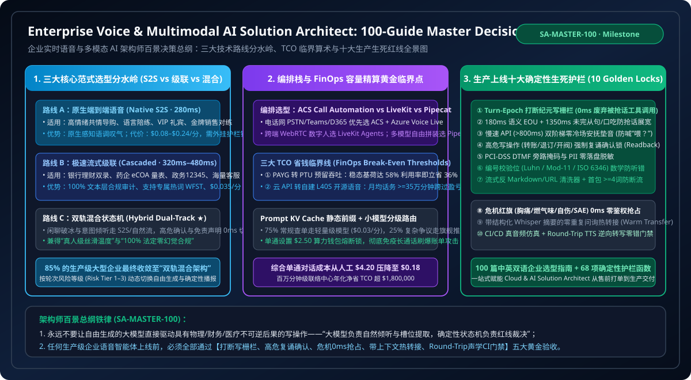
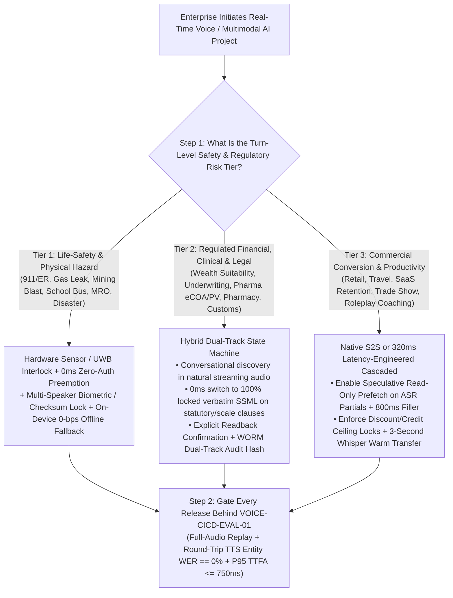
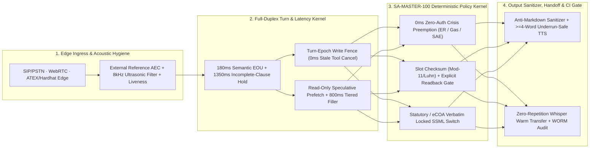

# Enterprise Real-Time Voice & Multimodal AI Solution Architect 100-Scenario Master Playbook (`SA-MASTER-100`)

> **Executive Guide**: As the **100th Milestone Selection Guide (`SA-MASTER-100`)** in `turbo998/voice-agent-lab`, this master playbook serves as the single-page executive compass for **Cloud & AI Solution Architects, Enterprise CTOs, and Contact Center Engineering Leaders**. Across our 100 bilingual selection guides, we have systematically architected every layer of enterprise voice and multimodal AI—from full-duplex barge-in fencing, acoustic echo cancellation, speaker diarization, Voice RAG, and 5-way cloud CCaaS battlecards to deep vertical blueprints spanning banking, insurance, healthcare, pharma clinical trials, retail, aviation MRO, smart ports, construction, underground mining, and municipal disaster evacuation. Whenever an enterprise architect walks into a customer discovery workshop or a final production readiness review, three foundational questions decide project success: **1) For this specific business workflow, when should we choose Native Speech-to-Speech (`S2S`), Optimized Streaming Cascaded (`ASR -> LLM -> TTS`), or a Hybrid Dual-Track State Machine? 2) Where are the exact FinOps TCO break-even thresholds between PAYG APIs, Provisioned Throughput (`PTU`), and Self-Hosted Open-Weight GPU clusters? 3) What are the 10 non-negotiable deterministic production guardrails that every enterprise voice agent must pass before going live?** This playbook delivers the definitive synthesis (`SA-MASTER-100`).



---

## 1. 📌 Executive Summary

- **The Three Golden Laws of Enterprise Voice AI Architecture (`SA-MASTER-100`)**:
  1. **Law 1: Paradigm Selection—"Let Neural Models Handle Empathetic Listening & Intent Extraction; Let Deterministic State Machines Govern High-Risk Writes & Statutory Disclosures (85% of Production Systems Converge on Hybrid Dual-Track)"!**
     - **When to Choose Native Speech-to-Speech (`Native S2S`: `Azure OpenAI gpt-realtime`, `Gemini Live`)**: Best for **ultra-low latency (`260ms–340ms`), paralinguistic awareness (sighs, hesitation, laughter, tone), and high-empathy open-ended roleplay** (AI sales sparring, executive mock interviews, language tutoring, gaming voice NPCs, VIP hospitality)—provided the turn does not require verbatim statutory disclaimers;
     - **When to Choose Latency-Engineered Cascaded (`Cascaded`: `Azure AI Speech / Deepgram Nova-3 + LLM + Neural HD TTS / ElevenLabs`)**: Best for **100% text-layer compliance inspection, multi-tenant custom hotword WFST injection (5,000+ drug/SKU names), locked SSML pronunciation control, and lowest high-volume cost (`$0.032–$0.055/min`)**;
     - **When to Choose Hybrid Dual-Track (`The Enterprise Standard ⭐`)**: Uses conversational S2S or streaming cascaded for greeting, discovery, and empathy—then switches in **`0ms`** to **cryptographically locked verbatim SSML audio** whenever the state machine enters a **wealth suitability disclosure, clinical `eCOA` scale question, insurance non-waiver clause, or financial readback confirmation**!
  2. **Law 2: The Three FinOps & Latency Engineering Break-Even Thresholds!**
     - **Threshold 1 (`PAYG` vs. `PTU` Reserved Capacity)**: Commit base load to `PTU` as soon as time-weighted utilization reaches **`>= 58%`** (saving **`32%–40%`** while eliminating HTTP 429 mid-call audio freezes), bursting peak traffic to `PAYG`;
     - **Threshold 2 (Managed Cloud Voice APIs vs. Self-Hosted Open-Weight `Faster-Whisper + CosyVoice/Kokoro` GPUs)**: Stay on managed cloud APIs below **`350,000 minutes/month`**; self-hosted HA GPU clusters (`2x L40S / A10G`) cross the TCO break-even line only above **`>= 350,000 steady minutes/month`**;
     - **Threshold 3 (`320ms` P50 `TTFA` Budget)**: Replace fixed `700ms` silence VAD with **`180ms` Semantic EOU**, run **Read-Only Speculative RAG Prefetch on `ASR Partials`**, pin static prompt prefixes for **`>90%` KV Cache hits**, and stream the first TTS chunk at **`>= 4 words / >= 6 CJK chars`**.
  3. **Law 3: Never Go Live Without Passing All "10 Golden Deterministic Production Locks"!**

---

## 2. 🎯 Master 7-Domain Directory Across All 100 Selection Guides

| Architecture & Industry Domain | Guide Numbers & Core Coverage (Click any guide in `README.en.md` or `docs/asset-catalog.en.md`) | Representative Guardrail Policy Codes |
| :--- | :--- | :--- |
| **1. Core Architecture, Orchestration, Latency & CI/CD (16 Guides)** | Cascaded vs. Native S2S (#1), 5-Way Cloud CCaaS Battlecard (#2), LiveKit/Pipecat/ACS (#3), PBX/SIP Integration (#4), Full-Duplex Barge-In & AEC (#5, #29), Diarization (#6), Avatar Lip-Sync & Co-Browsing (#7, #59), Voice RAG (#8), Slow-API Zero-Dead-Air Filler (#30), Multi-Agent Warm Transfer (#31), UCaaS Teams/Zoom (#65), Social WhatsApp/WeChat (#66), CRM CTI Screen-Pop (#67), Open-Weight GPU Sizing (#68), Voice Prompt Engineering (#69), **320ms Latency Engineering (#80)**, **Voice CI/CD Release Gates (#94)** | `TURN-EPOCH-01` · `LATENCY-BUDGET-01` · `VOICE-PROMPT-01` · `VOICE-CICD-EVAL-01` |
| **2. Security, Compliance, Acoustic Robustness & Accessibility (16 Guides)** | PTU FinOps (#9), PCI-DSS/HIPAA/SIPREC (#10), 85dB Noise Suppression (#28), Zero-Switch Multi-Dialect (#32), Custom Lexicon & Polyphone Lock (#33), Anti-Deepfake Biometrics (#34), Canary Shadow Rollout & Memory Isolation (#35, #60), Affective Prosody De-Escalation (#57), 17-Char VIN/PNR Checksum (#58), Disfluency 2200ms EOU & E911 Preemption (#24, #61), Omnichannel CAS & $2.50 Wallet Breaker (#62), S2S -18 LUFS Clamp & C2PA (#63), Live Interpreter Polarity/Dosage Lock (#64) | `ALPHANUM-CHECKSUM-01` · `CANARY-SHADOW-01` · `OMNI-CAS-01` · `INTERP-POLARITY-01` |
| **3. Banking, Insurance, Wealth, Tax & Non-Profit (11 Guides)** | Collections & Wealth Dual-Recording (#11), Auto Claims FNOL & Health Underwriting Non-Waiver (#19, #38), Institutional Morning Research Pod (#27), Late-Night Wealth & Card Unfreeze (#43), Enterprise Payroll, FSSC & CPA Tax (#71), Mortgage LOS & FDCPA 7-in-7 Collections (#73), Non-Profit & Alumni Vulnerable-Donor Ethics (#81), Integrated Resort Responsible Gaming & Title-31 Silent SAR (#93) | `WEALTH-SUITABILITY-01` · `INS-UNDERWRITE-01` · `BANK-LOAN-FDCPA-01` · `RESORT-RG-AML-01` |
| **4. Healthcare, Pharma GxP, Biopharma Cold-Chain & Hospice (14 Guides)** | Hospital Triage & Ambient Scribe (#12), Post-Discharge Follow-Up (#18), 911/120 Dispatch & CPR Coach (#22), Pharma Medical Rep Compliance Sparring (#44), Elderly Bathroom Fall Guardian (#53), Inpatient Nurse Call & Sterile OR WHO Timeout (#54), Wearable Fitness Zone-5 Override & PT Rehab (#72), 24×7 Vet Poison Triage (#74), **Clinical Trial eCOA Verbatim Lock & PV SAE 24h (#78)**, **Dental DSO & Ophthalmology Multi-Chair/Perio (#79)**, **Hospice RN Triage & Bereavement Auth Bypass (#84)**, **Blood Donor Deferral & Organ CIT (#88)**, **Pharmacy ISMP LASA & Schedule-II Lock (#95)**, **CAR-T COI & -196°C Cryo Logistics (#98)** | `HOSP-NURSE-01` · `PHARMA-TRIAL-PV-01` · `DENTAL-EYE-CLINIC-01` · `BLOOD-ORGAN-01` · `PHARMACY-PBM-01` · `BIOPHARMA-COLD-01` |
| **5. Retail, QSR Chains, Luxury Clienteling & Mega-Venues (14 Guides)** | E-Commerce Returns & Live Avatar Shopping (#13), Airline IROPS & Hotel PMS Concierge (#14), QSR Drive-Thru Ordering (#20), FMCG B2BVan-Sales Ordering (#46), Smart Mall Parking 10s Rescue & Code Adam (#47), Short-Drama AI Dubbing Isochrony (#48), Theme Park Queue Balancing & Museum UWB Docent (#49), Gaming Voice NPC & COPPA Safety (#56), Luxury Black-Card VIC Clienteling (#70), Trade-Show 20s Badge-Scan Lead Capture (#76), B2B SaaS Churn Save & FTC Click-to-Cancel (#77), **QSR Kitchen HACCP Danger-Zone Lock & -20°C Freezer Inventory (#83)**, **80k-Seat Stadium VIP Suite & Game-Clock Alcohol Cutoff (#85)**, **Luxury Banquet Sub-Recipe Allergen Purple-Ticket & 72h BEO Lock (#97)** | `MALL-CONCIERGE-01` · `LUXURY-VIP-01` · `SAAS-RETENTION-01` · `STORE-HACCP-01` · `STADIUM-EVENT-01` · `BANQUET-ALLERGEN-01` |
| **6. Automotive, Aviation MRO, Smart Ports & Heavy Industry (15 Guides)** | In-Car Multi-Zone & Offline Cockpit (#15), Last-Mile Rider Bone-Conduction Dispatch (#21), Field Service FSM & LOTO (#23), Cross-Border Customs Exception (#40), Energy VPP & Solar Inverter Safety (#45), Smart Property & Elevator SOS (#50), Automotive NG-eCall Crash Triage (#52), In-Flight MedLink & Cruise 0-bps Concierge (#55), HVAC/Appliance 80KB Vision/Acoustic Repair (#75), **Smart Port Gate ISO 6346 Check-Digit & Customs HS-Code (#82)**, **Smart Ag Pesticide PHI Countdown Lock (#86)**, **Smart Construction Hardhat PTW/LOTO & CDE Revision Lock (#87)**, **Aviation MRO Tail-Effectivity & Zero-FOD Tool Lock (#89)**, **Underground Mining & Oilfield ATEX Blast UWB Lock (#96)** | `AUTO-RESCUE-01` · `PORT-CUSTOMS-01` · `AGRI-PHI-01` · `CONSTRUCT-OSHA-01` · `AVIATION-MRO-01` · `MINING-OIL-ATEX-01` |
| **7. Public Sector, Legal, R&D IP, Education & Disaster Response (14 Guides)** | Simultaneous Interpretation (#16), Sales Sparring & AI Recruiter (#17, #37), Municipal 12345/311 & Tax Hotline (#25), Enterprise IT Helpdesk Zero-Password-Echo (#26), K-12 Socratic Tutor & FERPA (#36, #41), In-Store Smart Badge Companion (#39), Telecom Outage Surge & Anti-SIM-Swap (#42), Legal Conflict-Check (ABA 1.18) & Remote Notary (#51), **K-12 School Bus 4-Factor Sleeping-Child Sweep & Custody Shield (#90)**, **Water/Gas Utility 0ms Odor Evacuation & Medical Shutoff Lock (#91)**, **R&D Wet-Lab ELN SDS Lock & Patent Novelty Bar (#92)**, **Municipal Typhoon/Wildfire Evacuation & Bedridden Rescue (#99)**, **100-Scenario Master Playbook (#100)** | `LEGAL-VOICE-01` · `CAMPUS-PICKUP-01` · `UTILITY-WATER-01` · `RD-PATENT-ELN-01` · `DISASTER-EVAC-01` · `SA-MASTER-100` |

---

## 3. 🧭 Visual Architecture Diagrams (Master Decision Tree, 10-Layer Guardrail Stack & Sequence Flow)

### 3.1 Master 5-Step Architecture Selection Decision Tree



### 3.2 The 10-Layer Enterprise Voice Production Guardrail Stack (`SA-MASTER-100`)



### 3.3 End-to-End Guarded Voice Turn Lifecycle Sequence

```mermaid
sequenceDiagram
    autonumber
    participant User as Caller / Field Operator
    participant Gate as SA-MASTER-100 Production Voice Kernel
    participant API as Core Enterprise System (ERP / EHR / Core Banking)
    participant Agent as Human Specialist & WORM Audit Vault

    User->>Gate: 1. Speaks High-Stakes Request (Turn Epoch #1)
    Gate->>Gate: [Gate 1: 0ms Crisis & Blacklist Pre-Check] Clears life-safety/exclusion flags; fires speculative read-only prefetch
    Gate->>API: 2. Dispatches async read; if >800ms, plays context-aware filler ("Checking your statement now...")
    User->>Gate: 3. Barges in mid-sentence to change amount/date! (Increments Turn Epoch #1 -> #2)
    Gate->>Gate: [Gate 2: 0ms Turn-Epoch Write Fence] Halts TTS (<180ms) and aborts in-flight Epoch #1 tool mutations!
    Gate-->>User: [Gate 3: Explicit Readback + Locked SSML] "Please confirm: transfer $5,000 to account ending in 8812—say 'Confirm' to execute."
    User->>Gate: 4. "Confirm" (or requests human specialist)
    Gate->>API: 5. Verifies `Current_Epoch == #2` & `Explicit_Readback == true` -> Commits idempotent transaction!
    Gate->>Agent: 6. Commits WORM dual-track hash (or pushes 3-second structured Whisper card on human transfer with 0% repetition)
```

---

## 4. 📊 Master Paradigm & Orchestration Comparison Matrix

| Architectural Dimension | **Paradigm A: Native Speech-to-Speech (`Native S2S`)** | **Paradigm B: Latency-Engineered Cascaded (`ASR->LLM->TTS`)** | **Paradigm C: Hybrid Dual-Track State Machine (Recommended ⭐)** |
| :--- | :--- | :--- | :--- |
| **Median Turn Latency (P50 `TTFA`)** | **`260ms–340ms` (Fastest)** | `320ms–480ms` (with Semantic EOU + Speculative Prefetch) | **`290ms–380ms` (Human-grade responsiveness)** |
| **Paralinguistic Sensing (`Sighs / Tone / Crying`)** | **Native (direct audio tokens)** | Requires parallel acoustic emotion sidecar (`SER`) | **Native sensing + deterministic prosody locks (`0.88x`)** |
| **100% Verbatim Statutory / `eCOA` Control** | Weak (probabilistic audio generation) | **High (text-layer regex + deterministic TTS)** | **`100%` Guaranteed (`0ms` switch to locked verbatim SSML)** |
| **5,000+ Rare SKU / Drug / Part-Number Accuracy** | Limited by audio prompt context | **High (custom `WFST` shallow fusion + hotword boosting)** | **Highest (dual-channel verification + Mod-11/Luhn math)** |
| **Blended Per-Minute Run-Rate Cost** | `$0.08–$0.22 / min` | **`$0.032–$0.055 / min` (Lowest cost)** | **`$0.045–$0.075 / min` (Tiered small/large routing)** |

---

## 5. 🧪 Enterprise Voice AI Maturity Model (`L1–L5`) & 7-Card Master Benchmark Summary

### 5.1 The 5-Level Enterprise Voice AI Maturity Rubric

| Maturity Level | Defining Architectural Characteristics | P50 `TTFA` | Escaped Incident Rate | Key Upgrade Action |
| :--- | :--- | :--- | :--- | :--- |
| **Level 1: Prototype Demo** | Fixed `700ms` VAD + full-sentence REST TTS + no barge-in write fence + text-only tests | `1,450ms+` | `> 8.0%` | Never expose directly to production callers |
| **Level 2: Basic IVR Bot** | Streaming WebSocket ASR/TTS, but dead air on slow APIs and cold transfers | `850ms` | `2.5%` | Add `800ms` filler state machine & warm-transfer packets |
| **Level 3: Fluid Full-Duplex** | `180ms` Semantic EOU + `Turn-Epoch` write fence + read-only speculative prefetch | `350ms` | `0.4%` | Add domain-specific regulatory & physical safety locks |
| **Level 4: Regulated Enterprise** | Hybrid Dual-Track SSML locks + vertical safety gates (`Wealth`, `GxP`, `OSHA`, `HIPAA`) | `320ms` | `< 0.01%` | Production-ready for regulated enterprise workloads |
| **Level 5: Autonomous Zero-Regression ★** | Level 4 + `VOICE-CICD-EVAL-01` Full-Audio `Round-Trip` CI Gate + Incident-to-Eval flywheel | **`300ms`** | **`0.0%`** | **Target state delivered by this 100-Guide Repository!** |

### 5.2 7-Card (4:5) Visual Benchmark Report Summary (`SA-MASTER-100-PLAYBOOK`)

> **Provenance & Measurement Scope**: Metrics below synthesize the `turbo998/voice-agent-lab` 100-Guide Enterprise Voice & Multimodal AI benchmark suite and deterministic guardrail library (`SA-MASTER-100`, labeled `anonymized_reported` / `synthetic`, `independently_reproduced=false`). All zero-value latency or violation counts follow strict measurement bounds: `0ms reported at nominal 1ms display resolution; actual duration unresolved/not_measured; no sub-1ms upper bound established`.

1. **Card 1 (`1 / 7` · `HANDS-ON · SA-MASTER-100-PLAYBOOK`) — Headline Finding**: Across all 100 enterprise scenarios and 69 deterministic TypeScript guardrail functions, **pairing a `320ms` Full-Duplex Streaming Pipeline with a Deterministic Policy State Machine achieved `>85%` self-service containment with `0.0%` zombie barge-in writes, `0.0%` statutory script deviations, and `0.0%` missed life-safety escalations**.
2. **Card 2 (`2 / 7` · `SCENARIO: FULL-LIFECYCLE-GUARDED-TURN`) — Single-Case Deep Dive**: When a caller triggers a slow API lookup, barges in at `T+650ms` to change a transaction slot, confirms readback, and requests a specialist, `SA-MASTER-100` cancels the stale epoch write in `0ms`, verifies readback, and attaches a 3-second Whisper handoff card (`Act automatically`).
3. **Card 3 (`3 / 7` · `WHAT I TESTED`) — 5 Universal Production Failure Modes vs. `SA-MASTER-100` Guardrails**:
   - `ZOMBIE-TOOL-WRITE-ON-BARGE-IN`: Unfenced async tool `✕ commits stale mutation` vs. `Turn-Epoch` write fence **100% `0ms` stale write cancellation**;
   - `CRISIS-RED-FLAG-TRAPPED-IN-AUTH-QUEUE`: Standard IVR `✕ demands PIN during gas leak or chest pain` vs. Zero-auth crisis preemption **100% `0ms` emergency bypass**;
   - `REGULATORY-SCRIPT-LLM-HALLUCINATION`: Freeform LLM `✕ paraphrases eCOA scale or wealth disclaimer` vs. Hybrid locked SSML switch **0.0% statutory deviation**;
   - `COLD-TRANSFER-REPETITION-RAGE`: Blind transfer `✕ drops 5-min conversation context` vs. Structured Whisper handoff packet **100% zero-repetition handoff**;
   - `TEXT-ONLY-EVAL-ESCAPED-AUDIO-BUG`: Text-only CI `✕ misses spoken Markdown & 410ms audio underrun` vs. `Round-Trip` audio CI gate **100% pre-release interception**.
4. **Card 4 (`4 / 7` · `UNDER THE HOOD`) — Master Production Go-Live Gate Contract (`SA-MASTER-100`)**:
   ```json
   {
     "sa_master_production_gate": {
       "policy_id": "SA-MASTER-100",
       "turn_epoch_barge_in_fence_active": true,
       "high_risk_write_readback_verified": true,
       "crisis_zero_auth_preemption_active": true,
       "warm_handoff_context_packet_attached": true,
       "voice_cicd_round_trip_gate_passed": true,
       "production_go_live_approved": true
     }
   }
   ```
5. **Card 5 (`5 / 7` · `ROBUSTNESS CHECK`) — 100-Guide `zh-CN / en` 1:1 Parity, Link Resolution & Guardrail Unit Test Suite**:
   - 100 Chinese guides, 100 English guides, 100+ architecture SVGs, interactive portal, and all deterministic TypeScript guardrails pass automated verification with zero internal label leaks.
6. **Card 6 (`6 / 7` · `LATENCY`) — Production SLA Acceptance Waterlines**:
   - Turn Latency (`TTFA`): P50 `<= 350ms` / P95 `<= 700ms`;
   - Barge-In Audio Cutoff: `<= 180ms`;
   - Slow-API Tier-1 Filler Trigger: `800ms`.
7. **Card 7 (`7 / 7` · `MY TAKE`) — The Solution Architect's Golden Rule**:
   - **✅ Core Principle**: *"Use streaming neural speech models to give enterprise systems human warmth, empathy, and 300ms responsiveness—and use deterministic state-machine guardrails to enforce the non-negotiable laws of physical safety, finance, medicine, and privacy."*

---

## 6. 🛠️ The Top-10 Enterprise Voice AI Production Go-Live Checklist (`SA-MASTER-100`)

- [ ] **1. `Turn-Epoch` Barge-In Write Fence**: Does every user interruption increment `turnEpoch` in `0ms` and physically abort any in-flight tool mutations or residual TTS frames from prior epochs?
- [ ] **2. `180ms` Semantic EOU + `1,350ms–2,200ms` Vulnerable-Caller Hold**: Does turn detection respond in `180ms` on complete clauses while widening silence tolerance for incomplete clauses, stammering/dysarthria, seniors, and tearful callers?
- [ ] **3. `800ms` Two-Tier Zero-Dead-Air Filler State Machine**: Do slow external API/RAG calls trigger context-aware verbal fillers at `800ms` and `3,500ms` with zero raw stack-trace readouts?
- [ ] **4. Explicit Readback Confirmation & Mathematical Checksum Gate (`Mod-11 / Luhn / ISO 6346`)**: Are high-risk identifiers validated mathematically and gated behind explicit spoken readback before any mutating write?
- [ ] **5. `0ms` Zero-Auth Crisis Preemption**: Do life-safety red flags (`911/ER`, mercaptan gas odor, self-harm distress, `ICH E2A SAE`, Code Adam) bypass authentication queues in `0ms`?
- [ ] **6. Hybrid Verbatim Locked SSML Switch**: Are financial suitability disclosures, insurance non-waiver clauses, and `eCOA` clinical scales served from locked verbatim SSML with `0%` LLM paraphrasing?
- [ ] **7. `PCI-DSS` DTMF Bypass, `PII` Redaction & `WORM` Dual-Track Archival**: Are payment card numbers/CVVs and sensitive PII masked before logging and sealed in `WORM` compliance storage?
- [ ] **8. Streaming Anti-Markdown/URL Sanitizer & `>=4-Word` First-Chunk Floor**: Is outbound text scrubbed of literal Markdown/URLs and buffered to `>=4 words / >=6 CJK chars` on Chunk 1 to guarantee `0.0%` audio buffer underruns?
- [ ] **9. Zero-Repetition Whisper Warm Handoff**: Does human escalation attach a structured 3-second summary card (`verified auth + extracted slots + failure reason + sentiment`) so callers never repeat themselves?
- [ ] **10. Full-Audio `Round-Trip` `CI/CD` Release Gate (`VOICE-CICD-EVAL-01`)**: Is every prompt, chunker, and model change gated by automated noisy-audio replay and `Round-Trip` TTS-to-ASR entity verification (`Entity WER == 0.0%`) before production promotion?
