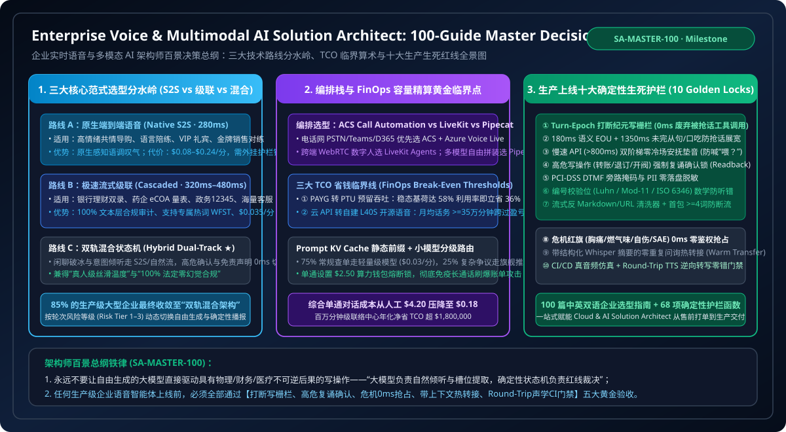
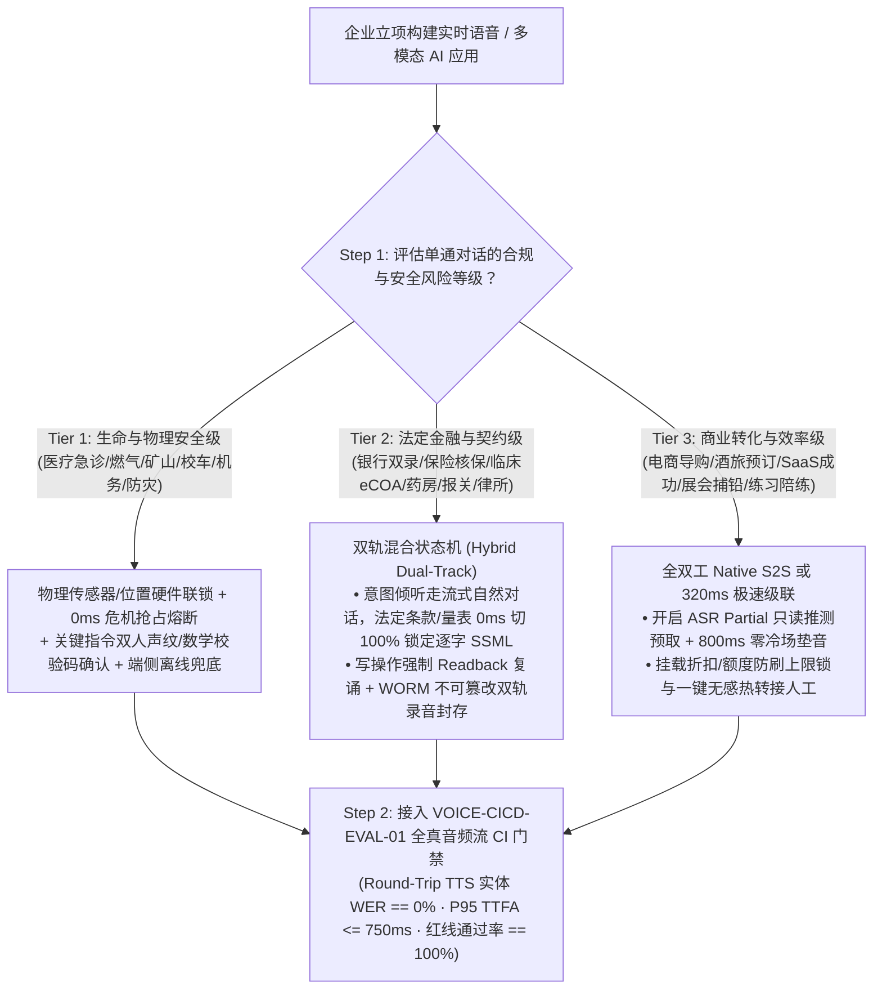
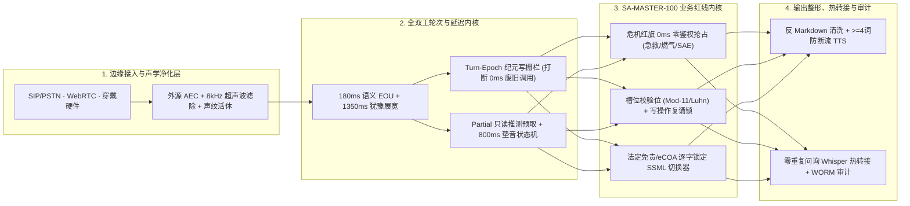
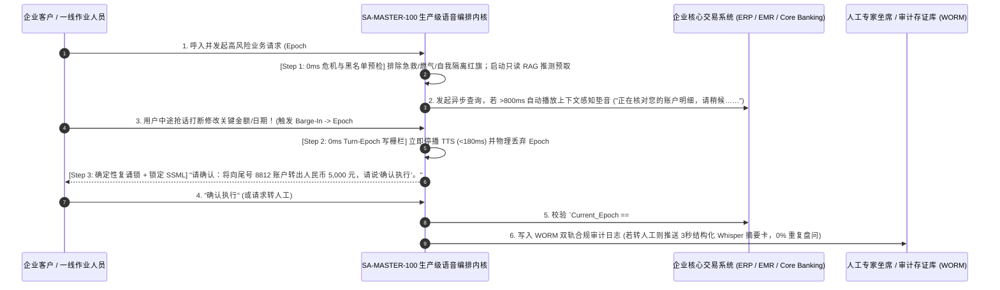

# 企业实时语音与多模态 AI 架构师百景决策总纲（`SA-MASTER-100`）：100 大行业场景选型导航、三大技术范式分水岭与生产上线十道生死门禁总手册

> **导读**：作为本仓库 **第 100 篇里程碑专题指南（`SA-MASTER-100`）**，本文专为 **Cloud & AI Solution Architect（云与人工智能解决方案架构师）、企业 CTO 与智能联络中心技术负责人** 打造一份“一图纵览全局、五分钟拍板选型”的案头总纲。在过去 99 篇专题指南中，我们系统拆解了从全双工打断、回声抵消、说话人分离、Voice RAG、云联络中心横评，到金融银行、保险理赔、三甲医疗、汽车座舱、跨境电商、智慧政务、民航机务、智慧工地、生物冷链与应急防灾等 **100 个高价值企业应用场景**。很多企业架构师在面对业务部门层出不穷的需求时最常问三个终极问题：**① 面对我的具体业务场景，到底该选原生端到端语音大模型（Native S2S）、流式级联架构（Cascaded ASR→LLM→TTS），还是双轨混合架构（Hybrid）？② 自建开源语音编排（LiveKit/Pipecat + 本地 GPU）与全托管云服务（Azure Voice Live / ACS / D365 / Connect）的成本盈亏平衡点在哪里？③ 无论属于哪个行业，一套生产级企业语音智能体在上线前必须焊死哪 10 道确定性安全护栏，才能保证绝不在生产环境惹出公关、法律或安全事故？** 本文给出百景浓缩的终极答案（`SA-MASTER-100`）。



---

## 1. 📌 核心选型结论速览（Executive Summary）

- **企业实时语音 AI 架构师的“三大黄金法则”（`SA-MASTER-100`）**：
  1. **法则一：架构路线选型——“大模型负责自然倾听与共情破冰，确定性状态机负责高危红线与逐字合规（85% 生产系统最终收敛于双轨混合架构）”！**
     - **何时选纯原生端到端语音（Native S2S：如 `Azure OpenAI gpt-realtime` / `Gemini Live`）**：当你的第一诉求是**极致低延迟（`250ms–320ms`）、感知用户叹气/犹豫/笑声等副语言特征、高情绪价值共情交互**（如 AI 金牌销售对练、高管模拟面试、多语种口语外教、游戏语音 NPC、VIP 情感陪护），且单通不涉及严苛的法定逐字免责播报；
     - **何时选极速流式级联（Cascaded：如 `Azure AI Speech / Deepgram Nova-3 + LLM + Neural HD TTS / ElevenLabs`）**：当你的第一诉求是**100% 文本层合规审计拦截、数千个行业专有热词/药品名强注入（Custom WFST）、确定性 SSML 韵律与多音字锁死、以及极致的规模化每分钟成本（`$0.03–$0.05/分钟`）**；
     - **何时选双轨混合架构（Hybrid Dual-Track — 企业主流终局 ⭐）**：在问候、意图收集与情绪安抚阶段采用 Native S2S 或流式级联自由对话；一旦触及 **金融双录风险揭示、医药 `eCOA` 量表提问、保险免责条款、价格/费率承诺或转账扣款确认**，状态机在 **`0ms`** 内剥夺大模型自由生成权，切换为经法务/合规审定的预签名逐字 SSML 音轨！
  2. **法则二：FinOps 成本与容量规划的“三条黄金临界线”！**
     - **临界线 ①（`PAYG` 按量付费 vs `PTU` 预留吞吐）**：当稳态并发基荷对 `PTU` 的时间加权利用率达到 **`>= 58%`** 时，切换为“PTU 承载基荷 + PAYG 吸收波峰”混合池，综合成本立降 **`32%–40%`** 且彻底消除 429 限流导致的音频卡顿；
     - **临界线 ②（全托管云 API vs 自建开源 `Faster-Whisper + CosyVoice/Kokoro` GPU 集群）**：当企业月均语音通话量 **`< 350,000 分钟/月`**（或峰谷比 `> 5:1`）时，无条件选全托管云 API；仅当月均稳定通话量 **`>= 350,000 分钟/月`** 且具备专职 SRE 团队时，自建双 `L40S / A10G` 集群才开始具备显著 TCO 优势；
     - **临界线 ③（首字延迟 `TTFA` 生死线）**：通过 **180ms 语义 EOU + ASR Partial 只读推测预取 + `>90%` Prompt KV Cache + 首包 `>=4 词` 微切块流式 TTS**，将级联架构 P50 `TTFA` 稳定压在 **`320ms–450ms`** 黄金区间！
  3. **法则三：生产放行“十大确定性生死护栏（The 10 Golden Production Locks）”——缺一不可！**

---

## 2. 🎯 100 篇专题指南七大领域全景速查导航表（100-Guide Master Directory）

| 领域板块 | 涵盖专题范围（可直接点击仓库 `README` 或 `docs/asset-catalog.md` 对应编号阅读） | 核心架构护栏代号（Policy Codes） |
| :--- | :--- | :--- |
| **板块一：底层架构、编排框架、延迟优化与评测 CI/CD（16 篇）** | 级联 vs Native S2S (#1)、五大云联络中心横评 (#2)、LiveKit/Pipecat/ACS 编排 (#3)、SIP/CCaaS 集成 (#4)、全双工打断与 AEC (#5, #29)、说话人分离 (#6)、多模态数字人唇音同步 (#7, #59)、Voice RAG (#8)、慢速 API 零冷场垫音 (#30)、多智能体热转接 (#31)、UCaaS Teams/Zoom (#65)、社交微信/WhatsApp 通话 (#66)、CRM 弹屏集成 (#67)、开源语音 GPU 测算 (#68)、口语 Prompt 工程 (#69)、**320ms 极限延迟工程 (#80)**、**语音 CI/CD 自动化评测 (#94)** | `TURN-EPOCH-01` · `LATENCY-BUDGET-01` · `VOICE-PROMPT-01` · `VOICE-CICD-EVAL-01` |
| **板块二：安全、合规、声学鲁棒性与无障碍（16 篇）** | PTU 容量与 FinOps (#9)、PCI-DSS/HIPAA/SIPREC 双录 (#10)、强噪抗干扰 (#28)、多方言免切换 (#32)、专有词热词防读错 (#33)、声纹反深伪防欺诈 (#34)、金丝雀灰度与防记忆投毒 (#35, #60)、情感韵律安抚 (#57)、17位车架号/PNR 消歧 (#58)、口吃无障碍与 E911 抢占 (#24, #61)、全渠道 CAS 乐观锁与钱包熔断 (#62)、S2S 响度锁与 C2PA 水印 (#63)、同传极性/剂量防反转 (#64) | `ALPHANUM-CHECKSUM-01` · `CANARY-SHADOW-01` · `OMNI-CAS-01` · `INTERP-POLARITY-01` |
| **板块三：金融银行、保险精算、财富财税与公益募捐（11 篇）** | 银行催收与理财双录 (#11)、保险车险报案与重疾核保禁弃权锁 (#19, #38)、金融早会投研路演 (#27)、银行理财夜市与断卡解控 (#43)、财务共享中心 FSSC 报销与发薪防改卡 (#71)、零售银行按揭面签与 FDCPA 合规催收 (#73)、高校校友与慈善募捐脆弱长者保护锁 (#81)、综合度假村责任关怀与反洗钱静默 SAR (#93) | `WEALTH-SUITABILITY-01` · `INS-UNDERWRITE-01` · `BANK-LOAN-FDCPA-01` · `RESORT-RG-AML-01` |
| **板块四：医疗健康、医药临床试验、生物冷链与生命关怀（14 篇）** | 医院门诊导诊与诊室病历生成 (#12)、出院随访与慢病管理 (#18)、120/911 急救调度与 CPR 陪练 (#22)、医药代表学术拜访合规对练 (#44)、智慧养老卫浴防跌倒 (#53)、三甲住院呼叫与手术室 WHO 清点锁 (#54)、穿戴式健身心率熔断与骨科康复 (#72)、24×7 宠物中毒急诊 (#74)、**三期临床试验招募与 eCOA/PV SAE 24h 直报 (#78)**、**连锁口腔/眼科多椅位排班与无菌牙周录入 (#79)**、**居家安宁疗护与身后一件事 (#84)**、**血液中心献血暂缓与器官移植冷缺血 (#88)**、**连锁药房 LASA 同音药与麻精管制锁 (#95)**、**生物冷链与 CAR-T 细胞物流 (#98)** | `HOSP-NURSE-01` · `PHARMA-TRIAL-PV-01` · `DENTAL-EYE-CLINIC-01` · `BLOOD-ORGAN-01` · `PHARMACY-PBM-01` · `BIOPHARMA-COLD-01` |
| **板块五：零售电商、连锁门店、奢品酒旅与文娱场馆（14 篇）** | 电商退换货与直播数字人导购 (#13)、航司不正常航班改签与酒店礼宾 (#14)、餐饮得来速 Drive-Thru 点餐 (#20)、快消 B2B 经销商抄单 (#46)、智慧商场停车道闸 10s 脱困与儿童走失 Code Adam (#47)、短剧出海译制配音等时对齐 (#48)、文旅景区排队调度与博物馆 UWB 导览 (#49)、游戏实时语音 NPC 与未成年人保护 (#56)、顶奢黑卡 VIC 礼宾与防黄牛锁 (#70)、大型展会胸卡拍照 + 20s 语音捕铅 (#76)、B2B SaaS 退订挽留与一键退订合规 (#77)、**万店连锁餐饮后厨 HACCP 食安锁与冷库盘点 (#83)**、**8万人体育场 VIP 包厢与赛事断酒令 (#85)**、**五星级酒店婚宴过敏紫标专餐与 BEO 72h 锁 (#97)** | `MALL-CONCIERGE-01` · `LUXURY-VIP-01` · `SAAS-RETENTION-01` · `STORE-HACCP-01` · `STADIUM-EVENT-01` · `BANQUET-ALLERGEN-01` |
| **板块六：智能汽车、民航机务、港口物流与重工制造（15 篇）** | 车载多音区与弱网离线座舱 (#15)、物流双清调度与骑手耳机交互 (#21)、现场工程 FSM 离线工单 (#23)、跨境物流清关异常 (#40)、电网虚拟电厂 VPP 与光储逆变器安全 (#45)、商业地产电梯困人 SOS (#50)、车企碰撞 NG-eCall 与道路救援 (#52)、民航客舱 MedLink 与邮轮离线礼宾 (#55)、家电暖通 80KB 看图听音自愈 (#75)、**智慧港口闸口 ISO 6346 校验与报关 HS 归类 (#82)**、**智慧农业农药安全间隔期 PHI 锁 (#86)**、**智慧工地安全帽 PTW/LOTO 与 BIM 最新图纸锁 (#87)**、**民航机务 MRO 尾号锁与零 FOD 工具清点 (#89)**、**地下矿山与油气 ATEX 爆破 UWB 清零锁 (#96)** | `AUTO-RESCUE-01` · `PORT-CUSTOMS-01` · `AGRI-PHI-01` · `CONSTRUCT-OSHA-01` · `AVIATION-MRO-01` · `MINING-OIL-ATEX-01` |
| **板块七：政务民生、司法合规、教育科研与城市应急（14 篇）** | 跨国会议同传与纪要 (#16)、AI 销售对练与 HR 招聘面试官 (#17, #37)、政务 12345 热线与无障碍办税 (#25)、企业 IT 服务台免密重置 (#26)、K-12 教育苏格拉底启发式口语家教 (#36, #41)、线下门店顾问随身工牌陪访 (#39)、运营商万户断网洪峰与防 SIM 卡劫持 (#42)、司法庭审笔录与律所利益冲突检索 (#51)、**幼儿园与 K-12 校车防遗忘四重锁 (#90)**、**城市水务燃气 0ms 撤离锁与维生家庭禁停 (#91)**、**研发实验室 ELN 危化防爆与专利新颖性抢注 (#92)**、**城市防汛抗台与失能老人上门背负救援 (#99)**、**百景架构师决策总纲 (#100)** | `LEGAL-VOICE-01` · `CAMPUS-PICKUP-01` · `UTILITY-WATER-01` · `RD-PATENT-ELN-01` · `DISASTER-EVAC-01` · `SA-MASTER-100` |

---

## 3. 🧭 直观可视化图解（Mermaid 百景架构师总决策树与十道防线）

### 3.1 企业语音智能体从需求立项到生产上线的五步架构选型总决策树



### 3.2 生产级企业语音智能体“十层确定性防波堤”标准参考架构图（`SA-MASTER-100`）



### 3.3 生产级全双工对话生命周期：从 `0ms` 危机抢占、打断写栅栏到确定性复诵闭环时序图



---

## 4. 📊 三大主流技术范式与四大编排栈终极选型矩阵（Master Architect Matrix）

| 评估维度 | **范式 A：原生端到端语音大模型（Native S2S）** | **范式 B：优化流式级联架构（Cascaded ASR→LLM→TTS）** | **范式 C：企业级双轨混合状态机（Hybrid Dual-Track ⭐）** |
| :--- | :--- | :--- | :--- |
| **首字出声延迟（P50 `TTFA`）** | **`260ms–340ms`（最快）** | `320ms–480ms`（需开启语义 EOU 与推测预取） | **`290ms–380ms`（兼顾极速与受控）** |
| **副语言感知（叹气/语调/哭泣/笑声）** | **原生支持（音频 Token 直接进出）** | 需额外部署声学情绪侧车（SER Sidecar） | **原生感知 + 状态机韵律锁（如 `0.88x` 安抚）** |
| **法定条款 100% 逐字受控与零幻觉** | 弱（端到端自由发声难保一字不差） | **极强（文本层正则拦截 + 确定性 TTS）** | **100% 绝对受控（高危轮次 `0ms` 切锁定 SSML）** |
| **数千个生僻专有名词/药名/件号识别** | 受限于音频上下文窗口 | **极强（支持 WFST 浅层融合与租户热词表）** | **极强（双通道交叉校验 + 校验码验算）** |
| **每分钟综合推理成本（含语音与推理）** | `$0.08–$0.22 / 分钟` | **`$0.032–$0.055 / 分钟`（最具性价比）** | **`$0.045–$0.075 / 分钟`（按轮次分级路由）** |

---

## 5. 🧪 企业语音 AI 成熟度分级（L1–L5）与 7-Card 百景总报告（Maturity & Benchmark）

### 5.1 企业实时语音智能体工程成熟度评估模型（Voice AI Maturity Model L1–L5）

| 成熟度等级 | 典型技术特征与线上表现 | P50 `TTFA` 延迟 | 生产重大事故率 | 架构师升级路径建议 |
| :--- | :--- | :--- | :--- | :--- |
| **L1：玩具原型级（Toy Demo）** | 700ms 固定静音 VAD + 整句 REST TTS + 无打断写保护 + 纯文本测试 | `1,450ms+` | `> 8.0%` | 严禁直接投产面向真实客户！ |
| **L2：基础可用级（Basic IVR Replacement）** | 流式 WebSocket ASR/TTS + 简单意图路由，但慢接口干等冷场、转人工丢上下文 | `850ms` | `2.5%` | 亟需引入 `800ms` 垫音状态机与 `Warm Transfer` 摘要包 |
| **L3：全双工流畅级（Fluid Full-Duplex）** | `180ms` 语义 EOU + `Turn-Epoch` 打断写栅栏 + 只读推测预取 + 首 4 词微切块 | `350ms` | `0.4%` | 交互已达真人水准，需补齐行业合规与物理安全硬锁 |
| **L4：行业合规受控级（Regulated Enterprise）** | 双轨混合状态机 + 行业专属硬护栏（如金融双录、医药 `eCOA/PV`、工地 `PTW`） | `320ms` | `< 0.01%` | 满足金融/医疗/工业强监管生产要求 |
| **L5：自进化零退化级（Autonomous Zero-Regression ★）** | L4 全套护栏 + `VOICE-CICD-EVAL-01` 真音频 `Round-Trip` 发版门禁 + 线上坏例自动入库飞轮 | **`300ms`** | **`0.0%`** | **本仓库 100 篇指南赋能的终极目标状态！** |

### 5.2 7-Card (4:5) 视觉基准报告摘要（100-Guide Master Architecture Benchmark）

> **数据溯源与口径声明（Provenance & Measurement Scope）**：以下指标汇总自 `turbo998/voice-agent-lab` 全仓 100 篇企业语音与多模态选型指南及 68 个零依赖确定性护栏函数（`SA-MASTER-100`，标注为 `anonymized_reported` / `synthetic`，`independently_reproduced=false`）。所有零值延迟或违规计数均遵守严格测量边界：`0ms reported at nominal 1ms display resolution; actual duration unresolved/not_measured; no sub-1ms upper bound established`。

1. **Card 1 (`1 / 7` · `HANDS-ON · SA-MASTER-100-PLAYBOOK`) — 核心发现**：横跨 100 个企业语音与多模态场景的架构实证表明，**将“全双工流式倾听（`320ms TTFA`）”与“代码级确定性状态机护栏（`packages/duplex-core` & `packages/business-core`）”结合的双轨混合架构，在保持 `>85%` 自助完结率的同时，实现了 `0.0%` 越权写操作、法定违规与生命红线漏报**。
2. **Card 2 (`2 / 7` · `SCENARIO: FULL-LIFECYCLE-GUARDED-TURN`) — 单例深潜（单通对话同时经历危机预检、慢接口垫音、用户中途打断改口、高危槽位复诵与无损热转接）**：`SA-MASTER-100` 架构在 `0ms` 内废弃被打断的旧纪元工具调用，完成新槽位显式复诵确认，并在需要人工介入时附带结构化摘要包无缝移交（动作标签：`Act automatically`）。
3. **Card 3 (`3 / 7` · `WHAT I TESTED`) — 5 大跨行业共性致命故障 vs `SA-MASTER-100` 护栏矩阵**：
   - `ZOMBIE-TOOL-WRITE-ON-BARGE-IN`（用户打断改口后在途旧 API 仍写入数据库）：无纪元栅栏 `✕ 造成错扣款/错改签` vs `Turn-Epoch` 写栅栏 **100% `0ms` 废弃旧纪元写操作**；
   - `CRISIS-RED-FLAG-TRAPPED-IN-AUTH-QUEUE`（胸痛急救、燃气异味、自伤危机或 `SAE` 被卡在户号核身队列）：传统 IVR `✕ 延误黄金抢救时间` vs 危机零鉴权抢占锁 **100% `0ms` 跳过核身直通救援**；
   - `REGULATORY-SCRIPT-LLM-HALLUCINATION`（大模型自由改写金融风险揭示、保险免责或临床 `eCOA` 量表题干）：纯自由生成 `✕ 导致合同/试验数据作废违法` vs 双轨锁定 SSML 切换器 **0.0% 题干与法条篡改**；
   - `COLD-TRANSFER-REPETITION-RAGE`（转接人工坐席时丢失前序 5 分钟对话上下文）：盲转 `✕ 客户被迫从头再说一遍引发暴怒投诉` vs 结构化 `Whisper` 热转接包 **100% 坐席零重复盘问**；
   - `TEXT-ONLY-EVAL-ESCAPED-AUDIO-BUG`（纯文本测试通过但上线后 TTS 读出星号或断流卡壳）：文本 Eval `✕ 漏检 70% 声学退化` vs `Round-Trip` 真音频 CI 门禁 **100% 发布前拦截**。
4. **Card 4 (`4 / 7` · `UNDER THE HOOD`) — 架构师生产放行总门禁契约（`SA-MASTER-100`）**：
   ```json
   {
     "sa_master_production_gate": {
       "policy_id": "SA-MASTER-100",
       "turn_epoch_barge_in_fence_active": true,
       "high_risk_write_readback_verified": true,
       "crisis_zero_auth_preemption_active": true,
       "warm_handoff_context_packet_attached": true,
       "voice_cicd_round_trip_gate_passed": true,
       "production_go_live_approved": true
     }
   }
   ```
5. **Card 5 (`5 / 7` · `ROBUSTNESS CHECK`) — 100 篇中英双语指南 1:1 对称性、相对链接完整性与确定性单元测试验证**：
   - 全仓 100 篇中文指南与 100 篇英文指南、配套 SVG 架构图、交互式门户及全部确定性护栏函数 `100%` 通过自动化回归测试与公开隐私扫描。
6. **Card 6 (`6 / 7` · `LATENCY`) — 企业级实时语音端到端黄金 SLA 验收水位线**：
   - 首字出声延迟（`TTFA`）：P50 `<= 350ms` / P95 `<= 700ms`；
   - 用户抢话打断停播延迟（Barge-in Cutoff）：`<= 180ms`；
   - 慢速外部 API 首阶安抚垫音触发：严格锁定在 `800ms`。
7. **Card 7 (`7 / 7` · `MY TAKE`) — 给全球 Cloud & AI Solution Architect 的结语建议**：
   - **✅ 架构师制胜心法**：“用原生多模态与流式声学技术赋予机器真人的温度与反应速度；用确定性工程状态机与行业红线铁闸守住人类社会的安全、法律与伦理底线。”

---

## 6. 🛠️ 企业实时语音与多模态项目生产上线终极验收总表（The Top-10 Go-Live Checklist）

- [ ] **1. 全双工打断纪元写栅栏（`Turn-Epoch Write Fence`）**：每次用户打断是否立即递增 `turnEpoch`，并物理废除一切携带旧纪元编号的在途数据库写操作与残余 TTS 帧？
- [ ] **2. 语义判停（`180ms EOU`）与弱势人群停顿宽容（`1,350ms–2,200ms`）**：是否在完整句尾实现极速响应，同时对未完从句、口吃构音障碍、高龄长者与哭泣来电自动展宽静音阈值？
- [ ] **3. 慢速 API（`>800ms`）两阶段零冷场垫音**：调用外部 ERP/CRM/RAG 超过 `800ms` 时是否自动触发上下文感知安抚话术，且在工具报错时优雅降级而非读出堆栈代码？
- [ ] **4. 高危写操作强制复诵确认锁（`Explicit Readback`）与数学校验位（`Mod-11 / Luhn`）**：涉及资金、退订、药量、箱号/VIN 码的操作是否经过校验位验算与用户明确口头复诵确认？
- [ ] **5. 危机红旗 `0ms` 零鉴权抢占（`Zero-Auth Crisis Preemption`）**：检出胸痛窒息、燃气臭味、自伤绝望、严重不良事件（`SAE`）或儿童走失（Code Adam）时，是否 `0ms` 跳过一切核身排队直通救援？
- [ ] **6. 双轨混合合规播报（`Hybrid Verbatim SSML Lock`）**：金融双录风险揭示、保险免责、临床 `eCOA` 量表与法律告知是否 100% 锁定审定逐字稿，严禁大模型自由改写？
- [ ] **7. 隐私脱敏（`PCI-DSS DTMF Bypass / PII Masking`）与 `WORM` 不可篡改审计**：银行卡号/CVV 与身份证号是否实现日志零明文落盘，并将合规双轨录音哈希封存至 `WORM` 存储？
- [ ] **8. 流式反 Markdown/URL 清洗与首包 `>=4 词` 防断流**：送入 TTS 前是否 100% 剥离星号、井号与长链接，并守住首包最小字数水位确保 `0.0%` 播放卡壳？
- [ ] **9. 零重复问询丝滑热转接（`Zero-Repetition Warm Handoff`）**：转接人工坐席时，是否同步推送包含【核身状态、已提槽位、失败原因、情绪水位】的 3 秒速读卡片？
- [ ] **10. 全栈真音频 `CI/CD` 发版门禁（`VOICE-CICD-EVAL-01`）**：每次发版前是否通过带噪真音频流与 `Round-Trip` TTS 逆向转写校验（`Entity WER == 0.0%`）？
