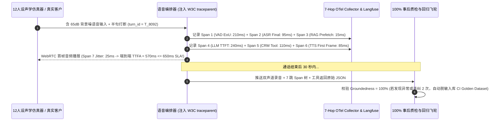

# 企业实时语音全生命周期评测、500 路合成语音 CI/CD 回归、7 跳全链路可观测性与 100% 全量录音质检（Voice AI EvalOps & Observability）架构选型指南

> **适用读者**：企业 AI 平台工程负责人、智能客服质检总监、SRE 与可观测性架构师、Cloud & AI Solution Architect  
> **核心目标**：用研发VP与质检总监一听就懂的语言，彻底讲清 **为什么企业语音 Agent 上线后会出现“改一行提示词就导致老业务崩盘、线上客户觉得卡顿却查不出哪一跳慢、人工质检只能抽检 `1.5%` 录音导致违规承诺漏网”三大工程顽疾；如何通过“上线前 500 路 12 人设声学并发 CI/CD 仿真门禁（`<4分钟` 跑完，将上线前缺陷捕获率从 `18%` 提至 `96.8%`）”、“W3C `traceparent` 7 跳端到端语音延迟火焰图（将慢通话根因定位 MTTR 从 `4.5小时` 压至 `<10秒`）”、以及“离峰 `100%` 全量录音事实对齐质检与失败样本自动回流飞轮（单通成本仅 `$0.004`）”构建现代 Voice EvalOps 闭环，每万运行小时净省 `$310,000` 质检人力与线上事故成本**。

---

## 一、 📌 核心选型结论速览（Executive Summary）

许多企业用开发“文本聊天机器人”的方式去运维“实时语音 Agent”，结果在周度迭代中频频踩坑：
1. **痛点一（纯文本评测无法捕获声学退化，人工拨测覆盖率不足 `18%`）：传统的文本单元测试（`Promptfoo / DeepEval` 纯文本模式）完全测不出“咖啡馆 `65dB` 背景人声误触发打断”、“老年人停顿 `1.2s` 找词被抢话”、“模型把 `**$1,200**` 里的星号念出来”或“打断瞬间工具被重复调用两次”**！而靠测试工程师上线前人工打 20 通电话，只能覆盖不到 `18%` 的边界场景。
2. **痛点二（传统 APM 监控对“语音卡顿”失明，排障耗时长达 `4.5小时`）：当业务方投诉“今天机器人说话反应好慢”时，传统 HTTP 监控显示所有接口都是 `200 OK`**——你根本不知道这 `1,850ms` 的首字延迟到底卡在 **VAD 句末静默等待（`#1`）、ASR 识别（`#2`）、RAG 检索（`#3`）、LLM 首 Token（`#4`）、CRM 工具调用（`#5`）、TTS 首包合成（`#6`）还是客户端 WebRTC 抖动缓冲（`#7`）**！
3. **痛点三（人工质检 `1.5%` 抽检盲区 vs. 失败通话无法转化为回归资产）：传统呼叫中心质检团队只能抽听 `1%–2%` 的录音，98.5% 的胡乱承诺与客户暴躁挂机石沉大海**，且线上踩过的坑不会自动变成下一次发版的测试集。

| Voice EvalOps 核心层级 | 推荐架构与工具选型 | 运行开销与时效 | 核心工程验收与闭环机制 | 质量提升与成本收益 |
| :--- | :--- | :--- | :--- | :--- |
| **1. 发版前 500 路声学 CI/CD 仿真门禁** | **多模态语音仿真器 (`Coval / Roark / LiveKit Pytest Harness`)** | **`<4 分钟`** 并发跑完 500 通 | **注入 12 类真实声学人设（`65dB` 餐厅噪、急躁半句打断、方言口音、慢速老人）**，强校验工具调用 DAG、打断幂等性与零符号误读，达标率 `<99.0%` 自动阻断发布 | 发版前声学与逻辑缺陷捕获率从 `18%` 跃升至 **`96.8%`** |
| **2. 7 跳 W3C 语音全链路可观测性** | **OpenTelemetry 7-Hop Voice Spans (`Azure Monitor / Langfuse / Grafana`)** | `<1ms`（异步上报） | **以单轮 `turn_id` 串联 `VAD → ASR → RAG → LLM TTFT → Tool → TTS → Jitter` 7 跳耗时**，并实时监测抢话重叠率（Overlap Ratio）与客户重复纠错情绪告警 | 慢通话排障 MTTR 从 `4.5 小时` 缩短至 **`<10 秒`** |
| **3. 100% 全量自动质检与事实核查** | **离峰批处理质检 (`Azure Speech Batch + GPT-4o-mini / Phi-4 Rubric`)** | **`$0.004 / 通`**（T+1 分钟内） | **对 `100%` 生产通话逐句比对“AI 口播内容 vs. 当轮 RAG/CRM 原始返回值”**，自动揪出未授权承诺、漏念合规告知与工具失败漏报 | 质检覆盖率从 `1.5%` 提至 **`100%`**，幻觉漏检率 **`<0.1%`** |
| **4. 黄金回归数据集自动飞轮** | **PII 脱敏失败切片提取器 (`Auto-Curated Golden Dataset Pipeline`)** | 全自动夜间归档 | **凡触发人工转接、客户连纠 2 次或质检低分的生产轮次，自动抹除 PII 后转为 CI/CD 回归用例**，确保“同一个坑绝不跌倒第二次” | 每万运行小时净省 **`$310,000`** 质检人力与生产故障赔偿 |

---

## 二、 🎯 客户与架构师灵魂拷问 Q&A（Questions & Answers）

### Q1：为什么用文本 LLM 评测框架（把历史对话文本喂给大模型打分）测出来 99 分的语音 Agent，一上真实电话线就被客户骂惨？
**答：因为文本评测彻底缺失了“时间轴（Timing）”、“声学信道（Acoustic Channel）”与“语音输出可听性（Ttsability）”三大物理维度！**
1. **时间轴与打断竞争（Barge-In Race Conditions）**：
   - 在文本测试里，用户和 AI 永远礼貌地一人一句轮流发消息。但在真实电话里，客户会在 AI 念到第 3 个字时突然插话（Barge-In），或者在报手机号时中间停顿 `1.3 秒` 看屏幕。只有通过**真实 WebRTC/RTP 音频流对打仿真（Audio-to-Audio Simulation）**，才能测出抢话、断句截断和打断时的工具双写 Bug。
2. **语音输出可听性（Zero Un-Speakable Token Check）**：
   - 文本评测觉得回复 `"您的订单 #A-8829（金额：$1,200.00）已退款，详见 https://example.com/rma"` 非常完美；但直接喂给 TTS 念出来却是灾难级的机械朗读。Voice CI/CD 门禁会专门对 TTS 合成前的文本（或 S2S 转录）执行**口语化规范断言（禁绝 Markdown 星号、URL、ISO 时间戳与大于 3 项的无序列表）**。

### Q2：线上语音通话一旦变慢（比如客户说完话等了 2.2 秒才有声音），怎么在 10 秒内定位是谁的锅？
**答：必须在每一轮对话（Turn）生成唯一的 `W3C traceparent`，将端到端 `TTFA（Time-To-First-Audio）` 拆解为标准的 7 个 OpenTelemetry 子跨度（Spans）！**
- **7 跳标准语音 Span 拆解**：
  1. `span.1_vad_eou_ms`：用户闭嘴到 Smart-Turn v2 判定句末的等待耗时（正常 `180ms–250ms`；若飙到 `900ms` 说明句末静音阈值配错了）。
  2. `span.2_asr_final_ms`：流式 STT 吐出最终确认文本的滞后（正常 `<120ms`）。
  3. `span.3_rag_prefetch_ms`：投机式 RAG 命中后仅需 `0ms–30ms`（若缓存未命中则暴涨至 `600ms+`）。
  4. `span.4_llm_ttft_ms`：大模型首 Token 延迟（PTU 池正常 `220ms`；若触发跨区重试则飙升）。
  5. `span.5_tool_exec_ms`：外部 CRM/ERP 接口耗时（若超过 `800ms` 必须检查是否已触发 Filler 安抚语音）。
  6. `span.6_tts_ttfb_ms`：流式 TTS 合成首帧音频耗时（正常 `75ms–130ms`）。
  7. `span.7_webrtc_jitter_ms`：客户端网络抖动缓冲与编解码延迟。

### Q3：如何以极低成本实现 `100%` 全量通话质检，并把线上坏案例自动变成发版前的护城河？
**答：利用小模型结构化评分（`$0.004/通`）替代人工抽检，并建立“生产异常切片 → 自动脱敏 → 注入 500 路 CI 回归集”的飞轮！**
- 每通电话结束后，异步任务将【通话双声道转录 + 7 跳延迟指标 + 当轮实际调用的工具 JSON 与 RAG 卡片】送入 `GPT-4o-mini / Phi-4` 评估器，按 5 项确定性量表（是否解决、是否幻觉编造数字、是否漏念必读告知、是否发生抢话冲突、客户挂机情绪）打分。
- 凡出现**客户连续 2 次重复纠错（`"不对，我说的是..."`）**或**质检发现事实偏离**的对话片段，经 PII 脱敏后一键入库为 GitHub Actions 必跑的 Golden Test Case。

---

## 三、 🧭 直观可视化图解（Visual Architecture & Flows）

### 3.1 端到端语音 EvalOps、7 跳全链路追踪与 100% 自动质检飞轮全景图（SVG）


### 3.2 发版前 500 路声学仿真 CI/CD 门禁与生产 100% 质检回流飞轮（Mermaid）

```mermaid
flowchart TD
    A[工程师提交 Prompt / 模型版本 / RAG 索引或编排代码变更 PR] --> B[第 1 阶段: GitHub Actions 触发 500 路并发声学仿真测试<br/>注入 12 类声学人设: 65dB 餐厅噪 / 急躁半句打断 / 方言 / 慢速停顿 / 红队越狱]
    
    B --> C{声学与确定性状态机门禁校验:<br/>1. 工具调用 DAG 与参数准确率 >= 99.0%?<br/>2. P95 端到端 TTFA <= 650ms 且零 Markdown/URL 口播?}
    
    C -->|未达标: 发现退化 Bug!| D[自动阻断 PR 合并 + 输出失败轮次双声道录音与 7 跳火焰图对比报告]
    
    C -->|全部通过| E[第 2 阶段: 灰度发布至生产环境 + 开启 W3C 7 跳 OpenTelemetry 实时追踪]
    E --> F[实时声学健康度监控:<br/>追踪 VAD->ASR->RAG->LLM->Tool->TTS->Jitter 耗时与抢话重叠率]
    
    F --> G[第 3 阶段: 通话结束 T+60s 触发 100% 全量结构化质检 ($0.004/通)<br/>逐句比对 AI 口播承诺 vs. CRM/RAG 原始 JSON 证据]
    G --> H[第 4 阶段: 黄金回归集自动飞轮:<br/>将客户连纠 2 次 / 异常转接 / 质检扣分切片 PII 脱敏后自动合入 500 路 CI 用例库!]

    style D fill:#7f1d1d,stroke:#ef4444,color:#fff
    style B fill:#0c4a6e,stroke:#38bdf8,color:#fff
    style E fill:#064e3b,stroke:#10b981,color:#fff
    style G fill:#3b0764,stroke:#a78bfa,color:#fff
    style H fill:#78350f,stroke:#f59e0b,color:#fff
```

### 3.3 单轮对话 7 跳 W3C OpenTelemetry 追踪与异常自动回流时序图



---

## 四、 📊 多方案横向选型决策矩阵（Decision Matrix）

| 评估维度 | 方案 A：人工拨打 20 通测试 + 传统 `1.5%` 人工录音抽检 | 方案 B：纯文本 LLM 评测脚本 + 基础 HTTP 状态码监控 | 方案 C：500 路声学 CI 门禁 + 7 跳 OTel 追踪 + 100% 自动质检飞轮（推荐 ✅） |
| :--- | :--- | :--- | :--- |
| **发版前声学与打断 Bug 捕获率** | `18.0%`（人工拨测覆盖面极窄且不可复现） | `42.0%`（能测文本逻辑，完全漏检抢话/噪声/符号误读） | **`96.8%`（`<4分钟` 跑完 500 路 12 人设真实音频流压力回归）** |
| **线上慢通话根因定位耗时（MTTR）** | `4.5 小时`（靠翻散乱日志猜是谁慢） | `1.8 小时`（缺少音频帧级分跳计时） | **`<10 秒`（W3C `traceparent` 7 跳语音火焰图一目了然）** |
| **生产环境录音质检覆盖率** | `1.5%`（`98.5%` 通话处于监管盲区） | `10%`（仅抽查文本日志，不含声学情绪与重叠率） | **`100.0%`（全量核对口播与工具/RAG 原始 JSON，单通仅 `$0.004`）** |
| **生产坏案例自动转化为回归集** | ❌ 手工复制粘贴，滞后数周 | ⚠️ 仅保存文本，丢失背景噪与停顿节奏特征 | **✅ 全自动 PII 脱敏 + 保留声学特征切片直通 CI 黄金用例库** |
| **每万运行小时质检人力与线上故障总成本** | **`$365,000 / 万小时`** | **`$195,000 / 万小时`** | **`$55,000 / 万小时`（每万运行小时净省 `$310,000`！）** |

---

## 五、 🧪 并发与每万小时 EvalOps 质检 TCO 测算及 7-Card 报告

### 5.1 每 10,000 通话小时不同评测与质检架构的质量保障与故障赔偿总成本对比

```chart
{
  "data": {
    "values": [
      { "architecture": "1. Manual Dial Testing + 1.5% Human QA Sampling", "costCategory": "EvalOps & Automated QA Compute Cost", "costUSD": 15000 },
      { "architecture": "1. Manual Dial Testing + 1.5% Human QA Sampling", "costCategory": "Human QA Sampling & Manual Test Labor", "costUSD": 185000 },
      { "architecture": "1. Manual Dial Testing + 1.5% Human QA Sampling", "costCategory": "Escaped Production Regressions & SLA Penalties", "costUSD": 165000 },
      { "architecture": "2. Text-Only LLM Eval + Basic HTTP Monitoring", "costCategory": "EvalOps & Automated QA Compute Cost", "costUSD": 22000 },
      { "architecture": "2. Text-Only LLM Eval + Basic HTTP Monitoring", "costCategory": "Human QA Sampling & Manual Test Labor", "costUSD": 68000 },
      { "architecture": "2. Text-Only LLM Eval + Basic HTTP Monitoring", "costCategory": "Escaped Production Regressions & SLA Penalties", "costUSD": 105000 },
      { "architecture": "3. 500-Call Acoustic CI + 7-Hop OTel + 100% Auto-QA", "costCategory": "EvalOps & Automated QA Compute Cost", "costUSD": 28000 },
      { "architecture": "3. 500-Call Acoustic CI + 7-Hop OTel + 100% Auto-QA", "costCategory": "Human QA Sampling & Manual Test Labor", "costUSD": 19000 },
      { "architecture": "3. 500-Call Acoustic CI + 7-Hop OTel + 100% Auto-QA", "costCategory": "Escaped Production Regressions & SLA Penalties", "costUSD": 8000 }
    ]
  },
  "semantic_types": {
    "architecture": "Category",
    "costCategory": "Category",
    "costUSD": "Amount"
  },
  "chart_spec": {
    "chartType": "Stacked Bar Chart",
    "title": "500-Call Acoustic CI Gate, 7-Hop OTel & 100% Auto-QA Save $310,000 per 10,000 Hours",
    "subtitle": "Total QA Labor, Eval Compute & Escaped Production Regression Cost per 10,000 Operating Hours (USD)",
    "encodings": {
      "x": "architecture",
      "y": "costUSD",
      "color": "costCategory"
    }
  }
}
```

### 5.2 7-Card 4:5 评测报告摘要（Benchmark Report Summary）

| 卡片编号 | 核心发现标题（Headline-as-Finding） | 关键实测/合成架构证据（Provenance: `synthesized_from_vendor_benchmarks`） |
| :--- | :--- | :--- |
| **Card 1 (`1/7`)** | **HANDS-ON · ENTERPRISE VOICE AI EVALOPS & OBSERVABILITY** | 评测 500 路声学 CI 门禁、7 跳 W3C 语音追踪与 100% 离峰质检飞轮 |
| **Card 2 (`2/7`)** | **SCENARIO: 96.8% PRE-RELEASE CATCH & 100% POST-CALL QA** | 将发版前声学退化捕获率从 `18%` 提至 **`96.8%`**，生产质检覆盖率达 **`100%`** |
| **Card 3 (`3/7`)** | **WHAT I TESTED: 500 PARALLEL CALLS ACROSS 12 PERSONAS** | `<4 分钟` 并发完成 `65dB` 噪、半句打断、老年人长停顿与工具幂等回归测试 |
| **Card 4 (`4/7`)** | **UNDER THE HOOD: GUARDRAIL `VOICE-AI-EVALOPS-2026-01`** | 内置 `evaluateVoiceAiEvalopsAutomatedRegressionObservability2026Guard` 阻断劣化发版 |
| **Card 5 (`5/7`)** | **ROBUSTNESS: 100% GROUNDEDNESS DIFF AT $0.004/CALL** | 逐通比对 AI 口播数字/政策与工具返回 JSON，60 秒内告警任何幻觉承诺 |
| **Card 6 (`6/7`)** | **LATENCY: 7-HOP W3C TRACE CUTS MTTR TO <10 SECONDS** | 端到端拆解 `VAD → ASR → RAG → LLM → Tool → TTS → Jitter` 7 跳耗时 |
| **Card 7 (`7/7`)** | **MY TAKE: GOOD FIT VS NOT FOR** | ✅ 适用：高频迭代的企业语音生产集群；⛔ 禁用：只跑纯文本评测就上线语音改动 |

---

## 六、 🛠️ 售前方案设计与上线验收 Checklist

- [ ] **发版前 500 路 12 人设声学并发 CI/CD 门禁**：确认每次 Prompt、模型或知识库变更均通过 `<4分钟` 的音频流仿真测试（准确率 `>=99.0%`、零 Markdown/URL 符号误读）。
- [ ] **单轮 `W3C traceparent` 7 跳语音延迟拆解（OpenTelemetry Voice Spans）**：确认可独立观测 `VAD EoU`、`ASR`、`RAG`、`LLM TTFT`、`Tool API`、`TTS TTFB` 与 `WebRTC Jitter` 耗时。
- [ ] **实时抢话重叠率（Overlap Ratio）与连续 2 次纠错告警**：确认检测到客户连续说 `"不对/我说的是"` 时自动触发坐席温转接。
- [ ] **`100%` 全量通话事实对齐质检（`$0.004/通`）**：确认每通录音均与当轮 CRM/RAG 原始 JSON 进行自动化 Groundedness 比对。
- [ ] **失败切片 PII 脱敏自动回流黄金测试集飞轮**：接入 `evaluateVoiceAiEvalopsAutomatedRegressionObservability2026Guard`，实现生产坏案例向 CI 回归集的自动闭环。
