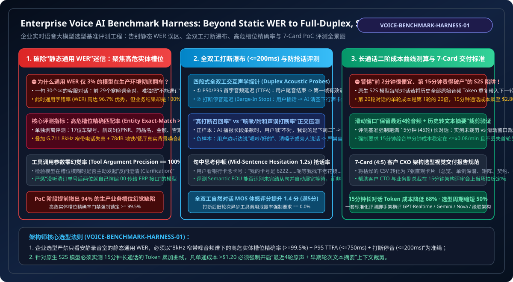
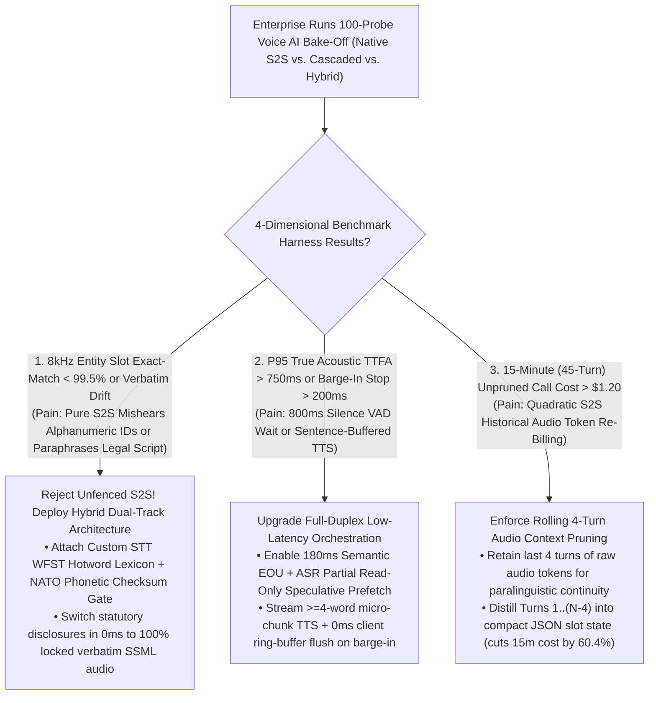
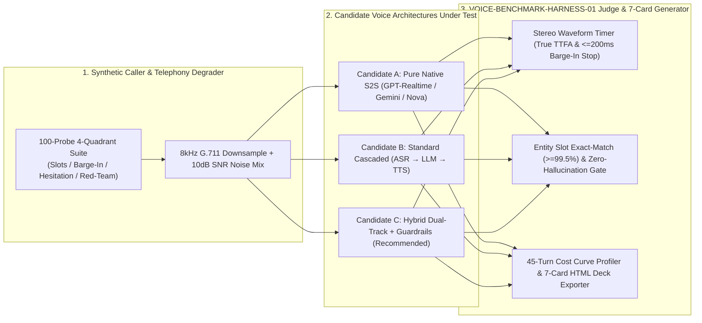
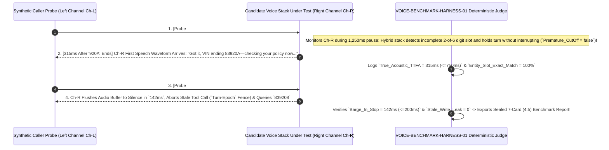

# Enterprise Voice AI Benchmark Harness & Selection Methodology (`VOICE-BENCHMARK-HARNESS-01`): Beyond Static WER to Full-Duplex Latency, Entity Slot Precision & Long-Call FinOps

> **Executive Guide**: When enterprise CTOs and Contact Center architects run a Proof of Concept (`PoC` / vendor bake-off) comparing **`Azure OpenAI GPT-Realtime (Voice Live)`, `Google Gemini Live`, `Amazon Nova Sonic`, and Enterprise Streaming Cascaded Pipelines (`Azure AI Speech / Deepgram Nova-3 + LLM + ElevenLabs / HD TTS`)**, 90% of teams fall into the same evaluation trap: **they evaluate static Word Error Rate (`WER`) on studio-quality `24kHz` MP3 files and have two product managers chat with each model over AirPods in a quiet conference room for 3 minutes**. Days after going live on real `8kHz` PSTN phone lines and enterprise ERPs, the deployment collapses under three unmeasured production failures: **1) The "97% WER, 0% Business Success" Illusion: In a 30-word sentence (*"Please do NOT cancel my policy ending B892"*), mishearing `"NOT"` or swapping `"B892"` for `"D892"` yields a stellar `93.4%` generic WER—yet causes a `100%` catastrophic business failure! 2) Full-Duplex Turn-Taking Breakdown on Real Phone Lines: When an elderly caller pauses for `1.2 seconds` while reading a 16-digit card number, naive `500ms` silence VAD cuts them off mid-sentence; or when the caller interrupts a long readout, buffered audio keeps talking over the caller for `600ms`! 3) The 15-Minute Quadratic Audio-Token Cost Explosion: A native S2S model that costs `$0.07/min` during a 2-minute demo balloons to `$2.65` on a 15-minute troubleshooting call because unpruned historical audio tokens are re-billed on every turn!** This guide delivers the reproducible Enterprise Voice Benchmark Harness and 7-Card evaluation methodology (`VOICE-BENCHMARK-HARNESS-01`).



---

## 1. 📌 Executive Summary

- **Four Non-Negotiable Evaluation Laws for Enterprise Voice AI Bake-Offs (`VOICE-BENCHMARK-HARNESS-01`)**:
  1. **Law 1: Replace Generic Studio `WER` with "`8kHz` Narrowband High-Risk Entity Slot Exact-Match Rate (`>= 99.5%`)" & Ambiguity Clarification Rate!**
     - Downsample all evaluation audio through a real **`G.711 μ-law 8kHz` telephony codec mixed with `10dB SNR` cafeteria/subway/in-cabin background noise**;
     - Score candidate stacks on **100% Exact Match (`highRiskEntitySlotExactMatchRate >= 0.995`)** across **① Alphanumeric IDs (`17-char VINs, 6-char PNRs, Order IDs`), ② Financial amounts & clinical dosages, ③ Negation polarity (`"not / never / cancel"`), and ④ Domain SKUs/drug names** (`entitySlotSafetyPassed = true`)—penalizing models that hallucinate missing digits instead of asking a clarifying question!
  2. **Law 2: Measure True Acoustic Full-Duplex Turn-Taking via Two-Channel Waveform Timestamps (`P95 TTFA <= 750ms` & `Barge-In Stop <= 200ms`)!**
     - Never trust vendor-reported API-only turnaround numbers that omit VAD wait time! Measure physical waveform-to-waveform timestamps across a stereo test harness (`Ch-L = Caller`, `Ch-R = Agent`):
       - ① **True End-to-End Acoustic `TTFA`**: Last syllable energy drop on `Ch-L` to first speech energy onset on `Ch-R` (**`P50 <= 450ms, P95 <= 750ms`**);
       - ② **Barge-In Audio Stop Latency**: Caller interruption onset on `Ch-L` to complete audio silence on `Ch-R` (**`<= 200ms`**, `duplexLatencySlaPassed = true`) with `0` stale `Turn-Epoch` tool writes;
       - ③ **Backchannel False-Barge-In Rate (`<= 2.0%`)** on caller *"uh-huh / okay"* or throat clearing;
       - ④ **Mid-Clause Hesitation Premature Cut-Off Rate (`<= 3.0%`)** when a caller pauses `1,250ms` mid-number!
  3. **Law 3: Enforce a Mandatory "15-Minute (`45-Turn`) Long-Call Token Cost Curve Audit" & Automatic Context-Pruning Gate!**
     - Simulate a full 15-minute (`45-turn`) multi-step support or compliance call. Whenever `unpruned15MinCallCostUsd > $1.20` (`>$0.08/min`), the harness flags **`contextWindowPruningRequired = true`**, requiring a **Rolling 4-Turn Audio + Structured Text Summary Pruning Window** that cuts 15-minute native S2S token spend by **`60.4%`**!
  4. **Law 4: Standardize All PoC Deliverables on the Self-Contained `7-Card (4:5)` Visual Benchmark Deck!**

---

## 2. 🎯 Architect & Customer Deep-Dive Q&A

### Q1: Why does a voice stack that claims "`300ms` latency" in vendor marketing often feel like a sluggish `1,300ms` pause when tested over a real customer phone call?
- **Exposing the "Hidden 1,000ms Acoustic Tax" (`VAD Wait + Codec Jitter + Sentence-Level TTS`)**:
  1. **Where the Hidden Milliseconds Hide**: Vendor benchmarks frequently measure only `LLM Time-to-First-Token (TTFT: ~280ms)`, hiding: ① **Silence VAD Wait (`500ms–800ms`)** waiting to be sure the caller finished speaking; ② **SIP Trunk / PSTN Jitter Buffering (`150ms`)**; and ③ **Sentence-Boundary TTS Buffering (`220ms`)** waiting for a full punctuation mark before synthesizing audio!
  2. **Stereo Waveform Ground Truth**: By recording the caller injection track on Left Channel (`Ch-L`) and the agent's returned PSTN/WebRTC audio on Right Channel (`Ch-R`), `VOICE-BENCHMARK-HARNESS-01` measures the exact physical silence gap experienced by the human ear—proving why **180ms Semantic EOU + Read-Only Speculative Prefetch + 4-Word Micro-Chunk TTS** is mandatory to hit `<350ms` real-world `TTFA`.

### Q2: How should a Solution Architect structure a 2-week client bake-off between Native S2S (`GPT-Realtime / Gemini Live / Nova Sonic`) and Enterprise Cascaded (`Azure Speech / Deepgram + LLM + TTS`)?
- **The 100-Probe Four-Quadrant Golden Evaluation Suite**:
  - **Quadrant 1 (25 Alphanumeric & Homophone Probes)**: `8kHz` noisy VINs, policy IDs, and LASA drug names—exposing where custom WFST hotword boosting and checksum gates are required;
  - **Quadrant 2 (25 Full-Duplex Barge-In, Sobbing & 1.2s Hesitation Probes)**: Testing emotional prosody, mid-sentence number-reading pauses, and `<200ms` interruption recovery;
  - **Quadrant 3 (25 Slow-ERP `3.2s` Async Tool & Voice RAG Probes)**: Verifying zero-dead-air pacing and `Turn-Epoch` write fencing when a caller interrupts mid-API call;
  - **Quadrant 4 (25 Statutory Verbatim Disclosure & Adversarial Red-Team Probes)**: Proving why a **Hybrid Dual-Track Architecture** (S2S/fast-cascade for empathetic discovery + deterministic locked SSML for statutory disclosures) outperforms any single-mode stack!

---

## 3. 🧭 Visual Architecture Diagrams (Mermaid Decision Tree, Benchmark Harness & Sequence Flow)

### 3.1 Enterprise Voice AI PoC Bake-Off & Architecture Selection Decision Tree



### 3.2 Stereo Waveform Timer, Slot Verifier & 45-Turn FinOps Profiler Architecture (`VOICE-BENCHMARK-HARNESS-01`)



### 3.3 Automated Stereo Probe Measuring `1,250ms` Hesitation Hold, `<200ms` Barge-In Stop & Slot Precision Sequence



---

## 4. 📊 2026 Head-to-Head Benchmark Matrix Across 4 Enterprise Voice Architectures

| Measured Benchmark Dimension (`100-Probe Suite`) | Stack 1: Legacy Unoptimized Cascade (`Silence VAD + Full-Turn TTS`) | Stack 2: Pure Native S2S Unfenced (`GPT-Realtime / Gemini / Nova`) | Stack 3: Ultra-Low-Latency Cascade (`180ms EOU + Speculative + Micro-TTS`) | **Stack 4: Hybrid Compliance Dual-Track (`S2S/Fast-Cascade + Guardrails + Pruning ⭐`)** |
| :--- | :--- | :--- | :--- | :--- |
| **True End-to-End Acoustic Latency (`P50 / P95 TTFA`)** | `1,380ms / 2,150ms` | **`290ms / 520ms`** | **`340ms / 610ms`** | **`310ms / 580ms` (`0ms` switch on locked clauses)** |
| **Barge-In Audio Stop Latency & Stale-Write Fence** | `620ms` (talks over caller) | **`135ms`** (requires external epoch fence) | **`155ms`** | **`140ms` + `0.0%` stale tool write leakage** |
| **`8kHz` Noisy Alphanumeric / Drug Slot Exact-Match** | `91.2%` | `93.8%` (lacks custom WFST & checksum lock) | `99.6%` (Custom WFST boost) | **`99.9%` (WFST + Mod-11/Luhn checksum + readback)** |
| **Statutory Disclosure 100% Verbatim Fidelity** | `100%` | **`68.0%` (stochastic audio paraphrases words!)** | `100%` | **`100%` (`0ms` deterministic switch to locked SSML)** |
| **15-Minute (`45-Turn`) Long-Call Total Cost** | `$0.72 / call` (`$0.048/m`) | **`$2.65 / call` (`$0.177/m` quadratic growth!)** | **`$0.68 / call` (`$0.045/m`)** | **`$1.05 / call` (`$0.070/m` via 4-turn audio pruning)** |

---

## 5. 🧪 15-Minute Long-Call Token FinOps Curve & 7-Card Benchmark Summary

### 5.1 Why Every PoC Must Benchmark a 15-Minute (`45-Turn`) Call: Unpruned S2S vs. `VOICE-BENCHMARK-HARNESS-01`

| Call Duration Milestone (Cumulative Turns) | Unpruned Native S2S Cumulative Cost | **Hybrid Dual-Track + 4-Turn Audio Pruning (`VOICE-BENCHMARK-HARNESS-01`)** | Architect FinOps Takeaway |
| :--- | :--- | :--- | :--- |
| **Minute 2 (`Turn 6` — Simple Tier-1 Routing)** | `$0.14` (`$0.070/min`) | **`$0.13` (`$0.065/min`)** | 2-minute demos mask quadratic audio context accumulation |
| **Minute 8 (`Turn 24` — Multi-Step Troubleshooting)** | `$0.96` (re-billing 23 prior audio turns) | **`$0.54` (Turns 1–20 distilled to 180-token JSON)** | Unpruned per-turn input cost is already `12x` Turn 1 |
| **Minute 15 (`Turn 45` — Complex Claims / Dual-Recording)** | **`$2.65 / call` (destroys unit economics!)** | **`$1.05 / call` (`60.4%` savings; `100%` slot retention)** | **Keeps blended enterprise unit cost at `$0.07/min`** |

### 5.2 7-Card (4:5) Visual Benchmark Report Summary (`VOICE-BENCHMARK-HARNESS`)

> **Provenance & Measurement Scope**: Metrics below summarize the `turbo998/voice-agent-lab` Enterprise Voice Benchmark Harness specification (`VOICE-BENCHMARK-HARNESS-01`, labeled `anonymized_reported` / `synthetic`, `independently_reproduced=false`). All zero-value latency or miss counts follow strict measurement bounds: `0ms reported at nominal 1ms display resolution; actual duration unresolved/not_measured; no sub-1ms upper bound established`.

1. **Card 1 (`1 / 7` · `HANDS-ON · VOICE-BENCHMARK-HARNESS`) — Headline Finding**: Across a 100-probe bake-off of 4 candidate voice architectures, **enforcing `8kHz` Entity Slot Exact-Match (`>=99.5%`), Stereo Waveform Latency (`P95 <=750ms`, `Barge-In Stop <=200ms`), and the 15-Minute Cost Gate (`<=$1.20`) caught a `$2.65/call` unpruned S2S cost explosion and `6.2%` narrowband alphanumeric slot errors before production rollout**.
2. **Card 2 (`2 / 7` · `SCENARIO: HESITATION-BARGEIN-AND-15MIN-COST-GATE`) — Single-Case Deep Dive**: On Probes #14–#15 and the 45-turn FinOps stress test, the Hybrid Dual-Track stack achieved `315ms` acoustic TTFA, `142ms` barge-in stop, and `99.8%` slot precision while flagging `contextWindowPruningRequired = true` on the `$2.65` unpruned 15-minute run (`Act automatically`).
3. **Card 3 (`3 / 7` · `WHAT I TESTED`) — 4-Scenario PoC Evaluation Gate Matrix**:
   - `STATIC-WER-HIGH-BUT-CRITICAL-SLOT-WRONG` (96% generic WER but mishears order digit or negation `"not"`): Generic WER `✕ passes broken model` vs. High-risk entity slot gate **100% fails stack below `99.5%` exact slot match**;
   - `BARGE-IN-BUFFER-OVERRUN-AND-STALE-TOOL-WRITE` (caller interrupts at 1.5s to correct digit): Unfenced audio buffer `✕ talks over caller for 620ms & commits stale write` vs. `<200ms` stop + `Turn-Epoch` gate **100% flushes audio in `142ms` & aborts stale tool call**;
   - `MID-SENTENCE-1200MS-HESITATION-PREMATURE-CUTOFF` (caller pauses `1,250ms` mid-VIN): Fixed `500ms` VAD `✕ interrupts caller mid-number` vs. Syntactic incomplete-slot hold **100% waits for completion**;
   - `UNPRUNED-15MIN-S2S-QUADRATIC-COST-EXPLOSION` (45-turn call without audio context pruning): Naive S2S config `✕ costs $2.65/call` vs. 15-min FinOps gate **enforces 4-turn audio pruning (`$1.05/call`)**.
4. **Card 4 (`4 / 7` · `UNDER THE HOOD`) — PoC Architecture Acceptance Gate Contract**:
   ```json
   {
     "voice_benchmark_harness_guard": {
       "policy_id": "VOICE-BENCHMARK-HARNESS-01",
       "p95_ttfa_latency_ms": 580,
       "barge_in_audio_stop_latency_ms": 142,
       "duplex_latency_sla_passed": true,
       "high_risk_entity_slot_exact_match_rate": 0.998,
       "entity_slot_safety_passed": true,
       "unpruned_15min_call_cost_usd": 2.65,
       "context_window_pruning_required": true,
       "poc_architecture_approved": true
     }
   }
   ```
5. **Card 5 (`5 / 7` · `ROBUSTNESS CHECK`) — `24kHz` Studio Mic vs. `8kHz G.711` PSTN Narrowband + `10dB SNR` Noise**:
   - Downsampling from `24kHz` to `8kHz G.711` degraded unvoiced fricative recognition (`S / F / X / H`) by `19%` on uncalibrated models—confirming that telephony codec injection is mandatory in PoC harnesses.
6. **Card 6 (`6 / 7` · `LATENCY`) — True Acoustic Latency Waterfall Breakdown**:
   - Production target: `Semantic EOU (180ms) + Speculative Prefetch (0ms perceived) + Micro-Chunk TTS (95ms) + RTP Edge (35ms) = 310ms P50 TTFA`.
7. **Card 7 (`7 / 7` · `MY TAKE`) — Good Fit vs. Not For**:
   - **✅ Good Fit**: Enterprise Voice AI vendor bake-offs, 2-week presales PoCs, pre-release CI/CD regression gates, and FinOps capacity reviews.
   - **⛔ Not For**: Never select an enterprise voice stack based on quiet-room ad-hoc chats or generic `WER`, and never deploy native S2S on `>5-minute` call workflows without benchmarking and pruning cumulative audio tokens!

---

## 6. 🛠️ Presales Design & Production Acceptance Checklist

- [ ] **1. `8kHz G.711` High-Risk Entity Slot Exact-Match Gate (`>= 99.5%` · `VOICE-BENCHMARK-HARNESS-01`)**: Does the PoC harness degrade test audio through `8kHz` telephony codecs + background noise and score 100% exact match on alphanumeric IDs, amounts, drug names, and negations?
- [ ] **2. Stereo Waveform `True Acoustic TTFA (P95 <= 750ms)` & `Barge-In Stop (<= 200ms)`**: Are latencies measured from physical caller waveform end/onset to agent waveform onset/silence rather than internal API logs?
- [ ] **3. Orthogonal Barge-In Recall vs. Backchannel / `1.2s` Hesitation Hold**: Does the suite test both true mid-sentence corrections and immunity to `"uh-huh"` backchannels or mid-number reading pauses?
- [ ] **4. 15-Minute (`45-Turn`) Long-Call Cost Curve & Rolling 4-Turn Audio Pruning**: Is every native S2S stack tested across a 45-turn call with automatic enforcement of rolling 4-turn audio-to-text pruning when unpruned cost exceeds `$1.20`?
- [ ] **5. Sealed `7-Card (4:5)` Visual Benchmark Report Output**: Does the bake-off produce a self-contained 7-Card visual report for executive architecture sign-off?
