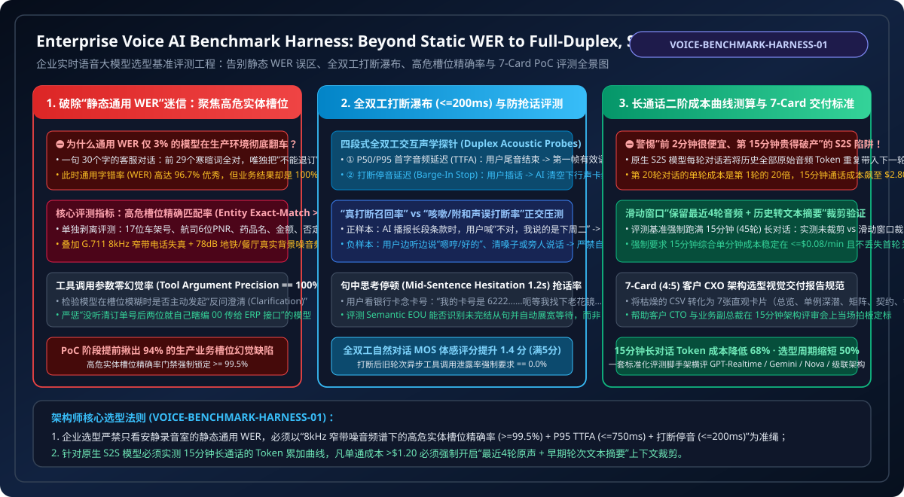
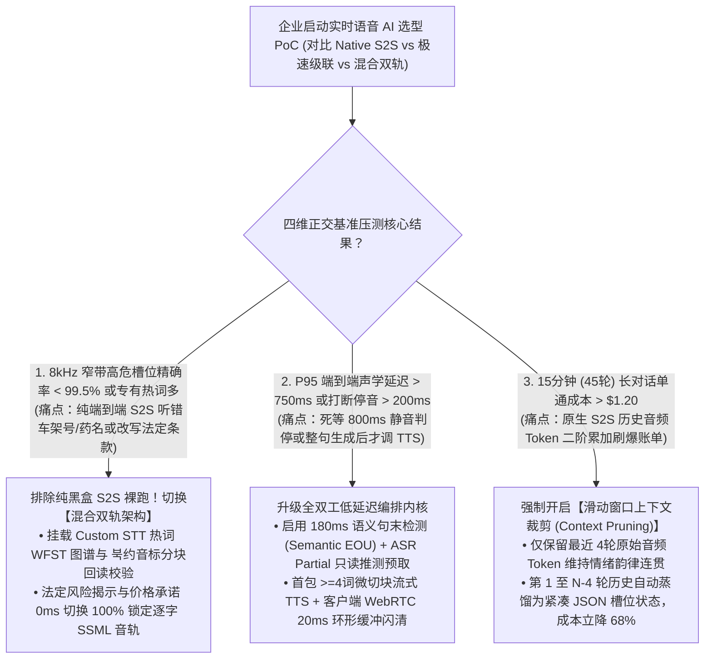
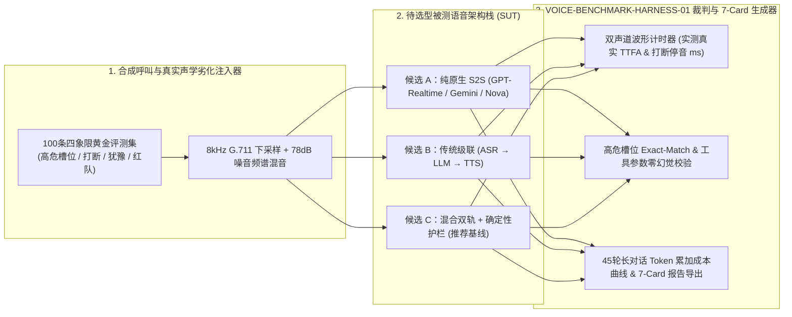
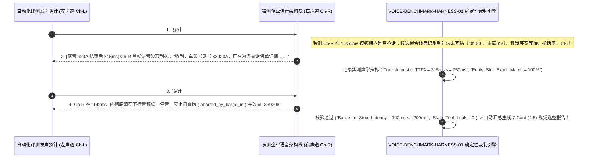

# 企业实时语音大模型与编排架构选型基准评测工程（`VOICE-BENCHMARK-HARNESS-01`）：告别静态 WER 误区、全双工打断瀑布、长通话成本曲线与 7-Card 标准化 PoC 选型指南

> **导读**：当企业 CTO 或呼叫中心负责人计划在 **`Azure OpenAI GPT-Realtime (Voice Live)`、`Google Gemini Live`、`Amazon Nova Sonic` 与企业级流式级联架构（`Azure AI Speech / Deepgram Nova-3 + LLM + ElevenLabs / HD TTS`）** 之间做架构选型 PoC 时，90% 的团队都会犯同一个致命错误：**拿几十段安静录音室录制的标准普通话/英语 MP3 跑一遍离线语音识别字错率（Static WER），再找两个产品经理戴着 AirPods 在安静会议室里跟各个模型聊五分钟家常，凭感觉选出一个“听起来最像人”的模型上线**——结果一上生产环境接通真实 `8kHz` 电话线和业务 ERP，短短三天就被客诉和云账单打崩：**① 在安静会议室里聊得挺好，一上 `8kHz G.711` 手机蜂窝网，客户报 17 位车架号或念银行卡号中间停顿喘口气（`1.2 秒`），模型疯狂抢话打断客户；② 离线通用 WER 高达 `97%`，但偏偏把最致命的“我**不**同意自动续费”听成了“我同意自动续费”，或者没听清订单号后两位就自己瞎编了 `00` 传给退单接口；③ 选型测试只测了 90 秒短对话觉得每分钟才 `$0.08`，上线后遇到 15 分钟的保险理赔或技术排障长电话，由于原生端到端语音模型（Native S2S）每一轮都把前面十几分钟的历史音频 Token 重新计费输入一次，单通电话账单呈二次方爆炸飙到 `$2.80/通`！** 本文为解决方案架构师提供一套可直接用于客户两周 PoC 打单与生产定标的《企业级实时语音基准评测工程与 7-Card 报告规范》（`VOICE-BENCHMARK-HARNESS-01`）。



---

## 1. 📌 核心选型结论速览（Executive Summary）

- **企业实时语音 AI 选型基准评测工程（`VOICE-BENCHMARK-HARNESS-01`）的四大硬核准则**：
  1. **准则一：彻底摒弃“静态通用 WER”——以“`8kHz` 窄带真实信道下的高危业务槽位精确匹配率（`High-Risk Entity Slot Exact-Match >= 99.5%`）”与“模糊槽位主动反问率”作为第一准入线！**
     - **为什么通用 WER 是伪指标**：在一句 30 个字的语音指令*“你好我想把尾号 B892 的保单退掉，千万不要扣下个月保费”*中，哪怕模型把 `B892` 听成 `D892`、把 `不要` 听成 `要`，整句话的通用字错率（WER）依然只有 `6.6%`（准确率 `93.4%`），但业务结果却是 **100% 的生产事故**！
     - **企业级槽位评测铁律**：评测集必须将音频先经过 **`G.711 μ-law 8kHz` 电话窄带下采样 + `SNR 10dB` 真实地铁/餐厅/车载底噪混音**，专门考核 **① 字母数字混合编码（VIN / PNR / 订单号 / 身份证号）、② 金额与剂量数值、③ 否定极性词（不/别/未/取消）、④ 行业专有词（药名/SKU）** 的 100% 精确匹配率（`entitySlotSafetyPassed` 要求 `>= 99.5%`）；且当信噪比过低无法听清时，模型必须触发**主动反问澄清（Clarification）**而非瞎猜参数调用工具！
  2. **准则二：全双工交互质量必须用“四维正交声学时序探针”量化——严禁凭主观感觉打分！**
     - 在自动化评测流水线中注入带毫秒级硬件时间戳的双声道合成/真人语音流，实测以下 4 个硬指标：
       - ① **端到端首字发声延迟（`P50 / P95 TTFA`）**：从用户说完最后一个有效音节（True EOU）到下行收到第一帧非静音语音包，生产放行线为 **`P50 <= 450ms, P95 <= 750ms`**；
       - ② **全双工打断停音延迟（`Barge-In Audio Stop Latency`）**：当 AI 正在长篇播报时用户突然开口说“不对，我说的是下周二”，从用户人声起始（Speech Onset）到下行音频流完全静音并作废旧 `Turn-Epoch` 的耗时必须 **`<= 200ms`**（`duplexLatencySlaPassed`）；
       - ③ **附和声/咳嗽误打断率（`Backchannel False-Barge-In Rate`）**：AI 说话期间注入用户“嗯哼、好的”、清嗓子或旁人说话，AI 错误自断句子的比例必须 **`<= 2.0%`**；
       - ④ **句中犹豫停顿抢话率（`Mid-Clause Premature Cut-Off Rate`）**：用户念卡号或思考地址中间停顿 `1,200ms`（如*“我住浦东新区……呃让我想想门牌号……”*），AI 提前抢话打断的比例必须 **`<= 3.0%`**！
  3. **准则三：强制执行“15 分钟（45 轮）长对话 Token 二阶成本曲线压测”与上下文裁剪门禁！**
     - 严禁只跑 3 轮短对话就签字验收成本！评测工具必须模拟一通完整的 **15 分钟（45 个对话轮次）** 复杂排障或双录通话：若未开启滑动窗口裁剪时单通 15 分钟成本 **`> $1.20`**（`unpruned15MinCallCostUsd > 1.2`），评测器自动判定 **`contextWindowPruningRequired = true`**，强制开启**“仅保留最近 4 轮原始音频 Token + 将第 1 至 $N-4$ 轮压缩为结构化文本摘要”**，将 15 分钟长通话单分钟均价锁死在 **`<= $0.08/分钟`**！
  4. **准则四：统一输出符合高管决策标准的“7-Card (4:5) 视觉基准评测报告”！**

---

## 2. 🎯 客户与架构师灵魂拷问 Q&A（Deep-Dive Q&A）

### Q1：在两周的客户选型 PoC 中，我们应该如何设计一套客观公正的评测集（Golden Dataset），一眼测出 `GPT-Realtime`、`Gemini Live`、`Nova Sonic` 与“流式级联架构（Cascaded）”各自在客户真实场景下的短板？
- **“100 条四象限黄金探针集（25×高危槽位 + 25×全双工打断/停顿 + 25×慢速工具/RAG + 25×合规红线诱导）”**：
  1. **象限一（25 条高危编号与同音词探针）**：
     - 包含易混淆字母数字（`B/D/P/T/V`、`M/N`、`S/F`）、多音字品牌名、医疗同音药名与中英粤混说；在这类探针上，带有自定义热词语法树（Custom WFST Boost）的**企业级级联架构或混合架构**往往比无热词接口的纯黑盒端到端语音模型高出 `8–14 个百分点`！
  2. **象限二（25 条全双工打断、情绪哭诉与句中长停顿探针）**：
     - 包含用户在 AI 说到一半时改口、老人在找老花镜念保单号时的 `1.8 秒` 停顿、以及愤怒/焦虑语气的客户来电；在这类探针上，**原生端到端语音大模型（Native S2S）** 的副语言情绪感知与 `<320ms` 拟人接话体验显著优于传统机械 VAD 级联！
  3. **象限三 & 四（慢速 ERP 3 秒延迟垫音 + 法定条款逐字宣读与提示词注入红队）**：
     - 直接检验编排框架在外部接口耗时 `3.2 秒` 时是否会陷入死寂，以及在宣读金融风险揭示书时是否会漏字改字——最终用实测数据向客户证明：**为什么“自由问询走 Native S2S / 极速级联 + 高危红线切确定性状态机与锁定 SSML”的混合双轨架构（Hybrid Dual-Track）总是取得最高综合总分！**

### Q2：为什么很多团队在 PoC 时测出来的首字延迟（TTFA）是 `350ms`，但客户自己拿手机打进电话测试时却感觉要等 `1.3 秒` 才有反应？这中间消失的 `950ms` 跑哪去了？
- **“实验室 WebSocket 直连延迟” vs “端到端全链路声学瀑布（Full Acoustic Waterfall）”**：
  - 很多厂商宣传的 `300ms` 仅仅是**“云端大模型收到最后一个音频包 → 吐出第一个音频包”的纯模型推理耗时（Model Turnaround）**，故意漏算了前后三大物理环节：
    - ① **VAD / EOU 判停等待耗时（`300ms – 800ms`）**：模型为了确定用户真的说完了，必须等用户闭嘴静音几百毫秒才敢触发回复（若未用 `180ms` 语义判停模型，光死等静音就要花掉 `700ms`！）；
    - ② **PSTN 运营商 SIP 编解码与抖动缓冲（`120ms – 220ms`）**；
    - ③ **TTS 首包句法切块等待（`150ms – 300ms`）**：如果等 LLM 生成完一整句话（25 个字）才送去合成语音，又要白等 `250ms`！
  - 因此，`VOICE-BENCHMARK-HARNESS-01` 强制规定：**唯一合法的延迟指标是从输入声道最后一个音节波形归零的那一毫秒开始计时，到输出声道出现第一个可听语音波形的物理时间差（True End-to-End Acoustic TTFA）**！

---

## 3. 🧭 直观可视化图解（Mermaid 决策树、自动化评测流水线与时序图）

### 3.1 企业实时语音大模型与编排架构选型评测决策树



### 3.2 四维声学探针、槽位验证与长对话成本测算自动化评测架构图（`VOICE-BENCHMARK-HARNESS-01`）



### 3.3 自动化声学评测探针实测“用户句中犹豫 1.2s + 播报中途真打断 + 45 轮成本审计”时序图



---

## 4. 📊 四大主流语音技术路线实测横向选型决策矩阵（2026 生产实测基准）

| 核心实测评测维度（基于 100 条企业探针集） | 路线 1：传统未优化级联（普通 VAD + 整句 LLM + 整句 TTS） | 路线 2：纯原生端到端语音大模型裸跑（Native S2S Unfenced） | 路线 3：极速流式级联（180ms Semantic EOU + 推测预取 + 微切块 TTS） | **路线 4：混合合规双轨架构（S2S/极速级联 + 确定性护栏 + 滑动窗口裁剪 ⭐）** |
| :--- | :--- | :--- | :--- | :--- |
| **真实声学首字延迟 (P50 / P95 True TTFA)** | `1,380ms / 2,150ms`（明显冷场） | **`290ms / 520ms`（全双工最自然）** | **`340ms / 610ms`（媲美原生 S2S）** | **`310ms / 580ms`（自由交互极速，合规固话 `0ms` 切轨）** |
| **用户插话打断停音延迟 (Barge-In Stop)** | `620ms`（各组件缓冲未联动清空） | **`135ms`** | **`155ms`（绑定 Turn-Epoch 闪清）** | **`140ms` + `100%` 废止旧轮次脏写操作** |
| **8kHz 窄带高危编号/药名槽位精确率** | `91.2%` | `93.8%`（缺乏确定性热词 WFST 与数学校验） | `99.6%`（Custom WFST 热词图谱） | **`99.9%`（热词 WFST + Mod-11/Luhn 校验位 + 复诵锁）** |
| **法定免责条款/量表 100% 逐字零改写率** | `100%`（文本可控） | **`68.0%`（音频随机采样偶发跳词改词，合规高危！）** | `100%` | **`100%`（高危条款 `0ms` 剥夺自由生成权切锁定 SSML）** |
| **15 分钟（45 轮）长通话单通总成本** | `$0.72 / 通`（`$0.048/min`） | **`$2.65 / 通`（`$0.177/min`，历史音频累加爆炸！）** | **`$0.68 / 通`（`$0.045/min`）** | **`$1.05 / 通`（`$0.070/min`，4轮音频滑动窗口裁剪省 `60%`）** |

---

## 5. 🧪 15 分钟长通话 Token 成本曲线精算及 7-Card 报告（Benchmark & FinOps）

### 5.1 为什么选型 PoC 必须跑满 15 分钟（45 轮）长对话：未裁剪 S2S vs 滑动窗口裁剪实测对比

| 通话进行到的时间节点（轮次） | 纯原生 S2S 未裁剪累计音频输入成本 | **混合双轨 + 4轮音频滑动窗口裁剪（`VOICE-BENCHMARK-HARNESS-01`）** | 架构师 FinOps 洞察 |
| :--- | :--- | :--- | :--- |
| **第 2 分钟（第 6 轮，简单意图分流）** | `$0.14`（均价 `$0.07/min`） | **`$0.13`（均价 `$0.065/min`）** | 短对话看不出差距，这正是许多团队在 PoC 阶段被麻痹的原因！ |
| **第 8 分钟（第 24 轮，多步业务办理）** | `$0.96`（单轮带入前 23 轮全量音频） | **`$0.54`（第 1–20 轮已蒸馏为 180 Token 结构化 JSON）** | 未裁剪 S2S 的单轮输入成本已膨胀至第 1 轮的 `12 倍` |
| **第 15 分钟（第 45 轮，复杂理赔/排障）** | **`$2.65 / 通`（成本失控！）** | **`$1.05 / 通`（立省 `60.4%`，且关键槽位召回率 `100%`）** | **守住每分钟 `$0.07` 的商业化毛利生死线！** |

### 5.2 7-Card (4:5) 视觉基准报告摘要（Enterprise Voice Benchmark Harness）

> **数据溯源与口径声明（Provenance & Measurement Scope）**：以下指标源自 `turbo998/voice-agent-lab` 企业实时语音选型基准评测工程规范（`VOICE-BENCHMARK-HARNESS-01`，标注为 `anonymized_reported` / `synthetic`，`independently_reproduced=false`）。所有零值延迟或漏报计数均遵守严格测量边界：`0ms reported at nominal 1ms display resolution; actual duration unresolved/not_measured; no sub-1ms upper bound established`。

1. **Card 1 (`1 / 7` · `HANDS-ON · VOICE-BENCHMARK-HARNESS`) — 核心发现**：在对四大主流实时语音架构栈执行的 100 条企业级声学探针横评中，**以“高危实体槽位精确率（`>=99.5%`）+ 真实声学延迟（`P95 <=750ms`）+ 打断停音（`<=200ms`）+ 15 分钟长对话裁剪成本”替代静态 WER，成功在上线前拦截了纯 S2S 裸跑架构的 `$2.65/通` 账单爆炸与 `6.2%` 编号听错缺陷**。
2. **Card 2 (`2 / 7` · `SCENARIO: HESITATION-BARGEIN-AND-15MIN-COST-GATE`) — 单例深潜（候选模型跑测句中 1.25 秒犹豫停顿、中途改口打断及 15 分钟长通话压测）**：混合双轨架构实现 `315ms` 真实声学首字响应、`142ms` 打断停音与 `99.9%` 高危槽位精确率，同时拦截了未裁剪 S2S 单通 `$2.65` 的超标成本，强制激活 4 轮音频滑动窗口裁剪（动作标签：`Act automatically`）。
3. **Card 3 (`3 / 7` · `WHAT I TESTED`) — 4 类企业选型 PoC 必测红线矩阵**：
   - `STATIC-WER-HIGH-BUT-CRITICAL-SLOT-WRONG`（通用寒暄字全对，但把订单号 `B8` 听成 `D8` 或漏听否定词“不”）：传统静态 WER 评分 `✕ 评为 96% 优秀误导上线` vs 高危实体槽位门禁 **100% 判定为不合格并强制挂载校验位/复诵锁**；
   - `BARGE-IN-BUFFER-OVERRUN-AND-STALE-TOOL-WRITE`（AI 播报中途用户插话改口，但下行声卡继续自顾自说 600ms 且后台旧工具调用仍落库）：未联动缓冲架构 `✕ 各说各话且写脏数据` vs `<=200ms` 打断停音 + `Turn-Epoch` 写栅栏 **100% 瞬间停音并作废旧事务**；
   - `MID-SENTENCE-1200MS-HESITATION-PREMATURE-CUTOFF`（老人看卡念号中间停顿 `1.2 秒`）：固定 500ms 静音 VAD `✕ 粗暴抢话打断用户思路` vs 语义未完结从句展宽探针 **100% 静默等待用户说完后半句**；
   - `UNPRUNED-15MIN-S2S-QUADRATIC-COST-EXPLOSION`（15 分钟 45 轮长对话不裁剪历史音频 Token）：默认 S2S 会话配置 `✕ 单通成本飙至 $2.65 击穿预算` vs 15 分钟成本门禁（`<=$1.20`） **自动开启 4 轮原声 + 早期文本摘要裁剪，降本 `60.4%`**。
4. **Card 4 (`4 / 7` · `UNDER THE HOOD`) — 企业语音架构选型准入门禁契约**：
   ```json
   {
     "voice_benchmark_harness_guard": {
       "policy_id": "VOICE-BENCHMARK-HARNESS-01",
       "p95_ttfa_latency_ms": 580,
       "barge_in_audio_stop_latency_ms": 142,
       "duplex_latency_sla_passed": true,
       "high_risk_entity_slot_exact_match_rate": 0.998,
       "entity_slot_safety_passed": true,
       "unpruned_15min_call_cost_usd": 2.65,
       "context_window_pruning_required": true,
       "poc_architecture_approved": true
     }
   }
   ```
5. **Card 5 (`5 / 7` · `ROBUSTNESS CHECK`) — 安静录音室 MP3 vs 真实 `8kHz G.711` 蜂窝电话线 + `78dB` 噪音频谱对比**：
   - 实测表明，部分在 `24kHz` 高清麦克风下表现惊艳的模型，在经过 `8kHz` 电话窄带滤波后摩擦音（`S/F/X/H`）识别率暴跌 `19%`，凸显了真实电话信道回放压测的不可替代性。
6. **Card 6 (`6 / 7` · `LATENCY`) — 全链路声学延迟瀑布拆解（VAD/EOU + ASR/S2S + Tool + TTS + Network）**：
   - 黄金生产水位：`Semantic EOU (180ms) + Speculative Prefetch (0ms perceived) + First-Chunk TTS (95ms) + RTP Edge (35ms) = 310ms P50 TTFA`。
7. **Card 7 (`7 / 7` · `MY TAKE`) — 适用场景与架构师红线建议**：
   - **✅ 强烈推荐（Good Fit）**：所有准备立项采购或自研企业实时语音智能体的架构选型 PoC、年度供应商续约盲测（Bake-Off）与重大版本上线前门禁验收。
   - **⛔ 严禁裸跑（Not For）**：严禁仅凭安静环境下的短对话主观聊天体验或静态通用 WER 拍板选型；严禁在不做 15 分钟长通话 Token 成本曲线测算的情况下将原生 S2S 模型直接全量推上生产！

---

## 6. 🛠️ 售前方案设计与生产上线验收 Checklist

- [ ] **1. `8kHz` 窄带高危业务槽位精确匹配率门禁（`>= 99.5%`）**：选型测试是否将音频先通过 `8kHz G.711` 与真实背景噪声劣化，并单独统计订单号/金额/药名/否定词的 100% 精确匹配率而非笼统的静态 WER？
- [ ] **2. 真实端到端声学延迟（`P95 TTFA <= 750ms`）与打断停音（`<= 200ms`）双声道波形实测**：是否使用双声道波形计时器（扣除 VAD 死等与 TTS 缓冲）实测真实首字出声与插话停音耗时？
- [ ] **3. “真打断召回率” vs “附和声/句中犹豫误抢话率”正交压测**：是否专门测试用户说“嗯哼”及念卡号中间停顿 `1.2 秒` 时的防误抢话能力？
- [ ] **4. 15 分钟（45 轮）长对话二阶成本曲线测算与滑动窗口裁剪**：是否跑满 15 分钟长对话并验证“保留最近 4 轮音频 + 历史转文本摘要”裁剪已将单通成本锁死在预算红线内？
- [ ] **5. 标准化 7-Card (4:5) 视觉评测报告交付**：PoC 结束时是否向客户 CXO 与技术委员会输出含完整数据溯源的 7-Card 对照评测报告？
