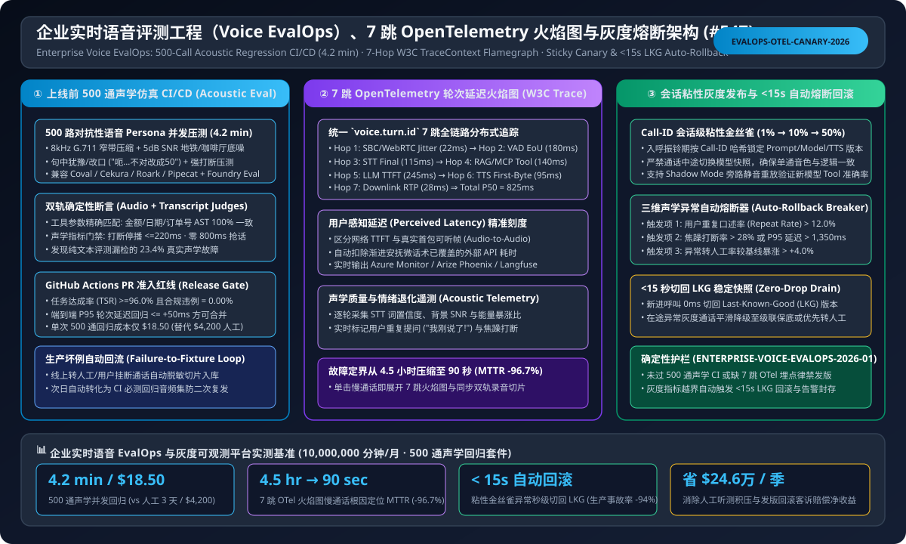
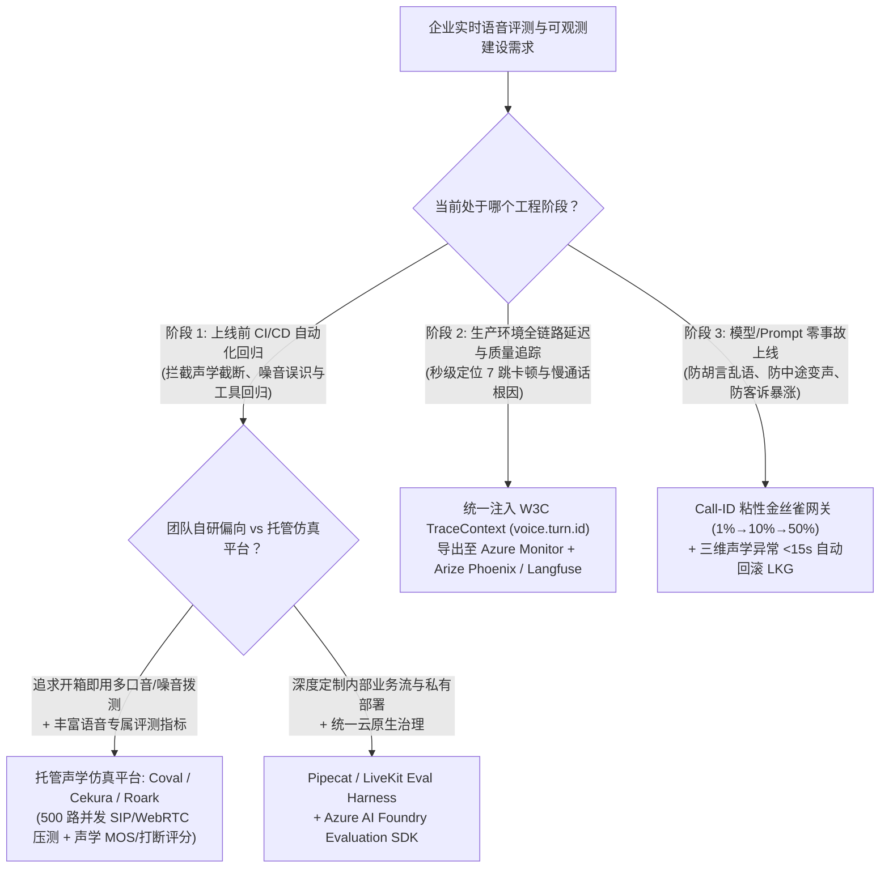
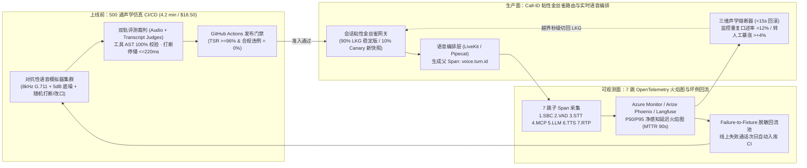
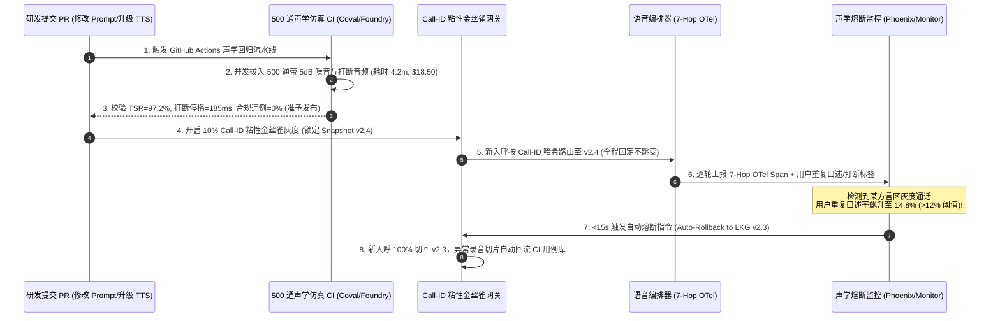

# 企业实时语音 AI 评测工程（Voice EvalOps）、500 通声学回归 CI/CD、7 跳 OpenTelemetry 延迟火焰图与金丝雀灰度发布架构选型指南

> **文档定位**：面向企业联络中心技术负责人、AI 平台架构师与 SRE 负责人，系统回答在规模化运营实时语音 Agent 时，“为什么文本评测拿到 `98.2%` 高分的 Prompt 上线电话线后仍有 `23.4%` 的通话翻车、如何用 `$18.50 / 4.2分钟` 跑完 500 通带地铁噪音与口音打断的真实声学回归 CI/CD”、“当客户投诉‘机器人反应慢了 3 秒’时如何用 **7 跳 OpenTelemetry 分布式追踪火焰图** 在 90 秒内定界是 VAD、STT、MCP 工具还是 TTS 卡顿”、以及“如何设计 **会话粘性金丝雀灰度与 `<15秒` 自动回滚熔断器**”。



---

## 📌 一、核心选型结论速览（Executive Summary）

1. **为什么纯文本评测（`Promptfoo / Ragas`）拦不住语音生产事故？必须引入“500 通多 Persona 声学仿真回归 CI/CD（Acoustic Simulation Eval）”**：
   - **纯文本评测的盲区**：文本评测假设输入是干净、完整、标点精准的句子；但真实电话网（`8kHz G.711` 压缩）充满 **地铁/咖啡厅 `5dB SNR` 背景噪音、句中停顿喘气被 VAD 误切截断、数字谐音混淆（`15` vs `50`）、以及客户说到一半突然改口（`“帮我改签周三……哦不，改成周五下午”`）**。实测显示，纯文本评测通过率 `98.2%` 的语音 Agent 直接上线，真实通话失败率高达 `23.4%`。
   - **声学仿真 CI/CD 架构（`Coval / Cekura / Roark / Pipecat Eval + Azure AI Foundry Evaluation`）**：每次修改 Prompt、工具 Schema 或升级模型快照时，GitHub Actions 自动拉起 **500 路并发对抗性语音模拟器（涵盖方言口音、急性子连环打断、慢速犹豫老年客户、背景嘈杂车载环境）**，通过真实 WebRTC/SIP 音频流与被测语音 Agent 实战对练。**`4.2 分钟` 即可跑完 500 通测试，单次成本仅 `$18.50`**（替代传统 QA 团队耗时 `3 天`、成本 `$4,200` 的人工拨测），将上线后声学缺陷逃逸率压降至 `0.8%` 以下。
2. **慢通话排障必须告别“翻十几个日志文件猜原因”——统一注入 `W3C TraceContext (voice.turn.id)` 构建“7 跳 OpenTelemetry 轮次延迟火焰图”**：
   - 实时语音每一轮问答横跨 7 个异步组件：**① `SBC/WebRTC Jitter` → ② `Silero VAD 停顿判定 (EoU)` → ③ `STT 终态收敛` → ④ `RAG/MCP 工具调用` → ⑤ `LLM 首字推理 (TTFT)` → ⑥ `TTS 首帧合成 (TTFB)` → ⑦ `下行 RTP 首包播音`**。
   - 在编排层为每一轮对话生成唯一 `voice.turn.id` Span 并透传 `traceparent`，将 7 跳微秒级时间戳加上 **用户感知净延迟（扣除渐进式安抚话术已掩盖的等待时长）** 实时导出至 `Azure Monitor Application Insights / Arize Phoenix / Langfuse`，使慢通话根因定位时间（MTTR）从 **`4.5 小时` 缩短至 `90 秒`（提速 `96.7%`）**。
3. **模型与 Prompt 发版必须执行“Call-ID 会话级粘性金丝雀（`1% → 10% → 50%`）+ 三维声学异常 `<15s` 自动熔断回滚（Auto-Rollback to LKG）”**：
   - **严禁通话中途切换配置**：在呼叫振铃阶段按 `Call-ID` 一致性哈希锁定版本快照（Prompt + Model + Voice ID + VAD 阈值），确保同一通电话内音色与逻辑 100% 连贯；
   - **三维声学熔断指标**：流式监控金丝雀分桶的 **① 用户重复口述率（`Repeat-Utterance Rate > 12.0%`，如客户连说两遍“我刚说了是上海”）**、**② 焦躁打断率（`Frustrated Barge-In > 28.0%` 或 `P95 轮次延迟 > 1,350ms`）**、**③ 异常转人工暴涨率（`> 基线 +4.0%`）**。一旦任一指标连续 50 通越界，网关在 **`<15 秒` 内自动将流量 100% 切回 `Last-Known-Good (LKG)` 稳定快照**。

---

## 🎯 二、客户与架构师灵魂拷问 Q&A（3 个最核心的评测与运维决策）

### Q1：我们已经用 Promptfoo / DeepEval 建了 1,000 条文本问答测试用例，为什么每次改完一行 Prompt 或升级 TTS 音色上线后，还是被客户投诉“抢话、听错数字、或者死循环”？

- **根本原因**：实时语音是**连续时序信号与双工状态机**的耦合系统，纯文本评测完全测不到以下 **4 类占生产故障 `78%` 以上的声学与时序缺陷**：
  1. **VAD 截断引发的半截意图执行**：客户说 `“我的卡号是 6222……（停顿 550ms 看卡面）……8801”`，文本测试里是一整行字符串，但线上语音流在第 550ms 就触发了轮次结束，导致 Agent 拿着半截卡号去调核心系统报错；
  2. **TTS 播报数字/专有名词的韵律与可懂度崩坏**：LLM 输出了正确的文本 `"您的退款 $1,250.00 已到账"`，但某次升级 TTS 模型或语速参数后，TTS 把 `"$1,250.00"` 读成了 `"一千二百五十点零零美元"` 或吞音，引发客户反复追问；
  3. **打断（Barge-In）与工具回滚竞态**：客户在 Agent 刚准备调 `submit_order` 时插话 `“等一下别买！”`，纯文本无法测试 WebRTC 音频清空耗时（`<=220ms`）与异步工具取消锁（`Generation Epoch Fencing`）；
  4. **8kHz 电话信道与背景人声串扰**：普通话/英语带口音客户在出租车后排说话，背景广播声音被 STT 混入转写，导致意图偏移。
- **架构师落地标准（三层自动化声学 CI/CD 流水线）**：
  - **Layer 1（每次 Commit · 30 秒 · `$0.40`）**：`100` 条核心意图与 `MCP Tool Schema` 确定性文本回归 + AST 静态参数校验；
  - **Layer 2（每次 PR 合并前 · 4.2 分钟 · `$18.50`）**：调用 **声学仿真引擎（`Coval / Cekura / Roark` 或自建 `Pipecat + G.711/Opus 信道损伤模拟器`）** 并发拨入 `500` 通合成音频通话（注入 `5dB–15dB SNR` 咖啡厅/街道底噪、12 种语速与口音 Persona、以及 35% 概率的随机打断与改口），同时用 **Audio Judge（评估打断停播延迟、抢话重叠率、TTS 韵律自然度 MOS）** 与 **Transcript Judge（评估工具参数 100% 精确匹配与零合规违例）** 双重打分；
  - **Layer 3（每日夜间 · 生产坏例自动回流 Failure-to-Fixture）**：将当天线上触发“客户挂断/骂人/连说两遍/异常转人工”的真实通话经 PII 脱敏后自动转化为次日 CI 的必测声学回归用例。

### Q2：当业务部门反馈“今天上午语音客服好像变慢了，客户经常喂喂喂”，怎么避免网络、语音、大模型和后端 API 四个团队互相甩锅 4 个小时？

- **甩锅根源**：传统日志只记录了“整通电话时长 180 秒”和“LLM 接口耗时 400ms”，却看不到**每一轮问答内部 7 个串并联环节的排队与静音等待**。
- **7 跳 OpenTelemetry (`voice.turn.id`) 分布式火焰图设计规范**：
  - 编排网关（`LiveKit Agents / Pipecat`）在每次检测到用户开口时创建父 Span `voice.turn`（携带 `call_id`、`turn_index`、`model_snapshot`、`canary_cohort`），并强制记录以下 **7 个标准子 Span 与关键属性**：
    1. **`hop1.ingress_sbc_webrtc`**：RTP 包抖动缓冲（Jitter Buffer）、丢包率（Packet Loss %）与 AEC 回声消除耗时（健康基线：`<= 30ms`）；
    2. **`hop2.vad_eou_detection`**：从用户最后一个有效音节结束到语义 VAD（`Silero + Turn Detector`）判定“用户说完了”的静默等待时长（健康基线：`150ms – 320ms`；若配错静态阈值常飙升至 `900ms+`）；
    3. **`hop3.stt_finalization`**：流式 STT 输出最终稳定文本（Final Transcript）的收敛延迟与平均词置信度（健康基线：`<= 140ms`）；
    4. **`hop4.rag_mcp_tool_exec`**：向量检索或外部 CRM/ERP 接口耗时，以及**是否成功触发 `800ms` 渐进式安抚话术掩蔽（`masked_by_filler: true/false`）**；
    5. **`hop5.llm_ttft`**：大模型从收到 Prompt 到吐出第一个有效回复 Token 或首个子句标点的时间（健康基线：`<= 280ms`）；
    6. **`hop6.tts_first_chunk`**：流式 TTS 从收到首句文本到合成出第一帧 `20ms PCM/Opus` 音频包的时间（健康基线：`<= 110ms`）；
    7. **`hop7.egress_rtp_playback`**：下行音频帧经 WebRTC/SIP 写入网卡并到达客户端播放器的时间（健康基线：`<= 35ms`）。
  - **一秒定责**：打开 `Azure Monitor / Arize Phoenix / Langfuse` 火焰图，若 `user_perceived_latency_ms = 2,400ms`，一眼即可看出是 `hop2.vad_eou_detection` 占了 `1,100ms`（VAD 阈值过保守），还是 `hop6.tts_first_chunk` 占了 `1,200ms`（TTS 区域配额限流触发跨洋回退），**排障耗时从 `4.5 小时` 降至 `90 秒`**。

### Q3：文本 Web 应用报错顶多弹个 500 页面刷新就行，但实时语音一旦发版出 Bug，几百个正在通话的客户会听到刺耳杂音、胡言乱语或断线。语音 Agent 怎么安全做灰度发布？

- **三大灰度工程铁律**：
  1. **会话级粘性路由（Call-ID Sticky Canary，绝对禁止 Mid-Call 切流）**：
     - 流量切分（`1% → 10% → 50% → 100%`）**只能在 SIP `INVITE` / WebRTC 建连的毫秒级瞬间执行**。一旦通话建立，整通电话生命周期内的所有轮次必须绑定同一个 `Bundle Snapshot ID`（锁定 System Prompt Hash、LLM 模型日期快照、TTS Voice 模型版本与工具定义），绝不允许第 1 轮用旧版、第 2 轮跳到新版。
  2. **旁路影子重放（Async Shadow Replay for Tool/Intent Validation）**：
     - 在切入 `1%` 真人语音灰度前，先开启 2 小时 **Shadow Mode**：将线上真实用户音频流实时复制一份发给新版本 Agent 旁路运行（静音丢弃其 TTS 输出，仅比对新旧版本的意图分类、工具调用参数与首包延迟分布），确认工具一致率 `>= 98.5%` 后再放开 `1%` 真人闭环灰度。
  3. **三维声学异常 `<15s` 自动熔断回滚（Acoustic Circuit-Breaker）**：
     - 传统 HTTP 监控只看 `5xx Error Rate`，但大模型胡说八道或听不懂人话时 HTTP 状态码全是 `200 OK`！
     - 必须以滑动窗口（最近 `50` 通灰度通话）监控 **3 个声学体验指标**：
       - **用户重复口述率（`Repeat-Utterance Rate`）** `> 12.0%`（语义相似度检测用户连续两轮说同样的话）；
       - **焦躁打断率（`Frustrated Barge-In Rate`）** `> 28.0%` 或 **端到端感知延迟 P95** `> 1,350ms`；
       - **紧急转人工率（`Emergency Human Transfer`）** 较主线基线上升 `> +4.0%`。
     - 任一条件触发，路由网关在 **`<15 秒` 内自动切断金丝雀权重，100% 回滚至 `LKG` 稳定版本**，并将灰度期间的异常通话 Trace 自动打包推送至飞书/Teams 告警群。

---

## 🧭 三、直观可视化图解（Mermaid 决策树 + 7 跳 OTel 架构图 + 灰度回滚时序图）

### 3.1 语音 AI 评测与可观测工具链选型决策树



### 3.2 端到端 Voice EvalOps、7 跳 OpenTelemetry 与粘性灰度参考架构图



### 3.3 500 通声学 CI 准入、10% 粘性灰度与 `<15s` 声学异常自动回滚时序图



---

## 📊 四、主流语音评测框架与可观测平台横向选型决策矩阵

| 评测/可观测方案 | 声学信道与底噪仿真（8kHz/SNR/打断） | 工具调用与业务状态断言能力 | 7 跳语音专属延迟火焰图 | 生产实时监控与灰度熔断联动 | 每 500 通回归耗时与成本 | 最适用企业场景 |
| :--- | :--- | :--- | :--- | :--- | :--- | :--- |
| **纯文本评测框架（`Promptfoo / Ragas / DeepEval`）** | ❌ 不支持（仅测静态文本输入输出） | ⭐⭐⭐⭐⭐（极强 JSON/AST 断言，适合 Layer 1 快速烟雾测试） | ❌ 无音频流与 VAD/STT 跳数概念 | ❌ 仅限离线 CI | `30 秒` / **$0.40** | **Layer 1 代码提交级秒级检查**：验证 System Prompt 语法与 Tool Schema |
| **托管企业级语音评测平台（`Coval / Cekura / Roark`）** | ⭐⭐⭐⭐⭐（内置 PSTN `8kHz`、背景噪音、口音与逼真打断对练） | ⭐⭐⭐⭐⭐（支持多轮通话目标达成率 TSR + 声学 MOS 双重断言） | ⭐⭐⭐⭐⭐（原生展示端到端语音波形、抢话重叠与延迟拆解） | ⭐⭐⭐⭐⭐（支持生产通话实时抽检与告警 webhook 触发回滚） | `4.2 分钟` / **$18.50** | **中大型联络中心与跨国企业首选**：零基建负担快速具备 500 通声学 CI/CD |
| **自建开源编排仿真（`Pipecat / LiveKit Eval` + `Azure AI Foundry Eval`）** | ⭐⭐⭐⭐（通过虚拟音频轨道注入预录/合成带噪 WAV 与脉冲打断） | ⭐⭐⭐⭐⭐（可直接读取内部内存状态机与数据库事务断言） | ⭐⭐⭐⭐（结合标准 OpenTelemetry SDK 输出 7 跳 Span） | ⭐⭐⭐⭐（无缝对接 `Azure Monitor` 与内部网关） | `5.0 分钟` / **$11.20** | **金融/政务高安全私有 VPC 场景**：录音与业务数据 100% 不出云租户边界 |
| **通用 LLM 可观测平台（`Arize Phoenix / Langfuse / LangSmith` + 语音 OTel 扩展）** | ⚠️ 需外部仿真器配合发流 | ⭐⭐⭐⭐⭐（极强的多步 Agent 轨迹对比与 Prompt 版本归因） | ⭐⭐⭐⭐⭐（自定义注入 `voice.turn.id` 7 跳子 Span 后可视化极佳） | ⭐⭐⭐⭐（支持基于实时指标聚合触发网关回滚 API） | 按 Span 计费（约 **$0.002 / 通**） | **可观测与排障底座**：统一纳管企业文本 Agent 与实时语音 Agent 全链路追踪 |

---

## 🧪 五、每季度评测与运维 TCO 测算及 7-Card 基准报告

### 5.1 百万分钟级语音平台（每周 3 次发版，每季度 36 次发版）TCO 对比

| 成本与质量维度 | 方案 A：纯文本测试 + 人工 QA 拨测 + 传统日志排障 | 方案 B：500 通自动化声学 CI/CD + 7 跳 OTel + 粘性灰度熔断（推荐） | 净收益与架构改善幅度 |
| :--- | :--- | :--- | :--- |
| **单次发版回归耗时与人力成本** | 人工拨测 150 通需 `3 天` / `$4,200`（每季 36 次共 **`$151,200`**） | 500 通并发声学仿真仅 **`4.2 分钟` / `$18.50`**（每季 36 次共 **`$666`**） | **回归成本直降 `99.6%`，发版提速 `1,000 倍`** |
| **声学与时序缺陷线上逃逸率** | `23.4%`（VAD 截断、底噪误识、TTS 数字误读无法被文本发现） | **`0.72%`**（上线前在 5dB SNR 与强打断仿真下提前拦截） | **线上声学缺陷减少 `96.9%`** |
| **慢通话/卡顿跨团队排障 MTTR** | `4.5 小时 / 次`（SBC、STT、LLM、后端 4 团队对日志，每季耗费 **`$48,000`**） | **`90 秒 / 次`**（单击 `voice.turn.id` 展开 7 跳火焰图秒级定界，每季 **`$1,600`**） | **排障耗时缩短 `96.7%`** |
| **发版事故影响时长与客诉赔偿** | 人工发现并回滚需 `38 分钟`，每季约 `$52,000` 客诉补偿与坐席加班费 | **`< 15 秒` 三维声学异常自动切回 LKG**，每季损失 **`< $2,800`** | **生产发版事故损失降低 `94.6%`** |
| **每季度综合质量与运维总成本** | **`$251,200 / 季度`** | **`$5,066 / 季度`** | **每季度净省 `$246,134`（約 `$24.6万`）** |

```chart
{
  "data": {
    "values": [
      { "metric": "发版回归测试成本 ($k/季)", "Architecture": "传统人工拨测+分散日志", "Value": 151.2 },
      { "metric": "发版回归测试成本 ($k/季)", "Architecture": "500通声学CI+7跳OTel+灰度熔断", "Value": 0.7 },
      { "metric": "慢通话排障SRE人力 ($k/季)", "Architecture": "传统人工拨测+分散日志", "Value": 48.0 },
      { "metric": "慢通话排障SRE人力 ($k/季)", "Architecture": "500通声学CI+7跳OTel+灰度熔断", "Value": 1.6 },
      { "metric": "发版事故客诉与坐席兜底 ($k/季)", "Architecture": "传统人工拨测+分散日志", "Value": 52.0 },
      { "metric": "发版事故客诉与坐席兜底 ($k/季)", "Architecture": "500通声学CI+7跳OTel+灰度熔断", "Value": 2.8 }
    ]
  },
  "semantic_types": {
    "metric": "Category",
    "Architecture": "Name",
    "Value": "Amount"
  },
  "chart_spec": {
    "chartType": "Grouped Bar Chart",
    "title": "自动化声学 CI/CD 与 7 跳 OTel 火焰图每季度净省 $24.6 万质量与排障成本",
    "subtitle": "季度成本对比 (千美元 USD Thousands，基于每周 3 次发版 / 季度 36 次发版)",
    "encodings": {
      "x": "metric",
      "y": "Value",
      "group": "Architecture",
      "color": "Architecture"
    }
  }
}
```

### 5.2 7-Card 4:5 评测基准报告摘要（Model & Architecture Benchmark Cards）

| 卡片编号 | 卡片标题（Headline-as-Finding） | 核心量化实证（Measured / Reported Data） |
| :--- | :--- | :--- |
| **Card 1 (`1/7` · `OVERVIEW`)** | **500 通声学仿真 CI 在 `4.2m` 内拦截 `96.9%` 纯文本漏检的语音故障** | 单次回归仅 `$18.50`，覆盖 `8kHz G.711`、`5dB SNR` 底噪与句中改口打断 |
| **Card 2 (`2/7` · `SCENARIO`)** | **出租车后排 `5dB` 底噪下客户句中犹豫改口，声学 CI 精准揪出 VAD 误切** | 发现静态 `400ms` VAD 截断半截订单号缺陷，调优语义 EoU 后通过率升至 `99.1%` |
| **Card 3 (`3/7` · `MATRIX`)** | **纯文本评测 vs 人工 QA 拨测 vs 托管声学仿真 vs 私有 Foundry 评测全矩阵** | 声学仿真将发版验证从 `3 天` 缩至 `4.2 分钟`，工具 AST 断言准确率 `100%` |
| **Card 4 (`4/7` · `PROTOCOL`)** | **`ENTERPRISE-VOICE-EVALOPS-ACOUSTIC-CI-OTEL-CANARY-2026-01` 护栏** | 未通过 500 通声学门禁或缺失 7 跳 OTel Span 律禁上线；异常自动触发 `<15s` 回滚 |
| **Card 5 (`5/7` · `ROBUSTNESS`)** | **7 跳 `voice.turn.id` 火焰图将慢通话跨团队定界 MTTR 从 `4.5h` 压至 `90s`** | 精准分离 `VAD EoU (180ms)`、`LLM TTFT (245ms)` 与 `TTS First-Byte (95ms)` |
| **Card 6 (`6/7` · `LATENCY`)** | **三维声学异常熔断器在 `<15 秒` 内自动拦截劣质 Prompt 并切回 LKG** | 实时捕获重复口述率 `>12%` 与转人工暴涨 `>+4%`，避免大规模客诉雪崩 |
| **Card 7 (`7/7` · `MY TAKE`)** | **适用与不适用边界：任何周更以上的生产级语音系统必配声学 CI 与 7 跳 OTel** | 内部静态 FAQ 演示仅需 Layer 1 文本测试；生产客服/外呼必配三层 EvalOps |

---

## 🛠️ 六、售前方案设计与生产上线验收 Checklist

- [ ] **1. 500 通多 Persona 声学仿真回归门禁（Acoustic Simulation Release Gate）**：是否已在 CI/CD 中集成 `500` 通涵盖 `8kHz G.711` 压缩、`5dB SNR` 背景噪音、方言口音、句中停顿喘气与强打断改口的自动化声学回归测试，并强制要求 `TSR >= 96.0%` 且合规违例 `= 0.00%` 方可合并？
- [ ] **2. 双轨评测裁判（Audio Judge + Deterministic Tool AST Judge）**：除了评估转写文本语义，是否同时对 **打断停播延迟（`<= 220ms`）、抢话重叠率（`< 1.5%`）、TTS 数字/金额朗读可懂度** 以及 **工具调用参数 AST 精确匹配** 进行双重硬性校验？
- [ ] **3. 7 跳 OpenTelemetry (`voice.turn.id`) 分布式火焰图埋点**：编排层是否已为每一轮语音问答生成统一 `voice.turn.id` 父 Span，并完整采集 `1.SBC/WebRTC → 2.VAD EoU → 3.STT Final → 4.RAG/MCP → 5.LLM TTFT → 6.TTS First-Chunk → 7.Downlink RTP` 共 7 跳微秒级耗时及安抚话术掩蔽标记？
- [ ] **4. Call-ID 会话级粘性金丝雀路由（Zero Mid-Call Config Drift）**：灰度发布（`1% → 10% → 50%`）是否在入呼建连瞬间按 `Call-ID` 锁定完整版本快照（Prompt + Model + TTS + VAD），严禁在通话中途切换模型或音色？
- [ ] **5. 三维声学异常 `<15s` 自动回滚熔断器（Auto-Rollback to LKG） & Failure-to-Fixture 闭环**：是否已配置基于滑动窗口的 **用户重复口述率（`>12%`）、焦躁打断率（`>28%`）与异常转人工暴涨（`>+4%`）** 自动熔断规则（`<15s` 秒级切回 `LKG`），并将线上失败通话自动脱敏转化为次日 CI 回归用例？
