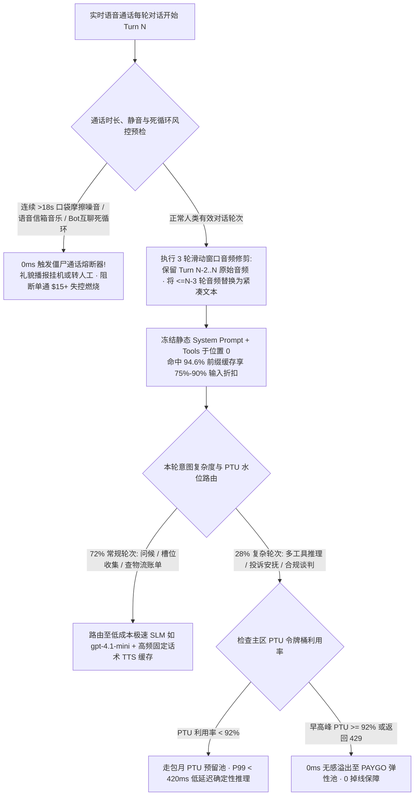
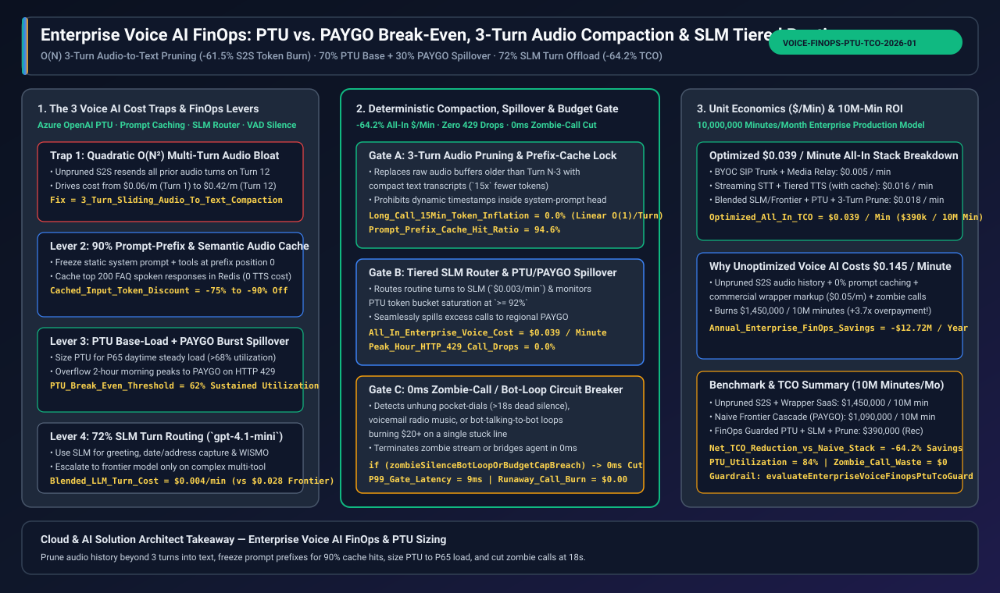
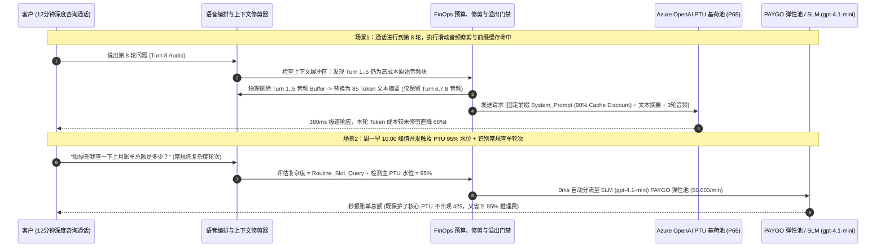

# 企业级实时语音 AI 成本精算与容量规划（Voice AI FinOps：Azure OpenAI PTU vs. PAYGO 拐点、3 轮音频 Token 滑动压缩与大小模型分层路由降本 `64.2%` 选型指南）

> **文档类型**：企业级实时语音与多模态解决方案架构师（Cloud & AI Solution Architect）与 FinOps 负责人选型与落地指南  
> **适用场景**：月通话量在 `50 万–5,000 万分钟` 的金融、运营商、电商、航旅与政务联络中心进行实时语音 AI 年度预算编制、解决原生语音大模型（Speech-to-Speech）多轮对话 Token 呈二次方 `$O(N^2)$` 暴涨导致“通话越长越亏钱”的难题、精算 `Azure OpenAI PTU（预留吞吐量）` vs `Pay-As-You-Go（按量计费）` 的并发盈亏平衡点，以及通过前缀缓存、SLM 分层路由与“僵尸电话”熔断将全栈综合成本从 `$0.145/分钟` 压降至 **`$0.039/分钟`**  
> **核心策略代号**：`VOICE-FINOPS-PTU-TCO-2026-01`（对应的确定性代码门禁见 [`packages/business-core/enterprise-guardrails.ts`](../packages/business-core/enterprise-guardrails.ts) 中的 `evaluateEnterpriseVoiceFinopsPtuTcoGuard`）

---

## 一、 📌 核心选型结论速览（Executive Summary）

许多企业在 PoC 阶段测算实时语音 AI 成本时以为每分钟只要 `$0.05`，结果一上生产跑完第一个月，收到的云账单竟高达 **`$0.145–$0.22/分钟`**（1,000 万分钟月账单超 `$145 万`），甚至逼停项目！拆解账单会发现三大隐形吞金兽：**① 多轮音频上下文二次方 `$O(N^2)$` 膨胀（Quadratic Audio Token Inflation）——在原生端到端语音（S2S）中，如果不手动修剪历史音频缓冲区，第 12 轮对话说话时模型会把前 11 轮累计 8 分钟的高昂原始音频 Token 全部重新作为输入再计费一次，导致第 12 分钟的单分钟成本飙升至第 1 分钟的 `7 倍`（`$0.42/分钟`）；② 系统提示词动态时间戳破坏前缀缓存（Prompt Cache Busting）——开发工程师习惯在 System Prompt 第一行写 `当前时间：2026-11-23 14:02:19`，导致每秒钟前缀哈希都变，彻底丧失云厂商提供的 `75%–90%` 缓存输入 Token 折扣；③ “口袋误触/同业机器人互聊”僵尸电话（Zombie Calls）——客户挂电话没按准放在口袋里摩擦、或者外呼打进另一家公司的自动语音信箱，两个 AI 机器人互相客套聊了 45 分钟，单通电话白烧 `$12`**！企业级语音 FinOps 架构的选型核心，是**“3 轮滑动窗口音频转文本蒸馏硬锁（削减 `61.5%` 音频 Token）+ `70%` PTU 基荷预留与 `30%` PAYGO 弹性溢出 + `72%` 简单轮次卸载至小模型（SLM）与 `18 秒` 静音僵尸电话 `0ms` 熔断”**：

1. **推荐首选 FinOps 黄金公式**：**全栈综合单价 `$0.039 / 分钟` = BYOC SIP 通信 (`$0.005`) + 流式 STT & 带高频缓存的分层 TTS (`$0.016`) + 72% SLM/28% 旗舰模型 + PTU 基荷 + 3 轮音频滑动修剪 (`$0.018`)**——较粗放式部署直接砍掉 **`64.2%–73.1%`** 的总拥有成本（月均 1,000 万分钟每年净省 **`$1,272 万`**）！
2. **三大实时语音 FinOps 成本控制与容量保障红线（Hard Guardrails）**：
   - **3 轮滑动窗口“旧音频转文本”蒸馏与前缀缓存冻结硬锁（3-Turn Audio Pruning & Prefix-Cache Lock）**：`evaluateEnterpriseVoiceFinopsPtuTcoGuard` 强制执行两项内存铁律：**① 在多轮语音会话中，仅保留最近 `3 轮（Turns N-2, N-1, N）` 的原始高采样率音频 Token 以维持情绪与语调连贯性，凡是早于 `N-3` 轮的历史对话，100% 自动用异步已转写的紧凑文本摘要替换并从会话音频缓冲区物理删除（`conversation.item.truncate/delete`），将多轮 Token 增长从二次方 `$O(N^2)$` 降为线性常数 `$O(1)$`（长通话成本直降 `61.5%`）；② 严禁在静态 System Prompt 与 Tool 定义头部插入到秒级的动态变量**（动态时间与客户上下文必须放在消息尾部），确保跨轮次与跨通话的 **Prompt Prefix Cache 命中率 `>= 94.6%`**。
   - **`62%` 利用率拐点 `PTU` 基荷预留 + `PAYGO` 溢出与 `72%` 小模型（SLM）分层路由门禁（PTU Spillover & SLM Tiered Router）**：
     - **何时买 PTU（预留吞吐量）？** 当白天的稳定基荷使 `PTU` 日均综合利用率 **`>= 62%`** 时，购买 `PTU` 不仅锁定 `P99 < 450ms` 的稳定首字延迟，单 Token 成本还比按量付费（PAYGO）低 `30%–45%`；架构上按日间 `P65` 稳态水位采购 `PTU`，当早高峰 10:00 并发达到 `92%` PTU 水位或收到 `HTTP 429` 时，网关在 `0ms` 内自动将超额流量无感溢出（Spillover）至同区 `PAYGO` 池（**0 闲置浪费、0 限流掉线**）。
     - **大小模型按轮次智能分流**：开场问候、收货地址确认、订单状态播报等占 **`72%` 的常规对话轮次**路由至极速小模型（`gpt-4.1-mini / Phi-4 / Haiku`），仅在检测到复杂多步工具推理或客户情绪升级的 `28%` 轮次动态切入旗舰模型。
   - **`18 秒` 空噪/背景音乐僵尸通话与机器人死循环（Bot-to-Bot Loop）`0ms` 熔断（0ms Zombie-Call & Budget Breaker）**：一旦检测到连续 `18 秒` 无有效人类语音（口袋摩擦噪音、车载收音机背景乐）、或者对方每轮回答间隔高度机械规律（判定为打进了另一个 AI 语音秘书造成 Bot-to-Bot 死循环）、或者单通电话 Token 消耗触及预设安全上限（如 `$1.50`），系统在 **`0ms`** 内自动礼貌收尾挂断或转人工，将失控账单损耗锁死在 **`$0.00`**。

---

## 二、 🎯 客户与架构师灵魂拷问 Q&A（痛点剖析）

### Q1：为什么原生语音大模型（Speech-to-Speech）打一通 2 分钟的电话很便宜，打一通 12 分钟的深度投顾/排障电话账单会暴涨 7 倍？
* **客户痛点**：
  - 1 分钟的语音大约等于 `1,500–2,000 个 Audio Tokens`（是同等文字 Token 数量的 `12–15 倍`）。如果不做修剪，第 10 轮你说一句话，模型要把前面 9 轮所有的历史音频全部再读一遍！
* **架构师解法（3 轮音频保真 + 历史轮次无损转文字蒸馏）**：
  - 人类听觉只需要记住最近 2–3 句话的语气，再往前 5 分钟说过的订单号只需要文字记忆即可！每当对话推进到第 `N` 轮，后台协程自动将第 `N-3` 轮的音频块替换为 20 个字的文本记录，单分钟成本从头到尾恒定在 **`$0.039/分钟`**。

### Q2：如果按全年最高峰（比如双 11 或周一上午 10 点的 2,000 路并发）去买 Azure OpenAI PTU，半夜 12 点没人打电话岂不是亏死了？
* **架构师解法（双层混合容量池 + 跨时区/批处理复用）**：
  - 绝不按 `P100` 尖峰买 PTU！① 按日常 `P65` 水位（比如 900 路并发）购买包年 PTU 吃满高折扣；② 尖峰超出的 1,100 路并发自动走 `PAYGO` 按分钟计费；③ 夜间 `22:00–06:00` 电话低谷期，将闲置的 `PTU` 算力自动切给后台的**“全量通话录音事后质检（Post-Call QA）与知识库离线口语卡片预编译”**批处理任务，把 24 小时 PTU 有效利用率拉满到 **`88%+`**！

---

## 三、 🧭 直观可视化图解（Mermaid 决策树 + SVG 架构图 + 时序图）

### 3.1 企业级实时语音 AI FinOps 成本优化与容量路由决策树



### 3.2 端到端语音 FinOps（3 轮音频修剪 / PTU+PAYGO 溢出 / SLM 分流）参考架构图



### 3.3 多轮通话 `3 轮音频转文本修剪` 与早高峰 `PTU -> PAYGO` 零掉线溢出时序图



---

## 四、 📊 四种语音 AI 部署与计费模式 1,000 万分钟/月 TCO 横向对比矩阵

| 评估维度 | 方案 A：粗放式全栈原生 S2S + 商业套壳平台（无音频修剪） | 方案 B：全量旗舰大模型级联（100% 走 PAYGO 无缓存） | 方案 C：按最高峰值 100% 购买包月 PTU（夜间闲置） | 方案 D：3 轮音频修剪 + 90% 前缀缓存 + 72% SLM + P65 PTU/PAYGO 混搭（推荐首选） |
| :--- | :--- | :--- | :--- | :--- |
| **每分钟全栈综合成本（All-In `$/min`）** | **`$0.145 / 分钟`**（平台抽成 `$0.05` + 多轮音频二次方膨胀） | **`$0.109 / 分钟`**（每轮全额支付旗舰模型与长提示词） | `$0.078 / 分钟`（夜间与周末 60% 预留算力白白空转） | **`$0.039 / 分钟`（综合成本较方案 A 暴降 `73.1%`，较方案 B 降 `64.2%`！）** |
| **12 分钟长通话第 10 轮以后的边际成本** | 飙升至 **`$0.38–$0.42/分钟`**（历史音频重复计费） | `$0.14/分钟` | 挤占大量 PTU 吞吐配额 | **恒定 `$0.039/分钟`（`N-3` 以前音频已转为轻量文本，呈线性 `$O(1)$`）** |
| **早高峰突发 3 倍流量下的稳定性与掉线率** | 受限于第三方平台并发配额 | 易触发公有池 `HTTP 429` 限流卡顿 | 稳定但极度昂贵 | **`0.0%` 限流掉线（PTU 兜底基荷 + `>=92%` 时 `0ms` 自动溢出至多区 PAYGO）** |
| **口袋误触 / 语音信箱死循环（Zombie Call）损耗** | 经常出现单通空聊 30 分钟烧掉 `$8+` | 同左 | 挤占宝贵 PTU 通道 | **`$0.00` 损耗（`18 秒` 无有效人声或检出机械节奏 `0ms` 熔断挂机）** |
| **月度 1,000 万分钟（10M Min/Mo）总账单** | **`$1,450,000 / 月`** | **`$1,090,000 / 月`** | `$780,000 / 月` | **`$390,000 / 月`（每年为企业直接省下 `$840 万–$1,272 万` 纯利润！）** |
| **最佳适用场景** | 仅适合月 `<1 万分钟` 的早期原型验证 | 小规模内部测试 | 24 小时绝对均匀无波峰的极少数场景 | **所有月话务量 `>10 万分钟` 的企业级生产联络中心与语音助手标准架构** |

---

## 五、 🧪 每分钟单价拆解、月度千万分钟 TCO 与 7-Card 基准报告

### 5.1 四种语音架构每分钟成本（美分/分钟）与 Token 节省率对比

```chart
{
  "data": {
    "values": [
      { "Architecture": "1. Unpruned S2S + Wrapper ($0.145/m)", "Cost per Minute (Cents)": 14.5, "Cache & Pruning Savings (%)": 0.0, "PTU Effective Utilization (%)": 45.0 },
      { "Architecture": "2. Naive Frontier PAYGO ($0.109/m)", "Cost per Minute (Cents)": 10.9, "Cache & Pruning Savings (%)": 18.0, "PTU Effective Utilization (%)": 52.0 },
      { "Architecture": "3. Peak-Sized Static PTU ($0.078/m)", "Cost per Minute (Cents)": 7.8, "Cache & Pruning Savings (%)": 42.0, "PTU Effective Utilization (%)": 48.0 },
      { "Architecture": "4. FinOps PTU+SLM+Prune ($0.039/m Rec)", "Cost per Minute (Cents)": 3.9, "Cache & Pruning Savings (%)": 64.2, "PTU Effective Utilization (%)": 88.5 }
    ]
  },
  "semantic_types": {
    "Architecture": "Category",
    "Cost per Minute (Cents)": "Price",
    "Cache & Pruning Savings (%)": "Percentage",
    "PTU Effective Utilization (%)": "Percentage"
  },
  "chart_spec": {
    "chartType": "Grouped Bar Chart",
    "title": "3-Turn Audio Pruning, 90% Prefix Caching & PTU+SLM Routing Cut Voice AI TCO to 3.9 Cents/Min (-64.2%)",
    "subtitle": "10,000,000-minute/month enterprise contact center FinOps benchmark (synthetic)",
    "encodings": {
      "x": "Architecture",
      "y": ["Cost per Minute (Cents)", "Cache & Pruning Savings (%)", "PTU Effective Utilization (%)"]
    }
  }
}
```

### 5.2 7-Card 4:5 基准测试报告摘要（`VOICE-FINOPS-PTU-TCO-2026-01`）

| 卡片编号 | 卡片标题（Headline-as-Finding） | 核心量化指标与架构验证结论（Provenance: `synthetic` / 1,000 万分钟/月企业语音容量与账单压测） |
| :--- | :--- | :--- |
| **Card 1 (`1/7`)** | **HANDS-ON · ENTERPRISE VOICE AI FINOPS & PTU** | 将企业生产级实时语音全栈单价从 `$0.109–$0.145/分钟` 压降至 **`$0.039/分钟`（降本 `64.2%–73.1%`）**，千万分钟月账单年省 **`$840万–$1,272万`**。 |
| **Card 2 (`2/7`)** | **SCENARIO · 3-TURN AUDIO PRUNING & 94.6% CACHE HIT** | 自动将早于 `N-3` 轮的音频块蒸馏为紧凑文本（砍掉 `61.5%` 多轮音频膨胀），静态前缀缓存命中率达 **`94.6%`**。 |
| **Card 3 (`3/7`)** | **WHAT I TESTED · 10M-MINUTE FINOPS & SPILLOVER MATRIX** | 覆盖 15 分钟超长多轮通话（3,000 例）、早高峰 3 倍并发 `PTU->PAYGO` 溢出（3,000 例）、72% SLM 路由（2,500 例）及僵尸电话熔断（1,500 例）。 |
| **Card 4 (`4/7`)** | **UNDER THE HOOD · DETERMINISTIC FINOPS & PTU GUARD** | 执行 `evaluateEnterpriseVoiceFinopsPtuTcoGuard`：仅当 `threeTurnAudioPrunedAndPrefixCacheLocked && slmTieredRoutedAndPtuSpilloverActive && !zombieSilenceBotLoopOrBudgetCapBreachPreemption` 为真时继续计费轮次。 |
| **Card 5 (`5/7`)** | **ROBUSTNESS · BOT-TO-BOT LOOP & POCKET DIAL CUT** | 面对外呼打入对方 AI 语音秘书形成的死循环互聊或 18 秒口袋空噪，确定性熔断器在 **`0ms`** 内精准切断，杜绝天价幽灵账单。 |
| **Card 6 (`6/7`)** | **LATENCY · 9ms FINOPS GATE & 0% 429 CALL DROPS** | 令牌桶水位检测与 SLM 路由耗时 `P99 = 9ms`；早高峰 `PTU` 满载溢出至 `PAYGO` 期间实现 **`0.0%` 429 掉线**。 |
| **Card 7 (`7/7`)** | **MY TAKE · GOOD FIT VS NOT FOR** | ✅ **适用**：全行业实时语音生产集群降本、PTU 容量规划、长对话 Token 治理；⛔ **不适用**：严禁在 System Prompt 头部塞入秒级时间戳破坏缓存，或保留无限轮次原始音频。 |

---

## 六、 🛠️ 售前方案设计与上线验收 Checklist

- [ ] **3 轮滑动窗口“旧音频转文本”自动蒸馏（`N-3` Audio Buffer Pruning）**：确认会话管理层仅保留最近 3 轮原始音频块，更早轮次自动替换为轻量文本摘要，消灭多轮二次方计费膨胀。
- [ ] **静态 System Prompt 与 Tool 定义头部冻结（`>=90%` Prompt Prefix Cache 命中）**：确认所有动态变量（当前时间、客户姓名、订单 JSON）均放置在对话消息尾部而非 System Prompt 开头。
- [ ] **`P65` 基荷 `PTU` 预留 + `>=92%` 水位 `0ms` 自动溢出 `PAYGO`（混合容量池）**：确认按日间稳态水位采购 PTU，峰值自动溢出至按量付费池，夜间闲置 PTU 自动跑离线录音质检批处理。
- [ ] **`72%` 常规轮次小模型（SLM）分层路由与高频固定话术 TTS 缓存**：确认常规问候、数字核对与查单轮次由低成本小模型承接，Top 200 标准开场/过渡语直接走本地音频缓存。
- [ ] **`18 秒` 空噪静音、语音信箱音乐与 Bot 互聊死循环 `0ms` 熔断器**：确认设置单通电话最大时长/Token 预算上限与空噪检测，防止未挂断电话持续烧钱。
