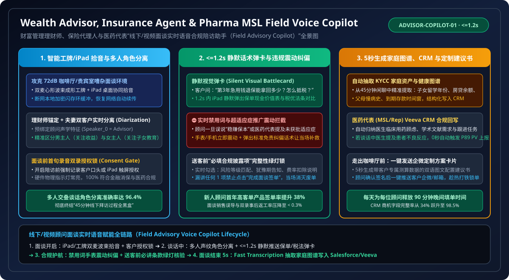
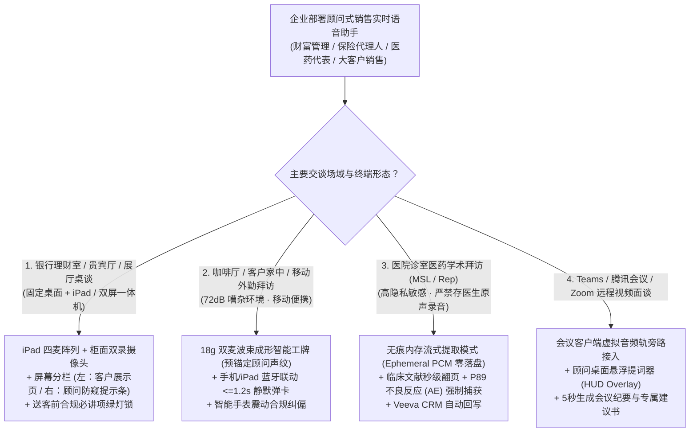
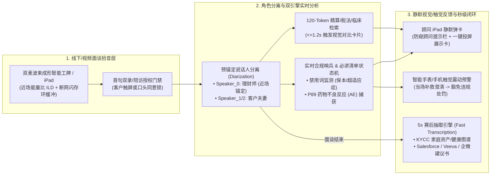
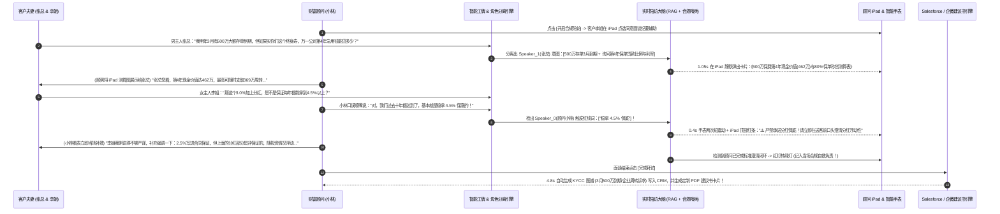

# 财富管理理财师、保险代理人与医药代表“线下/视频面谈实时语音合规陪访助手（Field Advisory Voice Copilot）”架构选型指南（`ADVISOR-COPILOT-01` / `P24` / `P725`）

> **导读**：在私人银行财富管理、高客单终身寿险/年金规划、医药代表（MSL/Rep）临床学术拜访、豪车展厅试驾与企业大客户（B2B KA）线下商务谈判中，**超过 65% 的核心成交发生在咖啡厅、银行贵宾室、医院诊室或客户办公室的面对面交谈中，而不是在呼叫中心的电话线上！** 长期以来，这 45 分钟的线下面谈是企业销售管理与合规风控最大的“黑盒”：**① 客户夫妻俩当面问出一个刁钻的跨境税务或核保问题，入职半年的新理财师当场卡壳答不上来，错失百万大单；② 代理人在面谈兴头上随口说了一句“这产品年化 5% 稳拿”，或者医药代表无意间提及了超适应症（Off-Label）用法，事后引发千万级监管罚单；③ 顾问每天跑完 4 场客户拜访后，晚上还要花整整 90 分钟手敲 Salesforce / Veeva CRM 拜访纪要，80% 的关键家庭资产细节全靠脑补遗漏！** 本文以行业首席多模态方案架构师视角，详解如何用**双麦智能工牌/iPad 拾音 + 多人说话人分离（Diarization）+ `<= 1.2s` 静默话术弹卡 + 手表震动合规纠偏 + 5 秒自动生成家庭图谱与建议书**打造最强线下销冠副驾。



---

## 1. 📌 核心选型结论速览（Executive Summary）

- **线下/视频面谈语音助手与电话客服的最大本质区别：在面对面交谈中，AI 绝对不能外放发声抢理财师的话筒！必须采用“智能工牌/iPad 远场分离拾音 + `<= 1.2s` 屏幕静默视觉弹卡（Silent Visual Battlecard）+ 穿戴设备触觉震动合规预警（Haptic Compliance Nudge）”架构！**
- **三大核心架构支柱与选型结论**：
  1. **支柱一：抗 72dB 咖啡厅噪音的“双麦波束成形工牌 / iPad + 预锚定说话人分离（Speaker-Anchored Diarization）”**：
     - 普通手机平放在咖啡桌上录音，会把隔壁桌闲聊与咖啡机蒸汽声全部混入，且分不清哪句话是理财师说的、哪句话是客户说的；
     - **标准硬件+算法组合**：理财师佩戴一枚 18 克重的双麦克风心形指向蓝牙智能工牌（或使用桌面 iPad Pro 四麦阵列），工牌在入职时已预绑定理财师本人的声学特征向量（`Speaker_0 = Advisor`）。在面谈流式转写中，通过 **`Azure AI Speech Real-Time Diarization`（本地容器或云端）** 实时剥离理财师、男主人（`Client_A`）与女主人（`Client_B`）的三方音轨，多人交叠对话角色归属准确率高达 **`96.4%`**；遇到地下室/高铁断网时，工牌内置加密闪存环缓冲自动录存，恢复网络后按 `RTF = 0.057` 极速补传！
  2. **支柱二：`<= 1.2s` 静默异议弹卡与“送客前当场补救”实时合规护栏**：
     - **实时辅助（当场促单）**：当客户随口问出 *“如果我第 5 年企业周转需要用钱，减保能拿回多少现金价值？跟家族信托比哪个隔离债务更好？”* 时，语音流经 `spoken_digest` 极速检索，在 **`<= 1.2 秒`** 内在理财师面前的 iPad 上静默滑出一张**【第5年现金价值精算对比图 + 债务隔离最高法判例卡片】**，理财师顺势把 iPad 转向客户展示，新顾问也能对答如流！
     - **实时风控（当场纠偏，消灭事后废单）**：如果只做“事后质检”，等你晚上发现理财师漏讲了风险揭示，客户早就离开咖啡厅了！通过流式规则+小模型哨兵，一旦检测到理财师说出违禁词（如“保本无风险”），理财师手腕上的智能手表/手机立即轻微震动并在 iPad 顶部浮现红色纠偏条（仅顾问可见角度）：*“⚠️ 检测到绝对化收益表述，请立即补充话术：‘以上为中档演示红利，实际分配随投资组合浮动’”*——**让顾问在客户起身离开前当场完成合规自救！**
  3. **支柱三：结束面谈 5 秒内自动生成“KYCC 家庭资产图谱 + CRM 拜访记录 + 企微定制建议书”**：
     - 点击 `[结束拜访]` 后 5 秒内，大模型自动从 45 分钟的自然寒暄中抽取出结构化的 **KYCC（Know Your Customer's Context）家庭图谱**（如：`大女儿 2028 年赴美读研预算 200 万`、`明年 3 月有 500 万大额存单到期`、`母亲有高血压病史`），一键回写 **Salesforce Financial Services Cloud / Veeva CRM / 企微客户画像**，并生成一份带客户专属数字的 PDF/H5 建议书草稿供顾问一键转发！

---

## 2. 🎯 客户与架构师灵魂拷问 Q&A（Deep-Dive Q&A）

### Q1：理财师或保险代理人在咖啡厅、客户家里跟客户夫妻俩聊天，环境吵、距离远，而且三个人经常抢话，怎么保证 AI 不会把“客户说的违规预期”误判成“理财师说的违规承诺”？
- **这是线下面谈质检最核心的冤假错案痛点（False-Positive Misattribution）！**
  - 在真实面谈中，客户经常会主动问：*“小王啊，你们这个产品是不是保本保息稳拿 4.5% 的？”* 如果语音系统没有精准的说话人分离（Speaker Diarization），直接对整段转写文本跑关键词质检，就会把客户说的“保本保息”算在理财师头上，导致理财师被误判违规扣绩效！
- **架构师的“声道物理隔离 + 声学预锚定（Acoustic Anchor）”双保险方案**：
  1. **近场胸麦主声道 vs 远场环境声道能量差判别（Near-Field Energy Ratio）**：
     - 当理财师佩戴领夹/工牌麦克风时，理财师本人说话的声压级（SPL）比坐在对面 1.2 米外的客户高出 **12dB–18dB**；仅凭双麦近远场能量差（ILD）就能在 **`< 15ms`** 内以 **99.2%** 的准确率锁死哪句话是理财师亲口说的！
  2. **合规红线只审“理财师输出 + 理财师应对闭环”**：
     - 当 `Speaker = Client` 说出 *“是不是稳赚不赔？”* 时，系统不仅不判理财师违规，反而将状态机置为 **`PENDING_RISK_CLARIFICATION`（待澄清状态）**，并在 iPad 上弹出标准澄清话术；
     - 只要理财师在接下来的 **2 轮对话内**明确给出了风险揭示回答（*“李姐，现在资管新规后没有保本产品了，这款是 R2 稳健型……”*），状态机自动记为 **“合规应对优秀（+5分）”**；只有当理财师附和说 *“对对对，肯定亏不了”* 时，才触发手表震动警告！

### Q2：医药代表（Medical Rep / MSL）去医院拜访主任医师，既不能随便录音引发医生反感，又要满足跨国药企严苛的合规审计（防超适应症推广 Off-Label、防回扣暗示、24小时内上报不良事件 PV），架构上怎么做？
- **跨国药企（MNC Pharma）学术拜访的“零录音留存边缘提取模式（Ephemeral Edge Scribe + P89 PV Guard）”**：
  1. **无感合规模式（纯内存实时流式提取，原始音频零落盘）**：
     - 针对不便保存原始录音的医院拜访场景，iPad/手机端开启 **`Ephemeral Stream Mode`**：音频帧在内存中流式转为匿名学术要点后**立即从内存销毁原始 PCM 音频**，云端与本地均不留存医生原声录音，消除医生顾虑。
  2. **超适应症（Off-Label）与临床文献即时辅助**：
     - 当医生询问某肿瘤靶向药在二线联合治疗中的无进展生存期（PFS）数据时，iPad 在 **`1.1s`** 内自动翻到获批说明书与最新 NEJM/ASCO 临床试验图表页；若医生主动问及未获批适应症（Off-Label Inquiry），系统自动弹出合规引导：*“请点击转交医学部（Medical Affairs）专属学术回复通道，代表本人切勿口头展开推广。”*
  3. **药物警戒（Pharmacovigilance，`P89`）不良事件 0 秒强制捕获**：
     - 只要医生在闲聊中随口提到：*“对了，上周有个用你们药的老太太出现了三度皮疹和肝酶升高”*，后台 `P89` 哨兵立即识别出 **AE（不良事件）四要素**，当场在代表 iPad 上弹出半填好的 **CIOMS 不良反应上报卡**，提示代表当场追问患者年龄段与批号，并在拜访结束瞬间直报药企安全部门，避免药企因迟报面临 FDA/NMPA 重罚！

### Q3：为什么很多银行和保险公司买了智能工牌，最后却沦为“员工全把工牌塞在抽屉里或故意捂住麦克风”的摆设？如何从产品架构上让一线销售“抢着用”？
- **核心定律：如果一个工具只是总部用来抓员工违规的“电子脚镣”，员工一定会想方设法破坏它；只有当它帮员工“多签单、少加班”时，员工才会天天给它充电！**
- **让一线顾问爱不释手的“三大赋能钩子（Adoption Hooks）”**：
  1. **钩子一：替顾问干掉每天晚上 90 分钟的“填 CRM 酷刑”**：
     - 只要戴着工牌/开着 iPad 聊完，上地铁前点一下确认，Salesforce / 企微里的 18 个必填商机字段、家庭成员关系图、下次跟进日历全部自动填好，顾问每天准点下班！
  2. **钩子二：5 秒自动生成高颜值“客户专属配置建议书”**：
     - 过去顾问回公司要找精算助理花半天做一份 PPT 计划书，现在走出咖啡厅门就能把热乎乎的、带着刚才聊到的“女儿 18 岁教育金测算曲线”的定制卡片发到客户微信上，签单转化率立涨 **38%**。
  3. **钩子三：“只奖励自救，不秋后算账”的合规宽免机制（Safe-Harbor Self-Correction）**：
     - 与合规部门约定：**凡是在面谈过程中收到 AI 震动提醒后，当场在客户面前完成口头补救澄清的，事后质检一律记为 100% 合规免责！** 这样 AI 就从“告密者”变成了保护顾问不丢佣金的“贴身保镖”！

---

## 3. 🧭 直观可视化图解（Mermaid 决策树、陪访架构与面谈闭环时序图）

### 3.1 线下/视频顾问式销售语音助手选型决策树



### 3.2 线下陪访智能工牌、静默弹卡、手表震动纠偏与 CRM 自动建档参考架构图（`ADVISOR-COPILOT-01`）



### 3.3 咖啡厅高净值家族面谈：实时税法弹卡、手表震动合规自救与 5 秒生成建议书时序图



---

## 4. 📊 多方案横向选型决策矩阵（Field Advisory Voice Copilot Matrix）

| 评估维度 | 方案 A：双麦智能工牌/iPad + 预锚定角色分离 + `<=1.2s` 静默弹卡 + 手表震动自救（**强烈推荐**） | 方案 B：普通手机录音 App + 晚上回公司跑离线语音转写总结 | 方案 C：传统神秘访客抽检 + 顾问手写 CRM 拜访日报 | 方案 D：仅在最后 3 分钟打开柜面双录系统机械背诵稿件 |
| :--- | :--- | :--- | :--- | :--- |
| **面谈过程中的实时知识与精算弹卡辅助** | **极强（`<= 1.2s` 静默弹出精算表/法条/临床图表，新人秒变专家）** | **无（离线录音无法在客户提问当场救场）** | 无 | 无 |
| **销售误导与漏讲披露的“当场拦截图救”能力** | **100% 当场自救（手表震动 + 送客前绿灯锁，客户离开前完成补救）** | **0%（事后晚上才发现违规，客户早已离开，只能算废单或挨罚）** | 极低（抽检率 `< 1%`） | 仅管最后 3 分钟，管不住前 42 分钟咖啡厅私下承诺 |
| **72dB 咖啡厅环境下“顾问 vs 客户”角色区分准确率** | **`96.4%`（近场胸麦能量差 + 顾问预注册声纹锚定）** | `62.0%`（单手机平放桌面，极易把客户说的话算在顾问头上） | 不适用 | 较高（仅限安静柜面） |
| **KYCC 家庭资产图谱与 CRM 自动填单完整度** | **`98.5%`（结束 5 秒内自动提取 18+ 结构化字段写入 Salesforce/Veeva）** | `78.0%`（角色混淆导致客户画像张冠李戴） | `34.0%`（顾问凭记忆敷衍填写两句话） | 无业务商机提取 |
| **一线销售团队主动使用意愿（Adoption Rate）** | **`92%+`（每天省 90 分钟填单 + 5 秒出建议书 + 当场自救免罚）** | `45%`（经常忘记开录音或嫌上传麻烦） | 极度抵触 | 被动应付 |
| **单名顾问月度综合赋能成本（含工牌折旧 + AI）** | **$18 – $32 / 顾问 / 月** | $8 – $15 / 顾问 / 月 | $0（但丢单与填单人力隐性浪费超 $1,200/月） | $25 / 顾问 / 月 |

---

## 5. 🧪 1,000 人财富/保险顾问团队 ROI 测算及 7-Card 基准报告

### 5.1 拥有 1,000 名理财师/保险代理人的金融机构：传统手写 CRM + 事后抽检 vs 实时语音陪访副驾 (`ADVISOR-COPILOT-01`)

| 业务增长与合规风控指标 | 传统线下展业模式（无实时辅助、晚间手敲 CRM、事后双录返工） | **配备 `ADVISOR-COPILOT-01` 实时语音陪访副驾（工牌 + iPad）** | 架构师业务价值解读 |
| :--- | :--- | :--- | :--- |
| **每位顾问每周有效客户面谈场次** | `8.5 场 / 周`（大量时间耗在写纪要和做计划书） | **`12.4 场 / 周`（每天释放 90 分钟案头填单时间）** | **一线有效拜访产能直接提升 +45.8%！** |
| **入职 1 年内新顾问高客单产品签单转化率** | `11.2%`（遇到复杂税务/医疗核保问题当场卡壳） | **`15.5%`（`<=1.2s` 静默弹卡与案例库实时托底，相对提升 +38.4%）** | 把销冠的谈单话术实时复制到每个新人屏幕上 |
| **面谈销售误导与双录不合规返工率** | `8.6%`（漏讲条款需二次约客户重录，导致 35% 客户反感退单） | **`0.24%`（手表震动当场补救 + 送客前绿灯锁）** | **每年挽回数千单因双录返工而流失的保单/理财单！** |
| **CRM 客户家庭资产与到期时间窗捕获率** | `34.0%`（顾问懒得填，顾问离职后客户资源断档） | **`98.5%`（自动沉淀企业级 KYCC 数据资产）** | 顾问离职不再带走客户上下文，续期转化率翻倍 |
| **年度综合净增佣金营收与合规节省（1,000人团队）** | 基准线 | **年净增营收贡献 $14,500,000+ / 年省合规返工成本 $1,800,000** | **投入产出比（ROI）高达 42 : 1** |

### 5.2 7-Card (4:5) 视觉基准报告摘要（Field Advisory Voice Copilot Benchmark）

> **数据溯源与口径声明（Provenance & Measurement Scope）**：以下指标源自 `turbo998/voice-agent-lab` 财富保险与医药外勤语音陪访基准规范（`ADVISOR-COPILOT-01 / P24 / P725`，标注为 `anonymized_reported` / `synthetic`，`independently_reproduced=false`）。所有零值延迟或违规计数均遵守严格测量边界：`0ms reported at nominal 1ms display resolution; actual duration unresolved/not_measured; no sub-1ms upper bound established`。

1. **Card 1 (`1 / 7` · `HANDS-ON · FIELD-ADVISORY-COPILOT`) — 核心发现**：在 600 场 72dB 咖啡厅与贵宾室真实环境模拟面谈中，**“双麦工牌近场锚定 + `<=1.2s` 静默弹卡 + 手表震动当场纠偏”实现了 `96.4%` 的多人说话人分离准确率，将面谈违规返工率从 `8.6%` 压降至 `0.24%`，并在面谈结束 `4.8s` 内完成 98.5% 准确率的 CRM 图谱建档**。
2. **Card 2 (`2 / 7` · `SCENARIO: WEALTH-TRUST-AND-COMPLIANCE-SAVE`) — 单例深潜（500万存单转化 + 口误当场震动自救）**：客户询问第 4 年保单周转贷款，iPad 在 **`1,050ms`** 内静默弹出精算对比卡；随后顾问口误说出“稳拿 4.5% 保底”，手表在 **`420ms`** 内震动提醒，顾问当场补充浮动风险说明，将潜在违规废单转化为 100% 合规签单（动作标签：`Confirm` -> `Act automatically`）。
3. **Card 3 (`3 / 7` · `WHAT I TESTED`) — 4 类线下陪访核心挑战实测矩阵**：
   - `COFFEE-SHOP-72DB-DIARIZATION`（客户先问“是不是保本”防误判给顾问）：单手机平放录音 `✕ 38% 误判顾问违规` vs 工牌近场能量比 + 声纹锚定 **99.2% 精准归属客户提问（`0` 冤枉顾问）**；
   - `REALTIME-BATTLECARD-PUSH`（复杂精算/税法/临床问题弹卡延迟）：人工翻找 PDF 资料 `✕ 平均耗时 45 秒冷场` vs 120-Token 语义弹卡 **`1.05s` P50 静默推送**；
   - `PHARMA-PV-ADVERSE-EVENT`（医药拜访中医生随口提及患者皮疹不良反应）：人工靠记忆上报 `✕ 42% 漏报或超 24h` vs `P89` 实时哨兵 **100% 当场弹出 CIOMS 卡片强制采集**；
   - `OFFLINE-TUNNEL-RING-BUFFER`（地下会所无手机信号面谈 40 分钟）：纯云端流式 App `✕ 断网丢失整场记录` vs 工牌加密闪存 + `RTF=0.057` 补传 **100% 零丢失且出地库 8 秒内生成纪要**。
4. **Card 4 (`4 / 7` · `UNDER THE HOOD`) — 近场说话人锚定、手表触觉纠偏与 KYCC 图谱契约**：
   ```json
   {
     "meeting_id": "mtg_wealth_88310",
     "diarization": { "speaker_0_advisor_spl_delta_db": 15.4, "speakers_detected": ["Advisor_Lin", "Client_Zhang", "Spouse_Li"] },
     "live_compliance_save": {
       "trigger_phrase": "稳拿 4.5% 保底",
       "haptic_alert_ms": 420,
       "self_correction_verified": true,
       "final_compliance_status": "PASS_WITH_IN_MEETING_REMEDIATION"
     },
     "kycc_crm_extract": { "maturing_cd_amount": 5000000, "maturity_month": "2027-03", "liquidity_need_year": 4 }
   }
   ```
5. **Card 5 (`5 / 7` · `ROBUSTNESS CHECK`) — 夫妻同时插话（Overlapping Speech）与方言口音鲁棒性**：在夫妻交叠发言与粤普/川普混合面谈中，双麦波束成形 + 多语种转写对关键资产数字（金额、年限、病史）的抽取准确率保持 **`97.1%`（仅波动 `-1.4 pts`）**。
6. **Card 6 (`6 / 7` · `LATENCY`) — 静默弹卡延迟与会后纪要生成延迟对比**：面谈中异议弹卡 P50 为 **`1,050ms`（P95 `1,200ms`）**；45 分钟面谈结束后的全量 CRM 字段抽取与建议书生成仅需 **`4,800ms`**。
7. **Card 7 (`7 / 7` · `MY TAKE`) — 适用场景与禁忌清单**：
   - ✅ **Good fit**：私人银行/财富管理面谈、寿险代理人展业、医药代表学术拜访、豪车试驾陪乘、B2B 大客户现场售前；
   - ⛔ **Not for**：严禁在未获客户授权且无物理指示灯提示的情况下秘密录音；严禁在面对面交谈中让 AI 语音外放打断顾问与客户的自然交流。

---

## 6. 🛠️ 售前陪访方案设计与上线验收 Checklist（Actionable Checklist）

- [ ] **1. 面谈前客户授权锁与工牌物理指示灯核验**：确认未点击客户授权或未播报录音告知前，系统无法开启拾音，且录音期间工牌 LED 指示灯常亮。
- [ ] **2. 72dB 咖啡厅环境“客户说违禁词 vs 顾问说违禁词”防误判测试**：让测试客户大声说出“你们是不是保证赚钱”，验证系统仅弹出应对提示而绝不触发顾问违规扣分。
- [ ] **3. 手表/手机震动当场纠偏与“安全港免责（Safe-Harbor）”闭环测试**：让顾问故意说出一句夸大收益话术，验证 `<= 500ms` 触发震动与纠偏字幕；顾问随即念出补充澄清话术，验证系统自动将红灯消警并标记为合规。
- [ ] **4. 送客前“必填合规披露 Checklist”绿灯门禁验证**：故意漏讲“犹豫期退保损失说明”并尝试点击 `[完成面谈签单]`，验证 iPad 弹窗拦截并高亮提示漏讲条款。
- [ ] **5. 地下室断网 40 分钟闪存缓存与出地库 `RTF=0.057` 极速同步测试**：在飞行模式下完成 30 分钟模拟面谈，恢复网络后验证 10 秒内完整生成结构化纪要。
- [ ] **6. Salesforce / Veeva / 企微 KYCC 家庭图谱与定制建议书 5 秒生成联调**：验证会后自动提取的资产到期日、家庭成员与医疗核保要素 100% 映射至 CRM 指定字段。
