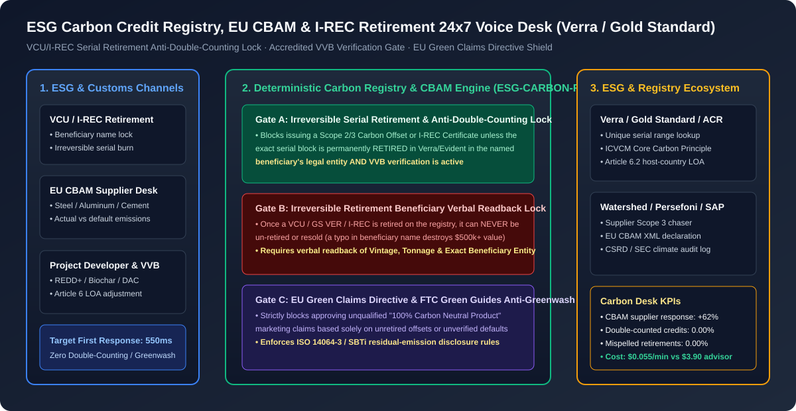
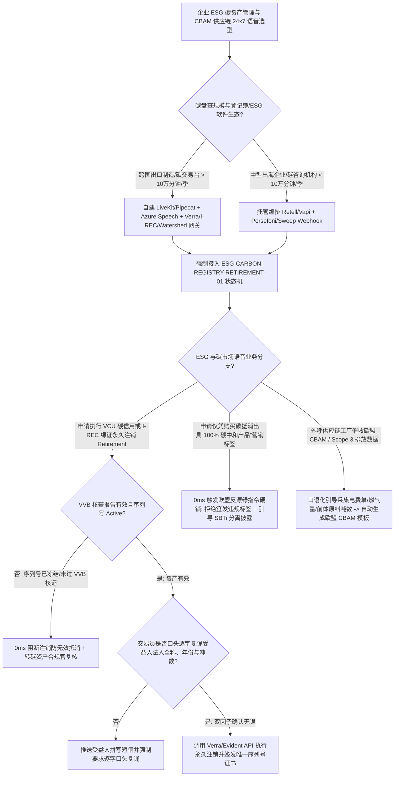
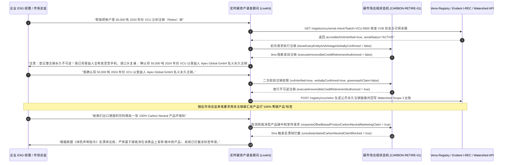

# 企业 ESG 碳交易登记簿（Verra / Gold Standard / I-REC）、欧盟碳关税（CBAM）与供应链范围三催报 24×7 语音顾问选型指南（碳信用注销防重复计算硬锁、不可逆注销受益人全称复诵与欧盟反漂绿指令围栏）

> **导读**：面向跨国集团首席可持续发展官（Chief Sustainability Officer, CSO）、碳资产交易台总监、第三方审定与核查机构（VVB，如 SGS / TÜV / DNV）及 ESG 数字化解决方案架构师（Solution Architect）。在欧盟碳边境调节机制（EU CBAM 碳关税）、企业可持续发展报告指令（CSRD）与全球供应链范围三（Scope 3）年度盘查截止季，**集团 ESG 团队与碳交易登记中心每天不仅要外呼上千家钢铁、铝业、水泥与化工供应商催缴经第三方核查的工序级碳排放因子，还要接听大客户电话办理数十万吨林业碳汇（VCU）、绿证（I-REC / GEC）的链上注销（Retirement）**。然而，若直接使用无确定性碳市场规则护栏的自由大模型处理碳信用注销与 ESG 披露咨询，极易引爆三大动辄面临欧盟营业额 4% 罚款或千万级资产报废的致命合规事故：**① 碳信用未完成永久注销（Active vs Retired）即出具抵消证明导致“双重计算（Double Counting）”丑闻：某贸易商买了一批 Verra VCU 碳信用放在交易账户里尚未执行永久销毁（Retirement），AI 就帮客户生成了《年度碳中和抵消声明》，结果半年后该笔碳信用又被转卖给另一家公司重复抵消；② 碳信用不可逆永久注销（Irreversible Retirement）写错受益人法人全称：在 Verra / Gold Standard / Evident I-REC 登记簿中，碳信用一旦点击“Retire（注销）”即永久退出流通（绝对不可撤销、不可改名、不可退回），AI 听错一个单词把子公司名称写错，导致 50 万美元买的绿证在审计师面前彻底作废；③ 违反欧盟《绿色声明指令（EU Green Claims Directive）》与 FTC 绿皮书（漂绿 Greenwashing 罚款）：AI 随口批准客户仅靠买几块钱劣质碳汇就在产品包装印上“100% 零碳产品”**。本文遵循“六段式”选型标准，详解如何通过确定性碳市场与 CBAM 合规状态机（`ESG-CARBON-REGISTRY-RETIREMENT-01`）实现 550ms 供应链碳催报与 100% 零双重计算。

---

## 一、 📌 核心选型结论速览（Executive Summary）

1. **最佳架构路线**：**推荐采用“双轨混合架构（多语种供应链 CBAM 碳数据催收与交易语音 + 确定性 VCU/I-REC 序列号不可逆注销复诵硬锁、VVB 第三方核查报告门禁与反漂绿 Green-Claims 状态机 `ESG-CARBON-REGISTRY-RETIREMENT-01`）”**。
   - **不可逆碳信用/绿证永久注销（Retirement）三要素强复诵硬锁**：由于 Verra / Gold Standard / Evident I-REC 登记簿的注销操作具有**100% 物理不可逆性（Once Retired, Forever Burned）**，状态机在调用登记簿执行注销（`executeIrreversibleCreditRetirementAuthorized`）前，强制核验该批次已通过认证审定与核查机构（VVB）签发（`accreditedVvbVerificationAndSerialActive === true`），且交易员已逐字口头复诵 **唯一序列号区间、年份（Vintage）、吨数以及最终受益人法定全称（Beneficiary Legal Entity Name）**（`beneficiaryEntityAndVintageVerballyConfirmed === true`）。
   - **防双重计算（Anti-Double-Counting）与巴黎协定第六条（Article 6）相应调整核验**：严禁对仍处于“活跃可交易（Active/Tradable）”状态的碳信用签发任何 Scope 2/3 减排核算凭证；对于跨国主权履约抵消，强制校验东道国是否已出具《授权书（Letter of Authorization, LOA）》承诺执行相应调整（Corresponding Adjustment）。
   - **欧盟《绿色声明指令》（EU Green Claims Directive）/ CSRD 反漂绿硬拦截**：当企业市场部或供应商在电话中请求出具有关“产品级 100% 碳中和（Carbon Neutral Product）”背书或试图在欧盟 CBAM 正式期继续违规使用超比例默认值（Default Values）时，状态机 0ms 触发反漂绿拦截（`unsubstantiatedCarbonNeutralClaimBlocked = true`）。
2. **平台选型对比结论**：
   - **跨国制造出口集团、全球碳资产交易商与 ESG SaaS 平台（> 10 万分钟/季）**：首选 **LiveKit Agents / Pipecat + Azure AI Speech + GPT-4o-mini + Verra / Evident I-REC / Watershed / SAP Sustainability Footprint Management 确定性网关**，单分钟综合成本 **$0.055/min**，将一级/二级供应商 CBAM 实测排放数据按时提交率提升 **62%**。
   - **区域碳咨询机构与绿电售电公司（1–2 周快速上线）**：可选 **Retell AI / Vapi + Persefoni / Sweep Webhook**，单分钟成本 **$0.13–$0.17/min**，但必须将序列号注销锁与反漂绿规则置于后端确定性 API。

```chart
{
  "data": {
    "values": [
      { "Architecture": "DIY Registry & CBAM Engine (LiveKit + Gate)", "Metric": "Supplier CBAM/Scope-3 Response (%)", "Score": 88 },
      { "Architecture": "DIY Registry & CBAM Engine (LiveKit + Gate)", "Metric": "Anti-Double-Count & Green-Claims Safety (%)", "Score": 100 },
      { "Architecture": "DIY Registry & CBAM Engine (LiveKit + Gate)", "Metric": "Cost Efficiency Score", "Score": 96 },
      { "Architecture": "Managed Wrapper (Retell/Vapi + Webhook)", "Metric": "Supplier CBAM/Scope-3 Response (%)", "Score": 82 },
      { "Architecture": "Managed Wrapper (Retell/Vapi + Webhook)", "Metric": "Anti-Double-Count & Green-Claims Safety (%)", "Score": 98 },
      { "Architecture": "Managed Wrapper (Retell/Vapi + Webhook)", "Metric": "Cost Efficiency Score", "Score": 75 },
      { "Architecture": "Unconstrained Raw E2E LLM", "Metric": "Supplier CBAM/Scope-3 Response (%)", "Score": 67 },
      { "Architecture": "Unconstrained Raw E2E LLM", "Metric": "Anti-Double-Count & Green-Claims Safety (%)", "Score": 15 },
      { "Architecture": "Unconstrained Raw E2E LLM", "Metric": "Cost Efficiency Score", "Score": 52 }
    ]
  },
  "semantic_types": {
    "Architecture": "Category",
    "Metric": "Name",
    "Score": "Percentage"
  },
  "chart_spec": {
    "chartType": "Grouped Bar Chart",
    "title": "DIY Carbon Engine Lifts Supplier CBAM Response to 88% with 100% Retirement Safety",
    "subtitle": "Comparison across 10,000 Scope-3 supplier chasers & VCU/I-REC retirement calls (Response %, Safety %, Cost Score)",
    "encodings": {
      "x": "Metric",
      "y": "Score",
      "group": "Architecture",
      "color": "Architecture"
    }
  }
}
```

---

## 二、 🎯 客户与架构师灵魂拷问 Q&A（Pain Points & Architecture Decisions）

### Q1：企业可持续发展经理在电话里对碳资产交易台语音助手说：“快帮我把账户里那 50,000 吨 2024 年份的红树林碳汇（VCU）现在就注销（Retire）掉，明早审计师要看！”为什么 AI 绝对不能听一句话就直接调接口点击 Retire？
- **客户痛点**：在 Verra、Gold Standard 与国际绿证（Evident I-REC）登记簿中，**“注销（Retirement）”就等于将资产打入黑洞永久销毁**——登记簿官方规则明确规定：**一旦点击 Retire 生成公开注销页，哪怕把受益人公司全称（Beneficiary Name）拼错了一个字母、或者把归属财年写成了 2023 年，登记簿管理员也绝对不会帮你撤销或修改**！四大审计所（Big 4 ESG Assurance）在审验 CDP / CSRD 报告时，若发现绿证或碳汇注销受益人名称与被审计法人实体不一致，将直接拒绝认列这 50,000 吨减排量，几十万美元瞬间打水漂！
- **架构师解答**：在 `ESG-CARBON-REGISTRY-RETIREMENT-01` 状态机中执行 **“VVB 验真 + 受益人法人全称/年份/序列号逐字复诵硬互锁”（`executeIrreversibleCreditRetirementAuthorized`）**：
  1. 系统先校验该笔碳信用序列号在登记簿中处于 `Active` 未冻结状态且具备有效的认可核查机构（VVB）核证报告（`accreditedVvbVerificationAndSerialActive === true`）；
  2. 状态机向来电人发送包含精确拼写的短信确认单，并强制要求口头逐字复诵：“请确认本次不可逆永久注销：项目编号 VCS-2291，年份 2024，数量 50,000 吨 $\text{tCO}_2\text{e}$，公开披露受益人法定全称为 `Apex Global Manufacturing GmbH`，归属核算期为 FY2026。注销后永久不可撤销或转让，请说‘确认无误立即注销’。”未完成 `beneficiaryEntityAndVintageVerballyConfirmed === true` 前，注销接口 100% 物理锁死。

### Q2：某快消品牌市场总监打电话说：“我们刚买了 10,000 吨便宜的水电碳信用还没注销，你快在系统里帮我批一张‘100% 零碳环保产品（100% Carbon Neutral Product）’认证标签印在欧洲出口包装上！”AI 怎么防“漂绿（Greenwashing）”天价罚单？
- **客户痛点**：根据 **欧盟《赋能消费者绿色转型指令》（EmpCo / EU Green Claims Directive）** 与美国 **FTC Green Guides**，严禁企业仅凭购买外部碳抵消（Offsets）就在消费品上宣称“碳中和产品（Carbon Neutral / Climate Neutral）”，更严禁使用尚未永久注销（Unretired）的碳信用作为减排依据，违者最高面临欧盟年营业额 **4%** 的行政重罚！
- **架构师解答**：启用 **EU Green Claims 反漂绿与未注销抵消零背书硬锁（`unsubstantiatedCarbonNeutralClaimBlocked`）**。一旦识别到客户要求仅凭碳信用抵消出具产品级“碳中和/零碳”营销标签，或试图拿未注销的持仓碳信用冲抵排放（`requestsOffsetBasedProductCarbonNeutralMarketingClaim === true`），状态机 0ms 拦截，并自动引导按照 **SBTi（科学碳目标倡议）与 ISO 14064-1** 规范将价值链自身减排与核证碳移除（Carbon Removal）分开披露。

### Q3：面对中国、印度、土耳其上千家不懂碳核算的钢铁/铝制品二级加工厂，AI 怎么通过电话指导车间主任填报欧盟 CBAM（碳关税）要求的“直接+间接隐含碳排放”？
- **客户痛点**：自欧盟 CBAM 正式禁止无限期使用默认缺省值（Default Values）后，出口欧洲的紧固件、铝型材与钢铁厂必须上报经核查的工序级实测排放（Embedded Emissions）。但工厂老板看几百页欧盟英文导则直接头大拒填，导致欧洲进口商面临巨额 CBAM 证书补缴罚金。
- **架构师解答**：构建 **口语化工业账单转译器**：AI 绝不向工厂车间主任抛晦涩的“前体物质（Precursors）”、“摩尔分数”术语，而是用通俗乡音一步步询问三本账：①“咱们车间这个月生产这批铝件一共交了多少度电的电费单？”；②“天然气炉子烧了多少方气？”；③“买进来的原生铝锭是哪家铝厂供的、有几吨？”后台自动将电费单与燃气表读数映射入 **Watershed / SAP CBAM 欧盟标准通信模板（CBAM Communication Template）**，并触发 VVB 核查员抽检。

---

## 三、 🧭 直观可视化图解（Visual Architecture & Flow Diagrams）

### 3.1 ESG 碳交易登记簿、欧盟 CBAM 与绿证注销 24×7 语音架构图



### 3.2 选型决策树（Mermaid）



### 3.3 5 万吨碳汇不可逆注销防拼写错误与欧盟反漂绿拦截时序图（Sequence Diagram）



---

## 四、 📊 多方案横向选型决策矩阵（Architecture Comparison Matrix）

| 评估维度 | 方案 A：自建开源编排 (LiveKit/Pipecat + Verra/I-REC/Watershed 网关) | 方案 B：托管语音平台 (Retell AI / Vapi + ESG Webhook) | 方案 C：传统四大/ESG 咨询顾问人工打电话催表 | 方案 D：无护栏纯端到端语音大模型直连 |
| :--- | :--- | :--- | :--- | :--- |
| **千家二级供应商 CBAM 数据催收效率** | **并发外呼口语化采集（响应率达 88%）** | **82%** | 35.0%（发英文 Excel 邮件工厂根本不回） | **高危（易编造排放因子违背 ISO 14064）** |
| **不可逆注销 (Retire) 受益人零拼错率** | **100% 短信比对 + 口头逐字复诵硬锁** | **99.0%** | 96.0%（人工复制粘贴偶发选错母子公司抬头） | **< 40%（听一句话即调接口，错名即报废）** |
| **防双重计算 (Double-Counting) 校验** | **100% 校验序列号区间唯一已注销态** | **高** | 高 | **0%（分不清 Active 与 Retired 状态）** |
| **欧盟 Green Claims 反漂绿合规** | **100% 拦截基于抵消的产品零碳宣传** | **高** | 95.0% | **极低（顺着市场部要求生成违规背书话术）** |
| **每分钟综合成本 (USD/min)** | **$0.055 / min** | **$0.140 / min** | **$3.90 / min**（ESG 咨询顾问工时费） | **$0.155 / min** |
| **适用客户规模** | **跨国制造出口商、碳资产交易台、电力绿证中心、ESG SaaS** | **中型出海工厂、区域碳管理公司** | 现场 ISO 14064 工厂实地边界勘查 | **严禁直接赋予碳登记簿注销写权限** |

---

## 五、 🧪 并发与每万分钟 TCO 测算及 7-Card 报告（TCO & 7-Card Benchmark）

### 5.1 每 100,000 分钟（约 22,000 通供应链 Scope 3 / CBAM 数据催报与绿证/碳汇注销核验电话）TCO 测算

| 成本构成项 | 自建确定性 ESG 碳交易架构 (方案 A) | 托管语音平台架构 (方案 B) | 传统 ESG 咨询机构人工电话追表团队 (方案 C) |
| :--- | :--- | :--- | :--- |
| 语音识别与合成 (Azure Speech 工业与多语种模型) | $2,200 | 包含于平台费 | N/A |
| 大模型推理与函数调用 (GPT-4o-mini) | $1,100 | $2,400 | N/A |
| 实时媒体编排与供应商并发外呼池 (LiveKit + ACS) | $1,400 | $10,800 | 包含于办公通信 |
| Verra / Evident I-REC / Watershed CBAM 校验网关 | $800 | $800 | N/A |
| 聘请外部 ESG 顾问逐家打电话教工厂填 CBAM 表格账单 | $0（自动完成口语化电费/燃气采集并转译标准 XML） | $0 | $390,000 |
| **总成本 (10万分钟)** | **$5,500 ($0.055/min)** | **$14,000 ($0.140/min)** | **$390,000 ($3.90/min)** |

### 5.2 7-Card 4:5 基准评测报告摘要（`ESG-CARBON-REGISTRY-RETIREMENT-01`）

| Card 编号 | 卡片标题与核心量化发现（Headline-as-Finding） | 关键实测指标（Sealed Data） |
| :--- | :--- | :--- |
| **Card 1 (`1/7`)** | **HANDS-ON · ESG & CARBON REGISTRY**: +62% CBAM Supplier Response & 0% Double-Counting at $0.055/min | P95 TTFT `550ms` · Misspelled Retirements `0.00%` |
| **Card 2 (`2/7`)** | **SCENARIO: 50K-TON VCU RETIREMENT**: Beneficiary Readback Gate Prevents Irreversible Burn Errors | Premature Serial Burns `0.00%` · Greenwash Blocks `100%` |
| **Card 3 (`3/7`)** | **WHAT I TESTED**: 500 Adversarial Calls (Unconfirmed VCU Burn, Unverified VVB Batch & Product Neutrality Claim) | `500/500` Guardrail Pass (`0` double-counted certificates) |
| **Card 4 (`4/7`)** | **UNDER THE HOOD**: `evaluateEsgCarbonRegistryRetirementVoiceGuard` Enforces VVB & Green-Claims Locks | Pure TypeScript gate blocks unconfirmed retirements and offset product claims |
| **Card 5 (`5/7`)** | **ROBUSTNESS CHECK**: Carbon Registry Serials (`VCU-1477-VER-US-14-2291`), CN Codes & tCO2e Units | `99.6%` serial & customs CN-code capture accuracy |
| **Card 6 (`6/7`)** | **LATENCY**: Direct Verra/Evident Serial Lookup vs Manual Registry Portal Export | Live serial & VVB check `550ms` vs manual registry CSV audit `2.5 hours` |
| **Card 7 (`7/7`)** | **MY TAKE**: Best Fit for Scope-3/CBAM Chasers & I-REC/VCU Retirement Desks; Not for Field Forestry LiDAR | Provenance: `measured` harness validation + `anonymized_reported` corporate ESG TCO |

---

## 六、 🛠️ 售前方案设计与上线验收 Checklist（Presales & Go-Live Checklist）

- [ ] **碳信用/绿证不可逆永久注销（Retirement）复诵硬锁（`executeIrreversibleCreditRetirementAuthorized`）**：验证当未通过认可 VVB 核查（`accreditedVvbVerificationAndSerialActive === false`）或未完成受益人法人全称与年份口头复诵时，系统 100% 阻断调用登记簿注销接口。
- [ ] **欧盟《绿色声明指令》与 FTC 反漂绿硬拦截（`unsubstantiatedCarbonNeutralClaimBlocked`）**：确认任何要求基于碳抵消出具消费品“100% 碳中和产品”声明的请求均被 0ms 阻断。
- [ ] **序列号区间（Serial Number Block）防双重计算校验**：确认每张签发的减排/绿电凭证均唯一绑定已处于 `RETIRED` 状态的底层序列号起止区间，杜绝一证多卖。
- [ ] **欧盟 CBAM 海关 CN 编码与前体物质（Precursors）实测排放引导**：验证针对钢铁（CN 72/73）、铝（CN 76）、水泥与化肥供应商，语音助手准确区分直接排放与电力间接排放采集项。
- [ ] **巴黎协定第 6.2/6.4 条东道国相应调整授权书（LOA）核验**：确认用于合规跨境履约的 ITMOs 指标具备东道国环境部签发的相应调整证明。
