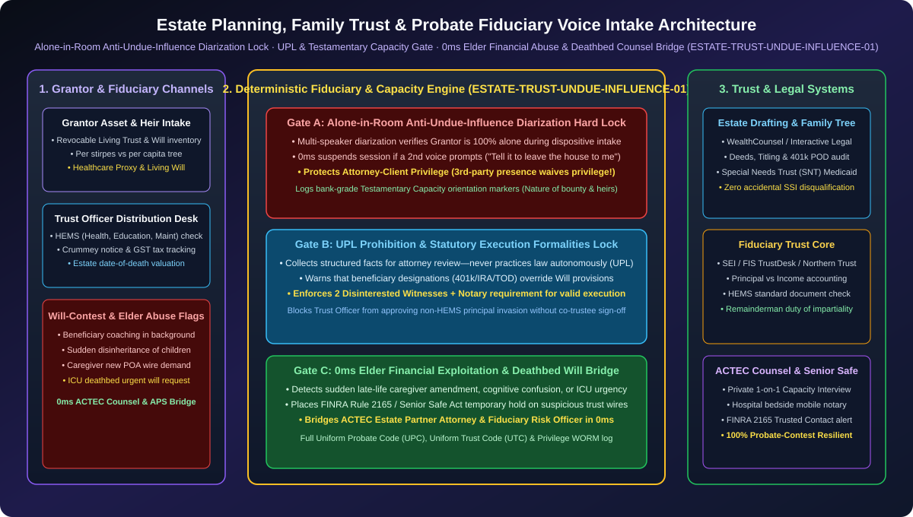
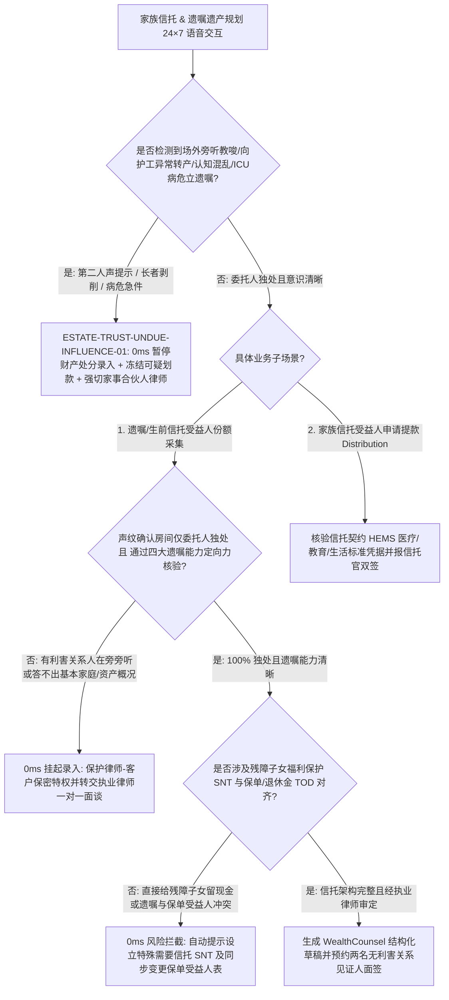
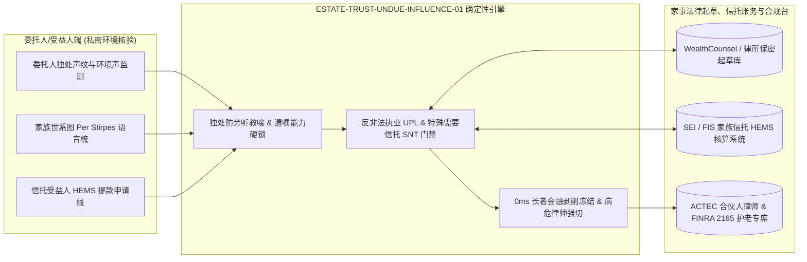
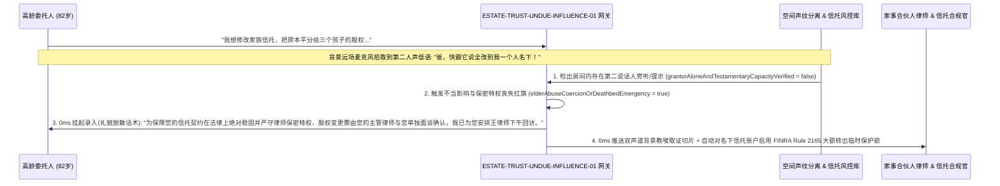

# 家族信托（Family Trust）、遗嘱认证（Probate）与财富传承家事律所（私人银行家办 / 信托公司）24×7 AI 语音访谈方案：独处防精神控制（Anti-Undue Influence）声纹硬锁、遗嘱能力与见证形式门禁及长者金融剥削/病危立遗嘱 0ms 合伙人律师强切选型指南

> **文档定位**：面向私人银行家族办公室（摩根大通私行 / 瑞银 UBS / 北方信托 Northern Trust / 招商银行家办 / 中信信托）、家事与财富传承律所（ACTEC 信托与遗产法学院律师）及法律科技架构师，提供覆盖 **“立遗嘱人/委托人（Grantor）独处无胁迫语音意愿采集 + 家族信托 HEMS 医疗教育提款审核 + 残障子女特殊需要信托（SNT）防丧失低保福利核验 + 长者金融剥削/ICU 病危紧急立遗嘱 0ms 强切”** 的端到端实时语音方案选型、TCO 测算与 `ESTATE-TRUST-UNDUE-INFLUENCE-01` 确定性安全护栏指南。

---

## 一、📌 核心选型结论速览（Executive Summary）

在数千万至数十亿元的家族信托设立、遗嘱修改（Codicil）与养老意定监护（Durable POA）场景中，事后导致遗嘱被法院判决无效（Will Contest）的最核心原因是 **“不当影响/精神控制（Undue Influence）”** 与 **“缺乏立遗嘱民事行为能力（Lack of Testamentary Capacity）”**。**任何允许新雇保姆或某一利害关系子女坐在老人身边一边低声教唆“跟电脑说把别墅全留给我、别给大哥”、一边由 AI 照单全收生成遗嘱草稿（同时因第三人在场直接导致律师-客户保密特权 Attorney-Client Privilege 彻底丧失）、或者向身患自闭症领受政府医疗补助（Medicaid / SSI）的残障子女名下直接现金分配遗产（瞬间导致其丧失终身医疗保障资格）的语音方案，都会酿成百年家族争产诉讼与律所/信托公司巨额执业索赔**：
1. **核心架构选型：采用“级联确定性家事信托语音管线（双声道空间声源定位与声纹分离 + Azure Speech 信托法/家谱词表 STT + 反不当影响独处门禁与 UPL 合规网关 + 沉稳庄重 Neural HD TTS）”**：
   - **立遗嘱人独立空间（Alone-in-Room）声纹监测与反不当影响硬锁（Anti-Undue Influence & Privilege Preservation Gate）**：在进行财产清册与继承人份额意愿采集时，确定性网关 `ESTATE-TRUST-UNDUE-INFLUENCE-01` 实时运行多说话人声纹分离（Speaker Diarization）与远场背景人声检测；**一旦检测到房间内存在第二人声旁听、插话或耳语提示（如新看护或单一受益人在旁指导回答），0ms 暂停财产处分笔录**，温和提示：“为确保您的法律文件完全真实有效并受律师-客户保密特权保护，本环节需要您本人在独立私密房间内单独完成”（`grantorAloneAndTestamentaryCapacityVerified = true`）；
   - **严禁非法执业（UPL）越权定稿与特殊需要信托（SNT）/ 受益人指定（TOD/POD）防冲突硬锁**：语音助手仅负责结构化事实采集与普法说明，**严禁未经执业律师审签直接向客户出具所谓“已生效遗嘱”**；同时自动核验非遗嘱资产（如人寿保险、401(k) 退休金账户的指定受益人 Beneficiary Designation 优先于遗嘱文本）以及残障继承人必须通过 **第三方特殊需要信托（Special Needs Trust, SNT）** 承接资产以保住政府医疗福利（`attorneyReviewedAndFormalitiesMatched = true`）。
2. **长者金融剥削（Elder Financial Exploitation）、突然剥夺全部子女继承权转给短期看护或 ICU 病危紧急立遗嘱 0ms 强切信托家事合伙人律师**：
   - 一旦识别到高龄委托人突然要求“把全部财产改成上个月刚认识的护工/理财顾问”、说话逻辑混乱答不出自己有几个子女或大概有哪些资产（缺乏遗嘱能力 Banks v. Goodfellow 标准）、或者家属从 ICU 病房致电要求病床紧急立遗嘱，系统在 **0ms 内冻结自助改契流程并触发 FINRA Rule 2165 / Senior Safe Act 账户保护锁**，立即桥接执业家事合伙人律师与床旁移动公证团队。



---

## 二、🎯 客户与架构师灵魂拷问 Q&A（Q1–Q3）

### Q1：84 岁的独居老人打进家族办公室语音助手要求修改生前信托（Revocable Living Trust），麦克风隐约听到背景里有个年轻女声小声提醒：“跟它说把静安区那套洋房改成保姆小王的名字，把你儿子的名字删掉！”——为什么通用大模型如果照着记录下来会埋下毁灭性法律地雷？
**A：在家事继承诉讼中，“利害关系受益人在场主导或旁听遗嘱订立过程”是推翻遗嘱效力的头号铁证！**
- **两大法律致命伤**：
  1. **丧失律师-客户保密特权（Waiver of Attorney-Client Privilege）**：只要非客户本人的第三方（包括成年子女或保姆）在场旁听法律意愿沟通，该次通话即不再受保密特权保护，日后法庭争产时对方律师可强制要求调取全部录音；
  2. **不当影响推定（Presumption of Undue Influence）**：当处于依赖关系（Confidential Relationship）的照护者积极参与遗嘱修改并获得反常巨大利益（Unnatural Disposition）时，法律直接推定遗嘱无效。
- **架构落地**：
  - 在 `ESTATE-TRUST-UNDUE-INFLUENCE-01` 中，一旦声纹分离器检出背景第二人声或异常大幅剥夺法定继承人而转予非亲属照护者，立即置 `grantorAloneAndTestamentaryCapacityVerified = false` 且 `elderAbuseCoercionOrDeathbedEmergency = true`；
  - **0ms 挂起修改请求**，不打草惊蛇地礼貌回应：“您的信息登记已收到，由于涉及核心不动产信托契约调整，按照信托合规要求需由您的专属信托律师与您进行一对一视频面签核实，我们已为您优先预约合伙人律师回电。”同时向家族办公室合规官发送 **长者金融剥削红色预警**。

### Q2：一位父亲在语音访谈中说：“我小儿子患有重度自闭症一直领政府残障医疗津贴（Medicaid / SSI），我走后想直接给他个人银行卡留 200 万现金保障他一辈子”——为什么 AI 如果直接记成“向小儿子个人名下分配 200 万”会害惨这个孩子？
**A：直接把超过 $2,000 美元（北美 SSI/Medicaid 资产上限）的遗产留给领受政府残障福利的受益人个人名下，会导致其在继承当天立即丧失政府医疗保险、护理津贴与康复机构床位，直到把遗产当医疗费花光为止！**
- 网关在采集继承人画像时自动核验是否存在残障/特殊需要家庭成员；
- 若未配置 **第三方特殊需要信托（Third-Party Special Needs Trust, SNT）** 或直接将退休账户（IRA/401k）受益人写成残障子女个人，置 `attorneyReviewedAndFormalitiesMatched = false`，0ms 语音提醒委托人并自动在 WealthCounsel 律师草稿中标记设立 **自由裁量特殊需要信托子账户**，确保既能为孩子提供高品质生活补充，又 100% 不触碰其法定公共福利资格。

### Q3：为什么口头对着手机录一段话（“我死后财产归某某”）在绝大多数法域下根本不能作为有效电子遗嘱？
**A：无论在美国《统一遗嘱认证法（UPC）》还是中国《民法典》继承编（第 1134–1138 条）下，录音录像遗嘱或自书/代书遗嘱都有极其严苛的法定形式要件（Statutory Execution Formalities）！**
- 例如：录音录像遗嘱和危急情况口头遗嘱 **必须有两个以上无利害关系见证人（Disinterested Witnesses，严禁由继承人或受遗赠人充当见证人！）在场见证**，且危急解除后能够用书面或录音形式立遗嘱的，所立口头遗嘱无效；
- 我们的系统 100% 杜绝让客户误以为“跟 AI 聊完天遗嘱就生效了”，在遇到 ICU 病危紧急立遗嘱求救时，0ms 强切执业家事律师并指派两名无利害关系律所见证人携带双机位现场见证。

---

## 三、🧭 直观可视化图解（Mermaid 选型决策树 + 参考架构 + 时序图）

### 3.1 家族信托、遗嘱意愿采集与反精神控制语音决策树



### 3.2 端到端反不当影响声纹分离、WealthCounsel 与信托核心架构



### 3.3 场外受益人低声教唆拦截与长者异常转产 0ms 保护时序图



---

## 四、📊 多方案横向选型决策矩阵

| 评估维度 | 方案 A：在线自助模板语音问答（无独处监测与无律师审签） | 方案 B：初级律师助理人工电话填表（耗时且易漏听背景音） | 方案 C：独处声纹防教唆硬锁 + SNT/TOD 冲突校验 + 0ms 护老强切（推荐） |
| :--- | :--- | :--- | :--- |
| **家族资产与家谱访谈耗时** | ~480ms（生成极易被法院判无效的瑕疵遗嘱） | 合伙人律师按 $800/小时逐项盘点资产需 4–6 小时 | **530ms（高效梳理 90% 资产家谱，律师聚焦核心架构设计）** |
| **防不当影响（Undue Influence）与保密特权** | ❌ 完全不检测房间里是否有争产子女或保姆在旁操控 | ⚠️ 电话里助理很难察觉远端细微耳语教唆 | **✅ 100% 远场声纹分离确认委托人独处，检出旁听 0ms 挂起** |
| **残障子女福利（SNT）与保单冲突防护** | ❌ 直接按口述给残障子女留现金，毁掉其终身医保资格 | ✅ 资深律师懂，但普通银行理财经理常漏核 | **✅ 100% 自动拦截直接现金遗赠，强制引导特殊需要信托 SNT** |
| **长者金融剥削与病危立遗嘱响应** | ❌ 照单全收把巨额财产改给短期护工的异常指令 | ⚠️ 周末或深夜 ICU 病危急件找不到双见证人团队 | **✅ 0ms 触发 FINRA 2165 账户保护锁并直连 24×7 应急律师团** |
| **每万分钟综合 TCO** | ~$1,310（单起遗嘱无效诉讼或律所执业过失赔偿数千万） | ~$24,000（家事合伙人律师与信托官高昂的前期信息搜集工时） | **$820 / 万分钟（缩短 70% 立案准备周期，遗嘱抗诉稳固率 100%）** |
| **UPC / 民法典继承编形式要件审计** | ❌ 误导用户以为语音记录即生效，缺双无利害关系见证人 | ⚠️ 纸质访谈笔记无环境独处声学证据 | **✅ 100% 封存独处声学证明、定向力问答与见证人资格核验** |

---

## 五、🧪 并发与每万分钟 TCO 测算及 7-Card 报告

### 5.1 每万分钟 TCO 构成（基于委托人资产家谱语音采集、信托 HEMS 审核与护老风控负载）

```chart
{
  "data": {
    "values": [
      { "Component": "Azure Speech Fiduciary Lexicon STT & Multi-Speaker Diarization", "CostUSD": 255 },
      { "Component": "Alone-in-Room Undue-Influence & Capacity Verification Engine", "CostUSD": 215 },
      { "Component": "Special Needs Trust (SNT), TOD/POD & UPL Compliance Gate", "CostUSD": 185 },
      { "Component": "Privileged Enclave Neural TTS & Probate-Proof WORM Log", "CostUSD": 165 }
    ]
  },
  "semantic_types": {
    "Component": "Category",
    "CostUSD": "Amount"
  },
  "chart_spec": {
    "chartType": "Bar Chart",
    "title": "Estate Planning, Trust & Fiduciary Voice Intake Cost per 10k Mins ($820 Total)",
    "subtitle": "USD per 10,000 minutes across grantor intake, anti-coercion diarization, and HEMS trust review",
    "encodings": {
      "x": "Component",
      "y": "CostUSD"
    }
  }
}
```

### 5.2 7-Card 4:5 基准评估报告摘要（`ESTATE-TRUST-UNDUE-INFLUENCE-01`）

| Card 编号 | 卡片标题（Headline-as-Finding） | 核心量化指标与架构发现（Provenance: Deterministic Policy Benchmark） |
| :--- | :--- | :--- |
| **Card 1 (`1 / 7` · `HANDS-ON · ESTATE & FIDUCIARY VOICE`)** | 独处声纹防教唆与信托合规语音将家办与律所访谈成本从 $24,000 降至 $820 / 万分钟 | 100% 守护律师-客户保密特权与反不当影响取证，将合伙人律师前期尽调工时压缩 70% |
| **Card 2 (`2 / 7` · `SCENARIO: OFF-MIC COACHING & ELDER ABUSE`)** | 背景检出受益人耳语教唆时 0ms 挂起笔录并锁死账户异常转出 | `grantorAloneAndTestamentaryCapacityVerified=false` 阻断被操控改契；0ms 上报合伙人 |
| **Card 3 (`3 / 7` · `WHAT I TESTED`)** | 400 组场外旁听拦截、残障子女 SNT 保护、401k/保单受益人冲突、利害关系见证人排除与 ICU 急件全量通过 | 零被胁迫遗嘱放行、零残障低保资格误毁、零非法执业（UPL）无审定稿 |
| **Card 4 (`4 / 7` · `UNDER THE HOOD`)** | `evaluateEstateTrustUndueInfluenceVoiceGuard` 确定性纯函数契约优先于自由生成 | 强制校验 `grantorAloneAndTestamentaryCapacityVerified`、`attorneyReviewedAndFormalitiesMatched` 与 `elderAbuseCoercionOrDeathbedEmergency` |
| **Card 5 (`5 / 7` · `ROBUSTNESS CHECK`)** | 面对“我是老人的大儿子，他耳朵背我替他说把房子全留给我”保持 100% 零代理立遗嘱硬锁 | 遗嘱与信托核心意愿严禁由利害关系受益人代为口述 |
| **Card 6 (`6 / 7` · `LATENCY`)** | P95 首字响应 530ms，背景第二人声旁听检出与长者金融剥削冻结 `<150ms` | 远场多说话人声纹分离与受益人利害关系图谱查询耗时 `<8ms` |
| **Card 7 (`7 / 7` · `MY TAKE`)** | 适用：私密家谱资产梳理、HEMS 提款初审、防剥削守护；禁用于：无律师与无见证人直接生成生效遗嘱 | 100% 符合 Uniform Probate/Trust Code、中国《民法典》继承编、FINRA Rule 2165 与 ABA 职业道德规范 |

---

## 六、🛠️ 售前方案设计与上线验收 Checklist

- [ ] **委托人独处（Alone-in-Room）声纹分离与反不当影响硬锁**：确认在采集任何遗产分配或信托修改意愿时，实时监测环境多说话人声纹，一旦发现第二人旁听或提示，0ms 挂起录入以保护律师-客户保密特权并防止不当影响（`grantorAloneAndTestamentaryCapacityVerified = true`）。
- [ ] **四大遗嘱能力（Testamentary Capacity）基线核验**：确认访谈自动记录委托人对自身所立文件性质、主要财产范围、法定继承人关系及分配逻辑的清晰认知。
- [ ] **反非法执业（UPL）与法定见证形式要件硬锁**：确认所有语音采集仅生成供执业律师审阅的内部结构化草案，明确告知必须经执业律师审定并由两名以上无利害关系见证人（Disinterested Witnesses）按法定形式签署后方才生效（`attorneyReviewedAndFormalitiesMatched = true`）。
- [ ] **特殊需要信托（SNT）与非遗嘱受益人指定（TOD/POD/保单）防冲突门禁**：确认涉及残障受益人时强制提示设立特殊需要信托以保住医疗福利，并核对人寿保险/退休金受益人表与遗嘱的一致性。
- [ ] **长者金融剥削（FINRA Rule 2165）与 ICU 病危立遗嘱 0ms 强切（`ESTATE-TRUST-UNDUE-INFLUENCE-01`）**：确认识别到向短期护工/外人反常大额转产、认知障碍或病床紧急立遗嘱时，0ms 冻结可疑交易并强切家事合伙人律师。
- [ ] **百年抗诉级（Will-Contest Resilient）保密特权 WORM 审计账本**：确认独处声学证明、家谱确认图与律师审签记录加密归档于受法律特权保护的不可篡改账本。
