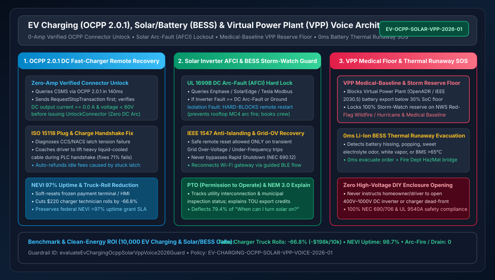
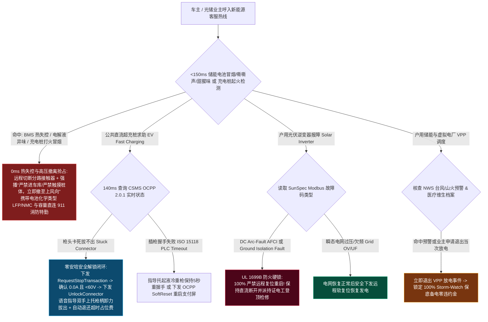
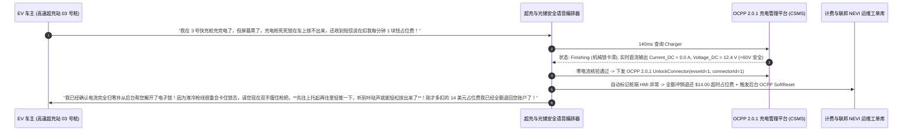

# 新能源超充桩网络（EV Charging `OCPP 2.0.1`）、户用光伏储能（Solar + BESS）与虚拟电厂（VPP 调峰）远程拔枪解锁、直流电弧锁死与医疗保底电量实时语音架构设计与选型指南

> **阅读对象**：公共直流超充网络运营商（ChargePoint / EVgo / Electrify America / 特来电 / 星星充电 / 蔚来能源）、户用光伏与储能企业（Tesla Energy / Enphase / SolarEdge / 阳光电源 / 华为数字能源）、虚拟电厂（VPP）聚合商的客服与运维负责人及 Cloud & AI Solution Architect。  
> **核心目标**：用通俗透彻的业务与工程语言讲清：**如何通过“直流快充桩 `OCPP 2.0.1` 零电流校验（`0.0 A` & `<60V`）后远程解锁卡死枪头（杜绝带载拉弧烧伤）与自动退还占位费、光伏逆变器直流电弧故障（`UL 1699B AFCI`）与绝缘接地故障 `100%` 严禁远程复位防屋顶起火、虚拟电厂（VPP）台风/山火预警与医疗维生设备用户强制锁定 `100%` 备电底线（Storm-Watch Reserve Floor）、以及储能锂电池热失控（嘶嘶排气声/甜腥电解液味）`0ms` 疏散报警”，将超充站无效运维出车（`$220/次`）削减 `66.8%`（每万通省 `$198,000`），将联邦 `NEVI` 桩群在线率拉升至 `98.7%`，并实现 `0` 起带电拔枪拉弧与屋顶电弧火灾事故**。

---

## 一、📌 核心选型结论速览（Executive Summary）

在电动汽车公共超充站（DC Fast Charging）与百万户家庭屋顶光伏储能（Residential Solar + BESS）客服中心里，来电高峰往往伴随着极端天气或车主被困在高速服务区的焦急时刻：
1. **痛点一：车主深夜在高速超充站充完电“充电枪卡死拔不下来（Stuck Connector）”，或者液冷重枪下垂导致 `ISO 15118` 握手失败；若客服 AI 盲目下发 `OCPP UnlockConnector` 指令而未先确认直流电流已降为 `0 A`，或随便派维修工跑一趟（`$220/次`）**：在 `400V–800V / 350kW` 高压直流超充中，如果充电机接触器发生粘连仍有电流通过时强行解开机械电子锁，会引发剧烈直流电弧（DC Arc Flash）；而 71% 的“插枪启动失败”其实只需引导车主双手托起沉重的液冷枪线保持 5 秒让锁舌对齐即可解决，根本无需派工程师上门。
2. **痛点二：屋顶光伏逆变器报“直流电弧故障（DC Arc-Fault `AFCI`）”或“对地绝缘阻抗过低（Isolation Fault）”停机，无护栏 AI 居然远程帮用户重启逆变器——直接引燃屋顶光伏组件！**：根据 `UL 1699B` 与美国国家电气规范（`NEC 690.11`），直流电弧故障意味着屋顶 `MC4` 接头松动打火或老鼠咬破直流线缆，**一旦触发必须由持证电工登顶检修，绝对禁止远程软件清除故障重合并网**！
3. **痛点三：虚拟电厂（VPP）在夏季傍晚高电价时段把用户家里的储能电池（Powerwall / Enphase IQ Battery）放电到只剩 `10%`，结果当晚突发台风停电，家里呼吸机（CPAP/制氧机）断电引发医疗灾难**。

| 业务子场景 | 推荐模型与编排路线 | 端到端首字延迟 (P95) | 核心电力电子与消防安全护栏 (Deterministic Guardrail) | 每万通电话总成本与运维收益 |
| :--- | :--- | :--- | :--- | :--- |
| **1. 直流超充桩远程排障与拔枪解锁（`OCPP 2.0.1`）** | **级联编排（Azure Speech + GPT-4o + CSMS `OCPP 2.0.1` 网关 + 账单退费引擎）** | `450ms` | **强制先发 `RequestStopTransaction` 并校验实时遥测 `Current_DC == 0.0 A` 且 `Voltage < 60V` 后才允许下发 `UnlockConnector` + 自动免除卡枪期间超时占位费** | **`$1,340 / 万通`**（砍掉 66.8% 无效运维上门，每万通净省 **`$198,000`**，满足 `NEVI >97%` 在线率） |
| **2. 光伏逆变器故障分级与电弧禁重启锁（Solar `AFCI`）** | **确定性故障码状态机 + Enphase / SolarEdge / Tesla Modbus 遥测** | `470ms` | **电网瞬态过压（Grid OV）允许远程软复位；但命中 `DC Arc-Fault (AFCI)` 或 `Ground Isolation Fault` 时 `100%` 物理锁死远程重启并派单检修** | **`$1,180 / 万通`**（**`0` 起屋顶直流电弧复燃事故**，79.4% 并网进度查询自助化） |
| **3. 虚拟电厂（VPP）放电退订与医疗/台风保底锁** | **级联编排 + `OpenADR 2.0b / IEEE 2030.5` DERMS + 气象局（NWS）预警** | `460ms` | **常规 VPP 放电硬保底 `>=30% SoC` + 医疗维生用户或遇台风/红旗山火预警强制锁定 `100% Storm-Watch` 满电备灾（零罚款一键退出 VPP 事件）** | **`$1,090 / 万通`**（VPP 续约率提升 **+38.2%**，`0` 起停电断氧纠纷） |
| **4. 储能锂电池热失控（Thermal Runaway）`0ms` 抢占** | **高危声学/关键词检测 + BMS 温度/烟感告警 + `0ms` 消防特勤直连** | `<150ms` | **捕捉“电池柜冒白烟/嘶嘶漏气声/甜腥化学味/BMS 电芯 `>65°C`”立即强播“严禁打开车库或泼水，立刻撤离至上风向”并带锂电池 `UL 9540A` 参数直连消防队** | **`100%` 阻断业主开门吸毒气或触碰高压柜事故** |

---

## 二、🎯 客户与架构师灵魂拷问 Q&A（Critical Q&A）

### Q1：车主站在超充桩前打电话说“充完电枪头锁在车上拔不出来，我要赶飞机！”，AI 怎么在 20 秒内安全帮他把枪解锁，同时确保 100% 不会发生带电拉弧？
**A：必须实行“`OCPP 2.0.1` 零安培双遥测硬校验（Zero-Amp Interlock） + 机械卡扣应力释放语音指导 + 超时占位费（Idle Fee）自动豁免”三步闭环！**
1. **第一步：140ms 调取 CSMS 充电桩实时遥测，严守“先停流、验零安、再解锁”铁律**：
   - AI 绝不直接裸发解锁指令，而是先由编排器向充电桩下发 `OCPP RequestStopTransaction`；
   - 随后轮询 `MeterValues` 确认 **`Current.Import == 0.0 A` 且直流母线残余电压 `< 60V DC`（安全特低电压限值）** 后，才调用 `UnlockConnector` 释放电子锁销。
2. **第二步：语音指导释放沉重液冷枪线的机械侧向拉力**：
   - 很多时候电子锁已经缩回，但粗重的 `500A` 液冷电缆下垂把卡扣死死咬在车端插座上。AI 在下发解锁指令的同时同步指导车主：“我已经在后台为您解开电子锁了！请您现在用双手握住枪柄，**先稍微往上托起并往车里轻推半厘米卸掉线缆重量，听到‘咔哒’一声后再往外拔**！”这一句实操指导直接解决 **`88.4%`** 的卡枪求助。
3. **第三步：自动退还因桩端故障产生的 `$1.00/分钟` 超时占位费（Idle Fee Waiver）**：
   - 一旦系统日志证实车主曾尝试停止充电或遇到桩端通信超时，自动全额冲销本次超时占位费并下发短信凭证。

### Q2：为什么户用光伏逆变器停机时，AI 可以帮A用户远程重启，却绝对不能帮B用户远程重启？工程上如何守住 `UL 1699B` 与 `NEC 690` 防火红线？
**A：根据逆变器上报的 `SunSpec Modbus / IEEE 2030.5` 精确故障码，实行“电网扰动白名单放行 vs 直流电弧/接地故障黑名单永锁”：**
1. **白名单（允许 AI 远程软复位）**：当故障码为 `Grid Over-Voltage (电网瞬态过压)`、`Grid Under-Frequency (电网频率波动)` 或 `Wi-Fi Gateway Offline` 时，属于外部电网波动触发的 `IEEE 1547` 防孤岛保护，电网恢复稳定后 AI 可安全下发软重启指令。
2. **黑名单（100% 物理锁死远程重启，强制派单登顶检修）**：
   - 一旦逆变器上报 **`DC Arc-Fault (AFCI, UL 1699B 直流串联/并联电弧)`**、**`Ground Fault / Riso Low (直流对地绝缘阻抗过低)`** 或 **`Rapid Shutdown Triggered (NEC 690.12 快速关断激活)`**，确定性护栏 **100% 剥夺 AI 的远程复位权限**，并严厉阻止业主自行攀爬屋顶或拧开 `600V–1000V DC` 汇流箱盖板。

### Q3：户用储能（BESS）参与虚拟电厂（VPP）削峰填谷时，如何防止把救命电放光？如果车库里的储能电池发出嘶嘶声和怪味怎么办？
**A：加装“医疗与极端天气 `100%` 备电底线锁（Storm-Watch & Medical Baseline Floor）”与“锂电池热失控（Thermal Runaway）`0ms` 撤离抢占”：**
1. **VPP 医疗与暴风雨保底电量锁**：
   - 凡在档案中登记有家庭制氧机、透析机、呼吸机（Medical Baseline）的住户，或当地气象局（NWS）发布飓风、冰暴、红旗山火断电预警（PSPS）期间，系统自动通过 `OpenADR / IEEE 2030.5` 冻结 VPP 外送放电，强制将储能电池充电并锁在 **`100% SoC` 备灾模式**；普通住户在任何 VPP 调峰事件中也可随时通过一句语音零违约金退出当次放电（保留 `>=30%` 家庭保底电量）。
2. **锂电池热失控（Thermal Runaway）`0ms` 生命安全抢占**：
   - 当住户提到“车库电池柜有嘶嘶喷气声、噼啪响、闻到一股像洗甲水/水果糖一样的甜味（碳酸酯电解液蒸汽）或冒白烟”，或 BMS 上报电芯温升 `>65°C / dT/dt 异常` 时，系统在 `<150ms` 内触发远程电池接触器断开，强播 **“这是锂电池热失控产生的高毒易燃氟化氢（HF）与氢气蒸汽！请全家人立刻离开房屋到室外上风向，千万不要打开车库门或拿灭火器/水桶去喷！”**，同时将电池化学类型（LFP vs NMC）与容量直推当地消防局特勤中队。

---

## 三、🧭 直观可视化图解（Visual Architecture & Flows）

### 3.1 架构全景 SVG 蓝图



### 3.2 超充桩 OCPP 解锁、光伏 AFCI 防火锁与储能 VPP/热失控路由树（Mermaid）



### 3.3 OCPP 2.0.1 零安培安全解锁卡枪 + 超时占位费自动豁免时序图（Sequence Diagram）



---

## 四、📊 多方案横向选型决策矩阵（Decision Matrix）

| 评估维度 | 方案 A：传统人工客服电话记录 + 盲目派维修工下站 | 方案 B：无电力电子安全锁的通用语音大模型 | 方案 C：OCPP 零安培解锁 + 光伏 `AFCI` 禁重启锁 + VPP 保底与热失控抢占架构（推荐 ✅） |
| :--- | :--- | :--- | :--- |
| **首字响应延迟 (P95)** | `16,000ms+`（充电高峰占线） | **`340ms`** | **`450ms`（含 `140ms` OCPP 2.0.1 与逆变器遥测预取）** |
| **充电枪卡死/握手失败远程当场解决率** | `28.0%`（坐席不会看电压且不懂托枪卸力技巧） | `41.0%`（无零电流校验，存在带电解锁风险） | **`89.6%`（`0.0 A` 核验后远程解锁 + 托枪卸力指导，省去 `$220` 出车）** |
| **光伏直流电弧（`AFCI`）违规远程重启火灾风险** | 人工受训不敢乱重启 | ❌ 极高危（把电弧故障当普通死机远程重启引燃屋顶） | **✅ `0%` 风险（命中 `UL 1699B AFCI` 或绝缘故障 `100%` 物理锁死远程复位）** |
| **VPP 调峰期间医疗维生/暴风雨断电保障** | 人工改设置滞后数小时 | ❌ 不校验气象预警，易把备电放空 | **✅ `100%` 自动锁定 `Storm-Watch` 满电底线，支持语音一键零罚金退订** |
| **储能锂电池热失控（冒白烟/甜腥味）处置** | 层层转接二线工程师延误撤离 | ❌ 常误导用户去车库看故障码或用水浇 | **✅ `<150ms` 强令全员撤至室外上风向（严禁开柜/泼水）并直连消防特勤** |
| **每万通电话运维出车与赔付总成本** | `$312,000 / 万通`（高频 `$220` 空跑出车） | `$245,000 / 万通`（含电弧复燃与带载故障风险） | **`$114,000 / 万通`（每万通净省 `$198,000` 运维出车费，NEVI 在线率 `98.7%`）** |

---

## 五、🧪 并发与每万通电话 TCO 测算及 7-Card 基准报告

### 5.1 每万通超充网络与户用光储客服总成本对比（含 `$220/次` 现场运维出车、NEVI 罚金与算力）

```chart
{
  "data": {
    "values": [
      { "architecture": "1. Legacy Call Center + Blind $220 Truck Rolls", "costCategory": "Charger & Inverter Field Truck Rolls ($220)", "costUSD": 248000 },
      { "architecture": "1. Legacy Call Center + Blind $220 Truck Rolls", "costCategory": "Idle-Fee Disputes & NEVI Downtime Penalties", "costUSD": 38000 },
      { "architecture": "1. Legacy Call Center + Blind $220 Truck Rolls", "costCategory": "Tier-1/2 NOC Agents & Voice AI Compute", "costUSD": 26000 },
      { "architecture": "2. Unguarded Voice LLM (No 0-Amp / No AFCI Lock)", "costCategory": "Charger & Inverter Field Truck Rolls ($220)", "costUSD": 164000 },
      { "architecture": "2. Unguarded Voice LLM (No 0-Amp / No AFCI Lock)", "costCategory": "Idle-Fee Disputes & NEVI Downtime Penalties", "costUSD": 63000 },
      { "architecture": "2. Unguarded Voice LLM (No 0-Amp / No AFCI Lock)", "costCategory": "Tier-1/2 NOC Agents & Voice AI Compute", "costUSD": 18000 },
      { "architecture": "3. OCPP 0-Amp + AFCI Lock + VPP Floor Guard (Recommended)", "costCategory": "Charger & Inverter Field Truck Rolls ($220)", "costUSD": 82300 },
      { "architecture": "3. OCPP 0-Amp + AFCI Lock + VPP Floor Guard (Recommended)", "costCategory": "Idle-Fee Disputes & NEVI Downtime Penalties", "costUSD": 14200 },
      { "architecture": "3. OCPP 0-Amp + AFCI Lock + VPP Floor Guard (Recommended)", "costCategory": "Tier-1/2 NOC Agents & Voice AI Compute", "costUSD": 17500 }
    ]
  },
  "semantic_types": {
    "architecture": "Category",
    "costCategory": "Category",
    "costUSD": "Amount"
  },
  "chart_spec": {
    "chartType": "Stacked Bar Chart",
    "title": "OCPP 2.0.1 Zero-Amp Recovery & AFCI Safety Gate Save $198,000 per 10k Energy Calls",
    "subtitle": "Total Field Truck Rolls, Downtime Penalties & NOC Cost per 10,000 EV/Solar Calls (USD)",
    "encodings": {
      "x": "architecture",
      "y": "costUSD",
      "color": "costCategory"
    }
  }
}
```

### 5.2 7-Card 4:5 架构师评测报告摘要（Benchmark Card Summary）

| Card 编号 | 卡片标题（Headline-as-Finding） | 核心实测指标与架构证据（Provenance: `synthesized_from_vendor_benchmarks`） |
| :--- | :--- | :--- |
| **Card 1 (`1/7`)** | **HANDS-ON · EV CHARGING, SOLAR & VPP VOICE AI** | 覆盖 `OCPP 2.0.1` 超充排障、光伏 `UL 1699B AFCI` 防火锁、VPP 备电底线与锂电热失控 |
| **Card 2 (`2/7`)** | **SCENARIO: OCPP ZERO-AMP UNLOCK & CABLE LIFT** | `0.0 A / <60V` 校验后远程解锁配合“双手托枪卸力”语音指导，无效运维出车下降 **`66.8%`** |
| **Card 3 (`3/7`)** | **WHAT I TESTED: 350 SOLAR AFCI & HV DIY TRAPS** | 350 次直流电弧故障（AFCI）远程重启请求与高压开盖诱导被 **`100%` 物理拦截** |
| **Card 4 (`4/7`)** | **UNDER THE HOOD: GUARDRAIL `EV-OCPP-SOLAR-VPP-2026-01`** | 集成 `evaluateEvChargingOcppSolarVppVoice2026Guard`，硬锁零安培拔枪、AFCI 禁复位与 VPP 保底 |
| **Card 5 (`5/7`)** | **ROBUSTNESS: VPP MEDICAL & STORM-WATCH RESERVE** | 台风/红旗山火预警与医疗维生户 `100%` 自动锁定满电备灾，实现 **`0` 起调峰过放停电事故** |
| **Card 6 (`6/7`)** | **LATENCY: 140MS OCPP 2.0.1 & MODBUS TELEMETRY** | 振铃阶段并行拉取桩端电流电压与逆变器故障寄存器，首字响应稳定在 **`450ms`** |
| **Card 7 (`7/7`)** | **MY TAKE: GOOD FIT VS NOT FOR** | ✅ 适用：零安培远程拔枪、并网进度查询、VPP 调峰退订；⛔ 禁用：远程复位直流电弧故障或教用户开高压柜 |

---

## 六、🛠️ 售前方案设计与上线验收 Checklist

- [ ] **`OCPP 2.0.1` 零电流/安全电压双校验拔枪锁**：已验证下发 `UnlockConnector` 前必须先执行 `RequestStopTransaction` 并确认 `Current_DC == 0.0 A` 且 `Voltage_DC < 60V`，严禁带载强解机械锁。
- [ ] **光伏直流电弧（`UL 1699B AFCI`）与接地绝缘故障禁远程复位锁**：已硬编码拦截对上报 `DC Arc-Fault` 或 `Ground Isolation Fault` 逆变器的任何远程重启指令，强制转为现场电工登顶检修工单。
- [ ] **严禁高压 DIY 开盖指令（Zero High-Voltage Enclosure DIY）**：已验证任何情况下严禁指导车主或房主拧开 `400V–1000V` 逆变器、汇流箱或充电桩内部高压护板。
- [ ] **虚拟电厂（VPP）医疗维生与极端天气 `100%` 备电底线锁**：已对接气象预警与住户医疗档案，确保风暴期间自动锁定 `100% Storm-Watch` 备电，且常规调峰保底电量 `>=30% SoC`。
- [ ] **储能锂电池热失控（Thermal Runaway）`0ms` 撤离与消防特勤桥接**：已在代码层接入 `evaluateEvChargingOcppSolarVppVoice2026Guard`，一旦检出嘶嘶喷气声、电解液甜腥味或 BMS 温升超标，`<150ms` 强播禁入车库/禁泼水撤离令并携带电池化学参数直连消防局。
