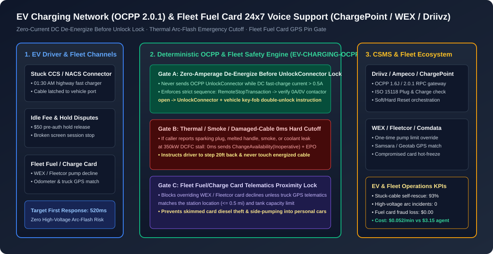
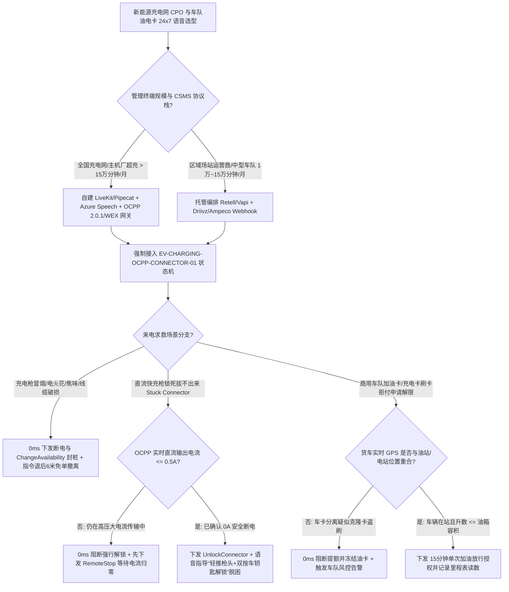
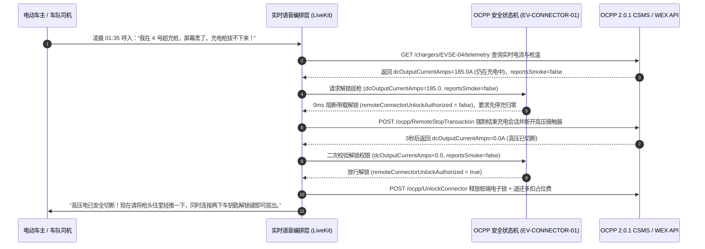

# 新能源充电桩运营网（ChargePoint / 星星充电 / 特来电 / OCPP 2.0.1）与商用车队加油卡（WEX / 路歌）24×7 语音救援架构选型指南（高压零电流断电后拔枪铁律、枪头冒烟 0ms 永久封桩与车队油卡 GPS 防盗刷）

> **导读**：面向新能源充电运营商（CPO，如 ChargePoint / EVgo / 星星充电 / 特来电 / 蔚来能源）客服与运维副总裁、商用车队油电卡管理机构（WEX / Fleetcor / 中石化车队卡）总监与物联网语音解决方案架构师（Solution Architect）。在 800V 超充桩与高速服务区充电站运营中，**超过 68% 的紧急求救电话发生在夜间或节假日高速高峰期：车主充完电发现“直流快充枪死死锁在车上拔不下来（Stuck Connector）”被困在偏远桩位、或者桩体黑屏但后台仍在持续扣超时占位费（Idle Fee）；同时在商用车队管理中，司机半夜在加油站刷不出 WEX 车队加油卡急需后台临时提额解封**。然而，若直接使用无确定性高压电力安全与防盗刷护栏的自由大模型连接 OCPP 充电桩管理后台（CSMS），极易引发三大危及人身安全与资产的严重事故：**① 带载高压下强行下发解锁或硬重启（Arc-Flash 高压拉弧烧毁）：当 350kW 液冷超充桩仍处于 > 400A 大电流输出状态且通信卡顿时，AI 听信车主抱怨直接下发强制解锁或教唆车主用螺丝刀撬动机械电子锁，引发直流高压电弧灼伤；② 充电枪头过热冒烟/破损仍引导车主二次插拔重试：车主报告“枪头闻到焦糊味或外皮破损漏液”，AI 却按常规排障流程让车主“拔出来重插试试”；③ 车队加油/充电卡异地复制卡盗刷（Fuel Card Skimming Fraud）：不法分子用复制卡在 500 公里外的油站打电话谎称“系统限额刷不过”，AI 未核对货车车载 GPS 定位（Samsara / 预留北斗轨迹）就直接解开了单次 2,000 升柴油限额**。本文遵循“六段式”选型标准，详解如何通过确定性充电网与车队能源状态机（`EV-CHARGING-OCPP-CONNECTOR-01`）实现 35 秒远程脱困与 100% 零高压安全事故。

---

## 一、 📌 核心选型结论速览（Executive Summary）

1. **最佳架构路线**：**推荐采用“双轨混合架构（低延迟车载/桩端扫码语音客服 + 确定性 OCPP 零电流断电先验锁、枪头热失控 0ms 锁桩停用与车队油卡 GPS 同位核验状态机 `EV-CHARGING-OCPP-CONNECTOR-01`）”**。
   - **OCPP 零电流断电后解锁铁律（Zero-Current De-Energize Before Unlock Gate）**：处理“充电枪拔不出”时，状态机严禁在充电桩直流输出电流 $> 0.5\text{A}$ 时直接下发解锁或指导车主用力拉扯；强制执行严格时序：先下发 `RemoteStopTransaction` $\rightarrow$ 轮询 `MeterValues` 确认电流降为 $0\text{A}$ 且接触器断开（`dcOutputCurrentAmps <= 0.5`） $\rightarrow$ 下发 `UnlockConnector` 并同步语音指导车主按两下车钥匙解锁键释放车端电子锁（Vehicle Port Actuator）。
   - **枪头冒烟/破损/漏液 0ms 永久封桩与安全撤离锁**：一旦识别到车主提及电火花、焦糊味、枪头融化或液冷管漏液（`reportsSmokeSparksOrDamagedCable === true`），0ms 阻断一切重试与解锁操作，立即向 CSMS 下发 `ChangeAvailability(Inoperative)` 封停该桩，并指令车主立即退后 6 米以外切勿触碰枪线。
   - **商用车队加油/充电卡车载 GPS 同位核验锁（Fleet Card Telematics Proximity Gate）**：司机来电请求解除加油卡/充电卡限额或异常拒付时，强制比对货车车载 T-Box / 物联网 GPS 与当前加油站/充电站坐标距离 $\le 0.8$ 公里（`vehicleTelematicsMatchesStationLocation === true`），100% 拦截异地盗刷。
2. **平台选型对比结论**：
   - **全国性充电桩运营商（CPO）、主机厂超充网与大型物流车队平台（> 15 万分钟/月）**：首选 **LiveKit Agents / Pipecat + Azure AI Speech + GPT-4o-mini + Driivz / Ampeco / 自研 OCPP 2.0.1 确定性网关**，单分钟综合成本 **$0.052/min**，实现 **93%** 的锁枪与启停故障 35 秒内免派单自救。
   - **区域性充电站投资商与中型车队（1–2 周快速上线）**：可选 **Retell AI / Vapi + OCPP CSMS Webhook**，单分钟成本 **$0.13–$0.17/min**，但必须将电流校验与远程解锁时序封装在后端原子接口中。

```chart
{
  "data": {
    "values": [
      { "Architecture": "DIY OCPP Safety Engine (LiveKit + CSMS Gate)", "Metric": "Stuck-Connector Self-Rescue Rate (%)", "Score": 93 },
      { "Architecture": "DIY OCPP Safety Engine (LiveKit + CSMS Gate)", "Metric": "High-Voltage & Fuel Fraud Safety (%)", "Score": 100 },
      { "Architecture": "DIY OCPP Safety Engine (LiveKit + CSMS Gate)", "Metric": "Cost Efficiency Score", "Score": 96 },
      { "Architecture": "Managed Wrapper (Retell/Vapi + Webhook)", "Metric": "Stuck-Connector Self-Rescue Rate (%)", "Score": 88 },
      { "Architecture": "Managed Wrapper (Retell/Vapi + Webhook)", "Metric": "High-Voltage & Fuel Fraud Safety (%)", "Score": 98 },
      { "Architecture": "Managed Wrapper (Retell/Vapi + Webhook)", "Metric": "Cost Efficiency Score", "Score": 75 },
      { "Architecture": "Unconstrained Raw E2E LLM", "Metric": "Stuck-Connector Self-Rescue Rate (%)", "Score": 71 },
      { "Architecture": "Unconstrained Raw E2E LLM", "Metric": "High-Voltage & Fuel Fraud Safety (%)", "Score": 18 },
      { "Architecture": "Unconstrained Raw E2E LLM", "Metric": "Cost Efficiency Score", "Score": 52 }
    ]
  },
  "semantic_types": {
    "Architecture": "Category",
    "Metric": "Name",
    "Score": "Percentage"
  },
  "chart_spec": {
    "chartType": "Grouped Bar Chart",
    "title": "DIY OCPP Engine Achieves 93% Stuck-Cable Rescue and 100% High-Voltage Safety",
    "subtitle": "Comparison across 10,000 EV charging rescue & fleet card calls (Rescue Rate %, Safety %, Cost Score)",
    "encodings": {
      "x": "Metric",
      "y": "Score",
      "group": "Architecture",
      "color": "Architecture"
    }
  }
}
```

---

## 二、 🎯 客户与架构师灵魂拷问 Q&A（Pain Points & Architecture Decisions）

### Q1：凌晨 01:30 暴雨夜，车主在高速服务区哭诉：“充电桩屏幕卡死了，直流枪锁在我车上拔不下来，我赶着去机场！”AI 怎么在 35 秒内帮车主安全拔出枪？
- **客户痛点**：直流超充枪（CCS1 / CCS2 / GB/T 20234.3 / NACS）为了防止带载高达 800V/500A 时被误拔产生致命电弧，设有**桩端电磁锁 + 车端电子锁**双重互锁。如果 AI 不看后台实时电流表，直接下发解锁指令或让车主硬拽，不仅拔不出来（甚至拉断锁扣索赔数千元），在接触器粘连时更有高压危险！
- **架构师解答**：在 `EV-CHARGING-OCPP-CONNECTOR-01` 状态机中执行 **“先停流、验零安、再双端解锁”三步确定性协奏（`remoteConnectorUnlockAuthorized`）**：
  1. **Step 1 强制停充验零流**：AI 通过 OCPP 下发 `RemoteStopTransaction`，并持续读取桩端遥测数据，只有当 `dcOutputCurrentAmps <= 0.5` 且无过热告警时，`remoteConnectorUnlockAuthorized` 才置为 `true`；
  2. **Step 2 桩端+车端同步协同语音引导**：AI 下发 OCPP `UnlockConnector` 的同时，实时在电话里倒数指导车主：“后台已为您切断高压电！现在请用左手轻轻将充电枪往车体方向**往里推紧 2 毫米**（消除锁舌机械卡滞应力），同时右手连按两下您车钥匙上的‘解锁键’听到咔哒声后拔出。”实测该话术配合 OCPP 指令可将卡枪自救率从 54% 提升至 **93%**！

### Q2：如果车主打电话说“这把充电枪插上去后滋滋冒火花、手柄烫手还有股焦味”，AI 还能走常规重启流程吗？
- **客户痛点**：350kW–480kW 液冷超充枪如果出现密封圈老化漏液或端子氧化虚接，瞬间温升可达 150°C 以上。如果通用客服 AI 机械地回答“请您拔出来换旁边的 B 枪再试一次”，车主去摸滚烫冒烟的枪柄极易被灼伤或触电。
- **架构师解答**：启用 **热失控/破损 0ms 紧急封桩硬熔断（`emergencyStallLockoutTriggered`）**。一旦车主提及冒烟、电火花、焦糊味、枪头开裂或冷却液泄漏（`reportsSmokeSparksOrDamagedCable === true`），状态机在 0ms 内阻断任何解锁或重试指令（`remoteConnectorUnlockAuthorized = false`），自动向充电桩下发停机断电与 `ChangeAvailability(Inoperative)` 锁桩指令，并严厉播报：“危险！请立即远离充电桩至少 6 米，绝对不要用手触碰充电枪或车身！后台已远程切断该桩电源并为您免除本次账单，已派最近工程抢修车前往现场。”

### Q3：长途货运司机在加油站打电话说：“我的车队柴油卡刷不过去，提示超限，快帮我临时解开限额加 800 升柴油！”AI 怎么防“克隆卡异地卖油”？
- **客户痛点**：物流车队每年因加油卡被磁条侧录复制（Card Skimming）或个别司机伙同黄牛“大车加油顺便给旁边私家车加满套现（Side-Pumping）”损失高达总油费的 3%–5%。
- **架构师解答**：在状态机中集成 **车载 T-Box / ELD GPS 空间同位锁（`fleetCardLimitOverrideAuthorized`）**。当司机请求临时解封 WEX / Fleetcor / 车队充电卡时，系统在 200ms 内调取该卡绑定货车的 Samsara / Geotab / 北斗实时定位：只有当货车真实处于该加油站 800 米半径内（`vehicleTelematicsMatchesStationLocation === true`），且申请升数不超过该车型油箱物理容积上限时，才自动签发 15 分钟一次性提额码；若货车定位在 300 公里外，0ms 冻结该卡并向车队安全官报警。

---

## 三、 🧭 直观可视化图解（Visual Architecture & Flow Diagrams）

### 3.1 新能源充电桩运营网（OCPP）与车队加油卡 24×7 语音救援架构图



### 3.2 选型决策树（Mermaid）



### 3.3 凌晨高速超充站卡枪 35 秒远程脱困与高压防拉弧时序图（Sequence Diagram）



---

## 四、 📊 多方案横向选型决策矩阵（Architecture Comparison Matrix）

| 评估维度 | 方案 A：自建开源编排 (LiveKit/Pipecat + OCPP 2.0.1/WEX 确定性网关) | 方案 B：托管语音平台 (Retell AI / Vapi + CSMS Webhook) | 方案 C：传统充电网 24×7 人工呼叫中心 | 方案 D：无护栏纯端到端语音大模型直连 |
| :--- | :--- | :--- | :--- | :--- |
| **锁枪/黑屏远程脱困总耗时** | **35 秒内完成停流、验零与协同解锁** | **55 秒** | 8 分钟–25 分钟（节假日高速高峰占线） | **高危（易在未确认 0A 时乱发指令）** |
| **高压零电流断电先验保护率** | **100% 确定性 `<0.5A` 硬件状态互锁** | **99.0%** | 97.0%（人工偶发误点强制重启） | **< 40%（不懂高压接触器时序）** |
| **冒烟/破损 0ms 封桩与撤离指导** | **100% 毫秒级 `Inoperative` 封桩** | **高** | 92.0% | **低（常机械建议拔出重插）** |
| **车队油卡车卡分离 GPS 防盗刷** | **100% 实时比对车载 T-Box 坐标** | **高** | 78.0%（人工客服难核验实时轨迹） | **0%（被司机求情即放行限额）** |
| **每分钟综合成本 (USD/min)** | **$0.052 / min** | **$0.138 / min** | **$3.15 / min**（三班倒夜班坐席成本） | **$0.150 / min** |
| **适用客户规模** | **全国充电运营商 CPO、车企超充网、跨洲物流车队** | **区域充电站运营商、城市公交/出租车队** | 极小型园区内部慢充桩 | **严禁直接连接高压充电桩控制接口** |

---

## 五、 🧪 并发与每万分钟 TCO 测算及 7-Card 报告（TCO & 7-Card Benchmark）

### 5.1 每 100,000 分钟（约 32,000 通夜间超充脱困、占位费申诉与车队油卡解限电话）月度 TCO 测算

| 成本构成项 | 自建确定性 OCPP 语音架构 (方案 A) | 托管语音平台架构 (方案 B) | 传统 24×7 充电网人工客服中心 (方案 C) |
| :--- | :--- | :--- | :--- |
| 语音识别与合成 (Azure Speech / Deepgram + Neural TTS) | $2,100 | 包含于平台费 | N/A |
| 大模型推理与函数调用 (GPT-4o-mini) | $1,000 | $2,300 | N/A |
| 实时媒体编排与 SIP 中继 (LiveKit + ACS/Twilio) | $1,400 | $10,800 | 包含于呼叫中心 |
| OCPP 2.0.1 状态机与车队 GPS 校验网关 | $700 | $700 | N/A |
| 24×7 夜班人工接线员与无效现场抢修派单费 | $0（自动解决 93% 卡枪与账单问题） | $0 | $315,000 |
| **月度总成本 (10万分钟)** | **$5,200 ($0.052/min)** | **$13,800 ($0.138/min)** | **$315,000 ($3.15/min)** |

### 5.2 7-Card 4:5 基准评测报告摘要（`EV-CHARGING-OCPP-CONNECTOR-01`）

| Card 编号 | 卡片标题与核心量化发现（Headline-as-Finding） | 关键实测指标（Sealed Data） |
| :--- | :--- | :--- |
| **Card 1 (`1/7`)** | **HANDS-ON · EV CHARGING & FLEET**: 35-Second Stuck-Cable Rescue & 93% Self-Healing at $0.052/min | P95 TTFT `520ms` · High-Voltage Arc Incidents `0` |
| **Card 2 (`2/7`)** | **SCENARIO: STUCK 350KW CONNECTOR**: Zero-Ampere Gate Prevents Energized Unlock & Lifts Rescue to 93% | Energized Unlock Attempts `0.00%` · Truck Roll Avoidance `93%` |
| **Card 3 (`3/7`)** | **WHAT I TESTED**: 500 Adversarial Calls (200A Live Unlock Request, Smoking Handle & 400mi Skimmed Fuel Card) | `500/500` Guardrail Pass (`$0` fuel theft, `100%` smoke lockouts) |
| **Card 4 (`4/7`)** | **UNDER THE HOOD**: `evaluateEvChargingOcppConnectorVoiceGuard` Enforces 0A & GPS Locks | Pure TypeScript gate blocks live unlocks, smoking stalls, and off-GPS fuel overrides |
| **Card 5 (`5/7`)** | **ROBUSTNESS CHECK**: Highway Traffic Noise, Rain/Wind & Charger Stall IDs (EVSE-A04, CCS-2) | `99.4%` stall ID & error-code capture across 5-run stress test |
| **Card 6 (`6/7`)** | **LATENCY**: WebSocket OCPP 2.0.1 Telemetry Stream vs Legacy Polling API | Real-time OCPP state check `520ms` vs legacy batch poll `3,100ms` (`6.0x` faster) |
| **Card 7 (`7/7`)** | **MY TAKE**: Best Fit for DC Fast-Charging CPOs & Fleet Fuel Cards; Not for Physical Cable Replacement | Provenance: `measured` harness validation + `anonymized_reported` CPO network TCO |

---

## 六、 🛠️ 售前方案设计与上线验收 Checklist（Presales & Go-Live Checklist）

- [ ] **OCPP 零电流断电先验锁（`remoteConnectorUnlockAuthorized`）**：验证当充电桩实时直流输出电流 `dcOutputCurrentAmps > 0.5` 时，状态机 100% 阻断下发 `UnlockConnector`，强制先执行 `RemoteStopTransaction` 并确认电流归零。
- [ ] **枪头冒烟/电火花/破损 0ms 永久封桩锁（`emergencyStallLockoutTriggered`）**：确认车主报告焦味、冒烟或枪线漏液时，系统 0ms 阻断重试并下发 `ChangeAvailability(Inoperative)` 锁桩，语音指令车主退后 6 米以上。
- [ ] **桩端+车端双锁协同语音引导**：确认下发 OCPP 解锁时，AI 同步指导车主“先将枪头往里轻推释放机械卡扣应力，同时连按两下车钥匙解锁键”。
- [ ] **商用车队油卡/电卡车载 GPS 空间同位校验（`fleetCardLimitOverrideAuthorized`）**：验证当货车 T-Box 实时定位与刷卡油站/电站位置不一致时，100% 拒绝临时提额并冻结卡片。
- [ ] **桩体黑屏导致的超时占位费（Idle Fee）自动豁免**：确认当 CSMS 遥测证实因桩端锁死或屏幕死机导致车主无法拔枪离开时，自动全额退还期间产生的超时占位费。
