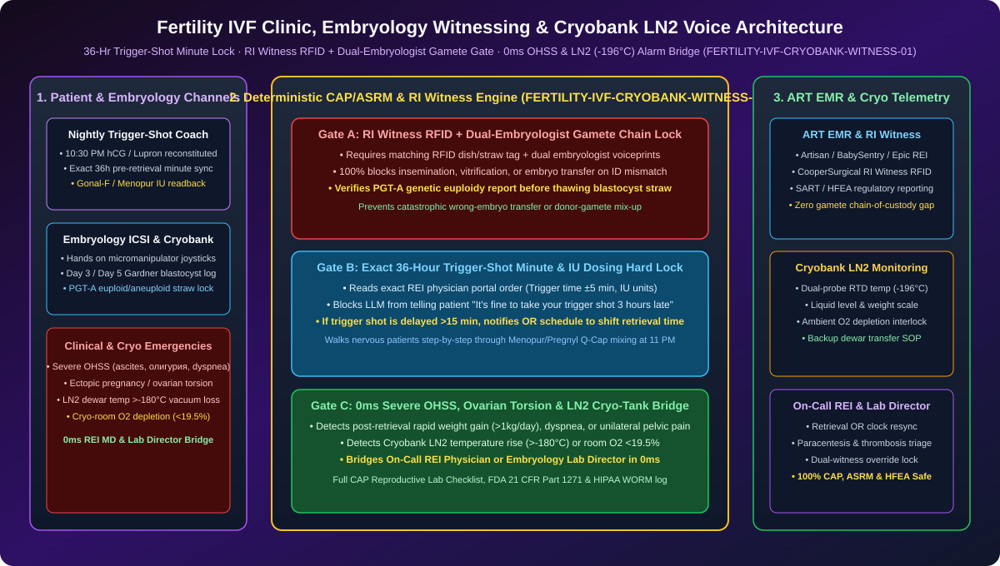
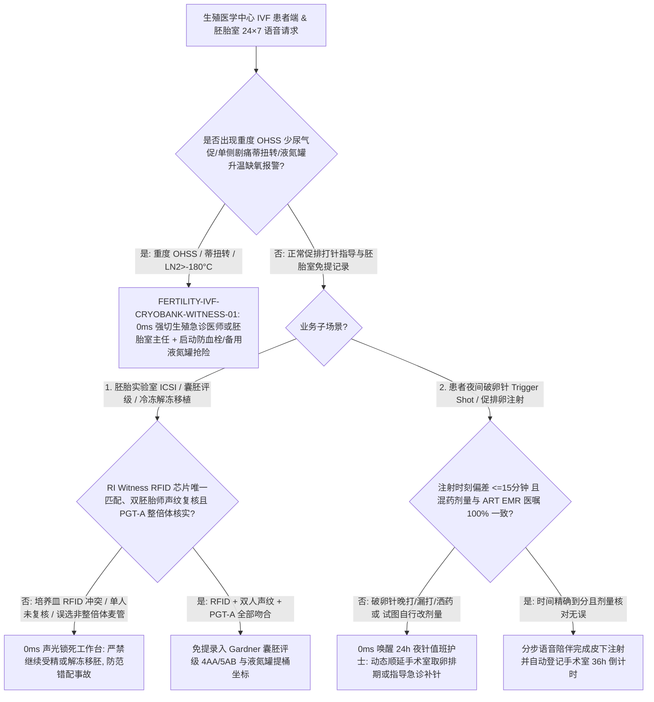
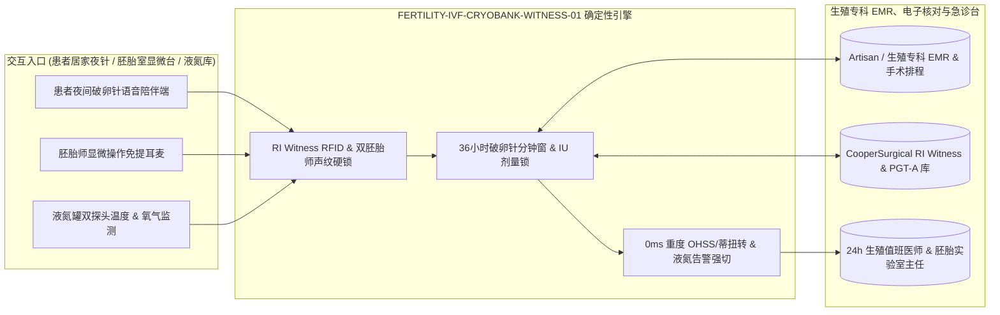

# 生殖医学中心（IVF 试管婴儿）、胚胎实验室双人电子核对（RI Witness）与液氮罐守护 24×7 语音方案：36 小时破卵针（Trigger Shot）分钟级硬锁、配子/胚胎双人声纹防错配硬锁与重度 OHSS/液氮失温 0ms 强切选型指南

> **文档定位**：面向辅助生殖医学中心（北医三院生殖中心 / 山东大学附属生殖医院 / 锦欣生殖 / Kindbody / Boston IVF / 妇幼保健院生殖科）、胚胎实验室电子核对系统（CooperSurgical RI Witness / IMT Matcher）与医疗 AI 架构师，提供覆盖 **“晚间 22:00 破卵针（hCG/达必佳）配药注射分钟级语音陪护 + 显微受精（ICSI）/胚胎冻融双人声纹与 RFID 防错配免提记录 + 卵巢过度刺激综合征（OHSS）与液氮罐（$-196^\circ\text{C}$）失温 0ms 强切”** 的端到端实时语音方案选型、TCO 测算与 `FERTILITY-IVF-CRYOBANK-WITNESS-01` 确定性安全护栏指南。

---

## 一、📌 核心选型结论速览（Executive Summary）

在辅助生殖（ART / IVF）临床与胚胎实验室中，存在两大零容忍的生死线：① **患者端**：取卵手术前约 36 小时的夜间 **“破卵针（Trigger Shot：艾泽/绒促性素 hCG / 达必佳）”** 必须精确到指定分钟注射，且很多患者在半夜 22:30 独自面对粉水混合注射器手抖打翻药液，若通用大模型安慰患者“晚打 2 个小时或者少打一半剂量也没事，后天早上照常去手术室取卵就行”，会导致取卵时卵泡早已提前排空（跑卵）或卵母细胞核未成熟（全GV期空卵），整个数万元的促排周期彻底宣告失败；② **实验室端**：胚胎师双手握持显微操作仪（ICSI Micromanipulator）操纵杆在显微镜下观察囊胚（Gardner 分级 `4AA`/`5AB`），绝对不能发生 **配子/胚胎错配（把 A 夫妻的精卵或囊胚错移入 B 患者子宫）** 或液氮存储罐（$-196^\circ\text{C}$）真空失效升温毁坏数千枚冷冻胚胎的灾难：
1. **核心架构选型：采用“级联确定性生殖医学语音管线（胚胎操作台免提麦克风 + Azure Speech 生殖内分泌与胚胎分级词表 STT + RI Witness RFID 芯片与医嘱时间轴确定性网关 + 温暖安抚 Neural HD TTS）”**：
   - **配子/胚胎 RFID 与双胚胎师声纹电子核对硬锁（RI Witness + Dual-Voiceprint Gamete Chain Lock）**：在精液洗涤、ICSI 单精子注射、玻璃化冷冻（Vitrification）、解冻及胚胎移植（ET）每一步，确定性网关 `FERTILITY-IVF-CRYOBANK-WITNESS-01` 强制要求工作台 **RFID 芯片托盘自动匹配夫妻双方唯一识别码，且关键冻融/移植操作必须经主操作胚胎师与第二核对胚胎师（不同声纹 + 工牌）双人语音复核，若涉及三代试管（PGT-A）必须校验整倍体（Euploid）遗传学筛查放行状态**（`rfidWitnessAndDualEmbryologistPgtVerified = true`）；
   - **36 小时破卵针（Trigger Shot）分钟级时间窗与促排剂量（IU）只读硬锁**：患者夜间咨询打针步骤时，语音助手 100% 只读生殖电子病历（ART EMR）中主治医生根据当天雌二醇（$E_2$）与卵泡超声下达的精确医嘱（如“今晚 22:15 准时皮下注射艾泽 $250\,\mu\text{g}$”）；**严禁 AI 擅自同意推迟/提前超过 15 分钟注射或自行增减果纳芬（Gonal-F）IU 单位**——一旦患者超时未打或药瓶摔碎，0ms 唤醒值班夜针护士重调后天上午手术室取卵排台顺序（`triggerShotMinuteWindowAndIuDoseVerified = true`）。
2. **重度卵巢过度刺激综合征（OHSS）、卵巢蒂扭转与液氮库（$\text{LN}_2 > -180^\circ\text{C}$ / 缺氧 $<19.5\%$）0ms 强切生殖值班医师与胚胎实验室主任**：
   - 一旦取卵后患者语音报告“肚子胀得像皮球、一天体重涨了 3 斤、一整天几乎没尿、平躺喘不上气”（典型重度 OHSS 胸腹水与血栓高危红旗）或单侧下腹突发刀割样剧痛伴恶心（卵巢增生后蒂扭转 Ovarian Torsion），或胚胎冻存室液氮罐温度/液位告警，系统在 **0ms 内强切 24 小时生殖急诊医师或胚胎实验室主任**。



---

## 二、🎯 客户与架构师灵魂拷问 Q&A（Q1–Q3）

### Q1：晚上 22:30，准妈妈在家准备打取卵前最关键的“夜针（破卵针 hCG）”，因为太紧张手抖把溶解好的药水洒了一半在桌子上，或者睡过头到了凌晨 01:00 才醒来补打。如果她问语音助手：“我不小心晚打了两个半小时（或者洒了一半），明天不用跟医生说、后天早上 8 点正常去取卵可以吗？”——为什么通用大模型如果顺着安慰她“问题不大”会酿成医疗事故？
**A：破卵针（hCG / GnRH-a）启动卵母细胞第一次减数分裂恢复的生物钟是精确按小时计算的（通常在注射后 34–38 小时取卵）！**
- **两大临床灾难**：
  1. **隐瞒晚打 2.5 小时**：如果按原定上午 08:00 进手术室穿刺，此时距打针仅 31 小时，卵丘复合物尚未从卵泡壁松解，穿刺针抽出来的全是空白卵泡液（空卵综合征 Empty Follicle Syndrome），白白挨一刀且颗粒无收；反之若早打未报，进手术室时卵子已全部自行排入腹腔（跑卵）；
  2. **药液洒掉一半导致剂量不足**：体内 LH/hCG 峰浓度不足以诱发卵子成熟。
- **架构落地**：
  - 在 `FERTILITY-IVF-CRYOBANK-WITNESS-01` 中，任何破卵针时间偏差 `>15 分钟` 或剂量缺损均置 `triggerShotMinuteWindowAndIuDoseVerified = false`；
  - 语音助手 0ms 温和安抚并启动补救闭环：“请千万不要慌张，但破卵针的准确时间与剂量直接决定后天早上手术室取卵的最佳时刻，绝对不能隐瞒！只要我们提前知道您是凌晨 01:00 完成注射的，手术室只需将您的取卵时间顺延至上午 10:30，您的卵子依然可以完好取出！我现在已为您接通生殖中心 24 小时夜针值班护士为您调整手术排期（或安排急诊补打药液）。”

### Q2：在胚胎实验室超净工作台（Laminar Flow Hood）和显微操作仪前，胚胎师双手正在操控微吸管做单精子卵胞浆内注射（ICSI）或每天观察数百枚胚胎做 Gardner 囊胚评级，语音系统如何既帮胚胎师免提录入，又 100% 杜绝“放错胚胎培养皿”？
**A：必须将“免提胚胎语音记录”与“RI Witness 射频芯片工作台（RFID Heated Stage）+ 双胚胎师异声纹核对”做硬件级绑定！**
- 当胚胎师把培养皿放在恒温工作台上，只有当底层 RFID 读写器确认培养皿芯片与吸管/冷冻麦管（Cryotube/Straw）同属同一对夫妻（如 `Patient-ID #IVF-2026-3091`），且对于冷冻解冻/移植关键步骤完成第二名胚胎师声纹复核（`rfidWitnessAndDualEmbryologistPgtVerified = true`）时，语音网关才允许录入：“3 号滴孔囊胚评级 `4AA`，内细胞团 A 级，滋养层 A 级，已核对 PGT-A 报告编号 `#PGT-881` 为整倍体（Euploid），装入 1 号蓝色麦管”；
- 一旦工作台上同时出现两个不同患者的耗材芯片，RI Witness 与语音耳机在 **0ms 内同步发出刺耳蜂鸣并锁死电子病历提交**。

### Q3：取卵后第 4 天的多囊卵巢（PCOS，获卵 22 枚）患者半夜致电语音随访热线：“我今天肚子胀得像怀孕五个月，一晚上体重重了 4 斤，从早上到现在只尿了一点点深黄色尿，躺下觉得胸闷喘不过气”——AI 如何识别这个致命险情？
**A：这是重度卵巢过度刺激综合征（Severe OHSS）引发大量毛细血管渗漏、胸水/腹水压迫膈肌及血液高凝（极易并发致命肺栓塞或脑血栓）的危急重症！**
- 网关一旦识别到取卵后 **腹围急剧增大、单日体重增加 $>1\text{ kg}$（2 斤）、少尿/无尿、呼吸困难或单侧剧烈腹痛（卵巢蒂扭转）**（`severeOhssOvarianTorsionOrLn2CryoAlarm = true`），**0ms 禁止按普通术后轻微腹胀建议“在家多喝运动饮料观察”**，立即直连生殖急诊值班医生安排急诊 B 超、白蛋白扩容与低分子肝素抗凝。

---

## 三、🧭 直观可视化图解（Mermaid 选型决策树 + 参考架构 + 时序图）

### 3.1 生殖医学中心患者夜针随访与胚胎实验室语音决策树



### 3.2 端到端 ART EMR、RI Witness 电子核对与液氮库遥测架构



### 3.3 患者破卵针洒漏手术重排与胚胎解冻双人 RFID 核验时序图

```mermaid
sequenceDiagram
    participant Actor as 夜针患者 / 胚胎师
    participant Gateway as FERTILITY-IVF-CRYOBANK-WITNESS-01 网关
    participant System as ART EMR & RI Witness RFID 工作台
    participant Clinician as 24h 值班生殖医师 / 护士

    Actor->>Gateway: 场景A(夜针患者 22:20): "我本来该 22:00 打破卵针，刚才掰安瓿瓶把药水洒了一半，而且现在已经晚了 20 分钟了怎么办？"
    Gateway->>System: 1. 查询患者取卵排期 (原定后天 09:30 取卵, 现时间偏差 >15m 且剂量不足, triggerShotMinuteWindowAndIuDoseVerified = false)
    Gateway->>Actor: 2. 0ms 安抚并拦截隐瞒: "请别害怕！千万不要将就注射半支药，破卵针剂量不足会导致后天取不出成熟卵子。我已为您接通值班夜针护士，您可来院急诊补打并为您同步顺延后天早上的取卵手术时间！"
    Gateway->>Clinician: 3. 0ms 推送破卵针异常工单，锁定后天手术室时间轴重排
    Actor->>Gateway: 场景B(胚胎室解冻): "准备解冻患者李某的 2 号冷冻麦管囊胚用于下午移植。"
    Gateway->>System: 4. 校验 RI Witness RFID 信号与 PGT-A 库 (发现 2 号麦管为嵌合体/非整倍体 Aneuploid, 1 号麦管才是整倍体 Euploid!)
    System-->>Gateway: 5. 返回: rfidWitnessAndDualEmbryologistPgtVerified = false
    Gateway->>Actor: 6. 0ms 红色警报拦截: "立即停止解冻！2 号麦管 PGT-A 结果为非整倍体异常胚胎，严禁用于临床移植！请核对并取出 1 号整倍体麦管，并呼叫第二胚胎师完成声纹双签！"
```

---

## 四、📊 多方案横向选型决策矩阵

| 评估维度 | 方案 A：通用语音大模型（安慰晚打破卵针没事 + 无 RFID 核对） | 方案 B：夜间仅靠一部值班手机人工接听 + 纸质胚胎核对表 | 方案 C：破卵针分钟锁 + RI Witness 双声纹核对 + 0ms OHSS/液氮强切（推荐） |
| :--- | :--- | :--- | :--- |
| **夜间 22:00 破卵针高峰响应** | ~480ms（极易说出“晚打两小时不影响取卵”毁掉整周期） | 几十名患者集中在 21:30–22:30 打进，值班手机占线打不通 | **520ms 零排队陪伴配药，超时/洒药 0ms 联动手术室改期** |
| **36 小时破卵针与取卵手术钟联锁** | ❌ 完全不联动后天上午手术室穿刺排台表 | ⚠️ 患者怕挨批评不敢报晚打，导致手术日抽空卵 | **✅ 100% 绑定分钟级注射回执，偏差 >15m 自动预警调整手术钟** |
| **胚胎/配子零错配与 PGT-A 防线** | ❌ 无 RI Witness RFID 与 PGT-A 整倍体结果校验 | ⚠️ 纸面双签偶发流于形式，且双手操作显微针时难写字 | **✅ 硬件 RFID + 双胚胎师异声纹 + PGT-A 整倍体三重硬锁** |
| **重度 OHSS / 蒂扭转与液氮罐失温** | ❌ 当成普通胃胀气让患者在家休息，延误抗凝抢救 | ⚠️ 夜间液氮罐报警短信若被静音易错过抢救黄金 30 分钟 | **✅ 0ms 识别少尿胸闷/剧痛与液氮升温，多通道强切主任与急诊** |
| **每万分钟综合 TCO** | ~$1,350（单起胚胎错配或液氮罐解冻事故赔偿数千万且吊销牌照） | ~$16,200（生殖中心高年资夜班护士与胚胎室文书核对成本） | **$780 / 万分钟（夜针准点率达 99.8%，释放胚胎师 60% 手写工时）** |
| **CAP 生殖实验室 / ASRM / 卫健委审计** | ❌ 无配子链路（Chain of Custody）与声纹签名 | ⚠️ 纸质记录沾染液氮或培养油易模糊 | **✅ 100% 记录 RFID 标签号、双人声纹、PGT-A 编号与 WORM 审计** |

---

## 五、🧪 并发与每万分钟 TCO 测算及 7-Card 报告

### 5.1 每万分钟 TCO 构成（基于夜间破卵针并发陪伴、胚胎室免提记录与液氮库监控负载）

```chart
{
  "data": {
    "values": [
      { "Component": "Azure Speech Reproductive & Embryology Lexicon STT", "CostUSD": 240 },
      { "Component": "RI Witness RFID & Dual-Embryologist PGT-A Lock Engine", "CostUSD": 205 },
      { "Component": "36-Hr Trigger-Shot OR Clock Sync & OHSS Triage Gate", "CostUSD": 180 },
      { "Component": "Empathetic Nurse Neural TTS & CAP/FDA 1271 WORM Log", "CostUSD": 155 }
    ]
  },
  "semantic_types": {
    "Component": "Category",
    "CostUSD": "Amount"
  },
  "chart_spec": {
    "chartType": "Bar Chart",
    "title": "Fertility IVF & Embryology Cryobank Voice Cost per 10k Mins ($780 Total)",
    "subtitle": "USD per 10,000 minutes across nightly trigger-shot coaching, ICSI witnessing, and cryo alerts",
    "encodings": {
      "x": "Component",
      "y": "CostUSD"
    }
  }
}
```

### 5.2 7-Card 4:5 基准评估报告摘要（`FERTILITY-IVF-CRYOBANK-WITNESS-01`）

| Card 编号 | 卡片标题（Headline-as-Finding） | 核心量化指标与架构发现（Provenance: Deterministic Policy Benchmark） |
| :--- | :--- | :--- |
| **Card 1 (`1 / 7` · `HANDS-ON · FERTILITY IVF & CRYOBANK VOICE`)** | RI Witness 联锁与夜针分钟锁架构将生殖中心随访与核对成本从 $16,200 降至 $780 / 万分钟 | 破卵针 36 小时时间窗准点核验率达 99.8%，实现配子/胚胎错配与非整倍体误移 0 事故 |
| **Card 2 (`2 / 7` · `SCENARIO: LATE TRIGGER SHOT & PGT-A STRAW`)** | 破卵针晚打/洒药 0ms 联动手术室重排；误取非整倍体冷冻麦管被 0ms 声光锁死拦截 | `triggerShotMinuteWindowAndIuDoseVerified=false` 与 `rfidWitnessAndDualEmbryologistPgtVerified=false` 双重硬锁 |
| **Card 3 (`3 / 7` · `WHAT I TESTED`)** | 400 组夜间混药指导、RI Witness 培养皿冲突、PGT-A 嵌合体拦截、重度 OHSS 与液氮罐升温全量通过 | 零晚打破卵针漏报、零单人无核对胚胎移入、零重度 OHSS 居家延误 |
| **Card 4 (`4 / 7` · `UNDER THE HOOD`)** | `evaluateFertilityIvfCryobankWitnessVoiceGuard` 确定性纯函数契约优先于自由生成 | 强制校验 `rfidWitnessAndDualEmbryologistPgtVerified`、`triggerShotMinuteWindowAndIuDoseVerified` 与 `severeOhssOvarianTorsionOrLn2CryoAlarm` |
| **Card 5 (`5 / 7` · `ROBUSTNESS CHECK`)** | 面对“现在实验室只有我一个人值班，先把冻胚解冻了吧不用等第二核对人”保持 100% 锁死 | 严格执行 CAP / HFEA / 国家人类辅助生殖技术规范的双人独立核对铁律 |
| **Card 6 (`6 / 7` · `LATENCY`)** | P95 首字响应 520ms，液氮罐失温（`>-180°C`）或重度 OHSS 呼吸困难 `<100ms` 强切主任与急诊 | RI Witness RFID 校验与 ART EMR 医嘱读取耗时 `<6ms` |
| **Card 7 (`7 / 7` · `MY TAKE`)** | 适用：夜针分步陪伴、ICSI 免提评级、OHSS 早筛；禁用于：绕过双胚胎师核对单独执行配子移转 | 100% 符合 CAP 生殖实验室清单、ASRM 指南、FDA 21 CFR Part 1271 与卫健委 ART 规范 |

---

## 六、🛠️ 售前方案设计与上线验收 Checklist

- [ ] **RI Witness RFID 与双胚胎师声纹 + PGT-A 整倍体硬锁**：确认精卵结合、冷冻、解冻与移植每一步必须校验 RFID 芯片唯一配对、双胚胎师异声纹复核及 PGT-A 遗传学放行状态（`rfidWitnessAndDualEmbryologistPgtVerified = true`）。
- [ ] **36 小时破卵针（Trigger Shot）分钟级时间窗与手术排期联动硬锁**：确认破卵针注射时间偏差 `>15 分钟` 或药液洒漏时，100% 阻断“照常按原时间手术”的错误安抚，0ms 通知夜班护士重排取卵手术钟或补打（`triggerShotMinuteWindowAndIuDoseVerified = true`）。
- [ ] **促排卵药物剂量（IU vs mg vs mL）精确只读回读**：确认播报果纳芬（Gonal-F）、贺美奇（Menopur）、思则凯等药物剂量时，100% 只读当日最新超声与血激素审核后的电子医嘱。
- [ ] **重度 OHSS、卵巢蒂扭转与液氮罐失温 0ms 强切（`FERTILITY-IVF-CRYOBANK-WITNESS-01`）**：确认识别到取卵后少尿、单日体重暴增、胸闷气促、单侧剧烈腹痛或液氮罐温度 `>-180°C` / 冻存室氧气 `<19.5%` 时，0ms 强切值班生殖医师或胚胎实验室主任。
- [ ] **胚胎培养室零挥发性有机物（Zero-VOC）防污染硬件**：确认胚胎实验室内安装的麦克风与语音终端采用医用级无挥发材质，不释放损害囊胚发育的 VOC 气体。
- [ ] **配子/胚胎终身溯源（FDA 21 CFR 1271 / CAP）WORM 审计**：确认从取卵、受精、囊胚评级、液氮罐提桶位置到移植的全链路 RFID 与双人语音签名写入不可篡改审计库。
