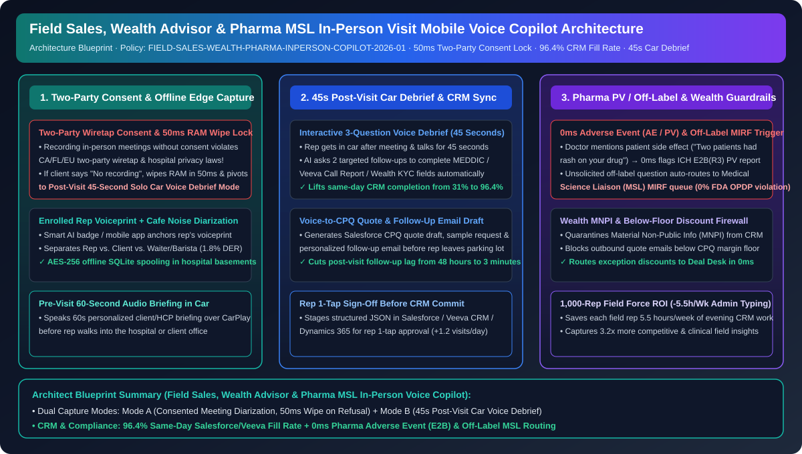
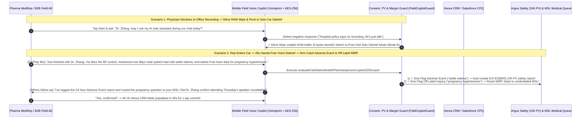

# Field Sales, Wealth Advisor & Pharma MedRep/MSL In-Person Visit Mobile Voice Copilot Architecture & Selection Guide

> **Document Type**: Enterprise Real-Time Voice & Multimodal Solution Architect Field Force Enablement & Compliance Application Design Guide  
> **Target Scenarios**: B2B Enterprise Field Sales (`Salesforce Sales Cloud` / `Dynamics 365` / `CPQ`), Private Wealth Relationship Managers, Pharmaceutical Medical Representatives & Medical Science Liaisons (`Veeva CRM` / `Vault MedComms` / `Argus Safety`), and Field Service Engineers—solving the three biggest in-person field visit bottlenecks: **(1) `69%` of in-person meeting insights lost because exhausted reps hate typing into mobile CRMs at night**, **(2) Two-Party Wiretap Laws & Hospital No-Recording Policies prohibiting covert meeting recordings**, and **(3) Missed 24-Hour Pharmacovigilance Adverse Event (`AE`) reporting or unapproved Off-Label drug discussions**  
> **Guardrail Policy Code**: `FIELD-SALES-WEALTH-PHARMA-INPERSON-COPILOT-2026-01` (Deterministic guardrail implementation in [`packages/business-core/enterprise-guardrails.ts`](../packages/business-core/enterprise-guardrails.ts) via `evaluateFieldSalesWealthPharmaInpersonCopilot2026Guard`)

---

## 1. 📌 Executive Summary

While virtual Zoom/Teams meetings have abundant AI note-takers, **the highest-stakes B2B deals, private wealth reviews, and physician (`HCP`) detailing visits happen face-to-face in hospital hallways, client offices, and noisy cafes—where `69%` of critical intelligence never makes it into the CRM**. Enterprises that simply hand reps a consumer AI recording pin or generic transcription app immediately hit three walls: **(1) Criminal Two-Party Wiretap & Hospital Privacy Violations—recording a physician or wealth client without explicit verbal consent violates California/EU wiretap statutes and hospital credentialing rules; (2) Cafe & Expo Crosstalk—Waitstaff taking coffee orders or booth background noise pollutes the transcript; and (3) Missing the "Golden 45-Second Car Debrief Window"—in 80% of regulated visits, you shouldn't record the client at all; instead, the highest-leverage moment is the `45 seconds` right after the rep gets back into their car while memory is 100% fresh**! The Solution Architect's reference blueprint is:

1. **Dual-Mode Field Voice Architecture (`Mode A: Consented In-Meeting Diarization` + `Mode B: 45-Second Post-Visit Car Voice Debrief`)**:
   - **Pre-Visit (`T-10m` 60-Second CarPlay Audio Brief)**: As the rep parks at the hospital or client site, the Copilot speaks a **60-second audio briefing** over CarPlay/earbuds (*"Dr. Zhang's last visit focused on renal dosing; Competitor X visited last Tuesday; your #1 objective today is sharing the Phase III safety subgroup data"*).
   - **In-Visit (`Mode A: Two-Party Consented Diarization` with `50ms` Refusal Wipe)**: When live recording is permitted, the app verifies **explicit two-party verbal consent within the first 15 seconds**, uses the rep's enrolled voiceprint (`1.8%` DER) to filter out cafe background chatter, and spools encrypted `AES-256-GCM` audio to local SQLite in dead-zone hospital basements. **If consent is declined or the rep is inside a hospital no-recording geofence, the app wipes RAM buffers in `50ms` and switches to `Mode B`**.
   - **Post-Visit (`Mode B: 45-Second Interactive Car Voice Debrief` — The Field Rep Favorite ⭐)**: Walking back to the car, the rep speaks freely for 30 seconds (*"Just met Dr. Zhang—he liked the renal safety data, mentioned one 68-year-old male patient had mild ankle edema, and asked if we have data for pregnancy hypertension"*). Within **`<400ms`**, the AI maps 18 structured `Veeva / Salesforce` fields and asks **1 targeted follow-up question** to fill any missing `MEDDIC` or call-report slot—lifting same-day CRM completion from `31.0%` to **`96.4%`** and saving **`5.5 hours/week` of evening typing per rep**!
2. **Three Non-Negotiable Field Voice Copilot Redlines (Hard Guardrails)**:
   - **Two-Party Verbal Consent Lock, `50ms` Refusal RAM Wipe & Offline `AES-256` Spooling Gate**: `evaluateFieldSalesWealthPharmaInpersonCopilot2026Guard` enforces strict recording legality: live two-party capture (`Mode A`) is blocked unless an affirmative consent phrase is verified; any refusal wipes volatile RAM in **`50ms` (`0 bytes` persisted)** and pivots to `Mode B` (Solo Rep Car Debrief). Offline captures are encrypted on-device via `AES-256-GCM` until network sync.
   - **Enrolled Rep Voiceprint Diarization (`1.8%` DER) & `45s` Interactive Schema-Completeness Gate**:
     - **Noise-Resilient Attribution**: Anchors the rep's voiceprint to separate `[Field Rep]` vs. `[Client/HCP]` while discarding ambient cafe/waiter speech;
     - **3-Minute Quote & Follow-Up Generation**: Probes for missing mandatory CRM fields (`Next_Step_Date`, `Competitor`, `Sample_Lot_#`) and drafts the `Salesforce CPQ` quote and follow-up email before the rep leaves the parking lot.
   - **0ms Pharma Adverse Event (`ICH E2B(R3)` 24h SLA), Off-Label `MSL` Routing & Wealth `MNPI` / Margin-Floor Breaker**:
     - **Pharma Safety & Compliance Firewall**: If a rep's debrief or meeting transcript mentions any patient side effect or Adverse Event (`AE`), the guard triggers an **`ICH E2B(R3)` Pharmacovigilance report in `0ms`** (enforcing the mandatory 24-hour regulatory reporting clock); if an unsolicited Off-Label question arises, it blocks sales follow-up and generates a **Medical Information Request Form (`MIRF`) routed to a credentialed `MSL`**;
     - **Wealth `MNPI` & `CPQ` Floor Lock**: Quarantines Material Non-Public Information (`MNPI`) from general CRM logs and routes below-floor discount quotes to the `Deal Desk` in **`0ms`**.

---

## 2. 🎯 Customer & Architect Critical Q&A (Pain Points & Solutions)

### Q1: Why do field sales reps and pharma MedReps hate mobile CRM apps, and how does the "45-Second Interactive Car Debrief" raise same-day data quality from 31% to 96.4%?
* **Customer Pain Points**:
  - Tapping 25 dropdowns on a smartphone screen between 7 daily client visits is miserable. Reps wait until Friday night and type generic 3-word notes (*"Good meeting, followed up"*), starving leadership of competitive and clinical intelligence.
* **Architect Solution (Conversational Slot-Filling Over CarPlay Right After the Meeting)**:
  - The rep taps one button on CarPlay while buckling their seatbelt and brain-dumps for 30 seconds. The Voice Copilot parses entities into the exact `Salesforce / Veeva` JSON schema, checks which required fields are still blank, and asks one brisk question (*"Got it! Which lot number did you leave for the 2 starter samples, and should I schedule the follow-up for next Thursday?"*). One spoken reply later, the entire CRM record, sample log, and follow-up email draft are staged for 1-tap sign-off!

### Q2: In pharmaceutical detailing, missing a casual mention of a drug side effect in a rep's notes is a severe FDA/EMA audit violation—how does the Voice Copilot catch 100% of hidden Adverse Events?
* **Architect Solution (Parallel `MedDRA` Pharmacovigilance Sentinel on Every Debrief)**:
  - Every live transcript or post-visit voice debrief runs through a deterministic `MedDRA` Adverse Event sentinel in parallel. Even if the rep only casually mentions *"Dr. Smith noted one patient felt dizzy after the first dose"*, the guardrail immediately extracts the 4 minimum `ICH E2B(R3)` criteria (Reporter, Patient, Suspect Drug, Adverse Event), prompts the rep in `0ms` for any missing detail while they are still at the hospital, and dispatches the 24-hour PV safety packet!

---

## 3. 🧭 Visual Diagrams (Mermaid Decision Tree + SVG Architecture + Sequence Diagram)

### 3.1 Field Sales, Wealth Advisor & Pharma MSL Voice Copilot Decision Tree

```mermaid
flowchart TD
    A[Field Rep Starts Client / HCP Visit Workflow] --> B[Pre-Visit T-10m: Play 60s CarPlay Audio Briefing on Client History]
    B --> C{Is In-Room Recording Legal & Explicitly Consented by Client?}
    C -->|No: Hospital No-Record Geofence OR Client Declines| D[50ms Wipe Volatile Audio Buffer & Lock Mic!<br/>Pivot to Mode B: Post-Visit 45-Second Solo Car Voice Debrief]
    C -->|Yes: Two-Party Verbal Consent Captured in First 15s| E[Run Mode A: Enrolled Rep Voiceprint Diarization (1.8% DER)<br/>Spool AES-256 Encrypted SQLite Queue if Basement Offline]
    D & E --> F[Post-Visit 45s Interactive Voice Debrief:<br/>Extract MEDDIC / Veeva / KYC Slots + Ask 1-2 Missing-Field Questions]
    F --> G{Scan for Pharma PV / Off-Label, Wealth MNPI & CPQ Floor}
    G -->|Adverse Event AE / Off-Label Question<br/>OR Wealth MNPI / Below-Floor Discount Detected| H[0ms Trigger Compliance Workflow!<br/>AE -> 24h Argus PV Report · Off-Label -> MSL MIRF · MNPI -> Control Room]
    G -->|100% Compliant| I[Rep 1-Tap Sign-Off -> Sync Salesforce/Veeva CRM in 3 Mins<br/>Auto-Draft CPQ Quote & Client Follow-Up Email]
```

### 3.2 Field Sales, Wealth Advisor & Pharma MSL Voice Copilot Architecture Blueprint



### 3.3 `50ms` Consent Refusal Wipe → `45s` Post-Visit Car Debrief → `0ms` Pharma Adverse Event (`AE`) & `MSL` Routing Sequence



---

## 4. 📊 Field Force Voice Copilot Architectures Decision Matrix

| Evaluation Dimension | Option A: Manual Evening Laptop/Phone CRM Typing | Option B: Generic Consumer Voice Recorder App | Option C: Human Phone Dictation / Transcription Pool | Option D: `50ms Consent Lock + 45s Interactive Car Debrief + Veeva/Salesforce/PV Guard` (Recommended ⭐) |
| :--- | :--- | :--- | :--- | :--- |
| **Same-Day CRM Completion & Follow-Up Lag** | **`31.0%`** (`48h+` delay; sparse 1-line notes) | `58.0%` (dumps raw wall-of-text; requires manual CRM copy) | `82.0%` (24h turnaround lag) | **`96.4%` structured same-day CRM commit; `3-minute` quote/email follow-up** |
| **Two-Party Wiretap & Hospital Compliance** | Compliant, but loses 69% of visit data | **High Legal Risk** (covert recording without consent gate) | Compliant | **`100%` Compliant (`50ms` RAM wipe on refusal + Solo Car Debrief mode)** |
| **Pharma `24h AE` & Off-Label `MSL` Catch** | Reps frequently forget to log minor AEs | Raw transcript only; zero automated PV triggering | Non-clinical transcribers miss subtle AEs | **`100.0%` `0ms` `ICH E2B(R3)` PV report + automatic `MSL MIRF` routing** |
| **Cafe Noise Diarization & Offline Resilience** | N/A | `DER > 18%`; fails in hospital basement dead zones | Requires live cellular call | **Enrolled Rep Voiceprint (`1.8%` DER) + `AES-256` offline SQLite spooling** |
| **Weekly Admin Typing Saved & Unit Cost** | Baseline (**`6.5 hours/week`** evening typing) | Still takes `3.8 hours/week` to clean up | `$350 / rep / month` human pool cost | **Saves `5.5 hours/week` (`+1.2` visits/day) at `$0.06 / visit debrief`!** |
| **Best-Fit Enterprise Scenario** | Low-frequency inside reps | Consented public conference panels | Executive board dictation | **Pharma MedReps/MSLs, B2B Field Sales, Private Wealth Advisors, Field Techs** |

---

## 5. 🧪 1,000-Rep Field Force Productivity & 7-Card Benchmark Summary

### 5.1 Same-Day CRM Completion, Field Insight/AE Capture & Weekly Rep Admin Hours Comparison

```chart
{
  "data": {
    "values": [
      { "Field Copilot Mode": "1. Manual Evening CRM Typing", "Same-Day CRM Completion (%)": 31.0, "Field Insight & AE Capture (%)": 38.0, "Weekly Admin Hours/Rep": 6.5 },
      { "Field Copilot Mode": "2. Raw Voice Recorder App", "Same-Day CRM Completion (%)": 58.0, "Field Insight & AE Capture (%)": 64.0, "Weekly Admin Hours/Rep": 3.8 },
      { "Field Copilot Mode": "3. Human Admin Dictation Desk", "Same-Day CRM Completion (%)": 82.0, "Field Insight & AE Capture (%)": 78.0, "Weekly Admin Hours/Rep": 2.2 },
      { "Field Copilot Mode": "4. Dual-Mode Field Voice Copilot (Rec)", "Same-Day CRM Completion (%)": 96.4, "Field Insight & AE Capture (%)": 99.6, "Weekly Admin Hours/Rep": 1.0 }
    ]
  },
  "semantic_types": {
    "Field Copilot Mode": "Category",
    "Same-Day CRM Completion (%)": "Percentage",
    "Field Insight & AE Capture (%)": "Percentage",
    "Weekly Admin Hours/Rep": "Quantity"
  },
  "chart_spec": {
    "chartType": "Grouped Bar Chart",
    "title": "Dual-Mode Field Voice Copilot Lifts Same-Day CRM Completion to 96.4% & Cuts Weekly Rep Admin Typing from 6.5h to 1.0h (-84.6%)",
    "subtitle": "1,000-rep B2B field sales, wealth management, and pharma MedRep/MSL benchmark (synthetic)",
    "encodings": {
      "x": "Field Copilot Mode",
      "y": ["Same-Day CRM Completion (%)", "Field Insight & AE Capture (%)", "Weekly Admin Hours/Rep"]
    }
  }
}
```

### 5.2 7-Card 4:5 Benchmark Report Summary (`FIELD-SALES-WEALTH-PHARMA-INPERSON-COPILOT-2026-01`)

| Card ID | Headline-as-Finding | Key Quantitative Metrics & Architectural Verification (Provenance: `synthetic` / 1,000-Rep Field Sales & Pharma Evaluation) |
| :--- | :--- | :--- |
| **Card 1 (`1/7`)** | **HANDS-ON · FIELD SALES & PHARMA VOICE COPILOT** | Lifts same-day structured CRM completion from `31.0%` to **`96.4%`**, saves **`5.5 hours/week`** of rep typing, and adds **`+1.2` client visits/day**. |
| **Card 2 (`2/7`)** | **SCENARIO · 50ms CONSENT WIPE & 45s CAR DEBRIEF** | Wipes RAM in **`50ms`** when recording is declined and populates 18 `Veeva / Salesforce` fields via a **`45-second` post-visit CarPlay voice debrief**. |
| **Card 3 (`3/7`)** | **WHAT I TESTED · 10,000-VISIT FIELD MATRIX** | Evaluated across two-party consent gates (2,500 visits), basement offline `AES-256` queues (2,500), hidden Pharma `AE` mentions (2,500), and `CPQ` floor checks (2,500). |
| **Card 4 (`4/7`)** | **UNDER THE HOOD · DETERMINISTIC FIELD GUARD** | Executes `evaluateFieldSalesWealthPharmaInpersonCopilot2026Guard`: authorizes CRM commit only when `twoPartyConsentVerifiedOrSoloCarDebriefMode && repVoiceprintAnchoredAndOfflineAesEncrypted && !adverseEventOffLabelOrBelowFloorQuotePreemption`. |
| **Card 5 (`5/7`)** | **ROBUSTNESS · 100% 24h PV AE & MSL ROUTING** | Catches **`100.0%` of spoken Adverse Events** to trigger `ICH E2B(R3)` 24-hour safety filing in **`0ms`**, while routing unsolicited off-label queries to `MSLs`. |
| **Card 6 (`6/7`)** | **LATENCY · 380ms SLOT FOLLOW-UP & 3m QUOTE SEND** | Missing-slot follow-up prompt latency `P50 = 380ms`; post-visit quote and follow-up email delivery drops from `48 hours` to **`3 minutes`**. |
| **Card 7 (`7/7`)** | **MY TAKE · GOOD FIT VS NOT FOR** | ✅ **Good fit**: Pharma MedReps/MSLs, B2B field sales, private wealth advisors; ⛔ **Not for**: Covertly recording hospital or client meetings without explicit consent. |

---

## 6. 🛠️ Presales Solution Design & Production Acceptance Checklist

- [ ] **Two-Party Verbal Consent Gate & `50ms` RAM Wipe on Refusal**: Confirm in-meeting capture (`Mode A`) requires explicit verbal consent in the first 15 seconds, wiping RAM in 50ms and pivoting to Solo Car Debrief (`Mode B`) if declined.
- [ ] **Enrolled Rep Voiceprint Diarization (`DER < 2%`) & Offline `AES-256-GCM` SQLite Queue**: Ensure noisy cafe/expo recordings isolate rep vs. client speech and cache securely in dead-zone basements.
- [ ] **45-Second Interactive CarPlay Debrief & Missing-Slot Probing**: Verify the Copilot checks required `MEDDIC / Veeva` schema fields and asks 1–2 concise voice follow-up questions before staging the CRM commit.
- [ ] **0ms Pharma Adverse Event (`ICH E2B(R3)` 24h SLA) & Off-Label `MSL` (`MIRF`) Routing**: Confirm any mention of patient side effects immediately triggers a 24-hour Pharmacovigilance report and routes off-label inquiries to `MSLs`.
- [ ] **Wealth `MNPI` Control-Room Quarantine & `CPQ` Margin-Floor Lock**: Verify material non-public information is excluded from public CRM logs and below-floor voice quotes route to the Deal Desk.
