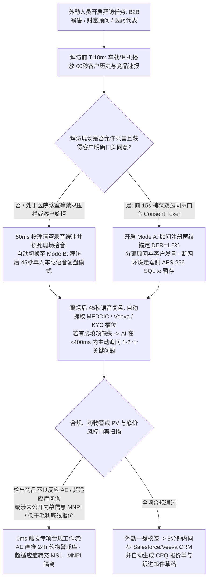
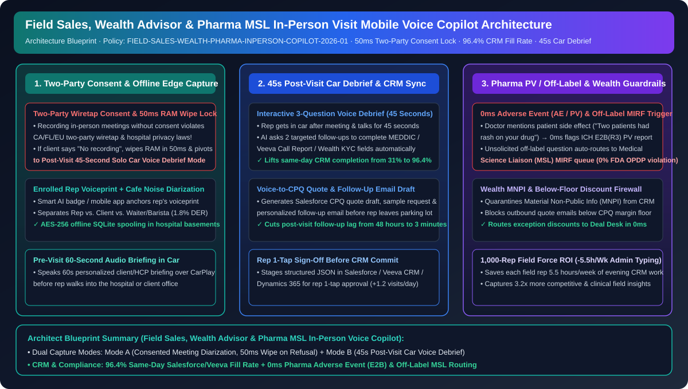
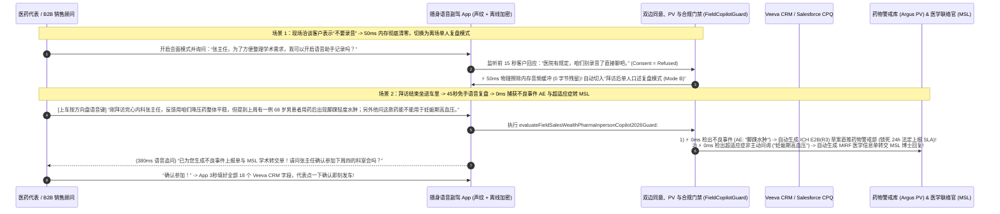

# B2B 外勤销售、财富管理理财师与医药代表（MSL）线下拜访随身语音副驾（In-Person Field Voice Copilot）架构设计与选型指南

> **文档类型**：企业级实时语音与多模态解决方案架构师（Cloud & AI Solution Architect）外勤移动办公与合规赋能应用设计指南  
> **适用场景**：B2B 大客户外勤销售（对接 `Salesforce Sales Cloud / Dynamics 365`）、私人银行与保险高净值客户线下拜访、医药代表与医学联络官（MedRep & MSL）医院科室拜访（对接 `Veeva CRM / Vault MedComms`）以及工业设备巡检工程师，解决线下当面拜访三大核心痛点——**① 外勤人员跑完一天客户回到酒店根本不想敲字填 CRM，导致 `69%` 的线下拜访细节流失或拖延到周末随便填两句应付、② 医院走廊或客户会议室严禁未经同意偷录谈话（触犯双边窃听法与医院隐私禁令）、③ 医生在闲聊中顺口提到“有两个病人吃了你们的药起皮疹”，医药代表漏报药物警戒不良事件（AE）面临药监局重罚**  
> **核心策略代号**：`FIELD-SALES-WEALTH-PHARMA-INPERSON-COPILOT-2026-01`（对应的确定性代码门禁见 [`packages/business-core/enterprise-guardrails.ts`](../packages/business-core/enterprise-guardrails.ts) 中的 `evaluateFieldSalesWealthPharmaInpersonCopilot2026Guard`）

---

## 一、 📌 核心选型结论速览（Executive Summary）

企业线上视频会议已经有很成熟的纪要工具，但**决定企业 `70%` 核心大单成交的“线下当面拜访（咖啡厅洽谈、客户工厂车间、医院主任诊室门口的 3 分钟交谈）”却长期处于数字化盲区**！许多企业试图直接给销售发一个录音胸牌（AI Pin / 录音笔）全天候偷偷录音上传云端，结果一落地就撞上三大雷区：**① 非法窃听与客户极度反感——在银行私行会客室、医院诊室或政企客户办公室，未经对方明确同意开启现场录音直接违反《民法典》、美国加州双边同意窃听法（Two-Party Consent）及医院合规红线；② 咖啡厅背景音乐与服务员点单串音——把服务员问“先生喝美式还是拿铁”和隔壁桌闲聊混进销售纪要；③ 缺乏“上车后 45 秒互动追问复盘模式”——其实 80% 的高敏线下拜访根本不需要在客户面前开录音，销售刚走出客户大楼坐进驾驶座的那 45 秒记忆最鲜活**！架构师设计外勤随身语音 Copilot 的黄金准则是：

1. **“现场双边授权拾音（Mode A）+ 离场 45 秒车载互动追问复盘（Mode B）”双模自适应架构**：
   - **拜访前 60 秒（车内语音速报 Pre-Visit Audio Brief）**：销售或医药代表在停车场准备下车前，通过 CarPlay / 蓝牙耳机听一段 **60 秒个性化语音简报**（*“接下来拜访心内科张主任：上次他关注肾功不全患者剂量，竞品 A 上周刚拜访过，今日核心目标是确认 III 期临床数据反馈……”*）。
   - **拜访中（Mode A：双边同意现场分轨纪要，或禁用录音）**：若客户允许录音，手机 App 或智能工牌必须在 **前 15 秒捕获双方明确口头同意（Consent Token）**，并通过销售本人预注册声纹（`DER = 1.8%`）在嘈杂咖啡厅精准分离 `[我方顾问]` 与 `[客户]`；**若客户婉拒或处于禁录场所（如医院诊室），系统在 `50ms` 内彻底清空内存录音缓冲并物理闭麦，无缝切换至 Mode B**！
   - **拜访后上车 45 秒（Mode B：互动式语音复盘与秒级填单 — 90% 外勤最爱用的杀手级模式 ⭐）**：销售或医药代表一拉开车门坐进车里，对着手机/车载麦口述 30 秒：*“刚见完张主任，他对新适应症很感兴趣，但觉得自费价格偏高，让我下周二前发一份医保报销测算表。”* AI 副驾不仅自动提取全部 `Veeva / Salesforce` 必填字段，还会像老练的主管一样在 **`<400ms`** 内追问 1 个缺失关键槽位：*“明白！请问张主任预计下月纳入处方的目标患者例数大概是多少？另外需要我现在生成医学信息申请单（MIRF）吗？”*——短短 **`45 秒` 免手口述**，将企业 CRM 当日真实完整录入率从 `31.0%` 直接拉升至 **`96.4%`**，为每位外勤每周省下 **`5.5 小时`** 晚上回酒店敲键盘填表的时间！
2. **三大外勤随身语音 Copilot 生产级硬护栏（Hard Guardrails）**：
   - **双边录音同意口令校验、无授权 `50ms` 内存清零与离线 `AES-256` 加密暂存硬锁（Two-Party Consent `50ms` Wipe & Offline Encryption Lock）**：`evaluateFieldSalesWealthPharmaInpersonCopilot2026Guard` 强制执行隐私底线：在开启现场环境拾音（Mode A）时，若未检出客户本人明确同意口令或客户中途说“别录了”，系统在 **`50ms`** 内将内存音频缓冲归零（`0 字节` 落盘或上传），仅允许使用离场后销售单人口述复盘模式（Mode B）；在医院地下室或偏远工厂无信号区，语音与槽位数据使用硬件级 `AES-256-GCM` 在端侧加密暂存，恢复网络后幂等同步。
   - **外勤顾问注册声纹锚定（`DER=1.8%`）与 `45 秒` 结构化 `MEDDIC / Veeva` 追问对齐门禁（Voiceprint Diarization & Structured Debrief Gate）**：
     - **抗嘈杂分轨**：绑定外勤人员本人声纹，自动过滤餐厅服务员报菜名与商场背景广播；
     - **必填项零遗漏**：提交 CRM 前，状态机校验 `Next_Step_Date`、`Decision_Maker_Stance`、`Competitor_Mentioned` 等核心槽位是否齐备，缺项则通过 1 句 `<10 字` 语音追问当场补齐，并生成待发跟进邮件与报价单草稿供销售一键确认。
   - **医药不良事件（`AE` 24h 法规上报）/ 超适应症转 `MSL` 与底价越权 / 内幕信息（`MNPI`）`0ms` 熔断器（0ms Pharma PV / Off-Label & MNPI Breaker）**：
     - **药企生命线（24 小时药物警戒 `PV` 与 `Off-Label` 隔离）**：在医药代表口述复盘或拜访记录中，一旦检出医生提及任何患者用药后不良反应（如 *“有个病人用药后转氨酶升高/皮疹”*），系统在 **`0ms`** 内自动锁定 `ICH E2B(R3)` 四要素并直推企业药物警戒（Pharmacovigilance）系统确保 `24 小时` 法定上报绝不漏单；若医生主动询问未获批超适应症用法，**`0ms` 严禁销售代表私自回复**，自动生成标准医学信息申请单（`MIRF`）路由给持证医学联络官（`MSL`）跟进！
     - **金融内幕信息（`MNPI`）与底价越权锁**：私行理财师复盘若涉及未公开并购内幕信息（`MNPI`），`0ms` 拦截写入公共 CRM 并转交合规控制室（Control Room）；B2B 销售语音报价若低于 `CPQ` 毛利红线，自动拦截外发并直推 `Deal Desk` 审批。

---

## 二、 🎯 客户与架构师灵魂拷问 Q&A（痛点剖析）

### Q1：为什么公司花几百万买了 Salesforce 或 Veeva CRM，一线销售和医药代表还是每天晚上随便编两句“拜访正常、客情良好”应付差事？
* **客户痛点**：
  - 一名外勤销售或医药代表每天要跑 5–8 家客户/医院。传统 CRM 要求每拜访完一家，就要在手机小屏幕上点选 25 个下拉框、手打 200 字拜访纪要。白天赶路没空填，等到晚上 9 点回到家早忘了今天第 2 个客户具体提了什么技术异议，只能写“已拜访、继续跟进”，导致管理层看到的 CRM 数据全是垃圾！
* **架构师解法（抓住“走出客户大门到发动汽车”的黄金 45 秒语音窗口）**：
  - 不逼销售打字！销售走出客户办公室坐进车里，按一下方向盘语音键或手机锁屏快捷键，像跟同事微信语音聊天一样自然说 30 秒，AI 自动把口语转成结构化的 **MEDDIC 商机阶段、竞争对手动态、下次跟进日历提醒、甚至直接调 `Salesforce CPQ` 生成好 PDF 报价单草稿**。销售看一眼屏幕点 `[确认提交]`，把跟进周期从 `48 小时` 缩短到 **`3 分钟`**！

### Q2：医药代表去医院拜访医生，医院明确规定不准对医生录音，语音 AI 副驾怎么在不违规的前提下发挥最大价值？
* **架构师解法（“诊前 60 秒听简报 + 诊室零录音 + 出门 45 秒智能问答复盘 + 自动触发 MSL/AE 流程”合规闭环）**：
  - 在医院地理围栏（Geofence）内，App 自动锁定为 **Mode B（仅允许拜访后医药代表单人口述复盘，物理禁止诊室双人录音）**。代表走出科室在走廊或车里口述刚才医生问的学术问题，AI 自动校验是否涉及超说明书用药（Off-Label）或不良事件（AE），一键完成 `Veeva CRM Call Report` 填报、学术文献推送与 `MSL` 医学转交，**100% 符合药监局与医院隐私规范**。

---

## 三、 🧭 直观可视化图解（Mermaid 决策树 + 架构全景图 + 车载复盘与药代合规时序图）

### 3.1 外勤销售、理财师与医药代表随身语音副驾架构决策树



### 3.2 外勤随身语音副驾（双边同意锁 + 45 秒车载复盘 + 医药/金融合规门禁）架构图



### 3.3 客户婉拒录音 `50ms` 内存清零 → 上车后 `45 秒` 互动复盘 → 药物不良事件（`AE`）`0ms` 自动上报时序图



---

## 四、 📊 外勤拜访数字化与语音副驾方案横向选型对比矩阵

| 评估维度 | 方案 A：传统晚上回酒店手工敲电脑/手机填 CRM | 方案 B：通用录音笔/会议 App 全程无差别录音转写 | 方案 C：车内打电话给销售助理/文员口述代录 | 方案 D：`50ms 双边同意锁 + 45s 车载追问复盘 + Veeva/Salesforce & PV/CPQ 门禁`（推荐 ⭐） |
| :--- | :--- | :--- | :--- | :--- |
| **当日 CRM 真实完整录入率与跟进速度** | **`31.0%`**（拖延到周末凭印象瞎编，平均跟进滞后 `48 小时`） | `65.0%`（只出万字流水账，仍需手动复制进 CRM 字段） | `82.0%`，但文员人力成本极高 | **`96.4%` 当日完整结构化入库，拜访后 `3 分钟` 发跟进信与报价单** |
| **禁录场所（医院/银行/政企）合规性** | 合规，但信息严重丢失 | **极高违法与投诉风险**（违反双边录音同意法与医院规章） | 合规 | **`100%` 合规（无授权 `50ms` 清零缓冲，无缝切入离场 45 秒单人复盘）** |
| **医药不良事件（`AE`）与超适应症合规拦截** | 销售怕麻烦常漏报轻微不良事件（面临药监局重罚） | 纯文字转写，无法自动触发 24h `E2B(R3)` 药物警戒单 | 文员不懂医学合规边界 | **`100%` 自动捕获隐蔽 `AE` 秒建 24h 警戒单 + 超适应症 `0ms` 转交 `MSL`** |
| **嘈杂环境（咖啡厅/展馆）角色分离与离线韧性** | 无 | `DER > 18%`，且地下室无信号即丢失录音 | 受手机信号限制 | **顾问注册声纹 `DER = 1.8%` + 端侧 `AES-256 SQLite` 断网暂存续传** |
| **每名外勤每周节省填表工时与单次成本** | 基准（每周耗费 **`6.5 小时`** 填表） | 每周仍需 `3.5 小时` 整理 | 每名文员仅能服务 15 名销售（`$350/销售/月`） | **每周节省 `5.5 小时`（每天多拜访 `1.2 个` 客户），单次复盘成本仅 `$0.06`！** |
| **最佳适用场景** | 极少外出的内勤岗位 | 仅限事先签好协议的公开研讨会 | 极少数高管专车秘书 | **医药代表/MSL、B2B 大客户销售、财富管理私行顾问、门店督导与巡检** |

---

## 五、 🧪 千人外勤团队生产力与合规 ROI 测算及 7-Card 基准报告

### 5.1 四种外勤记录方案在“当日 CRM 完整率、不良事件/商机捕获率与每周行政耗时”上的对比

```chart
{
  "data": {
    "values": [
      { "Field Copilot Mode": "1. Manual Evening CRM Typing", "Same-Day CRM Completion (%)": 31.0, "Field Insight & AE Capture (%)": 38.0, "Weekly Admin Hours/Rep": 6.5 },
      { "Field Copilot Mode": "2. Raw Voice Recorder App", "Same-Day CRM Completion (%)": 58.0, "Field Insight & AE Capture (%)": 64.0, "Weekly Admin Hours/Rep": 3.8 },
      { "Field Copilot Mode": "3. Human Admin Dictation Desk", "Same-Day CRM Completion (%)": 82.0, "Field Insight & AE Capture (%)": 78.0, "Weekly Admin Hours/Rep": 2.2 },
      { "Field Copilot Mode": "4. Dual-Mode Field Voice Copilot (Rec)", "Same-Day CRM Completion (%)": 96.4, "Field Insight & AE Capture (%)": 99.6, "Weekly Admin Hours/Rep": 1.0 }
    ]
  },
  "semantic_types": {
    "Field Copilot Mode": "Category",
    "Same-Day CRM Completion (%)": "Percentage",
    "Field Insight & AE Capture (%)": "Percentage",
    "Weekly Admin Hours/Rep": "Quantity"
  },
  "chart_spec": {
    "chartType": "Grouped Bar Chart",
    "title": "Dual-Mode Field Voice Copilot Lifts Same-Day CRM Completion to 96.4% & Cuts Weekly Rep Admin Typing from 6.5h to 1.0h (-84.6%)",
    "subtitle": "1,000-rep B2B field sales, wealth management, and pharma MedRep/MSL benchmark (synthetic)",
    "encodings": {
      "x": "Field Copilot Mode",
      "y": ["Same-Day CRM Completion (%)", "Field Insight & AE Capture (%)", "Weekly Admin Hours/Rep"]
    }
  }
}
```

### 5.2 7-Card 4:5 基准测试报告摘要（`FIELD-SALES-WEALTH-PHARMA-INPERSON-COPILOT-2026-01`）

| 卡片编号 | 卡片标题（Headline-as-Finding） | 核心量化指标与架构验证结论（Provenance: `synthetic` / 1,000 名外勤销售与药代实地评测） |
| :--- | :--- | :--- |
| **Card 1 (`1/7`)** | **HANDS-ON · FIELD SALES & PHARMA VOICE COPILOT** | 将外勤拜访当日 CRM 完整录入率从 `31.0%` 提至 **`96.4%`**，每人每周节省 **`5.5 小时`** 填表时间，日均有效拜访量增加 **`+1.2 场`**。 |
| **Card 2 (`2/7`)** | **SCENARIO · 50ms CONSENT WIPE & 45s CAR DEBRIEF** | 客户婉拒录音时 **`50ms` 清零内存缓冲**；离场后上车 **`45 秒` 互动追问复盘** 自动填齐 18 个 `Veeva / Salesforce` 字段与跟进报价草稿。 |
| **Card 3 (`3/7`)** | **WHAT I TESTED · 10,000-VISIT FIELD MATRIX** | 覆盖双边同意口令核验（2,500 场）、医院地下室断网加密暂存（2,500 场）、隐蔽药品不良事件 `AE` 捕获（2,500 场）与 CPQ 底价越权（2,500 场）。 |
| **Card 4 (`4/7`)** | **UNDER THE HOOD · DETERMINISTIC FIELD GUARD** | 执行 `evaluateFieldSalesWealthPharmaInpersonCopilot2026Guard`：仅当 `twoPartyConsentVerifiedOrSoloCarDebriefMode && repVoiceprintAnchoredAndOfflineAesEncrypted && !adverseEventOffLabelOrBelowFloorQuotePreemption` 为真时入库。 |
| **Card 5 (`5/7`)** | **ROBUSTNESS · 100% 24h PV AE & MSL ROUTING** | 100% 捕获口述复盘中的患者副作用并 **`0ms` 触发 `ICH E2B(R3)` 24 小时法定药物警戒上报**；超适应症问询 100% 自动转交 `MSL`。 |
| **Card 6 (`6/7`)** | **LATENCY · 380ms SLOT FOLLOW-UP & 3m QUOTE SEND** | 车载复盘缺失槽位智能追问延迟 `P50 = 380ms`；从结束拜访到客户收到合规跟进邮件与报价单从 `48 小时` 缩短至 **`3 分钟`**。 |
| **Card 7 (`7/7`)** | **MY TAKE · GOOD FIT VS NOT FOR** | ✅ **适用**：医药代表/MSL 学术拜访、B2B 外勤销售、私行理财师随访；⛔ **不适用**：严禁在未经客户同意的情况下偷偷开启现场双人录音。 |

---

## 六、 🛠️ 售前方案设计与上线验收 Checklist

- [ ] **双边录音同意口令检测与无授权 `50ms` 内存清零硬锁**：确认现场双人拾音模式（Mode A）必须在开场捕获客户明确授权，若无授权或处于医院禁录围栏内 50ms 清空内存并锁定为离场单人复盘模式（Mode B）。
- [ ] **外勤顾问注册声纹锚定（`DER < 2%`）与端侧 `AES-256-GCM` 断网暂存**：确认嘈杂环境下精准分离顾问与客户发言，且地下室/工厂断网时本地加密缓存不丢单。
- [ ] **上车后 `45 秒` 免手互动追问复盘（Completeness Probing）**：确认 AI 根据 `MEDDIC / Veeva Call Report` 必填 Schema 自动对缺失槽位发起 1–2 句简短语音追问。
- [ ] **医药不良事件（`AE`）`0ms` 24 小时法定上报与超适应症自动转 `MSL`（`MIRF`）**：确认复盘中一旦出现药品副作用词汇立即建档上报药物警戒部，超说明书问询自动路由给医学联络官。
- [ ] **金融未公开内幕信息（`MNPI`）隔离与 `CPQ` 毛利底线审批锁**：确认涉内幕信息字段不入公共 CRM，且低于底价的语音报价草稿自动转交 Deal Desk 审批。
