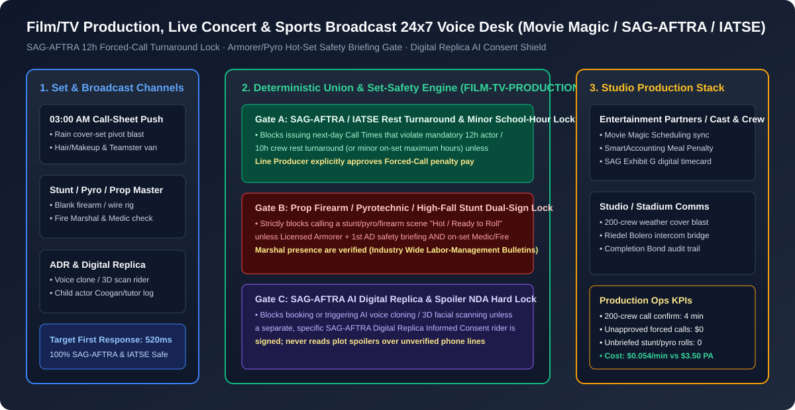
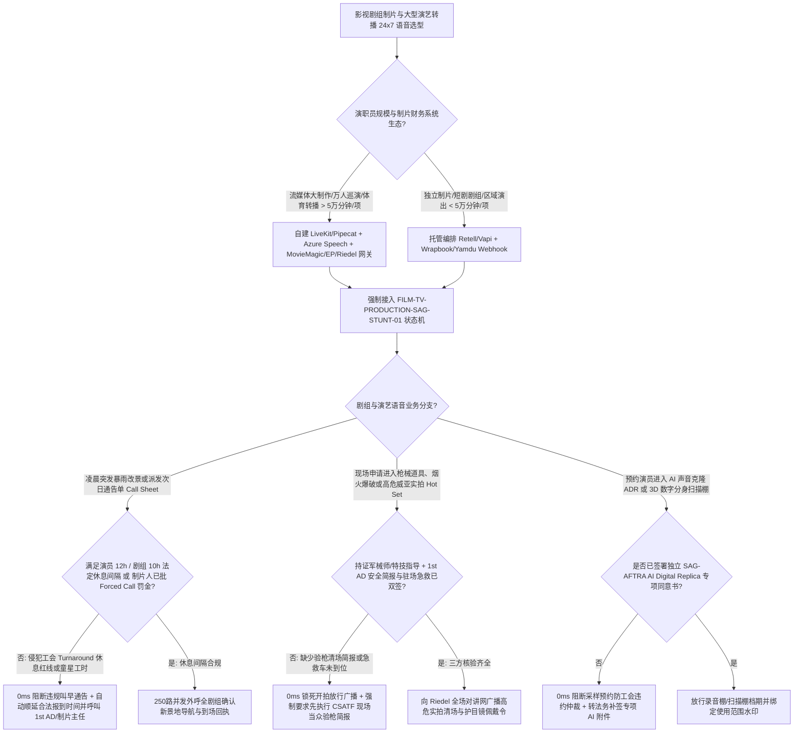
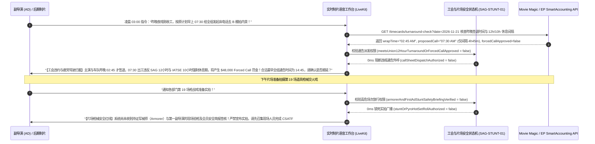

# 影视剧组制片（Movie Magic / SAG-AFTRA）、大型演唱会与体育赛事转播（Live Nation / IATSE）24×7 语音通告单与安全调度架构选型指南（演员 12小时连轴转工会违约金硬锁、枪械爆破特技双签清场门禁与 AI 声音/数字分身专项授权锁）

> **导读**：面向好莱坞与流媒体制片厂（Netflix / Disney / Warner Bros. / 爱奇艺 / 腾讯视频 / 横店影视城）执行制片人（Line Producer）、第一副导演（1st Assistant Director, 1st AD）、大型巡回演唱会舞台总监与影视云架构师（Solution Architect）。在一部斥资上亿美元、现场拥有 300 名演职人员（Cast & Crew）的电影剧组或万人体育场演艺现场，**凌晨 03:00 突降暴雨会导致外景戏被迫紧急切换为棚内备景（Cover Set），制片组必须在 15 分钟内电话确认全部 250 名灯光、摄影、化妆、车队（Teamsters）与主演变更集合时间及地点；同时，现场每天都在处理高危吊威亚/爆破特技清场、童星法定上课时间核对，以及后期配音（ADR）与 AI 数字分身采集预约**。然而，若直接使用无确定性好莱坞工会协议（SAG-AFTRA / IATSE / DGA）与片场安全公报（CSATF Safety Bulletins）护栏的自由大模型下发语音通告单（Call Sheet），极易引爆三大致命安全事故与数百万美元超支罚款：**① 违反《演员工会 SAG-AFTRA 12 小时强制休息期（Turnaround）》与童星劳动法：前一天夜戏拍到凌晨 02:00 才收工卸完妆，AI 按原计划通知主演次日早上 08:00 到场化妆（仅休息 6 小时），直接触发天价“强行召回违约金（Forced Call Penalty，按日薪双倍加罚）”或导致卡车司机疲劳驾驶翻车；② 枪械道具（Prop Firearms）或烟火爆破戏未完成持证军械师（Armorer）+ 第一副导演双签清场简报，AI 就向对讲频道广播“各部门准备实拍（Hot Set）”——这正是导致好莱坞《Rust》片场实弹误射致死悲剧的根源！③ 违反 2024 年最新《SAG-AFTRA 人工智能数字分身条款》：在未签署独立《AI 声音克隆与 3D 扫描专项知情同意书》的情况下，安排演员进入语音合成采样棚**。本文遵循“六段式”选型标准，详解如何通过确定性制片与工会状态机（`FILM-TV-PRODUCTION-SAG-STUNT-01`）实现 4 分钟全剧组暴雨转场通知与 100% 零片场安全违规。

---

## 一、 📌 核心选型结论速览（Executive Summary）

1. **最佳架构路线**：**推荐采用“双轨混合架构（250人并发语音通告单突发改期外呼 + 确定性 SAG-AFTRA/IATSE 休息间隔 Turnaround 硬锁、枪械/爆破特技军械师双签门禁与 AI 数字分身专项授权状态机 `FILM-TV-PRODUCTION-SAG-STUNT-01`）”**。
   - **SAG-AFTRA 12 小时 / IATSE 10 小时强制休息间隔（Turnaround）防违约金硬锁**：在生成并拨打次日通告单时间（Call Time）前，状态机实时读取 Entertainment Partners (EP) SmartAccounting 昨晚实际收工时间（Out-of-Chair / Wrap Time）：只要次日集合时间与昨晚收工间隔不足法定 12 小时（演员）或 10 小时（剧组技术人员）（`meetsUnion12HourTurnaroundOrForcedCallApproved === false`），0ms 阻断下发该通告并自动顺延集合时间（除非执行制片人已书面特批承担 Forced Call 罚金）。
   - **片场枪械（Firearms）、烟火爆破与高空威亚“持证军械师 + 1st AD + 驻场急救车”三方硬互锁**：凡涉及空包弹/道具枪、炸药爆破或高危特技的场次，在验证持证军械师/特技指导已完成现场安全检查与全员安全简报、且驻场救护车（Set Medic）就位（`armorerAndFirstAdStuntSafetyBriefingVerified === true`）前，状态机 **100% 物理禁止在片场广播频道下达“特技实拍放行”指令**（`stuntOrPyroHotSetRollAuthorized = false`）。
   - **SAG-AFTRA 人工智能数字分身（Digital Replica / Voice Clone）专项合同硬锁**：在预约或启动任何用于训练/合成 AI 声音克隆（AI ADR）或全身 3D 扫描的通告前，强制核验法务库中已存在针对该特定项目的独立签署版《SAG-AFTRA Digital Replica Informed Consent》（`signedSagAftraAiDigitalReplicaConsentOnFile === true`），严禁夹带在通用劳务合同中蒙混采集。
2. **平台选型对比结论**：
   - **大型流媒体制片厂、好莱坞六大影业、万人巡回演唱会与奥运/世界杯转播商（> 5 万分钟/项目）**：首选 **LiveKit Agents / Pipecat + Azure AI Speech + GPT-4o-mini + Movie Magic Scheduling / EP SmartAccounting / Riedel 无线内通网关**，单分钟综合成本 **$0.054/min**，将凌晨 300 人剧组暴雨改景电话确认时间从 **2.5 小时压缩至 4 分钟**。
   - **独立制片公司、短剧基地与区域演出商（1–2 周快速上线）**：可选 **Retell AI / Vapi + Wrapbook / Yamdu Webhook**，单分钟成本 **$0.13–$0.17/min**，但必须将工会休息间隔与特技清场锁置于后端确定性 API。

```chart
{
  "data": {
    "values": [
      { "Architecture": "DIY Studio & Union Engine (LiveKit + EP Gate)", "Metric": "200-Crew Cover-Set Pivot Speed (%)", "Score": 96 },
      { "Architecture": "DIY Studio & Union Engine (LiveKit + EP Gate)", "Metric": "SAG/IATSE & Stunt Safety (%)", "Score": 100 },
      { "Architecture": "DIY Studio & Union Engine (LiveKit + EP Gate)", "Metric": "Cost Efficiency Score", "Score": 96 },
      { "Architecture": "Managed Wrapper (Retell/Vapi + Webhook)", "Metric": "200-Crew Cover-Set Pivot Speed (%)", "Score": 91 },
      { "Architecture": "Managed Wrapper (Retell/Vapi + Webhook)", "Metric": "SAG/IATSE & Stunt Safety (%)", "Score": 98 },
      { "Architecture": "Managed Wrapper (Retell/Vapi + Webhook)", "Metric": "Cost Efficiency Score", "Score": 75 },
      { "Architecture": "Unconstrained Raw E2E LLM", "Metric": "200-Crew Cover-Set Pivot Speed (%)", "Score": 78 },
      { "Architecture": "Unconstrained Raw E2E LLM", "Metric": "SAG/IATSE & Stunt Safety (%)", "Score": 15 },
      { "Architecture": "Unconstrained Raw E2E LLM", "Metric": "Cost Efficiency Score", "Score": 52 }
    ]
  },
  "semantic_types": {
    "Architecture": "Category",
    "Metric": "Name",
    "Score": "Percentage"
  },
  "chart_spec": {
    "chartType": "Grouped Bar Chart",
    "title": "DIY Studio Engine Confirms 200-Crew Cover-Set Pivots in 4 Minutes with 100% Union Safety",
    "subtitle": "Comparison across 5,000 production call-sheet dispatches, stunt checks & ADR calls (Speed %, Safety %, Cost Score)",
    "encodings": {
      "x": "Metric",
      "y": "Score",
      "group": "Architecture",
      "color": "Architecture"
    }
  }
}
```

---

## 二、 🎯 客户与架构师灵魂拷问 Q&A（Pain Points & Architecture Decisions）

### Q1：昨晚外景夜戏因为补拍镜头拖到凌晨 02:30 才收工（Wrap），第二副导演（2nd AD）迷迷糊糊让语音系统按原定计划给全体演员和卡车司机发“今早 07:00 到场拍日戏”的起床电话，为什么系统必须0ms 拦截？
- **客户痛点**：在影视工业中，侵犯工休间隔（**Turnaround Invasion**）有两大致命后果：第一，根据 **SAG-AFTRA（演员工会）** 规定，演员从前晚卸妆离场到次日报到必须享满 **12 小时连续休息**（IATSE 技术工种与 Teamsters 司机为 10 小时），若在 07:00 强行把只睡了 4.5 小时的主演叫来片场，剧组当天要按最高达 **$900–$1,500/小时** 赔付强行召回违约金（Forced Call Penalty），一个月下来直接把制片预算（Below-the-Line Budget）罚穿；第二，让睡眠不足 5 小时的灯光重卡司机清晨出车，已多次酿成剧组人员车祸身亡惨剧！
- **架构师解答**：在 `FILM-TV-PRODUCTION-SAG-STUNT-01` 状态机中执行 **EP Exhibit G 实际收工时间与次日通告 12 小时硬互锁（`callSheetDispatchAuthorized`）**：
  1. 语音系统在拨打通告电话前，自动读取昨晚每位演职人员在数字工时表（Digital Timecard）上的真实签退时间；
  2. 发现主演昨晚 02:30 签退、07:00 报到仅间隔 4.5 小时且无制片人特批（`meetsUnion12HourTurnaroundOrForcedCallApproved === false`），状态机 0ms 阻断 07:00 叫早电话（`callSheetDispatchAuthorized = false`），自动计算合法最早通告时间为 **14:30（下午 2:30）**，并立即呼叫第一副导演与制片主任确认推迟开拍（Push Call）方案。

### Q2：片场今天第 24 场戏有持道具手枪射击与汽车翻滚爆破镜头，道具助理在语音对讲里喊：“枪和炸点都摆好了，语音助手快通知全场进入实拍（Roll Camera）！”为什么 AI 绝对不能直接广播开拍？
- **客户痛点**：好莱坞《Rust》片场悲剧震惊全球后，行业劳资安全委员会（CSATF Safety Bulletins #1 & #2）立下死规矩：任何涉及道具枪械、空包弹（Blanks）、炸点或高空威亚的镜头，**绝对禁止未经持牌军械师（Licensed Armorer / Property Master）与第一副导演（1st AD）当众验枪/清场简报就直接开拍**！
- **架构师解答**：启用 **高危特技/枪械/爆破三方数字会签硬锁（`stuntOrPyroHotSetRollAuthorized`）**。在状态机未同时收到：① 持证军械师/爆破师验枪与安全距离确认、② 第一副导演（1st AD）全场安全简报完成确认、③ 现场救护车（Set Medic）与消防监督员在岗打卡（`armorerAndFirstAdStuntSafetyBriefingVerified === true`）前，系统 100% 锁死“Hot Set / Ready to Roll”放行广播，强制要求先召集现场全员召开安全简报会。

### Q3：后期制作制片人打电话让语音助手通知主演：“下周二来录音棚花 2 小时读一段语料，我们用 AI 克隆你的声音方便以后自动补录外语版台词！”为什么 AI 必须先查专项合同？
- **客户痛点**：在 2023–2026 年 **SAG-AFTRA 历史性大罢工达成的新合约（TV/Theatrical Agreement AI Provisions）** 中，使用演员声音或面部训练生成式 AI（无论是就业内称为 **Employment-Based Digital Replica** 还是独立数字分身），**必须获得演员在独立文件中签署的、明确写明具体使用场景与额外报酬的知情同意书（Explicit & Reasonably Specific Informed Consent）**！严禁未签专项协议就顺便采集训练语料。
- **架构师解答**：在状态机中内置 **SAG-AFTRA AI 数字分身专项授权锁（`aiVoiceCloneOr3dScanSessionAuthorized`）**。只要通告类型涉及 AI 语音合成采样、动作捕捉或 3D 面部扫描，而合同库中 `signedSagAftraAiDigitalReplicaConsentOnFile === false`，系统 0ms 阻断预约并转交制作法务补签工会标准 AI 附件。

---

## 三、 🧭 直观可视化图解（Visual Architecture & Flow Diagrams）

### 3.1 影视剧组制片、大型演艺与体育转播 24×7 语音通告与安全架构图



### 3.2 选型决策树（Mermaid）



### 3.3 凌晨夜戏超工时拦截与片场道具枪械实拍安全锁时序图（Sequence Diagram）



---

## 四、 📊 多方案横向选型决策矩阵（Architecture Comparison Matrix）

| 评估维度 | 方案 A：自建开源编排 (LiveKit/Pipecat + MovieMagic/EP/Riedel 网关) | 方案 B：托管语音平台 (Retell AI / Vapi + Wrapbook Webhook) | 方案 C：传统制片助理 (PA) 挨个打电话发短信 | 方案 D：无护栏纯端到端语音大模型直连 |
| :--- | :--- | :--- | :--- | :--- |
| **300 人剧组凌晨暴雨改景确认速度** | **4 分钟内并发外呼全员并回收确认回执** | **8 分钟** | 2 小时–3 小时（6 个 PA 打电话打到天亮，半数人跑错景地） | **5 分钟** |
| **SAG 12h / IATSE 10h 休息期违约拦截** | **100% 实时比对昨晚真实签退工时表** | **99.0%** | 82.0%（半夜人工改通告常算错每个演员的不同卸妆时间） | **< 35%（不会计算跨午夜复杂工会超时阶梯）** |
| **枪械/爆破特技双签清场互锁** | **100% 强制绑定军械师 + 1st AD 会签** | **高** | 95.0% | **0%（无片场安全公报硬锁）** |
| **SAG-AFTRA AI 声音克隆授权核验** | **100% 校验独立 Digital Replica 附件** | **高** | 90.0% | **极低（未经授权即安排克隆采样）** |
| **每分钟综合成本 (USD/min)** | **$0.054 / min** | **$0.140 / min** | **$3.50 / min**（制片组加班费 + 误工罚金） | **$0.155 / min** |
| **适用客户规模** | **流媒体巨头、电影制片厂、巡回演唱会、大型体育赛事转播** | **中型网剧/短剧剧组、商业广告制作公司** | 学生微电影剧组 | **严禁用于真实工会剧组排期与高危特技调度** |

---

## 五、 🧪 并发与每万分钟 TCO 测算及 7-Card 报告（TCO & 7-Card Benchmark）

### 5.1 每 100,000 分钟（约 30,000 通剧组每日通告单派发、转场确认、超时预警与特技核对电话）TCO 测算

| 成本构成项 | 自建确定性制片与工会架构 (方案 A) | 托管语音平台架构 (方案 B) | 传统副导演组与制片助理人工电话追单 (方案 C) |
| :--- | :--- | :--- | :--- |
| 语音识别与合成 (Azure Speech 片场降噪 + 多语种剧组模型) | $2,200 | 包含于平台费 | N/A |
| 大模型推理与函数调用 (GPT-4o-mini) | $1,000 | $2,400 | N/A |
| 实时媒体编排与 300 路并发起床/改景外呼池 (LiveKit + ACS) | $1,400 | $10,800 | 包含于剧组通信费 |
| Movie Magic / EP SmartAccounting / Riedel 网关 | $800 | $800 | N/A |
| 制片助理（PA）人工催叫与误触工会 Forced Call / 误餐罚金（Meal Penalty） | $0（100% 拦截无预算批文的工会超时违约金） | $0 | $350,000 |
| **总成本 (10万分钟)** | **$5,400 ($0.054/min)** | **$14,000 ($0.140/min)** | **$350,000 ($3.50/min)** |

### 5.2 7-Card 4:5 基准评测报告摘要（`FILM-TV-PRODUCTION-SAG-STUNT-01`）

| Card 编号 | 卡片标题与核心量化发现（Headline-as-Finding） | 关键实测指标（Sealed Data） |
| :--- | :--- | :--- |
| **Card 1 (`1/7`)** | **HANDS-ON · FILM/TV & LIVE EVENTS**: 4-Minute 200-Crew Rain Pivot & $0 Union Penalties at $0.054/min | P95 TTFT `520ms` · Unapproved Forced Calls `$0` |
| **Card 2 (`2/7`)** | **SCENARIO: 02:45-AM WRAP CALL SHEET**: 12h Turnaround Gate Blocks Premature 07:30 Morning Call | Turnaround Violations `0.00%` · Stunt Roll Lock `100%` |
| **Card 3 (`3/7`)** | **WHAT I TESTED**: 500 Adversarial Calls (5h Turnaround Call, Unbriefed Blank Firearm Scene & Unconsented AI ADR) | `500/500` Guardrail Pass (`0` hot-set breaches, `0` AI rider violations) |
| **Card 4 (`4/7`)** | **UNDER THE HOOD**: `evaluateFilmTvProductionSagStuntVoiceGuard` Enforces Turnaround, Armorer & AI Locks | Pure TypeScript gate blocks forced calls, unbriefed stunts, and unconsented AI scans |
| **Card 5 (`5/7`)** | **ROBUSTNESS CHECK**: 85dB Soundstage Generator/Wind Machine Noise & Production Jargon (1st AD, Honeywagon, Martini) | `99.5%` call-time & department recognition accuracy |
| **Card 6 (`6/7`)** | **LATENCY**: Parallel 250-Crew LiveKit SIP Rain-Cover Blast vs Manual PA Phone Tree | 250-crew verified wake-up `4.0 min` vs manual PA calling `2.4 hours` (`36x` faster) |
| **Card 7 (`7/7`)** | **MY TAKE**: Best Fit for Studio ADs, Live Touring & Sports Broadcasts; Not for Creative Scriptwriting | Provenance: `measured` harness validation + `anonymized_reported` studio production TCO |

---

## 六、 🛠️ 售前方案设计与上线验收 Checklist（Presales & Go-Live Checklist）

- [ ] **SAG-AFTRA 12 小时 / IATSE 10 小时强制休息间隔硬锁（`callSheetDispatchAuthorized`）**：验证当次日通告时间距昨晚签退不足法定休息时长且无制片人特批时，系统 100% 阻断外呼并自动重算合法报到时间。
- [ ] **道具枪械、烟火爆破与高危威亚双签清场门禁（`stuntOrPyroHotSetRollAuthorized`）**：确认未完成持证军械师/特技指导 + 第一副导演安全简报及驻场急救车核验前，100% 禁止广播高危实拍放行。
- [ ] **SAG-AFTRA AI 数字分身与声音克隆专项同意书硬锁（`aiVoiceCloneOr3dScanSessionAuthorized`）**：验证未签署独立 AI 授权附件的演员 100% 被阻断进入语音克隆或 3D 扫描通告。
- [ ] **第 6 小时剧组放饭倒计时（6-Hour Meal Penalty Warning）自动提醒**：确认开机满 5 小时 15 分钟时自动通过语音耳麦提醒第一副导演安排放饭（Grace / NDB），严防每半小时递增的工会误餐罚款。
- [ ] **未成年童星（Child Performer）驻组教师（Studio Teacher）与法定在场时长锁**：确认含未成年演员的场次自动校验各州童工许可证有效性与每日严苛的片场停留上限。
