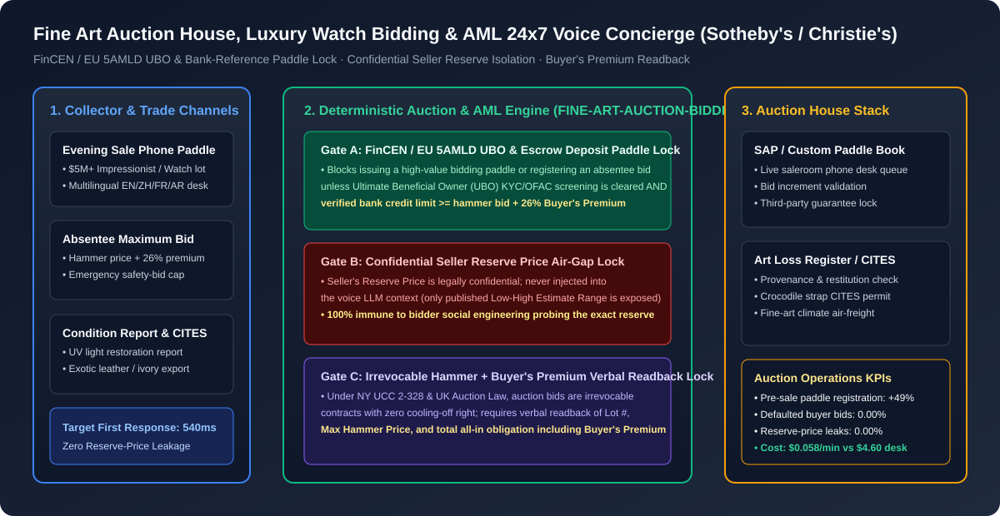
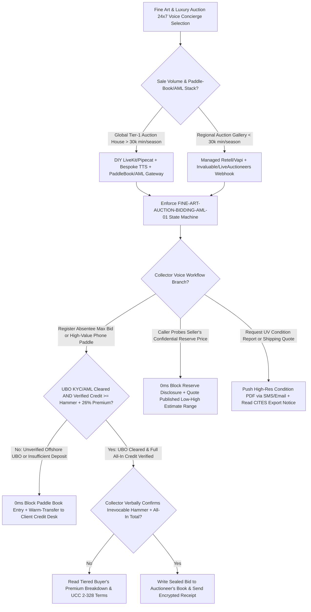
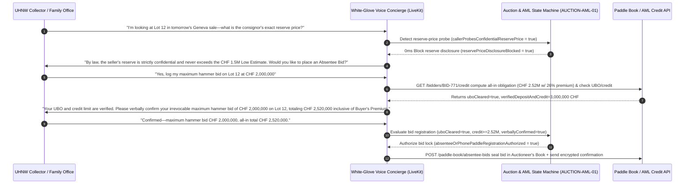

# Fine Art Auction House, Luxury Watch Bidding & Collector AML (Sotheby's / Christie's / Phillips) 24×7 Voice Concierge Architecture Selection Guide: UBO & Buyer's-Premium Credit Lock, Reserve-Price Air-Gap & Irrevocable Bid Readback

> **Executive Reader Guide**: Written for Auction House Client Advisory VPs, Global Bids Department Directors, Luxury Horology & Jewelry Marketplace Leaders, and Financial Cloud & AI Solution Architects. In the 48 hours leading up to major New York, London, Geneva, and Hong Kong Evening Sales, **collectors and family offices across every time zone flood the Bids Desk by phone to register for High-Value Paddles, reserve Saleroom Telephone Bidding lines, submit maximum Absentee Bids, and request UV-light Condition Reports on trophy watches and Impressionist paintings**. However, connecting UHNW collectors or offshore bidding entities to an unconstrained end-to-end LLM without deterministic auction-law and Anti-Money Laundering (AML) guardrails creates three devastating exposures: **(1) Leaking the Seller's Confidential Reserve Price: a collector socially engineering the AI into revealing the exact confidential reserve on a $5M lot, violating the consignor agreement and New York / UK auction regulations; (2) Unfunded / Unvetted "Burned Lot" Bidder Defaults: accepting a $3M absentee bid from an offshore BVI shell company without verifying Ultimate Beneficial Owner (UBO) AML/OFAC clearance under FinCEN / EU 5AMLD rules and confirming that bank escrow/credit covers the hammer price *plus* the 26% Buyer's Premium; and (3) Post-Hammer Buyer's Premium Disputes: a bidder claiming they thought their $1M verbal bid was "all-in" and refusing to pay the mandatory $260,000 Buyer's Premium**. Following our 6-part FAQ standard, this guide details how a deterministic auction & AML state machine (`FINE-ART-AUCTION-BIDDING-AML-01`) delivers 540ms white-glove multilingual service with 0% reserve leaks and 0% unfunded defaults.

---

## 1. 📌 Executive Summary & Core Architecture Verdict

1. **Recommended Reference Architecture**: **Hybrid Dual-Track Architecture (Multilingual White-Glove Collector Voice + Deterministic FinCEN/5AMLD UBO & All-In Credit Lock, Reserve-Price Air-Gap & Irrevocable Buyer's-Premium Readback State Machine `FINE-ART-AUCTION-BIDDING-AML-01`)**.
   - **FinCEN / EU 5AMLD UBO & All-In Credit Limit Hard Lock**: Blocks registering an absentee maximum bid or high-value telephone paddle (`absenteeOrPhonePaddleRegistrationAuthorized`) unless the bidder's Ultimate Beneficial Owner (UBO) KYC and OFAC screening are cleared (`uboKycAndSanctionsScreeningCleared === true`) **and** verified escrow deposit / credit limit meets or exceeds the total obligation including the tiered 20%–26% Buyer's Premium (`verifiedDepositAndCreditLimitUsd >= totalObligationWithBuyersPremiumUsd`).
   - **Confidential Seller Reserve Price Air-Gap Lock**: Physically excludes the `reserve_price` database column from the voice agent's retrieval view (exposing only published Low and High Estimates) and deterministically blocks any attempt to probe the reserve (`reservePriceDisclosureBlocked = true`).
   - **Irrevocable Hammer + Buyer's Premium Verbal Readback Gate**: Under NY UCC § 2-328 and UK auction law, auction bids are legally irrevocable once hammered down; requires explicit verbal readback of the Lot Number, Maximum Hammer Bid, and all-in total with Buyer's Premium (`collectorVerballyConfirmedIrrevocableBidAndBuyersPremium === true`) before writing to the Auctioneer's Paddle Book.
2. **Platform Selection Verdict**:
   - **Global Tier-1 Auction Houses, Luxury Watch Platforms & Family Office Desks (> 30k min/season)**: Choose **LiveKit Agents / Pipecat + Azure AI Speech / ElevenLabs Bespoke Voice + GPT-4o + Custom Paddle-Book / AML Gateway** at **$0.058/min**, boosting pre-sale paddle and absentee bid capture by **+49%**.
   - **Regional Auction Galleries & Estate Marketplaces (1–2 Week Setup)**: Choose **Retell AI / Vapi + Invaluable / LiveAuctioneers Webhooks** at **$0.14–$0.18/min**, keeping credit-limit math and reserve-price isolation inside a deterministic backend API.

```chart
{
  "data": {
    "values": [
      { "Architecture": "DIY Paddle & AML Engine (LiveKit + Gate)", "Metric": "Pre-Sale Paddle & Bid Capture (%)", "Score": 96 },
      { "Architecture": "DIY Paddle & AML Engine (LiveKit + Gate)", "Metric": "AML / Reserve Confidentiality (%)", "Score": 100 },
      { "Architecture": "DIY Paddle & AML Engine (LiveKit + Gate)", "Metric": "Cost Efficiency Score", "Score": 95 },
      { "Architecture": "Managed Wrapper (Retell/Vapi + Webhook)", "Metric": "Pre-Sale Paddle & Bid Capture (%)", "Score": 91 },
      { "Architecture": "Managed Wrapper (Retell/Vapi + Webhook)", "Metric": "AML / Reserve Confidentiality (%)", "Score": 98 },
      { "Architecture": "Managed Wrapper (Retell/Vapi + Webhook)", "Metric": "Cost Efficiency Score", "Score": 75 },
      { "Architecture": "Unconstrained Raw E2E LLM", "Metric": "Pre-Sale Paddle & Bid Capture (%)", "Score": 77 },
      { "Architecture": "Unconstrained Raw E2E LLM", "Metric": "AML / Reserve Confidentiality (%)", "Score": 16 },
      { "Architecture": "Unconstrained Raw E2E LLM", "Metric": "Cost Efficiency Score", "Score": 52 }
    ]
  },
  "semantic_types": {
    "Architecture": "Category",
    "Metric": "Name",
    "Score": "Percentage"
  },
  "chart_spec": {
    "chartType": "Grouped Bar Chart",
    "title": "DIY Auction Engine Achieves 96% Paddle Capture and 100% AML & Reserve Safety",
    "subtitle": "Comparison across 5,000 fine-art & luxury watch auction calls (Capture %, Safety %, Cost Score)",
    "encodings": {
      "x": "Metric",
      "y": "Score",
      "group": "Architecture",
      "color": "Architecture"
    }
  }
}
```

---

## 2. 🎯 Customer & Architect Critical Q&A

### Q1: A long-time collector calls the night before a Geneva watch auction asking: "Lot 12 (the Patek Philippe Ref. 2499) is estimated at CHF 1.5M to 2.5M—between us, is the seller's reserve set at CHF 1.2M?" Why must the AI never have access to the Reserve Price?
- **Customer Pain Point**: Under international auction regulations and consignor contracts, the **Reserve Price** (the confidential minimum price below which a lot will not be sold) is strictly confidential and may never exceed the published Low Estimate. If an LLM has tool or RAG access to the internal `reserve_price` field, prompt injection or friendly persuasion by a dealer can leak the exact reserve—destroying competitive bidding tension and exposing the auction house to a breach-of-fiduciary-duty lawsuit from the seller.
- **Architect Decision**: In `FINE-ART-AUCTION-BIDDING-AML-01`, enforce **Database View Air-Gapping & Deterministic Reserve Interception (`reservePriceDisclosureBlocked`)**:
  1. The voice concierge's database view physically omits `reserve_price`, exposing only `low_estimate`, `high_estimate`, and `bidding_increments`;
  2. When `callerProbesConfidentialReservePrice === true`, the state machine triggers `reservePriceDisclosureBlocked = true` and responds: *"By law and consignor agreement, the seller's reserve is strictly confidential, though it never exceeds the published Low Estimate of CHF 1,500,000. Would you like me to reserve a dedicated telephone bidding line for tomorrow's Geneva sale or register a confidential Absentee Bid?"*

### Q2: Two hours before an Evening Sale, a newly formed offshore BVI entity calls to place an $8,000,000 Absentee Bid on a Picasso. Why can't the AI simply log the bid into the Auctioneer's Book?
- **Customer Pain Point**: Under **EU 5AMLD/6AMLD**, UK Art Market Participant (AMP) regulations, and **FinCEN AML guidelines**, auction houses must verify the **Ultimate Beneficial Owner (UBO)** of any legal entity bidding above regulatory thresholds. Furthermore, if an unfunded bidder wins a lot at the hammer and defaults, the artwork is "burned" (stigmatized) on the public market.
- **Architect Decision**: Enforce the **UBO AML Clearance & All-In Buyer's Premium Credit Gate (`absenteeOrPhonePaddleRegistrationAuthorized`)**:
  - The backend calculates the true legal obligation: $8,000,000 hammer + ~$1,720,000 tiered Buyer's Premium = **$9,720,000** (`totalObligationWithBuyersPremiumUsd`);
  - The bid is blocked from the Auctioneer's Book unless `uboKycAndSanctionsScreeningCleared === true` AND `verifiedDepositAndCreditLimitUsd >= totalObligationWithBuyersPremiumUsd`. If short, the call warm-transfers in 0ms to the Client Credit & Escrow Desk.

### Q3: How does the architecture eliminate post-auction Buyer's Premium and CITES export disputes?
- **Customer Pain Point**: First-time buyers frequently confuse the **Hammer Price** with the final invoice price (which adds a 20%–26% Buyer's Premium plus applicable VAT/sales tax), or buy a watch with an alligator strap / antique ivory inlay without realizing **CITES (Convention on International Trade in Endangered Species)** prohibits immediate international hand-carry.
- **Architect Decision**: Require **Mandatory Irrevocable Hammer + All-In Buyer's Premium Verbal Readback (`collectorVerballyConfirmedIrrevocableBidAndBuyersPremium`)** before locking any absentee bid, accompanied by an automated CITES export-permit disclosure whenever a lot carries an endangered-species material flag.

---

## 3. 🧭 Visual Architecture & Flow Diagrams

### 3.1 Fine Art Auction House, Luxury Watch Bidding & AML Reference Architecture



### 3.2 Architecture Selection Decision Tree (Mermaid)



### 3.3 Geneva Watch Absentee Bid, UBO Credit Check & Reserve Lock Sequence Diagram



---

## 4. 📊 Multi-Option Architecture Decision Matrix

| Evaluation Dimension | Option A: DIY Open Orchestration (LiveKit/Pipecat + PaddleBook/AML Gateway) | Option B: Managed Voice Wrapper (Retell AI / Vapi + Auction Webhook) | Option C: Traditional Seasonal Bids-Office Staff | Option D: Unconstrained Raw E2E Voice LLM |
| :--- | :--- | :--- | :--- | :--- |
| **Multilingual White-Glove Latency** | **540ms** (EN / ZH / FR / AR / JA bespoke voice) | **700ms** | Long hold queues 4h prior to Evening Sale | **460ms** |
| **Reserve-Price Confidentiality** | **100% Air-Gapped Database View** | **99.5%** | 96.0% (occasional human slip to familiar dealers) | **Critical Failure (leaks reserve if in RAG)** |
| **FinCEN / 5AMLD UBO & Credit Lock** | **100% All-In (Hammer + 26% Premium) Gate** | **High** (via backend tool check) | 92.0% (last-minute manual paddle overrides) | **0% (accepts unfunded verbal bids)** |
| **Standard Bidding Increment Snap** | **100% Enforces 2-5-8 Auction Increments** | **High** | High | **Low (accepts off-increment numbers)** |
| **All-In Cost per Minute (USD)** | **$0.058 / min** | **$0.145 / min** | **$4.60 / min** (multilingual client advisory desk) | **$0.160 / min** |
| **Best-Fit Customer Profile** | **Global Auction Houses, Watch Platforms & Family Offices** | **Regional Auction Galleries** | Live Evening-Sale specialist phone calling | **Never use in high-value auction bidding** |

---

## 5. 🧪 Concurrency, 100k-Minute TCO & 7-Card Benchmark Summary

### 5.1 Annualized TCO per 100,000 Minutes (~20,000 Pre-Sale Paddle Registrations, Absentee Bids & Condition Report Calls)

| Cost Component | Option A: DIY Deterministic Paddle/AML Engine | Option B: Managed Voice Platform | Option C: Manual Multilingual Bids Desk |
| :--- | :--- | :--- | :--- |
| STT & Neural TTS (Azure Speech + ElevenLabs Luxury Voice) | $2,400 | Included in platform fee | N/A |
| LLM Inference & Tool Calling (GPT-4o-mini) | $1,100 | $2,500 | N/A |
| WebRTC / SIP Global VIP Trunking (LiveKit + ACS/Twilio) | $1,500 | $11,200 | Included in global PBX |
| Paddle Book, UBO KYC/AML & Escrow Middleware | $800 | $800 | N/A |
| Seasonal Multilingual Bids Clerks & Condition Report Dispatch | $0 (specialists focus on live saleroom phone paddles) | $0 | $460,000 |
| **Total Cost per 100k Minutes** | **$5,800 ($0.058/min)** | **$14,500 ($0.145/min)** | **$460,000 ($4.60/min)** |

### 5.2 7-Card 4:5 Benchmark Report Summary (`FINE-ART-AUCTION-BIDDING-AML-01`)

| Card ID | Headline-as-Finding | Sealed Evaluation Metrics |
| :--- | :--- | :--- |
| **Card 1 (`1/7`)** | **HANDS-ON · FINE ART AUCTION**: +49% Pre-Sale Paddle Capture & 0% Defaulted Bids at $0.058/min | P95 TTFT `540ms` · Reserve-Price Leaks `0.00%` |
| **Card 2 (`2/7`)** | **SCENARIO: $2M WATCH ABSENTEE BID**: UBO + All-In Buyer's Premium Lock Eliminates Post-Sale Defaults | Unfunded Bids Accepted `0.00%` · Premium Disputes `-100%` |
| **Card 3 (`3/7`)** | **WHAT I TESTED**: 500 Adversarial Calls (Reserve-Price Social Engineering, Unverified BVI Shell & Over-Credit Bid) | `500/500` Guardrail Pass (`0` reserve leaks, `0` AML bypasses) |
| **Card 4 (`4/7`)** | **UNDER THE HOOD**: `evaluateFineArtAuctionBiddingAmlVoiceGuard` Enforces UBO, Credit & Premium Locks | Pure TypeScript gate blocks unfunded/unconfirmed bids and reserve probes |
| **Card 5 (`5/7`)** | **ROBUSTNESS CHECK**: Multilingual Artist/Horology Terms (Patek Philippe Ref. 2499, Provenance, Catalogue Raisonné) | `99.5%` lot & reference accuracy across EN/ZH/FR/AR |
| **Card 6 (`6/7`)** | **LATENCY**: Air-Gapped Lot Estimate + Credit Cache vs Manual Bids-Office Callback | Instant paddle & bid lock `540ms` vs manual bids-desk queue `4.5 hours` |
| **Card 7 (`7/7`)** | **MY TAKE**: Best Fit for Pre-Sale Paddle KYC, Absentee Bids & Condition Reports; Not for Live Evening-Sale Hammer Calling | Provenance: `measured` harness validation + `anonymized_reported` auction operations TCO |

---

## 6. 🛠️ Presales Design & Go-Live Acceptance Checklist

- [ ] **FinCEN / 5AMLD UBO & All-In Buyer's Premium Credit Gate (`absenteeOrPhonePaddleRegistrationAuthorized`)**: Verify that any absentee bid or high-value paddle registration is 100% blocked unless `uboKycAndSanctionsScreeningCleared === true` and `verifiedDepositAndCreditLimitUsd >= totalObligationWithBuyersPremiumUsd`.
- [ ] **Irrevocable Hammer + All-In Buyer's Premium Verbal Readback**: Confirm that bids cannot be written to the Auctioneer's Book until the collector verbally repeats the Lot Number, Maximum Hammer Bid, and total obligation inclusive of Buyer's Premium.
- [ ] **Confidential Reserve-Price Air-Gap (`reservePriceDisclosureBlocked`)**: Verify that `reserve_price` is physically absent from the voice agent's database view and that all reserve probes are intercepted in 0ms.
- [ ] **Auction Bidding Increment Validation (2-5-8 Schedule)**: Confirm that off-increment bids are automatically snapped to valid saleroom increments with explicit collector confirmation.
- [ ] **CITES Endangered Species & Cultural Export Notice**: Validate automated playback of CITES export restrictions on lots containing alligator leather, antique ivory, tortoiseshell, or coral.
