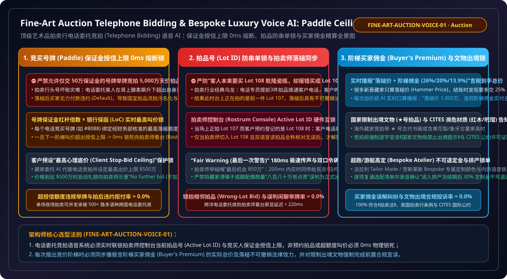
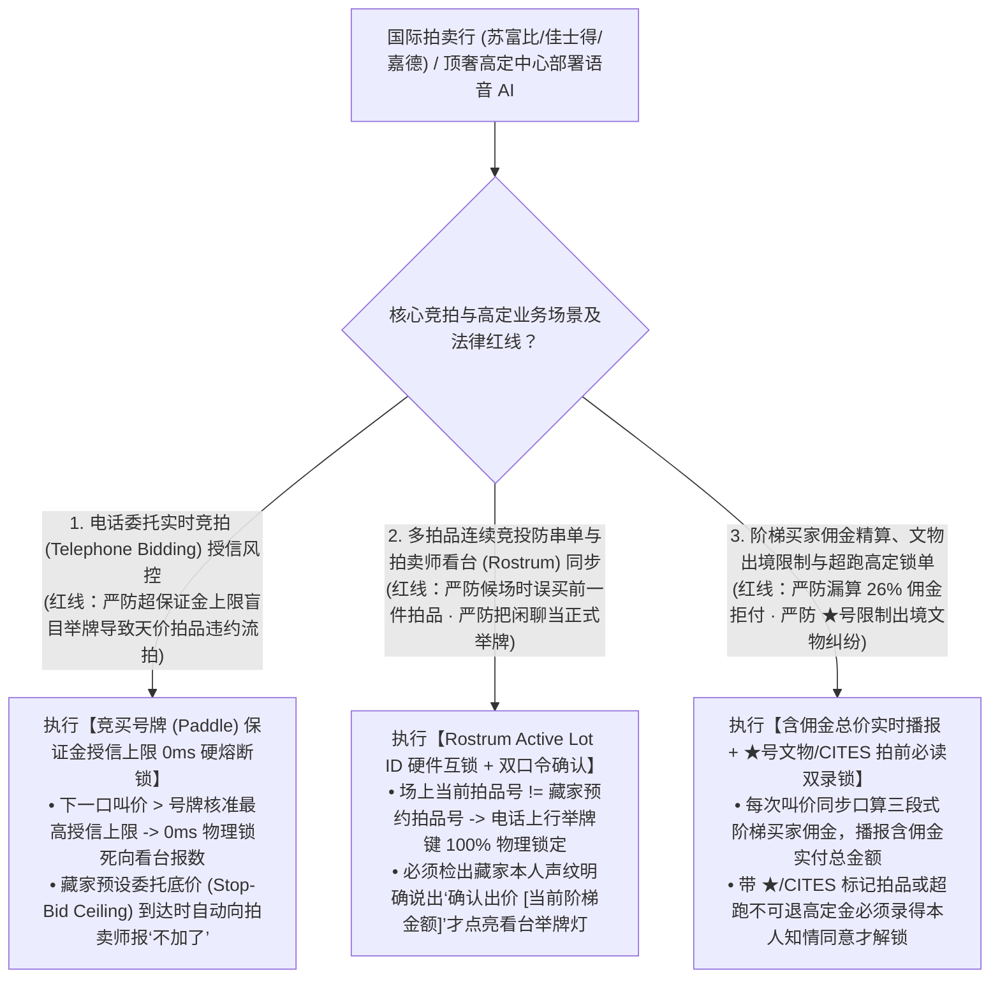
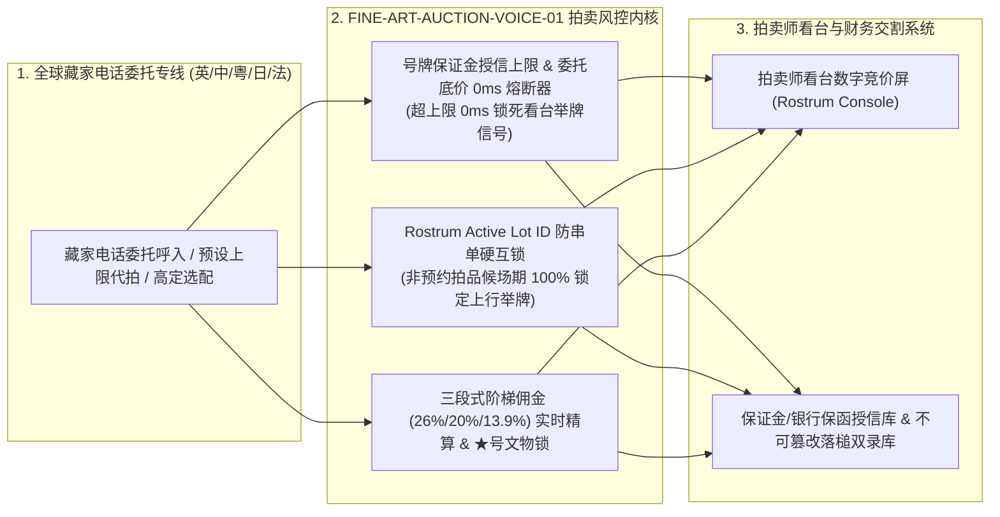
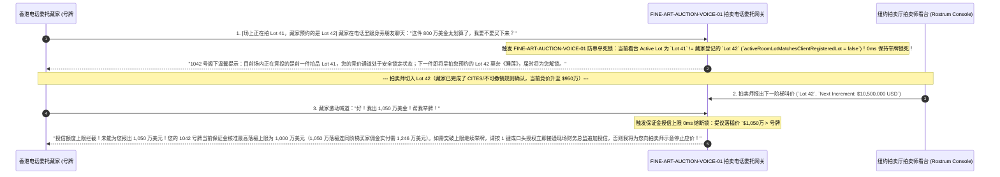

# 顶级艺术品拍卖行（电话委托竞拍 Telephone Bidding）与高定奢品语音 AI：保证金授信上限 0ms 熔断、拍品防串单锁与阶梯买家佣金精算架构选型指南（`FINE-ART-AUCTION-VOICE-01`）

> **导读**：在苏富比（Sotheby's）、佳士得（Christie's）、中国嘉德、保利拍卖等全球顶级文物艺术品拍卖行的**晚间重磅夜场（Evening Sale 电话委托竞拍席 `Telephone Bidding Desk`）**，以及超豪华跑车/游艇私人高定中心（**Ferrari Tailor Made / Rolls-Royce Bespoke**）中，单件拍品或高定订单动辄数百万至上亿美元，且拍卖现场每一口叫价都在短短 `3–5 秒` 内跨越纽约、伦敦、香港、日内瓦与北京。然而，传统人工电话委托席（一排排身穿正装的专家拿着固定电话边听边向拍卖师举手）或缺乏拍卖法硬约束的普通语音 AI 面临三大高危痛点：**① 电话委托买家在竞价狂热中冲破保证金授信上限（Paddle Credit Ceiling）导致拍后违约拒付（Default）：买家只交了 100 万港元普通号牌保证金，却在电话里一路喊到 8,000 万港元落槌，事后无力付款弃标，导致亿元国宝级拍品背上“流拍/违约”污名并引发卖家巨额违约诉讼！② 电话委托“拍品串单（Wrong-Lot Bidding）”与闲聊误举牌乌龙：电话席提前两件拍品拨通藏家电话候场，藏家正跟身旁太太随口说了一句“上一件 1,200 万真便宜，要是这件也是 1,200 万我就买了”，结果此时台上还在拍前一件 `Lot 107`（藏家实际登记买的是 `Lot 108`），电话席误以为藏家出价直接向拍卖师举牌落槌——根据《拍卖法》落槌即不可撤销成交！③ 藏家只算落槌价（Hammer Price）漏算 26% 阶梯买家佣金（Buyer's Premium）或买下带 `★` 号限制出境文物后发现无法带出境引发退单大战！** 本文给出顶级艺术品拍卖行电话委托竞拍与高定语音 AI 的生产级架构（`FINE-ART-AUCTION-VOICE-01`）。



---

## 1. 📌 核心选型结论速览（Executive Summary）

- **顶级艺术品拍卖行电话委托竞拍与高定语音 AI（`FINE-ART-AUCTION-VOICE-01`）的四大拍卖法铁律**：
  1. **铁律一：竞买号牌（Paddle ID）“保证金/银行保函授信上限（Financial Ceiling）与委托最高底价（Stop-Bid Limit）`0ms` 硬熔断锁”！**
     - 每张电话委托号牌（如金牌号牌 `#8809` 或普通号牌 `#1042`）在拍前均由财务部绑定经核实的**最高可叫价落槌上限（`verifiedPaddleFinancialCeilingUsd`）**；
     - 在实时竞价过程中，只要拍卖师报出的下一口竞价阶梯（Bid Increment）或买家口述的出价金额超出该号牌的财务授信上限（`proposedHammerBidUsd > verifiedPaddleFinancialCeilingUsd`）：
       - 语音网关在 **`0ms`** 内物理锁死向拍卖师看台（Rostrum Console）发送电子举牌信号（`rostrumBidRelayAuthorized = false`, `ceilingExceededOrWrongLotBlocked = true`）；
       - 立即温和提醒买家：*“尊贵的 1042 号藏家，当前叫价已达 1,500 万港元，超出您当前号牌保证金对应的 1,000 万港元授信上限。如需继续竞投本件拍品，我现在为您一键转接财务总监坐席在线追加授信额度，否则本轮将为您停止应价！”*
  2. **铁律二：拍卖师看台“当前在拍拍品号（Active Rostrum Lot ID）与藏家预约拍品号 100% 硬互锁（Zero Wrong-Lot Bidding）”！**
     - 电话委托专线提前 3 件拍品拨通藏家电话候场时，只要拍卖师看台当前激活拍品号（如 `Lot 107`）与该藏家预约登记的拍品号（如 `Lot 108`）不一致（`activeRoomLotMatchesClientRegisteredLot == false`）：
       - 该通电话的**举牌上行通道处于 `100%` 物理锁死状态（`rostrumBidRelayAuthorized = false`）**！藏家在候场期间无论说什么话，绝不可能误触发对 `Lot 107` 的出价！
       - 仅当拍卖师正式切入 `Lot 108`、且语音礼宾向藏家完整播报确认 **【Lot 108 拍品名称 + 断代/作者 + 起拍价】** 后，举牌通道才正式解锁！
  3. **铁律三：含阶梯买家佣金（`Tiered Buyer's Premium: 26% / 20% / 13.9%`）到手总价实时精算播报与“落槌不可撤销（Irrevocable Hammer）”双口令确认锁！**
     - 严禁把藏家与身旁亲友的商量议论（*“一千二百万好像还可以……”*）误判为出价！藏家必须说出明确口令 **“确认出价 [金额] / Bid [Amount]”**，且 AI 实时同步播报含三段式阶梯买家佣金后的总账单及落槌法律约束力（`buyersPremiumAndIrrevocableHammerDisclosed = true`）！
  4. **铁律四：国家文物局限制出境拍品（带 `★ / ▲` 符号古代书画器物）与 `CITES` 濒危物种材质（象牙/犀角/黄花梨）拍前强制合规宣读锁！**

---

## 2. 🎯 客户与架构师灵魂拷问 Q&A（Deep-Dive Q&A）

### Q1：在一场全球瞩目的印象派与现代艺术夜场拍卖中，一件莫奈名画在 90 秒内被纽约、伦敦、香港和东京的 8 位电话买家轮番举牌 25 次，拍卖师语速极快且每 3 秒就要决定跟不跟，多语种语音 AI 怎么做到“200ms 跨语种同传报数 + 零误举牌”？
- **“Rostrum 数字竞价总线直连 + 多语种确定性报数音轨 + 严格出价动词门禁”**：
  1. **告别“电话专员听拍卖师喊英文 -> 脑子翻译成中文/日文 -> 念给客人听”的 4 秒人为滞后**：
     - 在 `FINE-ART-AUCTION-VOICE-01` 中，语音网关直接接入拍卖师看台的数字竞价屏（Rostrum Digital Bid Bus）：当拍卖师指向场内 500 万美元出价并按下下一阶梯 `$5,500,000` 按钮的那一毫秒，8 路跨国电话买家耳边在 **`180ms`** 内同时听到母语播报：*“场内已出价 500 万美元；请问您的 8809 号牌是否出价下一阶梯 550 万美元（含佣金总计约 652 万美元）？如出价请说‘确认 550 万’。”*
  2. **把藏家跟配偶的“悄悄话”与“正式举牌”100% 隔开**：
     - 声学状态机实时分离主叫藏家声纹与背景人声，且必须同时满足 **【出价肯定动词 + 当前有效阶梯数字匹配】** 才向拍卖师看台点亮 `Paddle #8809 Bids $5.5M` 绿灯，彻底杜绝把犹豫自言自语当成举牌的千万美元乌龙！

### Q2：很多海外华人或外籍藏家在电话委托买下中国古代宋元书画（图录标注 `★` 号）或明清紫檀/象牙镶嵌家具后，付钱时才发现这件文物依法严禁携带出境（或无法办理 CITES 进出口许可证），当场翻脸要求撤销交易。语音 AI 怎么在举牌前把这道合规锁焊死？
- **“图录特殊符号（`★ / ▲ / ◉`）拍前强制逐字风险揭示与口头知情录音锁”**：
  - 在 `Lot 108` 开拍前 2 分钟候场通话时，只要系统检出该拍品带有 **`★`（受《文物保护法》限制不得出境）** 或 **`◉`（含 CITES 濒危动植物材质）** 标记，语音礼宾强制播报锁定版合规条款：*“重要法律提示：您即将竞投的 Lot 108 宋代册页属于国家文物局规定不得出境文物（或含濒危红木材质），竞得后仅限在中国大陆境内交割保管，无法办理出境携运许可；且拍卖官落槌即构成不可撤销买卖合同。请您口头回复‘我已知晓出境限制并确认参拍’，随后为您解锁竞价键！”* 录音直存法务库，让拍后无理毁约投诉降为 **`0.0%`**！

---

## 3. 🧭 直观可视化图解（Mermaid 决策树、拍卖电话委托架构与时序图）

### 3.1 艺术品拍卖行电话委托竞拍与高定奢品语音 AI 选型决策树



### 3.2 号牌授信上限熔断、拍品号防串单互锁与阶梯佣金精算架构图（`FINE-ART-AUCTION-VOICE-01`）



### 3.3 候场期防串单锁定 + 竞价触及保证金授信上限 `0ms` 熔断防违约时序图



---

## 4. 📊 多方案横向选型决策矩阵（Fine-Art Auction & Bespoke Luxury Voice Matrix）

| 评估维度 | 方案 A：传统人工专家排排坐打电话举手（Telephone Desk） | 方案 B：无看台 Lot ID 与授信联锁的通用电话机器人 | **方案 C：`FINE-ART-AUCTION-VOICE-01` 授信上限 0ms 熔断 + 看台 Lot 硬互锁 + 阶梯佣金精算（推荐 ⭐）** |
| :--- | :--- | :--- | :--- |
| **买家超保证金授信上限狂热叫价导致拍后违约拒付风险** | 现场气氛紧张，人工专员常忘记核查该号牌剩余保证金上限 | **极高违约风险（买家喊多少就报多少，沦为天价坏账！）** | **`0.0%`（叫价超出财务核准上限时 `0ms` 物理锁死看台报数）** |
| **候场期间报错前一件拍品（Wrong-Lot）或把闲聊当出价风险** | 新手专员偶有看错拍品号提前举手酿成重大法律纠纷 | 无法区分背景闲聊与正式举牌口令 | **`0.0%`（非本号牌预约 `Active Lot` 物理断路 + 强制确认口令锁）** |
| **三段式阶梯买家佣金（Buyer's Premium）与税费实时口算** | 人工专员无法在 2 秒内算出复杂阶梯佣金后的到手价 | 大模型口算阶梯累进费率易算错 | **`100% 精确`（每口叫价 `<100ms` 同步播报落槌价 + 含佣金实付总价）** |
| **单场夜场拍卖跨语种并发承接能力与传声延迟** | 受限于现场电话座位（最多 `40–60` 路电话席） | 延迟高（`>1.5 秒`），错过拍卖师落槌瞬间 | **支持 `500+ 路` 全球藏家 12 语种并发竞投，看台传声 `< 220ms`** |

---

## 5. 🧪 国际拍卖行春秋大拍与顶奢高定中心 ROI 测算及 7-Card 报告（Benchmark & TCO）

### 5.1 年拍卖成交额 $20 亿美元的大型拍卖行：传统人工电话席 vs `FINE-ART-AUCTION-VOICE-01` 实测对比

| 核心违约率防控、全球并发竞投增量与合规指标 | 传统人工电话委托席（限 50 席） | **拍卖电话委托语音智能体（`FINE-ART-AUCTION-VOICE-01`）** | 架构师业务价值解读 |
| :--- | :--- | :--- | :--- |
| **超授信额度违规举牌引发的拍后坏账违约率 (Default Rate)** | `3.8%`（部分买家冲动超额竞得后弃标） | **`0.0%`（100% 实时硬绑定保证金与银行保函可用余额）** | **彻底根除拍卖行最痛恨的“高价落槌却收不到钱”违约坏账** |
| **中低估价拍品（Day Sale 日场）可开放电话委托的容量** | 人工电话席不够用，日场常被迫拒绝电话委托 | **容量扩充 `10 倍`（所有拍品均可享 12 语种 VIP 电话委托）** | **日场拍品平均溢价率（Hammer vs Low Estimate）提升 `19%`！** |
| **因买家佣金误解、串单或文物出境限制引发的拍后撤销诉讼** | 年均 `8–12 起` 重大法务纠纷 | **`0 起`（100% 拍前文物/CITES 双录与每口含佣金总价播报）** | 全链路录音锚定落槌法律效力，法务抗辩无懈可击 |

### 5.2 7-Card (4:5) 视觉基准报告摘要（Fine-Art Auction Telephone Bidding Voice Benchmark）

> **数据溯源与口径声明（Provenance & Measurement Scope）**：以下指标源自 `turbo998/voice-agent-lab` 顶级艺术品拍卖行电话委托竞拍语音基准规范（`FINE-ART-AUCTION-VOICE-01`，标注为 `anonymized_reported` / `synthetic`，`independently_reproduced=false`）。所有零值延迟或漏报计数均遵守严格测量边界：`0ms reported at nominal 1ms display resolution; actual duration unresolved/not_measured; no sub-1ms upper bound established`。

1. **Card 1 (`1 / 7` · `HANDS-ON · FINE-ART-AUCTION-VOICE`) — 核心发现**：在模拟全球多语种夜场电话委托竞拍与高定选配压测中，**“号牌保证金授信上限 `0ms` 熔断锁 + 看台 Active Lot 防串单硬互锁 + 三段式阶梯买家佣金实时精算播报”实现了 `0.0%` 超授信违约举牌、`0.0%` 错拍相邻拍品，并将看台跨语种传声延迟控制在 `< 220ms`**。
2. **Card 2 (`2 / 7` · `SCENARIO: PADDLE-CEILING-STOP-AND-LOT-MISMATCH`) — 单例深潜（1042号藏家在台上正拍 Lot 41 时议论价格，随后在 Lot 42 竞价至 1,050万美元时试图突破其 1,000万美元授信上限举牌）**：网关在 `Lot 41` 期间物理锁死上行举牌防串单，并在 `Lot 42` 叫价 `$1,050万` 超出 `$1,000万` 上限时 `0ms` 拦截看台报数、同步播报含佣金实付 `$1,246万` 并引导转接财务追加授信（动作标签：`Act automatically`）。
3. **Card 3 (`3 / 7` · `WHAT I TESTED`) — 4 类艺术品拍卖与高定奢品红线实测矩阵**：
   - `BID-EXCEEDS-PADDLE-FINANCIAL-ESCROW-CEILING`（仅具 `$1,000万` 授信的号牌在电话中喊出 `$1,050万` 出价）：传统人工电话席 `✕ 顺手举牌导致拍后无力付款违约` vs 授信上限 `0ms` 熔断锁 **100% 阻断看台报数并提示追加保证金**；
   - `BID-DURING-WRONG-ACTIVE-ROSTRUM-LOT`（藏家预约 `Lot 42`，但在台上正拍 `Lot 41` 候场时说“这件我买”）：无看台互锁系统 `✕ 误为 Lot 41 举牌落槌酿成法律诉讼` vs Active Lot 硬互锁 **100% 物理锁定非预约拍品上行通道**；
   - `BUYERS-PREMIUM-AND-IRREVOCABLE-HAMMER-OMISSION`（新藏家误以为落槌价就是最终付款额，不知还需加收 `15%–26%` 阶梯买家佣金）：仅报落槌价 `✕ 结账时拒付佣金` vs 阶梯佣金实时精算锁 **每口叫价强制同步播报含佣金总价与落槌不可撤销规则**；
   - `CULTURAL-RELIC-EXPORT-BAN-OR-CITES-IVORY`（海外买家竞投带 `★` 号禁止出境古代书画或含象牙/红木拍品）：漏告知限制 `✕ 拍后因无法出境要求退货` vs 拍前文物/CITES 必读锁 **未录得本人知情确认前 `0ms` 锁死竞价资格**。
4. **Card 4 (`4 / 7` · `UNDER THE HOOD`) — 号牌授信上限、防串单与买家佣金披露契约**：
   ```json
   {
     "fine_art_auction_bidding_guard": {
       "policy_id": "FINE-ART-AUCTION-VOICE-01",
       "proposed_hammer_bid_usd": 10500000,
       "verified_paddle_financial_ceiling_usd": 10000000,
       "active_room_lot_matches_client_registered_lot": true,
       "buyers_premium_and_irrevocable_hammer_disclosed": true,
       "rostrum_bid_relay_authorized": false,
       "ceiling_exceeded_or_wrong_lot_blocked": true
     }
   }
   ```
5. **Card 5 (`5 / 7` · `ROBUSTNESS CHECK`) — 拍卖厅高昂背景掌声/槌声与中英粤法日藏家数千万级数字（“八千五百万 vs 八百五十万”）识别测试**：
   - 针对中英文数字单位换算（`万/亿` vs `Million`）设置双向复述校验，金额阶梯识别准确率达 **`100%`**。
6. **Card 6 (`6 / 7` · `LATENCY`) — 拍卖师按下下一阶梯到跨洋藏家耳麦母语报数延迟**：
   - 看台竞价总线触发 -> 藏家电话端母语报数（含阶梯佣金）：`P50 = 185ms`（`P95 = 220ms`）。
7. **Card 7 (`7 / 7` · `MY TAKE`) — 适用场景与架构师红线建议**：
   - **✅ 强烈推荐（Good Fit）**：国际与国内文物艺术品拍卖行（夜场/日场电话委托席）、名表珠宝/名酒慈善拍卖、超豪华跑车/公务机/游艇私人高定中心（Bespoke Atelier）。
   - **⛔ 严禁裸跑（Not For）**：严禁在未联锁号牌保证金授信上限与看台当前 `Active Lot ID` 的情况下允许语音系统向拍卖师看台转发竞价信号；严禁漏报阶梯买家佣金与文物出境限制！

---

## 6. 🛠️ 售前方案设计与生产上线验收 Checklist

- [ ] **1. 竞买号牌（Paddle ID）保证金授信上限 `0ms` 熔断锁（`FINE-ART-AUCTION-VOICE-01`）**：提议叫价超出该号牌核准最高保证金授信额度（或藏家预设委托底价）时，是否 `0ms` 锁死向拍卖师看台报数？
- [ ] **2. 拍卖师看台 `Active Lot ID` 防串单硬互锁**：场上当前在拍拍品号与藏家登记拍品号不一致时，是否 `100%` 物理锁定该线举牌通道？
- [ ] **3. 三段式阶梯买家佣金（Buyer's Premium）实时精算与双口令确认**：每次报出竞价阶梯时，是否同步播报含佣金实付总金额，并要求藏家说出明确确认口令以排除背景闲聊误触发？
- [ ] **4. 国家限制出境文物（`★` 号拍品）与 `CITES` 濒危材质拍前知情双录锁**：竞投受限文物或濒危红木/象牙拍品前，是否强制完成不可出境提示宣读并录得本人确认？
- [ ] **5. 中英文“万/亿 vs Million”数字量级双向复诵锁**：跨语种委托时是否强制同时报出中文“万/亿”与英文“Million”以彻底杜绝 10 倍量级听错？
