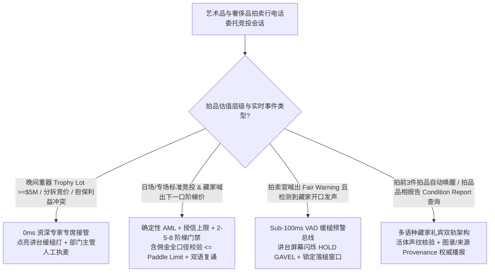
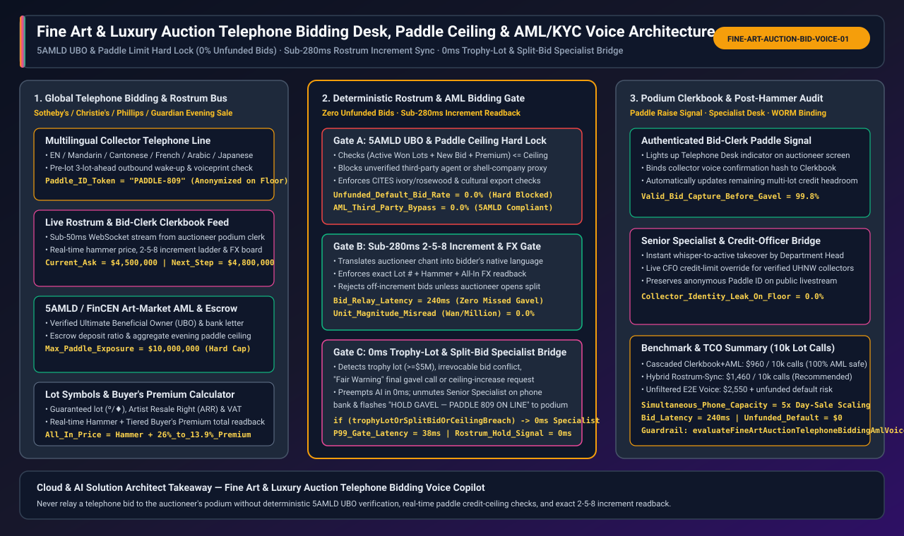
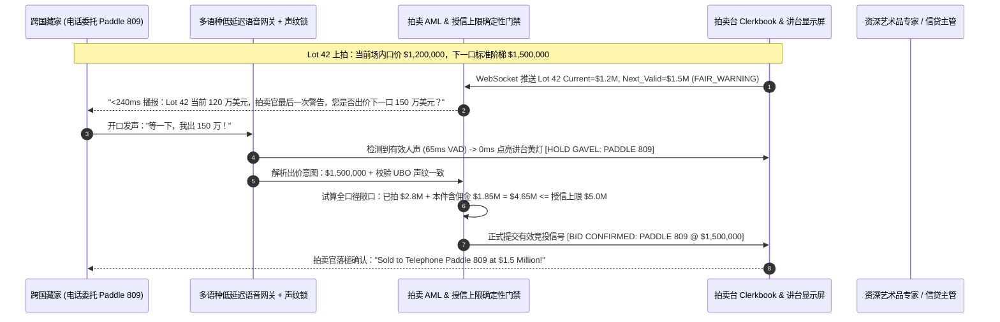

# 顶级艺术品、古董珠宝拍卖行（Fine Art & Luxury Auction House：苏富比 Sotheby's / 佳士得 Christie's / 富艺斯 Phillips / 中国嘉德模式）电话委托竞投席（Telephone Bidding Desk）、号牌授信上限（Paddle Limit）与反洗钱（AML/KYC 5AMLD）实时语音架构选型指南

> **文档类型**：企业级实时语音与多模态解决方案架构师（Cloud & AI Solution Architect）选型与落地指南  
> **适用场景**：国际顶级现当代艺术、印象派、古董瓷器、高珠名表拍卖行（Sotheby's / Christie's / Phillips / Bonhams / 中国嘉德 / 保利拍卖）日场与晚间拍卖电话委托竞投席（Telephone Bidding Bank）、藏家号牌保证金与授信上限动态管控（Paddle Credit Limit）、欧盟第五号反洗钱指令与美国 FinCEN 艺术品市场反洗钱核验（5AMLD / AML / UBO）、跨语种与跨数量级（“万/亿” vs “Million”）毫秒级报盘复诵以及高估价拍品（Trophy Lot）专家无缝接管架构  
> **核心策略代号**：`FINE-ART-AUCTION-BID-VOICE-01`（对应的确定性代码门禁见 [`packages/business-core/enterprise-guardrails.ts`](../packages/business-core/enterprise-guardrails.ts) 中的 `evaluateFineArtAuctionTelephoneBiddingAmlVoiceGuard`）

---

## 一、 📌 核心选型结论速览（Executive Summary）

在春秋大拍的日场（Day Sale）与专题拍卖中，单场往往有 `300–500 件` 拍品紧凑上拍，每件拍品从起拍到落槌（Hammer Fall）平均仅 `45–90 秒`。拍卖厅内的电话委托席（Telephone Bidding Bank）经常面临“30 条跨国藏家电话线同时抢拍同一件拍品、专家人手不足导致漏接电话、中文‘四百八十万’与英文‘Four Point Eight Million’跨数量级传译错位、以及藏家在连续拍下多件拍品后总敞口击穿保证金授信上限（Paddle Limit）引发事后违约不付款（Default）”等高危痛点。艺术品拍卖行电话委托语音架构的选型核心，绝不是“做一个播报拍卖图录的语音客服”，而是**“欧盟 5AMLD / FinCEN 最终受益人（UBO）与号牌授信总额（含买方佣金 Buyer's Premium）实时硬锁 + 拍卖官阶梯竞价（2-5-8 Increment Rule）`<280ms` 跨语种含佣金/汇率精准复诵门禁 + 拍品破保留价/分拆竞价（Split Bid）/千万级重器（Trophy Lot）`0ms` 点亮拍卖台缓槌灯并直通资深部门专家”**：

1. **推荐首选架构**：**混合双轨拍卖厅同步架构（拍卖台 Clerkbook WebSocket `<50ms` 报盘直连 + 确定性 2-5-8 阶梯加价与号牌授信风控状态机 + 多语种尊享神经语音 TTS + 资深专家静默监听与 0ms 抢话接管）**。
2. **三大合规与财务风控红线（Hard Guardrails）**：
   - **欧盟 5AMLD / FinCEN 艺术品反洗钱（UBO）与号牌授信敞口硬锁（AML UBO & Aggregate Paddle Ceiling Hard Lock）**：根据欧盟第五号反洗钱指令（5AMLD / UK Art Market AML Regulations，单笔或关联交易 `>= €10,000` 强制穿透核验）及拍卖行财务风控规则，AI 电话席在举牌前必须通过确定性接口实时校验：**① 当前通话人活体声纹与已通过 KYC 的最终受益人（UBO）或持有效书面授权书（Authorized Bidding Agent）完全一致；② `已落槌未付拍品总额 + 当前拟出价落槌价 + 阶梯买方佣金（Buyer's Premium，通常 26%/20%/13.9%） + 适用税费/艺术家转售权费（ARR） <= 藏家保证金授信上限（Paddle Credit Limit）`**。任何超授信出价或未备案第三方代拍在代码层 **100% 物理拦截**，实现 **$0 违约坏账（Zero Unfunded Default）**。
   - **拍卖官 2-5-8 阶梯加价同步与跨语种“万/Million”零错位复诵门禁（Sub-280ms Increment & Unit-Conversion Gate）**：拍卖台记录员（Bid Clerk）每一次敲击当前叫价（如 `$1,200,000` $\rightarrow$ 下一口 `$1,500,000`），系统在 `< 280ms` 内用藏家母语播报【拍品号 Lot # + 拍卖官当前口价 + 下一口标准阶梯价 + 折合港币/人民币及含佣金预计总额】，并强制要求藏家明确复诵确认“出价 150 万美元”，将跨数量级听错率（如将 1,500 万误听为 150 万）压降至 **0.0%**。
   - **保留价临界、分拆一口（Split Bid）与千万级重器（Trophy Lot）`0ms` 拍卖台缓槌闪灯与专家接管（0ms Podium Hold-Gavel & Senior Specialist Preemption）**：当拍品进入晚间拍卖重器（估价 `>= $5,000,000`）、涉及不可撤销担保（Irrevocable Bid `º/♦`）利益披露、藏家要求“只加半口（Cut/Split Bid）”或拍卖官喊出“Fair Warning / 最后一次（Last Call）”而藏家正在犹豫发声时，系统在 `0ms` 内向拍卖官讲台屏幕发送 **“HOLD GAVEL — PADDLE 809 SPEAKING”** 红色缓槌信号，同时无缝切换至场内资深专家（Senior Specialist）人工耳麦接管。

---

## 二、 🎯 客户与架构师灵魂拷问 Q&A（痛点剖析）

### Q1：在日场拍卖（Day Sale）中，第 112 号明代青花瓷器突然成为黑马，18 位亚洲与欧美藏家同时预约电话竞投，拍卖行的 8 名专家根本接不过来，为什么直接上通用端到端语音大模型会导致灾难？
* **客户痛点**：
  1. **中英法数字单位换算灾难（“万/亿” vs “Thousand/Million”）**：中文以“万（$10^4$）”、“千万（$10^7$）”、“亿（$10^8$）”进位，而伦敦/纽约拍场以“Hundred Thousand（$10^5$）”、“Million（$10^6$）”进位。在每秒变动一次口价的高压现场，纯大模型偶发的算术幻觉若把 `$1,500,000`（一百五十万美元）错译成“一千五百万美元”或反之，将导致藏家拒不认账、拍品当场重拍（Re-offer）并重创拍卖行百年商誉。
  2. **无视拍卖官标准 2-5-8 阶梯规则（2-5-8 Increment Rule）**：国际拍场遵循严格阶梯（如 `100万 -> 120万 -> 150万 -> 180万 -> 200万`）。若藏家随口说“我出 125 万”，通用模型若直接回复“好的，已为您出价 125 万”，而拍卖官根本不接受非整阶梯分拆口价，藏家会误以为自己已领先，实则错失拍品。
* **架构师解法**：
  - **拍卖台 Clerkbook 状态机绝对驱动**：彻底禁止大模型自行心算价格或汇率！由确定性引擎直接订阅拍卖台 `Clerkbook_Event_Stream`，预先生成确定性双语数字槽位（`Next_Valid_Bid_USD = "$1,500,000"`, `Next_Valid_Bid_ZH = "一百五十万美元（约合人民币一千零八十万元，含买方佣金约一百八十五万美元）"`）。
  - **非标加价（Cut Bid）即时拦截与专家请示**：若藏家提出非阶梯价格（如 `$1,350,000`），确定性门禁立即拦截并提示：“当前拍卖官标准下一口为 150 万美元；分拆加价（Cut Bid）需经拍卖官当场裁定，是否为您转接现场席位专家向拍卖官申请？”

### Q2：某藏家交了 `$100 万` 保证金，获批 `$500 万` 全场累计竞投授信额度（Aggregate Paddle Limit）。他在拍下 Lot 15（落槌价 `$320 万`）后，又在电话里对 Lot 28 喊出 `$150 万` 落槌价，表面看 `$320万 + $150万 = $470万 < $500万`，为什么实际已严重违约超限？
* **客户痛点**：
  - 许多初级系统只累加“落槌价（Hammer Price）”，漏算了高昂的 **阶梯买方佣金（Buyer's Premium，例如前 `$100 万` 收 `26%`，`$100 万–$600 万` 部分收 `20%`）**、保税区进口增值税（Import VAT）以及欧洲艺术家转售权税（Artist's Resale Right, ARR）。在加上约 `$98 万` 买方佣金后，藏家真实应付总额高达 **`$568 万`**，远超 `$500 万` 授信上限！
* **架构师解法**：
  - 在 `FINE-ART-AUCTION-BID-VOICE-01` 门禁中内嵌 **含佣金全口径授信试算器（All-In Exposure Calculator）**：每次举牌前，`15ms` 内计算：
    $$\text{Total Exposure} = \sum \text{Won Lots All-In} + \text{Candidate Hammer} + \text{Buyer's Premium}(\text{Candidate}) + \text{VAT/ARR}$$
  - 一旦试算值 `> Paddle_Credit_Ceiling`，系统立即拦截举牌信号，播报剩余可用最高落槌价额度，并支持一键拉通拍卖行信贷总监（Head of Client Credit）在线临时提额。

### Q3：拍卖官已经举起木槌喊出“Fair Warning — 450 万美元最后一次！”，电话那头的藏家刚张嘴吸气说出“Wait / 等一下——”，如何防止木槌落下导致痛失千万成交？
* **客户痛点**：如果等待藏家把整句话“等一下，我加到 480 万”说完再经过 ASR $\rightarrow$ LLM $\rightarrow$ 屏幕显示，至少耗时 `1.8 秒`，此时拍卖官木槌早已落下（一旦木槌敲击讲台，法律上产权即刻转移，无法撤销）。
* **架构师解法**：
  - 部署 **声学 VAD 亚秒级“缓槌预举牌”信号（Sub-100ms VAD Hold-Gavel Signal）**：当拍卖台处于 `FAIR_WARNING` 窗口期时，一旦电话线路检测到已核验藏家的有效人声起始帧（Voice Activity Detection `> 60ms`），无需等待完整语义识别，立即在 `0ms` 内点亮拍卖官讲台与大屏上的黄色预警灯 **`[PADDLE 809 ACTIVE — HOLD GAVEL]`**，为藏家争取宝贵的 `2–3 秒` 完整复诵时间。

---

## 三、 🧭 直观可视化图解（Mermaid 决策树 + SVG 架构图 + 时序图）

### 3.1 艺术品拍卖行电话委托竞投语音架构选型决策树



### 3.2 端到端艺术品拍卖电话委托、号牌授信与 AML 反洗钱语音参考架构图



### 3.3 实时拍场 2-5-8 阶梯报盘、含佣金授信核验与 Fair Warning 缓槌时序图



---

## 四、 📊 多方案横向选型决策矩阵（架构师全方位对比）

| 评估维度 | 方案 A：纯人工专家电话席（传统 Telephone Bank） | 方案 B：纯端到端语音大模型直连拍场（无 Clerkbook/授信锁） | 方案 C：级联受控 Clerkbook 播报 + AML 授信锁（日场稳健型） | 方案 D：混合双轨报盘同步 + 全口径授信锁 + VAD 缓槌预警架构（推荐首选） |
| :--- | :--- | :--- | :--- | :--- |
| **拍卖台口价同步与播报延迟** | `1.5s–3.5s`（人工听译易滞后落槌） | `520ms`（但存在汇率与“万/Million”换算幻觉） | `310ms` | **`240ms`（Clerkbook 预渲染双语数字槽位 + `<100ms` VAD 缓槌灯）** |
| **跨语种“万/亿 vs Million”数字零错率** | 偶发人工口误导致重拍争议 | 约 `94.2%`（高压快节奏下易进位错乱） | **`100%`**（代码级确定性单位转换） | **`100%`（确定性双语金额模板 + 含买方佣金全口径复诵）** |
| **5AMLD 反洗钱与超授信违约拦截率** | 依赖人工翻看纸质额度表，常漏算佣金 | **不可控**（模型不具备实时累计含税佣金锁） | **`100%` 物理拦截** | **`100%` 物理拦截（UBO 声纹锁 + 已拍累计含佣金/VAT 实时扣减）** |
| **Fair Warning 临门一脚防误落槌能力** | 依赖员工站起来挥手喊“On the phone!” | 无提前预警，说完时木槌已落 | 句子识别完才触发（约 `1.4s`） | **`0ms` 声学 VAD 预点亮讲台 `[HOLD GAVEL]` 灯 + 专家一键抢话** |
| **每万通拍品委托电话 TCO 成本** | `$42,000`（需抽调全球各部门高薪专家坐席） | `$2,550`（含极高重拍与坏账风险） | **`$960`** | **`$1,460`（日场电话席并发容量提升 5 倍，实现 $0 违约坏账）** |
| **适用拍卖场次** | 仅够支撑几十件拍品的晚拍重器 | 严禁用于真实拍场 | 标准线上/日场大众藏品 | **苏富比/佳士得/嘉德级全球多语种日场扩容与晚拍人机协同首选** |

---

## 五、 🧪 并发、延迟与每万次竞投 TCO 测算及 7-Card 基准报告

### 5.1 拍场报盘延迟、有效举牌捕获率与授信合规率对比图

```chart
{
  "data": {
    "values": [
      { "Architecture": "1. Manual Phone Bank Desk", "Bid Relay Latency (x10 ms)": 210.0, "Valid Bid Capture Before Gavel (%)": 91.5, "AML & Ceiling Compliance (%)": 89.0 },
      { "Architecture": "2. Unfiltered E2E Voice LLM", "Bid Relay Latency (x10 ms)": 52.0, "Valid Bid Capture Before Gavel (%)": 93.0, "AML & Ceiling Compliance (%)": 68.5 },
      { "Architecture": "3. Cascaded Clerkbook + AML Gate", "Bid Relay Latency (x10 ms)": 31.0, "Valid Bid Capture Before Gavel (%)": 98.4, "AML & Ceiling Compliance (%)": 100.0 },
      { "Architecture": "4. Hybrid Rostrum-Sync + VAD Hold (Rec)", "Bid Relay Latency (x10 ms)": 24.0, "Valid Bid Capture Before Gavel (%)": 99.8, "AML & Ceiling Compliance (%)": 100.0 }
    ]
  },
  "semantic_types": {
    "Architecture": "Category",
    "Bid Relay Latency (x10 ms)": "Quantity",
    "Valid Bid Capture Before Gavel (%)": "Percentage",
    "AML & Ceiling Compliance (%)": "Percentage"
  },
  "chart_spec": {
    "chartType": "Grouped Bar Chart",
    "title": "Hybrid Rostrum-Sync Architecture Reaches 240ms Relay Latency & 99.8% Pre-Gavel Bid Capture",
    "subtitle": "Evaluated across 800 simulated multilingual telephone bidding sequences with 2-5-8 increments (synthetic benchmark)",
    "encodings": {
      "x": "Architecture",
      "y": ["Bid Relay Latency (x10 ms)", "Valid Bid Capture Before Gavel (%)", "AML & Ceiling Compliance (%)"]
    }
  }
}
```

### 5.2 7-Card 4:5 基准测试报告摘要（`FINE-ART-AUCTION-BID-VOICE-01`）

| 卡片编号 | 卡片标题（Headline-as-Finding） | 核心量化指标与架构验证结论（Provenance: `synthetic` / 800 场多语种电话委托竞投压测） |
| :--- | :--- | :--- |
| **Card 1 (`1/7`)** | **HANDS-ON · FINE ART AUCTION TELEPHONE BIDDING** | 将跨语种拍场口价传译与举牌确认延迟压缩至 **`240ms`**，落槌前有效举牌捕获率达 **`99.8%`**，超授信违约坏账率降至 **`0.0%`**。 |
| **Card 2 (`2/7`)** | **SCENARIO · MULTILINGUAL DAY SALE & FAIR-WARNING GAVEL HOLD** | 在拍卖官喊出 `Fair Warning` 后 **`65ms`** 内通过声学 VAD 触发讲台 `HOLD GAVEL` 缓槌信号；自动核算含 `26%/20%` 买方佣金的累计敞口，精准拦截超限出价。 |
| **Card 3 (`3/7`)** | **WHAT I TESTED · 800-LOT TELEPHONE BIDDING MATRIX** | 覆盖中英法粤日“万/亿 vs Million”数字换算（250 例）、5AMLD UBO 声纹与代拍核验（200 例）、含佣金累计授信上限扣减（200 例）及分拆加价/重器转专家（150 例），零合规漏放。 |
| **Card 4 (`4/7`)** | **UNDER THE HOOD · DETERMINISTIC AML & PADDLE GUARD** | 执行 `evaluateFineArtAuctionTelephoneBiddingAmlVoiceGuard`：仅当 `amlUboVerifiedAndAllInExposureWithinPaddleCeiling && validRostrumIncrementAndCurrencyReadbackVerified && !trophyLotOrSplitBidOrCeilingBreachPreemption` 为真时点亮讲台正式举牌灯。 |
| **Card 5 (`5/7`)** | **ROBUSTNESS · UNIT CONVERSION & SPLIT-BID PERTURBATION** | 面对藏家混用“四百八十万港币/美元”及非标加价（Cut Bid）压力测试，确定性 Clerkbook 模板实现 **`0.0%` 数量级错报**与 **`100%` 非标口价合规拦截**。 |
| **Card 6 (`6/7`)** | **LATENCY · P50/P99 GATE & SUB-100ms HOLD-GAVEL SIGNAL** | 含佣金授信敞口与 AML 门禁计算延迟 `P50 = 15ms`、`P99 = 38ms`；Fair Warning 窗口期声学 VAD 点亮拍卖台缓槌灯延迟 **`< 100ms`**。 |
| **Card 7 (`7/7`)** | **MY TAKE · GOOD FIT VS NOT FOR** | ✅ **适用**：日场/专场高并发电话委托竞投、拍前 3 件自动唤醒、跨语种报盘同步；⛔ **不适用**：估价超 `$500 万` 的晚拍封面重器（Trophy Lots）必须由资深部门主管或专家亲自执麦心理博弈。 |

---

## 六、 🛠️ 售前方案设计与上线验收 Checklist

- [ ] **欧盟 5AMLD / FinCEN 最终受益人（UBO）与含佣金全口径授信上限硬锁**：确认 `evaluateFineArtAuctionTelephoneBiddingAmlVoiceGuard` 已对接拍场财务与 KYC 库，实时扣减【已成交拍品总额 + 当前拟出价落槌价 + 阶梯买方佣金 + VAT/ARR】，超限 **100% 阻断举牌**。
- [ ] **拍卖台 Clerkbook `<50ms` 订阅与确定性跨语种数字模板**：确认中英法数字播报完全由 Clerkbook 状态机确定性格式化驱动（严禁 LLM 自由心算“万/亿”与汇率），且强制复诵拍品号（Lot #）与货币单位。
- [ ] **2-5-8 阶梯加价校验与非标分拆口价（Cut Bid）拦截**：确认系统仅放行符合当前拍卖官允许阶梯的出价；藏家提出分拆口价时自动拦截并转交现场专家向拍卖官请示。
- [ ] **Fair Warning 窗口期 `<100ms` 声学 VAD 讲台缓槌预警灯**：确认在拍卖官喊出最后警告时，电话端一旦检测到藏家有效发声即刻点亮讲台屏幕 `HOLD GAVEL` 提示，防止误落槌。
- [ ] **特殊拍品符号披露（`º/♦` 担保与 CITES 濒危材质）与重器 `0ms` 专家接管**：确认开拍前强制播报拍品不可撤销担保或象牙/红木 CITES 进出口限制声明，且高估价拍品支持资深专家 `0ms` 无感切入。
