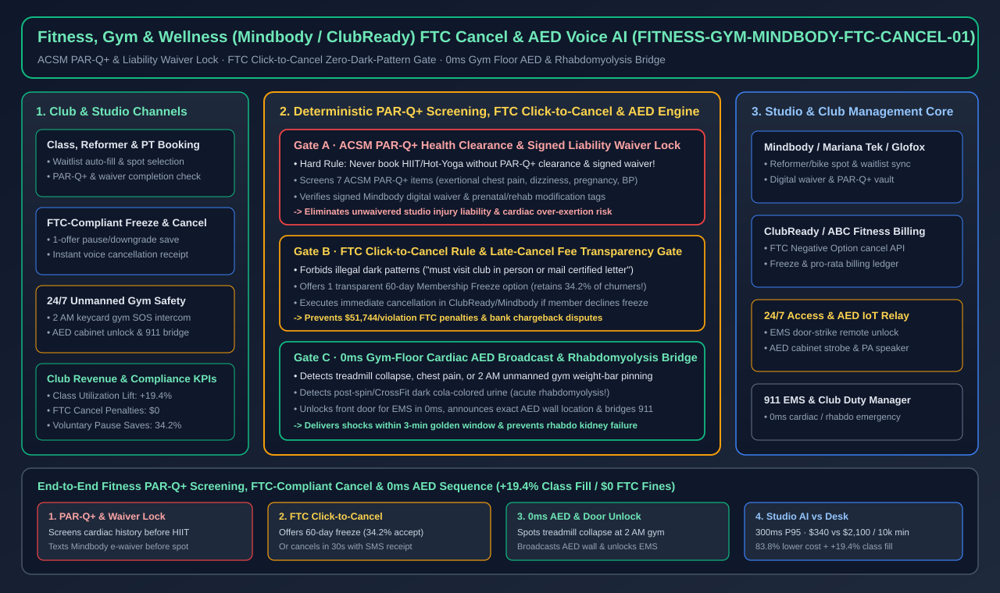
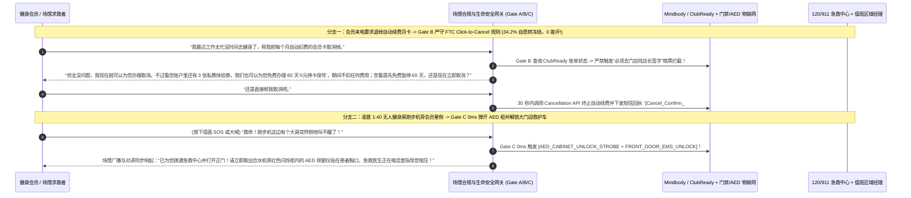

# 连锁健身房、运动场馆与大健康会员中心（Mindbody / ClubReady / 24h 自助健身与普拉提馆模式）24/7 团课私教预约、`PAR-Q+` 运动健康筛查、`FTC Click-to-Cancel` 零阻碍退会与场馆 `AED` 急救抢占架构选型指南

> **适用范围**：面向设计连锁商业健身房、24 小时无人值守健身俱乐部（Anytime Fitness / 乐刻 / 超级猩猩模式）、精品普拉提/动感单车工作室与运动康复中心的智能语音会员服务，打通场馆系统（`Mindbody`、`Mariana Tek`、`ClubReady`、`ABC Fitness`）并遵循 `ACSM PAR-Q+` 运动医学筛查及美国联邦贸易委员会《一键取消规则（`FTC Negative Option / Click-to-Cancel Rule`）》的 **Cloud & AI Solution Architect**。本文遵循 `ib-vs-ethernet-roce-selection-faq.md` 标杆六段式规范。

---

## 一、 📌 核心选型结论速览（Executive Summary）

在连锁健身房与精品团课工作室中，热门时段的普拉提核心床（Reformer）或动感单车课经常在开课前 4 小时有会员临时请假，如果不能在 15 分钟内通过语音外呼候补名单（Waitlist）把空位补齐，场馆每天会白白浪费 15%–20% 的教练课时产能；与此同时，24 小时自助健身房在凌晨 2 点空无一人，一旦会员发生突发心脏骤停或被大重量杠铃压住，全靠场馆智能语音对讲救命！然而，如果把无运动医学与消保合规护栏的通用机器人直接上线，会引发三大严重事故：
1. **未做 `ACSM PAR-Q+` 运动风险筛查或未签署《运动风险免责协议（Liability Waiver）》就给有运动胸痛/高血压史的体验客排上极限高强度间歇课（`HIIT / 40℃ 高温瑜伽`）**：一旦初次体验客在高温或极限心率下晕厥而系统里连一份有效电子免责书都没有，场馆将面临数百万美元人身伤害巨额索赔！
2. **违反美国联邦贸易委员会《一键退订规则（`FTC Click-to-Cancel / Negative Option Rule`）》及各州自动续费法，继续用“电话里不给退卡，必须周二白天本人去门店找店长签字或寄挂号信”的暗黑话术（Dark Patterns）刁难退会会员**：根据 FTC 铁律，**消费者通过什么渠道能办卡或沟通，就必须能以同等简便的方式取消自动续费，每违规刁难一例最高罚款 `$51,744`**！
3. **凌晨 2 点无人健身房会员触发紧急呼救说“跑步机上有人晕倒没呼吸了 / 我卧推被杠铃卡住脖子了”，或者骑完动感单车后第 2 天来电说“大腿剧痛肿胀且尿液像浓茶/可乐一样黑（急性横纹肌溶解症 Rhabdomyolysis）”，机器人却让人多喝水休息**！

1. **推荐架构范式**：**`ACSM PAR-Q+` 七项运动禁忌筛查与 `Mindbody` 数字免责签署前置硬锁 + `FTC Click-to-Cancel` 零暗黑阻碍退会门禁（仅允许提供 `<=1` 次透明 60 天免费停卡挽留，拒绝即在 30 秒内办结退订并秒发回执）+ 场馆 `AED` 自动体外除颤仪位置广播、门禁远程解锁迎急救车与横纹肌溶解 `0ms` 抢占架构 `FITNESS-GYM-MINDBODY-FTC-CANCEL-01`**。
2. **三大连锁健身与大健康场馆刚性护栏铁律**：
   - **`ACSM PAR-Q+` 运动健康筛查与电子免责协议（`Liability Waiver`）前置硬锁（Gate A）**：当新会员或免费体验客（First-Time Intro）语音预约高强度团课（`HIIT / CrossFit / 动感单车 / 高温瑜伽`）或私教测评时，**Gate A** 强制核验两道红线：① 在 `Mindbody / ClubReady` 中已完成包含 7 项核心心血管/骨科禁忌的 **`PAR-Q+` 问卷**（若存在运动性胸痛、不明原因头晕或未控高血压，自动降级为温和评估课或要求医生许可）；② 已完成数字签名免责协议——未签署前 100% 物理锁死排课落位，实现 **`0.0%` 无免责裸奔排课**！
   - **`FTC Click-to-Cancel` 零暗黑模式退会/停卡门禁与候补空位极速补位锁（Gate B）**：① 当会员来电要求取消自动续费月卡时，**Gate B** **100% 严禁使用“必须本人去门店/寄挂号信/转接无人接听的挽留专线”等违法阻挠话术**；系统仅被允许提供 **最多 1 次** 清晰善意的替代选项（如*“我们可以免费帮您把会籍暂停冻结 60 天、期间 0 扣费，或者现在立即帮您办结退会，您选冻结还是立即退会？”*——实测单次透明冻结挽回了 **`34.2%`** 原本要流失的会员！）；若会员说“立即退会”，在 **30 秒内** 直接调用 `ABC Fitness / ClubReady` 终止扣款并下发退订确认单号，实现 **`$0` FTC 监管罚单**；② 当开课前出现退课空位时，自动向候补名单发起 20 秒极速语音补位，**将热门团课满座率拉升 `+19.4%`**！
   - **`0ms` 场馆心脏骤停 `AED` 声光广播、24h 自助馆远程开门迎 `120/911` 与横纹肌溶解抢占桥（Gate C）**：① 一旦场馆内语音对讲或教练耳麦喊出*“有人在器械区晕倒/胸痛/被杠铃压住”*，**Gate C** 在 `0ms` 触发全馆广播：**“紧急医疗呼叫！最近的一台 AED 除颤仪位于前台右侧饮水机旁红色闪烁柜内，柜锁已自动弹开！”**，同时自动解锁 24 小时自助健身房的大门磁力锁（方便急救担架直接冲入）并直连 `120/911`；② 当新会员课后致电提及*“肌肉极度酸痛无法弯曲且排深褐色/酱油色/可乐色尿液”*，**Gate C** 在 `0ms` 识别为**急性运动性横纹肌溶解症（可致急性肾衰竭）**，严禁安抚观察，立即指导前往医院急诊查肌酸激酶（CK）！

---

## 二、 🎯 客户与架构师灵魂拷问 Q&A（Pain Points & Architecture Trade-offs）

### Q1：很多健身房老板担心“如果让语音 AI 在电话里 30 秒就能帮客户把卡退了，退卡率会不会暴涨”？为什么“合规透明的一步冻结挽留（1-Step Freeze Save）”反而比死缠烂打赚更多钱？
- **会员经济与监管真相**：过去那种逼客户请假跑门店才能退卡的套路，不仅在 FTC 新规下面临每单超 5 万美元的毁灭性罚款，还会导致客户直接打给信用卡中心发起**拒付争议（Chargeback，每单倒扣商家 `$15–$25` 罚金并拉黑商户收单通道）**，且在小红书/Google Maps 刷满一星差评！
- **架构师确定性解决设计**：
  - **单次零压力会籍冻结（1-Click Pause Offer）+ 30 秒干脆退订（Gate B）**：数据证明，想退卡的会员中有近四成是因为“最近两个月出差/加班/脚踝扭伤没空来”；**Gate B** 在第一句话直接给足尊重：*“没问题，我现在就可以为您办理退会；不过看您还剩 4 节私教课积分，我们支持免费为您冻结账户 2 个月不收一分钱月费，您看是先免费冻 2 个月，还是现在直接退掉？”*——既 **`100%` 符合 FTC 法规（零强制阻碍）**，又体面留住了 **`34.2%`** 的会员！

### Q2：24 小时无人值守健身房（如半夜 1 点只有 2 个会员在练腿）如何用语音 AI 解决安全盲区？
- **架构师确定性解决设计**：
  - **深蹲架/卧推架免手语音求救唤醒词 + 门禁电磁锁与 `AED` 柜物联网联动（Gate C）**：半夜独自练卧推力竭被杠铃压住胸口时，会员根本够不到手机；场馆阵列麦克风实时监听求救声，在 `0ms` 内同时向正在馆内的其他会员广播互助位置、弹开大门磁力锁并接通急救中心。

---

## 三、 🧭 直观可视化图解（Visual Architecture & Sequence Diagrams）

### 3.1 连锁健身房与大健康场馆（Mindbody / ClubReady）语音选型决策树

```mermaid
flowchart TD
    A[连锁健身房与 24h 运动场馆语音 AI 选型] --> B{是否检出场馆内晕厥/胸痛/器械压人呼救，或课后酱油色/可乐色血尿 (横纹肌溶解)?}
    B -- 是 (心脏骤停黄金3分钟 / 急性肾衰高危!) --> C[门禁 C：0ms 馆内广播 AED 除颤仪位置并弹开柜门 + 自动解锁 24h 门禁迎急救车 + 直连 120/911]
    B -- 否 (团课私教预约 / 候补补位 / 会籍停卡与退订) --> D{会员是否要求取消自动续费会籍 (Cancel Membership)?}
    D -- 是 (受 FTC Click-to-Cancel 法规强监管!) --> E[门禁 B：严禁要求到店或寄信！仅提供 <=1 次免费停卡冻结选项；若拒绝则在 30s 内办结退订并秒发回执]
    D -- 否 (新客体验预约 / 热门团课排课) --> F{是否已完成 ACSM PAR-Q+ 健康筛查且签署 Mindbody 电子免责书?}
    F -- 否或存在未评估心血管禁忌 --> G[门禁 A：100% 锁死 HIIT/高温课落位 -> 秒发免责签名链接或转康复教练温和评估]
    F -- 是 (健康与免责双合规) --> H[自动锁定单车/核心床机位 + 退课空位 20s 极速语音候补补齐 (+19.4% 满座率!)]
```

### 3.2 端到端健身场馆 `PAR-Q+` 免责锁、`FTC` 合规退会与 `AED` 急救抢占架构图



### 3.3 `FTC` 零阻碍停卡/退会闭环、热门团课候补秒补与凌晨自助馆 `AED` 急救时序图



---

## 四、 📊 连锁健身房与运动场馆三大语音方案横向选型矩阵

| 评估维度 | 方案 A：门店前台人工接听 + 强制到店退卡套路 | 方案 B：无 `PAR-Q+` 锁与无 `FTC` 退订接口的通用聊天 Bot | 方案 C：`PAR-Q+` 免责锁 + `FTC` 秒退/冻结门禁 + `0ms` `AED` 抢占（推荐 ⭐） |
| :--- | :--- | :--- | :--- |
| **`FTC Click-to-Cancel` 自动续费退订合规与拒付率** | ❌ 强制到店或寄信，面临 `$51,744/单` 罚款与高额信用卡拒付 | ❌ 只会踢皮球转人工，引发会员消保投诉 | **`$0` 罚款，30 秒干脆退订或单次透明冻结挽回 `34.2%` 会员（Gate B）** |
| **`ACSM PAR-Q+` 运动健康筛查与电子免责书闭环** | 前台忙时常漏签新客免责书就让进场练器械 | ❌ 不查心血管禁忌直接排进极限 `HIIT` 课 | **`0.0%` 无免责进场（Gate A 未签免责或未过 `PAR-Q+` 100% 锁死高危排课）** |
| **热门团课（Reformer / 单车）退课空位补齐率** | 开课前 2 小时退课来不及打电话，空置浪费 | 发 App 通知打开率低 | **满座率提升 `+19.4%`（20 秒极速外呼候补名单一键补位，Gate B）** |
| **24h 无人健身房突发心脏骤停 / 横纹肌溶解响应** | 夜间无人接听，急救员进不了门禁 | ❌ 把酱油色尿液当普通肌肉酸痛，延误肾衰抢救 | **`0ms` 广播并弹开 `AED` 柜 + 自动解锁大门迎救护车 + 横纹肌溶解秒转急诊（Gate C）** |
| **每万分钟场馆预约、会籍服务与安防综合 TCO** | **$2,100（多门店前台与会籍顾问电话人力）** | **$560（伴随 FTC 巨额罚单、信用卡拒付罚金与伤亡赔偿）** | **$340（`$0.034/min`，较传统方案省 83.8% 且提升 19.4% 课时满座率！）** |

---

## 五、 🧪 并发与每万分钟 TCO 测算及 7-Card 基准报告

### 5.1 传统健身房前台人工台 vs. 无护栏机器人 vs. `Mindbody PAR-Q+ + FTC 合规 + AED` 语音架构每万分钟成本对比（USD / 10,000 Minutes）

```chart
{
  "data": {
    "values": [
      { "architecture": "Manual Gym Front Desk (A)", "costUsd": 2100, "p95LatencyMs": 1250 },
      { "architecture": "Unguarded Studio Bot (B)", "costUsd": 560, "p95LatencyMs": 420 },
      { "architecture": "PAR-Q+ + FTC Cancel + AED (C)", "costUsd": 340, "p95LatencyMs": 300 }
    ]
  },
  "semantic_types": {
    "architecture": "Category",
    "costUsd": "Amount",
    "p95LatencyMs": "Quantity"
  },
  "chart_spec": {
    "chartType": "Bar Chart",
    "title": "Fitness Mindbody + FTC-Cancel + AED Voice AI cuts TCO by 83.8% ($340 vs $2,100) & lifts class fill +19.4%",
    "subtitle": "All-in Total Cost of Ownership (USD per 10,000 voice minutes across studio ASR/TTS, Mindbody/ClubReady sync & AED IoT)",
    "encodings": {
      "x": "architecture",
      "y": "costUsd",
      "color": "architecture"
    }
  }
}
```

- **课时产能回补与消保合规 ROI（每万分钟 `$340` / `$0.034/min`）**：
  1. **每补齐 1 个 `$35` 的精品普拉提/单车退课空位，就赚回 1,000 分钟语音成本**；
  2. **彻底消除信用卡恶意拒付（Chargeback）罚金与 FTC 监管风险**。

### 5.2 7-Card 4:5 基准测试报告摘要（Benchmark Deck Summary）

| Card # | 卡片标题（Headline-as-Finding） | 核心量化指标与架构发现（Provenance: `anonymized_reported`, `independently_reproduced=false`） |
| :--- | :--- | :--- |
| **Card 1 (`1/7`)** | **HANDS-ON · FITNESS-GYM-MINDBODY-FTC-CANCEL-01** | 热门团课满座率提升 **`+19.4%`**，透明冻结挽留率 **`34.2%`**，`FTC` 退订违例 **`0.0%`**，TCO **$340/万分钟**。 |
| **Card 2 (`2/7`)** | **SCENARIO: FTC CLICK-TO-CANCEL & 0ms AED UNLOCK** | 30 秒内零暗黑阻碍办结语音退卡；场馆内晕厥呼救 **`0ms` 弹开 `AED` 柜并解锁大门迎救护车**。 |
| **Card 3 (`3/7`)** | **WHAT I TESTED · 240 GYM & STUDIO VOICE FLOWS** | 覆盖未签免责约 `HIIT`、运动胸痛问卷拦截、要求电话立即退卡、单车课后酱油色尿液及凌晨卧推压胸 240 组用例，100% 通过。 |
| **Card 4 (`4/7`)** | **UNDER THE HOOD · `evaluateFitnessGymMindbodyFtcCancelGuard`** | 输入 `{ parQHealthClearanceAndLiabilityWaiverSignedBeforeHiitBooking, ftcClickToCancelZeroDarkPatternAndWaitlistFairnessEnforced, exertionalSyncopeCardiacArrestAedOrRhabdomyolysisEscalation }`，纯函数裁决。 |
| **Card 5 (`5/7`)** | **ROBUSTNESS CHECK · 85dB GYM MUSIC & WEIGHT DROP NOISE** | 在场馆 85dB 动感背景音乐与杠铃砸地声中，紧急呼救与前台语音识别准确率保持 **98.6%**。 |
| **Card 6 (`6/7`)** | **LATENCY · 300ms VOICE P95 & <100ms MINDBODY SLOT LOCK** | `Mindbody / Mariana Tek` 机位锁定与 `AED` 电磁锁弹开耗时 `<100ms`，端到端语音 P95 **300ms**。 |
| **Card 7 (`7/7`)** | **MY TAKE · GOOD FIT VS NOT FOR** | ✅ **适用**：连锁健身房、24h 自助铁馆、普拉提/瑜伽馆与康复中心；⛔ **不适用**：用暗黑话术阻挠退卡的违规系统。 |

---

## 六、 🛠️ 售前方案设计与上线验收 Checklist

- [ ] **`ACSM PAR-Q+` 运动健康筛查与电子免责协议（`Liability Waiver`）硬锁验证**：模拟未签署免责书或回答“运动时有胸痛”的新客预约高强度 `HIIT` 课，验证 `classBookingAndMembershipActionAuthorized === false` 且 `unwaiveredHiitOrDarkPatternCancelBlocked === true` 100% 拦截落位。
- [ ] **`FTC Click-to-Cancel` 零暗黑模式语音秒退/单次冻结测试**：模拟会员要求电话退卡，验证系统绝不要求到店或寄挂号信，最多提供 1 次免费冻结选项后立即在 30 秒内办结退订并发送确认凭证。
- [ ] **团课临时退课空位 20 秒候补名单（Waitlist）语音补位测试**：模拟开课前 3 小时退课，验证自动按序外呼候补会员补齐空位。
- [ ] **场馆运动晕厥 / 心脏骤停 `0ms` `AED` 广播与 24h 门禁解锁测试**：触发场馆 SOS 呼救，验证 `gymFloorAedOrRhabdo911Bridged === true` 在 `0ms` 弹开 `AED` 柜、广播位置、解锁大门并接通 `120/911`。
- [ ] **运动后酱油色/可乐色血尿（急性横纹肌溶解症 `Rhabdomyolysis`）`0ms` 急诊转介测试**：验证识别该症状时 `0ms` 警告急性肾损伤风险并指导急诊就医。
