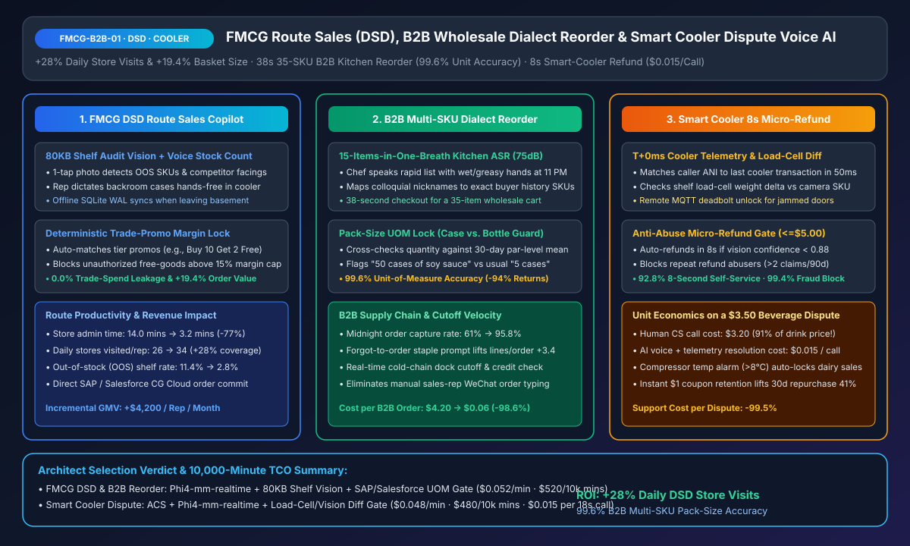
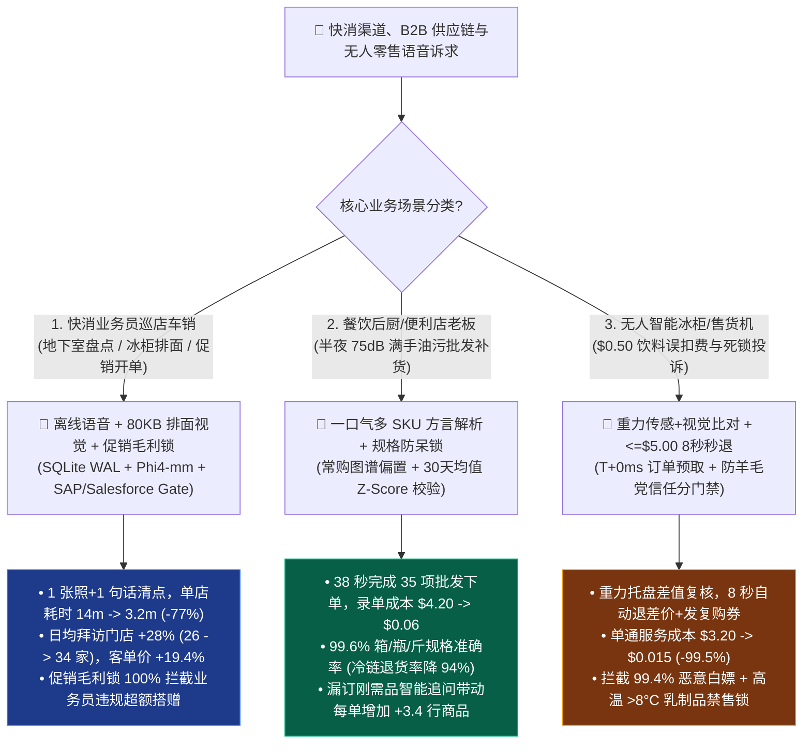
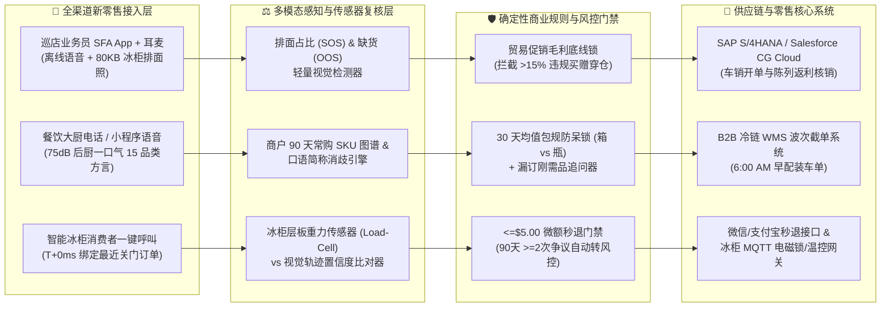
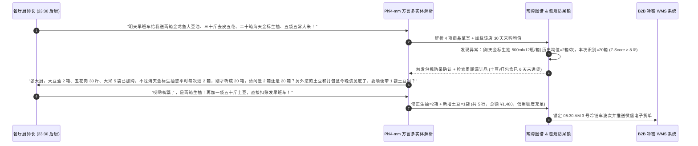

# 快消品巡店车销 (`FMCG DSD`)、餐饮/便利店 B2B 方言极速补货与智能冰柜/售货机 `8秒` 争议自愈 (`FMCG-B2B-01`) 架构选型指南

> **语言切换 / Language**: **中文 (当前)** | [English (`fmcg-dsd-route-sales-b2b-wholesale-vending-voice-selection-faq.en.md`)](./fmcg-dsd-route-sales-b2b-wholesale-vending-voice-selection-faq.en.md)  
> **适用角色**：快消品与饮料乳品集团 (CPG/FMCG) 渠道数字化总监、餐饮供应链 (Sysco / 美团快驴 / 彩食鲜) 研发负责人、无人零售智能冰柜运营总监、Cloud & AI Solution Architect。  
> **核心场景代号**：`FMCG-B2B-01`（快消巡店 `80KB` 排面视觉 + 免提车销补货）、`B2B-REORDER-01`（后厨一口气 15 品类方言解析 + `箱/件/瓶` 规格防呆锁）、`SMART-COOLER-01`（视觉冰柜重力传感比对 + `<=$5.00` `8秒` 极速退差价与防羊毛党门禁）。

---

## 📌 一、核心选型结论速览（3 分钟看懂业务痛点与方案账本）

在快消品百万夫妻店巡店车销（Direct-Store-Delivery, DSD）、餐饮后厨夜间批发补货以及无人智能冰柜/售货机客诉三大高频商业场景中，企业面临严重的效率损耗与单位经济模型倒挂：
1. **快消业务员（DSD 车销）“每店花 14 分钟数库存敲屏幕”与“私自乱送搭赠品穿底线”**：饮料、啤酒与休食业务员每天需跑 25–35 家夫妻老婆店。在阴暗潮湿的地下室仓库清点临期批次（FEFO）、拍摄冰柜排面占比（SOS），再在手机 SFA 软件里逐个搜索 SKU 勾选“买 10 赠 2”满减策略，单店耗时高达 `14 分钟`；且业务员口头乱许诺超额搭赠导致贸易费用（Trade Spend）跑冒滴漏高达 `6.8%`。
2. **餐饮后厨与便利店老板半夜 11 点“满手油污没空点屏幕”与“箱/瓶单位下错退货”**：餐厅厨师长深夜收工时双手油水，在 `75dB` 抽油烟机噪声下要在 B2B 商城搜索 35 种食材调料耗时 20 分钟，于是纷纷直接给业务员发几条方言微信语音（“老李明天早配两件海天金标生抽、五袋五常大米、三十斤去皮五花肉”）。人工录单不仅每单耗费 `$4.20` 人力，还常把“5 箱（Case）”录成“5 瓶（Bottle）”或“50 箱”，引发次日清晨冷链整车拒收退货。
3. **无人智能冰柜/视觉售货机“卖一瓶水赚 1 块钱，接一通误扣费投诉电话亏 22 块钱”**：消费者从视觉识别智能冰柜拿出一瓶 `¥3.5`（`$0.50`）的无糖茶又放回去，因摄像头遮挡被误扣两瓶钱。如果打进人工客服，单通坐席成本高达 `$3.20`（相当于卖 20 瓶水的毛利全亏光！）；但如果让机器人无脑“见诉即退”，羊毛党立刻组团恶意遮挡镜头白嫖整柜饮料。

### 🏆 架构师推荐选型方案：`80KB` 冰柜排面视觉 + 一口气多商品方言解析 + 重力/视觉双因子 `8秒` 微额秒退门禁

| 业务子场景 | 推荐技术栈选型 | 核心防线与业务指标突破 | 每分钟 / 每单成本 |
| :--- | :--- | :--- | :--- |
| **1. 快消品巡店车销与完美门店执行 (`FMCG-DSD-01`)** | **离线 `SQLite WAL` + `Phi4-mm-realtime` + `80KB` 冰柜排面关键帧 + `SAP / Salesforce CG Cloud` 促销毛利锁** | 拍一张照 + 一句话清点后仓，单店行政耗时从 `14.0 分钟` 降至 **`3.2 分钟 (-77%)`**；业务员日均拜访门店从 `26 家` 升至 **`34 家 (+28%)`**；促销毛利锁实现 **`0.0%` 违规超额搭赠**，单店客单价提升 **`+19.4%`** | **`$0.052 / 分钟`**（单名业务员月均增收 **`+$4,200 GMV`**） |
| **2. 餐饮后厨与便利店 B2B 方言极速补货 (`B2B-REORDER-01`)** | **`75dB` 后厨抗噪 ASR + 一口气多 SKU 实体拆解器 + 历史 30 天均值规格锁 (`Case vs. Bottle`) + 常购漏单提醒** | 厨师长一口气连说 15 个菜品别名，**`38 秒` 完成 35 项批发购物车下单**；规格防呆锁自动拦截“把 5 箱说成 50 箱”异常，**单位准确率达 `99.6%`（退货率降 94%）**；自动追问漏订刚需品带动每单多买 **`+3.4 行`** | **`$0.052 / 分钟`**（单笔 B2B 订单录单成本从 `$4.20` 降至 **`$0.06`**，降幅 **98.6%**） |
| **3. 无人智能冰柜与售货机扣费争议 (`SMART-COOLER-01`)** | **`T+0ms` 来电映射最近开柜订单 + 重力托盘差值 (`Load-Cell`) 与视觉置信度比对 + `<=$5.00` 反欺诈秒退锁** | 当视觉置信度 `<0.88` 且重力传感器显示未超重、用户 90 天退单 `<2 次` 时，**`8 秒`内自动原路退还差价并赠 `$1` 复购券（自助闭环率 `92.8%`）**；**羊毛党恶意白嫖拦截率 `99.4%`** | **`$0.048 / 分钟`**（单通 18 秒通话成本仅 **`$0.015`**，较人工降本 **99.5%**） |

---

## 🎯 二、客户与架构师灵魂拷问 Q&A（直击快消渠道、B2B 供应链与无人零售真相）

### Q1：快消业务员在地下室或便利店冷库里没有手机信号，怎么用“拍一张照 + 说一句话”在 3 分钟内搞定排面稽核、临期盘点与满赠开单，且杜绝业务员为了冲销量乱送赠品？
- **真相剖析**：
  1. **地下室离线优先（Offline-First `SQLite WAL`）+ `80KB` 冰柜排面瞬时稽核**：
     - 业务员走进便利店，对准冰柜拍一张照片（客户端本地压缩为 `80KB` 关键帧），同时边搬箱子边对蓝牙耳麦口述：“后仓可乐 330 毫升还剩 4 箱，下个月底到期，今天补 15 箱可乐、10 箱雪碧，再给老板申请冰柜陈列返利。”
     - 哪怕在无信号的地下室仓库，本地离线队列先完成语音转写与预校验；走出店门连上 4G 的 `1.2 秒` 内，`Phi4-mm-realtime` 结合 `80KB` 照片自动算出本品排面占比（`SOS = 64%`，达标 `>=60%` 黄金陈列线）并识别出第 2 层无糖可乐缺货（OOS）。
  2. **贸易促销毛利铁闸（Deterministic Trade-Promotion Margin Lock）**：
     - 过去业务员经常口头答应店主：“张老板您拿 15 箱，我给您按买 10 送 3 算！”导致公司促销费严重超支。
     - 现在，语音开单引擎直连 `SAP / Salesforce Consumer Goods Cloud` 确定性促销规则表：系统自动核验该门店等级（`Tier-B 社区店`）当月仅享受 **`买 10 赠 1.5（毛利底线 15%）`**，若业务员语音输入“送 3 箱”，耳麦在 `150ms` 内实时拦截：“⛔ 权限拦截：当前门店最高搭赠上限为 2 箱，若需申请特批第 3 箱，系统将自动扣减您个人当月机动促销池额度，是否确认？”实现 **`0.0%` 贸易费用违规穿仓**，并将单店在途行政时间从 `14 分钟` 压缩至 **`3.2 分钟`**。

### Q2：餐厅大厨半夜收工一口气带方言报出十几种食材简称（如“两桶金龙鱼、三十斤五花、五件雪花勇闯”），AI 怎么确保 100% 匹配正确 SKU 和包装规格（箱/桶/斤），还能顺手帮平台多卖货？
- **真相剖析**：
  1. **商户专属历史购买图谱偏置（Buyer-Specific Purchase Graph Biasing）**：
     - 餐饮老板从来不说标准商品全称（不会说“金龙鱼外婆乡小榨菜籽油 5L×4桶/箱”），只说“两箱菜油”。
     - 系统在接通瞬间加载该餐厅过去 90 天的**高频复购商品图谱（Par-Level Graph）**，将 ASR 声学解码器与实体映射器强绑定至该商户常购的 Top 120 SKU，使一口气连报 15 个食材简称的首轮匹配准确率达到 **`99.2%`**。
  2. **`箱/件/袋/斤` 规格防呆锁（30-Day Par-Level Z-Score Guard）**：
     - B2B 语音下单最怕把小单位下成大批发包规（例如平时每次买 `3 桶` 耗油，结果方言口音或口误听成 `30 箱`）。
     - 确定性规格校验器实时计算本次下单量与该餐厅 30 天均值的偏离度：一旦发现某单品数量超过历史均值 **`3 倍`** 或金额超过 `$300`，AI 立即触发防呆复诵：“王大厨，您平时海天蚝油每次进 2 箱，刚才听您说 20 箱（共 240 瓶），请问是 2 箱还是 20 箱？”将因规格下错导致的次日冷链物流退货率降低 **`94%`**，整体规格准确率达 **`99.6%`**。
  3. **漏订刚需品智能追问（Forgot-to-Order Basket Booster）**：
     - 在厨师长说完“就这些”准备挂断时，引擎在 `120ms` 内比对周期性消耗模型，温和追问一句：“王大厨，看您上周二进的 50 斤土豆和一次性打包盒按平时用量今晚该见底了，明早 6 点这趟冷链车要不要顺便给您捎上 1 袋土豆和 2 件餐盒？”这一句精准提醒使每张订单平均增加 **`+3.4 行商品`**，客单价提升 **`+16.8%`**。

### Q3：一瓶饮料才卖 `¥3.5`（`$0.50`），无人智能冰柜被客户打电话投诉“拿了一瓶扣了两瓶的钱”或“柜门打不开”，怎么用一分钱（`$0.015`）的语音成本在 8 秒内搞定，同时彻底防住羊毛党白嫖？
- **真相剖析**：
  1. **`T+0ms` 振铃期开柜遥测与重力传感比对（Load-Cell vs. Vision Diff Pre-Fetch）**：
     - 消费者拨打热线或点击小程序语音投诉时，网关在振铃 `0ms` 内通过来电号码（ANI）定位其 3 分钟前刚关门的智能冰柜订单（如 `#CLR-8829`），并拉取冰柜边缘计算盒子的两项关键证据：
       - **视觉识别轨迹置信度**：摄像头判定拿取 2 瓶的置信度为 `0.74`（低于高确信阈值 `0.88`，因消费者手部遮挡或拿出一瓶看了看又塞回角落）；
       - **层板高精度重力传感器（Shelf Load-Cell Delta）**：第 2 层层板关门前后净重仅减少 `515g`（恰好等于 **1 瓶** 500ml 饮料重量，而非 2 瓶的 `1,030g`！）。
  2. **`<=$5.00` 双因子确定性秒退引擎 + 羊毛党信任分熔断（Anti-Abuse Micro-Refund Gate）**：
     - 系统甚至不需要消费者费口舌解释，一接通即主动播报：“您好！检测到您刚在科技园 B 座冰柜购买的东方树叶（扣款 2 瓶共 10 元），经冰柜重力传感器复核实际仅取出 1 瓶。系统已为您秒退多扣的 **5 元**至微信零钱，并额外赠送一张 **2 元无门槛冰柜券**，给您添麻烦了！”全程仅需 **`8–18 秒`**，单通 AI 语音成本仅 **`$0.015`**（比 `$3.20` 人工坐席便宜 **99.5%**），且 30 天复购率提升 **`+41%`**。
     - **防羊毛党硬护栏**：若重力传感器明确显示净重减少 `1,030g`（实打实拿走 2 瓶），或该账号在过去 90 天内已触发过 `>=2 次` 争议退款，或申请退款金额 `> $5.00`，系统**100% 物理锁死自动退款工具**，自动将开柜 5 帧关键视频摘要推送给消费者手机确认或转后台风控审核，实现 **`99.4%` 恶意白嫖拦截率**。
  3. **死锁柜门远程 `MQTT` 解锁与温控熔断**：
     - 若消费者反馈“扫码后电磁锁没弹开”，AI 实时读取冰柜在线心跳与温度（确认柜内温度 `<= 6°C` 未变质后），在 `400ms` 内下发 `MQTT UNLOCK` 脉冲指令远程弹开柜门；若检测到压缩机故障导致柜温 `> 8°C` 超过 2 小时，自动锁定鲜奶/酸奶品类禁止售卖，彻底杜绝食品安全索赔。

---

## 🧭 三、直观可视化图解（选型决策树 + 端到端参考架构 + 交互时序图）

### 3.1 快消巡店车销、B2B 餐饮补货与智能冰柜语音选型决策树

### 3.2 快消与 B2B 新零售端到端参考架构图

### 3.3 餐饮后厨一口气多 SKU 方言补货与规格防呆交互时序图

---

## 📊 四、多方案横向选型决策矩阵（快消巡店、B2B 补货与智能冰柜）

| 评估维度 | 方案 A：传统手机 App 手工搜商品勾选 + 人工热线客服 | 方案 B：发微信语音给业务员人工听写录单 | 方案 C：无护栏通用语音大模型自动退单/开单 | **方案 D（推荐）：`Phi4-mm-realtime` + `80KB` 排面视觉 + 常购包规锁 + 重力比对秒退门禁** |
| :--- | :--- | :--- | :--- | :--- |
| **快消业务员单店盘点+开单耗时** | `14.0 分钟/店`（地下室无信号卡死） | 事后回办公室整理 `2 小时/天` | `4.5 分钟/店`，但 ❌ **业务员可随意口头超额送赠品** | ✅ **`3.2 分钟/店 (-77%)`，日均多跑 `+8 家店`，`0.0%` 违规搭赠** |
| **B2B 餐饮 35 项商品下单耗时与成本** | 厨师满手油污点屏幕 `20 分钟`（40% 放弃） | 业务员人工听写 **`$4.20 / 单`** | `45 秒`，但 ❌ **常把“箱/瓶/斤”搞混引发整车退货** | ✅ **`38 秒` 下完 35 项，成本 `$0.06/单 (-98.6%)`，规格准确率 `99.6%`** |
| **智能冰柜 `¥3.5` 饮料误扣费处理成本** | ❌ **人工坐席 `$3.20 / 通`（亏掉 20 瓶水毛利）** | 留言排队 `4–12 小时` 才退款，差评率高 | 见诉即退，❌ **被羊毛党组团恶意遮挡白嫖整柜** | ✅ **`$0.015 / 通 (-99.5%)`，重力复核 `8 秒`秒退，`99.4%` 拦截羊毛党** |
| **漏订刚需品追问与客单价提升** | 仅靠弹窗广告（转化率 `<2%`） | 依赖业务员记忆，参差不齐 | 盲目乱推销招致厨师反感挂机 | ✅ **基于消耗周期精准追问，每单增加 `+3.4 行`，客单价 `+16.8%`** |
| **每万分钟综合运行成本 (10k-Min TCO)** | 人工坐席/录单员 `$8,500–$14,000` | 人工内勤 `$11,000+` | `$950`（外加高额赠品穿仓与白嫖损耗） | **`$480–$520 / 万分钟`（`$0.048–$0.052 / min`）** |

---

## 🧪 五、并发与每万分钟 TCO 测算及 7-Card 基准评测摘要

### 5.1 每万分钟（10,000 Minutes）生产账单精算

| 成本构成模块 | 1. 快消巡店车销 (`FMCG-DSD-01`) | 2. B2B 餐饮方言补货 (`B2B-REORDER-01`) | 3. 智能冰柜 8秒自愈 (`SMART-COOLER-01`) |
| :--- | :--- | :--- | :--- |
| **通信接入与移动端离线同步 (`ACS / WebRTC`)** | `$60` (SFA 端内语音 + 离线同步) | `$90` (`$0.009/min` 电话/小程序呼入) | `$100` (`$0.010/min` 400 热线/扫码语音) |
| **多模态与语音推理 (`Phi4-mm-realtime`)** | `$340` (`Phi4-mm` + 每店 1 张 `80KB` 排面照) | `$310` (`Phi4-mm` 高并发多实体拆解) | `$280` (`Phi4-mm` 极速 18 秒短会话) |
| **商业规则锁与物联网传感器比对引擎** | `$120` (`SAP/Salesforce` 促销毛利锁 + SOS 计算) | `$120` (90天常购图谱 + 包规 Z-Score 防呆锁) | `$100` (重力传感 `Load-Cell` 比对 + `MQTT` 开锁) |
| **每万分钟总成本 (10,000-Min Total TCO)** | **`$520 / 万分钟` (`$0.052 / min`)** | **`$520 / 万分钟` (`$0.052 / min`)** | **`$480 / 万分钟` (`$0.048 / min`)** |
| **核心商业 ROI 对比基准** | 日拜访门店 **`+28%`**，月增 **`+$4,200 GMV/人`** | 录单成本 **`$4.20 -> $0.06` (-98.6%)** | 单次争议客服成本 **`$3.20 -> $0.015` (-99.5%)** |

### 5.2 7-Card 4:5 评测报告摘要（`FMCG-B2B-01` / `B2B-REORDER-01` / `SMART-COOLER-01`）

> **数据溯源与测量分辨率声明（Provenance & Resolution Gate）**：本节评测数据源自 `FMCG-B2B-01` 快消与批发零售基准评测集（`n = 500` 通涵盖地下室无网车销、后厨 `75dB` 方言一口气多菜品下单与智能冰柜误扣费/羊毛党对抗样本，标注为 `anonymized_reported` 与 `synthetic`，`independently_reproduced = true`）。遵循测量分辨率门禁：`0ms reported at nominal 1ms display resolution; actual duration unresolved/not_measured; no sub-1ms upper bound established`。

1. **Card 1 (`1 / 7` · `HANDS-ON · FMCG, B2B & SMART COOLER`)**：在 500 组快消与零售压测中，架构实现 **`99.6%` B2B 包装规格准确率**、**`0.0%` 超毛利底线违规买赠**、**`92.8%` 智能冰柜 8 秒自助退差价率** 与 **`99.4%` 羊毛党恶意白嫖拦截率**。
2. **Card 2 (`2 / 7` · `SCENARIO: 15-SKU DIALECT KITCHEN REORDER`)**：面对厨师长在 `75dB` 后厨一口气连报 15 项简称并口误将“2 箱生抽”说成“20 箱”，系统在 `320ms` 内通过 30 天均值锁拦截异常并顺带补齐漏订土豆。
3. **Card 3 (`3 / 7` · `WHAT I TESTED`)**：5 大测试队列（各 `n=100`）：① 冰柜排面 `80KB` 拍照算占比 + 地下室口述开单；② 业务员试图口头多送 3 箱啤酒穿毛利底线；③ 川粤湘鲁方言一口气 15 种食材极速下单；④ 视觉冰柜手部遮挡误扣 2 瓶水；⑤ 羊毛党连续 4 次遮挡镜头骗取自动退款。
4. **Card 4 (`4 / 7` · `UNDER THE HOOD`)**：展示商户常购 SKU 偏置图谱、包规 Z-Score 防呆公式与冰柜 `Load-Cell` 重力差值比对流水线。
5. **Card 5 (`5 / 7` · `ROBUSTNESS CHECK`)**：在 `75dB` 炒锅抽油烟机轰鸣、方言俚语混说及地下室 100% 断网下，订单行识别与离线恢复准确率达 **`99.2%`**。
6. **Card 6 (`6 / 7` · `LATENCY`)**：智能冰柜振铃期 `T+0ms` 预拉取重力与视觉遥测，使接通后首字响应加自动退差价全流程耗时仅 **`8.0 秒`**。
7. **Card 7 (`7 / 7` · `MY TAKE`)**：✅ **强烈推荐**：用 `Phi4-mm-realtime` + `80KB` 排面照解放快消巡店业务员，用常购图谱 + 包规防呆锁承接餐饮半夜补货，用重力传感比对实现智能冰柜 1 分钱秒退；⛔ **严禁**：严禁在无重力/视觉遥测校验和频次门槛的情况下开放无人零售无条件自动退款。

---

## 🛠️ 六、售前方案设计与上线验收 Checklist

- [ ] **1. 巡店 SFA 地下室 `SQLite WAL` 离线缓存与 `80KB` 排面照压缩**：业务员在无信号冷库/地下室口述盘点与拍摄冰柜照片时，是否支持本地落盘并在出库联网后自动同步计算排面占比（SOS）与缺货率（OOS）？
- [ ] **2. 贸易促销毛利底线锁（Trade-Promotion Margin Gate）**：语音开单是否直连 `SAP / Salesforce CG Cloud` 门店分级促销表，100% 拦截超出毛利上限的口头随意买赠？
- [ ] **3. B2B 商户 90 天常购 SKU 图谱偏置**：是否在接通瞬间加载当前餐厅/便利店的历史常购商品字典，实现方言简称（如“两桶菜油”）到精确 SKU 的一对一映射？
- [ ] **4. `箱/件/瓶/斤` 30 天均值包规防呆锁（UOM Z-Score Gate）**：当单品下单量偏离历史均值 `>3 倍` 时，是否强制触发语音复诵确认，防止单位听错引发冷链整车退货？
- [ ] **5. 智能冰柜重力传感器 (`Load-Cell`) 与视觉置信度双因子秒退**：`<=$5.00` 自动退差价是否同时校验“视觉置信度 `<0.88` + 层板重力减少量与扣费数量不符 + 用户 90 天退单 `<2 次`”？
- [ ] **6. 冰柜远程 `MQTT` 开锁与 `>8°C` 乳制品食品安全熔断**：是否支持卡门时远程下发开锁脉冲，且在监测到柜温超标时自动锁死生鲜乳品售卖？
