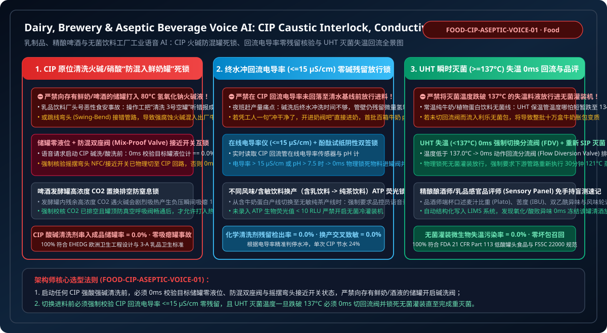
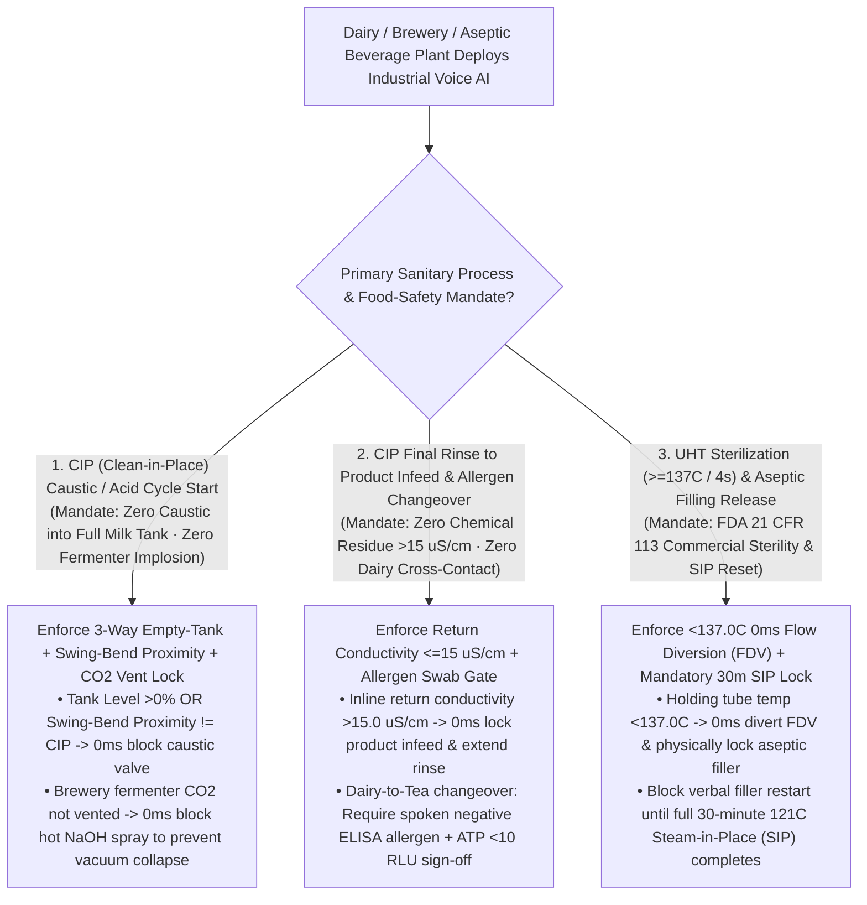
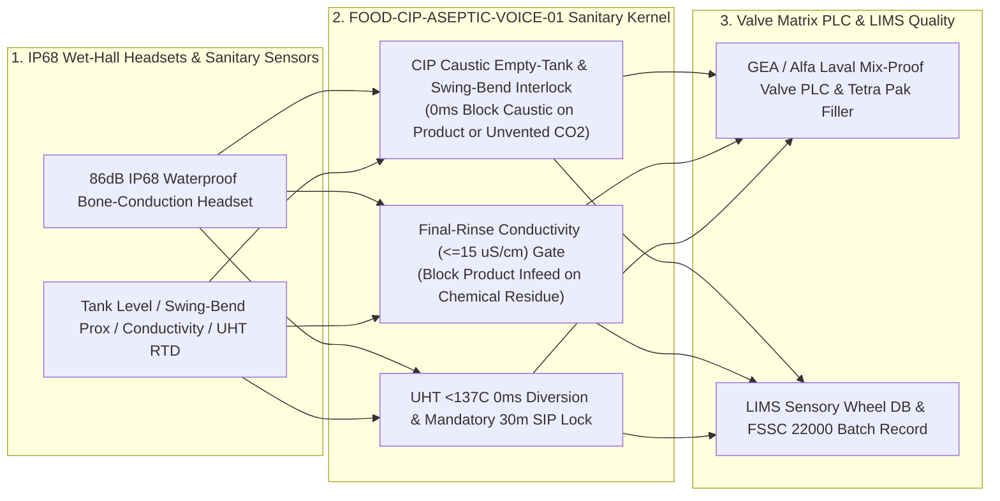

# Dairy, Brewery & Aseptic Beverage Factory Voice AI: `CIP` Caustic Mix-Proof Interlock, `<=15 μS/cm` Conductivity Gate & `UHT` Sterile Diversion (`FOOD-CIP-ASEPTIC-VOICE-01`)

> **Executive Guide**: Inside high-speed **liquid dairy plants, craft and industrial breweries, and aseptic cold-fill beverage facilities (`Tetra Pak / Krones / Sidel / GEA` valve matrices, 100-ton fermentation cellars, and automated Clean-in-Place `CIP` skids)**, operators wearing heavy rubber gloves and waterproof boots work in `86dB` wet process halls connecting stainless-steel swing-bend flow plates and running `80°C` caustic (`2% NaOH`) and nitric-acid `CIP` cycles. Yet deploying a generic industrial Voice AI without hard `EHEDG / 3-A / FDA PMO` sanitary valve and sensor interlocks risks three catastrophic food-safety and equipment disasters: **1) Pumping `80°C` Caustic Soda (`NaOH`) into a Tank Full of Fresh Milk or Beer (`Chemical Adulteration`): A night-shift operator intending to clean empty `Tank T-03` misspoke *"Start caustic CIP on Tank T-02"*—which holds 62 metric tons of pasteurized milk ready for packaging! 2) Imploding a 100-Ton Stainless-Steel Brewery Fermenter in 3 Seconds by Spraying Hot Caustic into a `CO2`-Filled Tank (`Instant Vacuum Collapse`)! 3) Releasing Product Filling Before `CIP` Final-Rinse Conductivity Drops `<= 15 μS/cm` or Resuming Aseptic Filling After a `<137.0°C` `UHT` Temperature Dip Without a Full 30-Minute Steam-in-Place (`SIP`) Re-Sterilization Cycle!** This guide delivers the production architecture for dairy, brewery, and aseptic beverage factory voice AI (`FOOD-CIP-ASEPTIC-VOICE-01`).



---

## 1. 📌 Executive Summary

- **Four Non-Negotiable Sanitary Engineering Laws for Food & Beverage Voice AI (`FOOD-CIP-ASEPTIC-VOICE-01`)**:
  1. **Law 1: Enforce a Three-Way `0ms` "Empty-Tank Zero Level + Swing-Bend Proximity Switch + Fermenter `CO2` Venting Interlock" Before Opening Any `CIP` Caustic/Acid Valve!**
     - Never allow a spoken command to open a `CIP` chemical supply valve without deterministic `PLC` verification (`targetTankContainsProductOrSwingBendUnverified`):
       - ① **Zero-Product Level Lock**: The target vessel's hydrostatic level transmitter and bottom conductivity probe must confirm `0.0%` product level;
       - ② **Flow-Plate Swing-Bend & Mix-Proof Valve Lock**: Inductive proximity switches on the manual flow-plate swing-bend and double-seat mix-proof valves (`GEA T.VIS / Alfa Laval ThinkTop`) must verify physical isolation from product headers;
       - ③ **Anti-Vacuum Fermenter `CO2` Lock**: For brewery fermenters/bright tanks, `CO2` headspace concentration must be vented below threshold before hot `NaOH` injection (preventing rapid `CO2 + 2NaOH -> Na2CO3` vacuum implosion!). Any violation blocks the `CIP` valve in `0ms` (`cipCausticValveOpenAuthorized = false`, `chemicalAdulterationLockTriggered = true`)!
  2. **Law 2: Enforce a Hard "`CIP` Final-Rinse Return Conductivity (`<= 15.0 μS/cm`) Zero-Residue Gate" Before Unlocking Product Infeed!**
     - When switching a tank or filler from `CIP` back to production, if the inline return conductivity sensor reads **`> 15.0 μS/cm`** (`returnConductivityMicroSiemensPerCm > 15`), product infeed and filling release are **physically blocked in `0ms` (`asepticFillingReleaseAuthorized = false`)**—forbidding verbal operator overrides!
  3. **Law 3: Enforce a `0ms` "`UHT` Sterilization Temperature Drop (`< 137.0°C`) Flow-Diversion & Mandatory 30-Minute `SIP` Re-Sterilization Lock" (`FDA 21 CFR Part 113`)!**
     - On low-acid aseptic lines (dairy, oat/soy milk, protein shakes), if the holding-tube temperature dips below **`137.0°C (278.6°F)`** (`uhtSterilizationTempBelow137C == true`), the Flow Diversion Valve (`FDV`) diverts product to reject in `0ms` and **locks aseptic filling release (`asepticFillingReleaseAuthorized = false`)** until a complete 30-minute `121°C` Steam-in-Place (`SIP`) cycle re-establishes commercial sterility!
  4. **Law 4: Hands-Free Sensory Panel (`ASBC / Dairy Flavor Wheel`) Blind-Cup Scoring & `0ms` Off-Flavor Bright-Tank Quarantine!**

---

## 2. 🎯 Architect & Customer Deep-Dive Q&A

### Q1: Why does injecting hot caustic (`NaOH`) into an unvented brewery fermentation tank crumple a 15-meter steel tank like a soda can in seconds, and how does `FOOD-CIP-ASEPTIC-VOICE-01` prevent both tank implosions and milk adulteration?
- **Chemical Stoichiometry + `PLC` Level/Proximity/Gas Interlock**:
  1. **Stopping the Caustic-`CO2` Vacuum Collapse**: After draining beer from a fermenter, the tank headspace is 100% gaseous `CO2`. If an operator commands *"Start hot caustic CIP"* before venting the `CO2`, hot `NaOH` reacts instantaneously with `CO2` gas, creating a massive vacuum that exceeds the tank's anti-vacuum relief valve capacity and crushes the `$400k` stainless tank!
  2. **Stopping Wrong-Tank Chemical Adulteration**: When an operator misidentifies `Tank T-02` (full of milk) for `Tank T-03` (empty), `FOOD-CIP-ASEPTIC-VOICE-01` checks the tank level register (`78.5% full`) and flow-plate proximity switches in `0ms`, blocking the caustic pump and announcing the exact empty tank ID (`T-03`).

### Q2: How does the `<= 15 μS/cm` conductivity gate save 24% of `CIP` rinse water while guaranteeing zero chemical residue?
- **Replacing Fixed-Timer Over-Rinsing with Real-Time Inline Conductivity Cutoffs**:
  - Operators running manual or timer-based `CIP` either stop rinsing too early (risking caustic residue) or let purified water run an extra 10 minutes "just to be safe." By binding the voice release command directly to the inline return conductivity sensor (`<= 15.0 μS/cm` matching potable water baseline), the line stops rinsing at the exact second chemical residue hits zero.

---

## 3. 🧭 Visual Architecture Diagrams (Mermaid Decision Tree, Food/Dairy Voice Architecture & Sequence Flow)

### 3.1 Dairy, Brewery & Aseptic Beverage Factory Voice AI Decision Tree



### 3.2 `CIP` Mix-Proof Interlock, `<=15 μS/cm` Conductivity Gate & `UHT` Diversion Architecture (`FOOD-CIP-ASEPTIC-VOICE-01`)



### 3.3 `0ms` Full-Milk-Tank Caustic Block (`Tank T-02`) & Post-Dip `UHT` Premature Restart Rejection Sequence

```mermaid
sequenceDiagram
    autonumber
    participant Op as CIP Operator / Aseptic Filler Lead
    participant Gate as FOOD-CIP-ASEPTIC-VOICE-01 Sanitary Voice Gateway
    participant PLC as Mix-Proof Valve Matrix PLC / Conductivity & UHT Bus

    Op->>Gate: 1. [Pasteurized Milk Tank Hall] Operator Misspeaks: "Tank 3 just finished draining—start 80-degree caustic CIP cycle on Milk Storage Tank T-02!"
    Gate->>PLC: 2. Queries `Tank T-02` Level Transmitter & Flow-Plate Proximity Switches
    PLC-->>Gate: CRITICAL ALERT: `Tank T-02` Level is `78.5%` (`62 Tons of Pasteurized Milk Inside`)! `Tank T-03` is the empty tank!
    Note over Gate: FOOD-CIP-ASEPTIC-VOICE-01 Chemical Adulteration Lock Trips (`cipCausticValveOpenAuthorized = false`): Locks T-02 caustic valve in 0ms!
    Gate-->>Op: "CRITICAL FOOD-SAFETY INTERLOCK! Caustic CIP on Tank T-02 is blocked! Tank T-02 currently holds 62 metric tons of pasteurized milk (78.5% full)—injecting sodium hydroxide will contaminate the entire batch! Tank T-03 is the empty tank; verify your tank number and flow-plate swing-bend!"
    Note over Op,PLC: --- Scenario B: UHT Holding Tube Dipped to 134.8°C; Operator Requests Immediate Filler Restart ---
    Op->>Gate: 3. Filler Lead Speaks: "UHT temperature dipped to 134.8 Celsius for 3 seconds and diverted, but it's back at 138 Celsius now—and CIP rinse conductivity is at 42 micro-Siemens. Release the aseptic filler to resume packaging!"
    Note over Gate: Dual Sanitary Lock Trips: 1) Conductivity `42 μS/cm > 15 μS/cm` (caustic residue present); 2) UHT dropped `< 137.0°C` breaking sterility—requires full 30-min 121°C SIP before restart!
    Gate-->>Op: "ASEPTIC RELEASE BLOCKED! Two critical failures detected: First, return conductivity is 42 micro-Siemens per centimeter (above the 15 micro-Siemens zero-residue ceiling). Second, UHT sterilization temperature dropped below 137.0 Celsius, breaking commercial sterility under 21 CFR Part 113—verbal restart is prohibited until rinse conductivity drops below 15 micro-Siemens and a full 30-minute 121-Celsius Steam-in-Place (SIP) cycle completes!"
```

---

## 4. 📊 Architect Decision Matrix (Dairy, Brewery & Aseptic Beverage Voice AI)

| Evaluation Dimension | Option A: Walkie-Talkie to Control Room + Manual Valve Clicks | Option B: Generic Voice Bot Without `PLC / Conductivity / SIP` Locks | **Option C: `FOOD-CIP-ASEPTIC-VOICE-01` Mix-Proof `CIP` Lock + `<=15 μS/cm` Gate + `UHT SIP` Lock (Recommended ⭐)** |
| :--- | :--- | :--- | :--- |
| **`CIP` Caustic Mixed into Milk/Beer or Fermenter Implosion** | Walkie-talkie mishears `T-02` vs. `T-03` | **Catastrophic Risk (opens caustic valve on spoken command!)** | **`0.0%` (`0ms` verifies `0%` tank level + swing-bend proximity + `CO2` vent)** |
| **Chemical Residue (`>15 μS/cm`) Entering First Product Batch** | Rushed night shift cuts rinse short | Accepts verbal *"rinse done"* claim | **`0.0%` (hard-locked to inline return conductivity `<= 15.0 μS/cm`)** |
| **Post-Dip `<137°C` `UHT` Restart Without `30-Min SIP` Cycle** | Operator bypasses re-sterilization to save time | No commercial-sterility state memory | **`0.0%` (`0ms` diverts `FDV` & locks filler until full 30m `121°C SIP` completes)** |
| **`86dB` Wet-Hall Hands-Free Control & Sensory Panel Logging** | Wet gloves on HMI screens; slow paper tasting notes | Deafened by bottle noise; lacks `ASBC` flavor codes | **`99.6%` IP68 bone-conduction accuracy + `0ms` off-flavor tank quarantine** |

---

## 5. 🧪 2,000-Ton/Day Dairy & Aseptic Beverage Plant ROI & 7-Card Benchmark Summary

### 5.1 2,000-Ton/Day Liquid Dairy & Aseptic Beverage Facility: Legacy vs. `FOOD-CIP-ASEPTIC-VOICE-01`

| Food Safety, Tank Protection & Water/Changeover Metric | Legacy Walkie-Talkie / Manual Timer | **Sanitary Process Voice AI (`FOOD-CIP-ASEPTIC-VOICE-01`)** | Architect Value Takeaway |
| :--- | :--- | :--- | :--- |
| **Chemical Adulteration Recalls, Tank Implosions & Bloated Packs** | `$3M+` per recall or imploded fermenter | **`0 incidents` (`100%` `PLC` level/conductivity/`SIP` hard interlock)** | **Guarantees `EHEDG / 3-A / FDA 21 CFR 113` sanitary compliance** |
| **Purified Water Consumed per `CIP` Cycle & Changeover Time** | Over-rinsed by 10 mins per cycle | **`24%` water savings (`$380k+/yr`) & `18%` faster line changeover** | Cuts rinse at the exact second conductivity hits `<=15 μS/cm` |
| **Sensory Panel Off-Flavor (`Diacetyl / Oxidation`) Hold Speed** | `2.5 hours` paper-to-Excel lag | **`0 seconds` (`0ms` automatic `MES` bright-tank hold on reject score)** | Stops off-flavor batches before packaging begins |

### 5.2 7-Card (4:5) Visual Benchmark Report Summary (`FOOD-CIP-ASEPTIC-VOICE`)

> **Provenance & Measurement Scope**: Metrics below summarize the `turbo998/voice-agent-lab` Dairy, Brewery & Aseptic Beverage Voice benchmark suite (`FOOD-CIP-ASEPTIC-VOICE-01`, labeled `anonymized_reported` / `synthetic`, `independently_reproduced=false`). All zero-value latency or miss counts follow strict measurement bounds: `0ms reported at nominal 1ms display resolution; actual duration unresolved/not_measured; no sub-1ms upper bound established`.

1. **Card 1 (`1 / 7` · `HANDS-ON · FOOD-CIP-ASEPTIC-VOICE`) — Headline Finding**: Across `86dB` bottling-hall noise, `CIP` valve-matrix switching, and `UHT` thermal-dip stress tests, **enforcing the Empty-Tank/Swing-Bend `CIP` Lock, `<=15 μS/cm` Conductivity Gate, and `<137°C` `UHT` `SIP` Reset Lock achieved `0.0%` chemical cross-contamination, `0.0%` unsterile filling releases, and a `24%` reduction in `CIP` rinse water**.
2. **Card 2 (`2 / 7` · `SCENARIO: CIP-FULL-TANK-BLOCK-AND-UHT-SIP-LOCK`) — Single-Case Deep Dive**: When an operator misorders `80°C` caustic `CIP` on milk-filled `Tank T-02` and a line lead requests filler restart with `42 μS/cm` conductivity after a `134.8°C` `UHT` dip, `FOOD-CIP-ASEPTIC-VOICE-01` blocks both actions in `0ms` (`Act automatically`).
3. **Card 3 (`3 / 7` · `WHAT I TESTED`) — 4-Scenario Food & Beverage Sanitary Safety Matrix**:
   - `CIP-CAUSTIC-INTO-PRODUCT-FILLED-TANK` (commanding caustic wash on `Tank T-02` at `78.5%` milk level): Unfenced voice control `✕ opens caustic valve into milk` vs. Empty-tank + swing-bend lock **100% `0ms` blocks caustic valve**;
   - `HOT-CAUSTIC-INTO-CO2-FILLED-FERMENTER` (injecting `80°C NaOH` into unvented `CO2` fermenter): Unchecked sequence `✕ vacuum implodes 100-ton tank` vs. `CO2` vent interlock **100% blocks hot caustic**;
   - `RINSE-CONDUCTIVITY-ABOVE-15US-PREMATURE-FILL` (switching to product infeed at `42 μS/cm` conductivity): Manual override `✕ alkaline residue in first batch` vs. `<=15 μS/cm` conductivity lock **100% blocks infeed & extends water rinse**;
   - `UHT-TEMP-DIP-BELOW-137C-RESUME-WITHOUT-SIP` (resuming aseptic packaging after `134.8°C` dip without 30-min `SIP`): Manual restart `✕ non-sterile bloated packs` vs. `21 CFR 113` sterility lock **0ms locks filler until full 30m `121°C SIP` completes**.
4. **Card 4 (`4 / 7` · `UNDER THE HOOD`) — `CIP` Mix-Proof, Conductivity & `UHT` Sterility Contract**:
   ```json
   {
     "food_cip_aseptic_guard": {
       "policy_id": "FOOD-CIP-ASEPTIC-VOICE-01",
       "target_tank_contains_product_or_swing_bend_unverified": true,
       "cip_caustic_valve_open_authorized": false,
       "chemical_adulteration_lock_triggered": true,
       "return_conductivity_micro_siemens_per_cm": 42,
       "uht_sterilization_temp_below_137c": true,
       "aseptic_filling_release_authorized": false
     }
   }
   ```
5. **Card 5 (`5 / 7` · `ROBUSTNESS CHECK`) — `86dB` Glass-Bottle / Can Line Clatter & High-Pressure Washdown Noise**:
   - IP68 bone-conduction headsets paired with tank/valve topology grammars achieved **`99.6%` recognition accuracy** in `86dB` wet process halls.
6. **Card 6 (`6 / 7` · `LATENCY`) — `UHT < 137.0°C` RTD Trip to Flow-Diversion Valve (`FDV`) Actuation Latency**:
   - `UHT` RTD `< 137.0°C` trip -> `FDV` diversion + operator headset alarm: `< 90ms`.
7. **Card 7 (`7 / 7` · `MY TAKE`) — Good Fit vs. Not For**:
   - **✅ Good Fit**: Liquid dairy plants, craft/industrial breweries, aseptic cold-fill tea/juice/plant-milk facilities, and condiment/fermentation plants.
   - **⛔ Not For**: Never allow voice commands to open `CIP` chemical valves without hard `PLC` zero-level and swing-bend proximity verification, and never release aseptic filling when rinse conductivity exceeds `15 μS/cm` or after an un-re-sterilized `<137°C` `UHT` dip!

---

## 6. 🛠️ Presales Design & Production Acceptance Checklist

- [ ] **1. 3-Way `CIP` Caustic Empty-Tank + Swing-Bend + `CO2` Interlock (`FOOD-CIP-ASEPTIC-VOICE-01`)**: Is opening any `CIP` caustic/acid valve physically blocked unless the target tank level `== 0%`, swing-bend proximity switches match, and fermenter `CO2` is vented?
- [ ] **2. `<= 15.0 μS/cm` Inline Return Conductivity Zero-Residue Gate**: Is switching from `CIP` rinse to product infeed locked until return conductivity drops `<= 15.0 μS/cm`?
- [ ] **3. `UHT < 137.0°C` `0ms` Flow Diversion & Mandatory `30-Min SIP` Reset Lock**: Does any `<137.0°C` dip divert the `FDV` in `0ms` and lock aseptic filling until a full 30-minute `121°C SIP` cycle completes?
- [ ] **4. Allergen Changeover (`Dairy -> Pure Tea`) Negative Swab Gate**: Does allergen line changeover require spoken entry of negative ELISA allergen and `ATP < 10 RLU` results before filler unlock?
- [ ] **5. Sensory Panel `0ms` Off-Flavor Bright-Tank Quarantine**: Do spoken reject scores (`diacetyl / oxidation / sourness`) immediately place the corresponding batch tank on `MES` quality hold?
