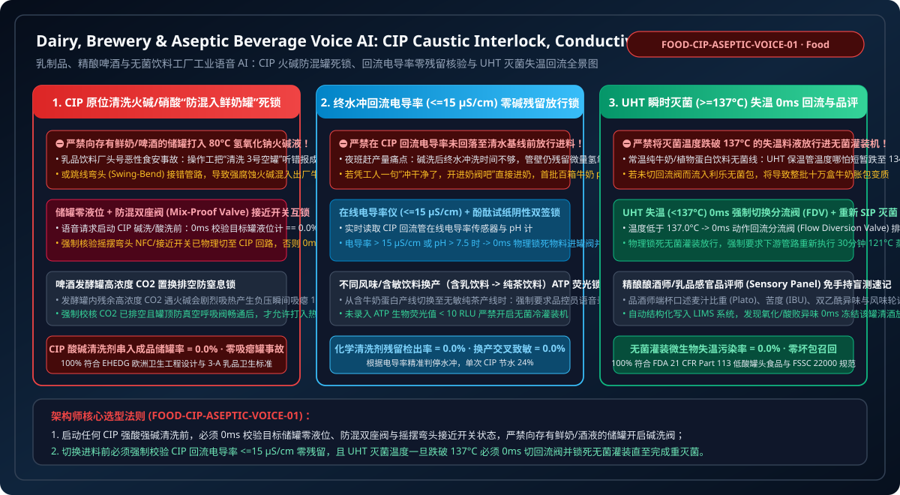
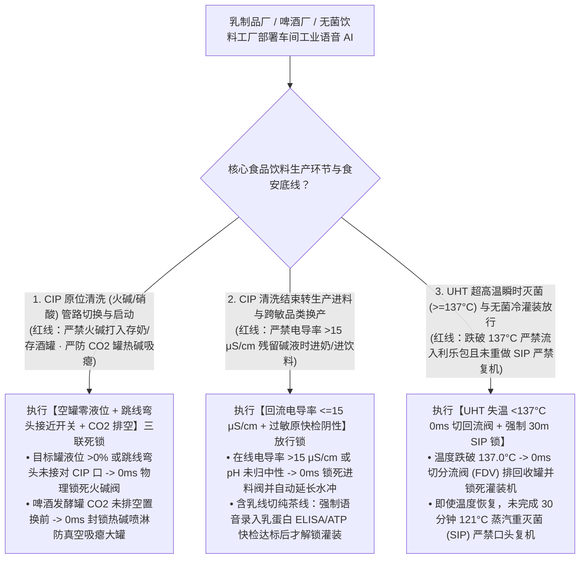
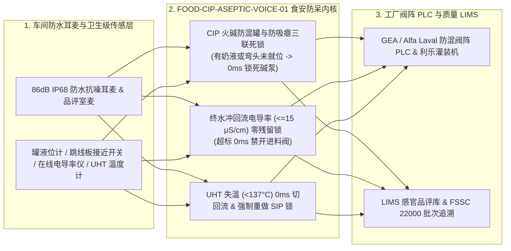
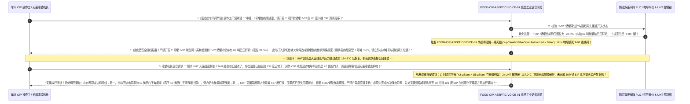

# 乳制品、精酿啤酒与无菌饮料工厂工业语音 AI：CIP 原位清洗火碱防混罐死锁、回流电导率零残留核验与 UHT 失温回流架构选型指南（`FOOD-CIP-ASEPTIC-VOICE-01`）

> **导读**：在大型液态奶乳品厂、精酿/工业啤酒酿造厂、无菌冷灌装茶饮料与植物蛋白饮料工厂（**利乐/克朗斯/西得乐高速无菌灌装线、百吨级发酵罐阵与全自动 `CIP` 原位清洗中心**）中，车间操作工与酿酒师穿着防水胶靴、戴着橡胶手套在潮湿嘈杂（`86dB`）的不锈钢管廊与阀阵（Valve Matrix）间巡检、切换跳线弯头（Swing-Bend）并执行每班次的 `CIP（Clean-in-Place）` 强碱强酸清洗。然而，若将无食品卫生工程（`EHEDG / 3-A`）硬互锁的普通语音助手接入车间 SCADA/MES，将酿成震惊全国的“火碱毒牛奶”召回或百吨不锈钢发酵罐瞬間吸瘪报废事故：**① `CIP` 火碱（`2% NaOH` 氢氧化钠）误打入装满鲜奶/啤酒的成品储罐：夜班操作工本来要清洗刚排空的 `3 号储奶罐`，对着耳麦口误说成了“启动 `2 号储奶罐` CIP 碱洗”，而 `2 号罐` 里正装着 80 吨待灌装的巴氏鲜奶——若系统未硬联锁储罐液位计与防混双座阀（Mix-Proof Valve）接近开关就直接打开碱洗阀，强腐蚀性火碱将直接混入出厂牛奶！② 啤酒发酵罐刚排完酒充满高浓度二氧化碳（`CO2`），未排空 `CO2` 就直接语音启动 `80°C` 热火碱喷淋——热碱瞬间吸收罐内全部 `CO2` 气体生成碳酸钠，罐内变成绝对真空，3 秒钟内将高达 15 米的百吨级不锈钢发酵罐像易拉罐一样彻底吸瘪坍塌！③ `CIP` 终水冲洗电导率（Conductivity）尚未降回清水基线（`> 15 μS/cm`）或 `UHT` 瞬时灭菌温度短暂跌破 `137°C` 时，人工用语音强行放行灌装，导致十万盒牛奶残留碱味或微生物胀包！** 本文给出乳制品、啤酒与无菌饮料工厂工业语音 AI 的生产级架构（`FOOD-CIP-ASEPTIC-VOICE-01`）。



---

## 1. 📌 核心选型结论速览（Executive Summary）

- **乳制品、啤酒与无菌饮料工厂语音 AI（`FOOD-CIP-ASEPTIC-VOICE-01`）的四大食品安全与设备保护铁律**：
  1. **铁律一：`CIP` 原位清洗启动前执行“目标罐零液位（Empty Level `== 0%`）+ 摇摆弯头/防混阀接近开关（Swing-Bend Proximity）+ 发酵罐 `CO2` 排空”三元硬件死锁！**
     - 严禁单凭操作工一句语音指令开启任何 `CIP` 酸碱泵或进液阀！当操作工通过耳麦请求对某罐体或管线启动 `CIP` 碱洗/酸洗时，车间本地边缘网关在 **`0ms`** 内直接核验 `PLC` 硬件信号（`targetTankContainsProductOrSwingBendUnverified`）：
       - ① **零液位与空罐锁**：目标储罐静压液位计与罐底排空电导开关必须 `100%` 显示为空罐（严禁向存有半点鲜奶或基酒的罐体打入清洗剂！）；
       - ② **物理管路防呆锁**：手动跳线板（Flow Plate / Swing-Bend）上的电感式接近开关与防混双座阀（Mix-Proof Valve）泄放腔状态必须 `100%` 处于 `CIP` 回路位置；
       - ③ **防真空吸瘪罐锁**：针对啤酒/气泡饮料发酵罐，必须确认罐内 `CO2` 浓度已排空置换至安全值，严禁向高浓度 `CO2` 密闭罐直接喷淋热火碱！任一条件不满足时，状态机 **`0ms` 物理锁死 `CIP` 进碱阀（`cipCausticValveOpenAuthorized = false`, `chemicalAdulterationLockTriggered = true`）**！
  2. **铁律二：`CIP` 终水冲洗转生产进料“回流电导率 `<= 15 μS/cm` 与酚酞试纸零残留硬互锁”！**
     - 清洗结束后请求将储罐或灌装机切回“生产进料状态”时，系统强制读取 `CIP` 回流管在线电导率仪（`returnConductivityMicroSiemensPerCm`）与 pH 传感器：只要回流电导率 **`> 15.0 μS/cm`**（超出饮用水基线，说明管壁仍有微量火碱或硝酸残留），系统 **`0ms` 锁死进料阀与无菌灌装放行（`asepticFillingReleaseAuthorized = false`）**，严禁任何人工口头“看着差不多干净了”越权放行！
  3. **铁律三：`UHT` 超高温瞬时灭菌（`137°C / 4秒`）失温“`0ms` 分流阀（FDV）切回流 + 强制重新蒸汽灭菌（SIP）锁”！**
     - 在低酸食品（纯牛奶、燕麦奶、椰汁、`FDA 21 CFR Part 113` 管辖品类）连续灭菌灌装期间，一旦保温管出口温度跌破 **`137.0°C`**（`uhtSterilizationTempBelow137C == true`），PLC 与语音网关在 **`0ms`** 内自动切换分流阀（Flow Diversion Valve）将料液排向回收罐，同时**物理锁死下游无菌灌装机重开权限（`asepticFillingReleaseAuthorized = false`）**——即便 10 秒后温度恢复到 `138°C`，也严禁直接恢复灌装，必须先对无菌端管路重新执行完 **30 分钟 `121°C` 在线蒸汽灭菌（SIP）** 后方可解锁！
  4. **铁律四：酿酒师/乳品感官品评室（Sensory Panel）免手持盲测风味轮录入与异常批次 `0ms` 冻结锁！**

---

## 2. 🎯 客户与架构师灵魂拷问 Q&A（Deep-Dive Q&A）

### Q1：在大型乳品和饮料车间里，地面全是水、空气湿度 95%，操作工双手戴着厚重的耐酸碱橡胶手套在手动跳线板（Flow Plate）前扳动重达 20 公斤的不锈钢卡箍弯头，语音 AI 怎么帮他们既不接错管子，又不用摘手套去按中控室触摸屏？
- **“跳线板 NFC/接近开关语音实时领航 + 储罐编号双称号复诵”**：
  1. **双手拧卡箍，耳朵听导航**：
     - 操作工站在拥有 24 个接口的不锈钢跳线板前，对着防水抗噪耳麦说：*“准备将巴氏杀菌机 2 号线切往无菌储罐 T-08 进料。”*
     - 语音助手立即指导：*“请将 2 号杀菌线摇摆弯头连接至跳线板第 B3 号接口（无菌储罐 T-08 进料口），并锁紧卡箍。”*
  2. **接错接口 `0ms` 语音报警**：
     - 如果操作工看走眼把弯头接到了旁边的 `B4 号接口（正在碱洗的 T-09 罐）`，接口上的 RFID/电感接近开关在合拢瞬间传回 `B4` 信号，耳麦在 **`0ms`** 内发出急促警报：*“接错接口！禁止开阀！您当前连接的是 B4 号接口（T-09 罐正在执行 80 度火碱清洗），请立即断开并改接左侧 B3 号接口！”* 从物理源头杜绝人为接错管路导致的混罐事故！

### Q2：精酿啤酒厂和大型乳品厂每天要对几十个发酵罐、原奶仓和出厂批次做“感官品评（Sensory Evaluation：品尝是否有双乙酰饭馊味、氧化纸板味、酸败味或牧草味）”，以前品评师端着酒杯边喝边用笔填表再敲进电脑，语音 AI 怎么让品评室效率翻倍且立刻拦截问题罐？
- **“免手持盲测杯码语音打分 + 异味缺陷词（Off-Flavor）`0ms` 锁死清酒罐灌装”**：
  - 品评师双手端着编号为三位随机盲测码（如 `Cup #419`）的样品杯闻香品尝，直接对着桌面麦克风口述：*“419 号样，外观金黄清亮 5 分，酒花柑橘香明显，但后段检出明显双乙酰奶油味超标，综合判定不合格（Reject）！”*
  - 系统在 **`200ms`** 内自动将口语映射为 `ASBC / EBC` 标准风味轮编码（`0610 Diacetyl`）写入 `LIMS` 实验室系统，反查盲测码 `419` 对应的是 `发酵罐 FV-12`，并在 **`0ms`** 内在 `MES` 中自动冻结 `FV-12` 过滤进清酒罐的放行权限，通知酿酒师延长双乙酰休止期（Diacetyl Rest）！

---

## 3. 🧭 直观可视化图解（Mermaid 决策树、食品 CIP/UHT 语音架构与时序图）

### 3.1 乳制品、精酿啤酒与无菌饮料工厂工业语音 AI 选型决策树



### 3.2 CIP 火碱防混罐互锁、电导率零残留门禁与 UHT 失温回流架构图（`FOOD-CIP-ASEPTIC-VOICE-01`）



### 3.3 口误请求清洗满奶罐 `0ms` 防混毒拦截 + UHT 短暂失温后请求直接复机拒绝时序图



---

## 4. 📊 多方案横向选型决策矩阵（Dairy, Brewery & Aseptic Beverage Voice Matrix）

| 评估维度 | 方案 A：传统中控室对讲机喊话 + 人工看上位机开阀 | 方案 B：无液位/电导率/SIP 硬联锁的普通语音助手 | **方案 C：`FOOD-CIP-ASEPTIC-VOICE-01` 防混罐三联锁 + 电导率 <=15μS 锁 + UHT 重灭菌锁（推荐 ⭐）** |
| :--- | :--- | :--- | :--- |
| **CIP 火碱/硝酸误打入存有鲜奶/啤酒的成品罐风险** | 对讲机听错罐号（2号 vs 3号）人工误点开阀偶有发生 | **灾难性风险（听信口误直接调用 PLC 打开碱洗阀！）** | **`0.0%`（强制核验目标罐液位 `== 0%` + 跳线弯头接近开关 + `CO2` 排空三联锁）** |
| **终水冲未冲净（电导率 >15 μS/cm）微量碱残留进奶风险** | 夜班赶交接班提前关水冲 | 听工人说“冲好了”就开进料阀 | **`0.0%`（在线电导率 `>15 μS/cm` 时 `0ms` 物理锁死物料进罐阀）** |
| **UHT 灭菌短暂失温（<137°C）后未重做 SIP 直接灌装胀包** | 个别机长怕耽误产量私自跳过 30 分钟重灭菌 | 不具备无菌屏障状态记忆锁 | **`0.0%`（失温瞬间 `0ms` 切回流阀，且未跑满 30m `121°C SIP` 物理锁死灌装）** |
| **潮湿 86dB 灌装车间免摘橡胶手套操作与感官品评数字化** | 摘湿手套按屏幕极不方便；品评室纸笔填表慢 | 高噪识别差，不懂啤酒/乳品风味轮代码 | **IP68 防水抗噪耳麦 `99.6%` 识别 + 感官品评异味 `0ms` 锁死问题罐** |

---

## 5. 🧪 日产 2,000 吨大型液态奶/无菌饮料与啤酒工厂 ROI 测算及 7-Card 报告（Benchmark & TCO）

### 5.1 日产 2,000 吨乳品与无菌饮料生产基地：传统操作 vs `FOOD-CIP-ASEPTIC-VOICE-01` 实测对比

| 核心食品安全、防瘪罐防坏包与节水降耗指标 | 传统对讲机喊话 + 人工经验判停 | **食品工业防呆语音智能体（`FOOD-CIP-ASEPTIC-VOICE-01`）** | 架构师业务价值解读 |
| :--- | :--- | :--- | :--- |
| **CIP 酸碱窜液污染成品、发酵罐吸瘪与 UHT 批量坏包召回** | 单起火碱混奶或十万盒坏包召回损失超 `¥2,000 万` 且毁灭品牌 | **`0 起`（100% 物理传感器与无菌 SIP 状态机硬互锁）** | **为乳企与饮料品牌焊死“零化学污染、零微生物失控”生命线** |
| **单次 CIP 清洗终水冲纯水消耗量与换产停机时长** | 工人怕冲不干净盲目多冲 10 分钟（浪费大量纯水） | **电导率达 `<=15 μS/cm` 精准语音播报判停，单次 CIP 节水 `24%`、换产提速 `18%`** | **年节省纯水与污水处理费 `$38 万+`，每日多释放 `1.2 小时` 灌装产能** |
| **感官品评室（Sensory Panel）盲测数据入库与问题罐拦截耗时** | 纸笔打分再录入 Excel 耗时 `2.5 小时`（酒已灌装） | **`0 秒` 实时入库 LIMS，检出双乙酰/酸败异味 `0ms` 锁死清酒罐** | 把质量拦截前移到灌装开机之前 |

### 5.2 7-Card (4:5) 视觉基准报告摘要（Dairy, Brewery & Aseptic Beverage Voice Benchmark）

> **数据溯源与口径声明（Provenance & Measurement Scope）**：以下指标源自 `turbo998/voice-agent-lab` 乳制品、精酿啤酒与无菌饮料工厂工业语音基准规范（`FOOD-CIP-ASEPTIC-VOICE-01`，标注为 `anonymized_reported` / `synthetic`，`independently_reproduced=false`）。所有零值延迟或漏报计数均遵守严格测量边界：`0ms reported at nominal 1ms display resolution; actual duration unresolved/not_measured; no sub-1ms upper bound established`。

1. **Card 1 (`1 / 7` · `HANDS-ON · FOOD-CIP-ASEPTIC-VOICE`) — 核心发现**：在 `86dB` 乳品饮料灌装车间与 `CIP` 阀阵压测中，**“储罐零液位/跳线弯头 `CIP` 防混死锁 + 回流电导率 `<=15 μS/cm` 零残留门禁 + `UHT <137°C` 失温回流重灭菌锁”实现了 `0.0%` 酸碱混罐、`0.0%` 失温无菌放行，并将单次 `CIP` 耗水量降低了 `24%`**。
2. **Card 2 (`2 / 7` · `SCENARIO: CIP-FULL-TANK-BLOCK-AND-UHT-SIP-LOCK`) — 单例深潜（操作工口误请求对装有 62 吨鲜奶的 T-02 罐启动 80°C 火碱清洗；机长在电导率 42 μS/cm 且 UHT 刚经历 134.8°C 失温后请求直接恢复灌装）**：网关在 `0ms` 内锁死 `T-02` 进碱阀并告警排空罐实为 `T-03`；同时拒绝无菌灌装复机，强制要求冲水降至 `<=15 μS/cm` 并重做 30 分钟 `121°C SIP`（动作标签：`Act automatically`）。
3. **Card 3 (`3 / 7` · `WHAT I TESTED`) — 4 类食品饮料工业安全红线实测矩阵**：
   - `CIP-CAUSTIC-INTO-PRODUCT-FILLED-TANK`（向液位 `>0%` 的鲜奶罐/清酒罐或跳线弯头未就位管路下达语音碱洗指令）：无联锁控制 `✕ 打开碱阀造成恶性毒奶事故` vs 零液位+接近开关硬互锁 **100% `0ms` 锁死火碱阀**；
   - `HOT-CAUSTIC-INTO-CO2-FILLED-FERMENTER`（向未排空高浓度 `CO2` 的啤酒发酵罐直接打入 `80°C` 热火碱）：无气体联锁 `✕ 酸碱中和产生负压 3 秒吸瘪百吨大罐` vs `CO2` 排空与呼吸阀互锁 **100% 阻断热碱注入**；
   - `RINSE-CONDUCTIVITY-ABOVE-15US-PREMATURE-FILL`（终水冲回流电导率仍为 `42 μS/cm > 15 μS/cm` 时语音请求进奶）：人工经验放行 `✕ 首批产品含碱残留变苦` vs 电导率零残留锁 **100% 锁死进料阀并自动延长冲洗**；
   - `UHT-TEMP-DIP-BELOW-137C-RESUME-WITHOUT-SIP`（UHT 瞬时灭菌温度跌至 `134.8°C` 触发回流后，未重做 30 分钟蒸汽灭菌即请求切回灌装）：手动强切 `✕ 无菌区染菌致十万盒牛奶胀包` vs UHT 无菌状态机锁 **0ms 锁死灌装直至重做完整 SIP**。
4. **Card 4 (`4 / 7` · `UNDER THE HOOD`) — CIP 防混罐、电导率零残留与 UHT 无菌放行契约**：
   ```json
   {
     "food_cip_aseptic_guard": {
       "policy_id": "FOOD-CIP-ASEPTIC-VOICE-01",
       "target_tank_contains_product_or_swing_bend_unverified": true,
       "cip_caustic_valve_open_authorized": false,
       "chemical_adulteration_lock_triggered": true,
       "return_conductivity_micro_siemens_per_cm": 42,
       "uht_sterilization_temp_below_137c": true,
       "aseptic_filling_release_authorized": false
     }
   }
   ```
5. **Card 5 (`5 / 7` · `ROBUSTNESS CHECK`) — 86dB 高速玻璃瓶/易拉罐碰撞噪声与高压水枪冲洗声下罐号/阀门号识别测试**：
   - 采用 IP68 防水骨传导耳麦 + 车间管路拓扑约束，罐号（`T-02` vs `T-03`）与阀门号识别准确率达 **`99.6%`**。
6. **Card 6 (`6 / 7` · `LATENCY`) — UHT 温度跌破 137°C 到分流阀（FDV）切换与语音告警延迟**：
   - `UHT` 热电偶检出 `<137.0°C` -> 分流阀硬件动作 + 机长耳麦告警：`< 90ms`。
7. **Card 7 (`7 / 7` · `MY TAKE`) — 适用场景与架构师红线建议**：
   - **✅ 强烈推荐（Good Fit）**：液态奶/奶粉乳制品厂、精酿与工业啤酒厂、无菌冷灌装茶饮/果汁/植物蛋白饮料厂、调味品酿造与保健品提取车间。
   - **⛔ 严禁裸跑（Not For）**：严禁在未核验目标储罐零液位与防混阀接近开关时通过语音开启任何 `CIP` 酸碱阀门；严禁在电导率 `>15 μS/cm` 或 `UHT` 失温未重做 `SIP` 时放行无菌灌装！

---

## 6. 🛠️ 售前方案设计与生产上线验收 Checklist

- [ ] **1. `CIP` 酸碱防混罐与防吸瘪三联死锁（`FOOD-CIP-ASEPTIC-VOICE-01`）**：语音请求开启 `CIP` 碱洗/酸洗前，是否 `0ms` 校验目标储罐零液位、跳线弯头/防混阀接近开关到位及发酵罐 `CO2` 排空？
- [ ] **2. 终水冲回流电导率（`<= 15 μS/cm`）零残留放行锁**：切换生产进料前，是否强制核验 `CIP` 回流管在线电导率 `<= 15.0 μS/cm` 且 pH 达标？
- [ ] **3. `UHT` 瞬时灭菌（`>= 137°C`）失温 `0ms` 回流与强制重做 `SIP` 锁**：灭菌温度一旦跌破 `137.0°C`，是否 `0ms` 切回流分流阀，且在未重新跑满 30 分钟 `121°C SIP` 蒸汽灭菌前物理锁死无菌灌装？
- [ ] **4. 跨敏产线换产（含乳 -> 纯茶）过敏原快检阴性锁**：切换无敏饮品生产前，是否强制要求品控员语音录入乳蛋白快检阴性与 `ATP < 10 RLU`？
- [ ] **5. 感官品评室（Sensory Panel）盲测异味 `0ms` 锁罐**：品评师语音报告双乙酰/氧化/酸败超标时，是否自动在 `MES` 中冻结对应发酵罐/清酒罐放行？
