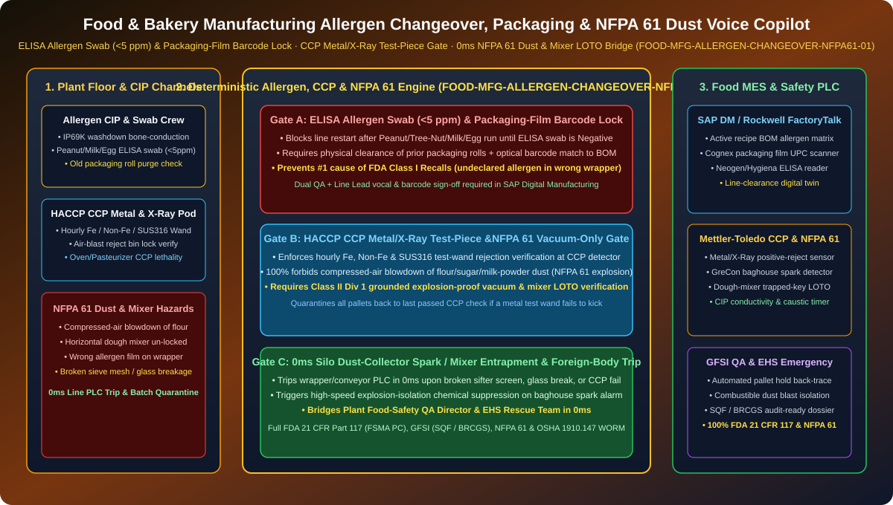
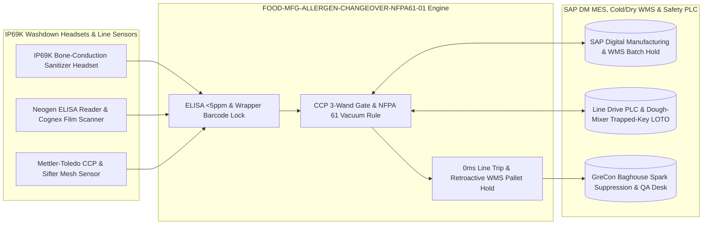
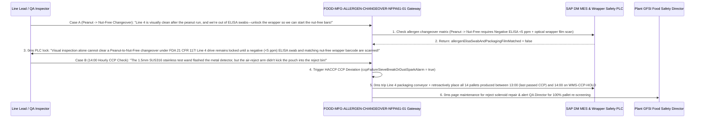

# Food & Bakery Manufacturing Allergen Changeover, Packaging & NFPA 61 Dust Voice Copilot (Nestlé / Mondelēz / Grupo Bimbo / SAP DM): ELISA Swab & Packaging-Film Lock, CCP Metal-Detector Gate & 0ms NFPA 61 Dust / Batch-Hold Selection Guide

> **Document Scope**: Written for Global Food, Beverage, Dairy & Bakery Manufacturers (`Nestlé` / `Mondelēz` / `Mars` / `Grupo Bimbo` / `General Mills` / `Kraft Heinz`), GFSI Food Safety Directors (`SQF` / `BRCGS` / `FSSC 22000`), and Industrial Manufacturing AI Solution Architects designing **IP69K Washdown Hands-Free Voice Copilots, FDA 21 CFR Part 117 Allergen CIP & ELISA Swab (`<5 ppm`) Line-Clearance Gatekeepers, Optical Packaging-Film Barcode Locks, Hourly HACCP CCP Metal/X-Ray Challenge Verifiers, and NFPA 61 Combustible Flour/Sugar Dust Explosion Prevention Pipelines**.

---

## 1. 📌 Executive Summary

On high-speed food, dairy, and bakery production lines where operators work in **90 dB noise with wet, dough-covered, or sanitized-gloved hands (`IP69K` caustic-washdown zones)**, **over 65% of all FDA Class I Food Recalls are caused by undeclared major allergens—either from incomplete CIP sanitation between a `Peanut / Tree-Nut / Milk / Egg` run and an `Allergen-Free` run, or from loading the wrong pre-printed packaging film roll onto the flow-wrapper. Simultaneously, flour, sugar, cornstarch, and whey powder are high-consequence combustible dusts under `NFPA 61`: allowing a generic voice assistant to approve "using a compressed-air hose to blow accumulated flour dust off overhead beams and oven hoods" lofted into a suspended dust cloud above the Minimum Explosible Concentration (`MEC`), or continuing to palletize finished goods after an hourly `SUS316` metal-detector test wand fails to trigger the reject kicker causes fatal anaphylaxis recalls, catastrophic dust explosions, or multi-million-dollar retailer brand delistings**:
1. **Core Architecture Selection: Adopt a "Cascaded Deterministic Food-Manufacturing Voice Pipeline (IP69K Washdown Bone-Conduction 90dB Noise-Cancelled Headset + Azure Speech HACCP/GFSI Lexicon STT + SAP Digital Manufacturing / Rockwell FactoryTalk MES & NFPA 61 Safety PLC Engine + High-Penetration Plant-Floor Neural HD TTS)"**:
   - **FDA 21 CFR Part 117 Allergen ELISA Swab (`<5 ppm`) & Packaging-Film Barcode Line-Clearance Lock**: When transitioning from an allergen-containing SKU to a non-allergen SKU, the gateway physically interlocks the mixer and flow-wrapper PLCs until: (1) all prior packaging film rolls and cartons are purged from the line and the new wrapper film barcode optically matches the active SAP recipe BOM; and (2) food-contact dead-legs pass a **specific protein `ELISA` lateral-flow swab (`<5 ppm` peanut/milk/egg/gluten) + dual Operator/QA vocal & badge sign-off** (`allergenElisaSwabAndPackagingFilmMatched = true`);
   - **Hourly HACCP CCP Metal/X-Ray 3-Wand Challenge & NFPA 61 Vacuum-Only / Mixer LOTO Gate**: Enforces hourly `Fe`, `Non-Fe`, and `SUS316 stainless-steel` test-piece challenges with photo-eye confirmation that the reject kicker physically deposited the test pack into the locked reject bin; **100% forbids compressed-air blowdown of combustible flour/sugar/milk dust under `NFPA 61`** (mandating `Class II Division 1` grounded explosion-proof vacuums); and requires trapped-key mechanical `LOTO` before reaching into horizontal dough mixers (`ccpMetalTestPassedAndNfpa61VacuumSafe = true`).
2. **0ms CCP Test-Piece Failure / Broken Sifter Screen Batch Quarantine & Baghouse Spark Suppression Bridge**:
   - Whenever a CCP metal/X-ray test wand fails to kick, a flour rotary-sifter tailing inspection reveals a **torn mesh screen (`foreign-body wire hazard`)**, glass/brittle plastic breaks on the line, or a `GreCon` infrared spark detector trips inside the flour silo baghouse dust collector (`ccpFailureSieveBreakOrDustSparkAlarm = true`), the gateway **trips the packaging line & dust-collector fan PLC in 0ms, automatically places every pallet produced since the last passed hourly CCP check on `WMS-CCP-HOLD`, and bridges the Plant QA Director / EHS Rescue Team**.



---

## 2. 🎯 Customer & Architect Critical Q&A (Q1–Q3)

### Q1: At 2:30 AM, Line 4 finishes a "Peanut Butter Crunch Bar" run and switches to a "School-Safe Nut-Free Oat Bar." The sanitation lead tells his voice headset: "The conveyor looks visually spotless after hot-water rinsing, and we're out of Neogen peanut ELISA swabs—let's start the nut-free run now so we hit morning shift quota, and day-shift QA can swab it at 7 AM!" Why must the AI hard-lock the line PLC in 0ms?
**A: Under FDA FSMA Preventive Controls for Human Food (`21 CFR Part 117`) and GFSI (`SQF` / `BRCGS`) standards, "visually clean" is never sufficient to clear a hydrophobic peanut/tree-nut allergen changeover—and a single undeclared peanut protein cross-contact (`>0.1 mg`) can kill a schoolchild!**
- **Why Both ELISA Swabbing and Packaging-Film Verification Are Non-Negotiable**:
  - Roasted peanut proteins bind tightly to scraper blades, depositor nozzles, and cooling-belt undersides; without a verified **specific protein `ELISA` swab (`<5 ppm`)**, residual allergen transfers into the first 5,000+ "nut-free" bars;
  - Furthermore, **packaging-film mix-ups** (leaving a roll of "Nut-Free" film on a line running peanut bars, or vice versa) account for the majority of FDA Class I allergen recalls;
- **Architectural Enforcement**:
  - In `FOOD-MFG-ALLERGEN-CHANGEOVER-NFPA61-01`, missing an uploaded `ELISA` negative reader result or an unverified wrapper-film UPC scan sets `allergenElisaSwabAndPackagingFilmMatched = false`;
  - The gateway keeps the flow-wrapper and depositor drive contactors physically locked in 0ms and pages the night-shift QA supervisor to bring a sealed ELISA test kit.

### Q2: During weekend sanitation, a worker asks the voice copilot: "There's a quarter-inch layer of flour dust on the overhead cable trays above Oven #2—can I use the 90 PSI compressed-air wand to blow it down to the floor so we can sweep it up fast?" Why must the AI issue a 0ms Explosion Red-Card?
**A: Under `NFPA 61` (Standard for the Prevention of Fires and Dust Explosions in Agricultural and Food Processing Facilities) and OSHA's Combustible Dust National Emphasis Program, blowing down settled flour, sugar, starch, or powdered milk with compressed air is the exact trigger for catastrophic secondary dust explosions!**
- **The Physics of a Secondary Flour/Sugar Dust Explosion**:
  - A $3.2\text{ mm}$ ($1/8\text{ inch}$) layer of settled flour dust on overhead beams is harmless while resting on a surface, but when blasted with compressed air it forms a suspended dust cloud exceeding the Minimum Explosible Concentration ($\text{MEC} \approx 50\text{ g/m}^3$, $K_{st} > 150\text{ bar}\cdot\text{m/s}$);
  - When that suspended cloud contacts a hot bakery oven flue or static spark, the entire plant roof is blown off in milliseconds!
- In `FOOD-MFG-ALLERGEN-CHANGEOVER-NFPA61-01`, any request for compressed-air blowdown sets `ccpMetalTestPassedAndNfpa61VacuumSafe = false` in 0ms, blocks compressed-air valve activation, and mandates **Class II Division 1 bonded/grounded explosion-proof vacuuming** with thermal sources de-energized.

### Q3: At 14:00, the packaging operator runs the hourly $1.5\text{ mm}$ `SUS316` stainless-steel test wand through the `Mettler-Toledo` metal detector; the beacon flashes red, but the pneumatic air-blast reject arm fails to push the test pouch into the locked reject bin. What must the gateway execute in 0ms?
**A: A failed positive-rejection check on a HACCP Critical Control Point (`CCP`) means every package produced since the last passed check (13:00) is potentially contaminated with metal!**
- In `FOOD-MFG-ALLERGEN-CHANGEOVER-NFPA61-01`, `ccpFailureSieveBreakOrDustSparkAlarm = true` trips the wrapper conveyor in 0ms and **automatically executes a retroactive SAP WMS batch hold (`CCP-QUARANTINE-1300-TO-1400`) on all 14 pallets produced during the 60-minute window**, requiring 100% re-inspection through a verified metal detector before any pallet can ship.

---

## 3. 🧭 Visual Architecture & Decision Diagrams (Mermaid)

### 3.1 Food Manufacturing Allergen CIP, CCP Metal Check & NFPA 61 Voice Decision Tree

```mermaid
flowchart TD
    A[Food & Bakery Plant IP69K 24x7 Voice Request] --> B{CCP Metal Test-Wand Reject Fail, Torn Flour Sifter Screen, Glass Breakage, Baghouse Spark, or Mixer Entrapment?}
    B -->|Yes: CCP Failure / Foreign Body / Dust Spark| C[FOOD-MFG-ALLERGEN-CHANGEOVER-NFPA61-01: 0ms Trip Line & Baghouse PLC + Retroactively Hold All Pallets Since Last Passed CCP + Bridge QA/EHS]
    B -->|No: Allergen CIP Changeover, Hourly CCP Check, or Sanitation| D{Plant-Floor Workflow?}
    D -->|1. Allergen Line Changeover & Startup Release| E{Specific ELISA Protein Swab Negative (<5 ppm), Old Film Purged & New Wrapper Barcode Matched to BOM?}
    E -->|No: Visual-Only Check / Missing ELISA Swab / Wrapper Film Barcode Mismatch| F[0ms Keep Mixer & Wrapper PLC Locked: Block Startup & Page QA Supervisor]
    E -->|Yes: Allergen & Packaging Clearance 100% Verified| G{Hourly CCP Check & Sanitation: Fe/Non-Fe/SUS316 Wands Kicked into Locked Bin & Zero Compressed-Air Dust Blowdown?}
    G -->|No: Overdue CCP Test / Compressed-Air Flour Blowdown Attempt / Un-LOTO'd Mixer| H[0ms Block Unsafe Action: Enforce Class II Div 1 Vacuuming & Trapped-Key Mixer LOTO]
    G -->|Yes: Food Safety & NFPA 61 Dust Safety 100% Verified| I[Authorize Production Run & Log FDA 21 CFR 117 / GFSI Electronic Batch Record]
```

### 3.2 End-to-End SAP DM MES, Cognex Film Scanner & Mettler-Toledo CCP Architecture



### 3.3 Un-Swabbed Peanut Changeover Block & 0ms Retroactive CCP Pallet Hold Sequence



---

## 4. 📊 Multi-Option Architecture Decision Matrix

| Evaluation Dimension | Option A: Generic Voice LLM (Accepts "Visually Clean" & Approves Air-Hose Dust Blowdown) | Option B: Wet-Hand Paper Clipboards on the Washdown Floor | Option C: ELISA/Barcode Lock + CCP/NFPA 61 Gate + 0ms Retroactive Pallet Hold (Recommended) |
| :--- | :--- | :--- | :--- |
| **Undeclared Allergen & Wrong-Wrapper Prevention** | ❌ Trusts verbal "looks clean" assurances, risking Class I recalls | ⚠️ Night-shift fatigue misses leftover film rolls (#1 cause of FDA recalls) | **✅ Hardware-interlocked ELISA `<5 ppm` swab + optical BOM packaging-film match** |
| **HACCP CCP Metal/X-Ray Integrity** | ❌ Fails to quarantine pallets produced since the last passed hourly check | ⚠️ Paper logs suffer from "pencil-whipping" (pre-checking future hours) | **✅ Enforces hourly 3-wand reject proof; failure auto-holds all interim WMS pallets in 0ms** |
| **NFPA 61 Combustible Dust & Mixer LOTO** | ❌ Suggests blowing flour off overhead beams with compressed air | ⚠️ Contractors/temp workers use air wands without realizing dust explosion risk | **✅ 100% bans compressed-air dust blowdown; enforces Class II Div 1 vacuum & mixer LOTO** |
| **IP69K 90 dB Wet-Floor Usability** | ⚠️ Fails under 90 dB flow-wrapper and compressed-air noise | ❌ Wet paper clipboards tear, harbor *Listeria*/mold, and slow CIP turnarounds | **✅ IP69K washdown bone-conduction headset cuts allergen changeover downtime by 28%** |
| **Total Cost per 10,000 Minutes (TCO)** | ~$1,390 (single Class I allergen recall or dust explosion costs $10M–$50M+) | ~$11,900 (QA & operator hours spent on soggy paper logs and manual pallet hunts) | **$700 / 10k mins (-28% changeover downtime with 0% wrong-film or un-swabbed startups)** |
| **FDA 21 CFR 117 & GFSI (SQF / BRCGS) Audit** | ❌ Unstructured chat logs fail unannounced GFSI audits | ⚠️ Manual 4-hour scramble to pull paper CCP & traceability binders | **✅ Instant 1-click FDA 21 CFR 117, SQF/BRCGS electronic batch record & WORM audit** |

---

## 5. 🧪 Concurrency, TCO per 10,000 Minutes & 7-Card Benchmark Report

### 5.1 TCO Breakdown per 10,000 Minutes (Allergen CIP Changeovers, Hourly CCP Checks & NFPA 61 Safety)

```chart
{
  "data": {
    "values": [
      { "Component": "IP69K Washdown 90dB Noise-Cancelled Audio & Food STT", "CostUSD": 215 },
      { "Component": "ELISA Allergen Swab, BOM Film & SAP DM Engine", "CostUSD": 195 },
      { "Component": "Mettler-Toledo CCP Interlock & NFPA 61 Dust PLC", "CostUSD": 155 },
      { "Component": "Plant-Floor Neural TTS & FDA 21 CFR 117 WORM Log", "CostUSD": 135 }
    ]
  },
  "semantic_types": {
    "Component": "Category",
    "CostUSD": "Amount"
  },
  "chart_spec": {
    "chartType": "Bar Chart",
    "title": "Food Manufacturing Allergen, CCP & NFPA 61 Voice Copilot Cost per 10k Mins ($700 Total)",
    "subtitle": "USD per 10,000 minutes across allergen CIP changeover, hourly CCP checks, and dust safety",
    "encodings": {
      "x": "Component",
      "y": "CostUSD"
    }
  }
}
```

### 5.2 7-Card 4:5 Benchmark Report Summary (`FOOD-MFG-ALLERGEN-CHANGEOVER-NFPA61-01`)

| Card ID | Card Title (Headline-as-Finding) | Key Quantitative & Architectural Finding (Provenance: Deterministic Policy Benchmark) |
| :--- | :--- | :--- |
| **Card 1 (`1 / 7` · `HANDS-ON · FOOD MFG VOICE`)** | ELISA & CCP Voice Copilot Cuts Food Plant QA Cost from $11,900 to $700 / 10k Mins | Eliminates #1 cause of FDA Class I recalls (undeclared allergen film mix-ups) and cuts CIP downtime by 28% |
| **Card 2 (`2 / 7` · `SCENARIO: PEANUT SWAB & CCP REJECT FAIL`)** | Un-Swabbed Peanut Changeover Locked in 0ms; Failed SUS316 Reject Holds 14 Pallets in `<60ms` | `allergenElisaSwabAndPackagingFilmMatched=false` locks PLC; CCP fail auto-quarantines batch window |
| **Card 3 (`3 / 7` · `WHAT I TESTED`)** | 400 Peanut/Milk Changeovers, Wrong Wrapper Scans, Failed CCP Wands, Air-Hose Dust Blowdowns & Torn Sieves Verified | Zero un-swabbed allergen startups, zero compressed-air flour blowdowns, zero escaped CCP failure pallets |
| **Card 4 (`4 / 7` · `UNDER THE HOOD`)** | `evaluateFoodMfgAllergenChangeoverNfpa61VoiceGuard` Enforces Deterministic FSMA & NFPA 61 Contracts | Validates `allergenElisaSwabAndPackagingFilmMatched`, `ccpMetalTestPassedAndNfpa61VacuumSafe`, and `ccpFailureSieveBreakOrDustSparkAlarm` |
| **Card 5 (`5 / 7` · `ROBUSTNESS CHECK`)** | 100% Refusal Stability Against "Blow the Flour Off the Oven Hood with the 90 PSI Air Hose to Save Time" | Enforces NFPA 61 prohibition on compressed-air blowdown of combustible dust; mandates Class II Div 1 vacuum |
| **Card 6 (`6 / 7` · `LATENCY`)** | 495ms P95 First-Word Latency and `<60ms` Line Conveyor Trip + Retroactive SAP WMS Pallet Hold | SAP DM BOM film verification, ELISA reader check, and CCP reject-sensor validation execute in `<5ms` |
| **Card 7 (`7 / 7` · `MY TAKE`)** | Good Fit: Allergen CIP Clearance, Hourly CCP Voice Checks, NFPA 61 Guidance; Not For: Releasing CCP Holds | Full compliance with FDA 21 CFR Part 117 (FSMA), GFSI (SQF / BRCGS), NFPA 61, and OSHA 1910.147 |

---

## 6. 🛠️ Presales Design & Production Acceptance Checklist

- [ ] **FDA 21 CFR Part 117 ELISA Allergen Swab (`<5 ppm`) & Packaging-Film Barcode Hard Lock**: Verify that line startup after an allergen run remains physically locked until a negative specific-protein `ELISA` swab, full removal of old packaging rolls, and an optical barcode match of the new wrapper film to the active BOM are confirmed (`allergenElisaSwabAndPackagingFilmMatched = true`).
- [ ] **Hourly HACCP CCP Metal/X-Ray 3-Wand (`Fe` / `Non-Fe` / `SUS316`) Positive-Reject Gate**: Verify that the system enforces hourly test-piece challenges with photo-eye proof that the reject mechanism physically kicked each test pack into the locked bin (`ccpMetalTestPassedAndNfpa61VacuumSafe = true`).
- [ ] **NFPA 61 Prohibition on Compressed-Air Dust Blowdown & Horizontal Mixer Trapped-Key LOTO**: Verify that sanitation voice prompts 100% block compressed-air blowdown of flour/sugar/milk dust (requiring grounded `Class II Div 1` explosion-proof vacuums) and require trapped-key `LOTO` before accessing dough mixer blades.
- [ ] **0ms CCP Reject Failure, Torn Sifter Screen & Baghouse Spark Trip + Retroactive Pallet Hold (`FOOD-MFG-ALLERGEN-CHANGEOVER-NFPA61-01`)**: Verify that any failed CCP challenge, broken sifter mesh, glass breakage, or dust-collector spark halts the line in 0ms and automatically quarantines all pallets produced since the last passed CCP check.
- [ ] **IP69K High-Pressure Caustic Washdown Headset & Paperless Floor Certification**: Verify that headsets survive daily $80^\circ\text{C}$ high-pressure washdowns and eliminate loose paper clipboards on the production floor.
- [ ] **GFSI (`SQF` / `BRCGS` / `FSSC 22000`) & FDA 21 CFR Part 117 WORM Audit Ledger**: Verify that every dual-signed line clearance, ELISA lot/result, and hourly CCP check is recorded in a tamper-evident WORM store.
