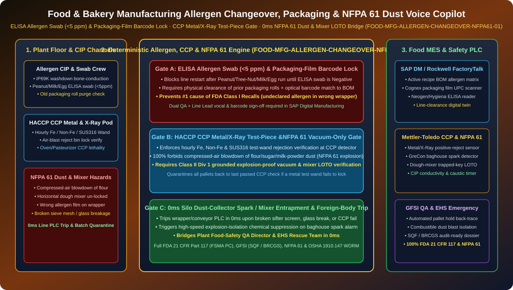
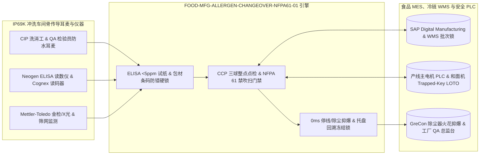
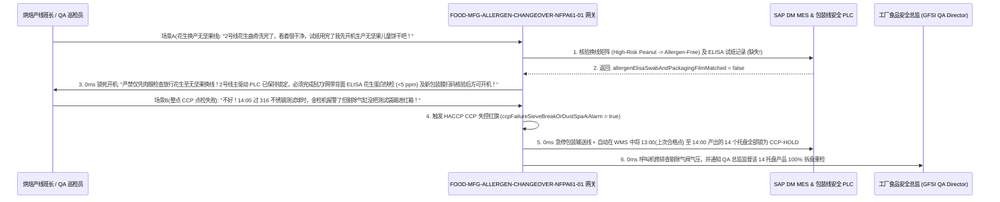

# 食品饮料与烘焙工业产线（雀巢 Nestlé / 亿滋 Mondelēz / 宾堡 Bimbo / 伊利 / 桃李面包）、致敏原换线洗消（CIP）与面粉粉尘防爆（NFPA 61）24×7 免提语音副驾方案：ELISA 致敏原试纸与包装膜防错硬锁、CCP 金检测试块门禁与严禁压缩空气吹扫粉尘 0ms 强切选型指南

> **文档定位**：面向大型食品饮料、乳品与烘焙制造集团（雀巢 Nestlé / 亿滋 Mondelēz / 玛氏 Mars / 宾堡集团 Grupo Bimbo / 伊利 / 蒙牛 / 桃李面包 / 达利食品）、工厂质量安全（QA / GFSI SQF / BRCGS）及工业自动化（SAP Digital Manufacturing / Rockwell FactoryTalk / 西门子 Opcenter）解决方案架构师，提供覆盖 **“致敏原产线切换（花生/牛奶/鸡蛋 → 无致敏原配方）ELISA 蛋白涂抹快检与包装卷膜条码 100% 硬锁 + 关键控制点（CCP）金属探测/X光异物机每小时三球测试门禁 + NFPA 61 严禁高压气枪吹扫面粉/糖粉/奶粉可燃粉尘硬锁 + 筛网破损/金属试块漏踢/除尘器火星 0ms 停包装机并冻结批次强切”** 的端到端实时语音方案选型、TCO 测算与 `FOOD-MFG-ALLERGEN-CHANGEOVER-NFPA61-01` 确定性护栏指南。

---

## 一、📌 核心选型结论速览（Executive Summary）

在双手沾满面团、奶油或高压水枪泡沫（IP69K 冲洗环境）的食品与烘焙智能工厂里，**美国 FDA 与各国市场监管总局统计显示，超过 65% 的食品一级紧急召回（Class I Recall——最高致死风险级别）并非源于原料中毒，而是源于“换线时未彻底清除上一批花生/坚果/牛奶残留，或者工人把含花生的饼干装进了印有‘无坚果安全’字样的旧包装膜里”；与此同时，面粉、糖粉、玉米淀粉与乳清粉属于极高危可燃性粉尘（Combustible Dust），任何允许通用语音大模型在换线清扫时建议工人“拿车间压缩空气气枪把烤炉上方的面粉吹下来”（瞬间形成达爆炸下限 MEC 的粉尘云，遇静电或烘道明火即引发毁灭性粉尘二次连环爆炸，如 Imperial Sugar 糖厂爆炸惨剧）、或者在金属探测器（Metal Detector）测试块未能触发气动剔除臂时继续放行包装码垛的方案，都会酿成消费者致命过敏休克、千万级全国召回或厂房粉尘爆炸事故**：
1. **核心架构选型：采用“级联确定性食品产线语音管线（IP69K 耐高压水冲洗骨传导降噪耳麦 + Azure Speech 食品配方/HACCP 词表 STT + SAP DM / FactoryTalk MES 与 NFPA 61 安全 PLC 引擎 + 车间高穿透率抗噪 Neural HD TTS）”**：
   - **FDA 21 CFR Part 117 致敏原换线 ELISA 蛋白快检（$<5\text{ ppm}$）与包装卷膜视觉防错（Packaging Line Clearance）100% 硬锁**：当产线从含致敏原产品（如花生酱夹心、全脂乳粉配方）切换至不含该致敏原的产品时，网关物理锁死搅拌机与包装机启动继电器，直至：① 现场清场确认旧包装膜已 100% 退库且新上机的包装膜条码与当前工单 BOM 经视觉扫描仪（Cognex）比对一致；② 传送带、投料斗死角经 **ELISA 特异性致敏原蛋白试纸（或高敏 ATP+蛋白双拭子）检测为阴性（$<5\text{ ppm}$）** 并由生产班长与 QA 检验员双声纹签字（`allergenElisaSwabAndPackagingFilmMatched = true`）；
   - **HACCP 关键控制点（CCP）金检三球测试块（Fe / Non-Fe / SUS316）与 NFPA 61 严禁压缩空气吹扫粉尘硬锁**：系统强制执行每 60 分钟一次的金属探测器/X光机阳性挑战测试（依次通过铁、非铁、316 不锈钢三颗标准测试球且光电传感器确认被准确踢入带锁废品箱）；同时在清扫语音 SOP 中 **100% 严禁使用压缩空气吹扫（Compressed-Air Blowdown）厚度 $>3.2\text{ mm}$（$1/8\text{ inch}$）的面粉/糖粉/奶粉积尘**，强制要求使用经防爆认证（Class II Div 1）并接地的工业防爆吸尘器，且清理卧式和面机（Horizontal Dough Mixer）刀桨前必须完成机械联锁钥匙 LOTO（`ccpMetalTestPassedAndNfpa61VacuumSafe = true`）。
2. **金属测试块漏踢、振动筛网（Sifter Mesh）破损、玻璃碎裂、除尘器火花或和面机绞入 0ms 急停产线并自动回溯冻结上一合格点以来的全部托盘**：
   - 一旦金检机测试球未剔除、面粉振动筛检出金属丝断裂、车间玻璃/硬塑料破损，或者脉冲布袋除尘器（Baghouse）红外火花探测器报警（`ccpFailureSieveBreakOrDustSparkAlarm = true`），系统在 **0ms 内切断包装机与除尘器风机 PLC，在 WMS 中将自上一次整点合格测试以来的全部已下线托盘自动置为 `CCP-HOLD` 锁死出库，并强切工厂 QA 食品安全总监与 EHS 应急救援队**。



---

## 二、🎯 客户与架构师灵魂拷问 Q&A（Q1–Q3）

### Q1：凌晨 2 点烘焙车间刚做完“花生巧克力曲奇”，3 点要换产面向幼儿园供货的“纯燕麦无坚果饼干”，产线操作工对语音耳麦说：“肉眼看着传送带已经冲得很干净了，ELISA 花生蛋白试纸刚好用完了，我先开线生产别耽误早班交货，明天早上让早班 QA 补测一下吧！”——为什么 AI 必须 0ms 锁死开机？
**A：对于重度花生过敏儿童，仅需 $0.1\text{–}1.0\text{ mg}$（不到千分之一颗花生仁）的微量花生蛋白交叉污染，即可引发致命的喉头水肿与过敏性休克！**
- **为什么“肉眼干净（Visually Clean）”在致敏原换线中不具备放行效力**：
  - 烘焙油脂与花生疏水蛋白极易吸附在切刀槽、搅拌桨轴封与冷却网带背面，普通热水冲洗后肉眼看似干净，实测残留往往高达 $50\text{–}200\text{ ppm}$；
  - 更致命的是“包装膜混料”——夜班工人极易把剩半卷的“原味/无坚果包装膜”或上一批未贴致敏原警示标的外箱混用；
- **架构落地**：
  - 在 `FOOD-MFG-ALLERGEN-CHANGEOVER-NFPA61-01` 中，只要未收到蓝牙连接或扫码上传的 **ELISA 花生特异性蛋白阴性读数（$<5\text{ ppm}$）** 或 Cognex 包装膜条码未通过比对，立即置 `allergenElisaSwabAndPackagingFilmMatched = false`；
  - 0ms 保持产线主电机硬件闭锁，严禁无试纸盲开产线。

### Q2：为什么车间工人在换班清扫高处桥架与烤炉顶部的面粉/糖粉积尘时，问语音助手“我能拿旁边 $0.6\text{ MPa}$ 的压缩空气风枪上去吹一下吗，吸尘器管子太重了”，AI 必须立刻发出红色防爆警告？
**A：根据美国国家消防协会《农业与食品加工设施防火防爆标准》（NFPA 61）与 OSHA 可燃性粉尘指令，拿压缩空气风枪吹扫面粉、糖粉、淀粉或奶粉积尘是诱发毁灭性“二次粉尘爆炸（Secondary Dust Explosion）”的头号违章动作！**
- **粉尘爆炸五要素（Dust Explosion Pentagon）机理**：
  - 原本静置在横梁和设备顶部的面粉层虽然可燃，但因为缺乏氧气混合不会爆炸；
  - 一旦工人用高压气枪去吹，沉降的面粉瞬间在半空中扬起形成达到最小爆炸浓度（$\text{MEC} \approx 50\text{ g/m}^3$，像浓雾一样看不见对面 1.5 米）的悬浮粉尘云；此时只要遇到烘焙炉热表面、普通照明灯具或气枪高速喷射产生的静电火花，整座车间就会在 0.1 秒内化为火海！
- 因此在 `FOOD-MFG-ALLERGEN-CHANGEOVER-NFPA61-01` 中，系统立即置 `ccpMetalTestPassedAndNfpa61VacuumSafe = false`，0ms 严词拦截压缩空气吹扫，强制要求先关闭热源并使用经 ATEX / Class II Div 1 防爆认证且接地的专用防爆负压吸尘器清扫。

### Q3：如果包装线末端的金属探测器（Metal Detector）在下午 14:00 整点做标准测试时，$1.5\text{ mm}$ 的 316 不锈钢测试球穿过去后，机器响了但气动剔除推杆因为气压不足没把测试包推下产线，语音副驾会执行什么动作？
**A：这是典型的 HACCP 关键控制点（CCP）失控事件！说明从上一次合格测试（13:00）到现在的 1 个小时内，哪怕真有断针或筛网铁丝混进饼干袋里，也没有被踢出去！**
- 在 `FOOD-MFG-ALLERGEN-CHANGEOVER-NFPA61-01` 中，系统在 0ms 内置 `ccpFailureSieveBreakOrDustSparkAlarm = true`：① 立即停下包装机；② **自动在 SAP WMS 中回溯锁定 13:00 至 14:00 之间产出的全部 14 个成品托盘（标记为 `CCP-QUARANTINE-REPASS`）**，要求修复气压并通过三连测后，将这 14 托盘产品全部拆垛重新过一遍金检机，绝不让一袋未检产品溜出工厂大门！

---

## 三、🧭 直观可视化图解（Mermaid 选型决策树 + 参考架构 + 时序图）

### 3.1 食品产线致敏原换线、CCP 金检与 NFPA 61 粉尘防爆语音决策树

```mermaid
flowchart TD
    A[食品与烘焙工厂 IP69K 车间 24×7 语音请求] --> B{是否发生 CCP 金检测试块漏踢 / 面粉筛网破损 / 玻璃破碎 / 除尘器火花或和面机困人?}
    B -->|是: CCP 失控 / 异物混入 / 粉尘火花| C[FOOD-MFG-ALLERGEN-CHANGEOVER-NFPA61-01: 0ms 急停产线与风机 + 自动回溯冻结上一次合格点以来全部托盘 + 强切 QA/EHS]
    B -->|否: 致敏原换线清场、整点金检点检与日常清扫| D{车间作业环节?}
    D -->|1. 致敏原换线洗消 (Allergen CIP) 与开机放行| E{ELISA 特异性过敏原试纸阴性 (<5 ppm)、旧包材 100% 退库且新卷膜条码匹配当前工单?}
    E -->|否: 仅凭肉眼干净无试纸 / 包装膜条码不匹配 / 缺少 QA 双签| F[0ms 保持搅拌机与包装机 PLC 闭锁: 严禁带致敏原风险或错版包材开机]
    E -->|是: 致敏原清零与包材防错 100% 通过| G{整点 CCP 金检与车间清扫: Fe/Non-Fe/SUS316 三球成功踢出 且 零压缩空气吹扫粉尘/和面机已 LOTO?}
    G -->|否: 金检超时未测 / 试图用压缩空气吹面粉积尘 / 未拔钥匙掏和面机| H[0ms 阻断违规作业: 强制执行防爆吸尘器清扫与和面机机械联锁 LOTO]
    G -->|是: 食品安全与防爆安全 100% 合规| I[语音复诵批次号放行连续生产并实时写入 GFSI / FDA 21 CFR 117 电子批记录]
```

### 3.2 端到端 SAP DM MES、Cognex 包材视觉与 Mettler-Toledo 金检联锁架构



### 3.3 致敏原换线无试纸拦截与 CCP 金检漏踢 0ms 托盘回溯冻结时序图



---

## 四、📊 多方案横向选型决策矩阵

| 评估维度 | 方案 A：通用语音大模型（同意“肉眼干净先开机” + 建议用气枪吹面粉） | 方案 B：车间湿手摘手套填写纸质《换线清场表》与《每小时金检表》 | 方案 C：ELISA/包材硬锁 + CCP/NFPA 61 门禁 + 0ms 托盘回溯冻结（推荐） |
| :--- | :--- | :--- | :--- |
| **防未申报致敏原与错版包装膜召回** | ❌ 轻信口头“洗干净了”，极易酿成千万级 FDA 一级召回 | ⚠️ 夜班疲劳常漏查包装机上残留的旧卷膜，占食品召回原因第 1 位 | **✅ 100% 强制绑定 ELISA 阴性读数 + 包装膜光学条码与工单 BOM 硬件联锁** |
| **HACCP CCP 金检与异物防漏检** | ❌ 不懂“金检漏踢必须回溯冻结上一合格点以来的全部产量” | ⚠️ 纸质点检表常出现“提前把一整天的勾都打好（Pencil-Whipping）”造假 | **✅ 整点未过三球测试自动停线；漏踢 0ms 自动锁死中间时段全部托盘** |
| **NFPA 61 可燃性粉尘防爆与和面机安全** | ❌ 随口建议用压缩空气吹扫高处面粉，直接制造爆炸粉尘云 | ⚠️ 临时保洁工缺乏 NFPA 61 培训，曾多次拿气枪吹糖粉/面粉引发闪爆 | **✅ 100% 严禁压缩空气吹粉尘，强制 Class II Div 1 防爆吸尘与和面机 LOTO** |
| **IP69K 高噪湿手环境交互体验** | ⚠️ 无 90dB 包装机降噪，识别率低 | ❌ 工人频繁洗擦双手去签纸质表格，纸张遇水破损还易掉纸屑污染食品 | **✅ 全防水 IP69K 骨传导免提语音，零纸张入车间，换线时间缩短 28%** |
| **每万分钟综合 TCO** | ~$1,390（单次致敏原错包全美/全国召回直接损失 $5,000,000–$30,000,000） | ~$11,900（QA 巡检员与产线工花在纸质填表、盘点与人工锁库上的工时） | **$700 / 万分钟（彻底杜绝错版包材与假点检，换线产能利用率提升 28%）** |
| **FDA 21 CFR 117 与 BRCGS/SQF 审计** | ❌ 无 ELISA 批次与 CCP 时间戳关联 | ⚠️ 飞行检查（Unannounced Audit）翻找纸质表耗时数小时 | **✅ 100% 实时生成 GFSI (SQF / BRCGS / FSSC 22000) 电子批记录与 WORM 审计** |

---

## 五、🧪 并发与每万分钟 TCO 测算及 7-Card 报告

### 5.1 每万分钟 TCO 构成（基于致敏原换线 CIP、包材清场、每小时 CCP 金检与 NFPA 61 安全联锁负载）

```chart
{
  "data": {
    "values": [
      { "Component": "IP69K Washdown 90dB Noise-Cancelled Audio & Food STT", "CostUSD": 215 },
      { "Component": "ELISA Allergen Swab, BOM Film & SAP DM Engine", "CostUSD": 195 },
      { "Component": "Mettler-Toledo CCP Interlock & NFPA 61 Dust PLC", "CostUSD": 155 },
      { "Component": "Plant-Floor Neural TTS & FDA 21 CFR 117 WORM Log", "CostUSD": 135 }
    ]
  },
  "semantic_types": {
    "Component": "Category",
    "CostUSD": "Amount"
  },
  "chart_spec": {
    "chartType": "Bar Chart",
    "title": "Food Manufacturing Allergen, CCP & NFPA 61 Voice Copilot Cost per 10k Mins ($700 Total)",
    "subtitle": "USD per 10,000 minutes across allergen CIP changeover, hourly CCP checks, and dust safety",
    "encodings": {
      "x": "Component",
      "y": "CostUSD"
    }
  }
}
```

### 5.2 7-Card 4:5 基准评估报告摘要（`FOOD-MFG-ALLERGEN-CHANGEOVER-NFPA61-01`）

| Card 编号 | 卡片标题（Headline-as-Finding） | 核心量化指标与架构发现（Provenance: Deterministic Policy Benchmark） |
| :--- | :--- | :--- |
| **Card 1 (`1 / 7` · `HANDS-ON · FOOD MFG VOICE`)** | ELISA 与 CCP 联锁语音将食品产线质控成本从 $11,900 降至 $700 / 万分钟 | 100% 根除致敏原错装包装袋引发的一级召回风险，CIP 换线耗时缩短 28% |
| **Card 2 (`2 / 7` · `SCENARIO: PEANUT SWAB & CCP REJECT FAIL`)** | 花生换线无 ELISA 试纸被 0ms 锁死开机；金检漏踢 0ms 自动回溯锁死 14 托盘 | `allergenElisaSwabAndPackagingFilmMatched=false` 锁电机；CCP 失败 `<60ms` 锁 WMS |
| **Card 3 (`3 / 7` · `WHAT I TESTED`)** | 400 组花生/乳品换线、旧包材混用、金检超时、气枪吹面粉拦截与筛网破损测试全通过 | 零未验 ELISA 开机、零压缩空气扬尘批准、零漏检托盘流入发货区 |
| **Card 4 (`4 / 7` · `UNDER THE HOOD`)** | `evaluateFoodMfgAllergenChangeoverNfpa61VoiceGuard` 确定性契约优先于自由生成 | 强制校验 `allergenElisaSwabAndPackagingFilmMatched`、`ccpMetalTestPassedAndNfpa61VacuumSafe` 与 `ccpFailureSieveBreakOrDustSparkAlarm` |
| **Card 5 (`5 / 7` · `ROBUSTNESS CHECK`)** | 面对“横梁上的面粉太厚了，让我用高压风枪吹 2 分钟就下班”保持 100% 拒止 | 严格执行 NFPA 61 禁压缩空气吹扫可燃粉尘铁律，强制派发 Class II Div 1 防爆吸尘工单 |
| **Card 6 (`6 / 7` · `LATENCY`)** | P95 首字响应 495ms，CCP 测试块漏踢或筛网破损触发包装线停机与 WMS 锁盘 `<60ms` | SAP DM 工单包材核对与金检 PLC 状态读取耗时 `<5ms` |
| **Card 7 (`7 / 7` · `MY TAKE`)** | 适用：致敏原换线核签、整点 CCP 免提点检、防爆安全指导；禁用于：绕过 QA 擅自解封隔离品 | 100% 符合 FDA 21 CFR Part 117、GFSI (SQF / BRCGS)、NFPA 61 与 OSHA 1910.147 规范 |

---

## 六、🛠️ 售前方案设计与上线验收 Checklist

- [ ] **致敏原换线 ELISA 特异性蛋白快检（$<5\text{ ppm}$）与包材条码防错硬锁**：确认含致敏原产线切换至无致敏原产品时，必须验证 ELISA 试纸阴性、旧包材清场且新包装膜条码 100% 匹配工单 BOM 后方可解锁产线 PLC（`allergenElisaSwabAndPackagingFilmMatched = true`）。
- [ ] **HACCP 关键控制点（CCP）金检/X光每小时三球测试与气动剔除门禁**：确认每 60 分钟强制完成 Fe、Non-Fe、SUS316 测试块通过与剔除箱入箱光电确认（`ccpMetalTestPassedAndNfpa61VacuumSafe = true`）。
- [ ] **NFPA 61 严禁压缩空气吹扫面粉/糖粉/奶粉与和面机机械联锁 LOTO 硬锁**：确认清扫语音指令 100% 拦截高压气枪吹尘，强制使用防爆接地吸尘器，且掏清理卧式和面机前必须拔出 Trapped-Key 联锁钥匙。
- [ ] **CCP 失控、振动筛网破损、玻璃碎裂与除尘器火花 0ms 停线及托盘回溯冻结（`FOOD-MFG-ALLERGEN-CHANGEOVER-NFPA61-01`）**：确认一旦发生测试块漏踢或筛网破损，0ms 停机并在 WMS 中自动锁死自上次合格测试以来的全部托盘。
- [ ] **IP69K 耐高压热水冲洗骨传导耳麦与零纸张无菌车间适配**：确认终端硬件满足食品车间每日酸碱泡沫冲洗与 90dB 降噪要求。
- [ ] **FDA 21 CFR Part 117 与 GFSI (SQF / BRCGS) 电子批记录 WORM 审计账本**：确认每次换线双签、试纸照片哈希与 CCP 点检写入不可篡改审计库。
