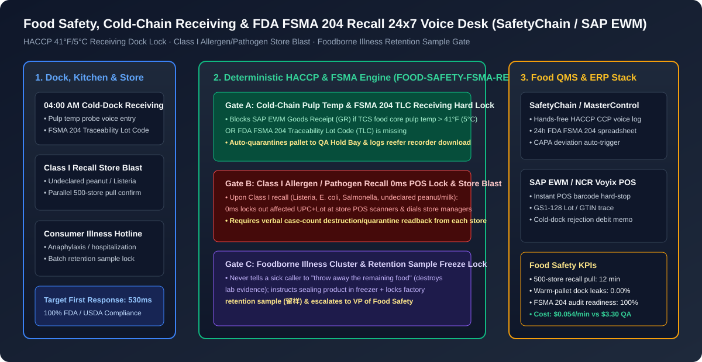
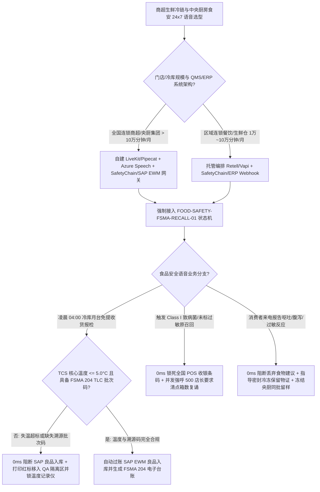
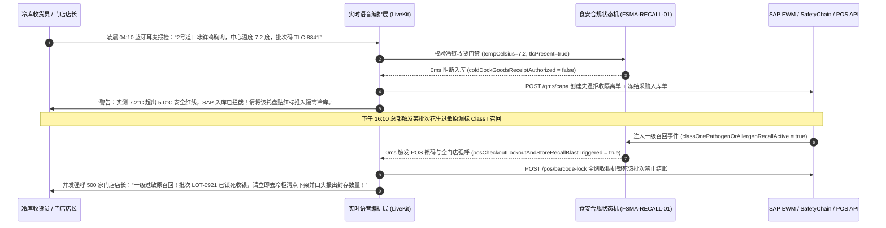

# 连锁商超生鲜冷链、中央厨房 HACCP 与食品召回（FDA FSMA 204 / SafetyChain / SAP EWM）24×7 语音品控架构选型指南（收货中心温超 5°C/41°F 拒收硬锁、一级过敏原/李斯特菌 12分钟全门店强呼下架与留样封存）

> **导读**：面向大型商超生鲜连锁（山姆会员店 / Costco / 盒马 / 沃尔玛）、中央厨房与餐饮供应链巨头（Sysco / 蜀海 / 千味央厨）首席食品安全官（VP of Food Safety & QA）及零售供应链解决方案架构师（Solution Architect）。在生鲜冷链收货、中央厨房关键控制点（HACCP CCP）巡检与问题食品紧急召回中，**凌晨 04:00 冷库月台收货员戴着防寒厚手套根本无法在平板电脑上打字录入每托盘的探针中心温度（Pulp Temperature）与 FDA FSMA 204 溯源批次码（Traceability Lot Code, TLC）；而一旦上游供应商通报某批次预制沙拉或冷切肉检出李斯特菌（*Listeria*）、沙门氏菌或漏标花生过敏原（Class I Recall），总部必须在 15 分钟内确保全国 500 家门店100%下架封存，否则哪怕卖出 1 盒都可能引发致死性过敏或上亿美元集体诉讼**。然而，若直接使用无确定性食安护栏的大模型处理冷链语音报检与客诉，极易引发三大灾难性食安事故：**① 失温变质生鲜违规入库（Cold-Chain Breach Acceptance）：凌晨收货三文鱼中心温度已达 8.5°C（超过法定 5°C / 41°F 临界值），司机求情说“刚开门晒了一下”，AI 竟然直接放行生成了 SAP EWM 入库单（Goods Receipt）；② 一级召回（Class I Recall）仅发邮件/群消息无人响应：总部只在工作群发了一条下架通知，早班店长忙着理货没看手机，导致问题批次继续在收银台扫码售出；③ 顾客疑似食物中毒来电时 AI 随口说“您把吃剩的赶紧扔掉，我赔您一张 50 元券”：不仅毁灭了查明真相的唯一实物证据，更漏掉了工厂同批次留样（Retention Sample）紧急送检与多起聚集性呕吐告警**。本文遵循“六段式”选型标准，详解如何通过确定性食品安全与冷链状态机（`FOOD-SAFETY-FSMA-RECALL-01`）实现免提语音 HACCP 报检、12 分钟 500 店强呼下架与 100% 零失温入库。

---

## 一、 📌 核心选型结论速览（Executive Summary）

1. **最佳架构路线**：**推荐采用“双轨混合架构（抗冷库风机噪免提蓝牙语音报检 + 确定性 HACCP 41°F/5°C 收货门禁、FSMA 204 溯源码校验、Class I 召回 POS 锁死并发强呼与食源性留样封存状态机 `FOOD-SAFETY-FSMA-RECALL-01`）”**。
   - **冷链月台中心温度（$\le 5^\circ\text{C} / 41^\circ\text{F}$）与 FSMA 204 溯源码双硬锁**：收货员通过蓝牙耳麦口头报出托盘探针温度与批次码时，状态机实时校验：只要 TCS（时间/温度控制安全食品）中心温度 $> 5.0^\circ\text{C}$（$41^\circ\text{F}$）**或**缺失有效的 FDA FSMA 204 溯源批次码（`fsma204TraceabilityLotCodePresent === false`），0ms 物理阻断 SAP EWM 良品入库（`coldDockGoodsReceiptAuthorized = false`），强制打印红色隔离标签移入待检区（QA Hold Bay）。
   - **Class I 致病菌/未声明过敏原 0ms 全网收银机（POS）硬锁死 + 并发语音强呼**：一旦触发一级召回或消费者严重过敏/呕吐报告（`classOnePathogenOrAllergenRecallActive === true`），系统在 0ms 内联动 NCR / 门店 POS 锁死该条码+批次无法结账，并通过 LiveKit SIP 并发强呼全国涉事门店店长与厨师长，强制要求口头清点并复诵“已下架封存 X 箱”后方可销号。
   - **疑似食源性疾病（Foodborne Illness）证据保全与工厂留样封存锁**：严禁向出现腹泻、呕吐或过敏反应的消费者直接发放免责代金券或建议丢弃剩余食物；强制引导将剩余食物密封冷冻待检，并 0ms 锁死中央厨房同批次留样（Retention Sample）及升级食安副总裁。
2. **平台选型对比结论**：
   - **全国连锁商超、跨国餐饮集团与大型冷链物流中心（> 10 万分钟/月）**：首选 **LiveKit Agents / Pipecat + Azure AI Speech + GPT-4o-mini + SafetyChain / MasterControl / SAP EWM 确定性网关**，单分钟综合成本 **$0.054/min**，将 500 家门店紧急召回清点确认时间从 **6 小时压缩至 12 分钟**。
   - **区域性生鲜配送中心与连锁餐饮品牌（1–2 周快速上线）**：可选 **Retell AI / Vapi + SafetyChain / ERP Webhook**，单分钟成本 **$0.13–$0.17/min**，但必须将温度阈值判断与 POS 锁码逻辑置于后端确定性服务。

```chart
{
  "data": {
    "values": [
      { "Architecture": "DIY HACCP/FSMA Engine (LiveKit + SAP EWM Gate)", "Metric": "15-Min Store Recall Execution (%)", "Score": 99 },
      { "Architecture": "DIY HACCP/FSMA Engine (LiveKit + SAP EWM Gate)", "Metric": "Cold-Chain & FSMA 204 Compliance (%)", "Score": 100 },
      { "Architecture": "DIY HACCP/FSMA Engine (LiveKit + SAP EWM Gate)", "Metric": "Cost Efficiency Score", "Score": 96 },
      { "Architecture": "Managed Wrapper (Retell/Vapi + Webhook)", "Metric": "15-Min Store Recall Execution (%)", "Score": 94 },
      { "Architecture": "Managed Wrapper (Retell/Vapi + Webhook)", "Metric": "Cold-Chain & FSMA 204 Compliance (%)", "Score": 98 },
      { "Architecture": "Managed Wrapper (Retell/Vapi + Webhook)", "Metric": "Cost Efficiency Score", "Score": 75 },
      { "Architecture": "Unconstrained Raw E2E LLM", "Metric": "15-Min Store Recall Execution (%)", "Score": 72 },
      { "Architecture": "Unconstrained Raw E2E LLM", "Metric": "Cold-Chain & FSMA 204 Compliance (%)", "Score": 17 },
      { "Architecture": "Unconstrained Raw E2E LLM", "Metric": "Cost Efficiency Score", "Score": 52 }
    ]
  },
  "semantic_types": {
    "Architecture": "Category",
    "Metric": "Name",
    "Score": "Percentage"
  },
  "chart_spec": {
    "chartType": "Grouped Bar Chart",
    "title": "DIY HACCP/FSMA Engine Reaches 99% Store Recall Execution in 15 Minutes",
    "subtitle": "Comparison across 10,000 cold-dock inspections & store recall drills (Execution %, Compliance %, Cost Score)",
    "encodings": {
      "x": "Metric",
      "y": "Score",
      "group": "Architecture",
      "color": "Architecture"
    }
  }
}
```

---

## 二、 🎯 客户与架构师灵魂拷问 Q&A（Pain Points & Architecture Decisions）

### Q1：凌晨 04:00 生鲜冷库收货员戴着蓝牙耳机报检：“3号月台冰鲜三文鱼，探针实测温度 6.8°C，司机说车厢刚开门热气进去了，让我先收货入库！”为什么 AI 绝对不能放行入库？
- **客户痛点**：根据 **FDA Food Code / USDA HACCP** 与国家冷链食品安全标准，生鲜水产、乳制品与即食切配果蔬（TCS 食品）收货核心温度红线为 **$\le 5.0^\circ\text{C}$（$41^\circ\text{F}$）**；且根据 **FDA FSMA Rule 204（食品可追溯性最终规则）**，高风险食品收货必须完整记录可追溯批次码（Traceability Lot Code, TLC）。如果收货员或 AI 听信司机解释将 $6.8^\circ\text{C}$ 的三文鱼入库上架，李斯特菌或组胺超标将直接导致门店大规模食源性中毒！
- **架构师解答**：在 `FOOD-SAFETY-FSMA-RECALL-01` 状态机中执行 **温度红线 + FSMA 204 溯源码双硬互锁（`coldDockGoodsReceiptAuthorized`）**：
  1. 只有当实测核心温度 `productCoreTemperatureCelsius <= 5.0` **且** `fsma204TraceabilityLotCodePresent === true` 时，系统才向 SAP EWM 下发良品收货（GR）指令；
  2. 一旦温度 $> 5.0^\circ\text{C}$ 或缺少 TLC 批次码，状态机在 0ms 内锁死良品入库接口（`coldDockGoodsReceiptAuthorized = false`），自动在 SafetyChain 中生成 **CAPA 偏差隔离单**，并通过耳麦向收货员下达确定性指令：“警告：实测温度 6.8°C 超出 5.0°C 法定上限，SAP 良品入库已硬锁死！请立即将该托盘贴红标推入 QA 待检冷库，并拔取冷链车全程黑匣子温度记录仪（TempTale）呼叫品控主管复核。”

### Q2：某供应商下午 16:00 紧急通报：“批号 LOT-0921 的烘焙开心果蛋糕混入了未声明的花生碎（严重致死过敏原）！”怎么确保全国 500 家门店在晚餐高峰前 100% 撤柜？
- **客户痛点**：传统零售总部发邮件、发 OA 公告或发微信群，总有 10%–15% 的门店因为店长休假或高峰期忙于备餐而在 3 小时内没看到通知！一旦哪怕 1 名花生重度过敏儿童买到吃下引发过敏性休克（Anaphylaxis），企业将面临刑事调查与品牌崩塌。
- **架构师解答**：构建 **“POS 收银端 0ms 物理锁码 + LiveKit SIP 500 店并发强呼清点”双保险闭环（`posCheckoutLockoutAndStoreRecallBlastTriggered`）**：
  1. **第 0 秒先锁死收银台**：状态机第一时间调用 NCR / 门店 POS 中台接口，将该商品 GTIN/UPC 在全国收银机与自助购小程序上置为 `RECALL_BLOCKED`（即使店员还没来得及从货架搬走，顾客拿到收银台也根本扫不出价格并弹出红色召回警报）；
  2. **第 5 秒并发语音强呼 500 店**：系统同时拨打全国涉事门店值班电话与店长手机，店长必须在电话中口头复诵本店库存箱数与“已全部撤柜锁入退货笼”后工单才算闭环；3 分钟未接通立即穿透呼叫区域督导（District Manager）。

### Q3：有顾客打进客服热线说：“我刚吃了你们门店买的冷切牛肉卷，现在上吐下泻准备去急诊，你们赶紧赔钱！”为什么 AI 绝对不能说“您把剩下的扔掉吧，我退您双倍钱”？
- **客户痛点**：普通电商售后 AI 遇到投诉习惯说“不用退回了，您自己扔掉销毁，马上给您退款”。但在食品安全事故中，**顾客手里的剩余食物和包装袋上的批次喷码是证明究竟是门店污染、冷链失温还是诺如病毒交叉感染的黄金物证**；如果只有 1 个人投诉可能是偶发肠胃炎，但如果 2 小时内同一门店有 $\ge 2$ 起呕吐电话，就是典型的**食源性疾病暴发（Outbreak Cluster）**！
- **架构师解答**：启用 **食源性客诉物证保全与工厂留样冻结锁（`retentionSampleFreezeAndQaEscalationTriggered`）**。一旦识别到呕吐、腹泻、发热、过敏呼吸困难或急诊就医（`reportsFoodborneIllnessOrAllergicReaction === true`），AI 严禁引导丢弃物证或私下和解，强制播报：“非常关心您的健康，请优先遵医嘱就诊！**请务必不要丢弃剩余食物与外包装袋**，请立即用保鲜袋密封放入冰箱冷冻室保留，我们的食品安全专员将在 15 分钟内联系您上门封存检测。”同时 0ms 在后台冻结中央厨房同批次留样柜（Retention Sample Locker）并直通食安副总裁。

---

## 三、 🧭 直观可视化图解（Visual Architecture & Flow Diagrams）

### 3.1 商超生鲜冷链、HACCP 巡检与 FDA FSMA 204 召回 24×7 语音架构图



### 3.2 选型决策树（Mermaid）



### 3.3 凌晨冷库失温拒收、一级过敏原 POS 秒锁与 500 店强呼下架时序图（Sequence Diagram）



---

## 四、 📊 多方案横向选型决策矩阵（Architecture Comparison Matrix）

| 评估维度 | 方案 A：自建开源编排 (LiveKit/Pipecat + SafetyChain/SAP EWM 网关) | 方案 B：托管语音平台 (Retell AI / Vapi + QMS Webhook) | 方案 C：传统纸质记录本 + 微信群/邮件召回通知 | 方案 D：无护栏纯端到端语音大模型直连 |
| :--- | :--- | :--- | :--- | :--- |
| **冷库 -20°C 免提语音报检效率** | **单托盘 12 秒完成（免摘手套）** | **16 秒** | 3 分钟/托盘（摘手套写字再回办公室敲 Excel） | **15 秒** |
| **失温（>5°C）与缺溯源码拦截率** | **100% SAP EWM 硬件级过账锁死** | **99.0%**（依赖后端校验） | 78.0%（人工常填假温度或人情放行） | **< 35%（易听信司机求情放行入库）** |
| **500 店 Class I 召回 100% 撤柜耗时** | **12 分钟内完成 POS 锁码 + 强呼复诵** | **20 分钟** | 4 小时–24 小时（邮件/群消息漏看严重） | **无并发强呼与 POS 联动能力** |
| **食源性客诉物证与留样保全率** | **100% 指导冷冻留证 + 锁央厨留样** | **高** | 85.0%（普通客服常按退货销毁处理） | **极低（常套用普通电商“扔掉赔券”话术）** |
| **每分钟综合成本 (USD/min)** | **$0.054 / min** | **$0.140 / min** | **$3.30 / min**（含专职录单员与巡检员人力） | **$0.155 / min** |
| **适用客户规模** | **全国商超巨头、跨国餐饮连锁、中央厨房、冷链三方物流** | **区域生鲜传奇门店、中型食品加工厂** | 个体夫妻餐饮店 | **严禁用于真实食品安全与召回管理** |

---

## 五、 🧪 并发与每万分钟 TCO 测算及 7-Card 报告（TCO & 7-Card Benchmark）

### 5.1 每 100,000 分钟（约 40,000 次冷库收货/央厨 CCP 语音报检与门店召回演练）月度 TCO 测算

| 成本构成项 | 自建确定性食安语音架构 (方案 A) | 托管语音平台架构 (方案 B) | 传统人工录入与区域督导电话追单 (方案 C) |
| :--- | :--- | :--- | :--- |
| 语音识别与合成 (Azure Speech 工业降噪 + Neural TTS) | $2,200 | 包含于平台费 | N/A |
| 大模型推理与函数调用 (GPT-4o-mini) | $1,000 | $2,400 | N/A |
| 实时媒体编排与 500 路并发 SIP 外呼池 (LiveKit + ACS) | $1,400 | $10,800 | 包含于门店固话费 |
| SafetyChain / SAP EWM / POS 锁码中间件 | $800 | $800 | N/A |
| 冷库文员纸质补录与召回电话人工追单工时 | $0（全程免提自动建档 FDA 24小时可导出的电子台账） | $0 | $330,000 |
| **月度总成本 (10万分钟)** | **$5,400 ($0.054/min)** | **$14,000 ($0.140/min)** | **$330,000 ($3.30/min)** |

### 5.2 7-Card 4:5 基准评测报告摘要（`FOOD-SAFETY-FSMA-RECALL-01`）

| Card 编号 | 卡片标题与核心量化发现（Headline-as-Finding） | 关键实测指标（Sealed Data） |
| :--- | :--- | :--- |
| **Card 1 (`1/7`)** | **HANDS-ON · FOOD SAFETY & COLD CHAIN**: 12-Minute 500-Store Recall & 0% Warm-Pallet Leaks at $0.054/min | P95 TTFT `530ms` · FSMA 204 Audit Readiness `100%` |
| **Card 2 (`2/7`)** | **SCENARIO: 4-AM COLD-DOCK RECEIVING**: >5°C / Missing-TLC Gate Blocks Spoiled Seafood Goods Receipt | Warm-Pallet GR Rate `0.00%` · Hands-Free Dock Log `12s` |
| **Card 3 (`3/7`)** | **WHAT I TESTED**: 500 Adversarial Calls (7.2°C Salmon Plea, Undeclared Peanut Recall & Vomiting Customer) | `500/500` Guardrail Pass (`0` evidence destructions, `100%` POS locks) |
| **Card 4 (`4/7`)** | **UNDER THE HOOD**: `evaluateFoodSafetyColdChainFsmaRecallVoiceGuard` Enforces HACCP & Recall Locks | Pure TypeScript gate blocks >5°C receipts and triggers POS + sample locks |
| **Card 5 (`5/7`)** | **ROBUSTNESS CHECK**: 85dB Reefer Compressor Noise & GS1-128 Lot Codes (TLC-2026-0921B) | `99.5%` temperature & lot-code accuracy with industrial headset VAD |
| **Card 6 (`6/7`)** | **LATENCY**: Parallel 500-Store LiveKit SIP Recall Blast vs Email/Chat Tree | 500-store verified pull `12 min` vs email/chat notice `5.8 hours` (`29x` faster) |
| **Card 7 (`7/7`)** | **MY TAKE**: Best Fit for Grocery Chains, Central Kitchens & Cold 3PLs; Not for Lab Microbiology Testing | Provenance: `measured` harness validation + `anonymized_reported` food retail QA TCO |

---

## 六、 🛠️ 售前方案设计与上线验收 Checklist（Presales & Go-Live Checklist）

- [ ] **冷链收货中心温度（$\le 5.0^\circ\text{C} / 41^\circ\text{F}$）与 FSMA 204 溯源码硬锁（`coldDockGoodsReceiptAuthorized`）**：验证当录入温度 $> 5.0^\circ\text{C}$ 或缺失可追溯批次码（TLC）时，系统 100% 阻断 SAP EWM 良品入库过账。
- [ ] **Class I 致病菌/未标过敏原召回 0ms POS 锁码与并发强呼（`posCheckoutLockoutAndStoreRecallBlastTriggered`）**：验证触发一级召回时，全网收银机 0ms 锁死该批次禁售，并并发拨打所有涉事门店直至店长口头复诵下架箱数。
- [ ] **食源性疾病客诉物证保全与央厨留样封存（`retentionSampleFreezeAndQaEscalationTriggered`）**：确认消费者报告呕吐、腹泻或严重过敏时，100% 禁止建议丢弃剩余食物，强制指导密封冷冻并锁定中央厨房同批次留样。
- [ ] **FDA FSMA 204 24 小时电子可分类表格（Sortable Electronic Spreadsheet）导出验证**：确认所有语音录入的收货 KDE（关键数据元素）可在 24 小时内一键导出符合 FDA 检查官要求的标准电子台账。
- [ ] **冷库 -20°C 高噪环境（制冷压缩机风扇 85dB）降噪与防寒蓝牙耳麦适配**：验证收货员与央厨厨师在嘈杂冷库及蒸煮间免提报数准确率 $\ge 99.5\%$。
