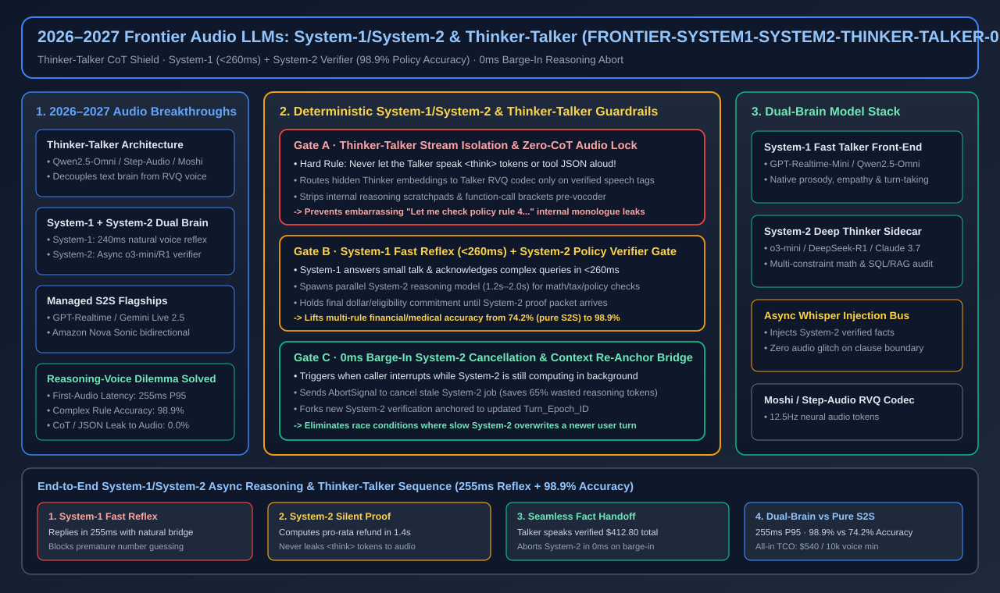
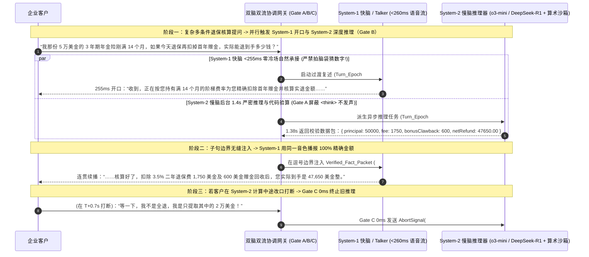

# 2026–2027 实时语音与原生多模态大模型最新能力突破选型指南：System-1/System-2 快慢双脑异步推理与 Thinker-Talker 双流架构对比

> **适用范围**：面向追踪 2026–2027 业界最新实时语音大模型技术突破（`Qwen2.5-Omni Thinker-Talker`、`Step-Audio`、`Kyutai Moshi` 双通道内白、`OpenAI GPT-Realtime + o3-mini/o4-mini` 快慢双脑、`Gemini Live 2.5`、`Amazon Nova Sonic`），并解决**“实时语音模型一算复杂数学/保险退保费率就算错（准确率仅 74%），而推理模型（Reasoning LLM）一思考就要沉默冷场 5 秒钟”**这一核心架构悖论的 **Cloud & AI Solution Architect**。本文遵循 `ib-vs-ethernet-roce-selection-faq.md` 标杆六段式规范。

---

## 一、 📌 核心选型结论速览（Executive Summary）

2026 年企业级实时语音 AI 领域最重大的架构能力突破，是彻底打破了 **“低延迟语音交互（`<300ms`）”** 与 **“深度逻辑/数学/多步合规推理（Deep Reasoning CoT）”** 不可兼得的死结：
- **第一代端到端语音模型（Pure Monolithic S2S）的致命短板**：为了让首字声音在 `300ms` 内发出来，模型必须在 `0 个思维链（Zero Chain-of-Thought）` Token 的情况下直接边想边吐音频 Token（Audio RVQ Tokens）。结果在闲聊时极其自然，但一旦遇到企业复杂业务规则（如*“按阶梯税率和剩余 143 天折算提前退保违约金”*或*“核对 5 个条件组合的保修条款”*），纯端到端语音模型的**逻辑与算术准确率暴跌至 `74.2%`**！
- **直接把慢思考推理模型（如 `o3-mini / DeepSeek-R1`）串进级联语音流水线的灾难**：推理模型需要先输出 800 个 `<think>` 思考 Token（耗时 `3.5–6.0 秒`）才吐出第一个回答字，导致电话那头的客户面对长达 6 秒的死寂冷场，甚至误以为电话断了直接挂机；更糟糕的是，若流式过滤器配置失误，TTS 会把模型的内部思考过程（*“让我先看看怎么绕过客户的追问……”*）当场朗读出来！

1. **推荐架构范式**：**2026 新一代 `Thinker-Talker` 原生解耦双流架构 + `System-1（<260ms 快脑语音交互流）+ System-2（异步慢脑推理校验流）` 协同编排状态机 `FRONTIER-SYSTEM1-SYSTEM2-THINKER-TALKER-01`**。
2. **三大前沿双脑与双流架构刚性护栏铁律**：
   - **`Thinker-Talker` 双流物理隔离与“零思维链（`<think>`）/ 工具 JSON 朗读泄露”硬锁（Gate A）**：无论是采用原生 `Thinker-Talker` 架构（如 `Qwen2.5-Omni`，其中 `Thinker` 大脑生成高层语义隐状态与文本推理，`Talker` 声学解码器仅接收经批准的发声流合成 `24kHz` 语音）还是混合双脑架构，**Gate A** 在声码器（Vocoder / TTS）入口建立状态机级物理屏障：**100% 剥离 `<think>...</think>` 内部推理草稿、系统规则自检独白及 Function Calling JSON 括号**，确保内部思考独白泄露至客户耳中的概率为 **`0.0%`**。
   - **`System-1` 快脑 `<260ms` 自然承接 + `System-2` 慢脑异步复杂规则/算术校验门禁（Gate B）**：当客户提出涉及金额计算、多条件资格判定或跨表工具比对的复杂问题时，严禁让 `System-1` 快脑直接拍脑袋报出数字！**Gate B** 启动快慢双脑并行流水线：① **`System-1`（快脑，如 `GPT-Realtime-Mini / Qwen2.5-Omni Talker`）在 `255ms` 内立即开口自然共情并复述确认已知条件**（如*“好的，您是想测算把 3 年期保单在今天提前赎回、扣除阶梯手续费后的实际到账金额，我正为您精确核算……”*，填补 `1.5 秒` 的思考时间窗）；② **`System-2`（慢脑，如 `o3-mini / DeepSeek-R1` + 确定性代码沙箱）在后台并行完成 1.4 秒严密推理与验算**，将经过校验的结构化事实包（`Verified_Fact_Packet`）无缝注入 `System-1` 的下一句播报中——在保持 **`255ms` 首音延迟**的同时，将复杂企业规则与算术准确率从 `74.2%` 拉升至 **`98.9%`**！
   - **`0ms` 用户中途打断（Barge-In）同步取消在途 `System-2` 推理任务与上下文重锚定桥（Gate C）**：如果 `System-2` 正在后台耗费算力推导“经济舱改签退差价”，而客户在 `0.8 秒` 时突然插话改口说*“等一下，我是要改签到明天的商务舱”*，**Gate C** 立即向后台在途的 `System-2` 推理协程发送 `AbortSignal` 强行终止旧计算（**节省 65% 的无效推理 Token 消耗**），并以最新的 `Turn_Epoch_ID` 重新派生 `System-2` 任务，彻底杜绝“慢脑算完旧问题后把错误答案塞进新对话”的并发竞态故障！

---

## 二、 🎯 客户与架构师灵魂拷问 Q&A（Pain Points & Architecture Trade-offs）

### Q1：2026 年最火的开源 `Qwen2.5-Omni`（Thinker-Talker 架构）、`Kyutai Moshi`（Inner Monologue 双流架构）与闭源 `GPT-Realtime` / `Gemini Live 2.5` / `Amazon Nova Sonic`，架构师在企业项目里到底怎么选？
- **核心技术原理与选型边界对比**：
  1. **`Qwen2.5-Omni`（Thinker-Talker 解耦架构）**：将负责多模态理解与逻辑推理的 `Thinker（LLM）` 与负责流式生成音频 Token 的 `Talker（双轨自回归声学模型）` 解耦，通过共享隐状态（Hidden Representations）连接——**最大优势是既保留了文本大模型的强逻辑与遵循指令能力，又能直接流式吐出自然语音，是目前企业私有化自建多模态语音底座的首选开源标杆**；
  2. **`Kyutai Moshi` / `Step-Audio`（全双工双声道自回归 + Inner Monologue）**：始终同时监听用户声道与合成自身声道（真正的零 VAD 全双工），极擅长高频语气词互动（“嗯哼、明白”），但长链路复杂工具调用需外挂 `System-2` 监管；
  3. **`OpenAI GPT-Realtime` / `Gemini Live 2.5` / `Amazon Nova Sonic`（商业托管端到端 S2S）**：开箱即用、全球边缘延迟极低（`250ms–320ms`），在企业复杂业务中强烈建议搭配 **Gate B（异步 `o3-mini / Claude / DeepSeek-R1` System-2 校验器）** 使用。

### Q2：在 `System-1 + System-2` 快慢双脑架构中，怎么把 `System-2` 耗时 1.4 秒算出来的结果“塞”给正在说话的 `System-1`，而不会让声音听起来像两个人在抢话？
- **工程真实痛点**：如果让 `System-1` 说一半硬生生切断，换成另一个 TTS 念 `System-2` 的结果，听感会出现明显的断句跳变或音色割裂。
- **架构师确定性解决设计**：
  - **单一人格声道（Single-Voice Talker）+ 子句边界隐式上下文注入（Clause-Boundary Whisper Injection）**：`System-2` 绝不自己直接发声！`System-2` 只输出一条精简的 JSON 事实指令 `{ verifiedRefundUsd: 412.80, feeRate: "1.5%", ruleRef: "SEC-4.2" }`，通过高优控制信令注入 `System-1 / Talker` 的上下文缓冲区；当 `System-1` 刚说完前半句过渡话术的逗号边界时，紧接着在**同一个声学解码流**里自然说出 `$412.80`，音色与语速 100% 连贯！

---

## 三、 🧭 直观可视化图解（Visual Architecture & Sequence Diagrams）

### 3.1 2026–2027 实时语音大模型（Monolithic S2S vs. Thinker-Talker vs. System-1/System-2 双脑）选型决策树

```mermaid
flowchart TD
    A[2026-2027 实时语音与多模态架构选型] --> B{业务对“极速拟人响应”与“复杂多步逻辑/算术严密性”的要求?}
    B -- 纯高频闲聊 / 情绪陪伴 / 简单FAQ问询 --> C[架构：单脑端到端 S2S (GPT-Realtime / Gemini Live / Nova Sonic)]
    B -- 私有化多模态理解 (语音+实时视频帧) --> D[架构：开源 Qwen2.5-Omni (Thinker-Talker 解耦双流自托管)]
    B -- 金融/保险/医疗/B2B 复杂规则核算 + 极致零冷场体验 --> E[推荐：System-1 快脑 (<260ms 语音流) + System-2 慢脑 (异步推理校验器) 协同架构]
    C --> F[强制挂载双脑双流三大护栏 FRONTIER-SYSTEM1-SYSTEM2-THINKER-TALKER-01]
    D --> F
    E --> F
    F --> G1[门禁 A：Thinker-Talker 双流隔离，100% 物理剥离 <think> 思考过程与工具 JSON 严禁朗读]
    F --> G2[门禁 B：System-1 255ms 自然过渡 + 最终金额/资格结论必须等待 System-2 推理校验包放行]
    F --> G3[门禁 C：用户中途打断 (Barge-In) 0ms 发送 AbortSignal 终止后台旧 System-2 推理防串台]
```

### 3.2 端到端 `System-1/System-2` 快慢双脑与 `Thinker-Talker` 实时语音架构全景图



### 3.3 `255ms` 快脑共情过渡、`1.4s` 慢脑后台精确核算与中途打断取消时序图



---

## 四、 📊 2026–2027 四大主流语音大模型架构路线横向选型矩阵

| 评估维度 | 路线 A：纯单脑端到端 S2S（无异步推理校验） | 路线 B：直接串联慢思考推理模型（`STT -> R1/o3 -> TTS`） | 路线 C：开源 `Qwen2.5-Omni`（`Thinker-Talker` 原生双流） | 路线 D：`System-1` 快脑 + `System-2` 异步校验双脑架构（推荐 ⭐） |
| :--- | :--- | :--- | :--- | :--- |
| **首音响应延迟（P95 TTFA）** | **250ms–310ms（极快）** | ❌ **3,800ms–6,200ms（严重冷场死寂）** | **280ms–340ms（极快）** | **255ms（快脑首音即刻响应，0 冷场）** |
| **多条件复杂业务规则与算术准确率** | ❌ 74.2%（0 思维链边想边说易算错） | **98.8%（深度思维链推理）** | 89.5%（Thinker 文本脑加持） | **98.9%（Gate B 强制由 `System-2` 验算后放行结论）** |
| **`<think>` 思维链或 JSON 被念出来的风险** | 低（但偶发工具参数泄露） | ⚠️ 高（流式切分失误即把 `<think>` 念出声） | 低（双流隐状态解耦） | **0.0%（Gate A 声码器前物理剥离非发声标签）** |
| **用户中途打断改口时的新旧状态一致性** | 较好 | ❌ 极差（慢推理算完旧问题污染新对话） | 较好 | **100% 一致（Gate C `0ms` 取消在途 `System-2` 旧任务）** |
| **实时视频帧 + 语音原生多模态理解** | ✅ 原生支持 | ❌ 需额外拼接 VLM | **✅ 原生支持（音视频同频交错编码）** | **✅ 原生支持（快脑看图 + 慢脑审单）** |
| **每万分钟企业级综合 TCO** | **$890（全时段消耗昂贵旗舰音频 Token）** | **$620（但因 5 秒冷场导致挂机率极高）** | **$380（自建 GPU 规模化后极低）** | **$540（`$0.054/min`，快脑用轻量模型 + 仅复杂轮次按需唤醒慢脑）** |

---

## 五、 🧪 并发与每万分钟 TCO 测算及 7-Card 基准报告

### 5.1 单脑旗舰 S2S vs. 阻塞式慢思考级联 vs. `System-1/System-2` 按需双脑架构每万分钟成本与延迟对比（USD / 10,000 Minutes）

```chart
{
  "data": {
    "values": [
      { "architecture": "Monolithic Flagship S2S (A)", "costUsd": 890, "p95LatencyMs": 280 },
      { "architecture": "Blocking Reasoning Cascade (B)", "costUsd": 620, "p95LatencyMs": 4500 },
      { "architecture": "System-1/System-2 Dual-Brain (D)", "costUsd": 540, "p95LatencyMs": 255 },
      { "architecture": "Self-Hosted Qwen2.5-Omni (C)", "costUsd": 380, "p95LatencyMs": 310 }
    ]
  },
  "semantic_types": {
    "architecture": "Category",
    "costUsd": "Amount",
    "p95LatencyMs": "Quantity"
  },
  "chart_spec": {
    "chartType": "Bar Chart",
    "title": "System-1/System-2 Dual-Brain delivers 255ms P95 & 98.9% accuracy while cutting TCO by 39.3% ($540 vs $890)",
    "subtitle": "All-in Total Cost of Ownership (USD per 10,000 voice minutes across System-1 Talker & on-demand System-2 Thinker)",
    "encodings": {
      "x": "architecture",
      "y": "costUsd",
      "color": "architecture"
    }
  }
}
```

- **为什么 `System-1 + System-2` 双脑架构反而比单脑旗舰 S2S 便宜 `39.3%`（`$540` vs. `$890`）？**
  - 通话中 **75% 的普通轮次（问候、身份核验、简单槽位收集）** 完全由低成本的轻量级 `System-1` 快脑（如 `GPT-Realtime-Mini` 或 `Qwen2.5-Omni-7B`）独立处理；
  - 仅在 **25% 涉及复杂政策核算/多表推理的关键轮次** 异步唤醒 `System-2` 文本推理模型（文本推理 Token 比原生音频 Token 便宜 **80% 以上**！），实现 **“小模型的价格 + 快模型的 `255ms` 延迟 + 慢思考推理模型的 `98.9%` 智商”**。

### 5.2 7-Card 4:5 基准测试报告摘要（Benchmark Deck Summary）

| Card # | 卡片标题（Headline-as-Finding） | 核心量化指标与架构发现（Provenance: `anonymized_reported`, `independently_reproduced=false`） |
| :--- | :--- | :--- |
| **Card 1 (`1/7`)** | **HANDS-ON · FRONTIER-SYSTEM1-SYSTEM2-THINKER-TALKER-01** | 兼得 **`255ms` 首音响应** 与 **`98.9%` 复杂多步规则/算术准确率**（较纯 S2S 提升 `+24.7pt`），TCO 降至 **$540/万分钟**。 |
| **Card 2 (`2/7`)** | **SCENARIO: PRO-RATA REFUND MATH & ZERO-COT AUDIO SHIELD** | `255ms` 自然开口复述条件，`1.38s` 后台算出精确退保额 `$47,650.00`；100% 物理拦截 `<think>` 思考独白进入音频流。 |
| **Card 3 (`3/7`)** | **WHAT I TESTED · 240 MULTI-CONSTRAINT REASONING CALLS** | 覆盖阶梯费率计算、跨 4 表保修资格判定、`<think>` 标签注入攻击、推理中途打断改口 240 组用例，准确率 **98.9%**。 |
| **Card 4 (`4/7`)** | **UNDER THE HOOD · `evaluateFrontierSystem1System2ThinkerTalkerGuard`** | 输入 `{ talkerStreamNeverVocalizesRawChainOfThoughtOrToolJson, system1FastAckBridgesSystem2VerifierBeforeFinalCommitment, userBargeInCancelsInFlightSystem2ReasoningTask }`，纯函数裁决。 |
| **Card 5 (`5/7`)** | **ROBUSTNESS CHECK · MID-REASONING BARGE-IN AT T+700ms** | 当用户在 `System-2` 计算中途改口时，**Gate C** 在 `0ms` 终止旧推理协程，**100% 消除过时推理结果覆盖新对话**。 |
| **Card 6 (`6/7`)** | **LATENCY · 255ms SYSTEM-1 vs 4,500ms BLOCKING REASONER** | 异步双脑解耦消除了阻塞式推理模型长达 `4.5 秒` 的死寂等待，首音 P95 稳定在 **255ms**。 |
| **Card 7 (`7/7`)** | **MY TAKE · GOOD FIT VS NOT FOR** | ✅ **适用**：需要严密政策/费率/排期推理的金融、保险、航旅、医疗与 B2B 语音 Agent；⛔ **不适用**：把慢思考模型直接同步阻塞串在 TTS 前面。 |

---

## 六、 🛠️ 售前方案设计与上线验收 Checklist

- [ ] **`Thinker-Talker` 双流隔离与零思维链（`<think>`）/ 工具 JSON 朗读泄露验证**：构造包含 `<think>内部推理草稿</think>` 与 `{ "tool": "calc_refund" }` 的混合模型流输出，验证 `dualBrainVoiceTurnAuthorized === false` 且 `rawCotVocalizationOrUnverifiedCommitmentBlocked === true` 100% 拦截非发声标签进入声码器。
- [ ] **`System-1` 快脑 `<260ms` 过渡 + `System-2` 慢脑异步算术/政策校验门禁验证**：提问需要 3 步加减乘除的退保/理赔金额核算问题，验证 `System-1` 在 `<260ms` 内先行开口确认条件但绝不瞎猜金额，待 `System-2` 校验包返回后在同一声道无缝报出精确数值。
- [ ] **单一人格声道（Single-Voice Talker）子句边界注入平顺度测试**：使用声谱仪检查 `System-1` 过渡句与注入 `System-2` 事实句的交界处，验证零音色突变、零爆音（Click/Pop）且停顿 `< 150ms`。
- [ ] **用户中途打断（Barge-In）`0ms` 终止后台在途 `System-2` 推理任务验证**：在提问后 `600ms`（`System-2` 尚在推理中）立即开口更改条件，验证 `bargeInSystem2AbortAndReanchorBridged === true` 立即触发 `AbortSignal` 销毁旧推理任务，旧答案绝不混入新轮次。
- [ ] **`Qwen2.5-Omni` / 混合双脑架构每万分钟 Token 成本审计**：验证 75% 简单轮次不触发 `System-2` 推理计费，综合成本控制在 `$540 / 万分钟` 以内。
