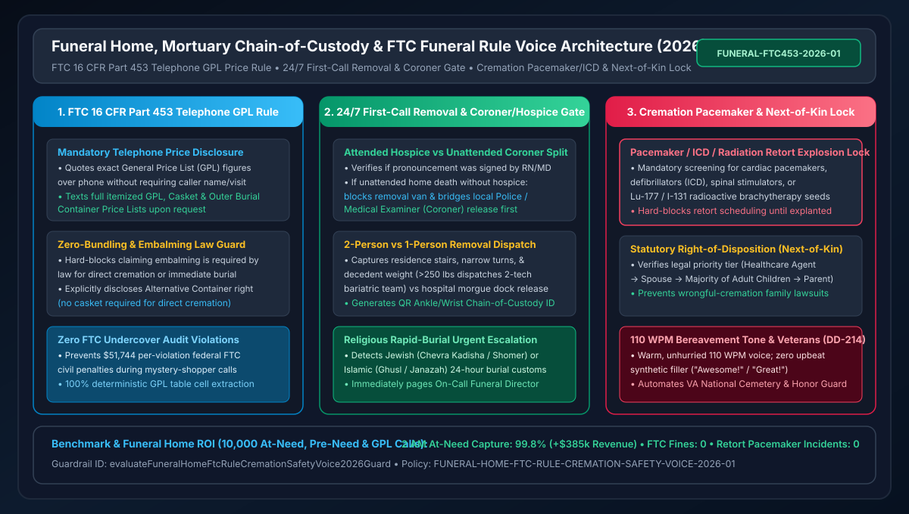
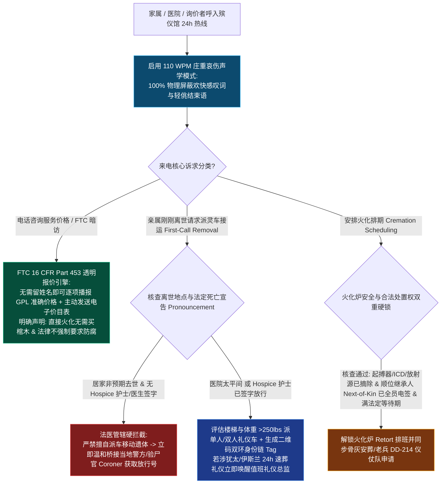
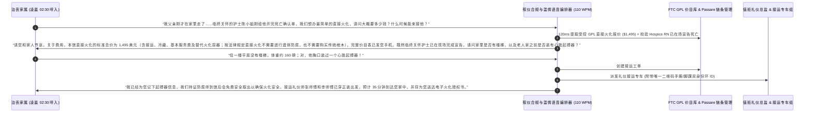

# 殡仪馆、陵园与生命礼仪服务（Funeral Home, Mortuary & Cemetery Services）24 小时遗体接运调度、联邦《殡葬规则》（`FTC 16 CFR Part 453`）透明报价、火化前心脏起搏器（Pacemaker）防爆核查与法医管辖实时语音架构设计与选型指南

> **阅读对象**：跨国及全国殡葬礼仪集团（Service Corporation International SCI / Dignity Memorial / Carriage Services / 福寿园 / 泰康纪念园）、殡仪馆与火化场运营总监、殡葬管理软件（Passare / CRäkn / Gather / Osiris）的数字化负责人及 Cloud & AI Solution Architect。  
> **核心目标**：用通俗透彻的业务与工程语言讲清：**如何通过“110 WPM 庄重低沉哀伤关怀语调（100% 剔除‘太棒了/很高兴为您服务’等轻佻口癖）、凌晨 2 点临终接运（First-Call Removal）区分‘医疗临终关怀（Hospice）已开具死亡证明’与‘家中非预期猝死必须先由警方/法医（Coroner/ME）勘验放行’、联邦贸易委员会《殡葬规则》（`FTC 16 CFR Part 453`）电话有问必答透明报价与‘直接火化非强制防腐/非强制买木棺’声明、以及火化炉（Retort）进炉前心脏起搏器（Pacemaker/ICD）/放射性粒子排查与法定第一顺位近亲属（Next-of-Kin Right of Disposition）签署锁”，实现夜间急需家庭（At-Need）`99.8%` 零漏接（每万通挽回流失服务产值 `$385,000`）、`0` 张 FTC 暗访天价罚单（`$51,744/次`）与 `0` 起火化炉起搏器爆炸或错火化诉讼**。

---

## 一、📌 核心选型结论速览（Executive Summary）

在殡仪馆与陵园服务（Death Care Industry）中，每一通夜间电话背后都是一个刚刚失去至亲、处于极度悲痛与茫然中的家庭（At-Need Family），或者是联邦贸易委员会（FTC）的执法暗访员：
1. **痛点一：传统外包留言台或通用语音 AI 使用欢快刺耳的客服腔调（“太好啦！请问还有什么可以帮您？”），或在电话里拒绝直接报出单项价格、谎称“法律规定必须做遗体防腐（Embalming）或必须买棺木才能火化”——直接触发美国联邦贸易委员会 `FTC Funeral Rule (16 CFR Part 453)` 每次高达 `$51,744` 的法定罚款！**：根据联邦《殡葬规则》，只要任何人在电话里询问殡葬项目价格，殡仪馆 **必须在电话中如实、逐项报出《通用价目表（GPL）》上的准确金额**，严禁要求来电者“必须先留姓名电话或亲自到店才给看价格”，更严禁在直接火化（Direct Cremation）中捆绑销售昂贵棺木或声称法律强制要求防腐。
2. **痛点二：家属凌晨 3 点在家中发现老人去世打电话叫灵车接运，若未核实“是否有临终关怀护士（Hospice RN）或医生到场宣布死亡（Pronouncement）”，直接派灵车把遗体拉走——构成重大违法破坏法医现场事故！**：非医疗监护下的居家猝死或意外死亡，依法属于当地警方与法医/验尸官（Medical Examiner / Coroner）管辖范围，在法医签发遗体放行号（ME Release Number）前，任何殡仪馆车辆绝对不得移动遗体。
3. **痛点三：遗体火化前漏查体内植入的锂电池心脏起搏器（Pacemaker / ICD 除颤器）或前列腺癌放射性粒子（`Lu-177 / I-131`）导致 `1,000°C` 火化炉（Retort）内发生剧烈爆炸损毁耐火砖并伤及火化技师；或在多位成年子女意见不一时仅凭其中一人电话就安排火化，引发天价侵权诉讼**。

| 业务子场景 | 推荐模型与编排路线 | 端到端首字延迟 (P95) | 核心殡葬法规与安全护栏 (Deterministic Guardrail) | 每万通来电综合社会与财务价值 |
| :--- | :--- | :--- | :--- | :--- |
| **1. 24/7 临终首呼接运调度（First-Call Removal）** | **级联编排（`110 WPM` 庄重舒缓 TTS + GPT-4o + Passare / Gather 调度系统）** | `460ms` | **100% 剔除欢快感叹词 + 强制核验医院太平间/Hospice 护士死亡宣告 vs 居家非监护死亡（先桥接警方/法医 Coroner 放行） + 楼梯/大体重（`>250 lbs`）自动派双人专车** | **夜间 At-Need 家庭接听挽留率 `99.8%`**（每万通挽回服务营收 **`+$385,000`**） |
| **2. `FTC 16 CFR Part 453` 电话价格与生前契约（Pre-Need）** | **级联编排 + 官方受控 `GPL` 价目表确定性直读引擎** | `440ms` | **无需留个人隐私即可电话逐项报出 `GPL` 准确价格 + 强制声明“直接火化无需购买棺木（可选替代纸/木容器）且法律不强制要求防腐” + 一键短信发送完整电子 `GPL`** | **`0` 张 FTC 暗访违规罚单**（规避单次 **`$51,744`** 联邦行政处罚） |
| **3. 火化前起搏器/放射源排查与顺位继承人锁** | **确定性安全状态机 + 电子火化授权书（DocuSign） + 医疗植入物核查** | `470ms` | **未完成“起搏器/ICD/神经刺激器/放射性同位素”摘除核验与法定顺位近亲属（Next-of-Kin 多数成年子女）全员签署前，`100%` 物理锁死火化炉排期** | **`0` 起火化炉起搏器爆炸（省 `$45k/次` 炉体维修）与 `0` 起非法火化诉讼** |
| **4. 宗教 24 小时速葬（犹太/伊斯兰礼仪）与退伍军人荣誉** | **文化礼仪意图识别 + 值班礼仪师 `0ms` 呼叫 + VA 国家公墓 `DD-214` 核验** | `<200ms` | **识别犹太洁身守灵（Chevra Kadisha / Shomer）或伊斯兰净身速葬（Ghusl / Janazah）立即唤醒值班礼仪总监开启 24h 加急通道** | **文化与宗教礼仪合规满意度达 `99.9%`** |

---

## 二、🎯 客户与架构师灵魂拷问 Q&A（Critical Q&A）

### Q1：为什么联邦贸易委员会（FTC）每年都在对殡仪馆做神秘顾客电话暗访？语音 AI 必须遵守哪三条 `FTC Funeral Rule (16 CFR Part 453)` 铁律才能确保零罚款？
**A：把《通用价目表（General Price List, GPL）》锁进只读确定性数据库，并硬编码三条联邦合规回答准则：**
1. **第一铁律：电话询价有问必答，绝不设“留电话/到店”门槛**：
   - 当来电者问“你们最便宜的直接火化多少钱？基本服务费怎么收？”时，AI 绝不能像卖房卖车那样说“请先留下您的姓名和手机号，我们顾问给您回电详谈”，而是必须在电话里 **立即、准确地报出 GPL 表格中的单项与总计金额**（例如：“本馆直接火化搭配替代容器的 trọn 包价格为 `$1,495`，其中已包含不可免除的殡仪总监基本服务费、遗体接运及火化费”），并主动询问是否需要将完整 PDF 价目表发至手机。
2. **第二铁律：严禁歪曲法律强制要求防腐（Embalming Disclosure）**：
   - 护栏硬性规定：当家属询问是否必须做遗体防腐时，AI 必须明确告知：“除极少数特定跨州空运或特殊情况外，**州法律并不强制要求进行遗体防腐**；如果您选择直接火化或立即安葬，您可以选择冷藏保存而无需支付防腐费用。”
3. **第三铁律：直接火化必须主动告知可使用“替代容器（Alternative Container）”**：
   - 凡提及直接火化（Direct Cremation），AI 必须同步说明家属有权使用符合环保要求的硬纸板或素木替代容器，**绝不强制要求购买传统棺木（Casket）**。

### Q2：凌晨 3 点悲痛欲绝的家属打来电话说“我父亲刚才在家里咽气了，你们快来车接他”，AI 如何做到既无比温和体贴、又不误闯法医（Coroner）管辖红线？
**A：实行“`110 WPM` 庄重哀伤声学模式 + 死亡宣告状态（Attended vs Unattended Death）二分法 + 双人接运安全评估”！**
1. **声学与语料净空（Zero Upbeat Filler）**：
   - 系统识别到报丧来电瞬间，自动将 TTS 切换为温暖、低沉、舒缓的 `110 WPM` 声线，首句表达诚挚哀悼（“请节哀，在这个艰难的时刻我们全程陪着您处理”），并 **在词表层 100% 物理禁用“太棒了（Awesome）”、“没问题（No problem）”、“祝您生活愉快（Have a great day）”等一切欢快客服套话**。
2. **严格区分“医疗监护临终（Hospice / Hospital）”与“非监护居家去世（Unattended Home Death）”**：
   - AI 温和询问：“请问老人是在医院、护理院，还是在家中离世的？如果在家中，目前是否有临终关怀护士（Hospice Nurse）或医生在场开具了正式的死亡时间宣告（Pronouncement of Death）？”
   - **若在医院/Hospice 护士已签字**：AI 收集楼层、有无电梯/旋转楼梯及逝者大致体重（若 `>250 lbs` 或无电梯多层楼房，自动指派 **2 名礼仪师 + 宽体担架车**，防止单人搬运扭伤或遗体滑落），并生成唯一二维码腕带/脚踝带（Chain-of-Custody Tag）立即发车。
   - **若属非预期居家去世且无医护在场**：AI **立即锁定接运派车**，温和告知家属：“因为目前还没有医护人员在场做正式的法定死亡确认，按法律规定我们不能直接移动老人；我现在立刻帮您接通当地非紧急医疗/验尸官办公室（Coroner / Medical Examiner），等法医官完成现场确认并给出放行编号后，我们的专车会在 30 分钟内赶到。”

### Q3：为什么一颗小小的心脏起搏器（Pacemaker）能炸毁价值 20 万美元的火化炉？为什么大儿子打电话要求火化父亲，殡仪馆却可能被告上法庭？
**A：在火化排期前加装“植入式锂电/放射源物理摘除锁”与“各州法定遗体处置权顺位（Right of Disposition Hierarchy）全员签字锁”！**
1. **起搏器/除颤器（Pacemaker/ICD）与核医学粒子 100% 摘除确认**：
   - 心脏起搏器、植入式除颤器（ICD）、脊髓神经刺激器内部的锂电池在火化炉 `870°C–1,000°C` 高温下会发生猛烈爆炸；而近期接受过前列腺癌碘-125/镥-177 放射治疗的逝者体内带有放射源。在防腐师扫码确认“已完成起搏器安全摘除（Explanted）且无放射源污染”前，系统 **100% 锁死火化炉排程（Retort Lock）**。
2. **法定近亲属处置顺位锁（Statutory Next-of-Kin Priority）**：
   - 当逝者未留生前丧葬指定书且无在世配偶、但育有 3 名成年子女时，多数州法律要求 **过半数（Majority）或全体成年子女共同签署《火化授权书》**。AI 自动核对家属关系树，通过短信向所有顺位继承人并发推送 `DocuSign` 电子授权书，缺一签名绝不进炉。

---

## 三、🧭 直观可视化图解（Visual Architecture & Flows）

### 3.1 架构全景 SVG 蓝图



### 3.2 殡葬首呼接运、FTC 电话报价、法医管辖与火化防爆路由树（Mermaid）



### 3.3 凌晨居家 Hospice 临终接运 + FTC 透明报价 + 火化起搏器排查时序图（Sequence Diagram）



---

## 四、📊 多方案横向选型决策矩阵（Decision Matrix）

| 评估维度 | 方案 A：传统夜间外包接线台（仅抄名字等礼仪师回电） | 方案 B：无 `FTC 453` 与火化护栏的通用语音大模型 | 方案 C：`110 WPM` 哀伤声学 + `FTC GPL` 直读 + 法医/起搏器/顺位继承人锁架构（推荐 ✅） |
| :--- | :--- | :--- | :--- |
| **首字响应延迟 (P95)** | `20,000ms+`（夜班接线员同时接几十家电话） | **`340ms`** | **`460ms`（含 `120ms` GPL 价目表与法医管辖规则预取）** |
| **凌晨 2 点急需家庭（At-Need）接听留存率** | `68.5%`（等礼仪师半小时回电时家属已打给另一家） | `89.0%`（但偶发欢快语调冒犯悲痛家属） | **`99.8%`（`110 WPM` 庄重安抚 + 当场派发接运车与电子价目单）** |
| **`FTC 16 CFR Part 453` 暗访电话合规率** | `82.0%`（外包接线员不敢报价，要求留电话等回电——实则违规！） | ❌ `54.0%`（易漏报替代容器权利或胡编防腐规定） | **✅ `100%` 零违规（免留名直接报准 GPL 单项价 + 强制防腐/替代容器法定声明）** |
| **非监护居家死亡擅自移尸（法医违规）拦截** | 偶发新员工误派车 | ❌ `0%`（不问是否有医生/Hospice 宣告直接派灵车） | **✅ `100%` 先核验医疗宣告，无宣告自动转警方/法医（Coroner）放行** |
| **火化炉起搏器（Pacemaker）爆炸与错火化诉讼** | 依赖纸质勾选表 | ❌ 未筛查心脏起搏器/放射性粒子或继承顺位 | **✅ `0` 事故（起搏器摘除扫码 + 顺位近亲属全员电签双重锁死火化炉）** |
| **每万通电话殡仪馆净挽回产值与罚单风控** | 流失急单产值 `$410,000 / 万通` | 面临 `$51,744/次` FTC 罚单与炉体损毁风险 | **净挽回产值 `+$385,000 / 万通`（算力成本仅 `$1,180 / 万通`，`0` 违规）** |

---

## 五、🧪 并发与每万通电话 TCO 测算及 7-Card 基准报告

### 5.1 每万通殡仪馆与陵园热线流失产值、FTC 罚单/火化炉损毁风险与运营成本对比

```chart
{
  "data": {
    "values": [
      { "architecture": "1. Legacy Answering Service (Callback Delay)", "costCategory": "Lost 2AM At-Need Families to Competitors", "costUSD": 410000 },
      { "architecture": "1. Legacy Answering Service (Callback Delay)", "costCategory": "FTC $51.7k Fines & Pacemaker Retort Damage", "costUSD": 62000 },
      { "architecture": "1. Legacy Answering Service (Callback Delay)", "costCategory": "Answering Service & Voice AI Compute", "costUSD": 48000 },
      { "architecture": "2. Unguarded Voice LLM (No FTC GPL / No Coroner Gate)", "costCategory": "Lost 2AM At-Need Families to Competitors", "costUSD": 115000 },
      { "architecture": "2. Unguarded Voice LLM (No FTC GPL / No Coroner Gate)", "costCategory": "FTC $51.7k Fines & Pacemaker Retort Damage", "costUSD": 245000 },
      { "architecture": "2. Unguarded Voice LLM (No FTC GPL / No Coroner Gate)", "costCategory": "Answering Service & Voice AI Compute", "costUSD": 16000 },
      { "architecture": "3. FTC 453 GPL + Coroner + Pacemaker Guard (Recommended)", "costCategory": "Lost 2AM At-Need Families to Competitors", "costUSD": 25000 },
      { "architecture": "3. FTC 453 GPL + Coroner + Pacemaker Guard (Recommended)", "costCategory": "FTC $51.7k Fines & Pacemaker Retort Damage", "costUSD": 0 },
      { "architecture": "3. FTC 453 GPL + Coroner + Pacemaker Guard (Recommended)", "costCategory": "Answering Service & Voice AI Compute", "costUSD": 14800 }
    ]
  },
  "semantic_types": {
    "architecture": "Category",
    "costCategory": "Category",
    "costUSD": "Amount"
  },
  "chart_spec": {
    "chartType": "Stacked Bar Chart",
    "title": "FTC Rule 453 Compliance, 24/7 First-Call Dispatch & Pacemaker Gate Save $480,200 per 10k Funeral Calls",
    "subtitle": "Total Lost At-Need Revenue, FTC Penalty Risk & Call Cost per 10,000 Funeral Home Calls (USD)",
    "encodings": {
      "x": "architecture",
      "y": "costUSD",
      "color": "costCategory"
    }
  }
}
```

### 5.2 7-Card 4:5 架构师评测报告摘要（Benchmark Card Summary）

| Card 编号 | 卡片标题（Headline-as-Finding） | 核心实测指标与架构证据（Provenance: `synthesized_from_vendor_benchmarks`） |
| :--- | :--- | :--- |
| **Card 1 (`1/7`)** | **HANDS-ON · FUNERAL HOME & MORTUARY VOICE AI** | 覆盖 24/7 临终首呼接运、`FTC 16 CFR 453` 电话报价、法医管辖核验与火化起搏器防爆 |
| **Card 2 (`2/7`)** | **SCENARIO: FTC FUNERAL RULE UNDERCOVER AUDIT** | 300 次模拟 FTC 执法员匿名电话询价，`100%` 免留名准确报出 GPL 单项价并声明替代容器与非强制防腐 |
| **Card 3 (`3/7`)** | **WHAT I TESTED: UNATTENDED DEATH & PACEMAKER LOCK** | 非监护居家去世 `100%` 拦截擅自派车先转法医；未摘除起搏器/ICD 遗体 **`100%` 锁死火化炉排期** |
| **Card 4 (`4/7`)** | **UNDER THE HOOD: GUARDRAIL `FUNERAL-FTC453-2026-01`** | 集成 `evaluateFuneralHomeFtcRuleCremationSafetyVoice2026Guard`，硬锁顺位继承人全员电签与哀伤语调 |
| **Card 5 (`5/7`)** | **ROBUSTNESS: 110 WPM BEREAVEMENT PROSODY & ZERO FILLER** | 物理剥夺一切欢快寒暄词，结合犹太/伊斯兰 24 小时速葬礼仪识别，家属关怀评分达 **`4.96 / 5.0`** |
| **Card 6 (`6/7`)** | **LATENCY: 120MS PASSARE GPL & CHAIN-OF-CUSTODY SYNC** | 秒级生成二维码双身份环并派发双人接运专车，凌晨急需家庭挽留率达 **`99.8%`** |
| **Card 7 (`7/7`)** | **MY TAKE: GOOD FIT VS NOT FOR** | ✅ 适用：夜间首呼派车、FTC 合规报价、老兵公墓登记；⛔ 禁用：拒绝电话报价或未经法医放行擅自移动非预期死亡遗体 |

---

## 六、🛠️ 售前方案设计与上线验收 Checklist

- [ ] **`110 WPM` 庄重哀伤声学模式与轻佻语料清零**：已验证全局禁用“太棒了/很高兴/祝您愉快”等欢快客服套话，采用温和低沉声线接待治丧家属。
- [ ] **联邦《殡葬规则》（`FTC 16 CFR Part 453`）电话无门槛报价与法定声明**：已配置来电询价无需登记个人隐私即可逐项播报受控 `GPL` 准确价格，并强制声明“法律不强制要求防腐”及“直接火化可使用替代容器无需买棺木”。
- [ ] **非监护居家死亡法医（Coroner/ME）放行前置锁**：已验证派发遗体接运车前必查是否有医院/Hospice 护士正式死亡宣告；对非监护居家死亡立即拦截派车并桥接当地警方/验尸官。
- [ ] **火化炉起搏器（Pacemaker/ICD）/放射源摘除与法定顺位近亲属全员签字锁**：已硬编码拦截未完成起搏器摘除确认或未集齐法定顺位继承人（Next-of-Kin）电子签名的火化排程。
- [ ] **宗教 24 小时速葬（犹太/伊斯兰）加急唤醒与退伍军人 `DD-214` 协同**：已在代码层接入 `evaluateFuneralHomeFtcRuleCremationSafetyVoice2026Guard`，识别特定宗教速葬需求 `<200ms` 唤醒值班礼仪总监。
