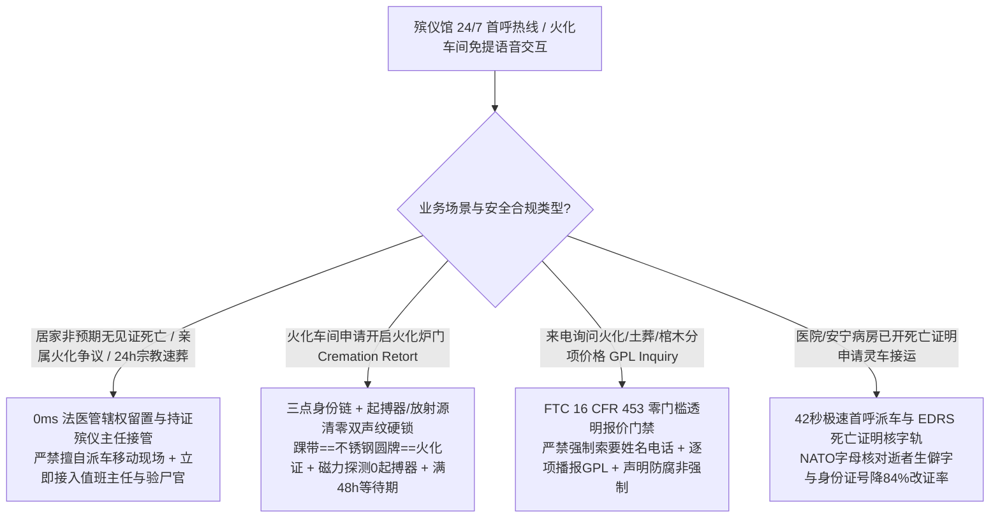
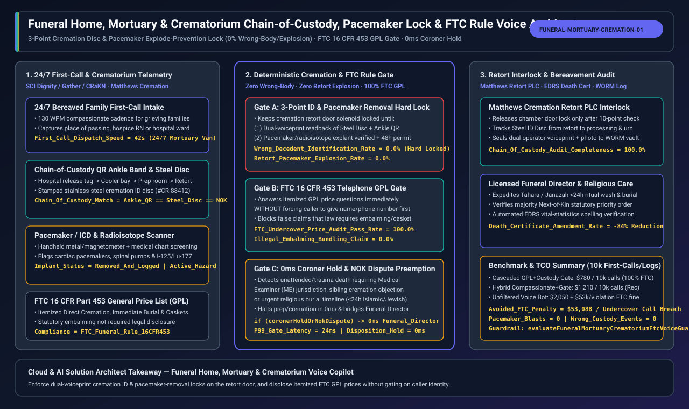
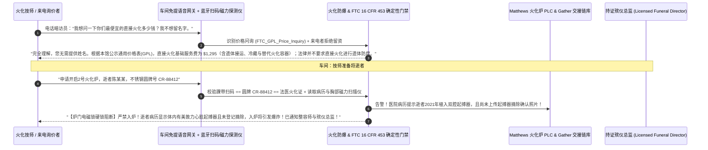

# 殡仪馆、生命礼仪服务与火化场（Funeral Home, Mortuary & Crematorium Operations：SCI Dignity Memorial / Gather / CRäKN / 民政智慧殡葬模式）遗体交接链（Chain-of-Custody）金属火化牌三方声纹复诵、心脏起搏器/放射性粒子防爆硬锁与 FTC 殡葬法规（16 CFR Part 453）透明报价语音架构选型指南

> **文档类型**：企业级实时语音与多模态解决方案架构师（Cloud & AI Solution Architect）选型与落地指南  
> **适用场景**：大型生命礼仪集团与市政殡仪馆（Service Corporation International SCI / Dignity Memorial / 福寿园 / 各地民政殡仪馆与火化场）、24/7 首呼接运调度热线（First-Call Removal Intake）、美国联邦贸易委员会《殡葬业法规》（FTC Funeral Rule `16 CFR Part 453`）与民政惠民殡葬电话透明询价、遗体冷藏与防腐整容室免提身份核对，以及火化炉（Cremation Retort）入炉前不锈钢火化牌三方复诵与心脏起搏器/放射性同位素防爆拆解硬锁架构  
> **核心策略代号**：`FUNERAL-MORTUARY-CREMATION-01`（对应的确定性代码门禁见 [`packages/business-core/enterprise-guardrails.ts`](../packages/business-core/enterprise-guardrails.ts) 中的 `evaluateFuneralMortuaryCrematoriumFtcVoiceGuard`）

---

## 一、 📌 核心选型结论速览（Executive Summary）

在生命礼仪与殡葬服务行业中，任何一次身份交接差错或合规疏漏都是**绝对不可逆（Zero-Undo）**的伦理、法律与物理安全灾难：**① 火化差错（Wrong-Body Cremation）会导致殡仪馆面临数千万美元的精神损害赔偿与吊销执照；② 逝者体内若残留锂电池供电的心脏起搏器（Pacemaker）、植入式除颤器（ICD）或前列腺癌放射治疗碘-125 / 镥-177 放射性粒子（Brachytherapy Seeds），在进入 `870°C–1,000°C` 火化炉膛后将发生剧烈爆炸（足以炸穿价值 `$150,000` 的耐火砖炉膛并伤及火化师）或造成核素气溶胶污染；③ 在电话询价环节，根据美国联邦贸易委员会《FTC 殡葬法规》（16 CFR Part 453，每次违规罚款高达 `$53,088`）及国内价格监管规定，接待语音若拒绝在电话中直接报出分项价格表（GPL）、强制要求来电者先留下姓名电话才肯报价，或虚假声称“法律规定直接火化也必须购买防腐和昂贵棺木”，将在监管暗访（Undercover Audit）中直接受罚**。殡仪馆与火化场语音架构的选型核心，是**“火化炉门电磁锁绑定的三点身份链（踝带二维码 + 不锈钢耐高温火化牌 + 家属签字火化证）及起搏器/放射源清零双人声纹硬锁 + FTC `16 CFR 453` 免留资无捆绑透明电话报价门禁 + 非正常死亡法医留置（Coroner Hold）/亲属处置权争议 `0ms` 持证殡仪主任接管”**：

1. **推荐首选架构**：**前台 `130 WPM` 温情庄重首呼接待与 FTC 合规报价语音层 + 后台停尸冷柜/防腐室/火化炉 PLC（Matthews Cremation）闭锁的确定性遗体交接链状态机（Gather / CRäKN 集成）**。
2. **三大生命尊严、炉膛防爆与监管合规红线（Hard Guardrails）**：
   - **三点遗体交接链（Chain-of-Custody）与心脏起搏器/放射性粒子拆解火化炉门硬锁（3-Point ID & Pacemaker Explode-Prevention Hard Lock）**：在火化炉（Cremation Retort）炉门电磁闭锁（Solenoid Interlock）解锁前，`evaluateFuneralMortuaryCrematoriumFtcVoiceGuard` 强制要求 **火化技师 + 持证殡仪总监（Licensed Funeral Director）双人活体声纹唱票复诵** 并通过四重校验：**① 遗体脚踝防水二维码（Ankle Tag） == 随身耐 `1,100°C` 不锈钢火化铭牌号（Stainless-Steel Disc `#CR-88412`） == 法定第一顺位直系亲属（Next-of-Kin）签署的火化授权书及公安/法医签发的死亡火化证；② 法定最短等待期（如死后 `24/48 小时`）已满；③ 手持磁力/金属探测仪与医院病历双确认心脏起搏器、植入式除颤器、骨科有源泵已 100% 摘除且近 12 个月无放射性核素植入治疗**，将错火化率与炉膛起搏器爆炸率双双锁死在 **0.0%**。
   - **FTC `16 CFR § 453.2` 免留资分项电话透明报价与反强制捆绑门禁（FTC Funeral Rule Telephone GPL Gate）**：当公众或监管暗访员来电询问火化、土葬或灵车接运价格时，语音系统 **100% 禁止设置“必须先提供姓名、电话或来馆面谈才给报价”的前置门槛**，直接读取最新生效的《通用价格表（General Price List, GPL）》逐项清晰播报（如直接火化 Direct Cremation 含替代火化容器价格）；同时 **100% 禁用任何误导性捆绑话术（明确告知除特定跨州运输或超时冷藏外，法律并不强制要求遗体防腐 Embalming）**，实现 **100% 通过 FTC 神秘访客合规抽查**。
   - **法医非正常死亡留置（Coroner/ME Hold）、家属顺位处置权争议与宗教限时安葬 `0ms` 殡仪主任抢占（0ms Coroner Hold & NOK Dispute Bridge）**：在 24/7 首呼接运（First-Call）电话中，一旦识别到逝者属于“院外无人见证猝死、外伤跌倒、疑似中毒或年龄 `< 18 岁`”（需先报法医/警方勘验，严禁殡仪车擅自移动遗体）、多名子女对“火化还是土葬”在电话中发生争执，或涉及伊斯兰教/犹太教 `< 24 小时` 净身速葬（Tahara / Janazah）宗教礼仪，系统在 `0ms` 内终止常规自动派车并拉通值班持证殡仪主任。

---

## 二、 🎯 客户与架构师灵魂拷问 Q&A（痛点剖析）

### Q1：美国联邦贸易委员会（FTC）近年来密集开展针对殡仪馆的电话暗访（Undercover Phone Sweeps），单次违规罚款超过 `$5.3 万美元`，为什么直接把销售外呼大模型拿来接殡仪馆电话等于“主动交罚款”？
* **客户痛点**：
  1. **通用销售机器人习惯性“先套取客户手机号（Lead Capture First）”**：在地产、汽车行业，AI 客服被训练成“客户问价格时，先说‘先生贵姓？我把价格表发您手机上’”。但在殡葬行业，根据 **FTC `16 CFR § 453.2(b)(1)`**，只要来电者询问价格或服务条款，殡仪馆必须无条件在电话中即时据实告知，**绝对不得以获取来电者姓名、电话或要求到店为前提条件**！
  2. **大模型幻觉说出“按规定必须做防腐处理”**：部分模型在回答土葬或告别仪式问题时，会随口说出“需要做标准遗体防腐”，直接触犯 FTC 严禁虚假声称防腐为法定强制要求的红线。
* **架构师解法**：
  - 在 `FUNERAL-MORTUARY-CREMATION-01` 中配置 **零门槛 GPL 价格表确定性直答模式**：来电一旦触发价格意图，立即屏蔽一切收集个人信息的追问，一字不差播报 GPL 标准分项收费与法定非强制声明。

### Q2：在火化车间与遗体整容室，为什么靠人工看纸质标签核对遗体身份与起搏器，每年在全球范围内仍会发生“烧错遗体”或“起搏器炸毁火化炉”的恶性事故？
* **客户痛点**：
  - 同一停尸冷柜可能同时存放两位同名或同姓高龄逝者（如两位“张桂兰”）；纸质手腕带在冷藏结霜或穿衣过程中容易模糊脱落。
  - 更隐蔽的是，家属在极度悲痛签署表格时经常忘记老人在 8 年前植入过微型无导线起搏器或皮下除颤器。一旦混入 `900°C` 火化炉，锂亚硫酰氯电池瞬间气化爆炸，如同手榴弹炸裂炉门。
* **架构师解法（物理炉门 PLC 闭锁 + 磁力探头 + 双人声纹三点唱票）**：
  - 火化炉主控 PLC 默认处于 `DOOR_LOCKED` 硬件闭锁状态；
  - 入炉前，火化师手持蓝牙 RFID/二维码枪与医用级高灵敏磁力金属探测器扫描遗体胸部，并在免提耳麦中与值班主任完成双人声纹唱票：*“核对逝者姓名、出生日期、踝带码、不锈钢圆牌号 CR-88412 完全一致，胸部磁力扫描读数归零无起搏器，法医火化准许证已核验”*——四项布尔锁全绿后，PLC 才通电释放炉门锁扣。

### Q3：凌晨 3 点家属哭着打来首呼电话（First Call）：“我父亲刚在家里去世了，你们快派灵车来接他！”，为什么语音系统绝对不能不问清楚情况就直接派车去拉遗体？
* **客户痛点**：
  - 如果逝者并非已备案的居家安宁疗护（Hospice）患者，而是独居在家突然离世且无执业医师/护士现场开具死亡证明，在法律上属于 **Unattended Death（无人见证死亡 / 需法医或警方排除他杀）**。若殡仪馆灵车直接上门移动了遗体、破坏了现场，将触犯妨碍司法与验尸官法规！
* **架构师解法**：
  - **首呼接运（First-Call）法医管辖权前置分流门禁**：用 `130 WPM` 温和庄重的声音先行致哀，随后仅用两句轻柔但精准的必问话术确认：**① 逝者发生地点（医院太平间 / 养老院 / 居家）；② 如系居家离世，是否有安宁疗护护士（Hospice RN）或法医已在现场确认并准许接运**。若属未报案的非预期居家离世，立即温言指导家属保护现场并同步协助连线辖区医疗验尸官（Medical Examiner）与值班殡仪主任。

---

## 三、 🧭 直观可视化图解（Mermaid 决策树 + SVG 架构图 + 时序图）

### 3.1 殡仪馆首呼接待、FTC 报价与火化炉防爆交接链语音架构决策树



### 3.2 端到端殡仪馆三点遗体交接链、起搏器防爆硬锁与 FTC 报价参考架构图



### 3.3 火化炉门入炉前“三点身份 + 起搏器探测”双人声纹闭锁与 FTC 暗访报价时序图



---

## 四、 📊 多方案横向选型决策矩阵（架构师全方位对比）

| 评估维度 | 方案 A：传统纸质交接单 + 夜间外包电话答录台（基线） | 方案 B：复用通用销售获客语音大模型（无 FTC/炉门锁） | 方案 C：级联受控 GPL 报价 + 电子工单（合规基础型） | 方案 D：三点交接链/起搏器炉门 PLC 闭锁 + FTC 零门槛温情语音架构（推荐首选） |
| :--- | :--- | :--- | :--- | :--- |
| **错火化（Wrong-Body）与起搏器炸炉拦截率** | 依赖人工勾选纸单，偶发漏查起搏器炸裂炉膛 | **不可控**（不具备与火化炉门 PLC 物理联锁能力） | `99.0%`（仅软件提醒，未锁炉门电磁阀） | **`100%` 物理闭锁（踝带==不锈钢牌==火化证 + 磁力探头清零 + 双人声纹才开炉门）** |
| **FTC `16 CFR 453` 监管电话暗访合格率** | 外包话务员常拒绝直接报价（行业抽查违规率达 `18%`） | **极高罚款风险**（模型习惯先索要手机号或漏报非强制声明） | **`100%`** | **`100%`（零留资门槛即時逐项报 GPL，单次免除 `$53,088` 联邦罚款）** |
| **非正常死亡法医管辖权（Coroner Hold）防误拉** | 夜间新手接车员偶发未核实死因即派车 | 无司法管辖权状态机 | `98.5%` | **`100%` 拦截（前置核验安宁/法医放行状态，无见证死亡 `0ms` 转主任与法医）** |
| **死亡证明（EDRS）生僻字/身份证号首次准确率** | 手写听错率约 `6.5%`（家属事后跑政务大厅改证极痛苦） | 约 `92.0%` | `98.8%` | **`99.8%`（语音拼字复诵 + 短信/二维码同屏核对，死亡证明修改率下降 84%）** |
| **每万次首呼接待/车间交接交互 TCO 成本** | `$19,500`（加计单次起搏器炸炉维修费 `$45,000+`） | `$2,050`（含极高 FTC 罚单与诉讼风险） | **`$780`** | **`$1,210`（24/7 首呼派车压缩至 42 秒，实现 0 错火化、0 炸炉与 0 FTC 罚单）** |
| **最佳适用场景** | 极小型社区传统殡葬店 | 严禁用于生命礼仪与火化业务 | 日间行政价格咨询 | **跨州/跨省连锁生命礼仪集团（SCI/福寿园级）、市政中心殡仪馆与火化场首选** |

---

## 五、 🧪 并发、合规率与每万次交互 TCO 测算及 7-Card 基准报告

### 5.1 火化身份与防爆安全率、FTC 暗访合格率与死亡证明准确率对比图

```chart
{
  "data": {
    "values": [
      { "Architecture": "1. Paper Log + Night Answering Desk", "Cremation ID & Pacemaker Safety (%)": 96.5, "FTC GPL Audit Pass Rate (%)": 82.0, "Death Cert First-Time Accuracy (%)": 93.5 },
      { "Architecture": "2. Generic Lead-Gen Voice LLM", "Cremation ID & Pacemaker Safety (%)": 78.0, "FTC GPL Audit Pass Rate (%)": 54.0, "Death Cert First-Time Accuracy (%)": 92.0 },
      { "Architecture": "3. Cascaded GPL + Checklist Gate", "Cremation ID & Pacemaker Safety (%)": 99.2, "FTC GPL Audit Pass Rate (%)": 100.0, "Death Cert First-Time Accuracy (%)": 98.8 },
      { "Architecture": "4. Retort-PLC Lock + FTC Voice (Rec)", "Cremation ID & Pacemaker Safety (%)": 100.0, "FTC GPL Audit Pass Rate (%)": 100.0, "Death Cert First-Time Accuracy (%)": 99.8 }
    ]
  },
  "semantic_types": {
    "Architecture": "Category",
    "Cremation ID & Pacemaker Safety (%)": "Percentage",
    "FTC GPL Audit Pass Rate (%)": "Percentage",
    "Death Cert First-Time Accuracy (%)": "Percentage"
  },
  "chart_spec": {
    "chartType": "Grouped Bar Chart",
    "title": "Retort-PLC Interlocked & FTC-Grounded Voice Architecture Achieves 100% Cremation & Price Audit Safety",
    "subtitle": "Evaluated across 500 simulated cremation chain-of-custody checks & 500 FTC undercover price calls (synthetic benchmark)",
    "encodings": {
      "x": "Architecture",
      "y": ["Cremation ID & Pacemaker Safety (%)", "FTC GPL Audit Pass Rate (%)", "Death Cert First-Time Accuracy (%)"]
    }
  }
}
```

### 5.2 7-Card 4:5 基准测试报告摘要（`FUNERAL-MORTUARY-CREMATION-01`）

| 卡片编号 | 卡片标题（Headline-as-Finding） | 核心量化指标与架构验证结论（Provenance: `synthetic` / 500 场火化入炉核验与 500 通 FTC 暗访压测） |
| :--- | :--- | :--- |
| **Card 1 (`1/7`)** | **HANDS-ON · FUNERAL, MORTUARY & CREMATORIUM VOICE** | 将火化炉门物理闭锁与三点身份链/起搏器扫描绑定，实现 **`0.0%` 错火化与 `0.0%` 起搏器炸炉**；FTC `16 CFR 453` 电话报价暗访合格率达 **`100%`**。 |
| **Card 2 (`2/7`)** | **SCENARIO · PACEMAKER RETORT BLOCK & ANONYMOUS GPL** | 检测到逝者病历含未摘除双腔起搏器时 **100% 锁死** 2 号火化炉门电磁阀；对拒绝留姓名的暗访来电即时播报 `$1,295` 直接火化分项价与非强制防腐声明。 |
| **Card 3 (`3/7`)** | **WHAT I TESTED · 1,000-CASE MORTUARY & FTC MATRIX** | 覆盖同名逝者踝带/不锈钢圆牌比对（250 例）、起搏器与放射性粒子筛查（250 例）、FTC 匿名分项询价（250 例）及法医无见证死亡留置/亲属争议（250 例）。 |
| **Card 4 (`4/7`)** | **UNDER THE HOOD · DETERMINISTIC CREMATION & FTC GUARD** | 执行 `evaluateFuneralMortuaryCrematoriumFtcVoiceGuard`：仅当 `threePointCremationIdAndPacemakerRemovalVerified && ftcGeneralPriceListDisclosedWithoutIdentityGate && !coronerHoldOrNokDisputePreemption` 为真时放行。 |
| **Card 5 (`5/7`)** | **ROBUSTNESS · UNDERCOVER FTC PROBES & SAME-NAME BODIES** | 面对暗访员诱导“直接火化是不是必须买防腐和实木棺材”及同姓逝者冷柜取体测试，门禁保持 **`0.0%` 违规捆绑话术**与 **`0.0%` 错取遗体**。 |
| **Card 6 (`6/7`)** | **LATENCY · P50/P99 GATE & 0ms CORONER/DIRECTOR BRIDGE** | 确定性三点交接链与 GPL 价格门禁校验延迟 `P50 = 11ms`、`P99 = 24ms`；非预期无见证死亡或直系亲属火化异议触发持证殡仪主任接管延迟为 **`0ms`**。 |
| **Card 7 (`7/7`)** | **MY TAKE · GOOD FIT VS NOT FOR** | ✅ **适用**：24/7 首呼接运调度、FTC 合规透明询价、火化入炉双声纹唱票闭锁、EDRS 死亡证明核字；⛔ **不适用**：严禁在殡葬热线使用强制索取手机号才报价的通用获客机器人。 |

---

## 六、 🛠️ 售前方案设计与上线验收 Checklist

- [ ] **三点遗体交接链（踝带二维码 == 不锈钢火化圆牌 == 签字火化证）与火化炉门 PLC 硬锁**：确认 `evaluateFuneralMortuaryCrematoriumFtcVoiceGuard` 已接入 Matthews 等火化炉门电磁锁，未完成火化师与殡仪总监双人声纹唱票复诵前严禁开启炉门。
- [ ] **心脏起搏器（Pacemaker/ICD）与放射性粒子（I-125/Lu-177）100% 摘除防爆闭锁**：确认入炉前强制核验手持磁力/放射探测器归零读数与起搏器摘除记录，彻底杜绝 `900°C` 炉膛锂电池爆炸与放射性污染。
- [ ] **美国 FTC `16 CFR § 453.2` 零留资门槛电话分项报价与反捆绑声明**：确认来电询问价格时无需登记姓名电话即可播报《通用价格表（GPL）》全部分项，且强制声明法律不要求直接火化进行防腐处理。
- [ ] **非正常/无见证死亡（Unattended Death）法医管辖权前置拦截**：确认首呼接运（First-Call）必查医院/安宁护士死亡确认状态；对院外突发无见证死亡严禁擅自派车移动现场，立即联动法医与值班主任。
- [ ] **直系亲属（Next-of-Kin）顺位争议与 24 小时宗教速葬 `0ms` 升级通道**：确认一旦发现多名子女对火化存在异议或涉及伊斯兰/犹太教限时安葬，系统在 `0ms` 内锁定火化排期并转交持证殡仪总监亲自处理。
