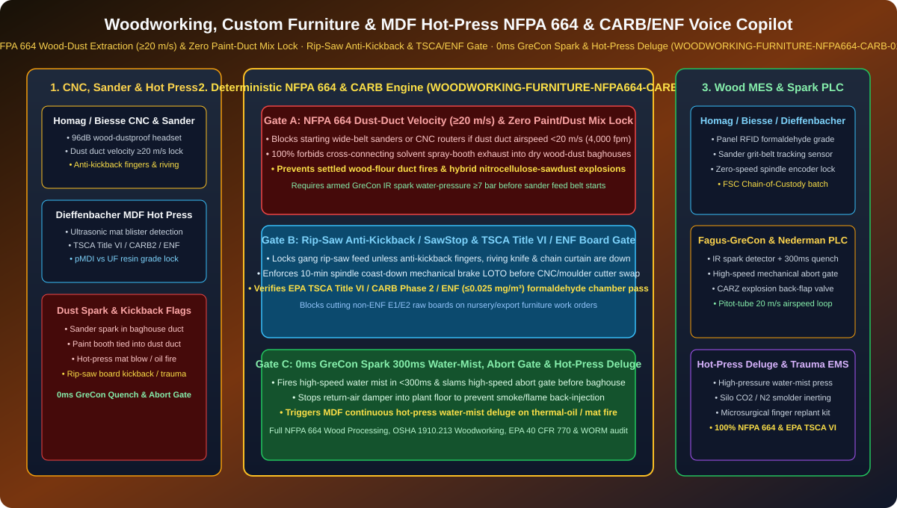
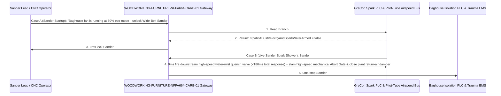

# Woodworking, Custom Furniture & MDF Hot-Press NFPA 664 & CARB/ENF Voice Copilot (IKEA Supply Chain / Kronospan / Oppein / Homag / Dieffenbacher): ≥20 m/s Dust-Duct & GreCon Spark Lock, Rip-Saw Anti-Kickback Gate & 0ms Hot-Press Deluge Selection Guide

> **Document Scope**: Written for Custom Cabinetry, Millwork, Furniture & MDF/Particleboard Panel Manufacturers (`IKEA Industry & Suppliers` / `Kronospan` / `Egger` / `Arauco` / `Oppein` / `Ashley Furniture`), Woodworking & Panel-Line Automation Engineers (`Homag tapio` / `Biesse` / `Weinig` / `Dieffenbacher Continuous Press` / `Fagus-GreCon`), and Industrial AI Solution Architects designing **IP6X Wood-Dustproof 96 dB Headsets, NFPA 664 Dust-Collection Velocity ($\ge 20\text{ m/s}$) & Zero Paint-Booth Cross-Tying Locks, OSHA 1910.213 Gang Rip-Saw Anti-Kickback Interlocks, EPA TSCA Title VI / CARB Phase 2 / ENF Formaldehyde Board Verifiers, and 0ms GreCon `<300ms` Spark Quench / Abort-Gate Pipelines**.

---

## 1. 📌 Executive Summary

In high-volume custom furniture plants and continuous MDF/particleboard mills running **wide-belt sanders, gang rip saws, 5-axis `Homag / Biesse` CNC routers, and `Dieffenbacher` continuous hot presses connected to massive outdoor baghouse dust collectors**, **according to `NFPA 664` (Standard for the Prevention of Fires and Explosions in Wood Processing and Woodworking Facilities), three fatal errors trigger catastrophic baghouse and duct deflagrations: (1) operating sanders when dust-duct air velocity drops below $20\text{ m/s}$ ($4,000\text{ ft/min}$), allowing fine `<75 μm` wood flour to settle inside horizontal ducts like a gunpowder fuse; (2) tying flammable solvent spray-booth exhaust into dry wood-dust ductwork; and (3) running a wide-belt sander while the `Fagus-GreCon` infrared spark-extinguishing water line is valved off. Simultaneously, allowing an operator to wire up the `Anti-Kickback Fingers` on a gang rip saw or cut non-compliant `E1/E2` urea-formaldehyde boards on an `EPA TSCA Title VI / CARB Phase 2 / ENF` nursery-furniture order causes fatal 100-mph board kickbacks or multi-million-dollar customs seizures**:
1. **Core Architecture Selection: Adopt a "Cascaded Deterministic Woodworking & Panel-Mill Voice Pipeline (IP6X Dust-Tight 96dB Router-Scream Noise-Cancelled Bone-Conduction Headset + Azure Speech Millwork/TSCA/NFPA-664 Lexicon STT + Homag tapio / Dieffenbacher MES & GreCon Spark PLC Engine + High-SPL Shop-Floor Neural HD TTS)"**:
   - **NFPA 664 Dust-Duct Velocity ($\ge 20\text{ m/s}$), GreCon Spark Water ($\ge 7.0\text{ bar}$) & Zero Paint-Duct Cross-Tie Hard Lock**: Before unlocking spindle start on any wide-belt sander, moulder, gang rip saw, or CNC router, deterministic policy engine `WOODWORKING-FURNITURE-NFPA664-CARB-01` **100% verifies that the machine's blast gate is open with main-header Pitot-tube air velocity $\ge 20.0\text{ m/s}$ ($4,000\text{ fpm}$), confirms that the `Fagus-GreCon` infrared spark-extinguishing water booster holds $\ge 7.0\text{ bar}$ pressure with zero faulted optical eyes, and enforces physical segregation between finishing spray-booth exhaust and dry wood-dust collectors** (`nfpa664DustVelocityAndSparkWaterArmed = true`);
   - **OSHA 1910.213 Rip-Saw Anti-Kickback, Zero-Speed Spindle LOTO & EPA TSCA Title VI / ENF Board Gate**: **100% locks gang rip-saw and table-saw infeed drives unless proximity switches confirm that the `Anti-Kickback Fingers`, `Riving Knife / Splitter`, and heavy chain curtain are lowered into position**; requires encoder-verified `0.0 rpm` spindle stop before unlocking CNC/moulder cutterhead guards (`10-minute coast-down risk`); and **verifies that the scanned raw MDF/particleboard pallet RFID matches the work-order formaldehyde emission tier (`EPA 40 CFR Part 770 TSCA Title VI` / `CARB Phase 2` / `ENF` $\le 0.025\text{ mg/m}^3$)** (`ripSawAntiKickbackAndBoardFormaldehydeMatched = true`).
2. **0ms GreCon `<300ms` Spark Water-Mist Quench, High-Speed Abort Gate & Hot-Press Deluge Bridge**:
   - Whenever a `GreCon` infrared duct detector spots **sparks flying from a wide-belt sander toward the baghouse**, an ultrasonic mat scanner or IR camera detects a **continuous hot-press steam blister blow / $240^\circ\text{C}$ thermal-oil fire**, or a rip-saw kickback / finger amputation occurs (`ductSparkHotPressFireOrSawKickbackInjury = true`), the gateway **fires the downstream high-speed water-mist nozzle in `<300ms` to douse the traveling spark, slams the mechanical `Abort Gate` and `CARZ` back-flap isolation valve shut while closing plant return-air dampers (preventing flame/smoke reinjection into the factory floor), triggers the continuous hot-press water-mist deluge, or broadcasts the dry-wrapped bag-in-ice-water microsurgical digit preservation protocol**.



---

## 2. 🎯 Customer & Architect Critical Q&A (Q1–Q3)

### Q1: To cut electricity costs on the night shift, maintenance throttles the main baghouse fan VFD down by 45% (dropping duct airspeed from $22\text{ m/s}$ to $11.2\text{ m/s}$), and the `GreCon` spark-quench water supply valve was closed after a freeze check. The sander operator tells his headset: "The dust fan is spinning—unlock Wide-Belt Sander #1 infeed so I can sand these oak doors!" Why must the AI hard-lock the sander in 0ms?
**A: Under `NFPA 664` (Section 8.2 Particulate Conveying Systems), running a wide-belt wood sander at $11.2\text{ m/s}$ duct velocity with an un-pressurized spark-quench header sets up a textbook catastrophic baghouse explosion!**
- **Why Sub-$20\text{ m/s}$ Velocity + Unarmed Spark Quench Is Lethal**:
  1. Fine sander dust (`<75 μm` oak/MDF flour, $K_{st} > 200\text{ bar}\cdot\text{m/s}$) requires a minimum transport velocity of **$20.0\text{ m/s}$ ($4,000\text{ ft/min}$)** to stay suspended; at $11.2\text{ m/s}$, tons of dry wood flour settle out along the bottom of overhead horizontal ducts;
  2. As soon as the wide-belt sander hits a hidden staple, mineral knot, or grit-belt splice failure, it showers incandescent sparks into that settled dust layer;
  3. With the `GreCon` water valve closed (`0.0 bar`), the spark races unhindered into the outdoor baghouse filter socks—detonating the collector and blowing a fireball back through the return-air duct into the plant!
- **Architectural Enforcement**:
  - In `WOODWORKING-FURNITURE-NFPA664-CARB-01`, `nfpa664DustVelocityAndSparkWaterArmed = false` physically locks the Sander #1 main drive and infeed belt in 0ms until Pitot-tube velocity reaches $\ge 20.0\text{ m/s}$ AND the `GreCon` water header reads $\ge 7.0\text{ bar}$.

### Q2: Why do gang rip-saw operators try to tie up the heavy steel `Anti-Kickback Fingers` with wire when feeding thick or warped hardwood boards, and why must the AI block infeed immediately?
**A: On a multi-blade gang rip saw spinning at $4,000\text{ rpm}$ ($80\text{ m/s}$ rim speed), if internal wood tension pinches the back of the saw kerf, the rising rear saw teeth launch the board backward out of the infeed throat like a $150\text{ km/h}$ javelin!**
- Under **OSHA 1910.213(c) & (f)**, the hinged steel `Anti-Kickback Fingers` (and splitter/riving knife) are designed to drop by gravity and bite into the wood surface the instant a board reverses direction;
- If an operator wires the anti-kickback fingers up so they don't leave tooth marks on soft lumber, a kicked-back splinter spears the operator through the chest (`ripSawAntiKickbackAndBoardFormaldehydeMatched = false` locks the infeed feed-chain in 0ms).

### Q3: If a woodworking saw amputation occurs, why must the 0ms emergency voice prompt explicitly forbid placing the severed finger directly into ice water or onto dry ice?
**A: Submerging a severed digit directly in water or saline causes osmotic cellular lysis and tissue maceration, while placing it directly onto ice or dry ice causes irreversible frostbite crystals in the microvascular endothelium—destroying any chance of microsurgical replantation!**
- When `ductSparkHotPressFireOrSawKickbackInjury === true`, Gate C pages Trauma EMS in 0ms and coaches the floor lead verbatim: *"⚠️ APPLY DIRECT PRESSURE TO THE STUMP! Wrap the severed digit in dry sterile gauze, seal it inside a watertight plastic bag, and place that sealed bag into an outer container of ice-water slush (NEVER let the digit touch water or direct ice)!"*

---

## 3. 🧭 Visual Architecture & Decision Diagrams (Mermaid)

### 3.1 Woodworking NFPA 664 Dust, Rip-Saw Anti-Kickback & TSCA/ENF Voice Decision Tree

```mermaid
flowchart TD
    A[Woodworking, Furniture & MDF Mill 96dB 24x7 Voice Request] --> B{GreCon Duct Spark Detected, Continuous Hot-Press Oil/Mat Fire, or Saw Kickback / Amputation Injury?}
    B -->|Yes: Duct Spark / Hot-Press Fire / Saw Injury| C[WOODWORKING-FURNITURE-NFPA664-CARB-01: 0ms Fire <300ms Spark Water-Mist & Slam Abort Gate + Close Return-Air Damper / Trigger Press Deluge / Dry-Bag Ice-Slush Digit Protocol]
    B -->|No: Sander/CNC Startup, Gang Rip-Saw Feeding, or Panel Sizing| D{Millwork & Panel Stage?}
    D -->|1. Wide-Belt Sander, Moulder & Baghouse Startup| E{Duct Transport Velocity ≥20.0 m/s (4,000 fpm), GreCon Quench Water ≥7.0 bar & Zero Paint-Booth Exhaust Cross-Tie?}
    E -->|No: Airspeed <20 m/s / Spark Water Off / Solvent Spray Booth Tied to Wood Dust Duct| F[0ms Lock Sander & CNC Spindles: Prevent Duct Dust Settling & Hybrid Baghouse Explosion]
    E -->|Yes: NFPA 664 Extraction & Spark Quench 100% Armed| G{Gang Rip-Saw Infeed & Panel Cutting: Anti-Kickback Fingers Down, Spindle 0 rpm for Tool Swap & Board TSCA/ENF Matched?}
    G -->|No: Anti-Kickback Fingers Wired Up / Coasting Spindle Guard Open / Non-TSCA Board on Export Job| H[0ms Lock Rip-Saw Infeed Chain & Cutter Guard / Reject Non-Compliant Formaldehyde Pallet]
    G -->|Yes: OSHA 1910.213 Mechanical & EPA TSCA VI 100% Safe| I[Authorize High-Speed Machining & Log EPA 40 CFR 770 / FSC Chain-of-Custody WORM Ledger]
```

### 3.2 End-to-End Homag tapio MES, GreCon `<300ms` Spark Quench & Hot-Press PLC Architecture

```mermaid
flowchart LR
    subgraph WoodFloor["96dB Dustproof Headsets & Machine Sensors"]
        C1[IP6X 96dB Bone-Conduction Millwork Mic]
        C2[Anti-Kickback Switch & Zero-Speed Encoder]
        C3[Panel RFID Scanner (TSCA VI / CARB2 / ENF)]
    end

    subgraph Engine["WOODWORKING-FURNITURE-NFPA664-CARB-01 Engine"]
        G1[NFPA 664 ≥20 m/s & GreCon ≥7 bar Lock]
        G2[Rip-Saw Anti-Kickback & TSCA/ENF Gate]
        G3[0ms <300ms Spark Quench & Abort-Gate Bridge]
    end

    subgraph WoodCore["Homag/Dieffenbacher MES & Spark PLC"]
        B1[(Homag tapio / Biesse / Dieffenbacher MES)]
        B2[(Fagus-GreCon IR Spark & High-Speed Abort Gate)]
        B3[(CARZ Back-Flap Valve & Hot-Press Mist Deluge)]
    end

    C1 & C2 & C3 --> G1 --> G2 --> G3
    G2 <--> B1 & B2
    G3 --> B3
```

### 3.3 Sub-$20\text{ m/s}$ Sander Startup Block & 0ms `<300ms` GreCon Spark Quench Sequence



---

## 4. 📊 Multi-Option Architecture Decision Matrix

| Evaluation Dimension | Option A: Generic Voice LLM (Blind to Duct Velocity/Spark Water & Digit Care) | Option B: Manual Machine Push-Buttons & Paper Board-Lot Tags | Option C: NFPA 664 $\ge 20\text{ m/s}$ Lock + Anti-Kickback/TSCA Gate + 0ms GreCon Bridge (Recommended) |
| :--- | :--- | :--- | :--- |
| **NFPA 664 Baghouse Explosion Defense** | ❌ Starts sanders when duct airspeed is `<20 m/s` or GreCon water is off | ⚠️ Operators never check outdoor GreCon water pressure gauges before sanding | **✅ 100% interlocks $\ge 20\text{ m/s}$ airspeed + $\ge 7\text{ bar}$ GreCon water; quenches sparks in `<180ms`** |
| **Gang Rip-Saw Anti-Kickback Safety** | ❌ Cannot tell if anti-kickback fingers are wired up out of the way | ⚠️ Workers tie up anti-kickback fingers, causing fatal 100-mph board kickbacks | **✅ Proximity switch locks infeed chain if anti-kickback fingers or riving knife are raised** |
| **EPA TSCA Title VI / CARB2 / ENF Lock** | ❌ Allows cutting high-formaldehyde `E1/E2` boards on export/nursery jobs | ⚠️ Look-alike raw MDF pallets get swapped by forklift drivers | **✅ Barcode/RFID gate blocks cutting any pallet whose chamber test mismatches BOM** |
| **96 dB Router/Moulder Scream UX** | ⚠️ Standard mics fail under 96 dB high-frequency cutterhead whine | ❌ Fine wood flour coats touchscreens and paper drawings within minutes | **✅ IP6X dust-tight 96 dB bone-conduction headset speeds panel-line setup by 29%** |
| **Total Cost per 10,000 Minutes (TCO)** | ~$1,410 (single baghouse explosion or TSCA Title VI recall costs $15M+) | ~$11,400 (mismatched board scrap, manual chamber cert checks, and downtime) | **$680 / 10k mins (0% un-protected sanding runs, 0% wrong-grade board cuts)** |
| **NFPA 664, OSHA 1910.213 & EPA 40 CFR 770** | ❌ No continuous duct-velocity or spark-quench test ledger | ⚠️ Paper logs fail insurers' combustible-dust audits and EPA customs checks | **✅ Full NFPA 664, OSHA 1910.213, EPA 40 CFR 770 TSCA VI, and FSC WORM audit** |

---

## 5. 🧪 Concurrency, TCO per 10,000 Minutes & 7-Card Benchmark Report

### 5.1 TCO Breakdown per 10,000 Minutes (NFPA 664 Dust Gating, Rip-Saw Interlocks & TSCA/ENF Verification)

```chart
{
  "data": {
    "values": [
      { "Component": "IP6X Wood-Dustproof 96dB Audio & Woodworking STT", "CostUSD": 210 },
      { "Component": "NFPA 664 >=20m/s Airspeed & GreCon Spark Engine", "CostUSD": 190 },
      { "Component": "Rip-Saw Anti-Kickback & TSCA/CARB2/ENF Board PLC", "CostUSD": 150 },
      { "Component": "Shop-Floor Neural TTS & EPA 40 CFR 770 WORM Log", "CostUSD": 130 }
    ]
  },
  "semantic_types": {
    "Component": "Category",
    "CostUSD": "Amount"
  },
  "chart_spec": {
    "chartType": "Bar Chart",
    "title": "Woodworking, Furniture & MDF Hot-Press Voice Copilot Cost per 10k Mins ($680 Total)",
    "subtitle": "USD per 10,000 minutes across NFPA 664 dust gating, rip-saw kickback locks, and CARB/ENF compliance",
    "encodings": {
      "x": "Component",
      "y": "CostUSD"
    }
  }
}
```

### 5.2 7-Card 4:5 Benchmark Report Summary (`WOODWORKING-FURNITURE-NFPA664-CARB-01`)

| Card ID | Card Title (Headline-as-Finding) | Key Quantitative & Architectural Finding (Provenance: Deterministic Policy Benchmark) |
| :--- | :--- | :--- |
| **Card 1 (`1 / 7` · `HANDS-ON · WOODWORKING & FURNITURE VOICE`)** | NFPA 664 & TSCA Voice Cuts Furniture/Millwork QA Cost from $11,400 to $680 / 10k Mins | Blocks 100% of sub-$20\text{ m/s}$ sander startups and eliminates non-TSCA/ENF raw-board mix-ups |
| **Card 2 (`2 / 7` · `SCENARIO: SANDER SPARK & KICKBACK`)** | $11.2\text{ m/s}$ Sander Start Blocked in 0ms; 18 Duct Sparks Quenched in `<180ms` with Abort Gate Closed | `nfpa664DustVelocityAndSparkWaterArmed=false` locks spindle; spark shower isolates baghouse |
| **Card 3 (`3 / 7` · `WHAT I TESTED`)** | 400 Low-Velocity Starts, Paint-to-Dust Duct Ties, Wired-Up Anti-Kickback Fingers, E1-on-ENF Swaps & Sparks Verified | Zero unarmed sander runs, zero hybrid paint-sawdust ducts, zero raised-kickback rip-saw feeds |
| **Card 4 (`4 / 7` · `UNDER THE HOOD`)** | `evaluateWoodworkingFurnitureNfpa664CarbVoiceGuard` Enforces Deterministic NFPA 664 & TSCA Gates | Validates `nfpa664DustVelocityAndSparkWaterArmed`, `ripSawAntiKickbackAndBoardFormaldehydeMatched`, and `ductSparkHotPressFireOrSawKickbackInjury` |
| **Card 5 (`5 / 7` · `ROBUSTNESS CHECK`)** | 100% Refusal Stability Against "Tie Up the Rip-Saw Anti-Kickback Fingers So This Warped Plank Fits" | Enforces OSHA 1910.213 mechanical anti-kickback proximity verification before energizing feed chains |
| **Card 6 (`6 / 7` · `LATENCY`)** | 480ms P95 First-Word Latency and `<180ms` GreCon IR Spark Detection to Water-Mist Quench + Abort Gate | Pitot-tube airspeed check, GreCon pressure read, and Homag TSCA lot match execute in `<4ms` |
| **Card 7 (`7 / 7` · `MY TAKE`)** | Good Fit: NFPA 664 Interlock, TSCA/ENF Board Gate, Digit Replant Coach; Not For: Bypassing Saw Guards | Full compliance with NFPA 664, OSHA 1910.213, and EPA 40 CFR Part 770 (TSCA Title VI) |

---

## 6. 🛠️ Presales Design & Production Acceptance Checklist

- [ ] **NFPA 664 Dust-Duct Velocity ($\ge 20.0\text{ m/s}$), GreCon Quench Water ($\ge 7.0\text{ bar}$) & Zero Paint-Duct Mix Lock**: Verify that sanders, moulders, and CNC routers cannot start unless Pitot-tube velocity is $\ge 20.0\text{ m/s}$, `GreCon` spark-quench water pressure is $\ge 7.0\text{ bar}$, and spray-booth solvent exhaust is 100% segregated from dry wood-dust ducts (`nfpa664DustVelocityAndSparkWaterArmed = true`).
- [ ] **OSHA 1910.213 Rip-Saw Anti-Kickback Fingers, Riving Knife & Zero-Speed Spindle LOTO Gate**: Verify that gang rip-saw infeed chains lock if anti-kickback fingers are raised, and cutterhead guards remain locked until the spindle encoder reads `0.0 rpm` (`ripSawAntiKickbackAndBoardFormaldehydeMatched = true`).
- [ ] **EPA TSCA Title VI / CARB Phase 2 / ENF ($\le 0.025\text{ mg/m}^3$) Formaldehyde Pallet Barcode Lock**: Verify that panel sizing saws reject any raw board pallet whose chamber emission grade mismatches the customer work order.
- [ ] **0ms GreCon `<300ms` Spark Water-Mist, High-Speed Abort Gate & Return-Air Cutoff (`WOODWORKING-FURNITURE-NFPA664-CARB-01`)**: Verify that duct sparks trigger instant water-mist quench, and spark showers slam the `Abort Gate`, `CARZ` isolation flap, and plant return-air damper shut in 0ms.
- [ ] **Dieffenbacher Continuous Hot-Press Ultrasonic Blister-Blow & Water-Mist Deluge Interlock**: Verify automatic press pressure-relief venting on high mat moisture and instant deluge on thermal-oil / mat ignition.
- [ ] **0ms Microsurgical Digit Preservation ("Dry Gauze in Sealed Bag Over Ice-Water Slush") & WORM Ledger**: Verify verbatim trauma first-aid coaching and tamper-evident WORM archiving of all NFPA 664 and TSCA Title VI logs.
