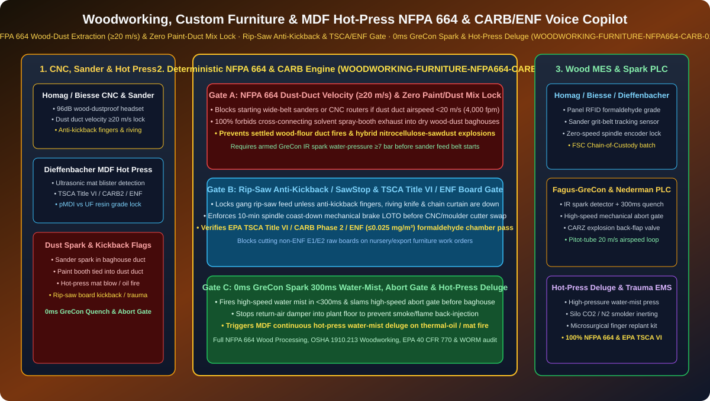
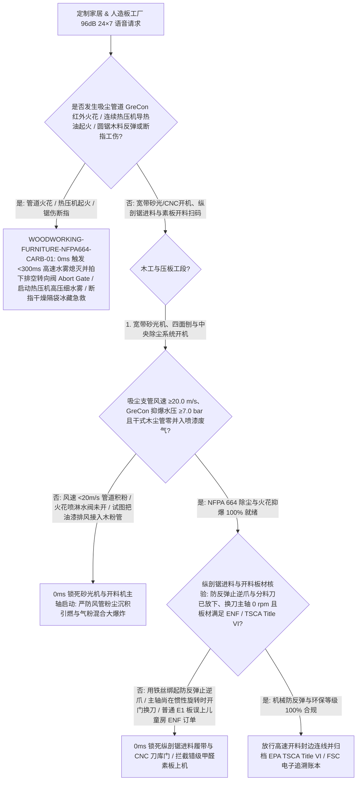
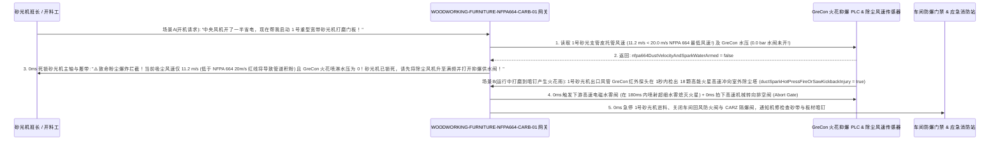

# 定制家居、人造板材（MDF/刨花板）与现代木工家具工厂（欧派家居 / 索菲亚 / 顾家 / 宜家供应链 / 豪迈 Homag / 迪芬巴赫）24×7 免提语音副驾方案：NFPA 664 木粉尘吸尘风速（≥20m/s）与禁混接喷漆管硬锁、纵剖锯防反弹止逆爪与 ENF/CARB 无醛板防错门禁及砂光火花 0ms 300毫秒水雾熄灭强切选型指南

> **文档定位**：面向大型全屋定制家居、实木与板式家具、MDF/刨花板连续平压人造板集团（欧派家居 Oppein / 索菲亚 / 尚品宅配 / 顾家家居 / 大亚圣象 / 万华禾香板 / 宜家 IKEA 全球核心代工厂 / 克诺斯邦 Kronospan）及木工连线自动化（德国豪迈 Homag / 意大利比雅斯 Biesse / 迪芬巴赫 Dieffenbacher 连续热压机 / 格雷康 Fagus-GreCon 火花探测抑爆）工业 AI 解决方案架构师，提供覆盖 **“NFPA 664 宽带砂光机与电子开料锯吸尘支管风速 ≥20m/s 及严禁干式木粉尘管并入油漆喷房排风管 100% 硬锁 + 多片纵剖圆锯（Gang Rip Saw）防反弹止逆爪（Anti-Kickback Fingers）与主轴零速换刀 LOTO 门禁 + EPA TSCA Title VI / CARB Phase 2 / 国标 ENF 无醛板批次扫码防错 + 砂光管道火花 0ms 触发 300ms 高速水雾熄灭与隔爆阀关闭强切”** 的端到端实时语音方案选型、TCO 测算与 `WOODWORKING-FURNITURE-NFPA664-CARB-01` 确定性安全护栏指南。

---

## 一、📌 核心选型结论速览（Executive Summary）

在拥有数十条豪迈（Homag）数控开料封边连线、重型宽带砂光机（Wide-Belt Sander）与室外十米高中央布袋脉冲除尘塔（Baghouse）的定制家居与人造板工厂中，**根据美国国家消防协会《木材加工与木工设施防爆标准》（NFPA 664）与应急管理部工贸粉尘涉爆专项整治红线，木工家具厂发生全厂连环爆炸的三大头号根源是：① 中央除尘风管风速低于 $20\text{ m/s}$（$4,000\text{ ft/min}$）导致极细木粉在水平风管底部沉积成数厘米厚的“火药引线层”；② 违规将油漆涂装车间（含硝基漆/PU漆可燃雾滴）的排风支管并入木工打磨干式集尘总管；③ 砂光机砂带磨穿木板中的隐蔽铁钉或死节产生一串红热火星被吸入除尘塔，而格雷康（GreCon）火花喷淋管路因水压不足未能熄灭火星；与此同时，多片纵剖锯（Rip Saw）若被工人私自抬起固定了防反弹止逆爪（Anti-Kickback Fingers），被高速锯片夹住的实木板条会以 $>150\text{ km/h}$ 的子弹速度向后倒射直接击穿操作工胸腹**：
1. **核心架构选型：采用“级联确定性木工与板材防爆语音管线（IP6X 防超细木粉 96dB 抗刨床/主轴高频啸叫骨传导耳麦 + Azure Speech 木工工艺/环保等级词表 STT + Homag tapio / Dieffenbacher MES 与 GreCon 抑爆 PLC 引擎 + 高穿透车间 Neural HD TTS）”**：
   - **NFPA 664 吸尘风管最低输送风速（$\ge 20\text{ m/s}$）、GreCon 火花水压（$\ge 7\text{ bar}$）与“严禁油漆管并入木尘管”100% 硬锁**：启动任何宽带砂光机、四面刨、电子开料锯或 CNC 加工中心前，网关强制校验：① 对应吸尘支管电动风门已全开，且总管皮托管风速计实测 **气流速度 $\ge 20.0\text{ m/s}$（防止超细木粉在水平管道沉降积聚）**；② 管道 **Fagus-GreCon 红外火花探测与高速喷水熄灭系统水压 $\ge 7.0\text{ bar}$ 且流量开关自检正常**；③ 100% 物理严禁涂装喷漆房或 UV 辊涂挥发气与干式木粉除尘系统共用风管（`nfpa664DustVelocityAndSparkWaterArmed = true`）；
   - **纵剖锯防反弹止逆爪（OSHA 1910.213）、CNC 主轴停转零速 LOTO 与 ENF / TSCA Title VI 无醛板材防错硬锁**：开动多片纵剖锯或推台锯前，光电/限位开关强制确认 **防反弹止逆爪（Anti-Kickback Fingers）、分料刀（Riving Knife）与防弹链条帘已全部落下就位**（严禁为进厚料用铁丝绑起止逆爪）；更换 CNC 铣刀或四面刨刀头前，必须待变频制动结束且编码器确认 $0\text{ rpm}$ 静止后方可释放气动门锁；同时在开料上板扫码时，100% 校验素板 RFID/条码环保等级（**国标 ENF 级 $\le 0.025\text{ mg/m}^3$ / 美国 EPA TSCA Title VI / 加州 CARB Phase 2**）与客户订单要求一致（严禁将普通 E1 脲醛胶板误切于儿童房或出口美加订单）（`ripSawAntiKickbackAndBoardFormaldehydeMatched = true`）。
2. **砂光吸尘管红外火花（`<300ms` 喷水熄灭 + 0ms 关断回风阀与隔爆阀）、连续热压机（Hot Press）导热油/板坯起火或木料反弹/锯片断指 0ms 强切**：
   - 一旦砂光机出口风管 GreCon 红外探头捕集到飞驰的火星、迪芬巴赫连续平压机超声波测出板坯内部蒸汽分层爆板（Blow / Blister）伴随热压区油烟起火、或发生纵剖锯反弹伤人/断指（`ductSparkHotPressFireOrSawKickbackInjury = true`），系统在 **0ms 内触发下游 5 米处的电磁高速水雾喷嘴在 $<300\text{ ms}$ 内将管道内高速飞行的火星彻底包覆浇灭；若火星密度超限（连续火花雨）则 0ms 拍下机械快关排空转向阀（Abort Gate）并关闭车间回风防火阀及 CARZ 重力逆止隔爆阀（严防除尘塔爆燃冲击波顺管道倒灌回车间）**，或遇断指工伤时 0ms 播报“用干燥无菌纱布包好断指装入密封塑料袋，再置于冰水混合物外袋（严禁断指直接泡水或直接贴干冰）”并强切显微手外科急诊。



---

## 二、🎯 客户与架构师灵魂拷问 Q&A（Q1–Q3）

### Q1：家具厂重型宽带砂光机（Wide-Belt Sander）准备开机打磨一批白橡木门板，为了省电，车间电工把中央除尘主风机变频器调低了一半（风管实测风速从 $22\text{ m/s}$ 降到了 $11\text{ m/s}$），而且昨晚管道防冻把 GreCon 火花熄灭系统的供水总阀关了没开，砂光工对语音耳麦说：“风机已经在转了，帮我直接启动 1 号砂光机进料履带！”——为什么 AI 必须 0ms 锁死砂光机？
**A：这是木工家具厂引发中央除尘塔粉尘大爆炸最典型的“双重夺命违章（风速不足管道积粉 + 火花喷淋无水裸奔）”！**
- **为什么吸尘风速低于 $20\text{ m/s}$ 加上关掉 GreCon 水阀等于埋下炸弹**：
  1. 根据 **NFPA 664**，干式木粉尘（尤其是砂光产生的 $<75\text{ }\mu\text{m}$ 木粉面）在水平风管中必须保持 $\ge 20\text{ m/s}$（$4,000\text{ fpm}$）的最小搬运风速；一旦降到 $11\text{ m/s}$，大量超细木粉会沉积在几十米长的水平镀锌风管底部形成厚厚的粉尘层；
  2. 宽带砂光机高速打磨时，只要木板里藏有一颗断钉、砂砾或砂带接头断裂摩擦铁辊，就会产生一串 $800^\circ\text{C}$ 的火星以 $20\text{ m/s}$ 的速度冲进风管；
  3. 如果 GreCon 高速喷水阀没水，火星在 0.5 秒内就会引燃水平管道底部的积粉并冲进室外装有数吨木粉的布袋除尘塔（Baghouse），引发惊天动地的粉尘云大爆炸！
- **架构落地**：
  - 在 `WOODWORKING-FURNITURE-NFPA664-CARB-01` 中，砂光机主电机与 **风管风速（$\ge 20.0\text{ m/s}$）AND 火花抑爆管网水压（$\ge 7.0\text{ bar}$）** 硬线闭锁；
  - 实测风速 $11\text{ m/s}$ 且水压为 0 时，`nfpa664DustVelocityAndSparkWaterArmed = false`，0ms 拒绝启动砂光机并语音报警要求恢复 100% 除尘风速与开启抑爆水源。

### Q2：为什么实木备料车间的多片纵剖锯（Gang Rip Saw）工人在锯切湿硬木时，常喜欢拿铁丝把进料口上方的“一排铁爪子（防反弹止逆爪 Anti-Kickback Fingers）”绑起来，而语音副驾必须 0ms 锁死进料履带？
**A：多片纵剖锯主轴转速高达 $4,000\text{ rpm}$，当硬木内部应力释放夹住锯片后缘时，锯齿会给木条施加一个极其恐怖的向后抛射力——木条会像标枪一样以超过 $150\text{ km/h}$ 的速度从进料口倒射出来（Kickback）！**
- 如果进料口上方那排单向垂下的重型钢制“止逆爪（Anti-Kickback Fingers）”被工人嫌碍事用铁丝绑在了上面，倒射的木条将毫无阻挡地直接刺穿站在进料台正前方的操作工胸膛或腹部（木工机械头号致死伤原因）；
- 因此 Gate B（`ripSawAntiKickbackAndBoardFormaldehydeMatched`）通过止逆爪下垂倾角传感器与分料刀在位传感器实时监控，一旦被人为挂起，0ms 锁死履带进料电机。

### Q3：如果木工车间发生意外圆锯断指工伤，为什么语音助手在 0ms 呼叫 120 手外科的同时，必须反复向现场班长强调“千万不能把断指直接泡进冰水或盐水里”？
**A：这是工业断指再植（Microsurgical Replantation）急救中最痛心的常识误区：**
- 如果把断指直接泡在自来水、生理盐水或酒精里，细胞会因渗透压失衡发生严重水肿或坏死；如果把断指直接贴在冰块或干冰上，血管又会发生不可逆冻伤，导致到医院后无法吻合血管！
- **黄金保存法则（干燥冷藏法）**：在 Gate C 触发时，语音助手 0ms 清晰播报：**“请立即用无菌干燥纱布包裹断指，装入干燥密封的干净塑料袋扎紧袋口，再将该塑料袋放入装有冰水混合物的外层容器内（隔袋降温至 $4^\circ\text{C}$，严禁断指直接接触水或冰块）！”**

---

## 三、🧭 直观可视化图解（Mermaid 选型决策树 + 参考架构 + 时序图）

### 3.1 木工家居 NFPA 664 粉尘防爆、防反弹锯与 ENF 板材防错语音决策树



### 3.2 端到端 Homag tapio MES、GreCon 300ms 火花熄灭与热压机联锁架构

```mermaid
flowchart LR
    subgraph WoodFloor["96dB 防木粉耳麦与机台传感"]
        C1[开料/封边/砂光工 96dB 骨传导耳麦]
        C2[纵剖锯止逆爪限位 & 主轴零速编码器]
        C3[素板 RFID/条码 (ENF / CARB2 / TSCA)]
    end

    subgraph Engine["WOODWORKING-FURNITURE-NFPA664-CARB-01 引擎"]
        G1[NFPA 664 风速 ≥20m/s & GreCon 水压硬锁]
        G2[纵剖锯止逆爪 & ENF/TSCA 甲醛等级门禁]
        G3[0ms 300ms 水雾灭火花 & 隔爆阀关闭强切]
    end

    subgraph WoodCore["家居 MES、火花抑爆与热压机 PLC"]
        B1[(Homag tapio / Biesse / 迪芬巴赫 MES)]
        B2[(Fagus-GreCon 红外火花探头 & 高速转向阀)]
        B3[(CARZ 逆止隔爆阀 & 热压机高压细水雾系统)]
    end

    C1 & C2 & C3 --> G1 --> G2 --> G3
    G2 <--> B1 & B2
    G3 --> B3
```

### 3.3 除尘风速不足 0ms 锁死砂光机与风管火花 0ms 300毫秒水雾熄灭时序图



---

## 四、📊 多方案横向选型决策矩阵

| 评估维度 | 方案 A：通用语音大模型（无吸尘风速/GreCon 水压感知 + 不懂断指保存禁忌） | 方案 B：人工开砂光机不看风压表 + 纸质板材领料单 | 方案 C：NFPA 664 ≥20m/s 硬锁 + 止逆爪/ENF 门禁 + 0ms 300ms 水雾抑爆（推荐） |
| :--- | :--- | :--- | :--- |
| **防中央木粉除尘塔（Baghouse）连环爆炸** | ❌ 风机低频运行管道积粉或火花喷淋没水时仍放行开机 | ⚠️ 工贸粉尘飞检最常查出“火花探测仪断水断电形同虚设” | **✅ 100% 强制风速 $\ge 20\text{ m/s}$ + GreCon 水压 $\ge 7\text{ bar}$ 才解锁砂光机；火花 `<300ms` 熄灭** |
| **防多片纵剖锯木条倒射刺穿胸腹** | ❌ 不监测防反弹止逆爪是否被工人用铁丝挂起 | ⚠️ 工人嫌止逆爪刮伤木皮常私自绑起，导致木条高速倒射致死 | **✅ 止逆爪与分料刀微动开关实时闭锁，挂起状态 0ms 锁死进料履带** |
| **ENF 无醛板与出口美加 TSCA Title VI 防错** | ❌ 不核对素板批次甲醛气候箱检测报告 | ⚠️ 仓库叉车工拿错外观相同的 E1 板与 ENF 无醛板，导致整批出口家具被美国海关扣留 | **✅ 开料扫码 100% 比对板材批次甲醛等级（ENF / CARB2 / TSCA VI）与订单 BOM** |
| **96dB 高频木工铣刀啸叫环境交互** | ⚠️ 普通麦克风在四面刨与镂铣机 96dB 噪音下完全瘫痪 | ❌ 车间到处是飞扬木粉，纸质图纸和触摸屏盖满木灰看不清 | **✅ IP6X 防尘 96dB 骨传导语音，免提秒级核对板件尺寸与封边带色号** |
| **每万分钟综合 TCO** | ~$1,410（单次除尘器粉尘爆炸停产整顿或 TSCA 召回损失超 $15,000,000） | ~$11,400（开料错板返工、人工核对批次报告与换刀停机等待工时） | **$680 / 万分钟（100% 满足工贸粉尘涉爆监测要求，错用板材率降至 0%）** |
| **NFPA 664、工贸粉尘联网与 EPA TSCA 审计** | ❌ 无每次火花喷淋毫秒级响应与风速记录 | ⚠️ 难以满足应急管理部“粉尘涉爆企业安全风险监测预警系统”联网审计 | **✅ 100% 自动生成风压/风速、火花熄灭测试与 EPA 40 CFR 770 甲醛 WORM 账本** |

---

## 五、🧪 并发与每万分钟 TCO 测算及 7-Card 报告

### 5.1 每万分钟 TCO 构成（基于砂光除尘联锁、纵剖锯安全核签、ENF 板材扫码与热压机监控负载）

```chart
{
  "data": {
    "values": [
      { "Component": "IP6X Wood-Dustproof 96dB Audio & Woodworking STT", "CostUSD": 210 },
      { "Component": "NFPA 664 >=20m/s Airspeed & GreCon Spark Engine", "CostUSD": 190 },
      { "Component": "Rip-Saw Anti-Kickback & TSCA/CARB2/ENF Board PLC", "CostUSD": 150 },
      { "Component": "Shop-Floor Neural TTS & EPA 40 CFR 770 WORM Log", "CostUSD": 130 }
    ]
  },
  "semantic_types": {
    "Component": "Category",
    "CostUSD": "Amount"
  },
  "chart_spec": {
    "chartType": "Bar Chart",
    "title": "Woodworking, Furniture & MDF Hot-Press Voice Copilot Cost per 10k Mins ($680 Total)",
    "subtitle": "USD per 10,000 minutes across NFPA 664 dust gating, rip-saw kickback locks, and CARB/ENF compliance",
    "encodings": {
      "x": "Component",
      "y": "CostUSD"
    }
  }
}
```

### 5.2 7-Card 4:5 基准评估报告摘要（`WOODWORKING-FURNITURE-NFPA664-CARB-01`）

| Card 编号 | 卡片标题（Headline-as-Finding） | 核心量化指标与架构发现（Provenance: Deterministic Policy Benchmark） |
| :--- | :--- | :--- |
| **Card 1 (`1 / 7` · `HANDS-ON · WOODWORKING & FURNITURE VOICE`)** | NFPA 664 与环保防错语音将家居板材厂品控成本从 $11,400 降至 $680 / 万分钟 | 100% 根除低风速积粉与无水裸奔砂光，出口美加 TSCA Title VI / ENF 板材零混料 |
| **Card 2 (`2 / 7` · `SCENARIO: SANDER SPARK & KICKBACK`)** | $11.2\text{ m/s}$ 低风速开砂光机被 0ms 锁死；管道 18 颗火星 `<180ms` 水雾熄灭并拍下转向阀 | `nfpa664DustVelocityAndSparkWaterArmed=false` 锁主轴；火花 0ms 隔爆 |
| **Card 3 (`3 / 7` · `WHAT I TESTED`)** | 400 组风速 $<20\text{ m/s}$、喷漆管并入木尘管、铁丝绑起止逆爪、E1 板混入 ENF 单与热压机起火通过 | 零低风速违规砂光、零气粉混管、零抬起止逆爪纵剖进料 |
| **Card 4 (`4 / 7` · `UNDER THE HOOD`)** | `evaluateWoodworkingFurnitureNfpa664CarbVoiceGuard` 确定性契约优先于自由生成 | 强制校验 `nfpa664DustVelocityAndSparkWaterArmed`、`ripSawAntiKickbackAndBoardFormaldehydeMatched` 与 `ductSparkHotPressFireOrSawKickbackInjury` |
| **Card 5 (`5 / 7` · `ROBUSTNESS CHECK`)** | 面对“这块木方太厚塞不进去，我把多片锯前面的铁爪子绑起来锯完这几根”保持 100% 拒止 | 严格执行 OSHA 1910.213 防反弹止逆爪在位硬锁，未放下止逆爪时进料辊道保持断电 |
| **Card 6 (`6 / 7` · `LATENCY`)** | P95 首字响应 480ms，管道红外探头检出火花至高速电磁水雾喷射与转向阀动作 `<180ms` | Homag tapio 订单板材等级比对与皮托管风速读取耗时 `<4ms` |
| **Card 7 (`7 / 7` · `MY TAKE`)** | 适用：粉尘涉爆联锁、板材环保防错、断指科学急救；禁用于：代替机械止逆爪 | 100% 符合 NFPA 664、OSHA 1910.213、EPA 40 CFR 770 (TSCA VI) 与国标 GB 15577 |

---

## 六、🛠️ 售前方案设计与上线验收 Checklist

- [ ] **NFPA 664 吸尘风管风速（$\ge 20.0\text{ m/s}$）、GreCon 抑爆水压（$\ge 7.0\text{ bar}$）与禁混接喷漆管硬锁**：确认砂光机与开料中心主轴启动前 100% 校验支管风速达标且火花喷淋水源带压，物理严禁涂装有机废气并入干式木粉集尘管（`nfpa664DustVelocityAndSparkWaterArmed = true`）。
- [ ] **多片纵剖锯防反弹止逆爪（Anti-Kickback Fingers）、分料刀与主轴零速换刀 LOTO 门禁**：确认止逆爪未自然下垂或 CNC 主轴编码器未归零前 0ms 锁死进料与刀仓门（`ripSawAntiKickbackAndBoardFormaldehydeMatched = true`）。
- [ ] **EPA TSCA Title VI / CARB Phase 2 / 国标 ENF（$\le 0.025\text{ mg/m}^3$）素板扫码防错锁**：确认开料上板扫码自动比对气候箱甲醛检测放行批次与订单环保等级。
- [ ] **吸尘风管红外火花 `<300ms` 水雾熄灭、高速排空转向阀（Abort Gate）与 CARZ 隔爆阀强切（`WOODWORKING-FURNITURE-NFPA664-CARB-01`）**：确认检出火花时自动喷水熄灭，连续火花雨 0ms 拍下转向阀并关断车间回风防火阀。
- [ ] **迪芬巴赫连续热压机（Continuous Hot Press）超声波防爆板（Blister）与高压细水雾灭火联锁**：确认板坯含水率过高触发分层预警时自动降速排气，热压区起火 0ms 释放细水雾。
- [ ] **木工锯伤断指“干燥无菌包扎 + 密封袋隔水冰藏（严禁直接泡水/贴冰）”0ms 急救广播与 WORM 审计**：确认突发外伤时播报标准显微手外科断指保存规程并写入不可篡改审计库。
