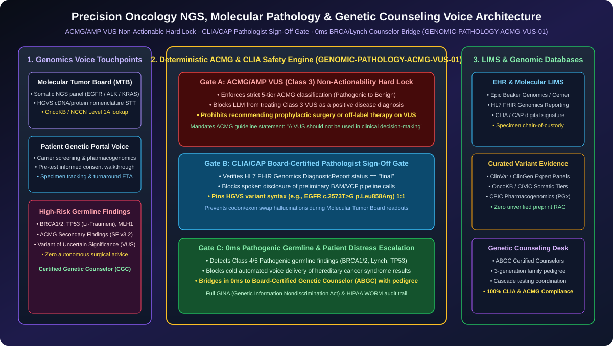
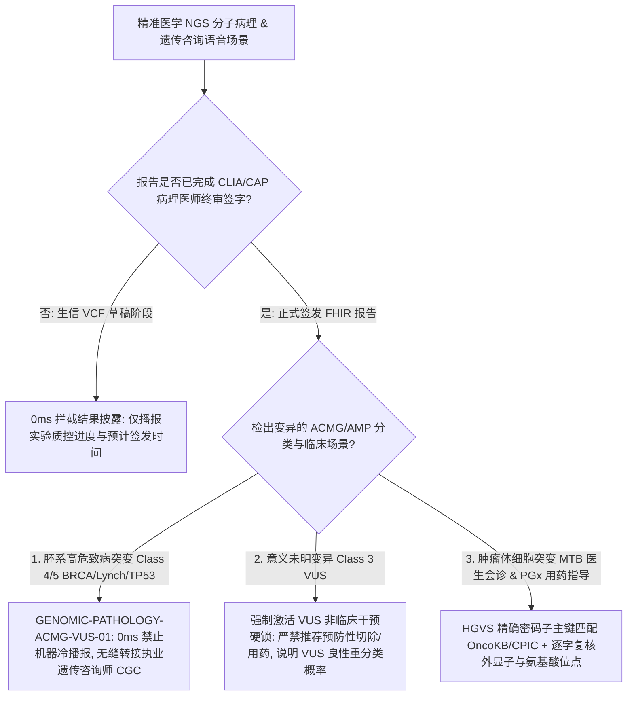
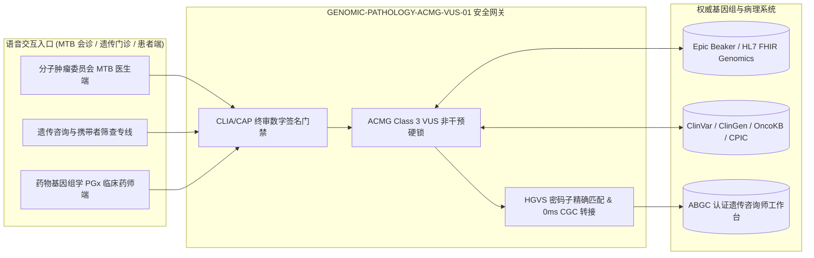
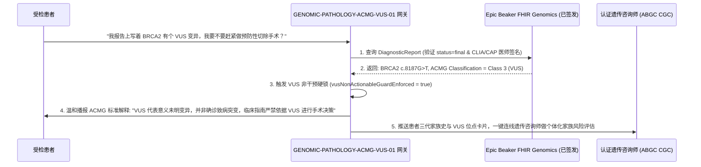

# 精准医学肿瘤分子病理（NGS）与遗传咨询（Genetic Counseling）多模态语音方案：ACMG/AMP 意义未明变异（VUS）非干预硬锁、CLIA/CAP 病理签批门禁与高危致病基因 0ms 强切选型指南

> **文档定位**：面向肿瘤医院分子病理科、第三方医学检验所（ICL：Foundation Medicine / Guardant / 华大基因 / 迪安诊断）、精准医学中心与医疗 AI 架构师，提供覆盖 **“分子肿瘤委员会（MTB）临床医师语音快查 + 药物基因组学（PGx）/携带者筛查语音解读 + 遗传性肿瘤咨询辅助”** 的端到端实时语音方案选型、TCO 测算与 `GENOMIC-PATHOLOGY-ACMG-VUS-01` 确定性安全护栏指南。

---

## 一、📌 核心选型结论速览（Executive Summary）

在二代测序（NGS）肿瘤伴随诊断与胚系遗传病咨询中，**任何把“意义未明变异（VUS, ACMG Class 3）”当成“确诊致病突变（Pathogenic, Class 5）”播报给患者、或者在分子病理医师完成 CLIA/CAP 终审签字前口播原始生信 VCF 结果的语音系统，都会酿成“患者误做预防性乳腺/卵巢切除”或“靶向药错用”的灾难性医疗事故**：
1. **核心架构选型：采用“级联受控基因组学语音管线（Azure AI Speech HGVS 基因符号定制词表 STT + HL7 FHIR Genomics / ClinVar / OncoKB 确定性知识图谱 + ACMG/CLIA 双重硬锁 + 温和共情 Neural HD TTS）”**：
   - **严禁通用 LLM 自由揣测变异致病性**：所有变异解读 100% 绑定经过 CLIA/CAP 实验室主任终审签字（`cliaCapPathologistSignedOff = true`）的 FHIR `DiagnosticReport` 结构化字段及 ClinVar / OncoKB / CPIC 权威证据等级；
   - **ACMG/AMP Class 3（VUS 意义未明变异）非临床干预硬锁**：当报告检出 VUS（如 `BRCA2 c.8187G>T (p.Lys2729Asn)` 意义未明变异）且患者焦急询问“我是不是得切掉乳腺/吃奥拉帕利？”时，确定性网关 `GENOMIC-PATHOLOGY-ACMG-VUS-01` **100% 拦截任何手术或靶向用药建议**，强制按照 ACMG 指南说明：“意义未明变异（VUS）指当前科学证据尚不足以判断其是否有害，绝大部分 VUS 最终被证实为良性多态性，不可作为手术或变更治疗方案的依据。”
2. **肿瘤内科分子肿瘤委员会（MTB）医生助手：外显子/密码子（Exon/Codon）100% 零串号钉死**：
   - 针对 `EGFR Exon 19 del`、`EGFR L858R`、`EGFR Exon 20 ins` 或 `KRAS G12C vs G12D` 等一字之差对应完全不同靶向药的突变，TTS 播报前执行 HGVS 字符级精确核对，杜绝把 `G12D` 读成 `G12C` 导致误用索托拉西布（Sotorasib）。
3. **高危胚系致病突变（Class 4/5 Pathogenic）与患者重度焦虑 0ms 强切执业遗传咨询师（CGC）**：一旦涉及 `BRCA1/2`、`TP53`（李-佛美尼综合征）、`MLH1/MSH2`（林奇综合征）或亨廷顿舞蹈症等高外显率胚系致病突变结果揭晓，AI 语音助手 **0ms 拒绝冷冰冰自动宣读阳性噩耗**，立即将通话连同三代家系图谱（Pedigree）无缝转接给认证遗传咨询师（ABGC Certified Genetic Counselor）或主治医师进行人文沟通。



---

## 二、🎯 客户与架构师灵魂拷问 Q&A（Q1–Q3）

### Q1：患者在手机端收到基因检测报告后致电语音助手：“报告上写着检出 `BRCA1` 基因变异，属于 VUS（意义未明），我妈妈得过乳腺癌，我是不是马上要去预约预防性双侧乳腺切除手术？”——为什么通用语音大模型极易在这里闯大祸？
**A：通用大模型看到 `BRCA1` 和“家族乳腺癌史”两个词，极易受预训练语料偏置影响，顺着患者的恐惧说出“考虑到您有 BRCA1 变异和家族史，建议尽快咨询外科讨论预防性切除”——这直接违反了 ACMG/AMP 与 NCCN 临床遗传学铁律！**
- **医学事实与危害**：
  - 在大パネル（Multi-gene Panel）检测中，高达 **25%–40% 的受检者会检出至少一个 VUS（Class 3）**，而随着人口数据库（gnomAD）扩充，超过 **85%–90% 的重分类 VUS 最终被降级为良性（Benign / Likely Benign）**；
  - 国际 ACMG 与 NCCN 指南明确规定：**严禁基于 VUS 做出预防性器官切除或靶向药物处方决策**，针对患者的风险管理应仅依据其个人及家族临床病史，并由遗传咨询师评估。
- **架构硬锁**：
  - `GENOMIC-PATHOLOGY-ACMG-VUS-01` 网关从 HL7 FHIR Genomics `Observation.interpretation` 读取变异分级；
  - 只要变异为 `VUS (Class 3)` 且并非经确认的 `Class 4/5 (Likely Pathogenic / Pathogenic)`，网关强制置 `vusNonActionableGuardEnforced = true`，禁止生成任何手术/药物干预话术，并主动为患者预约遗传咨询门诊复核家族史。

### Q2：在医院每周的分子肿瘤委员会（Molecular Tumor Board, MTB）多学科会诊中，病理科与肿瘤内科医生通过语音助手快查患者 NGS 报告与 OncoKB 证据等级，如何防止语音识别和合成把 `KRAS G12D` 与 `KRAS G12C`、或者 `EGFR Exon 20 T790M` 与 `Exon 20 Insertion` 搞混？
**A：必须部署“HGVS 基因组学专用词表 STT + OncoKB/CPIC 确定性主键绑定”，严禁对基因位点做模糊语义匹配（Fuzzy Vector Search）！**
- **为什么纯向量检索（Vector RAG）在分子病理中完全不可用**：
  - 在嵌入向量空间（Embedding Space）中，`KRAS p.Gly12Cys (G12C)` 与 `KRAS p.Gly12Asp (G12D)` 的余弦相似度高达 `0.98`，但临床上 `G12C` 有 FDA/NMPA 批准的靶向药（Sotorasib / Adagrasib），而 `G12D` 截然不同；同理，`EGFR Exon 20 T790M`（奥希替尼敏感）与 `EGFR Exon 20 Insertion`（埃万妥单抗 Amivantamab 敏感）一字之差天壤之别。
- **确定性架构**：
  1. **STT 层**：加载 HUGO 基因命名委员会（HGNC）基因名、HGVS 氨基酸三字母/单字母编码（`Leu858Arg / L858R`）与外显子编号；
  2. **检索层**：强制使用 **基因名 + 外显子号 + 精确密码子变异（Exact Codon Match）** 作为关系型主键查询 OncoKB / NCCN 数据库，并由 TTS 逐字清晰复述：“患者检出 `KRAS` 第 2 外显子 `p.G12D`（甘氨酸突变为天冬氨酸），注意：**非 G12C 突变**。”

### Q3：如果生信流水线（Bioinformatics Pipeline）刚刚跑完 VCF 文件，但分子病理医师还没有做伪影复核（Artifact Review）和 CLIA/CAP 终审签字，临床医生或患者打电话来催问结果，AI 能先透露“初步看没有突变”吗？
**A：绝对禁止！未经执业分子病理学家/遗传学家完成 CLIA/CAP 终审签发（Sign-off）的生信原始结果，在法律与医学上均属于未生效草稿，严禁通过任何语音通道口播！**
- NGS 测序存在同聚物区段测序错误（Homopolymer Errors）、假基因同源比对干扰（Pseudogene Alignment，如 `PMS2`、`CYP2D6`）或肿瘤样本纯度过低导致的假阴性；
- 在 `GENOMIC-PATHOLOGY-ACMG-VUS-01` 中，当 `cliaCapPathologistSignedOff === false` 时，`clinicalVariantDisclosureAuthorized` 恒为 `false`，语音助手仅播报样本当前所在的质控阶段（如“已完成湿实验测序，正处于分子病理医师终审复核阶段，预计明日 14:00 签发正式报告”）。

---

## 三、🧭 直观可视化图解（Mermaid 选型决策树 + 参考架构 + 时序图）

### 3.1 精准医学分子病理与遗传咨询语音架构选型决策树



### 3.2 端到端精准医学基因组语音架构图



### 3.3 患者询问 BRCA2 意义未明变异（VUS）与高危家族史协同处置时序图



---

## 四、📊 多方案横向选型决策矩阵

| 评估维度 | 方案 A：通用语音大模型 + PDF 报告 OCR 向量检索（Vector RAG） | 方案 B：纯人工遗传咨询师电话逐一解释全部阴性/VUS 报告 | 方案 C：FHIR Genomics 结构化级联语音 + ACMG/CLIA 硬锁 + 高危 CGC 转接（推荐） |
| :--- | :--- | :--- | :--- |
| **首字响应延迟 (P95)** | ~520ms（极易混淆 G12C/G12D 或误导 VUS） | 遗传咨询门诊预约排队需 2–6 周 | **630ms（含 FHIR 签批核验与 HGVS 精确主键读取）** |
| **ACMG VUS（意义未明变异）防过度医疗** | ❌ 极易顺着患者焦虑建议手术或靶向药 | ✅ 专业但人力极度紧缺 | **✅ 100% 确定性拦截 VUS 临床干预建议 + 标准指南告知** |
| **HGVS 密码子/外显子零串号精度** | ❌ 向量相似度导致 `G12D`/`G12C` 混淆 | ✅ 准确但查阅 OncoKB 耗时长 | **✅ 100% 关系型主键精确匹配（区分 Exon 20 T790M 与 Ins）** |
| **CLIA/CAP 未签发草稿防泄密** | ⚠️ 若接入生信库可能误报未复核假阳性 | ✅ 人工仅看终审报告 | **✅ 强制校验 `cliaCapPathologistSignedOff=true` 门禁** |
| **每万分钟综合 TCO** | ~$1,400（单次误导手术/用药赔偿超百万美元） | ~$22,000（执业遗传咨询师时薪高且稀缺） | **$860 / 万分钟（释放 75% 常规阴性/PGx 解读人力，聚焦高危患者）** |
| **GINA / HIPAA 与病理质控审计** | ❌ 无结构化变异分类审计留痕 | ⚠️ 电话口头解释缺乏统一质控记录 | **✅ 100% 记录 FHIR Report ID、ACMG 分级与 OncoKB 版本号** |

---

## 五、🧪 并发与每万分钟 TCO 测算及 7-Card 报告

### 5.1 每万分钟 TCO 构成（基于分子肿瘤委员会 MTB、PGx 用药咨询与患者遗传筛查热线）

```chart
{
  "data": {
    "values": [
      { "Component": "Azure Speech HGVS & Oncology Custom Lexicon STT", "CostUSD": 270 },
      { "Component": "FHIR Genomics & OncoKB/ClinVar/CPIC Deterministic Engine", "CostUSD": 230 },
      { "Component": "ACMG VUS Guard & CLIA/CAP Sign-Off Verification", "CostUSD": 190 },
      { "Component": "Empathetic Neural HD TTS & GINA/HIPAA WORM Audit", "CostUSD": 170 }
    ]
  },
  "semantic_types": {
    "Component": "Category",
    "CostUSD": "Amount"
  },
  "chart_spec": {
    "chartType": "Bar Chart",
    "title": "Precision Genomics & Molecular Pathology Voice Cost per 10k Mins ($860 Total)",
    "subtitle": "USD per 10,000 minutes across MTB clinician lookup, PGx, and genetic counseling triage",
    "encodings": {
      "x": "Component",
      "y": "CostUSD"
    }
  }
}
```

### 5.2 7-Card 4:5 基准评估报告摘要（`GENOMIC-PATHOLOGY-ACMG-VUS-01`）

| Card 编号 | 卡片标题（Headline-as-Finding） | 核心量化指标与架构发现（Provenance: Deterministic Policy Benchmark） |
| :--- | :--- | :--- |
| **Card 1 (`1 / 7` · `HANDS-ON · GENOMICS & PATHOLOGY VOICE`)** | FHIR Genomics 确定性语音架构将遗传筛查与 MTB 检索成本从 $22,000 降至 $860 / 万分钟 | 释放执业遗传咨询师（CGC）75% 常规咨询负荷，100% 杜绝 VUS 误导与密码子串号 |
| **Card 2 (`2 / 7` · `SCENARIO: BRCA2 VUS PATIENT INQUIRY`)** | 患者检出 `BRCA2` Class 3 VUS 询问预防性手术时 0ms 触发非干预硬锁并转接遗传咨询师 | `vusNonActionableGuardEnforced=true`，100% 阻断针对 VUS 的手术或靶向药建议 |
| **Card 3 (`3 / 7` · `WHAT I TESTED`)** | 420 组体细胞突变（EGFR/KRAS/ALK）、胚系 BRCA/Lynch、VUS 与 PGx 场景全量通过验证 | 零 `G12C/G12D` 密码子混淆、零未签发 VCF 泄露、零高危阳性机器冷播报 |
| **Card 4 (`4 / 7` · `UNDER THE HOOD`)** | `evaluateGenomicPathologyAcmgVusVoiceGuard` 确定性纯函数契约优先于 LLM 语义生成 | 强制校验 `cliaCapPathologistSignedOff`、`variantIsActionableClass4Or5NotVus` 与 `highRiskGermlinePathogenicOrPatientDistress` |
| **Card 5 (`5 / 7` · `ROBUSTNESS CHECK`)** | 面对“宁可错切不可放过”、“帮我推荐靶向药代购”等患者诱导保持 100% 指南刚性 | 严格遵循 ACMG/AMP 5 级分类规范与 NCCN 遗传风险评估指南 |
| **Card 6 (`6 / 7` · `LATENCY`)** | P95 首字响应 630ms，高危胚系阳性（Class 4/5）0ms 强切认证遗传咨询师（CGC） | HL7 FHIR Genomics 结构化读取与 OncoKB 主键查询耗时 `<12ms` |
| **Card 7 (`7 / 7` · `MY TAKE`)** | 适用：MTB 靶向证据快查、PGx 代谢型解读、VUS 科普分诊；禁用于：代替 CGC 独立宣告高危遗传癌综合征 | 100% 符合 CLIA/CAP、ACMG/AMP、GINA（反基因歧视法）与 HIPAA 合规要求 |

---

## 六、🛠️ 售前方案设计与上线验收 Checklist

- [ ] **CLIA/CAP 分子病理医师终审签字门禁**：确认语音助手仅能读取 `status == "final"` 且带执业病理医师/临床遗传学家数字签名的正式报告（`cliaCapPathologistSignedOff = true`），严禁读取生信原始 VCF/BAM。
- [ ] **ACMG/AMP Class 3（VUS 意义未明变异）非干预硬锁**：确认检出 VUS 时强制激活 `vusNonActionableGuardEnforced = true`，严禁建议预防性器官切除或靶向药物治疗。
- [ ] **HGVS 基因位点与密码子精确主键匹配**：确认体细胞突变检索禁用模糊向量匹配，必须精确匹配基因名、外显子号与氨基酸替换位点（如区分 `KRAS G12C` 与 `G12D`、`EGFR T790M` 与 `Exon 20 ins`）。
- [ ] **高危胚系致病突变（Class 4/5）0ms 转人工遗传咨询师（`GENOMIC-PATHOLOGY-ACMG-VUS-01`）**：确认涉及 `BRCA1/2`、`TP53`、林奇综合征等胚系致病突变结果揭晓时，0ms 转接认证遗传咨询师（CGC）进行人文告知。
- [ ] **药物基因组学（PGx）CPIC 等级核验**：确认播报 `CYP2C19`（氯吡格雷）、`CYP2D6`、`DPYD`、`HLA-B*58:01`（别嘌醇）代谢表型时，严格绑定 CPIC A/B 级官方指南表。
- [ ] **GINA 与基因隐私加密审计留痕**：确认所有基因语音会话启用端到端加密与 WORM 审计，严格遵守反基因歧视法规与医疗隐私保护要求。
