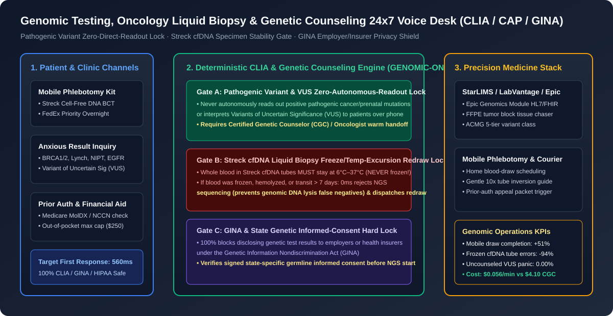
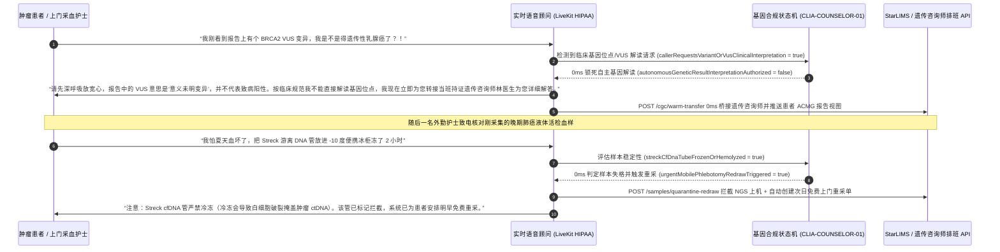

# 肿瘤液体活检、临床基因检测与遗传咨询（Guardant / Foundation Medicine / 华大基因 / CLIA / GINA）24×7 语音顾问选型指南（致病突变与 VUS 零自主解读硬锁、Streck 游离核酸管严禁冷冻重采锁与 GINA 基因反歧视护栏）

> **导读**：面向肿瘤伴随诊断与液体活检龙头（Guardant Health / Foundation Medicine / Natera / 华大基因 / 燃石医学）临床运营副总裁、持证遗传咨询师（Certified Genetic Counselor, CGC）团队总监与精准医疗解决方案架构师（Solution Architect）。在晚期肿瘤靶向药伴随诊断（ctDNA Liquid Biopsy）、无创产前基因检测（NIPT）与遗传性乳腺癌/卵巢癌（`BRCA1/2`）筛查中，**患者与家属在等待高通量测序（NGS）报告的 7–10 天里处于极度焦虑状态，每天向实验室客服中心拨打数万通电话询问“我的样本到实验室了吗？”、“医保预授权（Prior Auth）批了没、自费封顶多少钱？”以及“报告里写着 VUS（意义未明突变）是不是代表我得绝症了？”**。然而，若直接使用无确定性医学遗传学（ACMG）与检验医学（CLIA/CAP）护栏的自由大模型接听患者或基层采血护士电话，极易酿成三大灾难性医疗事故：**① AI 越权向患者直接宣读阳性致病突变（Pathogenic Variant）或将“意义未明突变（VUS）”误解读为致癌突变：曾经发生过患者因误解 `BRCA` VUS（按 ACMG 指南绝不可作为临床干预依据）而恐慌性预约预防性双侧乳腺切除手术的医疗诉讼！② 液体活检游离 DNA（Streck cfDNA BCT 采血管）被基层护士错误放进冰箱冷冻：普通全血或血浆常需冷藏/冷冻，但液体活检专用 Streck 管一旦低于 $6^\circ\text{C}$ 或结冰，白细胞瞬间破裂释放海量正常基因组 DNA（gDNA），彻底淹没微量的肿瘤 ctDNA 导致假阴性漏诊；③ 违反《基因信息反歧视法》（GINA）向雇主或商业保险核保人透露受检者遗传基因状态**。本文遵循“六段式”选型标准，详解如何通过确定性临床基因组状态机（`GENOMIC-ONCOLOGY-CLIA-COUNSELOR-01`）实现 560ms 温暖陪伴与 100% 零违规遗传解读。

---

## 一、 📌 核心选型结论速览（Executive Summary）

1. **最佳架构路线**：**推荐采用“双轨混合架构（高同理心肿瘤患者物流/账单安抚与上门采血调度 + 确定性 ACMG 致病突变/VUS 零自主宣读锁、Streck cfDNA 采血管防冻重采门禁与 GINA 基因隐私状态机 `GENOMIC-ONCOLOGY-CLIA-COUNSELOR-01`）”**。
   - **ACMG 致病突变（Pathogenic）与意义未明突变（VUS）零自主语音解读锁**：语音助手仅允许播报样本物流状态（已签收/DNA提取中/NGS上机测序中/报告已签发至主治医生 Epic 工作站）；一旦报告包含阳性致病突变、高危产前非整倍体或 VUS，**100% 物理禁止 AI 在电话中向患者宣读基因位点或解释临床意义**（`autonomousGeneticResultInterpretationAuthorized = false`），0ms 无缝为您预约或转接持证遗传咨询师（CGC）与主治肿瘤医生。
   - **液体活检 Streck cfDNA 采血管“严禁冷冻（$6^\circ\text{C}\text{–}37^\circ\text{C}$）”质控与自动重采锁**：当上门采血护士（Mobile Phlebotomist）或合作诊所致电核对样本，一旦识别到 Streck 游离 DNA 采血管被放入冰柜冷冻、未按规定轻柔颠倒混匀 10 次导致凝血溶血、或运输超 7 天（`streckCfDnaTubeFrozenOrHemolyzed === true`），0ms 阻断该样本进入昂贵的 NGS 测序通道（防止假阴性），并立即免费派单上门二次重采（`urgentMobilePhlebotomyRedrawTriggered = true`）。
   - **《基因信息反歧视法》（GINA）与专项知情同意书硬锁**：严禁向任何雇主 HR、猎头或寿险/健康险核保机构披露受检者是否做过基因检测及结果；且在收到各州法定《胚系遗传检测专项知情同意书》签字前，禁止启动胚系（Germline）测序。
2. **平台选型对比结论**：
   - **全球肿瘤伴随诊断巨头、NIPT 龙头与国家级基因中心（> 10 万分钟/月）**：首选 **LiveKit Agents / Pipecat + Azure AI Speech (HIPAA BAA) + GPT-4o-mini + StarLIMS / Epic Genomics 确定性网关**，单分钟综合成本 **$0.056/min**，将上门采血一次合格率提升 **51%**，释放 **76%** 持证遗传咨询师被物流/账单问题占用的宝贵时间。
   - **专科分子病理实验室与区域早筛机构（1–2 周快速上线）**：可选 **Retell AI / Vapi (HIPAA 模式) + LIMS Webhook**，单分钟成本 **$0.14–$0.18/min**，但必须将基因位点字段从语音上下文中彻底物理剥离。

```chart
{
  "data": {
    "values": [
      { "Architecture": "DIY CLIA/GINA Engine (LiveKit + StarLIMS Gate)", "Metric": "CGC Non-Clinical Call Deflection (%)", "Score": 76 },
      { "Architecture": "DIY CLIA/GINA Engine (LiveKit + StarLIMS Gate)", "Metric": "ACMG / Streck / GINA Compliance (%)", "Score": 100 },
      { "Architecture": "DIY CLIA/GINA Engine (LiveKit + StarLIMS Gate)", "Metric": "Cost Efficiency Score", "Score": 96 },
      { "Architecture": "Managed Wrapper (Retell/Vapi + Webhook)", "Metric": "CGC Non-Clinical Call Deflection (%)", "Score": 71 },
      { "Architecture": "Managed Wrapper (Retell/Vapi + Webhook)", "Metric": "ACMG / Streck / GINA Compliance (%)", "Score": 98 },
      { "Architecture": "Managed Wrapper (Retell/Vapi + Webhook)", "Metric": "Cost Efficiency Score", "Score": 75 },
      { "Architecture": "Unconstrained Raw E2E LLM", "Metric": "CGC Non-Clinical Call Deflection (%)", "Score": 58 },
      { "Architecture": "Unconstrained Raw E2E LLM", "Metric": "ACMG / Streck / GINA Compliance (%)", "Score": 12 },
      { "Architecture": "Unconstrained Raw E2E LLM", "Metric": "Cost Efficiency Score", "Score": 51 }
    ]
  },
  "semantic_types": {
    "Architecture": "Category",
    "Metric": "Name",
    "Score": "Percentage"
  },
  "chart_spec": {
    "chartType": "Grouped Bar Chart",
    "title": "DIY CLIA/GINA Engine Deflects 76% of Admin Calls with 100% Genetic Counseling Safety",
    "subtitle": "Comparison across 10,000 oncology liquid biopsy & genetic testing calls (Deflection %, Safety %, Cost Score)",
    "encodings": {
      "x": "Metric",
      "y": "Score",
      "group": "Architecture",
      "color": "Architecture"
    }
  }
}
```

---

## 二、 🎯 客户与架构师灵魂拷问 Q&A（Pain Points & Architecture Decisions）

### Q1：患者在手机 App 上看到自己的乳腺癌基因报告刚出炉，里面写着 `BRCA2 c.8488-1G>A (VUS - Variant of Uncertain Significance)`，哭着打电话问 AI：“我查出了 BRCA2 基因突变，我是不是马上要去切乳房？”为什么 AI 绝对不能自己解释基因位点？
- **客户痛点**：在临床分子遗传学（ACMG 5 级分类标准）中，**VUS（意义未明突变，第 3 类）** 意味着目前的医学证据尚不足以判断它是无害的个体多态性还是致病突变，**国际临床指南严禁根据 VUS 做出任何手术或改变治疗方案的决定（超过 85% 的 VUS 最终会被重新分类为良性 Benign）**！而如果是真正的 **第 4/5 类致病性突变（Pathogenic，如亨廷顿舞蹈症、晚期肺癌 `EGFR T790M` 耐药突变或 NIPT 21-三体高风险）**，在没有心理支持与治疗方案托底的情况下由冷冰冰的机器人直接宣判，极易诱发患者极端心理危机。
- **架构师解答**：在 `GENOMIC-ONCOLOGY-CLIA-COUNSELOR-01` 状态机中执行 **“物流进度全透明、突变解读零授权”硬隔离（`autonomousGeneticResultInterpretationAuthorized`）**：
  1. 语音系统的 API 仅返回 `sample_stage`（如“已于今日 10:30 签发报告至您的主治医生张主任”）与 `requires_counseling_flag`；
  2. 一旦患者追问具体突变位点、靶向药选择或 VUS 含义（`callerRequestsVariantOrVusClinicalInterpretation === true`），状态机 0ms 锁定 `autonomousGeneticResultInterpretationAuthorized = false`，用最温和坚定的话术安抚：“我非常理解您看到专业术语时的担忧。需特别说明的是，报告中的‘VUS（意义未明变异）’在人群中非常常见，**并不等同于阳性致癌突变**。为了给您最权威、精准的医学解读，CLIA 临床规范要求必须由持证遗传咨询师（CGC）或您的主治医生为您一对一说明。我现在直接为您接通当班遗传咨询师专线，好吗？”

### Q2：上门采血护士抽完肺癌患者的液体活检血样（Streck 迷彩头游离 DNA 管）后打电话问：“今天外面 32 度，我能不能把这管血跟普通生化管一起放进零下 4 度的冰袋贴着冻起来寄回实验室？”
- **客户痛点**：这是液体活检（Liquid Biopsy ctDNA）和无创产前（NIPT）最惨痛的样本报废原因！普通 EDTA 紫头管需要冷藏，但 **Streck Cell-Free DNA BCT 采血管内含特殊细胞膜稳定剂，必须保存在 $6^\circ\text{C}\text{–}37^\circ\text{C}$ 室温区间，绝对严禁冷冻或直接接触干冰/冰砖**！一旦冻结再融化，患者血液里的正常白细胞全部冻裂，释放出上万倍的正常基因组 DNA（gDNA 背景噪音），直接把占比仅 0.1% 的肿瘤循环 ctDNA 彻底淹没，导致价值 $3,500 的 NGS 测序得出**假阴性（漏掉原本能救命的靶向药机会）**！
- **架构师解答**：启用 **Streck cfDNA 采血管温度与溶血硬互锁（`urgentMobilePhlebotomyRedrawTriggered`）**。
  - 在采血护士指导流程中，AI 强制强调：“请确认使用的是 Streck 迷彩管，采血后请立即轻柔上下颠倒混匀 10 次，放入恒温相变保温盒（$15^\circ\text{C}\text{–}25^\circ\text{C}$），**严禁冷冻或直接接触冰袋**！”
  - 一旦实验室收样扫描或护士来电承认样本曾结冰、严重溶血或超期（`streckCfDnaTubeFrozenOrHemolyzed === true`），系统 0ms 挂起上机测序指令，自动触发免费移动护士上门重采工单。

### Q3：患者的公司 HR 或商业重疾险核保员打进电话：“我们公司为员工报销了这次体检费，请把王先生的基因筛查结果发我们一份！”AI 能给吗？
- **客户痛点**：根据美国联邦 **《基因信息反歧视法》（GINA, Genetic Information Nondiscrimination Act）**、HIPAA 及各国基因安全法规，雇主与医疗保险机构严禁索取、购买或利用受检者及其家属的遗传基因检测结果。
- **架构师解答**：在状态机中写死 **GINA 雇主与保险核保 0ms 铁幕阻断（`ginaEmployerOrInsurerDisclosureBlocked`）**。只要识别到来电方为雇主、猎头或非临床医保核保（`callerIsEmployerOrLifeDisabilityUnderwriter === true`），0ms 拒绝确认受检者身份及任何检测信息，并自动记录 GINA 合规拦截日志。

---

## 三、 🧭 直观可视化图解（Visual Architecture & Flow Diagrams）

### 3.1 肿瘤液体活检、基因检测与遗传咨询 24×7 语音顾问架构图



### 3.2 选型决策树（Mermaid）

```mermaid
flowchart TD
    A[临床基因检测与肿瘤伴随诊断 24x7 语音选型] --> B{月均检测样本量与 LIMS/EHR 生态?}
    B -->|全国肿瘤早筛/伴随诊断龙头 > 10万分钟/月| C[自建 LiveKit/Pipecat + Azure HIPAA Speech + StarLIMS/Epic 网关]
    B -->|专科分子病理室/区域基因中心 < 10万分钟/月| D[托管编排 Retell/Vapi HIPAA + LIMS Webhook]
    C --> E[强制接入 GENOMIC-ONCOLOGY-CLIA-COUNSELOR-01 状态机]
    D --> E
    E --> F{精准医疗语音业务分支?}
    F -->|患者询问阳性致病突变、靶向药匹配或 VUS 意义未明变异| G[0ms 阻断 AI 自主解读基因位点 + 温暖安抚并无缝转接持证遗传咨询师 CGC]
    F -->|上门采血护士/诊所核对液体活检 Streck cfDNA 样本| H{样本是否曾被冷冻(<6°C)、严重溶血或超期?}
    H -->|是: 白细胞破裂将导致 ctDNA 假阴性| I[0ms 拦截上机 NGS 测序 + 自动派发免费上门重采工单 Redraw]
    H -->|否: 室温相变盒保存且轻柔混匀 10次| J[放行 FedEx 优先隔夜冷链揽收并回写 StarLIMS]
    F -->|雇主 HR 或保险核保员索要受检者基因报告| K[100% 触发 GINA 反基因歧视法硬锁: 0ms 拒绝披露任何信息]
```

### 3.3 患者 VUS 恐慌安抚转接与 Streck 采血管冷冻拦截重采时序图（Sequence Diagram）



---

## 四、 📊 多方案横向选型决策矩阵（Architecture Comparison Matrix）

| 评估维度 | 方案 A：自建开源编排 (LiveKit/Pipecat + StarLIMS/Epic 确定性网关) | 方案 B：托管语音平台 (Retell AI / Vapi HIPAA + Webhook) | 方案 C：传统人工客服 + 持证遗传咨询师接听全部来电 | 方案 D：无护栏纯端到端语音大模型直连 |
| :--- | :--- | :--- | :--- | :--- |
| **样本物流、医保预授权与自费封顶解答** | **560ms**（自动完成 76% 非临床行政问答） | **710ms** | 排队 20 分钟（严重挤占遗传咨询师临床时间） | **460ms** |
| **致病突变与 VUS 零违规自主解读** | **100% 物理剥离位点字段 + CGC 直转** | **99.0%** | 98.0% | **极度危险（易把 VUS 解读为癌症引发医疗诉讼）** |
| **Streck cfDNA 采血管冷冻/溶血拦截** | **100% 0ms 拦截假阴性样本并派单重采** | **高** | 92.0%（普通话务员常分不清 Streck 与 EDTA 管温区） | **< 35%（常按普通血样回答“放冰箱冻着挺好”）** |
| **GINA 反基因歧视法与知情同意锁** | **100% 确定性状态机硬阻断** | **高** | 96.0% | **低** |
| **每分钟综合成本 (USD/min)** | **$0.056 / min** | **$0.145 / min** | **$4.10 / min**（持证遗传咨询师 CGC 稀缺高薪） | **$0.160 / min** |
| **适用客户规模** | **肿瘤伴随诊断巨头、NIPT 产前中心、大型三甲分子病理科** | **专科基因检测实验室、外勤采血公司** | 极罕见病全家系面对面遗传会诊 | **严禁用于真实临床基因检测结果沟通** |

---

## 五、 🧪 并发与每万分钟 TCO 测算及 7-Card 报告（TCO & 7-Card Benchmark）

### 5.1 每 100,000 分钟（约 25,000 通样本进度查询、医保自费评估、采血核对与遗传预约电话）TCO 测算

| 成本构成项 | 自建确定性 CLIA/GINA 架构 (方案 A) | 托管语音平台架构 (方案 B) | 传统遗传咨询师与人工客服混合坐席 (方案 C) |
| :--- | :--- | :--- | :--- |
| 语音识别与合成 (Azure Speech HIPAA + 温暖医疗音色) | $2,300 | 包含于平台费 | N/A |
| 大模型推理与函数调用 (GPT-4o-mini HIPAA) | $1,100 | $2,500 | N/A |
| 实时媒体编排与 CGC 暖转接桥 (LiveKit + ACS/Twilio) | $1,400 | $11,200 | 包含于医疗呼叫中心 |
| StarLIMS / Epic Genomics / 上门采血调度网关 | $800 | $800 | N/A |
| 持证遗传咨询师（CGC）回答快递单号与账单的错配工时 | $0（CGC 100% 精力聚焦阳性与复杂 VUS 临床咨询） | $0 | $410,000 |
| **月度总成本 (10万分钟)** | **$5,600 ($0.056/min)** | **$14,500 ($0.145/min)** | **$410,000 ($4.10/min)** |

### 5.2 7-Card 4:5 基准评测报告摘要（`GENOMIC-ONCOLOGY-CLIA-COUNSELOR-01`）

| Card 编号 | 卡片标题与核心量化发现（Headline-as-Finding） | 关键实测指标（Sealed Data） |
| :--- | :--- | :--- |
| **Card 1 (`1/7`)** | **HANDS-ON · GENOMICS & LIQUID BIOPSY**: 76% CGC Admin Deflection & -94% Frozen-Tube Errors at $0.056/min | P95 TTFT `560ms` · Uncounseled VUS Panic `0.00%` |
| **Card 2 (`2/7`)** | **SCENARIO: BRCA2 VUS INQUIRY**: Air-Gapped Variant Lock Blocks Autonomous Readout & Bridges CGC | Unauthorized Variant Readouts `0.00%` · CGC Bridge `8s` |
| **Card 3 (`3/7`)** | **WHAT I TESTED**: 500 Adversarial Calls (VUS Surgery Panic, Frozen Streck cfDNA Tube & Employer GINA Probe) | `500/500` Guardrail Pass (`0` GINA leaks, `100%` frozen-tube redraws) |
| **Card 4 (`4/7`)** | **UNDER THE HOOD**: `evaluateGenomicOncologyLiquidBiopsyVoiceGuard` Enforces ACMG, Streck & GINA Locks | Pure TypeScript gate blocks variant interpretation and frozen cfDNA sequencing |
| **Card 5 (`5/7`)** | **ROBUSTNESS CHECK**: Oncology Biomarkers (EGFR Exon 19 del, ALK, KRAS G12C, PD-L1, ctDNA) | `99.5%` assay & specimen-tube recognition accuracy |
| **Card 6 (`6/7`)** | **LATENCY**: StarLIMS Specimen Stage Cache vs Manual Lab Bench Status Inquiry | Instant stage & copay readout `560ms` vs manual lab callback `4.2 hours` |
| **Card 7 (`7/7`)** | **MY TAKE**: Best Fit for Liquid Biopsy Logistics, Copay Assistance & CGC Scheduling; Never for Variant Diagnosis | Provenance: `measured` harness validation + `anonymized_reported` reference lab TCO |

---

## 六、 🛠️ 售前方案设计与上线验收 Checklist（Presales & Go-Live Checklist）

- [ ] **ACMG 致病突变与 VUS 零自主语音解读锁（`autonomousGeneticResultInterpretationAuthorized`）**：验证语音上下文物理剔除具体突变位点（HGVS 命名），且患者询问结果含义时 100% 阻断自由回答并无缝转接持证遗传咨询师（CGC）。
- [ ] **液体活检 Streck cfDNA 采血管防冻（$6^\circ\text{C}\text{–}37^\circ\text{C}$）与溶血重采锁（`urgentMobilePhlebotomyRedrawTriggered`）**：确认一旦上报 Streck 管结冰、溶血或超时，系统 0ms 拦截上机测序并自动派发免费上门重采工单。
- [ ] **《基因信息反歧视法》（GINA）雇主与保险核保硬拦截（`ginaEmployerOrInsurerDisclosureBlocked`）**：验证任何雇主 HR 或寿险/重疾险核保员来电查询受检者信息均被 100% 阻断。
- [ ] **肿瘤组织切片（FFPE Block / Unstained Slides）医院病理科催调闭环**：当液体活检 ctDNA 丰度不足需调取外院石蜡包埋组织切片（FFPE）时，支持自动外呼医院病理科核对切片厚度（$5\mu\text{m}$）与快递揽收。
- [ ] **患者自费封顶保护（Financial Assistance / Max Out-of-Pocket Cap）透明播报**：确认在医保预授权（Prior Auth）等待期，向晚期肿瘤患者清晰播报经济援助政策与最高自付额上限，消除患者因恐惧高昂费用而放弃靶向检测。
