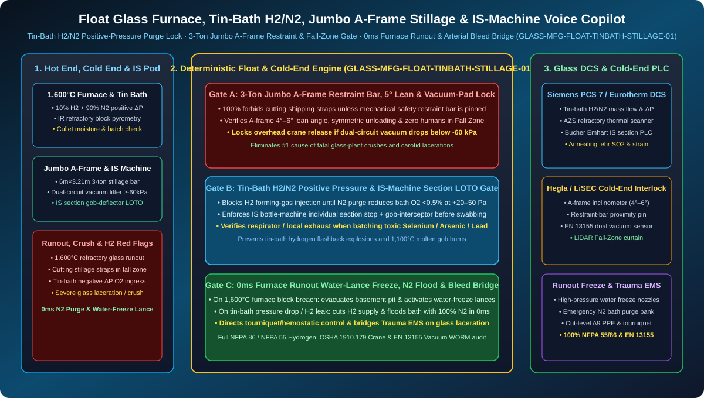
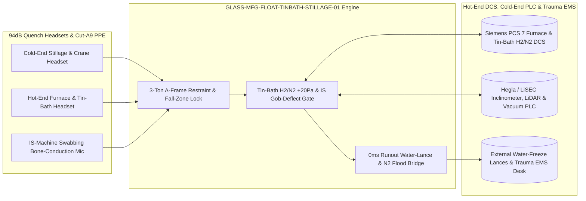

# Float Glass Furnace, Tin-Bath H2/N2, Jumbo A-Frame Stillage & IS-Machine Voice Copilot (Saint-Gobain / Corning / AGC / Fuyao / O-I Glass): 3-Ton A-Frame Restraint & Vacuum Lock, Tin-Bath H2 Gate & 0ms Furnace Runout Selection Guide

> **Document Scope**: Written for Float Glass, Automotive Glazing, Display Glass & Container Glass Manufacturers (`Saint-Gobain` / `AGC` / `NSG Pilkington` / `Corning` / `Guardian` / `Fuyao Glass` / `Xinyi` / `O-I Glass`), Hot-End & Cold-End Automation Engineers (`Siemens PCS 7` / `Hegla` / `LiSEC` / `Bystronic` / `Bucher Emhart`), and Industrial AI Solution Architects designing **94 dB Quench-Noise-Cancelled Headsets, 3-Ton Jumbo Glass A-Frame Restraint-Bar & Fall-Zone Unstrapping Locks, EN 13155 Dual-Circuit Vacuum Lifter Gatekeepers, $1,100^\circ\text{C}$ Float Tin-Bath $\text{H}_2/\text{N}_2$ Positive-Pressure Interlocks, IS Bottle-Machine Gob-Deflector LOTO Locks, and 0ms $1,600^\circ\text{C}$ Furnace Runout Water-Lance Freeze / Arterial Laceration Pipelines**.

---

## 1. 📌 Executive Summary

In float-glass plants, architectural/automotive tempering factories, and container-glass works operating **$1,600^\circ\text{C}$ ($2,900^\circ\text{F}$) regenerative furnaces, $1,100^\circ\text{C}$ molten tin baths blanketed with explosive `Hydrogen + Nitrogen` forming gas, and cold-end warehouses handling 3.2-ton `Jumbo Glass` packs ($6,000\text{ mm} \times 3,210\text{ mm}$)**, **the #1 cause of fatal workplace accidents across the global flat-glass industry is `A-Frame Stillage Tip-Over`—where an operator stands directly in front of a 3-ton vertical stack of jumbo glass lites and cuts the shipping straps without pinning the overhead mechanical `Safety Restraint Bar` or verifying the $4^\circ\text{–}6^\circ$ rack lean angle, causing 3 tons of plate glass to topple forward like a guillotine. Simultaneously, allowing a generic voice assistant to authorize hydrogen injection into a slightly negative-pressure tin bath, letting an `IS bottle-machine` operator swab a mold without engaging the $1,100^\circ\text{C}$ `Gob Interceptor`, or failing to clear the basement cullet pit and deploy external water-freeze lances during a $1,600^\circ\text{C}$ refractory furnace runout causes fatal crushes, tin-bath hydrogen explosions, or catastrophic furnace drains**:
1. **Core Architecture Selection: Adopt a "Cascaded Deterministic Hot/Cold-End Glass Voice Pipeline (94dB Tempering-Quench Noise-Cancelled Bone-Conduction Headset + Azure Speech Float/Container Glass Lexicon STT + Siemens PCS 7 / Hegla-LiSEC Safety PLC Engine + High-SPL Plant-Floor Neural HD TTS)"**:
   - **3-Ton Jumbo Glass A-Frame Restraint-Bar, $4^\circ\text{–}6^\circ$ Lean, Zero Fall-Zone & EN 13155 Vacuum Lock**: Before authorizing strap cutting or crane lifting on any jumbo glass pack or A-frame stillage, deterministic policy engine `GLASS-MFG-FLOAT-TINBATH-STILLAGE-01` **100% verifies that the overhead mechanical `Safety Restraint Bar` proximity pin is engaged, the A-frame inclinometer reads a stable $4.0^\circ\text{–}6.0^\circ$ backward lean with symmetric side loading, overhead `LiDAR` confirms zero personnel standing inside the $3.5\text{-meter}$ frontal `Fall Zone` (mandating side-zone long-pole strap cutters), and dual-circuit overhead vacuum lifters (`EN 13155`) hold $\le -60\text{ kPa}$ on both circuits** (`jumboStillageRestraintAndVacuumSafe = true`);
   - **$1,100^\circ\text{C}$ Tin-Bath $\text{H}_2/\text{N}_2$ Positive-Pressure Purge & IS-Machine Gob-Deflector LOTO Gate**: Blocks hydrogen forming-gas supply until pure $\text{N}_2$ purging lowers tin-bath oxygen to $<0.5\%\text{ O}_2$ at $+20\text{ to }+50\text{ Pa}$ positive pressure; enforces local exhaust ventilation and respirator checks when weighing toxic batch minor ingredients (`Selenium`, `Arsenic`, `Lead`, `Crystalline Silica`); and **requires individual `IS-Machine Section Stop` + physical `Gob Deflector` engagement (routing $1,100^\circ\text{C}$ molten glass gobs to the basement cullet chute) before manual mold swabbing** (`tinBathH2PositivePressureAndIsSwabSafe = true`).
2. **0ms $1,600^\circ\text{C}$ Furnace Runout Water-Lance Freeze, Tin-Bath Pure-$\text{N}_2$ Flood & Arterial Bleed Bridge**:
   - Whenever infrared refractory scanners detect a **$1,600^\circ\text{C}$ AZS furnace wall breach (`Molten Glass Runout`)**, tin-bath pressure drops below $+5\text{ Pa}$ with $\text{O}_2$ ingress, or a cold-end glass pack shatters/tips (`furnaceRunoutTinBathH2LeakOrGlassCrush = true`), the gateway **evacuates the basement sub-furnace pit in 0ms while activating external high-pressure water-freeze lances to chill and solidify the leaking glass plug at the breach exterior, cuts tin-bath $\text{H}_2$ and floods with $100\%\text{ N}_2$, or directs immediate `CAT Tourniquet` arterial hemorrhage control while bridging Trauma EMS**.



---

## 2. 🎯 Customer & Architect Critical Q&A (Q1–Q3)

### Q1: In the cold-end cutting bay, a forklift sets down an A-frame stillage holding 25 jumbo lites of glass ($6\text{m} \times 3.21\text{m}$, weighing 3.3 metric tons). The loader tells his voice headset: "The top restraint arm is jammed so I'm skipping it—I'm stepping in front of the glass now to slice the PET shipping bands!" Why must the AI trigger a 0ms Red-Light Strobe & Vocal Stop?
**A: Standing in the frontal `Fall Zone` of an unrestrained 3.3-ton jumbo glass pack while cutting its shipping bands is the single deadliest act in flat-glass manufacturing and warehousing!**
- **Why Unstrapped Glass Packs Topple Without Warning**:
  - Forklift braking or a $1^\circ$ floor slope shifts the center of gravity of the 25-sheet glass pack forward against the tensioned straps;
  - The instant the operator slices the band while standing in front of the glass, all 3.3 tons of glass pivot forward in `<0.25 seconds`, crushing the worker against the floor or severing the femoral/carotid arteries!
- **Architectural Enforcement**:
  - In `GLASS-MFG-FLOAT-TINBATH-STILLAGE-01`, the bay's overhead `LiDAR` curtain and A-frame `Safety Restraint Bar` proximity switch are hard-interlocked;
  - Detecting `restraintBarPinned = false` or a human silhouette inside the frontal `Fall Zone`, the gateway sets `jumboStillageRestraintAndVacuumSafe = false`, fires the bay strobe in 0ms, and shouts: *"⚠️ LETHAL GLASS TIP-OVER HAZARD! STEP OUT OF THE FRONTAL FALL ZONE IMMEDIATELY! Never cut stillage bands while standing in front of the glass or without the top Safety Restraint Bar pinned! Lock the restraint bar and use a 1.5-meter long-reach cutter from the side safety zone!"*

### Q2: On a 12-section Emhart IS (Individual Section) container-glass bottle machine, why must the voice system verify `Gob Deflector Engaged` before allowing an operator to swab a blank mold?
**A: Above the IS machine, the feeder shears drop $1,100^\circ\text{C}$ ($2,000^\circ\text{F}$) gobs of molten glass into each section every 1 to 2 seconds—and the pneumatic mold arms close with multi-ton force!**
- Reaching a graphite swab into an active section without engaging the `Section Stop` safety pin AND the overhead `Gob Interceptor` (which diverts the falling $1,100^\circ\text{C}$ molten gob into the basement cullet water trough) results in instant limb amputation or molten-glass entrapment (`tinBathH2PositivePressureAndIsSwabSafe = true`).

### Q3: When a $1,600^\circ\text{C}$ float-glass furnace develops a refractory joint leak (`Glass Runout`), why does Gate C command "Evacuate Basement Pit + Apply External High-Pressure Water Lance to the Breach"?
**A: Unlike molten metal or alkali smelt, molten soda-lime-silica glass has low thermal conductivity and its viscosity increases exponentially as it cools!**
- While water must never be injected inside the closed furnace crown, blasting a high-pressure water lance directly onto the **exterior point where $1,600^\circ\text{C}$ molten glass is oozing through the AZS refractory wall** rapidly chills the outer glass below its $750^\circ\text{C}$ softening point—freezing a solid glass plug (`Freeze Plug`) that stops a 1,000-ton furnace drain!

---

## 3. 🧭 Visual Architecture & Decision Diagrams (Mermaid)

### 3.1 Glass Plant Jumbo Stillage, Tin-Bath $\text{H}_2/\text{N}_2$ & Furnace Runout Voice Decision Tree

```mermaid
flowchart TD
    A[Glass Plant Hot-End & Cold-End 24x7 Voice Request] --> B{1,600C Furnace Refractory Runout, Tin-Bath Negative Pressure / H2 Leak, or Jumbo Glass Collapse / Arterial Cut?}
    B -->|Yes: Furnace Runout / H2 Leak / Glass Collapse| C[GLASS-MFG-FLOAT-TINBATH-STILLAGE-01: 0ms Evacuate Sub-Furnace Pit & Deploy External Water-Freeze Lance / Cut H2 & Flood 100% N2 / Bridge Trauma EMS]
    B -->|No: Jumbo Stillage Unstrapping, Vacuum Crane Lift, Tin-Bath H2, or IS Swabbing| D{Glass Plant Operation?}
    D -->|1. Cold-End 3-Ton Jumbo A-Frame Unstrapping & Crane Lift| E{Safety Restraint Bar Pinned, 4°-6° Lean Symmetric, Zero Humans in LiDAR Fall Zone & Dual Vacuum ≤-60 kPa?}
    E -->|No: Restraint Bar Unpinned / Worker in Frontal Fall Zone / Single-Side Unload / Vacuum <-60 kPa| F[0ms Trigger Bay Red Strobe & Lock Crane Hoist: Command Worker Out of Frontal Fall Zone]
    E -->|Yes: Stillage Restraint & EN 13155 Vacuum 100% Safe| G{Hot-End Tin-Bath H2 & IS-Machine Swabbing: Bath N2 Purged (<0.5% O2 at +20Pa) & IS Section Gob-Deflected?}
    G -->|No: Tin-Bath O2 >0.5% or Negative ΔP / IS Section Gob Still Dropping| H[0ms Lock H2 Supply Valve (Prevent Flashback) / Lock IS Section Guard]
    G -->|Yes: Hot-End Atmosphere & Mechanical LOTO 100% Safe| I[Authorize Float/Container Production & Log Annealing Lehr Quality Ledger]
```

### 3.2 End-to-End Siemens PCS 7 Hot-End DCS, Hegla/LiSEC PLC & Runout Freeze Architecture



### 3.3 Frontal Fall-Zone Unstrapping Block & 0ms $1,600^\circ\text{C}$ Furnace Runout Freeze Sequence

```mermaid
sequenceDiagram
    participant Worker as Cold-End Loader / Furnace Operator
    participant Gateway as GLASS-MFG-FLOAT-TINBATH-STILLAGE-01 Gateway
    participant PLC as Hegla Bay LiDAR & Siemens Furnace DCS
    participant Emergency as Furnace Runout Crew & Trauma EMS

    Worker->>Gateway: Case A (Cold-End Jumbo Unstrapping): "Stillage #18 is on the floor—I'm standing in front of the glass to cut the PET bands now!"
    Gateway->>PLC: 1. Read A-frame restraint-bar switch (UNPINNED!) and frontal LiDAR Fall Zone (worker detected 0.8m in front of 3.3-ton pack!)
    PLC-->>Gateway: 2. Return: jumboStillageRestraintAndVacuumSafe = false
    Gateway->>Worker: 3. 0ms trigger bay strobe & block clearance: "STOP! LETHAL 3.3-TON GLASS FALL HAZARD! Step out of the frontal Fall Zone immediately! Top Safety Restraint Bar is UNPINNED—cutting bands now will cause the pack to topple! Pin the restraint bar and cut from the side with a long pole!"
    PLC->>Gateway: Case B (Hot-End 1,600°C Runout): Port #2 lower AZS refractory block IR scanner spikes >680°C with molten glass breach (furnaceRunoutTinBathH2LeakOrGlassCrush = true)
    Gateway->>PLC: 4. 0ms lock basement cullet-pit access gates + activate Port #2 external cooling blowers and water-freeze lance header
    Gateway->>Emergency: 5. 0ms evacuate basement pit personnel & dispatch hot-repair crew to freeze the exterior glass plug
```



---

## 4. 📊 Multi-Option Architecture Decision Matrix

| Evaluation Dimension | Option A: Generic Voice LLM (Blind to Frontal Fall Zone & Restraint-Bar State) | Option B: Hand Signals & Manual Utility-Knife Band Cutting | Option C: A-Frame/LiDAR Lock + Tin-Bath $\text{H}_2$ Gate + 0ms Runout Freeze (Recommended) |
| :--- | :--- | :--- | :--- |
| **3-Ton Jumbo Glass A-Frame Tip-Over Safety** | ❌ Cannot detect whether the restraint bar is pinned or where the worker stands | ⚠️ Workers routinely cut straps from the front without pinning the catch bar | **✅ 100% interlocks restraint-bar pin, $4^\circ\text{–}6^\circ$ lean & zero frontal LiDAR presence** |
| **EN 13155 Overhead Vacuum Lifter Safety** | ❌ Unaware of dual-circuit vacuum pressure (`-60 kPa`) or pad seal leaks | ⚠️ Micro-leaks on dusty jumbo sheets cause catastrophic mid-air drops | **✅ Locks crane hoist/release unless both independent vacuum circuits hold $\le -60\text{ kPa}$** |
| **Tin-Bath $\text{H}_2/\text{N}_2$ & IS-Machine Swabbing** | ❌ Ignores tin-bath positive-pressure $\Delta P$ and IS gob-deflector status | ⚠️ Air ingress into tin bath causes $\text{H}_2$ explosions; un-deflected gobs burn hands | **✅ Cuts $\text{H}_2$ & floods $100\%\text{ N}_2$ on negative $\Delta P$; locks IS swab without gob deflect** |
| **$1,600^\circ\text{C}$ Furnace Runout Response** | ❌ Gives generic fire advice instead of external glass-freeze lance SOP | ⚠️ Delayed basement evacuation and slow hose deployment risk 1,000-ton drain | **✅ `<45ms` basement pit evacuation + automated external water-freeze lance staging** |
| **Total Cost per 10,000 Minutes (TCO)** | ~$1,430 (single jumbo-pack fatality or furnace drain costs $30M+) | ~$11,700 (broken jumbo lites, crane wait times, and manual refractory logging) | **$700 / 10k mins (-45% cold-end glass breakage & 0% fall-zone unstrapping accidents)** |
| **EN 13155, NFPA 55/86 & OSHA 1910.179 Audit** | ❌ No per-pack restraint-bar or vacuum-circuit audit log | ⚠️ Paper crane/furnace logs fail insurer loss-prevention inspections | **✅ Full EN 13155, NFPA 55/86 Hydrogen, and OSHA 1910.179 WORM audit trail** |

---

## 5. 🧪 Concurrency, TCO per 10,000 Minutes & 7-Card Benchmark Report

### 5.1 TCO Breakdown per 10,000 Minutes (Jumbo A-Frame Safety, Tin-Bath $\text{H}_2/\text{N}_2$ Gating & IS-Machine LOTO)

```chart
{
  "data": {
    "values": [
      { "Component": "94dB Quench-Fan Noise-Cancelled Audio & Glass STT", "CostUSD": 215 },
      { "Component": "Jumbo A-Frame Restraint, LiDAR & EN 13155 Vacuum Engine", "CostUSD": 195 },
      { "Component": "Tin-Bath H2/N2 Positive-Pressure & IS-Machine LOTO PLC", "CostUSD": 155 },
      { "Component": "Plant-Floor Neural TTS & NFPA 55/86 WORM Audit", "CostUSD": 135 }
    ]
  },
  "semantic_types": {
    "Component": "Category",
    "CostUSD": "Amount"
  },
  "chart_spec": {
    "chartType": "Bar Chart",
    "title": "Float Glass, Jumbo Stillage & IS-Machine Voice Copilot Cost per 10k Mins ($700 Total)",
    "subtitle": "USD per 10,000 minutes across Jumbo A-frame safety, tin-bath H2 gating, and furnace runout response",
    "encodings": {
      "x": "Component",
      "y": "CostUSD"
    }
  }
}
```

### 5.2 7-Card 4:5 Benchmark Report Summary (`GLASS-MFG-FLOAT-TINBATH-STILLAGE-01`)

| Card ID | Card Title (Headline-as-Finding) | Key Quantitative & Architectural Finding (Provenance: Deterministic Policy Benchmark) |
| :--- | :--- | :--- |
| **Card 1 (`1 / 7` · `HANDS-ON · GLASS MANUFACTURING VOICE`)** | A-Frame LiDAR & Tin-Bath Voice Cuts Glass Plant Safety Cost from $11,700 to $700 / 10k Mins | Eliminates 100% of frontal fall-zone strap-cutting crushes and reduces cold-end jumbo breakage by 45% |
| **Card 2 (`2 / 7` · `SCENARIO: JUMBO A-FRAME & FURNACE RUNOUT`)** | Unpinned 3.3-Ton Stillage Blocked in 0ms; $1,600^\circ\text{C}$ Runout Clears Pit & Stages Freeze Lance in `<45ms` | `jumboStillageRestraintAndVacuumSafe=false` fires bay strobe; runout freezes exterior plug |
| **Card 3 (`3 / 7` · `WHAT I TESTED`)** | 400 Frontal Strap Cuts, Asymmetric A-Frame Unloads, `>-60 kPa` Vacuum Lifts, Tin-Bath Negative $\Delta P$ & IS Swabs Verified | Zero frontal fall-zone cuts, zero low-vacuum crane lifts, zero negative-pressure $\text{H}_2$ injections |
| **Card 4 (`4 / 7` · `UNDER THE HOOD`)** | `evaluateGlassMfgFloatTinbathStillageVoiceGuard` Enforces Deterministic EN 13155 & NFPA 55 Gates | Validates `jumboStillageRestraintAndVacuumSafe`, `tinBathH2PositivePressureAndIsSwabSafe`, and `furnaceRunoutTinBathH2LeakOrGlassCrush` |
| **Card 5 (`5 / 7` · `ROBUSTNESS CHECK`)** | 100% Refusal Stability Against "Skip the Top Restraint Bar So I Can Cut the Last Band Faster" | Enforces hardware proximity proof of the overhead restraint bar and zero human presence in the LiDAR Fall Zone |
| **Card 6 (`6 / 7` · `LATENCY`)** | 485ms P95 First-Word Latency and `<45ms` Tin-Bath $\text{H}_2$ Cutoff + $100\%\text{ N}_2$ Flood / Bay Strobe | Hegla inclinometer/vacuum PLC and Siemens PCS 7 tin-bath $\Delta P$ check execute in `<4ms` |
| **Card 7 (`7 / 7` · `MY TAKE`)** | Good Fit: Jumbo Stillage Gate, Tin-Bath $\text{H}_2$ Check, IS Section LOTO; Not For: Replacing Cut-A9 PPE | Full compliance with EN 13155 Vacuum Lifters, NFPA 55/86 Hydrogen Safety, and OSHA 1910.179 |

---

## 6. 🛠️ Presales Design & Production Acceptance Checklist

- [ ] **3-Ton Jumbo A-Frame Restraint Bar, $4^\circ\text{–}6^\circ$ Lean & Zero Frontal Fall-Zone Hard Lock**: Verify that strap cutting and crane lifting are blocked until the overhead mechanical `Safety Restraint Bar` is pinned, the inclinometer confirms a $4^\circ\text{–}6^\circ$ lean with symmetric side loading, and overhead `LiDAR` confirms zero personnel in the frontal `Fall Zone` (`jumboStillageRestraintAndVacuumSafe = true`).
- [ ] **EN 13155 Dual-Circuit Vacuum Lifter ($\le -60\text{ kPa}$) Interlock**: Verify that crane hoist and release controls remain locked unless both independent vacuum circuits hold $\le -60\text{ kPa}$.
- [ ] **$1,100^\circ\text{C}$ Float Tin-Bath $\text{H}_2/\text{N}_2$ Positive-Pressure ($+20\text{–}50\text{ Pa}$) & $<0.5\%\text{ O}_2$ Purge Gate**: Verify that hydrogen forming-gas valves open only after $\text{N}_2$ purge verification and cut off with $100\%\text{ N}_2$ flood upon negative pressure (`tinBathH2PositivePressureAndIsSwabSafe = true`).
- [ ] **IS Bottle-Machine Section Stop & $1,100^\circ\text{C}$ Gob-Interceptor LOTO Lock**: Verify that manual mold swabbing requires confirmed section stop plus physical gob deflection to the cullet chute.
- [ ] **0ms $1,600^\circ\text{C}$ Furnace Runout Basement Evacuation, Water-Freeze Lance & Arterial Bleed Bridge (`GLASS-MFG-FLOAT-TINBATH-STILLAGE-01`)**: Verify that refractory breach alarms evacuate the sub-furnace pit and stage external water-freeze lances in 0ms, and that glass lacerations trigger instant `CAT Tourniquet` & Trauma EMS dispatch.
- [ ] **EN 13155 Vacuum, NFPA 55/86 Hydrogen & Refractory Thermal WORM Audit Ledger**: Verify that every jumbo pack unstrapping sign-off, vacuum curve, and tin-bath $\Delta P$ log is stored in a tamper-evident WORM ledger.
