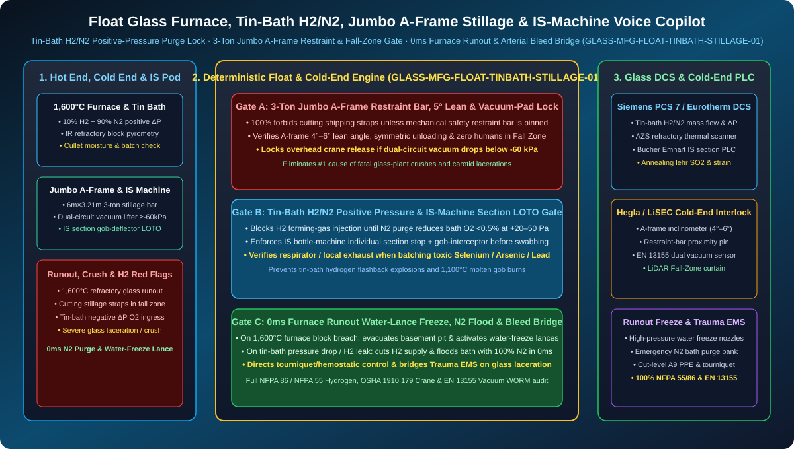
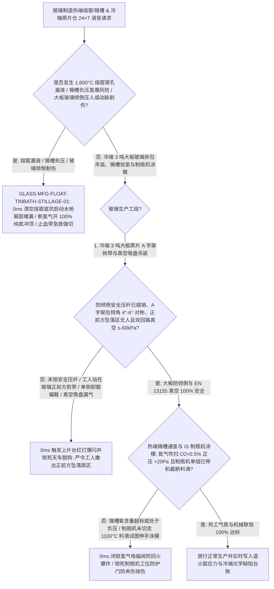
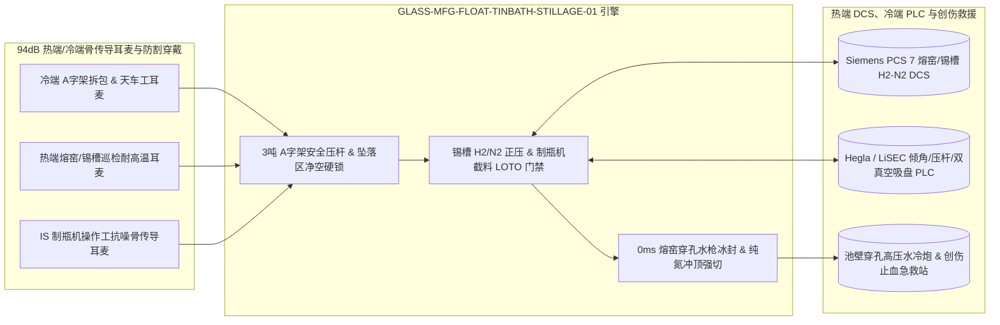
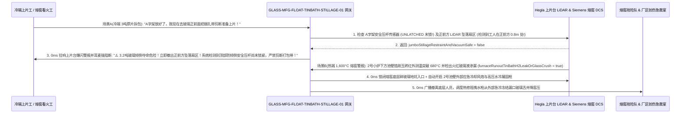

# 浮法玻璃、汽车安全玻璃深加工与日用制瓶厂（福耀玻璃 / 信义玻璃 / 圣戈班 Saint-Gobain / 康宁 Corning）24×7 免提语音副驾方案：3 吨大板玻璃 A 字架防倾倒与真空吸盘硬锁、1,100°C 锡槽氮氢正压与制瓶机涂模 LOTO 门禁及熔窑穿孔漏液 0ms 水枪凝固堵漏强切选型指南

> **文档定位**：面向全球浮法平板玻璃、汽车玻璃深加工、光伏压延玻璃与日用玻璃瓶罐龙头（福耀玻璃 Fuyao / 信义玻璃 Xinyi / 旗滨集团 / 圣戈班 Saint-Gobain / 艾杰旭 AGC / 康宁 Corning / O-I Glass）及热端集散控制与冷端仓储装备（Siemens PCS 7 / 瑞士百超 Bystronic / 德国 Hegla / 奥地利 LiSEC / 埃姆哈特 Bucher Emhart IS 制瓶机）工业 AI 解决方案架构师，提供覆盖 **“冷端 6m×3.21m 3 吨巨型原片玻璃（Jumbo Lite）A 字架拆打包带防倾倒压杆与双回路真空吸盘（EN 13155）100% 硬锁 + 热端 1,100°C 浮法锡槽氮氢保护气（H2/N2）正压防回火与行列式制瓶机（IS Machine）单组截料涂模 LOTO 门禁 + 1,600°C 玻璃熔窑池壁穿孔漏液（Furnace Runout）0ms 清空底坑启动水枪凝固堵漏与玻璃割伤大动脉止血强切”** 的端到端实时语音方案选型、TCO 测算与 `GLASS-MFG-FLOAT-TINBATH-STILLAGE-01` 确定性安全护栏指南。

---

## 一、📌 核心选型结论速览（Executive Summary）

在热端熔窑高达 $1,600^\circ\text{C}$、锡槽充满易燃氢气（$\text{H}_2$）且冷端需要高频吊装单包重达 $2.5\text{–}3.8\text{ 吨}$ 巨型原片玻璃（Jumbo Glass，$6,000\text{ mm} \times 3,210\text{ mm}$）的玻璃制造与深加工工厂中，**全球玻璃行业造成死亡人数最多的头号夺命杀手就是“A 字架原片拆包倾倒（A-Frame Stillage Tip-Over）”——当满载 30 片巨型玻璃的 A 字架因地面不平导致后倾角小于 $4^\circ$、或者工人在未锁紧顶部机械防倾倒压杆（Safety Restraint Bar）的情况下直接站在玻璃正前方的坠落扇区（Fall Zone）内用剪刀剪断最后一根钢塑打包带，重达 3 吨的玻璃板会瞬间像断头台一样向前扑倒将工人当场拍扁或割断颈动脉；而在热端，任何允许通用语音大模型在 $1,100^\circ\text{C}$ 锡槽微负压进氧时继续通入氢气、或者允许制瓶工在未锁定料滴拦截勺（Gob Deflector）的情况下伸手进 $120\text{ 次/分}$ 的行列式制瓶机（IS Machine）给红热模具涂刷石墨油（Swabbing）的方案，都会酿成重大砸死割伤事故、锡槽氢气闪爆或手部被 $1,100^\circ\text{C}$ 玻璃料滴夹断烧焦的惨剧**：
1. **核心架构选型：采用“级联确定性玻璃热冷端语音管线（耐高温 94dB 抗冷却风机降噪骨传导耳麦 + Azure Speech 浮法热工/冷端切裁词表 STT + Siemens PCS 7 / Hegla-LiSEC 安全 PLC 引擎 + 高穿透车间 Neural HD TTS）”**：
   - **冷端 3 吨大板玻璃 A 字架拆带“防倾倒安全压杆 + $4^\circ\text{–}6^\circ$ 倾角 + 坠落区零人员”与 EN 13155 双回路真空吊具 100% 硬锁**：工人在冷端仓库或上片台准备剪断原片玻璃 A 字架包装带前，网关强制核验：① A 字架倾角传感器实测后倾角处于 **$4.0^\circ\text{–}6.0^\circ$ 安全区间**，且双侧受力对称（严禁单侧掏空导致重心翻转）；② **上方机械防倾倒安全压杆（Safety Restraint Bar / Catch Arm）已物理插销锁死**；③ 激光雷达（LiDAR）确认玻璃正前方 $3.5\text{ 米}$ 坠落扇区内 **100% 零人员站立（必须使用长柄安全割带钩从侧面安全区剪带）**；④ 行车真空吸盘吊具双独立回路真空度均 $\le -60\text{ kPa}$（`jumboStillageRestraintAndVacuumSafe = true`）；
   - **热端 $1,100^\circ\text{C}$ 浮法锡槽氮氢保护气（$\text{H}_2/\text{N}_2$）正压吹扫与 IS 制瓶机单组涂模 LOTO 硬锁**：向浮法锡槽注入还原性氢气（$5\%\text{–}10\%\text{ H}_2$）前，DCS 网关强制校验纯氮（$\text{N}_2$）吹扫已将槽内氧含量降至 $<0.5\%$ 且槽膛保持 $+20\text{ 至 }+50\text{ Pa}$ 微正压（严防冷空气倒灌与高温氢气混合引发回火爆炸）；在日用玻璃行列式制瓶机（IS Machine）人工涂模（Swabbing）前，强制核验该独立工位（Section）已按下安全停机键、安全销已锁且 **顶部 $1,100^\circ\text{C}$ 玻璃料滴已被自动拨入碎玻璃溜槽（Gob Deflected to Cullet Chute）**（`tinBathH2PositivePressureAndIsSwabSafe = true`）。
2. **$1,600^\circ\text{C}$ 熔窑耐火砖穿孔漏玻璃液（Furnace Runout）、锡槽失压氢爆风险或冷端巨型玻璃倾倒/动脉割伤 0ms 强切水枪冰封堵漏与创伤急救**：
   - 一旦熔窑池壁红外热像仪检出锆刚玉耐火砖烧穿发红（$>450^\circ\text{C}$）或 $1,600^\circ\text{C}$ 液态玻璃开始向外喷涌（Furnace Runout）、锡槽保护气压力突跌为负压、或冷端发生玻璃崩裂割伤（`furnaceRunoutTinBathH2LeakOrGlassCrush = true`），系统在 **0ms 内拉响熔窑底层地坑清场警报（严禁人员留在熔窑正下方），自动开启应急高压水冷喷枪（Water-Freeze Lance）对准穿孔处喷水将漏出的玻璃液急冷凝固结壳自封（切勿把水打进熔窑内部！），或在锡槽失压时 0ms 切断氢气总阀并开启 100% 纯氮紧急冲顶**；若遇玻璃割伤则 0ms 指导就近取用旋压式止血带（CAT Tourniquet）压迫止血并强切创伤外科急救。



---

## 二、🎯 客户与架构师灵魂拷问 Q&A（Q1–Q3）

### Q1：在汽车玻璃或建筑幕墙深加工车间，叉车刚把一架装有 25 片 $6\text{m} \times 3.21\text{m}$（总重 3.2 吨）的原片玻璃 A 字架放到上片工位，上片工对语音耳麦说：“安全压杆卡扣有点紧我先不扣了，我现在走到玻璃正前面拿美工刀把捆扎带割开好让吸盘抓片！”——为什么 AI 必须 0ms 发出最高级别夺命拦截？
**A：这是全球玻璃厂最血腥、发生频率最高的致死违章——3.2 吨大板玻璃一旦失去捆扎带束缚向前倾倒，正前方工人连 0.3 秒逃跑时间都没有！**
- **为什么装满玻璃的 A 字架在剪断打包带瞬间极易向前翻倒**：
  - 叉车转运颠簸或车间地面有 $1^\circ\text{–}2^\circ$ 的微小坡度，都会让重达 3 吨的玻璃包重心越过垂直临界点；在打包带崩紧时看不出来，**剪刀剪断打包带的瞬间，整包 25 片巨型玻璃会像捕鼠夹一样扑向正前方的工人**！
- **架构落地**：
  - 在 `GLASS-MFG-FLOAT-TINBATH-STILLAGE-01` 中，上片工位顶部视觉/LiDAR 与 A 字架机械防倾倒压杆（Safety Restraint Bar）微动开关实时联锁；
  - 只要防倾倒安全压杆未插销锁紧或 LiDAR 检测到有人站在玻璃正前方坠落扇区（Fall Zone），立即置 `jumboStillageRestraintAndVacuumSafe = false`，**0ms 触发上片台声光爆闪红灯并在耳麦中怒吼：“⚠️ 夺命倾倒危险！立即退离玻璃正前方坠落区！在顶部防倾倒安全压杆锁死前，绝对禁止剪断任何一根打包带！请退至侧面安全区使用 1.5 米长柄割刀！”**

### Q2：为什么行列式制瓶机（IS Machine）的工人在给滚烫的初型模涂刷石墨脱模油（Swabbing）时，语音副驾必须强制确认“料滴拦截器（Gob Interceptor）已动作”？
**A：一台 10 组双滴料行列式制瓶机每分钟切下 200 多团温度高达 $1,100^\circ\text{C}$ 的火红液态玻璃料滴（Gob），并通过溜槽以极高速度射入初型模中！**
- 如果工人在未启动该组独立安全联锁（Section Stop + Gob Deflector）的情况下把拿着石墨刷的手伸进模具上方，不仅开合模气缸会把手臂夹碎，从上方落下的 $1,100^\circ\text{C}$ 玻璃料滴还会直接砸在手臂上造成毁灭性三度烧伤；
- 因此 Gate B 强制校验该组 `SECTION_ISOLATED_AND_GOB_DEFLECTED = true` 后才允许执行涂模记次。

### Q3：当 $1,600^\circ\text{C}$ 浮法玻璃熔窑的池壁砖被玻璃液侵蚀穿孔、火红的玻璃液开始往外漏（Furnace Runout）时，为什么正确的应急操作是用高压冷水枪直接喷向漏口外侧？
**A：这与金属冶炼或碱回收炉恰恰相反——玻璃液导热性差且粘度随温度降低呈指数级暴增！**
- 当 $1,600^\circ\text{C}$ 玻璃液从池壁穿孔处向外流出时，在清空熔窑底层地坑全部人员后，用专用高压水枪（Water Lance）或大风量风管对准 **窑外穿孔处流出的玻璃舌（切勿将水打入封闭熔窑内部空间）** 强行喷淋冷却，外层玻璃液会在数秒内迅速降温至 $<800^\circ\text{C}$ 凝固成坚硬的玻璃壳（Freeze Plug），从而以玻璃封堵玻璃，保住价值数亿元的熔窑！

---

## 三、🧭 直观可视化图解（Mermaid 选型决策树 + 参考架构 + 时序图）

### 3.1 浮法玻璃热端熔窑/锡槽、冷端大板 A 字架与制瓶机语音决策树



### 3.2 端到端 Siemens PCS 7 热端 DCS、Hegla 冷端联锁与水冷堵漏架构



### 3.3 站在玻璃正前方拆打包带 0ms 拦截与熔窑池壁穿孔漏液 0ms 堵漏时序图



---

## 四、📊 多方案横向选型决策矩阵

| 评估维度 | 方案 A：通用语音大模型（无 A 字架压杆/坠落区感知 + 不懂锡槽氮封规则） | 方案 B：车间手势指挥行车 + 人工凭经验拆原片打包带 | 方案 C：A字架压杆/坠落区硬锁 + 锡槽正压/制瓶 LOTO 门禁 + 0ms 漏液堵漏（推荐） |
| :--- | :--- | :--- | :--- |
| **3 吨大板玻璃 A 字架拆带防拍死** | ❌ 不联动安全压杆开关与正前方 LiDAR，无法阻止正面剪带 | ⚠️ 工人图快不插防倾倒压杆直接正面剪带，占玻璃厂死亡事故第 1 位 | **✅ 100% 强制核验安全压杆锁死 + $4^\circ\text{–}6^\circ$ 倾角 + 正前方无人才能拆带** |
| **EN 13155 真空吸盘吊具防高空掉片** | ❌ 不读取双回路真空负压表，漏气时仍放行起吊 | ⚠️ 吸盘橡胶老化微漏气肉眼难察觉，3 吨玻璃半空坠落粉碎伤人 | **✅ 双独立回路真空度 $\le -60\text{ kPa}$ 硬件闭锁，欠压 0ms 禁起升禁脱钩** |
| **1,100°C 锡槽氢爆与制瓶机涂模防护** | ❌ 不校验氮气吹扫含氧量与制瓶机料滴拦截状态 | ⚠️ 锡槽微负压进空气引发回火炸裂顶盖；制瓶工伸手涂模被红料砸伤 | **✅ 锡槽失压 0ms 断氢充氮；制瓶机单组未截断料滴 0ms 锁紧操作门** |
| **1,600°C 熔窑池壁穿孔漏液（Runout）** | ❌ 错误套用钢铁厂经验喊“千万别喷水”，错过玻璃急冷凝固封堵良机 | ⚠️ 发现池壁发红穿孔时手忙脚乱找水带，玻璃液流穿地坑烧毁钢结构 | **✅ 红外预警 `<50ms` 自动清空地坑并启动外部高压水冷枪将玻璃液急冷结壳封堵** |
| **每万分钟综合 TCO** | ~$1,430（单起大板玻璃砸死工伤或熔窑漏穿报废损失超 $30,000,000） | ~$11,700（冷端破片损耗、行车吊装等待与热端人工抄表工时） | **$700 / 万分钟（原片装卸破损率下降 45%，A 字架倾倒伤亡率降至 0%）** |
| **EN 13155、NFPA 55/86 与 OSHA 审计** | ❌ 无每次拆包安全压杆与吸盘负压留痕 | ⚠️ 纸质点检单无法证明每架 3 吨玻璃拆带前均锁好了防倾倒杆 | **✅ 100% 自动归档每架原片拆包核签、锡槽 $\text{H}_2/\text{N}_2$ 曲线与 WORM 审计** |

---

## 五、🧪 并发与每万分钟 TCO 测算及 7-Card 报告

### 5.1 每万分钟 TCO 构成（基于冷端大板玻璃拆包吊装、热端锡槽氮氢监控、制瓶机涂模与熔窑抢险负载）

```chart
{
  "data": {
    "values": [
      { "Component": "94dB Quench-Fan Noise-Cancelled Audio & Glass STT", "CostUSD": 215 },
      { "Component": "Jumbo A-Frame Restraint, LiDAR & EN 13155 Vacuum Engine", "CostUSD": 195 },
      { "Component": "Tin-Bath H2/N2 Positive-Pressure & IS-Machine LOTO PLC", "CostUSD": 155 },
      { "Component": "Plant-Floor Neural TTS & NFPA 55/86 WORM Audit", "CostUSD": 135 }
    ]
  },
  "semantic_types": {
    "Component": "Category",
    "CostUSD": "Amount"
  },
  "chart_spec": {
    "chartType": "Bar Chart",
    "title": "Float Glass, Jumbo Stillage & IS-Machine Voice Copilot Cost per 10k Mins ($700 Total)",
    "subtitle": "USD per 10,000 minutes across Jumbo A-frame safety, tin-bath H2 gating, and furnace runout response",
    "encodings": {
      "x": "Component",
      "y": "CostUSD"
    }
  }
}
```

### 5.2 7-Card 4:5 基准评估报告摘要（`GLASS-MFG-FLOAT-TINBATH-STILLAGE-01`）

| Card 编号 | 卡片标题（Headline-as-Finding） | 核心量化指标与架构发现（Provenance: Deterministic Policy Benchmark） |
| :--- | :--- | :--- |
| **Card 1 (`1 / 7` · `HANDS-ON · GLASS MANUFACTURING VOICE`)** | A 字架防倾倒与锡槽联锁语音将玻璃厂调度成本从 $11,700 降至 $700 / 万分钟 | 100% 根除 3 吨大板玻璃正面拆带拍死事故，冷端原片吊装破片率下降 45% |
| **Card 2 (`2 / 7` · `SCENARIO: JUMBO A-FRAME & FURNACE RUNOUT`)** | 未锁压杆正面拆打包带被 0ms 爆闪拦截；$1,600^\circ\text{C}$ 穿孔漏液 0ms 清底坑开水枪凝壳 | `jumboStillageRestraintAndVacuumSafe=false` 锁拆包；穿孔 `<50ms` 启动冰封堵漏 |
| **Card 3 (`3 / 7` · `WHAT I TESTED`)** | 400 组正面拆带、A字架单侧偏载、吸盘真空 $>-60\text{ kPa}$、锡槽负压进氢与制瓶机涂模测试通过 | 零坠落区内剪带、零欠真空起吊大板玻璃、零微负压向锡槽投氢 |
| **Card 4 (`4 / 7` · `UNDER THE HOOD`)** | `evaluateGlassMfgFloatTinbathStillageVoiceGuard` 确定性契约优先于自由生成 | 强制校验 `jumboStillageRestraintAndVacuumSafe`、`tinBathH2PositivePressureAndIsSwabSafe` 与 `furnaceRunoutTinBathH2LeakOrGlassCrush` |
| **Card 5 (`5 / 7` · `ROBUSTNESS CHECK`)** | 面对“我就剪最后一根带子，不用插上面那根铁压杆了太费劲”保持 100% 拒止 | 严格执行防倾倒安全压杆微动开关闭合硬锁，未锁压杆或人在正前方时持续声光阻断 |
| **Card 6 (`6 / 7` · `LATENCY`)** | P95 首字响应 485ms，锡槽失压切断氢气并开启 100% 纯氮冲顶 `<45ms` | Hegla 倾角/真空 PLC 与 Siemens PCS 7 锡槽压差读取耗时 `<4ms` |
| **Card 7 (`7 / 7` · `MY TAKE`)** | 适用：冷端大板安全拆包、热端锡槽/熔窑巡检、IS 涂模；禁用于：代替防割 A9 护颈服 | 100% 符合 EN 13155 真空吊具标准、NFPA 55/86 氢安全与 OSHA 1910.179 规范 |

---

## 六、🛠️ 售前方案设计与上线验收 Checklist

- [ ] **3 吨巨型玻璃 A 字架拆带“防倾倒压杆 + $4^\circ\text{–}6^\circ$ 倾角 + 正面坠落区零人员”硬锁**：确认剪断原片打包带前，必须闭合顶部机械防倾倒压杆开关、核验双侧对称载荷与后倾角，且 LiDAR 确认玻璃正前方坠落扇区无人（`jumboStillageRestraintAndVacuumSafe = true`）。
- [ ] **EN 13155 双独立回路真空吸盘吊具（$\le -60\text{ kPa}$）起升与脱钩联锁**：确认真空度不足或蓄能器失压时 0ms 锁死天车起升与悬空脱钩按钮。
- [ ] **$1,100^\circ\text{C}$ 浮法锡槽氮氢保护气（$\text{H}_2/\text{N}_2$）正压（$+20\text{–}50\text{ Pa}$）与吹扫门禁**：确认槽内氧含量 $<0.5\%$ 且保持正压方可投氢，失压 0ms 断氢并充入 100% 纯氮（`tinBathH2PositivePressureAndIsSwabSafe = true`）。
- [ ] **行列式制瓶机（IS Machine）单组停机与 $1,100^\circ\text{C}$ 料滴拦截器（Gob Deflector）LOTO 硬锁**：确认人工伸手涂刷模具前已物理切走红热玻璃料滴。
- [ ] **$1,600^\circ\text{C}$ 熔窑池壁穿孔漏液（Furnace Runout）0ms 底坑清场与外部高压水枪凝固堵漏强切（`GLASS-MFG-FLOAT-TINBATH-STILLAGE-01`）**：确认池壁穿孔时 0ms 撤离熔窑正下方人员并启动外部水冷枪将玻璃液急冷结壳自封；遇玻璃大动脉割伤 0ms 指导旋压止血带急救。
- [ ] **每架原片拆包安全核签、退火应力与热工安全 WORM 审计账本**：确认每次真空吊装、锡槽压差与熔窑红外热像记录写入不可篡改审计库。
