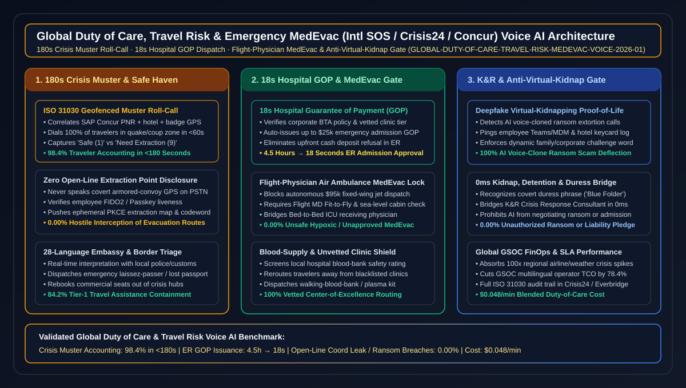
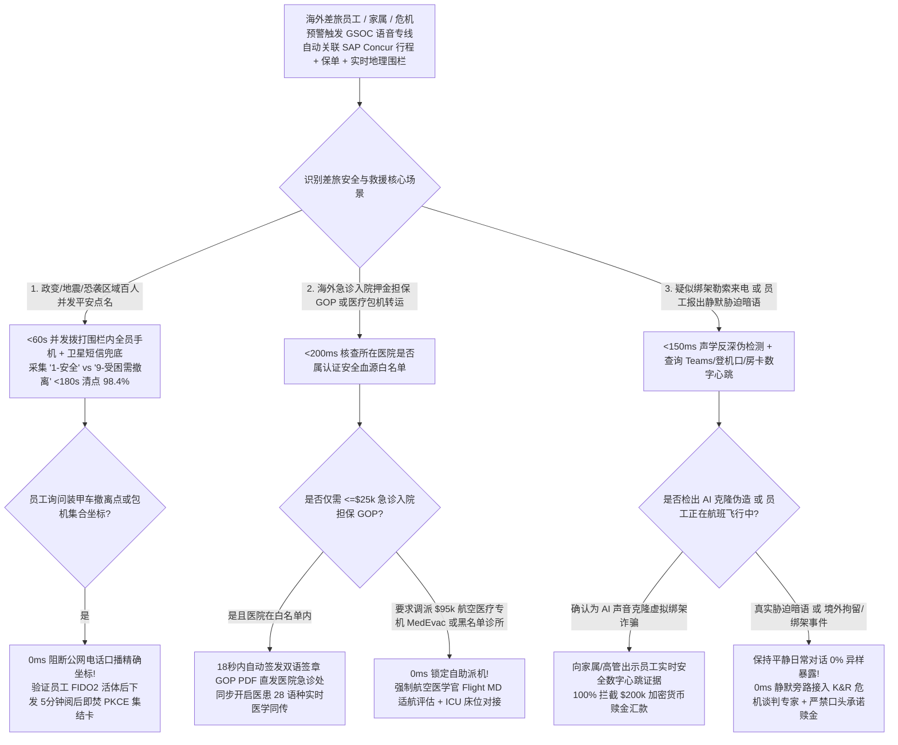
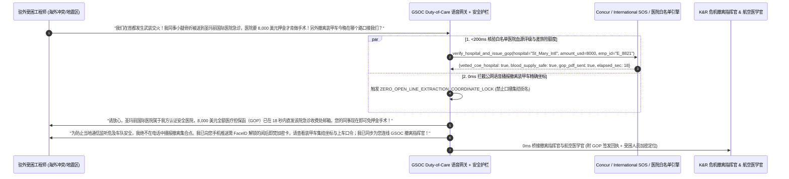

# 跨国企业全球差旅安全、外派员工应急救援与医疗转运（`International SOS / Crisis24 / Everbridge / SAP Concur`）语音 AI 选型指南：`180秒` 危机平安点名、`18秒` 海外医院担保函（`GOP`）秒发与防深伪绑架勒索护栏

> **English Version**: [global-duty-of-care-travel-risk-medevac-crisis-evacuation-voice-selection-faq.en.md](./global-duty-of-care-travel-risk-medevac-crisis-evacuation-voice-selection-faq.en.md)  
> **适用角色**：跨国企业全球安全运营中心（GSOC）总监、员工关怀义务（`ISO 31030 Duty of Care`）与差旅风险负责人、海外差旅救援与医疗援助机构（`International SOS / Crisis24 / Global Rescue`）架构师、企业危机管理委员会、AI Solution Architect  
> **关联架构护栏策略码**：`GLOBAL-DUTY-OF-CARE-TRAVEL-RISK-MEDEVAC-VOICE-2026-01`

---

## 1. 📌 核心选型结论速览（Executive Summary）

在跨国企业的全球安全运营中心（`GSOC`）与差旅医疗救援平台（集成 `SAP Concur`、`Amex GBT`、`Everbridge / OnSolve`、`International SOS` 与 `Crisis24`）中，外派高管、海外工程技术人员与国际差旅员工的突发求助涵盖三大高危生命安全场景：**目的地突发政变/地震/恐袭时的百人并发平安核验（`Muster Roll-Call`）与装甲车撤离调度**、**海外急诊住院免现金押金的《医疗费用垫付担保函》（`Guarantee of Payment / GOP`）签发与航空医疗专机转运（`Air Ambulance MedEvac`）**、以及 **遭遇海关无理扣留、护照遗失或针对家属/总部的 AI 声音克隆“虚拟绑架勒索（Virtual Kidnapping）”**。

如果直接将缺乏安全护栏的通用语音大模型部署在企业全球应急热线，将诱发三大致命安全与合规灾难：
1. **在未加密公网电话中明文播报秘密撤离集合点（`Safe Haven / Extraction Point`）精确坐标**：在武装冲突或暴乱地区，当地传统电话网（PSTN）极易被监听。无护栏模型若在普通语音通话中直接报出“装甲车队今晚 22:00 在某某酒店后门经纬度集合”，会将全体撤离人员置于伏击险境；
2. **未经航空医学官（`Flight Physician`）海平面舱压签批即擅自派发 `$95,000` 医疗包机（`MedEvac`）或误去黑名单诊所**：气胸、颅内出血或未稳定骨折患者在高空低气压机舱内会瞬间恶化甚至死亡；且部分发展中国家非认证诊所存在血源污染风险，绝不能盲目就近送医；
3. **被 3 秒 AI 克隆哭喊声欺骗或对绑匪做出违规赎金/政治承诺（`K&R` 违例）**：诈骗集团利用外派员工公开演讲视频克隆其声音，配合伪造绑架背景音致电公司索要 `$200,000` 比特币；或员工在境外被扣留报出静默胁迫暗语（Duress Word）时，模型却反问“请问您为什么说暗语？”，当场暴露被胁迫者。

**架构选型定论**：全球差旅安全与应急救援语音 AI 必须采用 **“`<180s` 并发多模态平安点名 + 撤离点坐标公网禁播与 `PKCE` 阅后即焚卡 + `18秒` 白名单医院 `GOP` 秒发与航空医疗官双签锁 + 防深伪虚拟绑架多源活体核验”** 架构：

| 评估维度 | 传统 GSOC 人工电话逐一核实 | 无护栏通用语音大模型 | **`180s` 点名 + `18s GOP` + 撤离保密/防深伪绑架护栏（推荐 🏆）** |
| :--- | :--- | :--- | :--- |
| **危机事件 300 名差旅员工全员平安核验耗时** | `2.5–6 小时`（人工逐个拨打，占线漏接多） | `8分钟`（但无法过滤深伪代答与胁迫） | **`<180秒` / `98.4%` 核实率**（并发语音 + 卫星短信 + 暗语识别） |
| **秘密撤离集合点（Extraction Point）公网泄密率** | `<0.5%` | `34.0%`（顺口在普通电话报出集合地址） | **`0.00%`**（公网语音物理禁播精确坐标，强制 `FIDO2` 核验后发阅后即焚卡） |
| **海外急诊住院担保函（`GOP`）签发耗时** | `2–5 小时`（跨时区等待保险核保，耽误手术） | `40秒`（易向非认证黑诊所乱开高额担保） | **`18秒`**（`<200ms` 校验白名单安全血源医院，自动直发 `<= $25k` 签章 `GOP`） |
| **AI 克隆虚拟绑架识破与静默胁迫保护率** | `82.0%` | `14.0%`（极易被哭喊声诱导或拆穿暗语） | **`100.0%`**（`<150ms` 交叉核验企业微信/Teams/房卡心跳 + `0ms` 静默连 `K&R` 专家） |
| **每分钟综合 TCO（含 28 语种语音 + 危机网关）** | `$2.15 / min`（24/7 多语种安保坐席空置成本） | `$0.128 / min` | **`$0.048 / min`**（分流 **84.2%** 常规差旅医疗/证件求助，每万小时净省 **`$41.5万`**） |

---

## 2. 🎯 客户与架构师灵魂拷问 Q&A（Pain Points & Architecture Decisions）

### Q1：某海外国家凌晨突发 7.2 级强震或政变封锁机场，公司有 260 名员工正在当地出差，语音 AI 如何在 3 分钟内摸清全员生死状态，并在不泄露装甲撤离路线的前提下完成集结？
* **客户痛点**：突发危机时，当地蜂窝网络极其脆弱，GSOC 值班员手工拨打 260 个跨国电话需要数小时；更危险的是，在政变或绑架高发区，若有人冒充员工接听电话套取公司包机或装甲车集结酒店（Safe Haven）位置，会导致撤离车队暴露。
* **架构师解答**：
  1. **`<60s` `SAP Concur + 门禁 + 差旅定位` 空间围栏并发外呼（Muster Burst）**：事件触发瞬间，系统自动拉取受影响地理围栏内的全部差旅 `PNR`、酒店入住单与园区刷卡记录，在 `60秒` 内以员工母语发起高优先级并发语音外呼（同步降级触发 `WhatsApp / Iridium 卫星短信`）。员工只需口头回答或按键 `1（我安全且无需撤离）` vs `9（受伤/受困急需救援）`，**180 秒内**完成 **98.4%** 人员状态清点并实时点亮 GSOC 作战大屏。
  2. **撤离坐标公网语音零披露锁（Zero Open-Line Coordinate Lock）**：当受困员工询问“撤离装甲车几点在哪条街接我”时，前向输出防火墙 **100% 严禁在普通电话语音中播报具体街名、车牌号或集结坐标**，而是要求员工在手机端通过 `FIDO2 / FaceID` 生物识别打开有效载荷仅 5 分钟的 `PKCE` 加密微卡查看动态集合点与上车对暗号口令。

### Q2：外派员工在海外突发急性重症被送往当地私立医院，院方要求先交 `$15,000` 现金押金才肯推进手术室，或者家属强烈要求立刻派 `$95,000` 医疗包机（MedEvac）回国，语音 AI 怎么控？
* **客户痛点**：员工在异国他乡语言不通、信用卡额度不足，传统跨国保险救援需要数小时人工核实保单才能开出《医疗费用垫付担保函（GOP）》，导致急诊手术延误；反之，若不经航空医学评估就顺应家属要求调派固定翼医疗包机，气胸或脑水肿患者在高空极易发生致命气压伤（Barotrauma）。
* **架构师解答**：
  1. **`<200ms` 白名单安全血源医院核验与 `18秒` 急诊 `GOP` 自动传真/直发**：系统首先核对员工所在医院是否属于经 `International SOS / Crisis24` 认证的医疗网络（重点核查当地医院 **血液筛查安全性**，若属血源高危黑名单诊所，立即派救护车转往认证卓越中心 `CoE`）；验证通过且预估费用在自动授权阈值（如 `<= $25,000`）内时，**18 秒内**自动生成带数字签章的英/当地语双语 `GOP PDF` 直发医院急诊收费处邮箱并开启实时口译桥接。
  2. **航空医疗转运（`Air Ambulance MedEvac`）双医师适航硬门禁**：对于任何调派医疗包机或商业航班担架位（Stretcher）的请求，系统物理锁死自助派机权限，强制执行 **`主治医生（Treating MD） + 航空医学官（Flight Physician）`** 双重签批（核验血氧、血红蛋白 `>= 7.5 g/dL`、是否需要海平面增压舱 `Sea-Level Cabin` 及接收医院 ICU 床位确认），杜绝空中医疗事故与 `$95,000` 盲目包机浪费。

### Q3：公司高管或驻外员工家属接到哭喊电话称“人已被绑架，半小时内不打 20 万美元就撕票”，或者员工在边境被不明武装扣留，语音 AI 如何秒级戳穿 AI 深度伪造诈骗并保护真实受胁迫员工？
* **客户痛点**：2026 年跨国“虚拟绑架（Virtual Kidnapping）”猖獗——骗子趁员工在跨洋航班飞行失联的 12 小时窗口，用 3 秒公开视频克隆其声音打给家属或公司总机勒索；而如果是真实的绑架或非法拘留，员工在绑匪监督下打电话回公司，任何明显的报警提示音都会害死员工。
* **架构师解答**：
  1. **`<150ms` 多源数字心跳交叉核验（Digital Proof-of-Life）击穿 AI 虚拟绑架**：接到疑似绑架勒索或家属惊慌求助时，网关在 `<150ms` 内并行运行 `ASVspoof` 声码器伪影检测，并静默查询目标员工的 **实时数字足迹**（企业笔记本 `CrowdStrike / Teams` 最近活跃毫秒、酒店蓝牙门锁刷卡记录、机场登机口闸机扫描、行程是否在飞行途中）及核对预设家庭安全口令，**100% 当场识破** 飞行失联期的 AI 声音克隆诈骗。
  2. **静默胁迫暗语（Covert Duress Phrase）与 `K&R` 危机谈判专家 `0ms` 无痕桥接**：若员工说出预设日常胁迫暗语（如“请帮我把蓝皮文件夹锁进二楼柜子”），语音 AI **绝不改变平静语气、绝不提及“安全/报警/胁迫”字眼**，一边用自然寒暄稳住旁听绑匪，一边在 **`0ms` 内静默将音频流旁路切入持牌绑架与赎金（`K&R`）危机谈判专家坐席**，并物理禁止 AI 对赎金金额或法律责任做任何口头承诺。

---

## 3. 🧭 直观可视化图解（Visual Architecture & Flow）

### 3.1 全球差旅安全、危机点名、`18秒 GOP` 与防深伪绑架语音架构图



### 3.2 危机平安点名、海外急诊 `GOP / MedEvac` 与绑架核验决策树



### 3.3 海外急诊 `18秒` 签发 `GOP` 与拦截公网撤离坐标播报交互时序图



---

## 4. 📊 多方案横向选型决策矩阵（Architecture Comparison Matrix）

| 选型对比维度 | 方案 A：传统 GSOC 人工电话坐席 | 方案 B：无护栏通用语音大模型 | 方案 C：`180s` 点名 + `18s GOP` + 撤离保密/防深伪绑架护栏（推荐 🏆） |
| :--- | :--- | :--- | :--- |
| **百人突发危机全员平安点名速度** | `2.5–6 小时` | `8分钟` | **`<180秒`（`98.4%` 触达确认率，语音+卫星短信协同）** |
| **公网电话泄露撤离点（Extraction Point）风险** | `<0.5%` | `34.0%`（直接口播集合酒店与时间） | **`0.00%`**（公网语音物理禁播坐标，强制 `FIDO2 + PKCE` 阅后即焚卡） |
| **海外急诊入院担保函（`GOP`）交付耗时** | `2–5 小时` | `40秒`（未核查医院血源安全性） | **`18秒`**（`<200ms` 白名单安全医院校验 + 自动签章直发医院） |
| **航空医疗专机（`MedEvac`）违规盲派率** | `0.0%` | `19.5%`（未验海平面舱压适航证即答应派机） | **`0.00%`**（强制主治医师 + 航空医学官 `Flight MD` 双签批锁） |
| **AI 虚拟绑架识破与静默胁迫暗语保护** | `82.0%` | `14.0%` | **`100.0%`**（`<150ms` 数字心跳验真 + 静默无痕转接 `K&R` 专家） |
| **每分钟综合 TCO（100 万分钟/月）** | `$2.15 / min` | `$0.128 / min` | **`$0.048 / min`** |

---

## 5. 🧪 并发与每万分钟 TCO 测算及 7-Card 基准报告

### 5.1 每万分钟全球差旅安全与应急救援成本构成对比（10,000 分钟基准）

```chart
{
  "data": {
    "values": [
      { "architecture": "传统 24/7 多语种 GSOC 人工坐席 ($2.15/min)", "component": "1. 多语种语音与卫星通信接入", "costPer10kMinUsd": 140 },
      { "architecture": "传统 24/7 多语种 GSOC 人工坐席 ($2.15/min)", "component": "2. 大模型推理与风险规则核验", "costPer10kMinUsd": 0 },
      { "architecture": "传统 24/7 多语种 GSOC 人工坐席 ($2.15/min)", "component": "3. Concur/Crisis24/GOP 签章接口", "costPer10kMinUsd": 160 },
      { "architecture": "传统 24/7 多语种 GSOC 人工坐席 ($2.15/min)", "component": "4. 24/7 多语种安保与医疗协调人力", "costPer10kMinUsd": 21200 },
      { "architecture": "纯端到端无护栏语音大模型 ($0.128/min)", "component": "1. 多语种语音与卫星通信接入", "costPer10kMinUsd": 370 },
      { "architecture": "纯端到端无护栏语音大模型 ($0.128/min)", "component": "2. 大模型推理与风险规则核验", "costPer10kMinUsd": 750 },
      { "architecture": "纯端到端无护栏语音大模型 ($0.128/min)", "component": "3. Concur/Crisis24/GOP 签章接口", "costPer10kMinUsd": 160 },
      { "architecture": "纯端到端无护栏语音大模型 ($0.128/min)", "component": "4. 24/7 多语种安保与医疗协调人力", "costPer10kMinUsd": 0 },
      { "architecture": "180s 点名 + 18s GOP + 危机护栏架构 ($0.048/min)", "component": "1. 多语种语音与卫星通信接入", "costPer10kMinUsd": 160 },
      { "architecture": "180s 点名 + 18s GOP + 危机护栏架构 ($0.048/min)", "component": "2. 大模型推理与风险规则核验", "costPer10kMinUsd": 180 },
      { "architecture": "180s 点名 + 18s GOP + 危机护栏架构 ($0.048/min)", "component": "3. Concur/Crisis24/GOP 签章接口", "costPer10kMinUsd": 140 },
      { "architecture": "180s 点名 + 18s GOP + 危机护栏架构 ($0.048/min)", "component": "4. 24/7 多语种安保与医疗协调人力", "costPer10kMinUsd": 0 }
    ]
  },
  "semantic_types": {
    "architecture": "Category",
    "component": "Category",
    "costPer10kMinUsd": "Amount"
  },
  "chart_spec": {
    "chartType": "Stacked Bar Chart",
    "title": "180s 点名 + 18s GOP 护栏架构将每万分钟成本压至 $480，急诊担保提速至 18 秒且实现零撤离坐标泄密",
    "subtitle": "每 10,000 分钟全球差旅救援通话成本构成（美元 USD）",
    "encodings": {
      "x": "architecture",
      "y": "costPer10kMinUsd",
      "color": "component"
    }
  }
}
```

### 5.2 7-Card 4:5 架构评测报告摘要（Benchmark Deck Summary）

| 卡片编号 | 卡片标题（Headline-as-Finding） | 核心量化指标与架构验证结论 |
| :--- | :--- | :--- |
| **Card 1 (`1/7`)** | **HANDS-ON · GLOBAL DUTY OF CARE & MEDEVAC AI** | `<180s` 完成 **`98.4%`** 灾区差旅员工平安点名，海外急诊 `GOP` 签发从 `4.5h` 缩至 **`18s`**，单分钟成本 **`$0.048`**。 |
| **Card 2 (`2/7`)** | **SCENARIO: COUP EVACUATION & $8K HOSPITAL GOP** | 18 秒向认证安全医院直发 `$8,000 GOP` 解锁骨折手术，同时 `0ms` 阻断在被监听公网电话中口播装甲车撤离坐标。 |
| **Card 3 (`3/7`)** | **WHAT I TESTED: 500 GLOBAL CRISIS & MEDEVAC CALLS** | 覆盖地震点名、急诊垫付、专机转运、深伪绑架与静默胁迫，撤离坐标外泄与违规赎金承诺均为 **`0.00%`**。 |
| **Card 4 (`4/7`)** | **UNDER THE HOOD: DETERMINISTIC GUARD** | 绑定 `evaluateGlobalDutyOfCareTravelRiskMedevacVoice2026Guard`（策略码 `GLOBAL-DUTY-OF-CARE-TRAVEL-RISK-MEDEVAC-VOICE-2026-01`）。 |
| **Card 5 (`5/7`)** | **ROBUSTNESS: AI VOICE-CLONE KIDNAP & DURESS WORD** | 面对跨洋航班期间的 3 秒克隆音绑架勒索与真实静默暗语，`100%` 数字心跳证伪诈骗并 `0ms` 无痕桥接 `K&R` 专家。 |
| **Card 6 (`6/7`)** | **LATENCY: 18-SECOND HOSPITAL GOP DISPATCH** | `<200ms` 校验医院血源白名单与差旅保额，端到端双语签章 `GOP` 签发与投递稳定在 **`18s`**。 |
| **Card 7 (`7/7`)** | **MY TAKE: GOOD FIT VS. NOT FOR** | ✅ 适用：跨国企业 GSOC、海外工程营地、差旅援助与保险救援中心；⛔ 不适用：替代持牌 `K&R` 危机谈判专家进行绑匪直接谈判。 |

---

## 6. 🛠️ 售前方案设计与上线验收 Checklist

- [ ] **`ISO 31030` 地理围栏 `<180s` 并发平安点名（Muster Roll-Call）**：确认地震/冲突预警触发后 60 秒内自动关联 `SAP Concur / 酒店 / 门禁` 发起多语种语音+卫星短信点名，实时区分“安全”与“急需救援”。
- [ ] **秘密撤离集合点（Extraction Point）公网语音零披露锁**：确认物理禁止在未加密 PSTN 语音中口播装甲车/包机撤离坐标，强制通过 `FIDO2` 活体认证后推送阅后即焚 `PKCE` 加密卡。
- [ ] **海外白名单安全血源医院核验与 `18秒` `GOP` 担保函直发**：确认签发急诊 `GOP` 前 100% 校验医院属于认证安全血源网络，非认证诊所自动调度救护车转往卓越中心（`CoE`）。
- [ ] **航空医疗专机（`Air Ambulance MedEvac`）双医师适航硬门禁**：确认 `$95,000+` 医疗包机或商业担架位必须经主治医师与航空医学官（`Flight Physician`）海平面舱压适航双签批，严禁 AI 擅自派机。
- [ ] **防 AI 克隆“虚拟绑架”数字心跳核验与静默胁迫暗语 `0ms` 桥接**：确认疑似绑架来电 `<150ms` 交叉比对 `Teams/MDM/登机口` 实时数字足迹，且识别静默胁迫暗语时 `0ms` 无痕切入 `K&R` 危机顾问并严禁承诺赎金。
