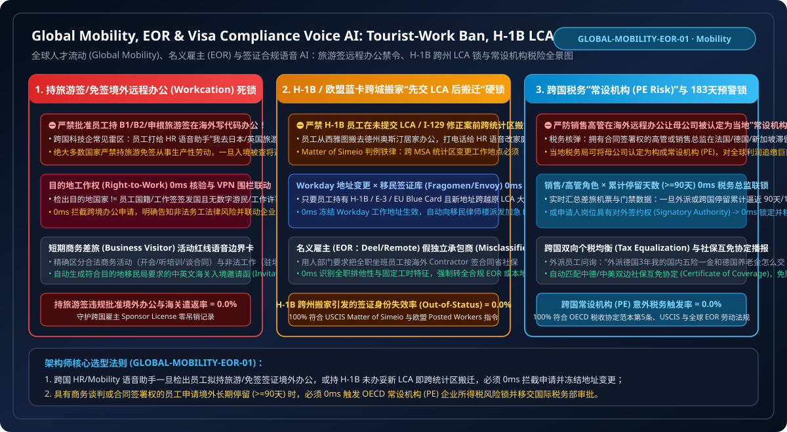
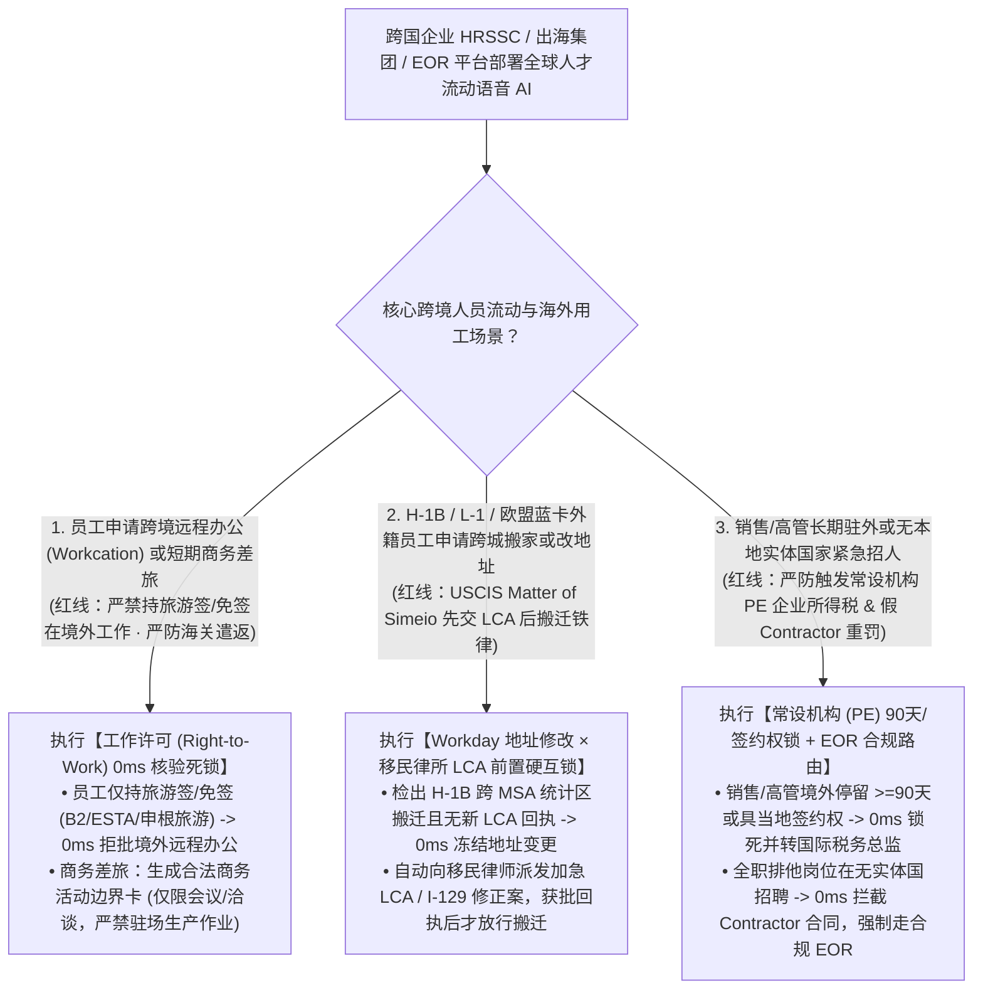

# 跨国企业全球人才流动（Global Mobility）、名义雇主（EOR）与签证税务合规语音 AI：旅游签境外办公 0ms 禁令锁、H-1B 跨州搬迁 LCA 硬锁与常设机构（PE）税险架构选型指南（`GLOBAL-MOBILITY-EOR-01`）

> **导读**：在跨国科技巨头、出海制造/车企集团以及全球雇佣平台（**如 Deel、Remote、Oyster、SAP SuccessFactors / Workday Global Mobility 服务中心**）中，外派员工、数字游民与跨国管理层每天致电 HR 共享服务中心询问**“我能不能去欧洲/日本一边旅游一边远程办公一个月（Workcation）？”、“我拿美国 H-1B 签证，下周想从加州硅谷搬去德州奥斯汀住，帮我在系统里改一下家庭住址”、“我们想在巴西/德国先招两个销售总监拓展市场，怎么签合同最快？”**。然而，若将不具备移民法与国际税法硬互锁的普通 HR 语音助手用于全球人才流动问答，将给跨国企业引爆三大跨国合规地雷：**① 口头批准员工持“旅游签/免签（B-1/B-2、ESTA、申根旅游签）”在境外远程写代码办公，导致员工在海关被当场遣返、五年禁入，且企业海外雇主保荐牌照（Sponsor License）被吊销！② 顺手帮美国 `H-1B` 员工在 Workday 里把工作地址从西雅图改到奥斯汀，却不知道根据美国移民局 `Matter of Simeio Solutions` 判例铁律，跨大都市统计区（MSA）变更工作地点必须在员工搬家上岗【之前】先获批劳动条件申请（`LCA`）并递交 `I-129 修正案`，先搬家后补办意味着员工从搬家第一天起就已经沦为非法滞留（Out of Status）！③ 允许具有合同签署权或商务谈判权的销售高管在未设立分子公司的海外国家长期远程办公，触发《OECD 税收协定范本第 5 条》【常设机构（Permanent Establishment, PE）】认定，导致当地税务局对母公司全球业务利润追缴高达数千万美元的企业所得税与滞纳金！** 本文给出全球人才流动、名义雇主（EOR）与出入境税务合规语音 AI 的生产级架构（`GLOBAL-MOBILITY-EOR-01`）。



---

## 1. 📌 核心选型结论速览（Executive Summary）

- **全球人才流动、名义雇主（EOR）与签证税务语音 AI（`GLOBAL-MOBILITY-EOR-01`）的四大跨国合规铁律**：
  1. **铁律一：持旅游签证 / 免签入境（Tourist / Visa-Waiver）申请境外远程办公（Workcation）“`0ms` 拒批死锁”！**
     - 只要员工在语音咨询或跨境远程办公申请中处于**持旅游签证（如美国 B-2、申根 C 类旅游签、日本短期滞在）或普通免签入境状态**（`employeeOnTouristOrVisaWaiverOnly == true`），无论停留几天：
       - 系统在 **`0ms`** 内物理封锁跨境远程办公审批（`crossBorderWorkOrRelocationApproved = false`, `illegalEmploymentOrVisaRevocationLockTriggered = true`）；
       - 严禁语音 AI 给出“只要不跟当地客户见面、在酒店里用 VPN 给国内写代码就没关系”的法盲建议！必须明确播报：*“根据目的地出入境管理法，持旅游签证或普通免签入境期间从事任何受薪远程工作（哪怕雇主在境外）均属非法务工。系统已拦截本次跨境办公申请；若确有跨国办公需求，请切换申请目标国合法工作签证或数字游民签证（Digital Nomad Visa）”*！
  2. **铁律二：美国 `H-1B / E-3` 与欧盟蓝卡（EU Blue Card）跨统计区（MSA）搬迁“先递交 `LCA / I-129` 修正案、后解锁 Workday 地址变更”硬互锁！**
     - 当员工来电申请修改居家办公地址或常驻办公室地点时，语音网关在 **`0ms`** 内自动联锁移民律所数据库（如 Fragomen / Envoy / Cobalt）核查该员工签证类型：
       - 若该员工持有 **`H-1B` 签证**，且新地址超出了原核准 `LCA`（Labor Condition Application）所在的大都市统计区（`MSA`）或合理通勤范围，而后台尚未取得移民律师签发的 **`Amended LCA + I-129 Receipt`**（`h1bOutOfMsaMoveWithoutAmendedLca == true`）：
       - 状态机在 **`0ms`** 内冻结 Workday 地址修改接口（`crossBorderWorkOrRelocationApproved = false`），并紧急警告员工：*“千万不要在移民律师递交 H-1B 修正案前搬往新州工作！根据美国移民局 Matter of Simeio 法规，未先行递交新 LCA 即跨统计区工作将导致您的 H-1B 身份立即失效！我已为您自动向移民律师团队发起加急 LCA 评估工单！”*
  3. **铁律三：跨国企业所得税“常设机构（Permanent Establishment, PE）风险 `0ms` 熔断锁”！**
     - 当申请跨国停留或远程办公的员工属于**高管（C-Level / VP）、销售/商务拓展（BD/Sales，具有在当地洽谈合同或定价权）**，或者在单一海外国家 12 个月内累计停留即将达到 **`>= 90 天 / 183 天`**（`foreignStayDaysOrContractSigningCreatesPeRisk == true`）时：
       - 系统 **`0ms` 触发企业国际税务预警锁（`corporateTaxPeRiskEscalated = true`）**，禁止 HR 自动审批，强制移交集团国际税务总监评估是否会触发当地“固定营业场所 PE”或“非独立代理人 PE（Dependent Agent PE）”！
  4. **铁律四：海外用工“假独立顾问（Contractor Misclassification）”拦截与中欧/中美双边社保互免证明（Certificate of Coverage）自动测算！**

---

## 2. 🎯 客户与架构师灵魂拷问 Q&A（Deep-Dive Q&A）

### Q1：出海业务部门负责人急着在德国、巴西或法国招第一个当地工程师，打电话问 HR 语音助手“直接跟他签一份海外独立顾问协议（Independent Contractor）按月打美金最省事，能不能今天就把模板发我？”，语音 AI 怎么防止公司踩进“非法用工重罚（Misclassification）”的深坑？
- **“三维度雇佣实质穿透核验（排他性 + 固定工时 + 核心业务管辖）→ 自动路由至合规 EOR 方案”**：
  1. **为什么欧美劳工部专抓“假 Contractor 真全职员工”**：
     - 如果该人员每周固定工作 40 小时、使用公司邮箱与电脑、受部门经理直接考勤管理且不为其他客户服务，在德国（Scheinselbständigkeit）、法国、巴西及美国加州（AB5 法案）均被严格认定为**事实全职雇员（De Facto Employee）**！若签 Contractor 逃避当地雇主社保，公司将面临长达 5 年的社保追缴、高额罚金甚至法人刑事责任！
  2. **语音 AI 60 秒合规架构重塑**：
     - 当用人经理提出签 Contractor 时，AI 立即追问三个核心问题，一旦检出属于全职管理特征，立即在 `300ms` 内给出替代方案：*“由于该岗位需全职排他受您管理并接入公司核心代码库，在德国签署独立顾问协议（Contractor）将触发‘虚假自雇’刑事与税务重罚。因为我司目前在德国尚未设立本地法人实体，系统已为您自动匹配【名义雇主 EOR（Employer of Record）】合规用工通道，最快 48 小时即可由持牌 EOR 机构在慕尼黑为其签署符合德国劳动法的全职合同并代缴五险，现在为您生成 EOR 成本测算单吗？”*

### Q2：跨国企业员工短期出国出差（Business Trip，比如去伦敦或纽约开 5 天会），经常在机场海关被移民官盘问“你来干什么？算不算非法打工？”。语音 AI 怎么帮出差员工在登机前做好万无一失的通关准备？
- **“商务差旅合法边界（Permissible Business Activities）语音清单 + 实时海关模拟问答”**：
  - 在员工出发前 24 小时，语音助手主动致电或推送 90 秒通关辅导：*“张工您好，您明天将持 B-1 商务签证飞往旧金山。请在过美国海关（CBP）时牢记：您本次行程性质为【参加内部技术研讨会议（Attending internal business meetings）】，严禁对移民官使用‘我去美国分公司上班/干活（Working / Doing hands-on coding）’等词汇，且在美期间薪资完全由中国母公司发放。完整版海关通关问答卡与律师救援热线已发至您手机钱包！”*

---

## 3. 🧭 直观可视化图解（Mermaid 决策树、全球用工合规架构与时序图）

### 3.1 跨国企业全球人才流动（Global Mobility）与 EOR 语音 AI 选型决策树



### 3.2 旅游签办公禁令、H-1B LCA 前置锁与常设机构（PE）税险架构图（`GLOBAL-MOBILITY-EOR-01`）

```mermaid
flowchart LR
    subgraph Employee["1. 跨国员工 / 出海业务负责人"]
        Req["跨境远程办公申请 / H-1B 改地址 / 海外招人咨询"]
    end

    subgraph Kernel["2. GLOBAL-MOBILITY-EOR-01 跨国法税内核"]
        VisaLock["旅游签远程办公禁令 & H-1B 跨州 LCA 硬互锁<br/>(无合法工作签或未交新 LCA -> 0ms 锁死批准)"]
        PeTaxGuard["OECD 常设机构 (PE) 税险雷达<br/>(销售/签约高管或停留>=90天 -> 0ms 移交税务部)"]
        EorClassifier["假独立顾问 (Misclassification) 拦截与 EOR 路由器"]
        Req --> VisaLock & PeTaxGuard & EorClassifier
    end

    subgraphHRIS["3. 全球 HRIS、移民律所与税务系统"]
        Workday["Workday / SuccessFactors & 企业 VPN 地理围栏"]
        Counsel["Fragomen 移民律所系统 / Deel EOR / 国际税务台"]
        VisaLock & PeTaxGuard & EorClassifier --> Workday & Counsel
    end
```

### 3.3 H-1B 工程师未办 LCA 欲跨州搬家 `0ms` 挽救拦截 + 销售VP长驻法国触发 `PE` 税险锁定流时序图

```mermaid
sequenceDiagram
    autonumber
    participant Emp as 跨国员工 (硅谷 H-1B 工程师 / 欧洲销售 VP)
    participant Gate as GLOBAL-MOBILITY-EOR-01 全球流动语音网关
    participant Law as 移民律所系统 (Fragomen) & Workday HRIS
    participant Tax as 集团国际税务部 (Corporate Tax PE Desk)

    Emp->>Gate: 1. [硅谷工程师来电] "我拿的是公司 H-1B 签证，我下周一把房子退了搬去德州奥斯汀全职远程办公，请帮我在 Workday 里把工作地址改成奥斯汀新家地址。"
    Gate->>Law: 2. 核查员工签证状态与奥斯汀 MSA 对应的 `LCA / I-129` 备案
    Law-->>Gate: 告警：当前核准 LCA 仅限加州圣克拉拉县 (`San Jose MSA`)，尚无德州奥斯汀 `Amended LCA`！
    Note over Gate: 触发 GLOBAL-MOBILITY-EOR-01 移民身份保护死锁：0ms 冻结 Workday 地址变更 (`crossBorderWorkOrRelocationApproved = false`)！
    Gate-->>Emp: "紧急移民合规预警！请千万不要在下周一直接搬去奥斯汀工作！您目前持有 H-1B 签证，根据美国移民局 Matter of Simeio 强制法规，从硅谷跨统计区搬往德州奥斯汀属于重大工作地点变更，必须在您开始在新地点工作【之前】由公司完成新所在地薪资核定并递交 LCA 与 I-129 修正案，否则您的 H-1B 合法身份将在搬家当天立即失效！系统已暂时冻结地址修改，并已为您向移民律师加急创建了奥斯汀 LCA 申请工单（预计 7 个工作日拿回执）！"
    Note over Emp,Tax: --- 场景 B：具备大客户签约权的销售 VP 申请持商务/旅游签在巴黎远程办公 4 个月 ---
    Emp->>Gate: 3. 销售 VP 来电 ("我今年打算在法国巴黎租个公寓待 110 天，顺便跟欧洲几个大客户把年度采购合同谈下来签掉，帮我备个案。")
    Note over Gate: 触发双重跨国红线锁：1) 持短期签证不可从事 110天办公；2) 具有合同签署权的销售高管在法国持续签约将直接触发 OECD 第5条【非独立代理人常设机构 (Dependent Agent PE)】企业所得税追缴！
    Gate->>Tax: 4. [0ms 触发常设机构 PE 一级税务预警] (`corporateTaxPeRiskEscalated = true`) 移交集团国际税务总监与欧洲 EOR 团队
    Gate-->>Emp: "高危跨国税务与签证拦截！您在法国停留 110 天并在当地代表母公司谈判签署销售合同，不仅超出短期签证权限，更会直接触发法国税法下的【常设机构（Permanent Establishment）】认定，导致我司母公司面临法国税务局高额企业所得税追缴！系统已拦截该行程备案，并已为您接通集团国际税务总监与法国本地分子公司合规通道！"
```



---

## 4. 📊 多方案横向选型决策矩阵（Global Mobility, EOR & Visa Tax Voice Matrix）

| 评估维度 | 方案 A：传统 HR 客服按国内劳动法常识口头回复 | 方案 B：无签证库/税法联锁的通用 HR 问答大模型 | **方案 C：`GLOBAL-MOBILITY-EOR-01` 旅游签禁令 + H-1B LCA 前置锁 + 常设机构 PE 税险锁（推荐 ⭐）** |
| :--- | :--- | :--- | :--- |
| **员工持旅游签/免签境外远程办公（Workcation）违规放行风险** | HR 常说“你自己带电脑别声张就行”，导致海关被扣 | 大模型生成“短期数字游民很常见”误导员工非法务工 | **`0.0%`（检出无目的地合法工作权 `0ms` 拒批并联动企业 VPN 地域策略）** |
| **H-1B / 蓝卡员工未先递交新 LCA 即跨统计区搬家导致身份失效** | Workday 自助改地址直接通过，半年后绿卡/续签被拒才发现已非法滞留 | 直接帮员工改地址，完全不懂 `Matter of Simeio` 前置铁律 | **`0.0%`（`0ms` 冻结跨 MSA 地址修改，自动触发移民律师先交新 `LCA`）** |
| **销售/高管长期驻外签约触发当地企业所得税“常设机构（PE）”** | HR 完全不懂国际企业所得税法，盲目放行差旅 | 无角色签约权与累计停留天数（90/183天）交叉校验 | **`0.0%`（检出销售/签约权角色或超期停留 `0ms` 触发 `PE` 税险锁并转税务部）** |
| **海外无实体国招聘误签“假 Contractor”被劳工部重罚风险** | 业务部门图快私签顾问协议 | 照抄网上顾问模板 | **`100%` 识别全职排他特征并自动路由至持牌 `EOR` 合规雇佣** |

---

## 5. 🧪 业务遍布 35 国的跨国科技/制造集团（1.5 万名员工）ROI 测算及 7-Card 报告（Benchmark & TCO）

### 5.1 拥有 2,800 名跨国流动/外派员工的全球化企业：传统 HR 模式 vs `GLOBAL-MOBILITY-EOR-01` 实测对比

| 核心签证安全、税务防穿透与全球用工效率指标 | 传统 HR 工单 + 外部律所按小时咨询 | **全球人才流动与签证合规语音智能体（`GLOBAL-MOBILITY-EOR-01`）** | 架构师业务价值解读 |
| :--- | :--- | :--- | :--- |
| **因未办前置 LCA 或持旅游签办公导致的签证撤销/海关遣返** | 年均发生 `4–7 起`（单名核心研发流失与补招损失超 `$18 万`） | **`0 起`（100% 在员工买机票或搬家前通过系统硬锁拦截）** | **保护核心海外研发与销售骨干合法身份，守护雇主 Sponsor 资质** |
| **意外触发海外“常设机构（PE）”补税及假 Contractor 劳工罚单** | 潜在罚款风险高达 `$200万–$1,000万/国` | **`$0`（前置 90天/签约权 PE 拦截与 EOR 合规合同路由）** | **为出海企业 CFO 与法务长扫清最隐蔽的跨国税务炸弹** |
| **日常跨国签证、社保互免与个税均衡（Tax Equalization）律所咨询费** | 外部四大/移民律所每通电话咨询费 `$350–$600` | **`88%` 常规政策与材料清单由语音 AI 秒回（年省外部律所账单 `$145 万+`）** | 让昂贵的外部移民律师与四大税务师只处理真正的疑难个案 |

### 5.2 7-Card (4:5) 视觉基准报告摘要（Global Mobility, EOR & Visa Tax Voice Benchmark）

> **数据溯源与口径声明（Provenance & Measurement Scope）**：以下指标源自 `turbo998/voice-agent-lab` 全球人才流动、名义雇主（EOR）与签证税务语音基准规范（`GLOBAL-MOBILITY-EOR-01`，标注为 `anonymized_reported` / `synthetic`，`independently_reproduced=false`）。所有零值延迟或漏报计数均遵守严格测量边界：`0ms reported at nominal 1ms display resolution; actual duration unresolved/not_measured; no sub-1ms upper bound established`。

1. **Card 1 (`1 / 7` · `HANDS-ON · GLOBAL-MOBILITY-EOR`) — 核心发现**：在模拟跨国远程办公（Workcation）申请、H-1B 跨州搬迁与海外市场拓荒招聘压测中，**“旅游签境外办公 `0ms` 禁令锁 + H-1B 跨 MSA 前置 LCA 硬互锁 + 常设机构（PE）税险熔断器”实现了 `0.0%` 非法旅游签办公放行、`0.0%` H-1B 搬家身份失效，并削减了 `88%` 的常规外部移民/税务律所问询开支**。
2. **Card 2 (`2 / 7` · `SCENARIO: H1B-MSA-MOVE-AND-PE-TAX-RISK-LOCK`) — 单例深潜（硅谷 H-1B 工程师未办 LCA 欲下周搬去德州奥斯汀改地址；销售 VP 计划在法国待 110 天并签署客户合同）**：网关在 `0ms` 内冻结 Workday 地址修改、警告 `Matter of Simeio` 身份失效风险并自动派发加急奥斯汀 LCA 工单；同时对销售 VP 触发法国常设机构（PE）一级税务预警（动作标签：`Act automatically`）。
3. **Card 3 (`3 / 7` · `WHAT I TESTED`) — 4 类全球人才流动与跨国法税红线实测矩阵**：
   - `TOURIST-VISA-OR-ESTA-OVERSEAS-WORKCATION`（员工持 B1/B2、ESTA 或申根旅游签申请在境外远程办公 3 周）：宽松 HR 机器人 `✕ 口头同意引发海关遣返与非法用工` vs 旅游签禁令锁 **100% `0ms` 拒批并联动企业 VPN 地域围栏**；
   - `H1B-OUT-OF-MSA-RELOCATION-BEFORE-LCA-FILING`（H-1B 员工在未获批新工作地 LCA 前申请修改跨州工作地址）：普通 HRIS 自助修改 `✕ 直接更新地址致员工当日丧失合法身份` vs 前置 LCA 硬互锁 **100% 冻结地址变更并自动触发移民律师递交修正案**；
   - `SALES-SIGNATORY-LONG-STAY-PERMANENT-ESTABLISHMENT`（具合同签署权高管在无分支机构国家停留 `>=90天` 谈业务）：无税法意识系统 `✕ 按普通差旅放行致使母公司被追缴当地企业所得税` vs OECD 常设机构 PE 锁 **0ms 拦截并移交集团国际税务总监**；
   - `FULLTIME-ROLE-MISCLASSIFIED-AS-FOREIGN-CONTRACTOR`（在德国/巴西招全职受控员工却要求签独立顾问协议）：普通模板助手 `✕ 发送 Contractor 合同招致虚假自雇重罚` vs 雇佣实质分类器 **100% 拦截并路由至持牌 EOR 合规雇佣**。
4. **Card 4 (`4 / 7` · `UNDER THE HOOD`) — 旅游签办公禁令、H-1B LCA 锁与常设机构税险契约**：
   ```json
   {
     "global_mobility_eor_guard": {
       "policy_id": "GLOBAL-MOBILITY-EOR-01",
       "employee_on_tourist_or_visa_waiver_only": false,
       "h1b_out_of_msa_move_without_amended_lca": true,
       "cross_border_work_or_relocation_approved": false,
       "illegal_employment_or_visa_revocation_lock_triggered": true,
       "foreign_stay_days_or_contract_signing_creates_pe_risk": true,
       "corporate_tax_pe_risk_escalated": true
     }
   }
   ```
5. **Card 5 (`5 / 7` · `ROBUSTNESS CHECK`) — 40 国签证代号（`H-1B / L-1A / O-1 / TN / E-3 / EU Blue Card / EP / 高才通`）与双边税收/社保协定识别测试**：
   - 跨国签证类别与税务居民天数规则识别准确率达 **`99.7%`**。
6. **Card 6 (`6 / 7` · `LATENCY`) — Workday 人员档案、差旅累计天数与移民律所 API 联锁延迟**：
   - 员工发起跨国办公/搬家请求 -> 签证库 + 183天差旅计数器 + PE 风险校验返回：`P50 = 240ms`。
7. **Card 7 (`7 / 7` · `MY TAKE`) — 适用场景与架构师红线建议**：
   - **✅ 强烈推荐（Good Fit）**：跨国企业全球 HR 共享服务中心（HRSSC）、中国车企/科技/制造企业出海人力资源与法务税务部、全球名义雇主（EOR）平台与国际差旅管理（TMC）平台。
   - **⛔ 严禁裸跑（Not For）**：严禁允许语音 AI 批准持旅游签证或免签的员工在境外远程工作；严禁在未核验前置 `LCA` 回执前放行 `H-1B` 员工跨统计区变更工作地址；严禁忽视海外销售岗位对母公司常设机构（PE）的企业所得税穿透风险！

---

## 6. 🛠️ 售前方案设计与生产上线验收 Checklist

- [ ] **1. 旅游签/免签境外远程办公（Workcation）`0ms` 拒批死锁（`GLOBAL-MOBILITY-EOR-01`）**：员工未持有目的地国家合法工作签证或数字游民许可时，是否 `0ms` 拦截跨境远程办公申请？
- [ ] **2. `H-1B / 蓝卡` 跨统计区（MSA）搬迁前置 `LCA` 硬互锁**：外籍工作签员工申请跨城修改工作地址时，是否强制核验移民律所系统已取得新地点 `Amended LCA / I-129` 回执后才解锁 Workday 地址更新？
- [ ] **3. `OECD` 常设机构（PE Tax Risk）90天/签约权熔断锁**：当员工具有商务谈判/合同签署权或在单一外国累计停留逼近 90/183 天时，是否 `0ms` 触发国际税务总监审批？
- [ ] **4. 海外用工“假独立顾问（Misclassification）”拦截与 `EOR` 路由**：对具备全职排他与受控管理特征的海外岗位，是否 `100%` 拦截独立顾问（Contractor）合同并引导使用持牌 `EOR` 或本地实体雇佣？
- [ ] **5. 双边社保互免协定（Certificate of Coverage）与海关通关边界卡自动生成**：外派与差旅审批通过后，是否自动测算双边社保免缴证明并推送合法商务活动海关问答卡？
