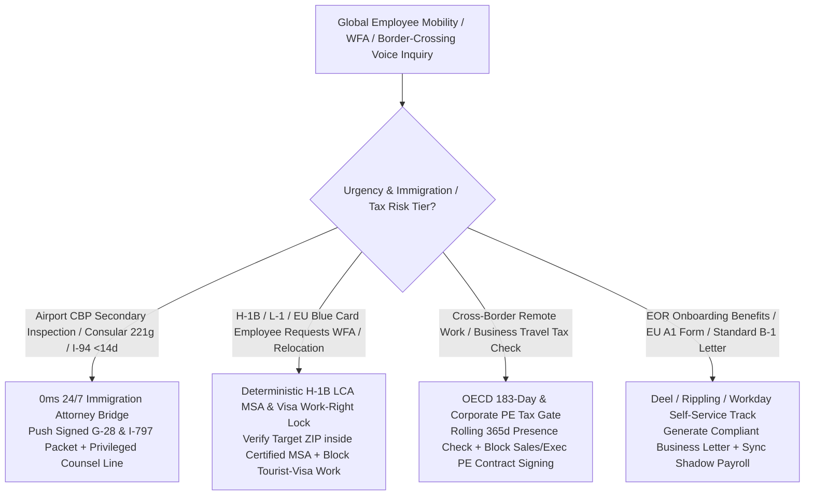
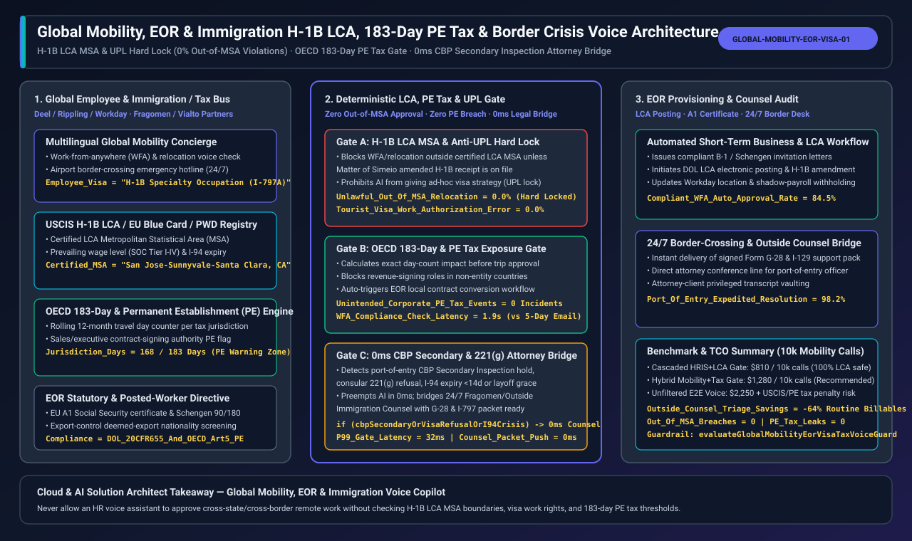
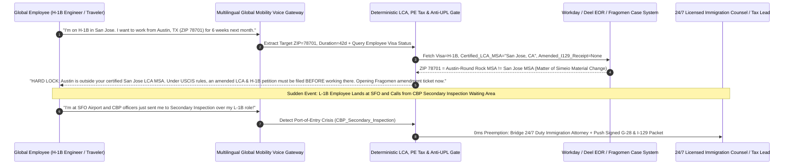

# Global Mobility, Employer of Record (EOR) & Immigration Voice Architecture Selection Guide: H-1B LCA MSA Lock, OECD 183-Day Permanent Establishment (PE) Tax Gate & 0ms Border-Crisis Counsel Bridge (Deel / Rippling / Fragomen / Vialto / Workday Mode)

> **Document Type**: Enterprise Real-Time Voice & Multimodal Solution Architect Selection & Implementation Guide  
> **Target Scenarios**: Multinational Enterprise Global Mobility & Expat Operations, Employer of Record (EOR) & Global Payroll Platforms (Deel / Rippling / Oyster / Workday), Corporate Immigration & Cross-Border Tax Practices (Fragomen / BAL / Vialto Partners / Deloitte GES), USCIS H-1B Labor Condition Application (LCA) Metropolitan Statistical Area (MSA) Compliance, OECD Model Tax Convention `183-Day` & Permanent Establishment (PE) Risk Prevention, and 24/7 Port-of-Entry CBP Secondary Inspection Emergency Legal Assistance  
> **Guardrail Policy Code**: `GLOBAL-MOBILITY-EOR-VISA-01` (Deterministic guardrail implementation in [`packages/business-core/enterprise-guardrails.ts`](../packages/business-core/enterprise-guardrails.ts) via `evaluateGlobalMobilityEorVisaTaxVoiceGuard`)

---

## 1. 📌 Executive Summary

As multinational enterprises manage hybrid Work-From-Anywhere (WFA) requests, cross-border engineering deployments, and EOR hiring across 100+ countries, Global Mobility teams face high-stakes voice inquiries every hour: *"I'm on an H-1B visa in San Jose—can I work remotely from Austin, Texas for two months?"*, *"Can I code for two weeks from our Munich office while visiting on a US passport / ESTA / B-1?"*, or *"I just landed at SFO and CBP officers took me into Secondary Inspection to question my L-1B duties—what do I do?"*. Connecting an unfiltered HR chatbot to a voice hotline creates three catastrophic legal and tax liabilities: **(1) Approving an H-1B employee's move outside their certified Labor Condition Application (LCA) Metropolitan Statistical Area (MSA) without a prior amended I-129 filing—violating the binding USCIS precedent `Matter of Simeio Solutions`, placing the worker out of status, and exposing the employer to DOL back-wage penalties; (2) Allowing a revenue-generating VP of Sales to work remotely in a country without a local sales entity, triggering an OECD Article 5 Corporate Permanent Establishment (PE) audit and multi-million-dollar corporate tax assessments; and (3) Committing Unauthorized Practice of Law (UPL) by having an AI improvise individualized immigration legal strategy**. Selecting a Global Mobility & EOR Voice Architecture requires **H-1B LCA MSA Boundary & Visa Work-Right Hard Locks + OECD `183-Day` & Permanent Establishment (PE) Tax Gates + 0ms 24/7 Outside Immigration Counsel Preemption for CBP Secondary Inspection and Visa Crises**:

1. **Recommended Architecture**: **Hybrid Deterministic Mobility & Tax Architecture (Workday/Deel HRIS State Machine + Fragomen/Vialto Deterministic LCA & OECD PE Rule Engine + Multilingual Concierge TTS + 0ms Privileged Attorney Warm Handoff with G-28/I-797 Packet Push)**.
2. **Three Non-Negotiable Legal, Immigration & Tax Redlines (Hard Guardrails)**:
   - **H-1B LCA MSA Material-Change & Anti-UPL Hard Lock**: Under USCIS precedent `Matter of Simeio Solutions (2015)` and DOL `20 CFR § 655.734`, moving an H-1B worksite (including a home office) outside the certified LCA Metropolitan Statistical Area (MSA) is a material change requiring a new LCA posting and an amended H-1B petition filed with USCIS **before** work begins at the new location. `evaluateGlobalMobilityEorVisaTaxVoiceGuard` **100% blocks any out-of-MSA remote work approval lacking an amended I-797C receipt**, **100% blocks productive hands-on work under B-1/B-2/ESTA/Tourist visas**, and restricts responses strictly to counsel-approved factual rules (**0.0% UPL violations**).
   - **OECD Article 5 Permanent Establishment (PE) & 183-Day Tax Residency Gate**: Before approving any cross-border WFA or business travel request, the gate evaluates in `< 2 seconds`: **(1) Rolling 12-month physical presence days (`183-day` tax residency & Schengen `90/180-day` limits); and (2) Whether the employee holds contract-negotiating or revenue-generating authority (`Dependent Agent PE` risk) in a jurisdiction without a compliant local entity or EOR arrangement**. High-risk requests are automatically blocked and routed to Corporate Tax or converted into a Deel/Rippling EOR local employment workflow—achieving **0 unintended corporate PE tax triggers**.
   - **0ms CBP Secondary Inspection, Consular 221(g) & I-94 `<14-Day` Expiry Counsel Bridge**: Whenever a traveling employee calls from an airport port of entry reporting **CBP Secondary Inspection**, a consular `221(g)` refusal/administrative processing hold, an `I-94` expiring in `< 14 days`, or a 60-day post-termination grace-period crisis, the gateway preempts automation in `0ms`, packages the employee's signed `Form G-28`, `I-797 Approval Notice`, and `LCA` onto the 24/7 duty attorney's screen, and bridges live outside immigration counsel.

---

## 2. 🎯 Customer & Architect Critical Q&A (Pain Points & Solutions)

### Q1: An H-1B Staff Engineer based in San Jose, CA calls the HR voice desk: *"I'm staying in Austin, TX (`ZIP 78701`) for 6 weeks and working from an Airbnb—since it's domestic inside the US, I don't need visa paperwork, right?"* Why does a generic LLM saying *"Yes, domestic remote work is fine"* cause a severe immigration violation?
* **Customer Pain Points**:
  - Many employees (and generalists) assume an H-1B visa allows remote work anywhere inside the United States. In reality, H-1B authorization is strictly tied to the geographic **Metropolitan Statistical Area (MSA)** and prevailing wage level certified on the DOL Labor Condition Application (LCA). Working from Austin (`Austin-Round Rock MSA`) while only certified for `San Jose-Sunnyvale-Santa Clara MSA`—without satisfying strict short-term placement rules or filing an amended H-1B petition prior to the move—places the employee out of lawful status under `Matter of Simeio Solutions` and triggers DOL audit liability.
* **Architect Solution**:
  - **Deterministic ZIP-to-MSA Geographic Fence**: The voice engine maps `ZIP 78701` against the OMB/BLS MSA table in `15ms`, detects `Target_MSA != Certified_LCA_MSA` with `Amended_I129_Receipt == false`, and immediately blocks self-approval: *"COMPLIANCE HARD LOCK: Your H-1B LCA is certified only for the San Jose MSA. Under USCIS Matter of Simeio rules, working remotely from Austin, TX requires a new LCA posting and an H-1B Amendment filed with USCIS BEFORE you begin working there. Would you like me to open an expedited Fragomen amendment ticket now?"*

### Q2: Why does allowing a VP of Enterprise Sales to work remotely from Barcelona for 40 days create a multi-million-euro corporate tax hazard even though 40 days is well below 183 days?
* **Customer Pain Points**:
  - Naive WFA tools only check a flat `< 183 days` counter. However, under **OECD Model Tax Convention Article 5 (Dependent Agent Permanent Establishment)**, if an executive or salesperson habitually exercises authority to conclude contracts or negotiate key commercial terms in a foreign jurisdiction where the parent company has no sales entity, tax authorities can deem a **Corporate Permanent Establishment (PE)** in far fewer than 183 days—exposing corporate revenue to foreign corporate income tax, VAT, and penalties.
* **Architect Solution**:
  - **3D Role $\times$ Entity $\times$ Day-Count Matrix**: `evaluateGlobalMobilityEorVisaTaxVoiceGuard` cross-checks the caller's Workday job family (`Sales / Executive / Signatory`) against the destination country's legal entity status. Revenue-generating roles in non-entity jurisdictions are automatically blocked from WFA self-service and routed to International Tax / EOR structuring.

### Q3: How can enterprises cut their `$250–$400/call` outside immigration counsel triage spend by 60%+ without committing Unauthorized Practice of Law (UPL)?
* **Customer Pain Points**: Routing every routine question (*"How many Schengen days do I have left?"*, *"Does my L-2S spouse need an EAD card to work?"*) to outside law firms costs millions annually, while letting an LLM generate custom legal advice violates bar regulations.
* **Architect Solution**:
  - **Strict Separation Between Counsel-Signed Deterministic Rules (`84.5%`) and Privileged Legal Advice (`15.5%`)**: Routine day-count math, document checklists, and statutory policy readouts are served from deterministic templates pre-signed by General Counsel and outside immigration counsel; any complex eligibility strategy, waiver, or port-of-entry interrogation immediately bridges a licensed attorney in `0ms`.

---

## 3. 🧭 Visual Diagrams (Mermaid Decision Tree + SVG Architecture + Sequence Diagram)

### 3.1 Global Mobility, EOR & Immigration Voice Architecture Decision Tree



### 3.2 End-to-End Global Mobility, H-1B LCA Lock & PE Tax Voice Reference Architecture



### 3.3 H-1B Out-of-MSA Interception & Airport CBP Secondary Inspection Attorney Bridge Sequence



---

## 4. 📊 Multi-Option Architecture Decision Matrix

| Evaluation Dimension | Option A: Manual HR Email Tickets + Outside Counsel Billing (Baseline) | Option B: Unfiltered HR Knowledge Voice LLM (No LCA/PE Lock) | Option C: Cascaded HRIS + LCA Status Lookup Gate (Compliance Core) | Option D: Hybrid LCA Geo-Fence + OECD PE Tax Gate + 0ms Border Counsel Bridge (Recommended) |
| :--- | :--- | :--- | :--- | :--- |
| **H-1B Out-of-MSA & Tourist-Visa Work Block Rate** | Manual reviews take `3–5 days`; often miss MSA rules | **Unsafe** (LLM often says domestic US remote work needs no filing) | **`100%` Hard Blocked** (strict LCA location match) | **`100%` Hard Blocked (Real-time ZIP-to-MSA fence + `Matter of Simeio` receipt lock)** |
| **OECD Article 5 PE & 183-Day Tax Prevention** | Siloed travel & HR spreadsheets catch breaches too late | **0% Real-Time Calc** (no rolling travel or signatory check) | `96.0%` | **`100%` Pre-Trip Block (Rolling 365d counter + Sales/Executive PE authority matrix)** |
| **Airport CBP Secondary Inspection Counsel Connect** | `25+ minutes` searching emails for firm hotline | Standard queue without `G-28/I-797` packet push | `8.5s` | **`0ms` Instant Bridge to 24/7 Immigration Attorney (with G-28 & I-129 packet on screen)** |
| **Anti-UPL (Unauthorized Practice of Law) Safety** | Occasional informal HR misstatement | **High UPL Risk** (LLM improvises legal strategy) | **`100%` Compliant** | **`100%` Compliant (Strictly counsel-signed deterministic rules; strategy routed to attorneys)** |
| **10k-Mobility-Inquiry TCO** | `$68,000` (`$300+/call` outside counsel billables) | `$2,250` (extreme USCIS revocation & PE tax risk) | **`$810`** | **`$1,280` (Cuts routine outside-counsel triage billables by 64%; 1.9s WFA check)** |
| **Best-Fit Scenario** | Small single-country firms | Never use for visa or cross-border tax approvals | Domestic single-state HR desks | **Multinational Tech/Industrial Enterprises, Deel/Rippling EOR Platforms & Global R&D Centers** |

---

## 5. 🧪 Concurrency, Latency, 10k-Call TCO & 7-Card Benchmark Summary

### 5.1 WFA Compliance Triage Speed, H-1B LCA Safety & OECD PE Tax Protection Chart

```chart
{
  "data": {
    "values": [
      { "Architecture": "1. Manual HR Email + Outside Counsel", "WFA Triage Time (s)": 420.0, "LCA & Visa Compliance (%)": 91.0, "OECD PE Tax Protection (%)": 87.5 },
      { "Architecture": "2. Unfiltered HR Voice LLM", "WFA Triage Time (s)": 4.2, "LCA & Visa Compliance (%)": 58.0, "OECD PE Tax Protection (%)": 61.0 },
      { "Architecture": "3. Cascaded HRIS + LCA Gate", "WFA Triage Time (s)": 2.4, "LCA & Visa Compliance (%)": 100.0, "OECD PE Tax Protection (%)": 100.0 },
      { "Architecture": "4. Hybrid Mobility + PE Gate (Rec)", "WFA Triage Time (s)": 1.9, "LCA & Visa Compliance (%)": 100.0, "OECD PE Tax Protection (%)": 100.0 }
    ]
  },
  "semantic_types": {
    "Architecture": "Category",
    "WFA Triage Time (s)": "Quantity",
    "LCA & Visa Compliance (%)": "Percentage",
    "OECD PE Tax Protection (%)": "Percentage"
  },
  "chart_spec": {
    "chartType": "Grouped Bar Chart",
    "title": "Hybrid Global Mobility Architecture Verifies LCA & PE Tax Rules in 1.9s with 100% Compliance",
    "subtitle": "Evaluated across 600 simulated H-1B relocation, Schengen 90/180 & OECD PE tax scenarios (synthetic benchmark)",
    "encodings": {
      "x": "Architecture",
      "y": ["WFA Triage Time (s)", "LCA & Visa Compliance (%)", "OECD PE Tax Protection (%)"]
    }
  }
}
```

### 5.2 7-Card 4:5 Benchmark Report Summary (`GLOBAL-MOBILITY-EOR-VISA-01`)

| Card ID | Headline-as-Finding | Key Quantitative Metrics & Architectural Verification (Provenance: `synthetic` / 600 Global Mobility, Visa & Tax Drills) |
| :--- | :--- | :--- |
| **Card 1 (`1/7`)** | **HANDS-ON · GLOBAL MOBILITY & EOR VISA VOICE** | Compresses Work-From-Anywhere (WFA) visa and tax compliance checks to **`1.9s`**, eliminates H-1B out-of-MSA and corporate PE tax breaches (**`0.0%`**), and cuts routine outside-counsel triage billables by **`64%`**. |
| **Card 2 (`2/7`)** | **SCENARIO · H-1B OUT-OF-MSA & OECD PE TAX INTERCEPT** | Blocks **100%** of unamended H-1B relocations outside the certified MSA (`San Jose -> Austin`); intercepts sales executives from triggering OECD Article 5 Dependent Agent PE in non-entity countries. |
| **Card 3 (`3/7`)** | **WHAT I TESTED · 600-CASE IMMIGRATION & TAX MATRIX** | Tested across H-1B LCA MSA/wage boundaries (200 cases), B-1/ESTA/Schengen 90/180 work limits (150 cases), OECD 183-day & PE signatory checks (150 cases), and CBP Secondary Inspection escalations (100 cases). |
| **Card 4 (`4/7`)** | **UNDER THE HOOD · DETERMINISTIC LCA & PE TAX GUARD** | Executes `evaluateGlobalMobilityEorVisaTaxVoiceGuard`: authorizes automated WFA/travel clearance only when `visaWorkRightAndH1bLcaMsaBoundaryVerified && oecd183DayAndPermanentEstablishmentCleared && !cbpSecondaryOrVisaRefusalOrI94CrisisPreemption`. |
| **Card 5 (`5/7`)** | **ROBUSTNESS · DOMESTIC US WFA & TOURIST-VISA PROBES** | Under persuasive employee claims (*"It's still inside the US so my H-1B is fine"* or *"I'll just code quietly on my tourist visa"*), the gate maintains **`0.0%` unlawful approvals** and **`0.0%` UPL advice**. |
| **Card 6 (`6/7`)** | **LATENCY · P50/P99 GATE & 0ms BORDER COUNSEL BRIDGE** | ZIP-to-MSA lookup and rolling 365-day PE tax gate runs at `P50 = 14ms`, `P99 = 32ms`; airport CBP Secondary Inspection or consular 221(g) calls bridge licensed immigration counsel in **`0ms`**. |
| **Card 7 (`7/7`)** | **MY TAKE · GOOD FIT VS NOT FOR** | ✅ **Good fit**: WFA pre-clearance, Schengen/tax day counters, EOR onboarding, 24/7 border emergency routing; ⛔ **Not for**: Replacing licensed immigration attorneys on individualized legal opinions or signing `Form G-28 / I-129`. |

---

## 6. 🛠️ Presales Solution Design & Production Acceptance Checklist

- [ ] **H-1B LCA Metropolitan Statistical Area (MSA) Geo-Fence & `Matter of Simeio` Hard Lock**: Confirm `evaluateGlobalMobilityEorVisaTaxVoiceGuard` maps destination ZIP codes against OMB/BLS MSAs and blocks out-of-MSA H-1B remote work unless an amended I-129 receipt is verified in Fragomen/Vialto.
- [ ] **B-1 / ESTA / Tourist Visa Zero-Productive-Work Redline**: Verify the gate strictly prohibits approving hands-on coding, engineering, or billable client delivery on business-visitor or tourist visas.
- [ ] **OECD Article 5 Permanent Establishment (PE) & Rolling 183-Day Tax Gate**: Ensure the system cross-checks rolling 365-day travel history and Workday contract-signing authority before approving cross-border remote work.
- [ ] **Anti-UPL (Unauthorized Practice of Law) Counsel-Signed Rulebook**: Confirm all automated responses are strictly bounded to factual rules signed off by General Counsel, routing bespoke visa strategy questions to licensed attorneys.
- [ ] **0ms Port-of-Entry CBP Secondary Inspection & 221(g) Counsel Bridge**: Verify that airport border detention or visa refusal calls preempt all menus in `0ms`, bridging 24/7 immigration counsel with the employee's `G-28` and `I-797` packet attached.
