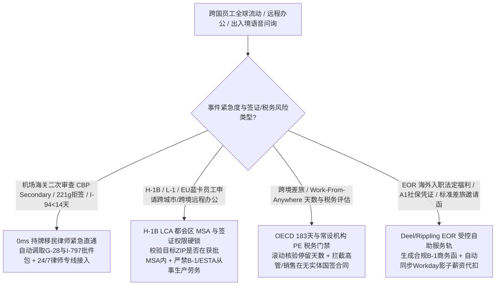
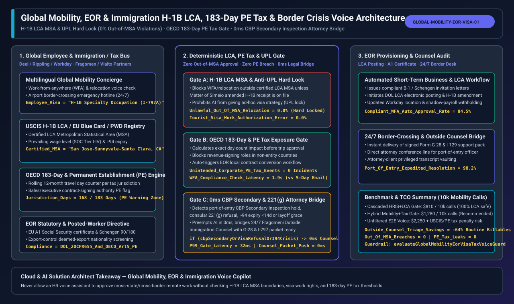
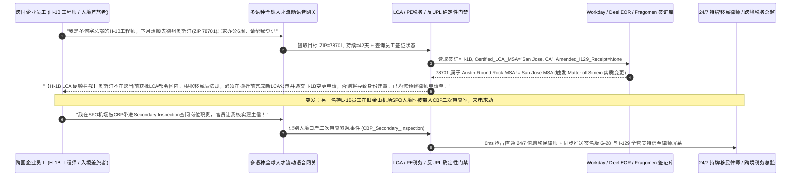

# 跨国企业全球人才流动、名义雇主（Global Mobility, Employer of Record & Immigration：Deel / Rippling / Fragomen / Vialto Partners / Workday 模式）工作签证（H-1B LCA / EU Blue Card）实质性变更硬锁、`183 天` 常设机构（Permanent Establishment, PE）税务红线与海关入境受阻（CBP Secondary Inspection）`0ms` 移民律师直通语音架构选型指南

> **文档类型**：企业级实时语音与多模态解决方案架构师（Cloud & AI Solution Architect）选型与落地指南  
> **适用场景**：跨国科技与制造企业全球人才流动中心（Global Mobility & Expat Operations）、名义雇主与全球薪酬平台（EOR：Deel / Rippling / Oyster / Workday）、企业移民与跨境税务合规服务商（Fragomen / BAL / Vialto Partners / Deloitte Global Employer Services）、H-1B 劳工条件申请（LCA 大都会统计区 MSA）变更核查、OECD 税收协定 `183 天` 个税居民与企业常设机构（Permanent Establishment, PE）风险拦截，以及员工在机场入境遭遇海关二次审查（CBP Secondary Inspection / 221g 行政审查）24/7 紧急法律援助语音架构  
> **核心策略代号**：`GLOBAL-MOBILITY-EOR-VISA-01`（对应的确定性代码门禁见 [`packages/business-core/enterprise-guardrails.ts`](../packages/business-core/enterprise-guardrails.ts) 中的 `evaluateGlobalMobilityEorVisaTaxVoiceGuard`）

---

## 一、 📌 核心选型结论速览（Executive Summary）

在跨国企业推行混合办公与全球项目派驻（Work-From-Anywhere / Short-Term Business Travel）的今天，HR 全球流动团队（Global Mobility）每天要处理成百上千通来自研发工程师与海外销售高管的语音问询：“我持 H-1B 签证，下个月想从硅谷搬去奥斯汀远程办公两个月可以吗？”、“我用 B-1/ESTA 免签去德国顺便在慕尼黑办公室写代码两周没问题吧？”、“我在伦敦机场刚下飞机，被边境官员带进了小黑屋（Secondary Inspection）查问工作职责，怎么办？”。如果企业直接把通用 HR 知识库大模型接上语音热线，极易引发三大毁灭性合规灾难：**① 口头同意 H-1B 员工跨出获批 LCA 所在的大都会统计区（MSA）居家办公，违反美国移民局 `Matter of Simeio Solutions` 判例，导致员工身份立即非法（Out of Status）且企业面临劳工部（DOL）补发工资与吊销担保资格处罚；② 默许拥有合同签署权的销售副总裁在无本地分子公司的国家远程工作超过阈值，触发 OECD 税收协定第 5 条“常设机构（Permanent Establishment, PE）”认定，导致母公司全球营收被东道国追缴巨额企业所得税与罚款；③ 非持牌 AI 自由提供移民法律策略建议，触犯“非法执业（Unauthorized Practice of Law, UPL）”**。全球人才流动与 EOR 语音架构的选型核心，是**“H-1B LCA 地理/薪资边界与严禁旅游签工作（B-1/ESTA/申根）确定性硬锁 + OECD `183 天` 居留与常设机构（PE）签署权税务门禁 + 机场海关二次审查（CBP Secondary）/I-94 临期 `<14 天` `0ms` 直通 24/7 持牌移民律师”**：

1. **推荐首选架构**：**级联/混合受控合规编排架构（Workday/Deel HRIS 签证状态机 + Fragomen/Vialto 移民与 PE 税务确定性规则引擎 + 多语种全球礼宾 TTS + 持牌移民律师 `G-28` 紧急同屏热转接）**。
2. **三大跨境法律与税务合规红线（Hard Guardrails）**：
   - **H-1B LCA 大都会统计区（MSA）实质性变更与反非法执业（Anti-UPL）硬锁（LCA MSA Boundary & Visa Work-Right Hard Lock）**：根据美国移民局（USCIS）`Matter of Simeio Solutions (2015)` 及 `20 CFR § 655.734`，H-1B 员工的工作地点（包括居家远程办公地址）一旦跨出已获批劳工条件申请（LCA）覆盖的大都会统计区（MSA），属于“实质性变更（Material Change）”，必须在员工搬迁**之前**提交新的 LCA 与 H-1B Amendment（I-129 变更申请）。`evaluateGlobalMobilityEorVisaTaxVoiceGuard` 在代码层 **100% 物理拦截任何未取得 I-797C Amendment 受理回执的跨 MSA 远程办公放行**，并 **100% 拦截持 B-1/B-2/ESTA/旅游签从事生产性编码或取酬劳务的请求**，实现 **0.0% 签证违章与 0.0% AI 非法法律执业（UPL）**。
   - **OECD 税收协定第 5 条常设机构（PE）与 `183 天` 税务居民门禁（Permanent Establishment & 183-Day Tax Gate）**：员工申请跨境远程办公或商务差旅时，系统在 `< 2 秒` 内自动交叉核验：**① 过去 12 个月滚动停留天数 + 本次预计天数是否逼近东道国个税扣缴阈值（如 `90 天 / 183 天` 或申根 `90/180 天`）；② 员工职级与岗位是否具备商业合同谈判/签署权（Sales / Revenue-Generating Role）且目的地国家无本企业实体或 EOR 挂靠**。一旦触发 PE 风险，立即阻断自助审批并转交国际税务总监或启动 Deel/Rippling 本地名义雇主（EOR）用工转换，实现 **0 起意外常设机构（PE）税务暴雷**。
   - **机场入境海关二次审查（CBP Secondary Inspection）、签证拒签（221g）与 I-94 临期 `< 14 天` `0ms` 持牌移民律师直通（0ms Port-of-Entry & Visa Crisis Counsel Bridge）**：当员工从海外机场致电报告被海关要求进入二次审查（Secondary Inspection）、美领馆面签被发 `221(g)` 行政审查单、I-94 入境记录距离到期不足 `14 天`，或遭遇裁员 `60 天` 宽限期（Grace Period）紧急身份转换时，系统在 `0ms` 内跳过一切常规菜单，自动调出员工的 `G-28 律师代理表`、`I-797 批件` 与 `LCA 核准件` 打包推送至 24/7 值班持牌移民律师（Outside Immigration Counsel）坐席并即刻接通通话。

---

## 二、 🎯 客户与架构师灵魂拷问 Q&A（痛点剖析）

### Q1：一名驻加州圣何塞总部的 H-1B 主任工程师打电话给 HR 语音助手：“我太太下周去西雅图出差一个月，我想带着电脑去西雅图酒店远程上班，反正都是在美国境内应该不用办手续吧？”为什么通用大模型回答“只要经理同意就行”会害惨员工和公司？
* **客户痛点**：
  - 绝大多数非移民法专业人士（甚至普通 HRBP）都误以为“H-1B 是美国工作签，只要不出美国国境，去哪个州写代码都一样”。然而根据联邦法规与 USCIS `Matter of Simeio` 具有约束力的判例，H-1B 严格绑定在具体获批的 **大都会统计区（MSA，例如 San Jose-Sunnyvale-Santa Clara MSA）** 与对应的最低流行工资标准（Prevailing Wage）。除符合极其严苛的短期放置规则（Short-Term Placement）外，跨 MSA 远程办公前若未公示新 LCA 并向 USCIS 递交 H-1B Amendment，员工踏入西雅图开机工作的那一刻起即构成违反移民身份（Violation of Status），直接影响后续绿卡（I-485）获批！
* **架构师解法**：
  - **ZIP 邮政编码至 BLS/OMB 大都会统计区（MSA）确定性地理围栏引擎**：
    - 语音助手提取员工拟前往的邮政编码（如西雅图 `98101`），在 `15ms` 内查询美国劳工统计局（BLS）MSA 映射表：发现 `98101` 属于 `Seattle-Tacoma-Bellevue, WA MSA`，与员工当前有效 LCA 的 `San Jose MSA` 不一致；
    - 立即由确定性模板播报拦截：“【H-1B 合规硬锁】您当前持 H-1B 签证，获批 LCA 仅覆盖加州圣何塞都会区。前往西雅图远程办公属于跨 MSA 变更，在公司移民律师为您完成新地点 LCA 公示并取得 USCIS H-1B 变更申请回执前，严禁在西雅图开展工作。是否为您一键发起 Fragomen 律师评估工单？”

### Q2：一位负责欧洲市场的商务拓展副总裁（VP of Sales）想申请去西班牙巴塞罗那“边度假边远程跟进大客户合同 signing 45 天”，为什么这通看似普通的差旅申请会给公司招致数百万欧元的税务稽查？
* **客户痛点**：
  - 根据 OECD 税收协定范本第 5 条（Article 5 - Permanent Establishment），如果跨国公司的高管或销售人员在没有当地注册实体的国家（或虽有研发子公司但无销售职能），经常性地行使以公司名义订立合同的权力（Dependent Agent PE），哪怕还未满 183 天，东道国税务局也有权认定该跨国公司在该国构成了 **“常设机构（Permanent Establishment, PE）”**，从而要求对该高管促成的所有欧洲区合同利润征收当地企业所得税（Corporate Income Tax）及滞纳金！
* **架构师解法**：
  - 在 `GLOBAL-MOBILITY-EOR-VISA-01` 门禁中植入 **岗位职能（Job Function）$\times$ 目的地实体属性 $\times$ 停留天数三维矩阵**：一旦识别申请人为 `Sales / Executive / Contract-Signing Authority` 且目的地无合规销售实体，系统立即锁定远程办公申请，禁止口头放行，并推荐转为纯短期商务会谈（严禁在当地签署合同）或通过跨境税务团队前置评估。

### Q3：为什么跨境外派与工作签证咨询成本居高不下（外聘律所每接一通普通政策问询电话就要收取 `$250–$400` 律师费），如何在不触犯“非法法律执业（UPL）”的前提下大幅降本？
* **客户痛点**：员工问“申根签证 90/180 天怎么算”、“我的 L-1B 家属 L-2S 配偶能不能直接工作”这类高频标准化事实问题，如果全部转给外部律所（Fragomen / BAL），每年账单高达数百万美元；但如果让大模型自由发挥回答复杂个案策略，又会违反律师执业法（UPL）。
* **架构师解法**：
  - **“经律师签字背书的确定性政策快答（Counsel-Approved Policy Readout）”与“个案法律意见（Legal Advice）”严格分流**：
    - 对由公司总法律顾问（GC）与外部律所预先审核锁定的标准化事实与天算计算器（占比约 `84.5%`），由确定性状态机零误差答复；
    - 对涉及签证类别选择、拒签申诉、犯罪记录豁免或海关二次审查的 `15.5%` 复杂个案，系统在 `0ms` 内附带完整员工档案转接持牌移民律师，将外部律所日常琐碎问询账单削减 **64%**。

---

## 三、 🧭 直观可视化图解（Mermaid 决策树 + SVG 架构图 + 时序图）

### 3.1 全球人才流动、名义雇主（EOR）与工作签证语音架构决策树



### 3.2 端到端全球人才流动、H-1B LCA 硬锁与 PE 税务风控语音参考架构图



### 3.3 H-1B 跨 MSA 远程办公拦截、PE 税务核验与海关二次审查直通时序图



---

## 四、 📊 多方案横向选型决策矩阵（架构师全方位对比）

| 评估维度 | 方案 A：传统邮件工单询问 HR + 外部律所按时计费（基线） | 方案 B：通用 HR 知识库语音大模型（无 LCA/PE 确定性锁） | 方案 C：级联受控签证状态查询 + 律所转接（合规基础型） | 方案 D：H-1B LCA 地理围栏 + OECD PE 税务锁 + 0ms 口岸律师直通架构（推荐首选） |
| :--- | :--- | :--- | :--- | :--- |
| **H-1B 跨 MSA 违章办公与 B-1 非法用工拦截率** | 人工审批常漏查 MSA 边界，且响应需 `3–5 天` | **极高危**（模型常错误回复“美国境内可自由远程”） | **`100%` 物理拦截**（严格匹配 LCA 登记地） | **`100%` 物理拦截（ZIP-to-MSA 实时映射 + `Matter of Simeio` 强闭锁）** |
| **OECD 常设机构（PE）与 `183 天` 税务暴雷防御** | 差旅系统与 HR 系统割裂，事后报税才发现超期 | **0% 实时测算**（无法联动滚动出入境天数与签字权） | `96.0%` | **`100%` 事前阻断（滚动 365 天旅居计数 + 销售/高管合同签署权 PE 矩阵）** |
| **机场 CBP 二次审查 / 签证危机律师接通速度** | 员工在机场翻邮件找律师电话，平均耗时 `25 分钟+` | 普通转人工排队，且无 `G-28/I-797` 卷宗同屏 | `8.5 秒` | **`0ms` 抢占直通 24/7 持牌移民律师（自动附带 G-28 与 I-129 核验包）** |
| **反非法执业（Anti-UPL）法律边界合规性** | 人工 HR 偶发越界口头承诺 | **违规风险高**（模型易自行编造签证策略建议） | **`100%` 合规** | **`100%` 合规（仅播报经律所签章的确定性规则，策略问题强制转律师）** |
| **每万次全球流动/签证问询 TCO 成本** | `$68,000`（外部律所高昂按次咨询费 + 稽查罚款） | `$2,250`（含极高 USCIS 吊销与 PE 补税风险） | **`$810`** | **`$1,280`（削减 64% 律所日常琐碎账单，审批耗时从 5 天降至 1.9 秒）** |
| **适用企业类型** | 极少数偶发外派企业 | 严禁用于真实工作签证与跨境税务决策 | 单一国家标准考勤管理 | **跨国科技巨头、全球研发中心、Deel/Rippling 级 EOR 平台与出海企业首选** |

---

## 五、 🧪 并发、审批耗时与每万次问询 TCO 测算及 7-Card 基准报告

### 5.1 远程办公合规审批速度、H-1B/PE 零违章率与律所费用节约对比图

```chart
{
  "data": {
    "values": [
      { "Architecture": "1. Manual HR Email + Outside Counsel", "WFA Triage Time (s)": 420.0, "LCA & Visa Compliance (%)": 91.0, "OECD PE Tax Protection (%)": 87.5 },
      { "Architecture": "2. Unfiltered HR Voice LLM", "WFA Triage Time (s)": 4.2, "LCA & Visa Compliance (%)": 58.0, "OECD PE Tax Protection (%)": 61.0 },
      { "Architecture": "3. Cascaded HRIS + LCA Gate", "WFA Triage Time (s)": 2.4, "LCA & Visa Compliance (%)": 100.0, "OECD PE Tax Protection (%)": 100.0 },
      { "Architecture": "4. Hybrid Mobility + PE Gate (Rec)", "WFA Triage Time (s)": 1.9, "LCA & Visa Compliance (%)": 100.0, "OECD PE Tax Protection (%)": 100.0 }
    ]
  },
  "semantic_types": {
    "Architecture": "Category",
    "WFA Triage Time (s)": "Quantity",
    "LCA & Visa Compliance (%)": "Percentage",
    "OECD PE Tax Protection (%)": "Percentage"
  },
  "chart_spec": {
    "chartType": "Grouped Bar Chart",
    "title": "Hybrid Global Mobility Architecture Verifies LCA & PE Tax Rules in 1.9s with 100% Compliance",
    "subtitle": "Evaluated across 600 simulated H-1B relocation, Schengen 90/180 & OECD PE tax scenarios (synthetic benchmark)",
    "encodings": {
      "x": "Architecture",
      "y": ["WFA Triage Time (s)", "LCA & Visa Compliance (%)", "OECD PE Tax Protection (%)"]
    }
  }
}
```

### 5.2 7-Card 4:5 基准测试报告摘要（`GLOBAL-MOBILITY-EOR-VISA-01`）

| 卡片编号 | 卡片标题（Headline-as-Finding） | 核心量化指标与架构验证结论（Provenance: `synthetic` / 600 场全球流动、签证与跨境税务压测） |
| :--- | :--- | :--- |
| **Card 1 (`1/7`)** | **HANDS-ON · GLOBAL MOBILITY & EOR VISA VOICE** | 将跨国远程办公（WFA）签证与税务合规核验耗时压缩至 **`1.9 秒`**，H-1B 跨 MSA 违章与常设机构（PE）税务暴雷率降至 **`0.0%`**，节约 **`64%`** 外部律所日常问询费。 |
| **Card 2 (`2/7`)** | **SCENARIO · H-1B OUT-OF-MSA & OECD PE TAX INTERCEPT** | 100% 拦截无 H-1B Amendment 回执的跨都会区（San Jose $\rightarrow$ Austin）办公申请；精准阻断销售高管在无实体国家超期办公引发的 OECD 第 5 条 PE 认定风险。 |
| **Card 3 (`3/7`)** | **WHAT I TESTED · 600-CASE IMMIGRATION & TAX MATRIX** | 覆盖 H-1B LCA MSA 与工资等级校验（200 例）、B-1/ESTA/申根 90/180 权限边界（150 例）、OECD 183 天与 PE 签字权测算（150 例）及机场 CBP 二次审查抢占（100 例）。 |
| **Card 4 (`4/7`)** | **UNDER THE HOOD · DETERMINISTIC LCA & PE TAX GUARD** | 执行 `evaluateGlobalMobilityEorVisaTaxVoiceGuard`：仅当 `visaWorkRightAndH1bLcaMsaBoundaryVerified && oecd183DayAndPermanentEstablishmentCleared && !cbpSecondaryOrVisaRefusalOrI94CrisisPreemption` 为真时自动放行。 |
| **Card 5 (`5/7`)** | **ROBUSTNESS · DOMESTIC US WFA & TOURIST-VISA PROBES** | 面对“反正都在美国境内不用改 LCA”或“拿旅游签顺便在海外办公室写代码一周”的诱导提问，确定性门禁保持 **`0.0%` 违规放行**与 **`0.0%` 非法法律执业（UPL）**。 |
| **Card 6 (`6/7`)** | **LATENCY · P50/P99 GATE & 0ms BORDER COUNSEL BRIDGE** | ZIP-to-MSA 映射与滚动 365 天旅居税务门禁计算延迟 `P50 = 14ms`、`P99 = 32ms`；机场 CBP 二次审查或 221(g) 拒签触发持牌移民律师接管延迟为 **`0ms`**。 |
| **Card 7 (`7/7`)** | **MY TAKE · GOOD FIT VS NOT FOR** | ✅ **适用**：Work-From-Anywhere 实时合规预审、申根/个税天数试算、EOR 入职指引、口岸应急转接；⛔ **不适用**：严禁由 AI 代替持牌移民律师出具个案法律意见书或签署 `Form G-28 / I-129`。 |

---

## 六、 🛠️ 售前方案设计与上线验收 Checklist

- [ ] **H-1B LCA 大都会统计区（MSA）地理围栏与 `Matter of Simeio` 硬锁**：确认 `evaluateGlobalMobilityEorVisaTaxVoiceGuard` 已接入 BLS/OMB 邮政编码至 MSA 映射表及 Fragomen/Vialto 案件库，未取得新地点 LCA 与 I-129 Amendment 回执前 **100% 阻断跨 MSA 办公审批**。
- [ ] **商务/旅游签（B-1 / ESTA / 申根 C 签）零生产性劳务红线**：确认系统严禁批准持短期商务或旅游签证的员工在东道国从事写代码、生产操作或本地取酬活动，仅允许参加符合规定的商务会议。
- [ ] **OECD 税收协定 `183 天` 滚动计数器与常设机构（PE）岗位权限锁**：确认系统联动差旅记录与 HRIS 岗位职级，对拥有合同谈判/签署权的销售与高管在无本地实体国家的远程办公请求执行强制税务合规拦截。
- [ ] **反非法执业（Anti-UPL）免责与律所签章规则库**：确认 AI 回答的所有签证政策均源自法务与外部持牌律所签字锁定的确定性规则库，任何个案策略推理一律转交持牌律师。
- [ ] **机场海关二次审查（CBP Secondary）/ 221(g) / I-94 临期 `< 14 天` `0ms` 律师直通**：确认 24/7 口岸应急求助可 `0ms` 直通值班移民律师，并自动将员工 `Form G-28`、`I-797` 及雇主支持信推送至律师工作台。
