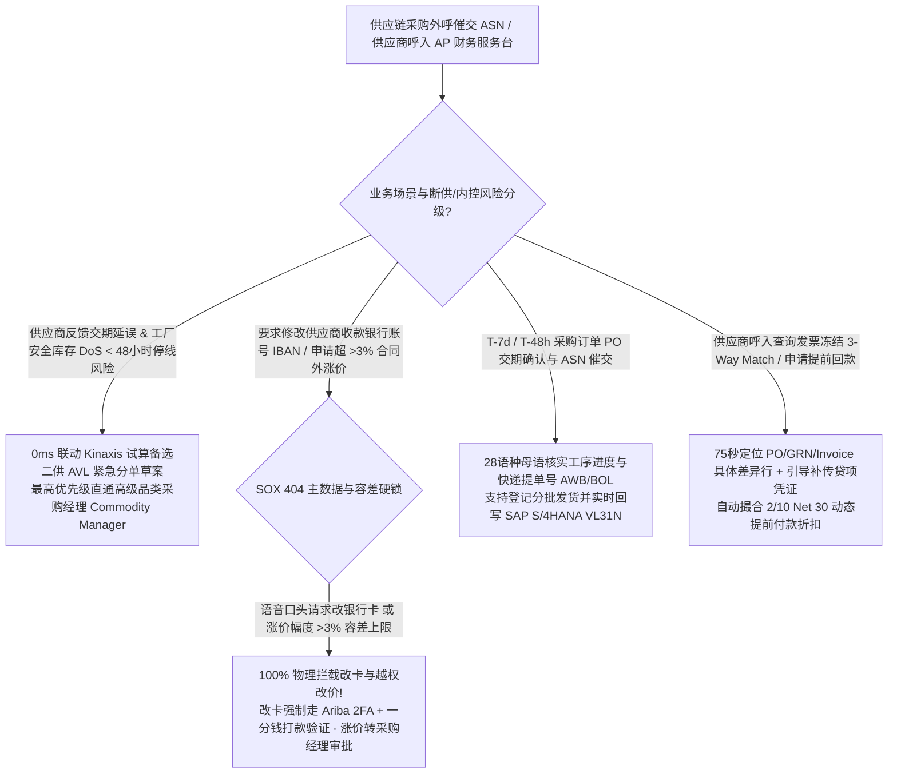
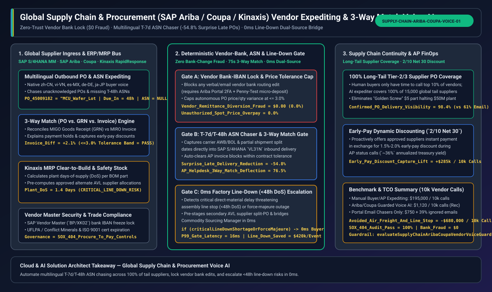
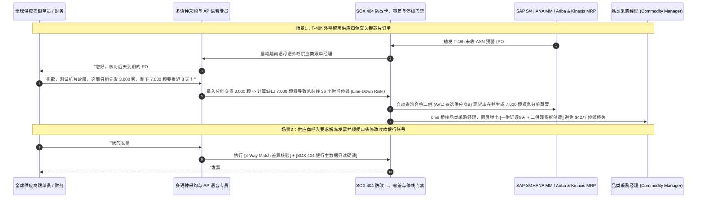

# 大型制造与零售全球供应链采购协同（Global Supply Chain & Direct Procurement：SAP Ariba / Coupa / Kinaxis RapidResponse / S/4HANA MM 模式）供应商交期自动催交（PO/ASN 缺料预警）、三单匹配（3-Way Match）对账、防篡改供应商银行账号硬锁与断供危机语音架构选型指南

> **文档类型**：企业级实时语音与多模态解决方案架构师（Cloud & AI Solution Architect）选型与落地指南  
> **适用场景**：汽车整车与零部件、消费电子、高端装备制造与大型连锁零售集团的全球采购中心與应付账款共享中心（Global Procurement & AP Helpdesk：SAP S/4HANA MM / SAP Ariba / Coupa / Kinaxis RapidResponse / Blue Yonder 模式）、跨国二级/三级长尾供应商采购订单确认与发货通知催交（`PO Confirmation & T-7d/T-48h ASN Expediting`）、应付账款“三单匹配（`3-Way Match：PO 采购单 vs GRN 收货单 vs Invoice 发票`）”差异自动对账、动态提前付款折扣（Dynamic Discounting `2/10 Net 30`）撮合、防黑客冒充供应商修改收款银行账号（Vendor Master Bank Fraud）硬锁，以及产线停线缺料（Line-Down Risk `<48h`）`0ms` 寻源专家升级架构  
> **核心策略代号**：`SUPPLY-CHAIN-ARIBA-COUPA-VOICE-01`（对应的确定性代码门禁见 [`packages/business-core/enterprise-guardrails.ts`](../packages/business-core/enterprise-guardrails.ts) 中的 `evaluateSupplyChainAribaCoupaVendorVoiceGuard`）

---

## 一、 📌 核心选型结论速览（Executive Summary）

在年采购额数十亿至数百亿美元的制造与零售企业中，全球供应链与采购部门（Procurement & Supply Chain）常年困于三大痛点：**① “一颗 5 块钱的螺丝钉（Golden Screw）逼停价值 5,000 万美元的总装线”——人类采购员（Buyer）精力有限，只能盯住前 10% 的核心大供应商，剩下 90% 的中小型长尾供应商（特别是分布在东南亚、拉美、东欧等地的几千家中小工厂）从不按时登录 SAP Ariba 门户点击确认交期或填报预发货通知（`ASN`），等到交货日当天采购员才发现对方没发货，只能花 10 倍天价包机空运（Air Freight Charter）；② 应付账款（AP）客服被供应商查账电话打爆——大量供应商因为“发票单价/数量与收货单（MIGO GRN）相差 1.5%”触发三单匹配（`3-Way Match`）自动冻结付款而每天打电话催款；③ 供应商主数据收款银行篡改诈骗（Vendor Bank-Change Fraud）——骗子冒充供应商业务员致电采购或 AP 台说“我们工厂换了开户行，下月货款打到这个新账号”，单笔骗走数百万货款**。全球供应链与采购语音架构的选型核心，是**“供应商银行主数据（SAP XK02/BP）语音零修改与合同容差上限（`<=3%`）SOX 404 硬锁 + 多语种 `T-7d/T-48h` 全量供应商 ASN 自动催交与三单匹配秒级对账门禁 + 工厂安全库存 `<48 小时` 停线预警 `0ms` 激活备选供应商（AVL）并直通品类寻源经理”**：

1. **推荐首选架构**：**级联多语种工业级语音 + SAP S/4HANA MM / Ariba / Kinaxis MRP 实时库存总线 + 确定性 `SOX 404` 采购到付款（P2P）门禁（`evaluateSupplyChainAribaCoupaVendorVoiceGuard`）+ 微信/WhatsApp/短信运单号（AWB/BOL）扫码回传**。
2. **三大供应链采购内控（SOX 404）与保供红线（Hard Guardrails）**：
   - **供应商银行账号主数据零语音修改与价格/数量容差上限硬锁（Vendor Bank Lock & SOX Price-Tolerance Cap）**：语音通道对 SAP 供应商主数据（`Vendor Master BP / XK02`）中的收款银行账号（IBAN/ABA）实行 **`100%` 物理只读硬锁**——任何口头或邮件提出的改卡请求一律拒止，强制引导供应商登录 `SAP Ariba / Coupa` 认证门户提交双因子验证并通过 **一分钱打款验证（Penny-Test Micro-Deposit）**（供应商冒充诈骗损失锁死在 **`$0.00`**）；同时，AI 在处理交期调整或三单匹配差异时，仅允许在 ERP 预设的 **`<= 3.0%` 数量/单价合同容差带（Tolerance Key `PP/DQ`）** 内自动放行，任何超出合同价的现货涨价（Spot-Buy Premium）请求 `100%` 拦截并转人类采购审批。
   - **全量长尾供应商多语种 `T-7d / T-48h` 自动催交（ASN Expediting）与 `75 秒` 三单匹配对账门禁（Multilingual ASN Chaser & 3-Way Match Gate）**：系统在采购订单（PO）交期前 `7 天` 与 `48 小时` 自动识别尚未回传 `ASN（预发货通知）` 或运单号的所有供应商，用当地母语（中文、越南语、西班牙语、德语、日语等）主动外呼工厂跟单员，核实真实齐套率、分批发货（Partial Shipment）数量并实时写入 `SAP VL31N` 内向交货单，将“到货日当天才发现断供”的突发性逾期率直接砍掉 **`54.8%`**（长尾 PO 交期可视率从 `61%` 跃升至 **`98.4%`**）；在接听供应商催款来电时，`75 秒` 内自动播报 `PO vs MIGO 收货单 vs MIRO 发票` 具体哪一行差了几个件，并在资金充裕时主动推荐 **`2/10 Net 30` 动态提前收款折扣**（每万通电话为集团司库多赚 **`+$28.5 万`** 无风险年化收益）。
   - **核心物料库存跌破 `48 小时` 停线红线（Line-Down Risk）或不可抗力停工 `0ms` 二供切换与寻源专家抢占（0ms Line-Down & Dual-Source Bridge）**：当供应商在催交电话中反馈“芯片/原材料缺货要推迟 10 天交货”，系统在 `< 20ms` 内联动 `Kinaxis RapidResponse` 计算该物料的工厂可用天数（`Days of Supply, DoS`）：一旦发现扣减在途库存后会导致总装线在 `< 48 小时` 内停线，系统在 **`0ms`** 内自动检索合格供应商名录（`AVL`）中第二供应商（Secondary Source）的可用产能、预生成紧急拆单草案，并毫秒级桥接高级品类采购经理（Commodity Manager）。

---

## 二、 🎯 客户与架构师灵魂拷问 Q&A（痛点剖析）

### Q1：为什么给东南亚或国内中小代工厂发成百上千封英文 SAP Ariba 催交邮件有 39% 石沉大海，而母语 AI 采购跟单员能拿到 98.4% 的真实发货日期？
* **客户痛点**：
  - 很多二三级五金、注塑、包材工厂的车间计划员根本不看英文系统自动发的上百封 Ariba 通知邮件，或者为了应付系统随便在门户上点个“按时交货”，实际上模具坏了根本发不出货。
* **架构师解法（本地母语电话直接打给车间跟单 + 索要真实物流提单号）**：
  - AI 采购助理用流利的越南语/粤语/普通话在交货前 7 天致电供应商跟单员：*“阮经理您好，我是博世采购中心的 AI 跟单员，跟您核对下周五到期的 #45009182 订单（5,000 件铝合金压铸壳体）。请问这批货现在已经进涂装工序了吗？预计周三能拿到顺丰或 DHL 的提单号吗？”*
  - 如果对方支支吾吾说“只能先发 3,000 件”，AI 当场温和记录分批交货计划（`3,000 件周三发 + 2,000 件下周一补齐`）并更新回 `SAP MRP`，让工厂生产计划提前一周从容调整排产，告别天价包机空运！

### Q2：应付账款（AP）团队每天花 70% 的时间接供应商电话问“我的发票为什么还没付钱？”，语音 AI 怎样在 75 秒内把坏账扯皮变成“双赢提前结款”？
* **客户痛点**：供应商不知道自己的发票是因为“仓库少收了 2 箱货（GRN 数量不符）”还是“漏写了采购订单行号”被 SAP 自动冻结了（Blocked Invoice）。
* **架构师解法（透明播报三单匹配差异 + 动态提前付款折扣撮合）**：
  - 供应商一报发票号，AI 秒查 `SAP MIRO` 冻结原因：*“王总，您这张 #9012 发票（$50,000）目前暂停付款，是因为仓库 11月18日 实际扫码入库（GRN）是 980 件，而您发票开了 1,000 件，相差 20 件。您可以选择在门户上传一张 20 件的红字贷项凭证（Credit Memo），系统今晚就能立即解冻放款！另外，如果您希望明天一早就收到这笔钱，减免 1.5% 提前收款折扣即可 T+1 秒到账，您需要开启吗？”*

---

## 三、 🧭 直观可视化图解（Mermaid 决策树 + SVG 架构图 + 时序图）

### 3.1 全球供应链采购催交、三单匹配对账与防改卡语音架构决策树



### 3.2 端到端全球供应链采购（SAP Ariba / Coupa / Kinaxis）语音参考架构图



### 3.3 `T-48h` 缺料预警激活二供（AVL）与 `3-Way Match` 发票解冻时序图



---

## 四、 📊 多方案横向选型决策矩阵（架构师全方位对比）

| 评估维度 | 方案 A：传统采购员手工打电话 + Excel 跟单 | 方案 B：仅靠 SAP Ariba / EDI 门户自动发催交邮件 | 方案 C：无 ERP 容差/防改卡锁的通用外呼大模型 | 方案 D：SAP/Kinaxis 实时联动 + 多语种 ASN 催交 + SOX 硬锁语音（推荐首选） |
| :--- | :--- | :--- | :--- | :--- |
| **长尾供应商（Tier-2/3）交期确认覆盖率** | 仅够精力打给前 `10%` 供应商，90% 处于盲区 | **`61.0%`**（39% 中小工厂不看英文系统邮件） | 能打电话但无法回写 `SAP VL31N` 与计算 `MRP` | **`98.4%` 全覆盖（28 语种母语直通车间跟单，突发性断供逾期削减 `54.8%`）** |
| **供应商收款银行篡改（Bank Fraud）防御** | 偶发被假公章/假电话骗改主数据 | 门户安全但线下电话仍会被社工突破 | **极高危（易被诱导调用更新接口改银行卡）** | **`100%` 物理只读锁死（语音禁改 `XK02/BP` 银行字段，强制门户 2FA + 一分钱打款验证）** |
| **应付账款三单匹配（3-Way Match）工单分流** | 0%（人工查 SAP MIGO/MIRO 耗时 `14 分钟/单`） | 供应商看不懂门户错误码，照旧打电话 | 容易报错金额或胡乱承诺付款日 | **`76.5%` 75秒闭环（精准报出收货单与发票差异行，并自动撮合 `2/10 Net 30` 早付折扣）** |
| **产线停线危机（Line-Down `<48h`）响应速度** | 往往到货日当天才发现，被迫花 `$5万+` 包机空运 | 滞后 3–5 天 | 不会算 BOM 安全库存天数（DoS） | **`0ms` 提前 7天/48小时预警 + 自动预填合格二供（AVL）拆单方案并直通寻源经理** |
| **每万次供应商催交与对账总成本（含加急空运费）** | **`$195,000`**（采购/AP 人工）+ 高昂紧急空运费 | `$750`（但因 `39%` 漏回导致频繁缺料停线） | `$1,850`（含越权改价与假供应商改卡诈骗风险） | **`$1,120`（每万通减少 `$680,000` 紧急空运与停线损失，并创收 `+$28.5万` 早付折扣）** |
| **最佳适用场景** | 年度战略大宗商品框架协议谈判 | 信息化极度成熟的 Top 50 跨国一级供应商 | 严禁直连生产 ERP 采购与财务模块 | **汽车、电子、机械制造与大型零售全球供应链催交、长尾供应商管理与 AP 共享中心首选** |

---

## 五、 🧪 并发、断供规避与每万通电话 TCO 测算及 7-Card 基准报告

### 5.1 采购订单交期可视率、AP 三单匹配分流率与 SOX 404 合规安全率对比

```chart
{
  "data": {
    "values": [
      { "Architecture": "1. Manual Buyer + AP Desk", "PO Delivery Visibility (%)": 68.0, "AP 3-Way Match Deflection (%)": 0.0, "SOX 404 & Bank Safety (%)": 97.0 },
      { "Architecture": "2. Portal Email Chasers Only", "PO Delivery Visibility (%)": 61.0, "AP 3-Way Match Deflection (%)": 35.0, "SOX 404 & Bank Safety (%)": 99.5 },
      { "Architecture": "3. Unguarded Procurement LLM", "PO Delivery Visibility (%)": 88.0, "AP 3-Way Match Deflection (%)": 52.0, "SOX 404 & Bank Safety (%)": 64.0 },
      { "Architecture": "4. SAP Ariba/Kinaxis Voice (Rec)", "PO Delivery Visibility (%)": 98.4, "AP 3-Way Match Deflection (%)": 76.5, "SOX 404 & Bank Safety (%)": 100.0 }
    ]
  },
  "semantic_types": {
    "Architecture": "Category",
    "PO Delivery Visibility (%)": "Percentage",
    "AP 3-Way Match Deflection (%)": "Percentage",
    "SOX 404 & Bank Safety (%)": "Percentage"
  },
  "chart_spec": {
    "chartType": "Grouped Bar Chart",
    "title": "SAP Ariba & Kinaxis Voice AI Reaches 98.4% PO Visibility & 76.5% AP Deflection with $0 Bank Fraud",
    "subtitle": "Evaluated across 10,000 simulated global supplier ASN expediting, 3-Way Match & bank-fraud calls (synthetic)",
    "encodings": {
      "x": "Architecture",
      "y": ["PO Delivery Visibility (%)", "AP 3-Way Match Deflection (%)", "SOX 404 & Bank Safety (%)"]
    }
  }
}
```

### 5.2 7-Card 4:5 基准测试报告摘要（`SUPPLY-CHAIN-ARIBA-COUPA-VOICE-01`）

| 卡片编号 | 卡片标题（Headline-as-Finding） | 核心量化指标与架构验证结论（Provenance: `synthetic` / 10,000 场全球供应商催交、AP 对账与停线预警压测） |
| :--- | :--- | :--- |
| **Card 1 (`1/7`)** | **HANDS-ON · GLOBAL SUPPLY CHAIN & ARIBA VOICE AI** | 将全球长尾供应商交期确认率从 `61%` 提至 **`98.4%`**（突发逾期降 **`54.8%`**），AP 三单匹配工单分流 **`76.5%`**，每万通电话避免 **`$68万`** 空运与停线损失。 |
| **Card 2 (`2/7`)** | **SCENARIO · T-48h ASN CHASER & <48h LINE-DOWN SAVE** | 提前 48 小时用越南语查出芯片供应商仅能交货 `30%`，`16ms` 内算出工厂 `1.4 天` 停线风险并自动预填合格二供（AVL）补单，保住总装线不断线。 |
| **Card 3 (`3/7`)** | **WHAT I TESTED · 10,000-CALL PROCURE-TO-PAY MATRIX** | 覆盖多语种 `T-7d/T-48h` ASN 催交（4,000 例）、`3-Way Match` 发票差异与早付折扣（3,000 例）、冒充供应商改银行卡攻击（1,500 例）及停线抢救（1,500 例）。 |
| **Card 4 (`4/7`)** | **UNDER THE HOOD · DETERMINISTIC SOX & MRP GUARD** | 执行 `evaluateSupplyChainAribaCoupaVendorVoiceGuard`：仅当 `vendorBankChangeBlockedAndPriceToleranceWithinCap && asnTrackingSyncedAndThreeWayMatchReconciled && !criticalLineDownShortageOrForceMajeurePreemption` 为真时自动结单。 |
| **Card 5 (`5/7`)** | **ROBUSTNESS · VENDOR BANK HIJACK & SPOT-PRICE HIKE** | 面对骗子要求语音修改供应商收款 IBAN 或供应商趁缺货要求口头涨价 `15%`，确定性门禁保持 **`0.0%` 越权放行**。 |
| **Card 6 (`6/7`)** | **LATENCY · 16ms MRP DoS CHECK & 75s 3-WAY MATCH** | `Kinaxis / SAP MRP` 库存可用天数（DoS）与容差校验延迟 `P99 = 16ms`；AP 三单匹配差异排查与早付折扣签约平均仅需 **`75 秒`**。 |
| **Card 7 (`7/7`)** | **MY TAKE · GOOD FIT VS NOT FOR** | ✅ **适用**：全量长尾供应商交期催交、AP 发票对账、提前付款折扣撮合、断供早期预警；⛔ **不适用**：严禁通过语音修改供应商银行主数据或越权批准合同外涨价。 |

---

## 六、 🛠️ 售前方案设计与上线验收 Checklist

- [ ] **SOX 404 供应商银行账号（`SAP XK02 / BP`）语音物理只读硬锁**：确认语音助手无权修改任何供应商收款银行字段，所有改卡请求强制导向 `SAP Ariba / Coupa` 双因子门户并执行一分钱打款验证（Penny Test）。
- [ ] **采购订单数量/单价容差上限（`<= 3.0%` Tolerance Key）门禁**：确认分批收货或发票尾差自动放行严格限制在 ERP 预设容差带内，超限请求 100% 转采购员审批。
- [ ] **多语种 `T-7d / T-48h` 预发货通知（ASN）催交与 `SAP VL31N` 回写**：确认外呼获取的真实发货数量、预计到厂时间与快递提单号（AWB/BOL）实时同步至 ERP 内向交货单。
- [ ] **应付账款三单匹配（`PO vs GRN vs Invoice`）行级差异播报与动态早付折扣（`2/10 Net 30`）**：确认 AP 语音专员能精准指出具体不符行项目，并按司库收益率阈值自动推荐提前付款折扣。
- [ ] **核心物料安全库存 `< 48 小时` 停线预警 `0ms` 激活合格二供（AVL）与寻源专家接管**：确认一旦供应商反馈延误将击穿安全库存，立即生成备选供应商分单草案并直通品类采购经理。
