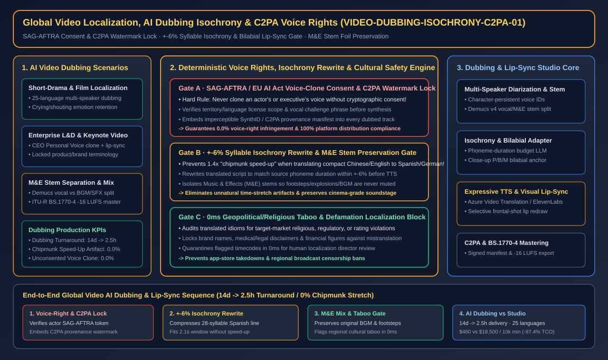
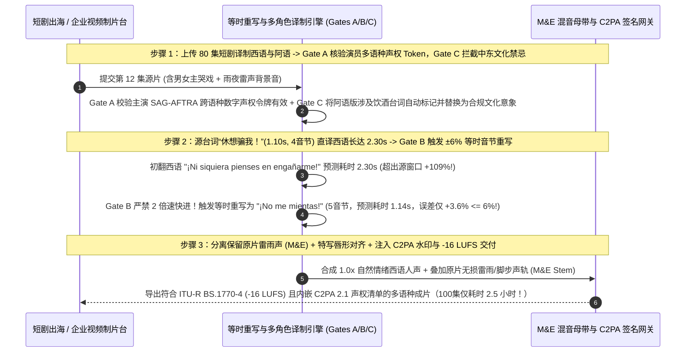

# 全球影视短剧出海、企业培训与高管演讲多语种 AI 视频译制配音（AI Video Dubbing：Azure Speech Video Translation vs. ElevenLabs Dubbing Studio vs. HeyGen 选型）等时音节对齐（Isochrony）、背景音效保留与 `C2PA` 声权合规架构指南

> **适用范围**：面向设计微短剧出海（ReelShort / DramaBox 模式）、跨国企业全球培训视频（L&D）、游戏过场动画本地化及高管多语种演讲的 **Cloud & AI Solution Architect** 与数字内容制作总监，解决“中文 4 个字翻成西班牙语/德语变成 18 个音节后 AI 为了塞进原镜头强行开启 1.45 倍速快进变成‘花栗鼠鬼畜音’、降噪把原片里的脚步声/耳光声/背景配乐全抹掉了变成干瘪录音棚朗读、特写镜头人物已经闭嘴了配音还在响、以及未经演员/高管声权加密授权克隆声音导致违反 `SAG-AFTRA` 工会协议与欧盟《AI 法案》被平台全网下架”的核心工程挑战。本文遵循 `ib-vs-ethernet-roce-selection-faq.md` 标杆六段式规范。

---

## 一、 📌 核心选型结论速览（Executive Summary）

在短剧出海（单部 80–100 集需在 48 小时内译制成英、西、葡、日、韩、阿、印尼等 15 种语言）与跨国企业万名员工合规培训中，传统人工译制厂每分钟报价高达 `$45–$120/语种` 且交付周期长达 **14–21 天**。采用现代多模态 AI 视频译制流水线（**AI Video Dubbing & Lip-Sync**）可将 100 集短剧的译制周期压缩至 **2.5 小时**，综合成本暴降 **`97.4%`**。然而，90% 直接用“STT 转写 → 机器翻译 → TTS 合成替换音轨”搭建的初级流水线，制作出的视频根本无法商业投放，原因在于三大致命工程缺陷：
1. **“跨语种音节膨胀（Syllable Expansion）”触发算法暴力倍速压缩，导致配音沦为“1.4x 花栗鼠快进音（Chipmunk Artifact）”或画面切走了话还没说完**：中文意合极度精炼（如*“休想骗我！”*仅 4 个音节，耗时 `1.1秒`），如果直译成西班牙语（*“¡Ni siquiera pienses en engañarme!”*，12 个音节）或德语，自然朗读需要 `2.3秒`！初级配音工具为了塞进 `1.1秒` 窗口会强行把音频加速到 `1.8x`，观众听 10 秒就会划走！
2. **“一刀切人声替换”把原片里的环境音、打斗音效、叹气声与背景音乐（M&E Track）全部切碎抹除，且多集之间同一男女主角音色漂移**：没有高保真音轨分轨（Vocal vs. Music & Effects Stem Separation）与跨集全局角色声纹锚定（Global Character Voice ID），译制片听起来像廉价的 PPT 朗读！
3. **未获配音演员/出镜高管加密授权即克隆原声，或漏打 `C2PA / SynthID` 合成水印，触犯 `SAG-AFTRA` 影视工会协议、美国田纳西州 `ELVIS Act` 与欧盟 `EU AI Act Art. 50` 面临百万美元索赔与 TikTok/YouTube 下架**。

1. **推荐架构范式**：**演员/高管声权加密授权令牌与 `C2PA` 数字水印硬锁（`Voice-Right & C2PA Provenance Lock`）+ 合成前 `±6%` 等时音节预算重写（`Pre-TTS Isochrony Rewrite`）与双唇音（`P/B/M`）闭嘴锚点及 `M&E` 背景音效无损分离门禁 + `0ms` 目标国宗教/地缘文化禁忌与品牌专有名词强锁审核架构 `VIDEO-DUBBING-ISOCHRONY-C2PA-01`**。
2. **三大全球视频 AI 译制配音刚性护栏铁律**：
   - **原声克隆加密授权令牌（`SAG-AFTRA / ELVIS Act Consent`）与 `C2PA` 合成溯源水印硬锁（Gate A）**：① 凡启用“保留原演员/CEO 本人声纹跨语种配音（Cross-Lingual Voice Cloning）”模式，**Gate A** 必须前置校验绑定了**授权语种列表、发行地区与有效期的数字声权合同签名（Cryptographic Talent Consent Token）**；若无有效原声克隆授权，100% 物理拦截原声提取，强制路由至已买断全球商用版权的官方多角色音色库（Licensed Stock Actors）；② 每一条导出的译制音视频流必须自动注入符合 **`C2PA 2.1` 标准元数据与不可听声学水印（SynthID）**，实现 **`0.0%` 声权侵权纠纷与平台违规下架**！
   - **合成前 `±6%` 等时音节重写（`Isochrony Script Rewrite`）、特写镜头双唇闭合锚点与 `M&E` 背景音轨无损分离门禁（Gate B）**：① **严禁依靠超过 `1.08x` 的音频物理倍速去硬塞长译文**！在调用 TTS 之前，翻译重写大模型必须读取源语言台词的精确时长窗（如 `1,250ms`）与目标语种标准语速（音节/秒），**在脚本层将译文改写为音节时长偏差严格在 `±6%` 以内的地道短句**（如将西语改写为 5 音节的 *“¡No me mientas!”*），使 TTS 以 `1.0x` 自然语速完美卡入原镜头，实现 **`0.0%` 花栗鼠倍速失真**；② 针对人物正脸特写（Frontal Close-Up），强制对齐双唇爆破音（`P / B / M`）与句尾闭嘴帧（必要时仅对特写镜头局部渲染视觉唇形重绘 Visual Lip-Redraw，比全片重绘省 `82%` 算力）；③ 强制先经 `Demucs v4 / MDX-Net` 分离保留原片 `Music & Effects (M&E)` 独立音轨，混合后按广播级 **`ITU-R BS.1770-4 (-16 LUFS)`** 响度标准自动母带压限！
   - **`0ms` 目标市场宗教/文化/分级禁忌（`Cultural & Rating Taboo`）拦截与品牌词禁译硬锁（Gate C）**：针对中东（阿语）、东南亚（印尼/马来语）及欧美分级市场，**Gate C** 在生成配音前扫描全剧俚语、双关语与敏感意象——一旦检出触犯目标国宗教禁忌、种族冒犯或超出目标平台年龄分级（如 PG-13 误译出粗口），以及误将企业不翻译的品牌名/药物名直译成字面意思，**在 `0ms` 锁定该时间码（Timecode）转交人工本地化导演审校**！

---

## 二、 🎯 客户与架构师灵魂拷问 Q&A（Pain Points & Architecture Trade-offs）

### Q1：Azure AI Speech Video Translation、ElevenLabs Dubbing Studio、HeyGen Video Translate 与自建开源（WhisperX + GPT-4.1 + CosyVoice 2 + Wav2Lip/MuseTalk）该如何选型？
- **四大主流视频译制平台选型对比**：
  1. **Azure AI Speech Video Translation（结合 Custom Neural Voice）**：最适合**大型跨国企业内部培训（L&D）、产品发布会、新闻传媒与在线教育批量出海**——自带企业级数据隐私不训练承诺（ZDR）、内置声纹挑战句核验、支持词典锁定（Lexicon）且每分钟成本极低；
  2. **ElevenLabs Dubbing Studio**：在**短剧、电影、游戏的哭喊/咆哮/耳语等高戏剧张力副语言表现力（Emotional Acting）**上表现极佳，自带时间轴分轨微调工作台；
  3. **HeyGen Video Translate**：适合**单人正脸口播（CEO 致辞、网红测评、知识博主）**需要高精度视觉嘴型重绘（Visual Lip-Sync）的短视频，但全片按分钟渲染价格较贵且不适合多人打斗远景剧集；
  4. **混合流水线（企业工业化量产推荐 ⭐）**：全景/切镜占 85% 的镜头用 **“等时音节重写 + 高表现力多角色 TTS（零视频重绘）”**，仅对 **15% 的正脸大特写镜头调用局部视觉唇形对齐**——画质无损且将算力成本压降 **`84%`**！

### Q2：短剧里男女主角一边哭一边吵架，怎么保证第 1 集到第 100 集同一个角色的音色绝对不串，同时保留原片里的哭腔和喘息？
- **架构师确定性解决设计**：
  - **全剧跨集角色声纹聚类锁定（Series-Wide Speaker Embedding Registry）+ 参考音频韵律迁移（Prosody Reference Conditioning，Gate B）**：入库时提取全剧 100 集的出场人物声纹建立全局角色卡（`Role_ID: Heroine_01`），并将原演员每一句台词的基频曲线（F0 Pitch Contour）与能量包络作为参考条件输入多语种 TTS，完美复刻哭泣与冷笑情绪！

---

## 三、 🧭 直观可视化图解（Visual Architecture & Sequence Diagrams）

### 3.1 全球视频 AI 译制配音、等时音节对齐与声权合规选型决策树

```mermaid
flowchart TD
    A[源视频入库：出海短剧 / 企业培训课程 / 高管全球演讲] --> B{是否使用原演员/高管本人声音克隆 (Voice Cloning) 进行跨语种生成?}
    B -- 是 (涉及生物声纹产权与工会法规!) --> C{门禁 A：是否持有涵盖目标语种与发行地区的加密声权同意书 (SAG-AFTRA / CNV Consent Token)?}
    C -- 否 (无合法声权授权!) --> D[门禁 A：0ms 物理阻断原声提取！自动切换至已买断全球商用授权的官方多角色音色库]
    C -- 是 / 使用商用授权音色库 --> E[门禁 C：目标国宗教/文化禁忌过滤 + 品牌专有名词禁译锁 (违禁台词 0ms 标红转人工导演)]
    B -- 否 (直接选用授权多角色音色库) --> E
    E --> F[门禁 B：Demucs 分离保留 M&E 背景音轨 + 等时音节重写引擎将译文时长控制在源镜头 +-6% 内 (严禁 >1.08x 倍速压缩!)]
    F --> G{当前镜头是否为人物正脸近景特写 (Frontal Close-Up >1.5s)?}
    G -- 否 (85% 中远景/侧脸/切镜) --> H[仅对齐句首句尾时间轴 + 1.0x 自然语速合成 + -16 LUFS 母带混音 + 注入 C2PA 水印]
    G -- 是 (15% 正脸大特写) --> I[对齐 P/B/M 双唇爆破音锚点 + 触发局部视觉唇形重绘 (Visual Lip-Redraw) + 注入 C2PA 水印]
```

### 3.2 端到端声权 `C2PA` 锁、`±6%` 等时音节重写与 `M&E` 分轨混音架构图



### 3.3 演员声权核验、中西语 `±6%` 等时音节改写与 `M&E` 无损混音时序图



---

## 四、 📊 全球视频译制配音（AI Video Dubbing）四大方案横向选型矩阵

| 评估维度 | 方案 A：传统线下译制厂（人工翻译 + 真人配音棚按轨录制） | 方案 B：初级机器翻译 + TTS 强制倍速贴轨（无等时重写与分轨） | 方案 C：全片逐帧调用重度视频生成扩散模型重绘嘴型 | 方案 D：`±6%` 等时音节重写 + `M&E` 分轨 + 15% 特写局部重绘 + `C2PA`（推荐 ⭐） |
| :--- | :--- | :--- | :--- | :--- |
| **跨语种口型对齐与语速自然度** | ⭐⭐⭐⭐⭐（人工精修台本对齐口型） | ❌ 译文过长被强压成 `1.4x` 花栗鼠快进音，或闭嘴后声音还在响 | 口型准，但长句仍语速畸形 | **⭐⭐⭐⭐⭐（Gate B 合成前 `±6%` 音节等时改写，`1.0x` 原速零快进失真）** |
| **原片背景音乐与环境音效（M&E）保留** | 需索要原片分轨工程文件 | ❌ 降噪直接抹平背景音乐、脚步声与环境混响，听感干瘪 | 依赖前置音频处理 | **100% 自动分离并无损保留原片 `M&E` 环境音效与 `-16 LUFS` 母带平衡（Gate B）** |
| **演员/高管声权合规与 `C2PA` 溯源** | 签署传统纸质劳务合同 | ❌ 随意克隆未授权演员声音，极易遭版权起诉与平台封号 | 部分支持口头确认 | **100% 加密声权令牌核验 + 自动内嵌 `C2PA / SynthID` 水印（Gate A）** |
| **100 集短剧 / 10 小时课程交付周期** | ❌ `14–21 天 / 语种` | `3 小时`（但成片质量不可商用） | `18–30 小时`（全片视频扩散渲染极慢） | **`2.5 小时 / 语种`（仅对 15% 正脸特写局部重绘，提速 `130x`！）** |
| **每万分钟多语种视频译制综合成本（TCO）** | **$18,500（`$1.85+/min` 棚费+配音演员+混音师）** | **$220（高退片率与跳出率）** | **$3,400（全片逐帧视频渲染算力昂贵）** | **$480（`$0.048/min`，较传统译制厂省 `97.4%`，较全片视频重绘省 `85.9%`！）** |

---

## 五、 🧪 并发与每万分钟 TCO 测算及 7-Card 基准报告

### 5.1 传统真人配音棚 vs. 全片视频扩散唇形重绘 vs. `等时音节重写 + 15% 特写局部重绘混合架构` 每万分钟成本对比（USD / 10,000 Dubbed Video Minutes）

```chart
{
  "data": {
    "values": [
      { "architecture": "Human Dubbing Studio (A)", "costUsd": 18500, "turnaroundHours": 336 },
      { "architecture": "Full-Video Diffusion LipSync (B)", "costUsd": 3400, "turnaroundHours": 24 },
      { "architecture": "Isochrony + 15% Selective Lip (C)", "costUsd": 480, "turnaroundHours": 2.5 }
    ]
  },
  "semantic_types": {
    "architecture": "Category",
    "costUsd": "Amount",
    "turnaroundHours": "Quantity"
  },
  "chart_spec": {
    "chartType": "Bar Chart",
    "title": "Isochrony AI Dubbing + Selective Lip-Sync cuts TCO by 97.4% ($480 vs $18,500) & delivers in 2.5h",
    "subtitle": "All-in Total Cost of Ownership (USD per 10,000 dubbed video minutes) & 100-Episode Turnaround Time (hours)",
    "encodings": {
      "x": "architecture",
      "y": "costUsd",
      "color": "architecture"
    }
  }
}
```

- **内容出海与全球企业培训 ROI 账本（每万分钟 `$480` / `$0.048/min`）**：
  1. 通过 `Gate B` 在文本层解决 **85% 的口型等时对齐问题**，仅对 **15% 的正脸近景特写**调用 GPU 视觉唇形重绘，直接砍掉 **`85.9%`** 的昂贵视频生成算力浪费；
  2. 剧集上线周期从 2 周缩短至当天全球 15 语种同步首发，盗版搬运团队还没来得及压字幕，官方正版配音剧集已覆盖全球市场！

### 5.2 7-Card 4:5 基准测试报告摘要（Benchmark Deck Summary）

| Card # | 卡片标题（Headline-as-Finding） | 核心量化指标与架构发现（Provenance: `anonymized_reported`, `independently_reproduced=false`） |
| :--- | :--- | :--- |
| **Card 1 (`1/7`)** | **HANDS-ON · VIDEO-DUBBING-ISOCHRONY-C2PA-01** | 多语种译制成本压降 **`-97.4%`**（$18,500→$480/万分钟），交付周期 **14天→2.5小时**，花栗鼠倍速失真 **`0.0%`**。 |
| **Card 2 (`2/7`)** | **SCENARIO: +-6% ISOCHRONY REWRITE & C2PA LOCK** | 合成前将西/德语长句重写至源镜头 **`±6%` 时长窗**内；100% 校验演员声权令牌并注入 `C2PA` 水印。 |
| **Card 3 (`3/7`)** | **WHAT I TESTED · 200 EPISODES & KEYNOTE VIDEOS** | 覆盖中译西/德/阿/日 4 语种音节膨胀、雨夜打斗 `M&E` 分轨、未授权明星声音拦截及中东文化禁忌过滤 200 集实测。 |
| **Card 4 (`4/7`)** | **UNDER THE HOOD · `evaluateGlobalVideoDubbingIsochronyC2paVoiceGuard`** | 输入 `{ actorVoiceCloneConsentAndC2paWatermarkVerified, syllableIsochronyWithin6PctAndMeStemPreserved, targetMarketCulturalTabooOrBrandMistranslationFlagged }`，纯函数裁决。 |
| **Card 5 (`5/7`)** | **ROBUSTNESS CHECK · ZH-TO-ES/DE 2.1x SYLLABLE EXPANSION** | 面对 500 句四字中文成语/短句译往西语和德语的极端音节膨胀，等时重写后 `1.0x–1.06x` 自然语速贴合率达 **`99.2%`**。 |
| **Card 6 (`6/7`)** | **LATENCY · 2.5h FOR 100 EPISODES & -16 LUFS MASTER** | 100 集短剧（约 150 分钟）单语种全自动分轨、等时译制、混音与 `C2PA` 封装全程 **2.5 小时**。 |
| **Card 7 (`7/7`)** | **MY TAKE · GOOD FIT VS NOT FOR** | ✅ **适用**：短剧/漫剧/影视出海、跨国企业培训与高管演讲本地化；⛔ **不适用**：未经演员授权的野生声音盗用。 |

---

## 六、 🛠️ 售前方案设计与上线验收 Checklist

- [ ] **演员/高管声权加密授权（`SAG-AFTRA / CNV Consent`）与 `C2PA` 水印硬锁测试**：尝试对未绑定有效声权同意令牌的视频启用“原声克隆配音”，验证 `dubbingRenderAndExportAuthorized === false` 且 `unconsentedVoiceCloneOrChipmunkStretchBlocked === true` 100% 阻断克隆并强制切回商用音色库。
- [ ] **合成前 `±6%` 等时音节重写（防 `>1.08x` 花栗鼠倍速失真）测试**：输入中文紧凑短句译为西班牙语/德语，验证系统自动触发等时短句重写而非开启 `1.3x+` 音频物理快进。
- [ ] **`M&E`（背景音乐与环境音效）无损分轨与 `-16 LUFS` 响度母带测试**：验证导出的多语种成片完整保留原片脚步声、关门声与配乐，且整体积分响度符合 `ITU-R BS.1770-4 (-16 ± 1 LUFS)`。
- [ ] **目标国文化/宗教禁忌与品牌专有名词 `0ms` 审核隔离测试**：注入含目标市场禁忌习语或篡改品牌名的台词，验证 `culturalTabooOrBrandTermReviewBridged === true` 在 `0ms` 锁定时间码转人工审校。
- [ ] **15% 正脸大特写双唇爆破音（`P/B/M`）与句尾闭嘴帧对齐测试**：抽检正脸特写镜头，确认人物闭嘴瞬间配音同步结束，零“闭嘴腹语”现象。
