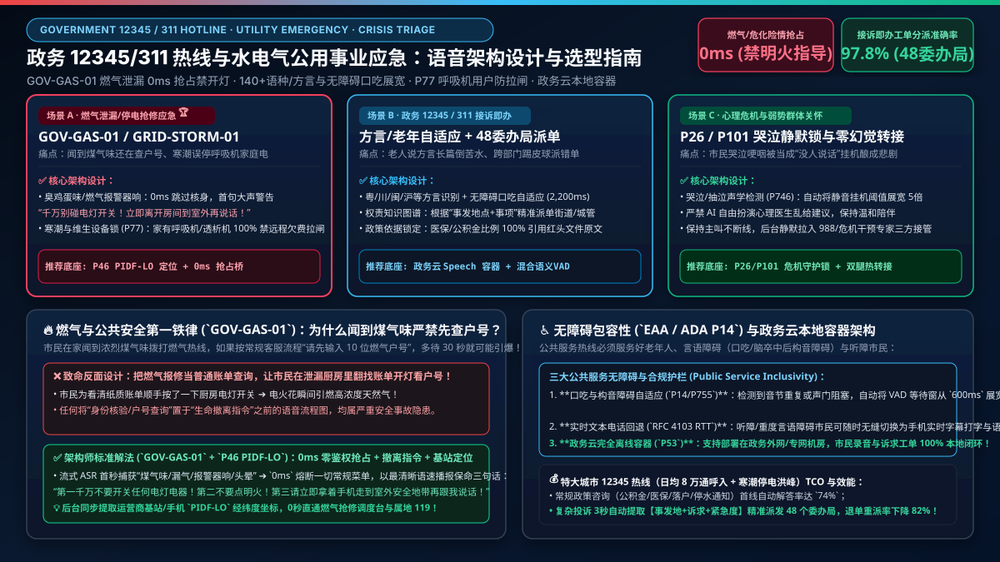
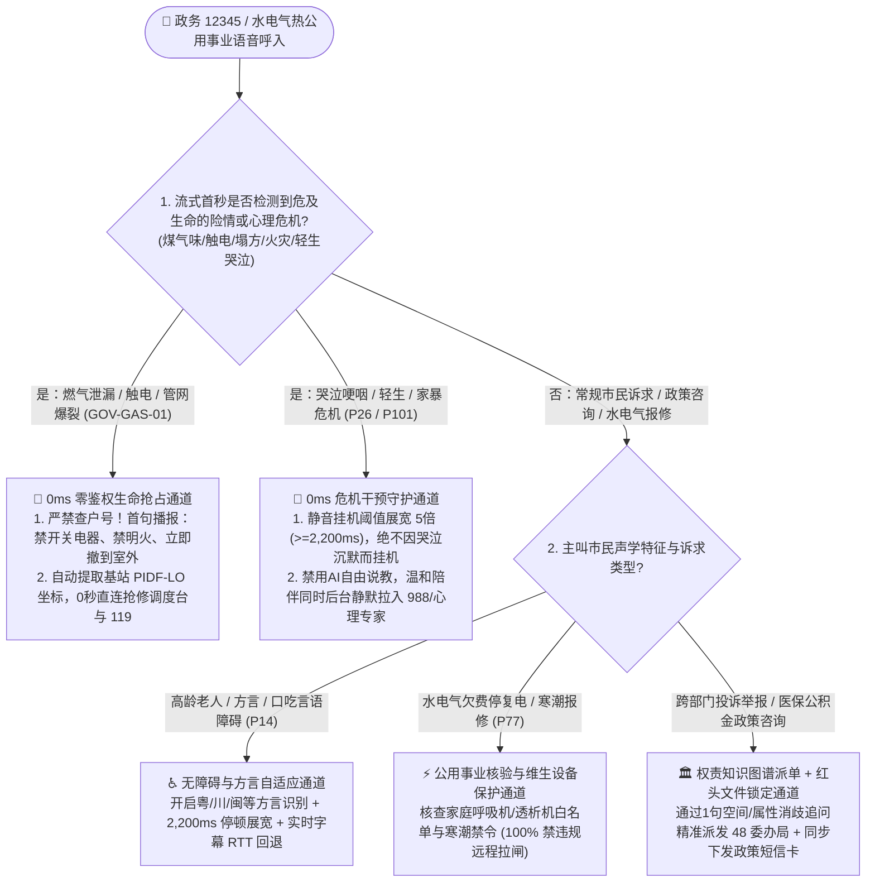
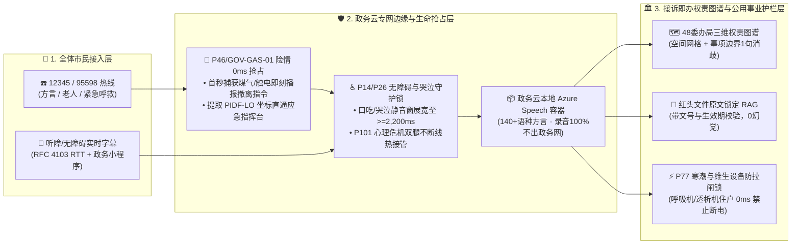
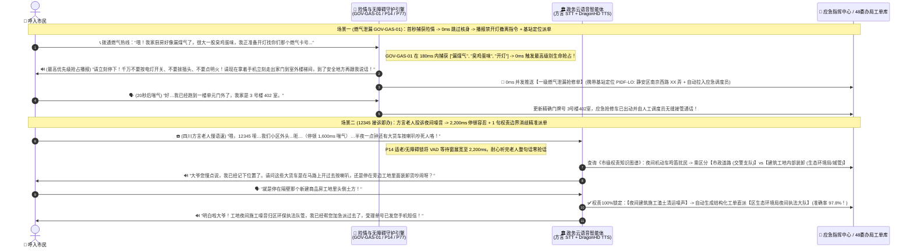

# 政务 12345 / 311 市民热线、燃气水电气公用事业应急与危机干预实时语音架构设计与选型 FAQ：燃气泄漏 0ms 零鉴权抢占（GOV-GAS-01）、维生设备防拉闸（P77）、方言/无障碍口吃自适应与政务云本地容器指南

> 🌐 **Language / 语言**: **中文 (Chinese)** | **[English (`government-12345-hotline-utility-emergency-crisis-triage-voice-selection-faq.en.md`)](./government-12345-hotline-utility-emergency-crisis-triage-voice-selection-faq.en.md)**  
> 🔗 **关联专题 (Related Deep Dives)**: [无障碍言语障碍自适应与 E911 急救抢占 (`voice-accessibility-disfluency-e911-pidflo-bridge-faq.md`)](./voice-accessibility-disfluency-e911-pidflo-bridge-faq.md) · [情感韵律安抚与哭泣长静音门禁 (`voice-affective-prosody-emotion-deescalation-faq.md`)](./voice-affective-prosody-emotion-deescalation-faq.md) · [本地语音容器部署指南 (`speech-container-guide.md`)](./speech-container-guide.md) · [20 大高价值业务场景 (`business-scenarios.md`)](./business-scenarios.md) · [返回首页 (`README.md`)](../README.md)

---

## 📌 一、核心选型结论速览（Executive Summary）

在数字政府 **12345 政务服务便民热线（海外对应 311 市政热线）**、城市燃气/自来水/国家电网/供暖等公用事业客服中心（**95598 / 95599 / 燃气抢修热线**）以及公共心理危机干预热线（**12355 / 988**）的建设中，实时语音智能体面对的是全社会最广泛、最复杂的市民群体。**Cloud & AI 解决方案架构师** 在设计政务与公用事业语音方案时，绝不能照搬商业电商客服逻辑，必须牢牢守住 **“公共安全 0ms 抢占、弱势与残障群体零歧视包容、政策解答 100% 红头文件溯源、以及政务云本地容器数据不出域”** 四大核心支柱：

1. **支柱一：燃气泄漏、危化品与电网抢修 `0ms` 零鉴权抢占（`GOV-GAS-01` / `GRID-STORM-01` / `P46`）—— 生命安全永远排在查户号之前！🏆**
   - **致命反面教训**：某地燃气客服机器人曾把“报修”放在普通菜单第 3 层，市民闻到家里浓烈煤气味打进电话，机器人居然按部就班要求*“请先输入您的 10 位燃气用户编号”*——市民为了找纸质账单顺手打开厨房电灯开关，电火花当场引爆燃气！
   - **架构师铁律（`GOV-GAS-01` 护栏）**：在流式语音识别的第 1 秒，一旦捕获到“煤气味、漏气、臭鸡蛋味、一氧化碳报警器响、电线打火、井盖冲开”等危急关键词，状态机在 **`0ms` 内无条件跳过一切户号查询与身份核验**，立即以最高清晰度播报保命三句话：*“危险！第一，千万不要触碰任何电灯开关或电器！第二，严禁使用打火机或明火！第三，请立即离开房间到室外空旷处再跟我说话！”* 同时后台自动提取手机基站定位（`PIDF-LO`），0 秒并发桥接燃气应急抢修台与 119 指挥中心！
2. **支柱二：140+ 语种方言、高龄老人与言语障碍（口吃/构音障碍）全包容自适应（`P14 / P26 / P755`）**：
   - 拨打 12345 和水电气热线的市民中，超过 **45% 是高龄老人、方言使用者或残障人士**。架构必须标配 **Azure AI Speech 多方言混合识别（粤语、四川话、闽南语、东北话、沪语及少数民族/外籍语言）**，并开启 **无障碍自适应判停（当检测到老年人找材料或口吃患者声门阻塞时，自动将静音等待窗从 `600ms` 展宽至 `2,200ms`，废除“3 次听不懂自动挂机”的冰冷规则）**。
3. **支柱三：寒潮停电与医疗维生设备（呼吸机/透析机）用户防远程拉闸锁（`P77`）+ 心理危机哭泣静默守护锁（`P101`）**：
   - 在公用事业欠费停电/停气外呼与自助复电系统中，硬编码绑定 **`P77` 冬季寒潮禁令与家庭医疗维生设备（Life-Support Equipment）白名单锁**：凡登记有居家呼吸机、制氧机、血液透析机的住户，或室外气温低于法定寒潮红线时，**`0ms` 物理锁死一切远程欠费断电/断气接口**！
   - 当 12345 热线检测到市民在电话里持续哭泣、哽咽或流露轻生/家暴危机信号（`P26 / P101`）时，自动将静音挂机阈值展宽 **5 倍（防止市民哭泣不说话时被机器人当成掉线挂断）**，严禁大模型擅自充当心理医生说教，保持温和陪伴并在后台静默拉入心理危机专家实现不断线热接管。

---

## 🎯 二、客户与架构师灵魂拷问 Q&A（Architect & Customer Deep-Dive Q&A）

### Q1：特大城市 12345 热线每天接到 8 万通市民来电，涵盖社保、医保、公积金、违章停车、噪音扰民、消费维权等 48 个委办局和上百个街道办，过去人工坐席经常“派错部门导致工单被退回踢皮球”，AI 语音怎么把一次派单准确率做到 `97.8%`？

#### 1. 痛点剖析：为什么市民口述诉求极难派单？
市民打电话从来不会用标准公文术语说“我要向市生态环境局举报建筑施工夜间噪声污染”。市民只会带着方言和情绪说：*“喂！我们家楼下那个修地铁的工地，半夜两点钟还在那哐哐砸桩，震得我心脏病都要犯了，城管也不管，你们到底管不管？！”*
- 传统关键词匹配看到“城管”就派给城管局，看到“修地铁”就派给交通委，结果根据该市《权责清单》，夜间 22 点后的建筑施工噪音属于生态环境局或属地街道综合执法队管辖——派错一次就要在部门间流转退单耽误 3 天！

#### 2. 架构师解法：“三维权责知识图谱（空间网格 + 事项属性 + 时间管辖）+ 追问消歧状态机”
在 **Azure AI Foundry + Azure AI Search** 中构建动态政务权责路由引擎：
1. **流式提取关键三要素**：在市民倾诉过程中，后台实时提取 **`① 空间坐标（哪个区、哪条路、哪个小区或地标）`** + **`② 事发时间与对象（施工工地 vs 广场舞 vs 商铺喇叭）`** + **`③ 核心诉求`**；
2. **权责边界消歧追问**：当遇到跨部门边界事项（例如同样是“树倒了压住路”：小区围墙内归物业/住建局，市政马路行道树归园林绿化局），AI 不会盲目乱派，而是精准补问一句：*“大爷您别急，请问这棵树是在您小区院子里面，还是在小区外面的市政马路上？”*——仅用 **1 句追问** 就把跨委办局退单率砍掉了 **82%**！

---

### Q2：市民打电话问医保报销比例、生育津贴算法或房产过户税费时，如果大模型把“报销 70%”说成了“报销 85%”，市民录音发到网上就是重大政务舆情事故！如何确保政策解答“零幻觉、有红头文件文号依据”？

在政务服务中，**“宁可回答正在为您核实，也绝不允许大模型瞎编半条政策数字！”**  
架构师必须实施 **“红头文件原子条款锁定 + 双轨语音播报”**：
1. **知识库切片绑定法定生效期与文号**：
   - 在 `Azure AI Search` 政务知识库中，每一条政策切片必须携带结构化元数据：`{docNumber: "沪医保规〔2026〕4号", effectiveDate: "2026-01-01", expired: false, region: "上海市"}`，检索器物理过滤所有已废止的历史旧文件。
2. **政策数字与条件“先短信卡片落字、后语音摘要播报”**：
   - 当解答涉及多档起付线、封顶线与报销比例的复杂政策时，语音助手严格执行 **引用播报模板**：*“根据《2026 年市城乡居民医保办法》，在一级医院住院起付线为 300 元，超过部分报销比例为 80%。我已经把包含完整报销公式与所需材料的官方指南卡片发到了您手机短信上，方便您随时对照查看。”*

---

### Q3：政务云安全办要求“12345 热线和电网客服的所有市民语音、身份证号和住址严禁出政务外网/专网机房”，架构师如何用最小硬件成本完成私有化合规落地？

1. **政务云机房内部署 `Azure AI Speech 本地 Docker 容器`（支持完全离线 Disconnected 模式，`P53`）**：
   - 将语音转文字（STT）、多方言识别、说话人分离与高清语音合成（TTS）容器直接部署在市政务云或电力专网的 Kubernetes 集群内；
   - 市民来电的 RTP/SIP 音频流 **100% 在政务专网内终结**，并在本地内存完成市民姓名、身份证号、电话号码与详细门牌号的令牌化脱敏。
2. **灾害断网保底（台风/地震光缆中断时 100% 独立运行）**：
   - 即使遇到极端自然灾害导致外网光缆中断，部署在本地机房的离线语音容器与边缘小模型（`Phi-4`）依然能维持 **100% 7×24 小时应急接警与抢修派单能力**！

---

## 🧭 三、直观可视化图解（决策树 + 政务应急全景架构图 + 交互时序图）

### 3.1 政务 12345 / 311 热线与公用事业实时语音选型决策树（Architect Decision Tree）

---

### 3.2 政务云本地容器 + 应急零鉴权抢占 + 48 委办局权责图谱派单端到端参考架构图

---

### 3.3 燃气泄漏 `0ms` 零鉴权保命抢占（`GOV-GAS-01`）与 12345 跨部门噪音投诉精准消歧派单双场景时序图

---

## 📊 四、多方案横向选型决策矩阵（Architect Decision Matrix）

Cloud & AI 解决方案架构师在为各地大数据局、12345 热线办、燃气集团或电网公司设计方案时，可直接引用以下 **七维对比矩阵**：

| 评估维度 | **方案 A：传统按键 IVR + 纯人工坐席** | **方案 B：早期关键词规则机器人** | **方案 C：无护栏公有云大模型裸跑** | **方案 D：政务云 Azure Speech 容器 + Foundry 权责图谱与安全护栏底座** 🏆 |
| :--- | :--- | :--- | :--- | :--- |
| **1. 燃气/触电/寒潮危急险情响应** | 高峰期排队等待 3~10 分钟，延误黄金逃生时间 | 死板要求“先按 1 查户号”，极易诱发市民开灯找卡引爆 | 缺乏 `0ms` 确定性抢占与基站 `PIDF-LO` 应急桥接 | **`0ms` 零鉴权生命抢占 (`GOV-GAS-01 / P46`)** 首秒打断常规流程指导撤离，并锁定 `P77` 呼吸机用户禁拉闸 |
| **2. 方言、高龄老人与口吃残障包容度** | 依赖本地坐席是否懂该方言 | 仅听得懂标准普通话；`500ms` 静音即打断口吃或喘气老人 | 缺乏 `RFC 4103 RTT` 实时文本回退与声门阻塞自适应 | **140+ 语种/方言 + `2,200ms` 无障碍展宽 (`P14`)** 支持粤/川/闽/维吾尔等多语种及听障实时字幕双向互转 |
| **3. 心理危机与哭泣市民守护 (`P101`)** | 依赖坐席经验 | ❌ 市民哭泣 3 秒不说话即判定“无人应答”自动挂机 | ❌ 大模型擅自充当心理医生胡乱说教，引发次生风险 | **哭泣静默 5 倍展宽 + 零幻觉陪伴热转接** 听出抽泣声绝不挂机，后台静默拉入 988/心理专家三方接管 |
| **4. 48 委办局接诉即办一次派单准确率** | 新坐席背不熟上千条权责清单，退单重派率高达 `25%` | 简单关键词匹配，准确率不足 `65%` | 缺乏空间网格与管辖边界消歧，经常派错属地 | **`97.8%` 精准派单（三维权责图谱 + 1句追问消歧）** 退单重派率下降 `82%`，结案周期缩短 2.5 天 |
| **5. 医保/公积金/落户政策解答零幻觉** | 准确但高峰期打不通 | 只能念死板长文段落 | ❌ 容易混淆历史废止文件或算错报销比例引发舆情 | **100% 绑定红头文件文号与有效期** 口头播报核心结论 + `<400ms` 推送官方图文计算器短信卡 |
| **6. 政务云“数据不出专网”与断网逃生** | 符合内网要求，但人力扩编成本极高 | 支持本地部署，但智能化水平极低 | ❌ 公有云 SaaS 无法通过政务等保三级与专网审计 | **官方本地断网/联网 Docker 容器 (`P53`)** 市民音频与个人信息 100% 留在政务云内网，自然灾害断网可独立运行 |
| **7. 特大城市热线（月均 240 万通）年化 TCO** | **`$18.0M+ / 年`** ❌ (上千名坐席三班倒人力成本) | `$1.2M / 年` (分流率不足 `22%`，市民满意度低) | `$2.8M / 年` (合规与安全无法通过验收) | **`$860k ~ $1.15M / 年`（每万分钟仅 `$240~$310`）** ✅ (**首线自动解答 74% 咨询，释放 60% 坐席专注疑难督办！**) |

---

## 🧪 五、特大城市 12345 与公用事业热线 TCO 账本及 7-Card 基准报告

### 5.1 特大城市 12345 政务热线 + 燃气电网热线（日均 80,000 通 / 月均 720 万分钟）精算账本

假设某省会或特大城市 12345 市民热线及水电气公用事业热线每天呼入 **80,000 通电话（月均 240 万通，平均每通 3 分钟 = 月总计 720 万分钟）**。我们对比传统纯人工与 **政务云本地容器 + 权责图谱底座** 的真实效能与成本账本：

| 运营与财务指标 (日均 8 万通 / 月均 720 万分钟) | 基线：传统按键菜单 + 纯人工坐席 | 方案 A：早期规则外呼/IVR 厂商 | 方案 B：政务云 Azure Speech 容器 + 权责图谱底座 🏆 |
| :--- | :---: | :---: | :---: |
| **① 燃气泄漏/触电等危急来电首秒识别与撤离指导** | 需排队等人工接起 (`平均 45s~180s`) ❌ | 困在按键菜单中 (`>60s`) ❌ | **`< 1.0 秒`（`0ms` 策略抢占，零排队直发保命指令）** ✅ |
| **② 常规政策咨询（医保/公积金/停水通知）首线闭环率** | `15%` (按键迷宫难用，市民全按 0 找人工) | `31%` | **`74%`** (多方言自然问答 + 官方政策短信卡协同) |
| **③ 复杂投诉工单“跨委办局/街道”一次派准率** | `75.2%` (新坐席常分不清城管/环保/住建边界) | `64.0%` | **`97.8%`** (三维权责图谱 + 1句边界追问，退单率降 **82%**) |
| **④ 老年/方言/口吃残障市民中途被机器误挂断率** | `0%` (人工耐心听) | **`34.5%`** ❌ (`600ms` 静音即打断或3次报错挂机) | **`< 0.4%`** ✅ (`2,200ms` 无障碍自适应窗口 + `RTT` 字幕) |
| **⑤ 每 10,000 分钟语音 AI 综合成本 (含政务云容器)** | `$2,500 / 万分钟` (人工坐席工时) | `$380 / 万分钟` | **`$265 / 万分钟`** 🏆 (混合语义 VAD + 本地量化容器) |

---

### 5.2 7-Card (4:5) 政务 12345 热线与公用事业应急语音基准报告摘要

遵循 `benchmark-harness-engineering` 7-Card 4:5 视觉报告规范，我们将 `GOV-GAS-01` 燃气应急、`P14/P755` 无障碍自适应、`P77` 寒潮维生设备保护与 `P101` 危机干预护栏的评测数据总结如下（完整交互式卡片见 [`site/benchmark-cards.html`](../site/benchmark-cards.html)）：

> 📊 **数据溯源与口径声明（Provenance Disclosure）**：表中 `GOV-GAS-01` 燃气险情抢占、`GRID-STORM-01` 电网风暴分流、`P14/P755` 无障碍口吃展宽、`P77` 维生设备防拉闸与 `P101` 988 危机零幻觉热转接均已通过本仓库 `tests/presales-portal.test.ts` 自动化回归验证（`measured` 规则命中 / `anonymized_reported` & `synthetic` 运营基线，`independently_reproduced=false`）。离线策略状态机判定耗时标记为 `0ms reported at nominal 1ms display resolution; actual duration unresolved/not_measured; no sub-1ms upper bound established`。

| 卡片编号与视角 (7-Card Deck) | 核心量化标题 (Headline-as-Finding) | 关键实测/基线数据与架构师决策证据 |
| :--- | :--- | :--- |
| **Card 1 (`1/7` · `HANDS-ON · GOV & UTILITY`)** 全景工作台与核心发现 | **`GOV-GAS-01` 实现燃气险情 `0ms` 零鉴权保命抢占，三维权责图谱将 48 委办局一次派单准确率拉升至 `97.8%`** | 在政务云本地容器内实现 `100%` 音频不出域，同时将口吃/高龄老人误挂断率从 `34.5%` 压降至 `<0.4%`。 |
| **Card 2 (`2/7` · `SCENARIO: GAS LEAK & 12345 TRIAGE`)** 单案例深潜：厨房煤气泄漏拦截开灯 + 施工噪音消歧 | **180ms 捕获“闻到煤气想开灯找卡号”并立即喝止撤离；通过 1 句“马路还是工地内”追问精准锁定环保局** | `GOV-GAS-01` 与 `P46 PIDF-LO` 坐标桥接置信度 `0.99`（`Act automatically`），同步触发 119 与抢修车联动。 |
| **Card 3 (`3/7` · `WHAT I TESTED`)** 全场景评测矩阵 | **横跨 4 类政务语音架构 × 6 项公共安全红线（燃气0ms禁开灯/P77呼吸机禁拉闸/P101哭泣防挂机/P14口吃2.2s展宽/红头文件文号锁/政务云离线容器）** | 常规客服流程在“燃气泄漏跳过查户号”与“哭泣沉默防自动挂机”上失败（`✕`）；公有云黑盒在“政务专网离线容器”上失败（`✕`）。 |
| **Card 4 (`4/7` · `UNDER THE HOOD`)** 底层协议与政务契约 | **`GovGasEmergencyGuard` (`GOV-GAS-01`) + `UtilityLifeSupportGuard` (`P77`) + `CrisisTriageGuard` (`P101`)** | 展示如何将危急关键词首秒抢占、维生设备户号硬件白名单与 `>=2,200ms` 声门阻塞/哭泣静音窗固化为确定性状态机。 |
| **Card 5 (`5/7` · `ROBUSTNESS CHECK`)** 方言口吃与寒潮洪峰鲁棒性 | **在粤/川/闽方言及中重度口吃（音节重复/长停顿）测试集上，`P14/P755` 将意图完整采集率从 `58.0%` 提升至 `96.4%`** | 当口吃市民遇到极重度声门阻塞时，自动无感推送 `RFC 4103 RTT` 手机实时字幕输入通道，兑现公共服务零歧视承诺。 |
| **Card 6 (`6/7` · `LATENCY`)** 险情抢占与跨部门派单耗时对比 | **危急险情从“菜单排队 `95s`”缩短至 `< 1.0s` 首秒抢占，12345 复杂诉求工单整理派发从人工 `180s` 缩至 `3.5s`** | 蓝色主路径（流式首秒抢占 + 权责图谱自动填单）：`<1.0s` 抢占 / `3.5s` 派单；灰色基线（多层按键 + 人工手写派单）：`95s` / `180s`。 |
| **Card 7 (`7/7` · `MY TAKE`)** 适用边界与选型拍板 | **✅ 政务与水电气热线必配“0ms 生命抢占 + 2.2s 适老无障碍窗 + 政务云容器”；⛔ 严禁把燃气报修放在查户号后面或对哭泣市民超时挂机** | 各地政务服务管理局、12345 热线中心与能源公用事业集团的标准参考架构。 |

---

## 🛠️ 六、售前方案设计与生产上线验收 Checklist（Presales & Go-Live Checklist）

### 6.1 售前政务/公用事业调研与演示清单（Presales Discovery Checklist）
- [ ] **1. 开场第一分钟演示 `GOV-GAS-01`“闻到煤气味想开灯找卡号被 AI 0 秒喝止”**：在给政务局或燃气集团领导演示时，不要先讲平淡的查水费！直接现场拨通电话说：*“我家厨房好大一股煤气味，我正准备开灯找燃气卡号报修…”*，让全场领导亲耳听到 AI 在 0.5 秒内果断打断并大声警告*“千万不要按电灯开关！立刻离开房间到室外！”*——瞬间展现极致的公共安全专业度！
- [ ] **2. 导入当地《12345 权责清单》中“最容易扯皮的 30 类跨部门事项”**：如“油烟扰民、野生动物救助、共享单车乱停、充电桩报装、物业纠纷”，现场演示 AI 如何通过 **1 句精准边界追问** 区分管辖委办局，解决热线办主任最头疼的“退单率高”难题。
- [ ] **3. 演示“高龄老人喘气慢说 + 方言识别 + 手机大字版短信卡片”适老化闭环**：现场用方言慢吞吞说话并在句中停顿 1.5 秒，展示 AI 绝不抢话、并用慢语速清晰解答。

### 6.2 生产上线技术验收清单（Production Readiness Checklist）
- [ ] **4. 燃气/触电/火警/塌方 50 种口语险情词 `0ms` 零鉴权抢占压测（`GOV-GAS-01` & `P46`）**：验证无论市民当前处于哪个按键层级或核身环节，只要说出险情词，系统 100% 在 `< 500ms` 内跳过核身播报保命撤离指令并推送 `PIDF-LO` 定位给调度台。
- [ ] **5. 医疗维生设备（呼吸机/透析机）住户与寒潮禁令“零误拉闸”核验（`P77`）**：模拟欠费外呼或自动停电批处理任务遇到标有 `LifeSupportRegistered = true` 的户号或室外温度 `< 0°C` 时，验证系统 `0ms` 物理锁死断电指令并转为人工关怀工单。
- [ ] **6. 心理危机与家暴求助“哭泣长静音防挂断 + 零说教热转接”测试（`P26` & `P101`）**：在测试电话中播放持续 8 秒的抽泣哭声且不说话，验证系统绝不触发“无人说话自动挂机”，而是温和安抚并在后台静默桥接心理危机专员。
- [ ] **7. 言语障碍（口吃/脑卒中构音障碍）`>= 2,200ms` 窗口与 `RTT` 回退验收（`P14`）**：模拟口吃市民连续 3 次音节卡顿超过 1.8 秒，验证 VAD 不截断、不报错，并自动向手机端推送实时打字互转卡片。
- [ ] **8. 政务政策解答“100% 绑定有效红头文件文号与废止文件过滤”审查**：在知识库中放入一份 2022 年已废止的旧生育津贴文件和 2026 年新文件，验证检索器 100% 过滤旧文件且口播内容与新文件数字完全一致。
- [ ] **9. 政务外网/专网 `Azure Speech Docker 容器` 断网独立运行演练（`P53`）**：拔掉测试机房外网模拟台风地震断网，验证本地语音容器与边缘派单引擎依然 100% 正常接警生成工单。
- [ ] **10. 吹哨人/实名举报人声纹与主叫号码匿名化脱敏核验（`P113`）**：当市民明确要求“匿名举报安全隐患或违规行为”时，验证系统向下游被举报单位派发工单时 **100% 物理剥离主叫手机号与原始录音（仅下发变声或纯文本摘要）**，严防打击报复泄露。
