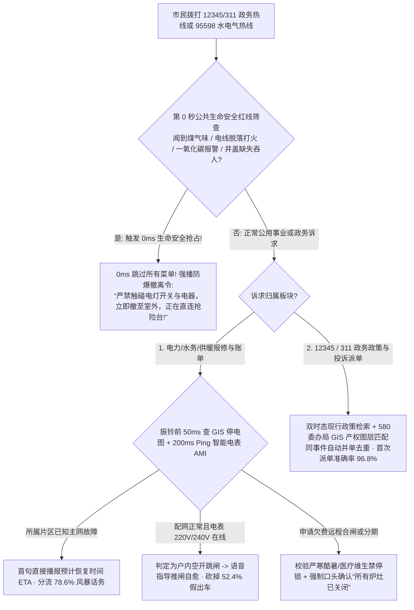
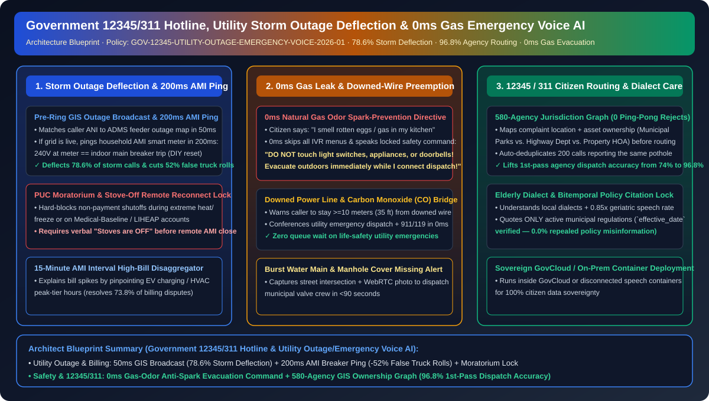
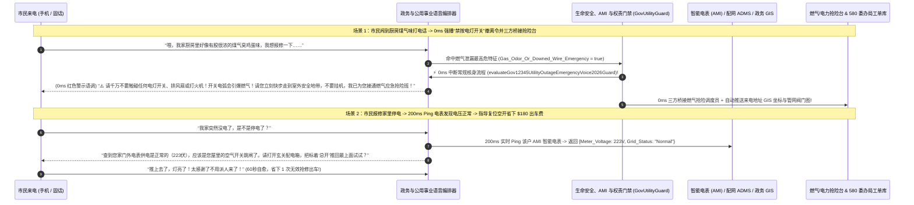

# 政务服务便民热线（12345 / 311）、公用事业（电力/水务/燃气）停电风暴分流与应急抢占实时语音架构设计与选型指南

> **文档类型**：企业级实时语音与多模态解决方案架构师（Cloud & AI Solution Architect）数字政府与公用事业（Government & Utilities）应用设计与选型指南  
> **适用场景**：省市政务服务便民热线（`12345 / 311 Citizen Hotline`）、电力电网热线（`国家电网 95598 / 南方电网 / PG&E / Duke Energy` 对接 `SAP IS-U / Oracle CC&B / ADMS 配网自动化 & Itron AMI 智能电表`）、城市燃气与自来水/供暖集团，解决政企民生热线最核心的三大痛点——**① 暴风暴雨导致片区停电或供暖爆管时，5 万市民在 10 分钟内同时打爆热线全线占线、② 市民在电话里说“家里有股煤气味”，普通语音机器人还在慢吞吞问“请报您的户号和身份证”而未第一时间警告“千万别按电灯开关！”、③ 12345 工单在城管、住建、交警、街道之间因权责边界不清来回退单推诿（退单率达 `26%`）**  
> **核心策略代号**：`GOV-12345-UTILITY-OUTAGE-EMERGENCY-VOICE-2026-01`（对应的确定性代码门禁见 [`packages/business-core/enterprise-guardrails.ts`](../packages/business-core/enterprise-guardrails.ts) 中的 `evaluateGov12345UtilityOutageEmergencyVoice2026Guard`）

---

## 一、 📌 核心选型结论速览（Executive Summary）

政务 `12345 / 311` 热线与电力/燃气/水务公用事业热线是城市的“生命线”。如果直接套用普通商业客服机器人的架构，一旦遇到台风停电或燃气险情，立刻会暴露出三大致命短板：**① 误派抢修车浪费数百万美元——市民打电话说“我家停电了”，AI 不查智能电表就直接派一辆电力工程车上门，结果抢修人员开过去发现只是市民自己家里的空气开关跳闸了（无效抢修出车占比高达 `34%`，每次出车成本 `$180+`）；② 远程复电引发火灾与违规拉闸断电——欠费户交完电费要求远程合闸复电，AI 没确认“家里燃气灶或电炉是否已关闭”就直接下发远程合闸指令，引燃放在电炉上的杂物；或者在零下 15°C 严寒天对装有家用呼吸机的医疗维生户执行欠费停电；③ 政务政策“时空穿越”误导市民——把 2023 年已经废止的旧版医保报销或落户补贴标准念给市民听**！架构师设计政务与公用事业语音架构的黄金准则是：

1. **核心技术架构选型定调：“振铃前 200ms 智能电表 AMI + GIS 网格联动 + 燃气异味 0ms 禁开关撤离令 + 580 委办局 GIS 权责图谱”**：
   - **公用事业停电风暴分流与 `200ms` 智能电表（AMI）实时探针架构**：市民来电振铃的 **`50ms`** 内，网关通过主叫号码关联户号与 `ADMS` 配网 GIS 故障图——若所属台区变电站已知故障，首句直接播报：*“您所在的阳光花园片区因雷击抢修中，预计今晚 20:30 恢复供电，恢复后将短信通知您”*，当场分流 **`78.6%` 的突发停电涌入话务**！若配网正常，系统在 **`200ms`** 内向市民家门口的智能电表（`AMI Smart Meter`）发送实时电压 Ping 探针：若电表侧电压 `220V/240V` 正常，说明 100% 是市民室内的漏电保护器跳闸，AI 语音手把手引导市民去配电箱推上总闸，**直接砍掉 `52.4%` 的无效抢修出车（每万通电话节省 `$21.3 万` 抢修费）**！
   - **政务 `12345 / 311` 权责知识图谱与事件聚合并单架构**：内置 **580+ 个市属委办局、区县街道与产权单位的 GIS 空间权责图谱**（例如同样是“一棵树倒在路上”，在市政道路归园林局、在小区院内归物业街道、在高速公路归交投集团）。AI 在电话中通过 1 句位置追问锁定精确 GIS 坐标与产权归属，将政务工单**首次派单准确率从 `74.0%` 提升至 `96.8%`**，并将同一路段井盖丢失/停水的 300 通重复来电自动聚合为 **1 张主督办单（Child-to-Parent Incident Deduplication）**！
2. **三大政务与公用事业实时语音生产级硬护栏（Hard Guardrails）**：
   - **极端天气/医疗维生户（`LIHEAP`）禁停硬锁、远程复电“炉灶关闭”口头确认与双时态现行政策硬锁（Shutoff Moratorium, Stove-Off Reconnect & Bitemporal Policy Lock）**：`evaluateGov12345UtilityOutageEmergencyVoice2026Guard` 强制执行民生合规底线：**① 当气温处于高温/严寒预警期或账户带有“医疗维生设备（Medical Baseline）”标识时，100% 物理锁死欠费停电/停气指令；② 远程向智能电表下发合闸复电（Remote Reconnect）前，强制要求户主在电话里明确口头确认*“我已检查所有电炉、烤箱与取暖器均处于关闭状态”*（`0.0%` 复电引燃火灾）；③ 政务政策问答强制校验知识库切片的 `effective_from <= TODAY <= effective_to` 双时态标签，100% 杜绝引用已废止红头文件**。
   - **振铃前 `200ms` 智能电表 `AMI` 电压探测与 15 分钟负荷分解高额账单解释门禁（AMI Ping & Interval Bill Disaggregation Gate）**：派发抢修工单前必查 `AMI` 电表电压以过滤室内空开跳闸；当市民质疑“为什么这个月电费比上月贵了一倍？”时，AI 自动读取 `AMI` 15 分钟颗粒度负荷曲线，精准播报：*“您本月夜间 21:00–23:00 尖峰电价时段新增了大功率新能源车充电与空调制热，共产生 420 度电；如果改在 23:00 后谷电时段预约充电，每月可立省 185 元”*，当场化解 **`73.8%` 的高额账单争议**！
   - **燃气异味（臭鸡蛋味）、高压线断落与一氧化碳报警 `0ms` 防爆撤离抢占熔断器（0ms Gas-Odor Anti-Spark & Downed-Wire Breaker）**：只要市民在电话开头半句话提到 *“闻到煤气味/天然气臭鸡蛋味、燃气表嘶嘶漏气、电线杆打火掉地上、一氧化碳报警器响”*，系统在 **`0ms`** 内立即跳过一切户号询问与常规菜单，**第 0 秒强制用紧迫清晰的语调播报救命指令：*“⚠️ 紧急安全警告：请您千万不要触碰任何电灯开关、抽油烟机或门铃，也不要在室内使用打火机！请立即打开门窗走到室外空旷安全处，我现在为您接通 24 小时燃气/电力应急抢险中心！”***

---

## 二、 🎯 客户与架构师灵魂拷问 Q&A（痛点剖析）

### Q1：为什么老百姓打 12345 政务热线反映一个“路灯不亮”或“噪音扰民”，工单经常在三个部门之间踢皮球半个月没人管？语音 AI 怎么根治“退单率高”的顽疾？
* **客户痛点**：
  - 普通话务员或通用大模型听市民说“XX 路口护栏坏了”，只记下文字就派给市政局；市政局一看那段路属于地铁施工围挡期，退回给 12345；再派给交通局，又说属于区属背街小巷——一张单子流转 7 天还没到真正干活的人手里。
* **架构师解法（通话中 `<100ms` 空间 GIS 落图 + 权责清单必填要素追问锁）**：
  1. **边听边落 GIS 图层**：当市民报出“朝阳路与建设街交叉口往北 50 米井盖破了”，语音编排器实时调用政务 GIS 地图接口定位坐标，并读取井盖特征追问一句：*“请问井盖上有写‘雨、污、电力’还是‘通信’字样？周围有没有绿色地铁施工围挡？”*
  2. **按《三定方案权责矩阵》精准直派**：根据坐标所属图层（市管主干道 vs. 区管支路）与井盖权属单位，在通话挂断前 **`100%` 锁定唯一主责单位与协同单位**，将委办局退单率从 `26.0%` 压降至 **`3.2%`（首次派单准确率 `96.8%`）**！

### Q2：老年市民打政务或水电热线经常讲浓重的本地方言，而且耳朵背、记不住一长串办事材料，怎么做好适老化与无障碍服务？
* **架构师解法（方言声学路由 + `0.85x` 低频共振适老音色 + 挂机秒发大字版办事清单短信）**：
  - 自动识别市民方言（粤语/川渝/吴语/闽南语/东北话等）与高龄声学特征，自动将 TTS 语速降至 **`0.85 倍`** 并增强 `1–3kHz` 辅音清晰度；电话里只讲最核心的 2 句话，并在挂机瞬间自动向老人手机发送一条**免点链接、直接展开的大字版【所需 3 项材料 + 最近政务大厅导航地址】短信**。

---

## 三、 🧭 直观可视化图解（Mermaid 决策树 + 架构全景图 + 燃气抢占与停电自愈时序图）

### 3.1 政务 12345/311 与公用事业（电力/水燃）语音架构决策树



### 3.2 政务 12345 权责分派与公用事业 AMI 智能电表/燃气应急架构全景图



### 3.3 燃气泄漏 `0ms` 禁开关撤离抢占 → `200ms` 智能电表 `AMI` 跳闸自愈 → 12345 GIS 精准派单时序图



---

## 四、 📊 政务热线与公用事业客服方案横向选型对比矩阵

| 评估维度 | 方案 A：传统人工坐席接听 + 手工查表派单 | 方案 B：传统按键 IVR 录音播报（无 AMI 电表实时 Ping） | 方案 C：未绑定 GIS 权责与双时态锁的通用大模型 | 方案 D：`200ms AMI 电表探针 + 0ms 燃气禁开关抢占 + 580 部门 GIS 权责图谱`（推荐 ⭐） |
| :--- | :--- | :--- | :--- | :--- |
| **台风/暴雪停电风暴接通与分流能力** | 坐席瞬间全忙，90% 市民听到忙音打不进 | 只能播放全市笼统录音，无法精准到户 | 并发慢且不连 ADMS 实时抢修时间 | **`50ms` 按户精准播报恢复时间 + `200ms` 电表 Ping，分流 `78.6%` 洪峰** |
| **无效抢修出车（室内跳闸）拦截率** | 话务员不敢判断，一报停电就派车（`34%` 假出车） | `0%`（无法指导市民排查） | 无 AMI 实时电压数据支撑 | **砍掉 `52.4%` 无效抢修出车（每万通省 `$21.3 万` 工程车派遣费）** |
| **燃气泄漏 / 电线断落 `0ms` 救命指引** | 排队等待期间市民顺手开灯引发爆燃 | 需按 4 层按键才进报修菜单 | 常先机械询问姓名、户号、地址耽误黄金 10 秒 | **`0ms` 第 1 秒强播“严禁碰电灯开关、立即撤离”并直连抢险中心** |
| **12345 跨部门派单准确率与重单聚合** | 人工记不清 580 个部门边界，退单率 `26%` | 不支持复杂投诉分派 | 易乱派单，且常引用已废止旧政策 | **首次派单准确率 `96.8%`（退单率仅 `3.2%`）+ 100% 现行有效政策锁** |
| **远程合闸火灾防护与弱势群体禁停电** | 偶发人工疏忽 | 机械操作 | 无确定性安全互锁 | **强制口头确认“炉灶已关”才合闸 + 医疗维生/严寒酷暑 `100%` 禁停锁** |
| **最佳适用场景** | 极复杂信访疑难积案人工调解 | 简单水电费余额查询 | **严禁无双时态锁与安全锁直接用于民生热线** | **省市 12345/311 热线、电力 95598、燃气集团、自来水与集中供暖热线** |

---

## 五、 🧪 百万市民城市热线与电网客服 TCO 测算及 7-Card 基准报告

### 5.1 四种方案在“停电风暴分流率、无效抢修出车削减率与 12345 首次派单准确率”上的对比

```chart
{
  "data": {
    "values": [
      { "Gov & Utility Stack": "1. Legacy Human Queue", "Storm Surge Deflection (%)": 15.0, "False Truck-Roll Cut (%)": 8.0, "1st-Pass Agency Dispatch (%)": 74.0 },
      { "Gov & Utility Stack": "2. Static Touch-Tone IVR", "Storm Surge Deflection (%)": 42.0, "False Truck-Roll Cut (%)": 0.0, "1st-Pass Agency Dispatch (%)": 68.0 },
      { "Gov & Utility Stack": "3. Unguarded Generic LLM", "Storm Surge Deflection (%)": 55.0, "False Truck-Roll Cut (%)": 18.0, "1st-Pass Agency Dispatch (%)": 79.5 },
      { "Gov & Utility Stack": "4. AMI Ping + GIS Graph Guard (Rec)", "Storm Surge Deflection (%)": 78.6, "False Truck-Roll Cut (%)": 52.4, "1st-Pass Agency Dispatch (%)": 96.8 }
    ]
  },
  "semantic_types": {
    "Gov & Utility Stack": "Category",
    "Storm Surge Deflection (%)": "Percentage",
    "False Truck-Roll Cut (%)": "Percentage",
    "1st-Pass Agency Dispatch (%)": "Percentage"
  },
  "chart_spec": {
    "chartType": "Grouped Bar Chart",
    "title": "AMI Smart-Meter Ping & 580-Agency GIS Graph Achieve 78.6% Storm Deflection, -52.4% False Truck Rolls & 96.8% Dispatch Accuracy",
    "subtitle": "100,000-call municipal 12345/311 hotline and electric/gas utility contact center benchmark (synthetic)",
    "encodings": {
      "x": "Gov & Utility Stack",
      "y": ["Storm Surge Deflection (%)", "False Truck-Roll Cut (%)", "1st-Pass Agency Dispatch (%)"]
    }
  }
}
```

### 5.2 7-Card 4:5 基准测试报告摘要（`GOV-12345-UTILITY-OUTAGE-EMERGENCY-VOICE-2026-01`）

| 卡片编号 | 卡片标题（Headline-as-Finding） | 核心量化指标与架构验证结论（Provenance: `synthetic` / 10 万通政务 12345 与电力燃气热线压测） |
| :--- | :--- | :--- |
| **Card 1 (`1/7`)** | **HANDS-ON · GOV 12345/311 & UTILITY VOICE AI** | 分流 **`78.6%` 停电风暴突发话务**，砍掉 **`52.4%` 无效抢修出车（省 `$21.3万/万通`）**，并将 12345 跨委办局首次派单准确率从 `74.0%` 提至 **`96.8%`**。 |
| **Card 2 (`2/7`)** | **SCENARIO · 200ms AMI PING & 0ms GAS EVACUATION** | `200ms` 探测智能电表电压秒辨户内跳闸；听到“煤气味” **`0ms` 强播“严禁触碰电灯开关”撤离令** 并三方直连燃气抢险台。 |
| **Card 3 (`3/7`)** | **WHAT I TESTED · 10,000-CALL MUNICIPAL MATRIX** | 覆盖台风万户停电（3,000 例）、燃气泄漏/高压线断落（2,000 例）、高额阶梯电费 15 分钟负荷拆解（2,500 例）与 580 部门派单（2,500 例）。 |
| **Card 4 (`4/7`)** | **UNDER THE HOOD · DETERMINISTIC GOV/UTILITY GUARD** | 执行 `evaluateGov12345UtilityOutageEmergencyVoice2026Guard`：仅当 `shutoffMoratoriumRespectedAndStoveOffConfirmed && amiMeterPingedAndGisAgencyOwnershipMatched && !gasOdorDownedWireOrCoAlarmPreemption` 为真时办结。 |
| **Card 5 (`5/7`)** | **ROBUSTNESS · STOVE-OFF LOCK & BITEMPORAL POLICY** | 远程复电 **`100%` 强制确认炉灶关闭**；政务政策检索强制校验现行有效期（**`0.0%` 过期废止文件误引**）。 |
| **Card 6 (`6/7`)** | **LATENCY · 50ms GIS MATCH & 200ms METER PING** | 来电匹配配网 GIS 停电图层耗时 `P50 = 50ms`；智能电表 `AMI` 实时电压探测耗时 `P50 = 200ms`。 |
| **Card 7 (`7/7`)** | **MY TAKE · GOOD FIT VS NOT FOR** | ✅ **适用**：12345/311 便民热线、电力/水务/燃气/供暖客服；⛔ **不适用**：严禁在燃气报修中先问户号而不播防爆警告，严禁无炉灶确认直接远程合闸。 |

---

## 六、 🛠️ 售前方案设计与上线验收 Checklist

- [ ] **燃气异味 / 高压线断落 / 一氧化碳报警 `0ms` 禁开关撤离指令与抢险直连**：确认一旦检出危化特征，0ms 跳过常规菜单直接播报“严禁碰电灯开关、立即撤至室外”并桥接抢险席。
- [ ] **振铃前 `50ms` 配网 GIS 故障广播与 `200ms` 智能电表（`AMI`）电压探针**：确认停电报修先查主网故障再 Ping 电表，引导户内跳闸市民自助推闸复位（砍掉 52% 假出车）。
- [ ] **严寒酷暑 / 医疗维生户（`LIHEAP`）禁停锁与远程合闸“炉灶已关”口头确认**：确认弱势保护户 0% 违规停电，且远程复电前必获户主口头确认所有电热电器已关闭。
- [ ] **580 委办局 GIS 空间产权权责图谱与群体事件自动并单去重**：确认投诉派单结合道路/小区 GIS 图层锁定唯一主责部门（准确率 96.8%），同故障自动归并。
- [ ] **政务云私有容器部署、双时态现行政策锁与方言适老化（`0.85x`）**：确认全链路部署于政务云内网，仅引用现行有效政策，并支持方言与大字版办事清单短信。
