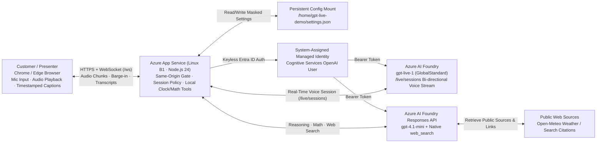

# 🎬 GPT-Live (`gpt-live-1`) Customer & Partner Presales Demo Handbook, Live Video & Cost Model

> 🌐 **Language / 语言切换**: **[中文 (`docs/gpt-live-partner-demo-handbook.md`)](./gpt-live-partner-demo-handbook.md)** | **[English (Current)](./gpt-live-partner-demo-handbook.en.md)** · **[Back to Home (`README.en.md`)](../README.en.md)** · **[中文首页 (`README.md`)](../README.md)**

---

## ⚡ 1. Value Proposition & Online Demo Assets

**GPT-Live (`gpt-live-1`)** is a self-hosted browser real-time voice assistant reference application running on **Azure App Service** and **Azure AI Foundry**. In a single web page, customers experience **natural full-duplex voice Q&A, mid-sentence barge-in, deterministic time/math tools, and source-grounded web search**, while keeping all cloud credentials and Managed Identity tokens strictly on the server.

- 🎥 **4m20s Azure Live Demo Recording (`GPT-Live-Azure-demo.mp4`)**:
  - **Online Web Playback (Homepage Voice Hub)**: [**`https://turbo998.github.io/voice/`**](https://turbo998.github.io/voice/) (direct stream: [`https://turbo998.github.io/voice/GPT-Live-Azure-demo.mp4`](https://turbo998.github.io/voice/GPT-Live-Azure-demo.mp4))
  - **GitHub Release (`v0.4.0`) Download**: [`https://github.com/turbo998/gpt-live-1-demo/releases/download/v0.4.0/GPT-Live-Azure-demo.mp4`](https://github.com/turbo998/gpt-live-1-demo/releases/download/v0.4.0/GPT-Live-Azure-demo.mp4)
- 🎓 **Partner Engineer Interactive Training Portal**: [`https://turbo998.github.io/gpt-live-1-demo/training.html`](https://turbo998.github.io/gpt-live-1-demo/training.html)
- 📊 **GPT-Live-1 7-Card (4:5) Visual Benchmark Report**: [`https://turbo998.github.io/gpt-live-1-demo/benchmark-cards.html`](https://turbo998.github.io/gpt-live-1-demo/benchmark-cards.html)

---

## 🏗️ 2. Logical Architecture & Three-Plane Separation

---

## ⏱️ 3. 6-Minute Live Presales Demo Script (Run of Show)

| Timeline | Stage | Recommended Prompt / Action | Key Architectural Message for Customers |
| :--- | :--- | :--- | :--- |
| **`0:00 – 0:40`** | **Framing & Scope** | Show the main console, status pill, and top UI language switcher | Explain that the browser handles WebRTC/audio while Node.js holds Entra Managed Identity and enforces session budgets. |
| **`0:40 – 1:30`** | **Natural Greeting** | Click **Start Conversation** and say: *"Hello, please introduce yourself in two sentences."* | Highlight sub-second voice response and per-sentence timestamped transcripts. |
| **`1:30 – 2:20`** | **Natural Barge-in** | Ask: *"Give me three use cases for a real-time voice assistant."* After point #1, interrupt: *"Hold on—just tell me how it helps at a retail reception desk."* | Demonstrate hands-free interruption (`Barge-in`), and explicitly note the production boundary: **audio barge-in does not automatically roll back backend writes without a `turnEpoch` / idempotency fence**. |
| **`2:20 – 3:30`** | **Clock & Deterministic Math** | Ask: 1. *"What time is it in Shanghai right now, and what day of the week is it?"* 2. *"What is 18 times 25 plus 125?"* | Standalone time uses the server clock (`0` LLM tokens); math invokes the deterministic `calculate` tool to return **`575`**. |
| **`3:30 – 4:20`** | **Grounded Web Search** | Ask: *"Search the web for a recent official Microsoft Azure announcement and summarize it in two sentences."* | Show the citation links in the transcript; explain that production deployments replace open web search with enterprise Azure AI Search. |
| **`4:20 – 4:50`** | **Bilingual UI & Locale** | Toggle the top UI selector between `简体中文` and `English` | Distinguish instant UI localization from spoken session locale (which takes effect on the next connection). |
| **`4:50 – 6:00`** | **Disconnect & FinOps** | Click **Disconnect** to close the live session and review the cost table | Emphasize disconnecting immediately after demos so idle sessions do not accrue per-minute voice charges. |

---

## 💰 4. Verified Azure Retail Pricing & Presales Demo TCO

Prices below are queried from the public **Azure Retail Prices API** (USD, excluding taxes and enterprise discounts):

| Cost Component | Azure SKU & Meter | Public Unit Price (USD) | Monthly Demo Estimate (20 Demos × 8 Min = 160 Min) |
| :--- | :--- | :--- | :--- |
| **App Service Hosting (West US 2)** | Linux Basic `B1` (1 vCPU, 1.75 GB RAM, 730 hrs/mo) | `$0.017 / hr` (**`$12.41 / mo`**) | **`$12.41 / mo`** (can be stopped between demos) |
| **Live Voice Model (`gpt-live-1`)** | Foundry `Live 1 Gl Unit` (`1c6d7ed2-46b0-5544-bbd5-1dacf5e4f925`) | `$3.00 / hr` = **`$0.05 / min`** | `160 min × $0.05` = **`$8.00 / mo`** |
| **Reasoning Backend (`gpt-4.1-mini`)** | Standard Tokens (Input / Cached / Output) | `$0.40` / `$0.10` / `$1.60` per 1M tokens | **`< $0.05 / mo`** for typical tool calls |
| **Total Monthly Presales Run Rate** | — | — | **~`$20.41 / month`** (Always-on B1 + 160 live voice minutes) |

---

## 🎥 5. Recording Provenance & Boundaries (`GPT-Live-Azure-demo.mp4`)

- **Media Spec**: MP4 (`1600×1000` H.264 video + 48 kHz stereo AAC audio), duration **`4m20.66s`** (`12,443,395` bytes).
- **Provenance**: Assistant voice and answers come from a live Azure `gpt-live-1` deployment; prompts and closing narration use offline synthesized speech; only the browser viewport is captured.
- **Explicit Technical Boundaries**:
  1. Demonstrates natural greeting, mid-sentence barge-in, server clock, `10 + 20 = 30` calculation, and voice-triggered web search with citations.
  2. The spoken English request during the recording overlapped with an ongoing search explanation; test English spoken conversation as a dedicated session after reconnecting.
  3. Post-disconnect narration is offline voiceover, and total video duration is not equal to billed live-session duration.
