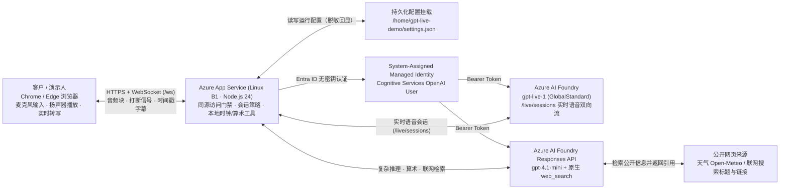

# 🎬 GPT-Live (`gpt-live-1`) 客户与合作伙伴售前演示手册、实录视频与成本边界

> 🌐 **Language / 语言切换**: **[中文 (当前)](./gpt-live-partner-demo-handbook.md)** | **[English (`docs/gpt-live-partner-demo-handbook.en.md`)](./gpt-live-partner-demo-handbook.en.md)** · **[返回首页 (`README.md`)](../README.md)** · **[English Home (`README.en.md`)](../README.en.md)**

---

## ⚡ 1. 一句话定位与在线演示资源

**GPT-Live (`gpt-live-1`)** 是跑在 **Azure App Service** 与 **Azure AI Foundry** 上的浏览器实时语音助手参考架构：让客户在同一网页中直观体验 **自然语音问答、毫秒级开口打断（Barge-in）、时间/算术快速响应与带来源的联网问答**，且所有云端凭据保留在服务端（零前端密钥暴露）。

- 🎥 **4 分 20 秒 Azure 实录演示视频 (`GPT-Live-Azure-demo.mp4`)**：
  - **个人主页在线播放**：[**`https://turbo998.github.io/voice/`**](https://turbo998.github.io/voice/)（视频直链：[`https://turbo998.github.io/voice/GPT-Live-Azure-demo.mp4`](https://turbo998.github.io/voice/GPT-Live-Azure-demo.mp4)）
  - **GitHub Release (`v0.4.0`) 高清下载**：[`https://github.com/turbo998/gpt-live-1-demo/releases/download/v0.4.0/GPT-Live-Azure-demo.mp4`](https://github.com/turbo998/gpt-live-1-demo/releases/download/v0.4.0/GPT-Live-Azure-demo.mp4)
- 🎓 **合作伙伴工程师交互培训门户**：[`https://turbo998.github.io/gpt-live-1-demo/training.html`](https://turbo998.github.io/gpt-live-1-demo/training.html)
- 📊 **GPT-Live-1 7-Card (4:5) 视觉基准报告**：[`https://turbo998.github.io/gpt-live-1-demo/benchmark-cards.html`](https://turbo998.github.io/gpt-live-1-demo/benchmark-cards.html)

---

## 🏗️ 2. 端到端逻辑架构与三平面职责划分

### 核心职责与安全边界

1. **浏览器前端（展示与采集层）**：负责麦克风采集、扬声器播放、带时间戳字幕显示、音色与中英界面切换，**绝不保存 Azure 密钥或直连模型端点**。
2. **Node.js 服务端（安全代理与策略层）**：强制同源 WebSocket 校验、远端会话单次上限（默认 15 分钟）与每分钟请求节流；对独立时间/日期/星期问题直接走服务端时钟零延迟返回。
3. **Azure AI Foundry 双模型协同层**：
   - **`gpt-live-1`**：负责低延迟听说、自然打断（Barge-in）、音色与实时转写。
   - **`gpt-4.1-mini`（Responses API）**：负责精确计算（`calculate`）、天气查询（`get_weather`）与带来源的联网搜索（`web_search`）。

---

## ⏱️ 3. 6 分钟标准售前现场演示脚本（Run of Show）

| 时间轴 | 演示环节 | 推荐现场提问 / 操作 | 客户观察点与架构价值讲解 |
| :--- | :--- | :--- | :--- |
| **`0:00 – 0:40`** | **开场定界** | 展示主界面、状态栏与顶部语言切换器 | 说明这是部署在 Azure App Service + Foundry 的单页参考应用，展示“实时语音对话 + 打断 + 推理工具协同” |
| **`0:40 – 1:30`** | **自然语音开场** | 点击“开始对话”，说：*“你好，请用两句话介绍一下你自己。”* | 展示首包语音响应延迟与逐句带时间戳的实时转写 |
| **`1:30 – 2:20`** | **开口打断（Barge-in）** | 先问：*“请分三点讲讲实时语音助手适合什么场景。”* 讲完第一点后直接插话：*“先停一下，只说它在门店接待里的作用。”* | **核心亮点**：无需按键即可打断播放并切换话题；同时向客户说明**“前端打断不等于自动回滚后台进行中的写操作，生产写事务须配合确认与幂等护栏”** |
| **`2:20 – 3:30`** | **时间与精确算术** | 依次提问： 1. *“现在上海时间几点？今天星期几？”* 2. *“帮我算一下 18 乘 25 加 125 等于多少？”* | 说明独立时间走服务端时钟；算术走受控工具返回 **`575`**，避免语音模型口算幻觉 |
| **`3:30 – 4:20`** | **联网检索与来源卡片** | 提问：*“请联网搜索一条微软 Azure 最近的官方技术发布，并用两句话总结。”* | 展示右侧来源链接卡片；强调来源代表已触发检索，生产环境建议对接企业白名单知识库（Azure AI Search） |
| **`4:20 – 4:50`** | **双语界面与外语提示** | 切换顶部 UI 语言为 `English`（不中断会话），演示简单英文问候 | 区分 **界面语言秒切** 与 **会话语音语言配置（重连生效）** |
| **`4:50 – 6:00`** | **架构、成本与收尾** | 点击“断开连接”释放实时语音会话，展示架构图与月度成本测算 | 养成演示完立即断开的 FinOps 习惯，避免空挂会话计费 |

---

## 💰 4. Azure 实测公开零售价与演示成本核算（Retail Prices API）

以下单价基于 Azure Retail Prices API（币种 USD，不含税与企业折扣）：

| 成本项 | Azure 计费方式与规格 | 公开零售单价（USD） | 演示成本测算（每月 20 场 × 8 分钟 = 160 分钟） |
| :--- | :--- | :--- | :--- |
| **App Service 托管 (West US 2)** | Linux Basic `B1`（1 vCPU, 1.75 GB RAM，常驻） | `$0.017 / 小时`（约 **`$12.41 / 月`**） | **`$12.41 / 月`**（若演示后停止或缩容可进一步降低） |
| **实时语音模型 (`gpt-live-1`)** | Foundry `Live 1 Gl Unit`（按连接会话时长计费） | `$3.00 / 小时` = **`$0.05 / 分钟`** | `160 分钟 × $0.05` = **`$8.00 / 月`** |
| **推理与工具后端 (`gpt-4.1-mini`)** | Standard Token 计费（输入 / 缓存 / 输出） | 输入 `$0.40/1M` · 缓存 `$0.10/1M` · 输出 `$1.60/1M` | 单场千级 Token 约 **`<$0.05 / 月`** |
| **原生联网搜索 (`web_search`)** | 按搜索调用次数计费 | 取决于搜索预览定价，建议仅演示 1 次 | 可选开启，默认高频演示可关闭 |
| **月度合计（典型售前团队）** | — | — | **约 `$20.41 / 月`**（常驻 B1 + 160 分钟实时语音） |

---

## 🎥 5. 实录演示视频 (`GPT-Live-Azure-demo.mp4`) 技术参数与验收边界

- **视频技术规格**：MP4（H.264 `1600×1000` 画面 + 48 kHz 双声道 AAC 音轨），时长 **`4 分 20.66 秒`**（`12,443,395` 字节）。
- **录制来源说明**：视频中模型回答与音频来自真实 Azure `gpt-live-1` 部署，提问与架构旁白使用离线合成音频驱动，仅录制浏览器应用窗口，不包含任何个人桌面或私有凭据。
- **客观边界提示**：
  1. 视频完整展示了自然语音问候、中途打断、服务端时钟、`10 + 20 = 30` 算术及带来源的语音联网搜索。
  2. 视频中段英文口语请求发出时模型仍在播报上一条搜索结果，因此英文口语应作为配置项重连后单独演示，不以该视频片段作为英文口语独立验收依据。
  3. 断开连接后的架构解说为离线合成旁白，视频总时长（4m20s）不等于云端语音会话计费时长。
