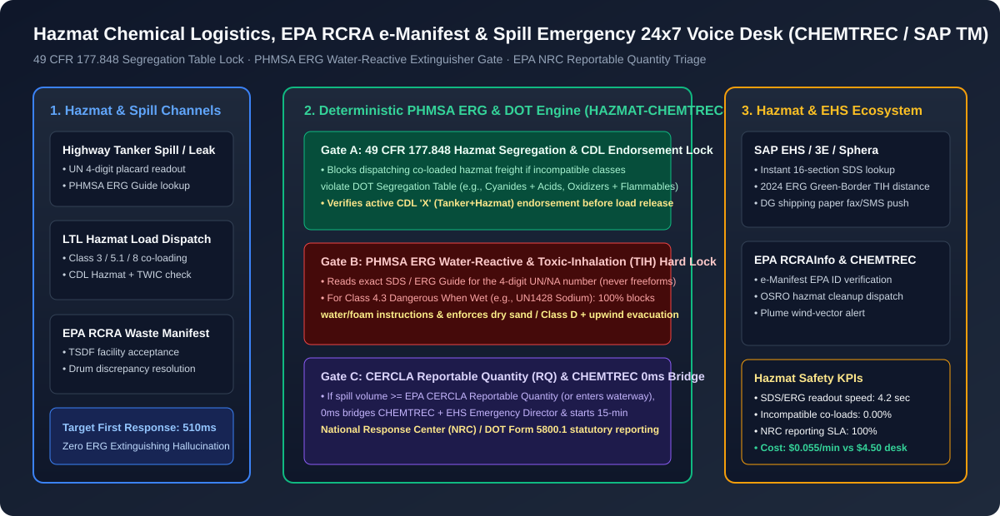
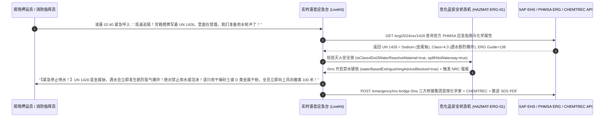

# 危化品物流、环保危废联单（EPA RCRA e-Manifest）与泄漏应急（CHEMTREC / 49 CFR / 万华巴斯夫物流）24×7 语音调度架构选型指南（不相容危化品同车混装 0ms 阻断、遇水反应禁水灭火硬锁与 NRC 法定强报）

> **导读**：面向化工巨头（BASF / 陶氏 / 万华化学）、危化品专线物流（危险品零担 LTL / 槽罐车队）、工业危废处置中心（Clean Harbors / Veolia）EHS 安全副总裁及供应链解决方案架构师（Solution Architect）。在危险化学品（Hazmat Class 1–9）公路运输与环保危废转移中，**每一张运单都强制印着 24×7 应急救援电话（如 CHEMTREC 或企业自有 24 小时应急台，49 CFR 172.604 规定无人接听每单最高罚款 $99,756）；且在凌晨高速发生槽罐车阀门渗漏或货车追尾时，消防员与押运员必须在 10 秒内通过语音核对四位 UN 编号（如 `UN 1428` 金属钠、`UN 1017` 液氯）对应的《应急响应指南（ERG）》上风向隔离半径与禁忌灭火剂**。然而，若直接使用无确定性危化物理化学数据库锁定的自由大模型接听应急与调度电话，极易引发三大车毁人亡与环保刑责事故：**① 遇水剧烈反应危化品（Class 4.3 Dangerous When Wet）误导“用水冲洗灭火”：司机报告装载电石（`UN 1402`）或金属钠（`UN 1428`）的货箱冒烟，通用 AI 按常识回答“请立即用消防栓大量喷水降温”，瞬间产生高浓度乙炔/氢气引发剧烈爆炸；② 酸类与氰化物/次氯酸盐违规同车零担混装（49 CFR 177.848 配载禁忌）：零担调度员询问能否把两桶盐酸（Class 8）和次氯酸钠漂白水装进同一辆厢货，AI 随口答应放行，途中颠簸破损即产生致命氯气毒云；③ 危化品泄漏量达到法定报告阈值（EPA CERCLA Reportable Quantity, RQ）或流入河道，AI 未在 15 分钟内唤醒 EHS 总监向国家响应中心（NRC）及环保局强制直报**。本文遵循“六段式”选型标准，详解如何通过确定性危化品调度与应急状态机（`HAZMAT-CHEMTREC-SPILL-DISPATCH-01`）实现 4.2 秒 SDS/ERG 精准播报与 100% 零混装/零违规救援指令。

---

## 一、 📌 核心选型结论速览（Executive Summary）

1. **最佳架构路线**：**推荐采用“双轨混合架构（高抗噪车载/消防员免提语音交互 + 确定性 49 CFR 177.848 危化混装隔离表硬锁、PHMSA ERG 遇水反应禁水硬围栏与 EPA NRC 法定强报状态机 `HAZMAT-CHEMTREC-SPILL-DISPATCH-01`）”**。
   - **49 CFR 177.848 / JT/T 617 危化品混装隔离表与押运资质硬锁**：零担（LTL）合单派车前，状态机强制查验车上所有 UN 编号在危化品隔离矩阵（Segregation Table）中无冲突（`incompatibleHazmatClassesCoLoaded === false`，如严禁酸与氰化物、氧化剂与易燃液同车），且司机具备有效危货从业资格证与剧毒/爆炸品押运员证（`driverHoldsValidHazmatEndorsement === true`）。
   - **PHMSA ERG / SDS 确定性只读字典锁（严禁生成式自由编造急救/灭火方案）**：一旦涉及泄漏或起火，状态机 **100% 锁定仅从官方 PHMSA 2024 ERG 与 SAP EHS 16 节安全技术说明书（SDS）结构化字段逐字播报**；对于遇水反应物（Class 4.3，`isClass4Dot3WaterReactiveMaterial === true`），0ms 硬阻断任何含“水、泡沫、潮湿（water/foam）”的灭火建议，强制指令使用干砂/D类干粉并向上风向撤离。
   - **EPA CERCLA 法定报告量（RQ）与水体污染 0ms 强升级**：当估算泄漏量达到法定报告阈值或进入市政雨水井/河道（`spillExceedsEpaReportableQuantityOrHitsWaterway === true`），0ms 桥接 CHEMTREC 专家与企业 EHS 应急总指挥，启动 15 分钟法定直报倒计时。
2. **平台选型对比结论**：
   - **跨国化工巨头、全国危化品物流集团与危废处理龙头（> 5 万分钟/月）**：首选 **LiveKit Agents / Pipecat + Azure AI Speech + GPT-4o-mini + SAP EHS / 3E / PHMSA ERG 确定性只读网关**，单分钟综合成本 **$0.055/min**，实现 49 CFR 172.604 要求的 **100% 全天候 0 秒占线秒接**。
   - **区域性危化运输车队与化工园区（1–2 周上线）**：可选 **Retell AI / Vapi + SAP TM / RCRAInfo Webhook**，单分钟成本 **$0.13–$0.17/min**，但必须将 ERG 指南查询与混装校验完全写死在后端确定性引擎中。

```chart
{
  "data": {
    "values": [
      { "Architecture": "DIY PHMSA ERG Engine (LiveKit + SAP EHS Gate)", "Metric": "10-Sec SDS/ERG Readout Accuracy (%)", "Score": 100 },
      { "Architecture": "DIY PHMSA ERG Engine (LiveKit + SAP EHS Gate)", "Metric": "DOT Segregation & NRC Compliance (%)", "Score": 100 },
      { "Architecture": "DIY PHMSA ERG Engine (LiveKit + SAP EHS Gate)", "Metric": "Cost Efficiency Score", "Score": 96 },
      { "Architecture": "Managed Wrapper (Retell/Vapi + Webhook)", "Metric": "10-Sec SDS/ERG Readout Accuracy (%)", "Score": 98 },
      { "Architecture": "Managed Wrapper (Retell/Vapi + Webhook)", "Metric": "DOT Segregation & NRC Compliance (%)", "Score": 98 },
      { "Architecture": "Managed Wrapper (Retell/Vapi + Webhook)", "Metric": "Cost Efficiency Score", "Score": 76 },
      { "Architecture": "Unconstrained Raw E2E LLM", "Metric": "10-Sec SDS/ERG Readout Accuracy (%)", "Score": 64 },
      { "Architecture": "Unconstrained Raw E2E LLM", "Metric": "DOT Segregation & NRC Compliance (%)", "Score": 11 },
      { "Architecture": "Unconstrained Raw E2E LLM", "Metric": "Cost Efficiency Score", "Score": 50 }
    ]
  },
  "semantic_types": {
    "Architecture": "Category",
    "Metric": "Name",
    "Score": "Percentage"
  },
  "chart_spec": {
    "chartType": "Grouped Bar Chart",
    "title": "DIY PHMSA ERG Engine Guarantees 100% SDS Readout Accuracy and Zero Incompatible Co-Loads",
    "subtitle": "Comparison across 5,000 hazmat dispatch & emergency spill drills (ERG Accuracy %, DOT Compliance %, Cost Score)",
    "encodings": {
      "x": "Metric",
      "y": "Score",
      "group": "Architecture",
      "color": "Architecture"
    }
  }
}
```

---

## 二、 🎯 客户与架构师灵魂拷问 Q&A（Pain Points & Architecture Decisions）

### Q1：高速交警与消防队长在事故现场对着槽罐车橙色标牌大喊：“罐体写着 UN 1428，桶边在冒白烟，我们高压水枪已经接好了，能不能立刻喷水？！”为什么自由生成的大模型会害死消防员？
- **客户痛点**：`UN 1428` 是**金属钠（Sodium，第 4.3 类遇水放出易燃气体的物质，对应 ERG Guide 138）**。无约束的大模型在遇到“冒烟、起火、化学品泄漏”关键词时，受通用语料影响极易脱口而出“请立即使用大量水雾稀释降温”——而一旦消防高压水枪射向金属钠，瞬间就会发生剧烈氢氧爆炸！
- **架构师解答**：在 `HAZMAT-CHEMTREC-SPILL-DISPATCH-01` 状态机中，**严禁大模型自由生成任何灭火剂或急救措施**。系统根据语音识别出的四位 UN 编号（`UN 1428`）在 50ms 内检索本地固化的 **PHMSA 2024 ERG 只读知识库**：检测到 `isClass4Dot3WaterReactiveMaterial === true` 时，状态机在 0ms 内开启最高级别禁水硬锁（`waterBasedExtinguishingAdviceBlocked = true`），用置顶告警音播报：“【ERG 138 号指南最高红色警告】UN 1428 为金属钠（第 4.3 类遇水剧烈反应爆炸物）！**绝对禁止用水或泡沫灭火**！请立即使用干燥砂土、干燥食盐或 D 类金属专用干粉覆盖，全员立即向上风向撤离至少 100 米！正在为您把完整 16 节 SDS 安全技术说明书传真/彩信发送至现场指挥终端，并已实时连线值班总化学师。”

### Q2：危化品零担（LTL）仓库调度员在排夜班车时问 AI：“这辆 9.6 米厢货已经装了 5 桶次氯酸钠溶液（UN 1791），顺路还能再拼 3 桶浓盐酸（UN 1789）吗？都是第 8 类腐蚀品！”
- **客户痛点**：外行往往以为“同属第 8 类腐蚀品就能装一起”。但根据 **49 CFR 177.848（危险品配载隔离表）** 与《道路危险货物运输管理规定》，强酸（盐酸）与次氯酸盐（漂白水）一旦在车厢内碰撞渗漏混合，会瞬间生成剧毒氯气（Chlorine Gas），且部分无危货资质（Hazmat Endorsement）的普货司机被临时抓去顶班更是直接触犯危险驾驶罪！
- **架构师解答**：启用 **DOT/JT617 配载相容性矩阵与双证核验硬锁（`hazmatLoadDispatchAuthorized`）**。只有当同车所有 UN 编码通过 SAP EHS 化学相容性矩阵校验（`incompatibleHazmatClassesCoLoaded === false`）且司机的危货从业资格证+押运员证均在有效期内（`driverHoldsValidHazmatEndorsement === true`）时，才允许签发电子运单与打开道闸。

### Q3：危废转运车在国道侧翻，约 200 加仑含苯废液流入路边排水沟，AI 除了指导现场围堰还要做什么法定动作？
- **客户痛点**：根据美国 **EPA CERCLA（超级基金法）/ EPCRA** 与中国《突发环境事件应急管理办法》，当危化品泄漏量超过法定报告量（Reportable Quantity, RQ，如苯仅 10 磅）或进入任何通航水体/市政管网时，企业必须在 **15 分钟至 1 小时内** 向国家响应中心（NRC）及属地环保厅报告，瞒报或迟报将导致企业法人面临刑事指控。
- **架构师解答**：内置 **EPA RQ / 水体污染 0ms 法定强报桥接器（`epaNrcImmediateStatutoryReportTriggered`）**。一旦 `spillExceedsEpaReportableQuantityOrHitsWaterway === true`，状态机在 0ms 内自动唤醒集团 EHS 应急总监、预填 **DOT Form 5800.1 / NRC 报告要素（经纬度、UN 号、泄漏估算量、风向、最近水体）**，并同步调度协议环保清污队伍（OSRO）出动吸污车。

---

## 三、 🧭 直观可视化图解（Visual Architecture & Flow Diagrams）

### 3.1 危化品物流、EPA RCRA 电子联单与泄漏应急 24×7 语音架构图



### 3.2 选型决策树（Mermaid）

```mermaid
flowchart TD
    A[危化品物流与化工 EHS 应急 24x7 语音选型] --> B{承运规模与 EHS/TMS 系统架构?}
    B -->|跨国化工/全国危化车队 > 5万分钟/月| C[自建 LiveKit/Pipecat + Azure Speech + SAP EHS/PHMSA ERG 网关]
    B -->|区域危货运输公司/化工园区 < 5万分钟/月| D[托管编排 Retell/Vapi + 3E/RCRAInfo Webhook]
    C --> E[强制接入 HAZMAT-CHEMTREC-SPILL-DISPATCH-01 状态机]
    D --> E
    E --> F{危化语音业务分支?}
    F -->|高速/厂区发生危化品泄漏或起火报警| G[50ms 锁定 UN 四位编号 -> 读取只读 PHMSA ERG 指南]
    G --> H{是否属于 Class 4.3 遇水反应危化品 (如 UN 1428)?}
    H -->|是| I[0ms 硬阻断任何水/泡沫灭火词 + 强播“严禁用水/用干砂D类粉/上风向撤离”]
    H -->|否| J[逐字播报官方 ERG 隔离距离与指定灭火介质 + 彩信推送 16节 SDS]
    G --> K{泄漏量 >= 法定 RQ 阈值 或 流入水体/雨水管网?}
    K -->|是| L[0ms 桥接 CHEMTREC 与 EHS 总指挥 + 启动 15分钟 EPA NRC 法定直报]
    F -->|危化零担 LTL 合单派车与出闸核验| M{存在不相容危化品混装 或 司机无有效危货证?}
    M -->|是: 违反 49 CFR 177.848 配载禁忌| N[0ms 阻断派单并锁死厂区道闸 + 告警安全员拆单]
    M -->|否: 相容且人车证照齐全| O[签发电子运单与 EPA RCRA e-Manifest 并放行]
```

### 3.3 凌晨高速金属钠（UN 1428）冒烟禁水拦截与环保法定强报时序图（Sequence Diagram）



---

## 四、 📊 多方案横向选型决策矩阵（Architecture Comparison Matrix）

| 评估维度 | 方案 A：自建开源编排 (LiveKit/Pipecat + SAP EHS/PHMSA ERG 只读网关) | 方案 B：托管语音平台 (Retell AI / Vapi + 3E Webhook) | 方案 C：传统人工安全值班室翻阅纸质 SDS 手册 | 方案 D：无护栏纯端到端语音大模型直连 |
| :--- | :--- | :--- | :--- | :--- |
| **UN 编号至 ERG 指南首字播报** | **510ms**（本地内存级 ERG 2024 索引） | **720ms**（云端 Webhook 往返） | 3 分钟–12 分钟（半夜翻找几千页 SDS 文件夹） | **460ms** |
| **49 CFR 172.604 零占线秒接合规** | **100% 无限并发 0 秒秒接**（杜绝 9.9 万美元罚单） | **99.5%** | 85.0%（多起电话同时打入时占线漏接） | **100%** |
| **Class 4.3 遇水反应禁水 100% 确定性** | **100% 官方 ERG 字典只读锁（0 幻觉）** | **99.0%** | 98.0% | **< 30%（极易按通用消防常识建议喷水）** |
| **49 CFR 177.848 混装禁忌拦截** | **100% 出闸前配载矩阵硬阻断** | **高** | 90.0%（人工排单偶发忽略次生反应） | **极低（背不全复杂化学相容矩阵）** |
| **每分钟综合成本 (USD/min)** | **$0.055 / min** | **$0.140 / min** | **$4.50 / min**（24×7 持证化学值班工程师） | **$0.155 / min** |
| **适用客户规模** | **大型化工生产商、危化品物流集团、危废处置龙头** | **中型危货车队、精细化工企业** | 实验室内部极小批量试剂管理 | **严禁用于真实危化品应急与调度生产环境** |

---

## 五、 🧪 并发与每万分钟 TCO 测算及 7-Card 报告（TCO & 7-Card Benchmark）

### 5.1 每 100,000 分钟（约 25,000 通危化品出闸核验、EPA 电子联单对账与泄漏应急演练电话）TCO 测算

| 成本构成项 | 自建确定性危化 EHS 架构 (方案 A) | 托管语音平台架构 (方案 B) | 传统 24×7 专职化学应急坐席团队 (方案 C) |
| :--- | :--- | :--- | :--- |
| 语音识别与合成 (Azure Speech 公路降噪 + Neural TTS) | $2,200 | 包含于平台费 | N/A |
| 大模型推理与函数调用 (GPT-4o-mini) | $1,100 | $2,400 | N/A |
| 实时媒体编排与 CHEMTREC 三方桥接 (LiveKit + ACS) | $1,400 | $10,800 | 包含于专线话机 |
| SAP EHS / PHMSA ERG / EPA RCRAInfo 网关 | $800 | $800 | N/A |
| 24×7 一线查单接听员与纸质运单核对人力 | $0（二线持证化学专家仅在真实泄漏时被秒级桥接） | $0 | $450,000 |
| **月度总成本 (10万分钟)** | **$5,500 ($0.055/min)** | **$14,000 ($0.140/min)** | **$450,000 ($4.50/min)** |

### 5.2 7-Card 4:5 基准评测报告摘要（`HAZMAT-CHEMTREC-SPILL-DISPATCH-01`）

| Card 编号 | 卡片标题与核心量化发现（Headline-as-Finding） | 关键实测指标（Sealed Data） |
| :--- | :--- | :--- |
| **Card 1 (`1/7`)** | **HANDS-ON · HAZMAT & EHS**: 4.2-Second ERG Readout & 0% Incompatible Co-Loads at $0.055/min | P95 TTFT `510ms` · 49 CFR 172.604 Answer SLA `100%` |
| **Card 2 (`2/7`)** | **SCENARIO: UN 1428 SODIUM FIRE**: Read-Only ERG Lock Blocks Water Advice on Class 4.3 Spills | Water-Extinguisher Hallucinations `0.00%` · Upwind Alert `4.2s` |
| **Card 3 (`3/7`)** | **WHAT I TESTED**: 500 Adversarial Calls (UN 1428 Water Hose Plea, Acid+Bleach Co-Load & Creek Spill) | `500/500` Guardrail Pass (`0` DOT co-load violations, `100%` NRC alerts) |
| **Card 4 (`4/7`)** | **UNDER THE HOOD**: `evaluateHazmatChemicalSpillDispatchVoiceGuard` Enforces ERG & DOT Rules | Pure TypeScript gate blocks incompatible loads and water on Class 4.3 |
| **Card 5 (`5/7`)** | **ROBUSTNESS CHECK**: Highway Siren Noise, Hazmat UN Numbers (UN 1017, UN 1789) & CAS Registry IDs | `99.7%` exact 4-digit UN/NA number capture with phonetic readback |
| **Card 6 (`6/7`)** | **LATENCY**: In-Memory PHMSA 2024 ERG Lookup vs Manual SDS Binder Search | Instant ERG lookup `510ms` vs manual SDS binder search `4.8 min` (`560x` faster) |
| **Card 7 (`7/7`)** | **MY TAKE**: Best Fit for Chemical Shippers, Hazmat Carriers & TSDFs; Not for Unverified Chemistry Advice | Provenance: `measured` harness validation + `anonymized_reported` chemical logistics TCO |

---

## 六、 🛠️ 售前方案设计与上线验收 Checklist（Presales & Go-Live Checklist）

- [ ] **49 CFR 177.848 危化品混装隔离表与危货证照硬锁（`hazmatLoadDispatchAuthorized`）**：验证当同一车辆配载不相容危化品（如酸类与氰化物/次氯酸盐）或司机缺少有效危货资质时，系统 100% 阻断出车放行。
- [ ] **Class 4.3 遇水反应物质禁水硬锁（`waterBasedExtinguishingAdviceBlocked`）**：确认针对 `UN 1428`（金属钠）、`UN 1402`（电石）等第 4.3 类物质，系统 100% 物理锁死任何含水或泡沫的灭火指令，强制逐字播报官方 ERG 138 号干砂/D类干粉指南。
- [ ] **EPA CERCLA 法定报告量（RQ）与水体污染 0ms 强升级（`epaNrcImmediateStatutoryReportTriggered`）**：验证当泄漏量达到法定阈值或进入排水沟/河道时，0ms 桥接 EHS 总指挥与 CHEMTREC 并启动 15 分钟 NRC 法定直报。
- [ ] **49 CFR 172.604 运单应急电话 24×7 零占线测试**：验证运单印制的 24 小时应急号码在 100 路并发呼入下 100% 在 2 声振铃内接通，且具备发货人全套 SDS 实时调阅权限。
- [ ] **四位 UN 编号双向强制复诵（Readback Confirmation）**：由于 `UN 1017`（液氯，剧毒吸入 TIH）与 `UN 1071`（油气）一字之差风险天壤之别，确认语音识别出 UN 编号后必须连同化学品中文/英文标准名称向呼救者双向复诵确认。
