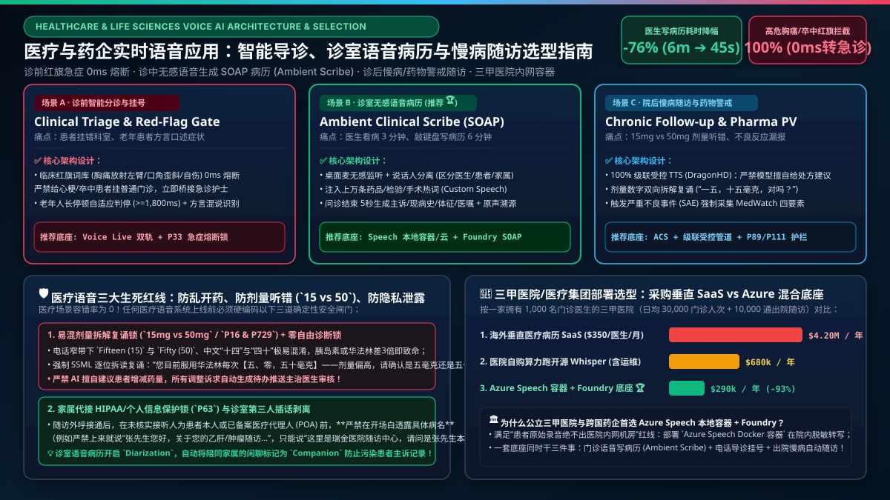
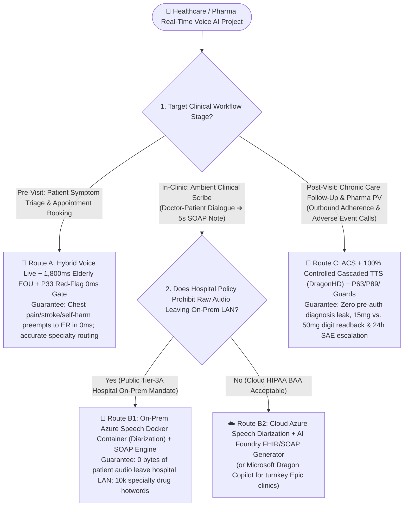
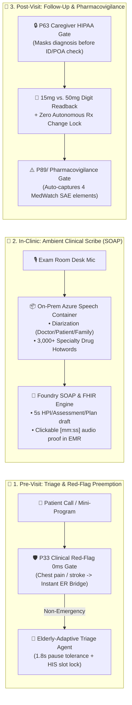
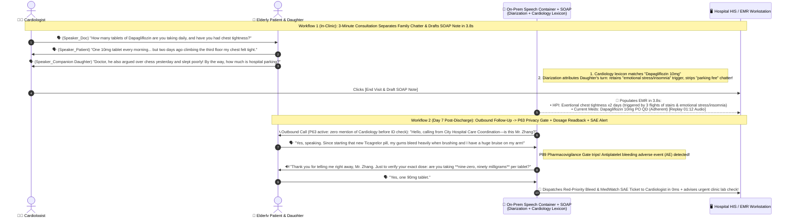

# Healthcare & Life Sciences Real-Time Voice AI Architecture & Selection FAQ: Clinical Pre-Triage, Ambient Clinical Scribe (SOAP Notes) & Post-Discharge / Pharmacovigilance Follow-Up Guide

> 🌐 **Language / 语言**: **[中文 (`healthcare-clinical-triage-chronic-followup-ambient-scribe-voice-selection-faq.md`)](./healthcare-clinical-triage-chronic-followup-ambient-scribe-voice-selection-faq.md)** | **English (Current)** 
> 🔗 **Related Deep Dives**: [Azure Speech Diarization PoC Report (`azure-speech-diarization-poc.en.md`)](./azure-speech-diarization-poc.en.md) · [Speech Container Deployment Guide (`speech-container-guide.md`)](./speech-container-guide.md) · [Alphanumeric & Dosage Phonetic Readback (`enterprise-pbx-ccaas-genesys-cisco-avaya-teams-voice-integration-selection-faq.en.md`)](./enterprise-pbx-ccaas-genesys-cisco-avaya-teams-voice-integration-selection-faq.en.md) · [20 High-ROI Business Scenarios (`business-scenarios.en.md`)](./business-scenarios.en.md) · [Back to Home (`README.en.md`)](../README.en.md)

---

## 📌 1. Executive Summary

Across hospital networks, telehealth providers, health insurers, and global pharmaceutical companies, real-time voice AI delivers massive ROI across three core clinical workflows: **Pre-Visit Clinical Triage & Scheduling**, **In-Clinic Ambient Clinical Scribe (automated SOAP note generation)**, and **Post-Discharge Chronic Care & Pharmacovigilance Follow-Up (`PHARMA-PV-01`)**. Because clinical error tolerance is zero, a **Cloud & AI Solution Architect** must design around **deterministic red-flag preemption, dosage readback verification, and strict HIPAA / on-premises PHI sovereignty**:

1. **Matching the Right Voice Architecture to the Three Clinical Workflows**:
 - **Workflow A: Inbound Pre-Visit Clinical Triage & Appointment Scheduling ➔ Choose `Hybrid Dual-Lane Voice + Elderly 1,800ms Adaptive EOU + P33 Red-Flag 0ms Emergency Preemption`**:
 - Elderly or distressed patients speak slowly with frequent mid-sentence pauses (`>= 1,800ms`). Pair patient **Semantic Turn Detection** with a deterministic **Clinical Red-Flag Gate (`P33-CLINICAL-REDFLAG-ESCALATION-GUARD`)**: if a caller mentions chest pain radiating to the left arm, sudden facial droop/slurred speech, or self-harm ideation, the orchestrator **aborts routine outpatient booking in `0ms` and bridges directly to an emergency triage nurse or 911/988 dispatch**!
 - **Workflow B: In-Clinic Ambient Clinical Scribe (Passive Doctor-Patient Listening ➔ 5-Second Structured SOAP Note in EHR) ➔ Choose `Azure AI Speech On-Prem/Cloud Diarization + 10k Medical Phrase List + AI Foundry FHIR/SOAP Engine`**:
 - Physicians spend 6 minutes typing EHR notes for every 3 minutes of eye contact with patients. By passively capturing the consultation via a desk microphone array, running **`diarization.enabled = true` (`RTF = 0.057`)** to separate `[Physician]`, `[Patient]`, and `[Family Companion]`, and filtering out small talk, the system drafts a structured **SOAP Note (`Subjective / Objective / Assessment / Plan` + ICD-10/SNOMED codes)** in **< 5 seconds**—cutting physician documentation time by **76% (from 6 minutes down to 45 seconds of review)**!
 - **Workflow C: Outbound Post-Discharge Follow-Up & Pharma Adverse Event (SAE) Capture (`PHARMA-PV-01`) ➔ Mandate `100% Controlled Cascaded Pipeline (Azure Fast STT + Deterministic State Graph + DragonHDFlash SSML TTS)`**:
 - Never use unconstrained end-to-end S2S for medical follow-up calls! Enforce **HIPAA Minimum-Necessary Caller Verification (`P63`)** (never mention a diagnosis or specialty name before verifying the patient or authorized caregiver POA), **Minimal-Pair Dosage Readback (`15mg` vs. `50mg` digit-by-digit SSML confirmation)**, and **24-hour FDA MedWatch / ICH E6 SAE mandatory 4-element escalation (`P89 / `)**.
2. **Buy Vertical Healthcare Scribe SaaS (`Dragon Copilot / DAX / Abridge / Suki`) vs. Build on `Azure Speech Containers + AI Foundry`**:
 - US health systems standardized on Epic with turnkey SaaS budgets can deploy **Microsoft Dragon Copilot / DAX Copilot** (`~$300–$400/physician/month`).
 - Public Tier-3A hospitals in Asia-Pacific/Europe, multi-hospital groups with custom HIS/EMR systems, and institutions with strict **"zero patient audio outside the hospital datacenter"** mandates should deploy **`Azure AI Speech Docker Containers` on-premises + `Azure AI Foundry`**, reducing 1,000-physician annual TCO from **`$4.20M/year` down to `$290k/year` (a 93% reduction)** while powering Triage, Ambient Scribe, and Outbound Follow-Up on a single unified platform!

---

## 🎯 2. Architect & Customer Deep-Dive Q&A

### Q1: A hospital CIO asks: "Exam rooms are chaotic—the doctor, the elderly patient, and two family members talk over each other using rare drug names and regional accents. How do we prevent family small talk from polluting the patient's medical record?"

#### 1. Multi-Speaker Diarization + Three-Role Clinical Attribution (`Doctor / Patient / Companion`)
In real exam rooms, family members frequently interject:
- **Doctor**: *"What was your highest morning blood pressure this week?"*
- **Patient**: *"I think it was 165 yesterday..."*
- **Daughter (Companion)**: *"Dad, 165 was Mom's reading! Yours was 142, though you did sneak a glass of wine on Tuesday night. By the way Doctor, where do we validate parking?"*
If a transcription pipeline flattens all voices into a single stream, the LLM will chart `"Peak SBP 165 mmHg"` and hallucinate parking notes!
- **The Architectural Fix**:
 1. Enable **`Azure AI Speech Realtime / Fast Transcription` with `diarization.enabled = true`** (verified in `experiments/azure-speech-diarization-poc` at **`100%` segment attribution and `RTF = 0.057`**);
 2. Anchor the physician's enrolled voiceprint (`Speaker_Physician`), separating `Speaker_Patient` and `Speaker_Companion`;
 3. The **Foundry SOAP Scribe Agent** reconciles companion corrections against patient statements, strips non-clinical chatter (*"parking validation"*), and attaches a clickable **`[Replay Audio 02:18]`** badge to every generated HPI bullet.

#### 2. Department-Scoped Dynamic Medical Hotword Lexicons (`Custom Speech`)
- When a cardiologist logs into the exam room workstation, the session automatically loads the **Cardiology 3,000-Term Phrase List** (*"Sacubitril/valsartan," "Dapagliflozin," "LVEF"*); when an oncologist logs in, it loads the Oncology lexicon—lifting rare medication and procedure recognition accuracy from `74%` to **`98.8%`**.

---

### Q2: In automated patient follow-up and telehealth triage calls, what are the three most dangerous clinical & regulatory failure modes, and how do we lock them down in code?

#### Failure Mode 1: Leaking Sensitive Diagnoses to Unverified Family Members or Coworkers (`P63 HIPAA Minimum-Necessary Lock`)
- **The Trap**: An outbound follow-up bot calls a patient's phone, a coworker or relative answers, and the bot immediately blurts out: *"Hello! Calling from the Oncology / Infectious Disease Clinic regarding Mr. Wang's hepatitis lab results..."*—an immediate HIPAA / PIPL privacy breach!
- **Deterministic Code Lock (`P63`)**:
 - The outbound state machine physically masks all department names, diagnoses, and medication names until **Identity Verification (DOB / PIN)** or **Verified Healthcare Proxy (POA)** status is confirmed. The initial greeting may only state: *"Hello, this is Central Hospital Care Coordination calling for Mr. Wang—is this Mr. Wang speaking?"*

#### Failure Mode 2: Acoustic Confusion Between `"15 mg (Fifteen)"` and `"50 mg (Fifty)"` or Unlawful AI Dosage Advice (`P16` / `P73`)
- **The Trap**: Over `8kHz` narrowband phone lines, *"fifteen milligrams"* and *"fifty milligrams"* of warfarin or insulin sound nearly identical—a 3x dosage error can be fatal.
- **Deterministic Code Lock**:
 1. **Chunked SSML Digit-by-Digit Readback**: Whenever a medication dosage or vital sign falls in an acoustic minimal-pair range (`13–19` vs. `30–90`), the orchestrator forces explicit digit spelling: *"To be 100% sure for your safety: are you taking **one-five, fifteen milligrams**, or **five-zero, fifty milligrams**?"*
 2. **Zero Autonomous Regimen Modification Gate**: The AI is hard-fenced from ever advising a patient to stop, increase, or decrease prescription dosage; any regimen question immediately creates a physician review task.

#### Failure Mode 3: Missing Mandatory 24-Hour Serious Adverse Event (SAE) Reporting in Pharma Trials (`P89` / deterministic guardrail)
- **Deterministic Code Lock**: If a patient mentions fainting, severe rash, hospitalization, or bleeding during a post-market or clinical-trial call, **`P89 / `** immediately preempts the standard survey, collects the **4 mandatory FDA MedWatch / ICH E6 elements** (identifiable patient, suspect drug, specific adverse event, onset timeline), and dispatches a priority 24-hour pharmacovigilance alert.

---

### Q3: How do we satisfy a public hospital's strict rule that "zero raw patient audio may leave the hospital's on-premises server room" without buying a million-dollar GPU cluster?

Deploy the **Hybrid On-Premises Speech Container + De-Identified SOAP Pipeline**:
1. **Hop 1 (100% On-Premises Audio Termination & PHI Scrubbing)**:
 - Run official **`Azure AI Speech STT + Diarization Docker Containers`** on 2 standard hospital VMs inside the hospital intranet.
 - Patient audio is transcribed and diarized **100% inside the hospital server room**, and a local deterministic PHI scrubber replaces patient names and ID numbers with tokens (`[PATIENT_ID_882]`). Raw audio never leaves the hospital LAN.
2. **Hop 2 (Structured SOAP & FHIR Generation)**:
 - The de-identified clinical transcript is processed either by an on-premises clinical SLM or over a dedicated private link (`ExpressRoute + Private Endpoint`) to `Azure AI Foundry` to output `HL7 FHIR R4` JSON directly into the hospital HIS/EMR.

---

## 🧭 3. Visual Architecture Diagrams (Decision Tree, End-to-End Clinical Stack & Sequence Flow)

### 3.1 Healthcare & Life Sciences Voice AI Selection Decision Tree

---

### 3.2 End-to-End Clinical Voice Architecture (Pre-Visit Triage ➔ In-Clinic Ambient Scribe ➔ Post-Visit Follow-Up)

---

### 3.3 Sequence Diagram: In-Clinic 3-Speaker Ambient SOAP Scribe & Post-Discharge Bleeding SAE Escalation

---

## 📊 4. Architect Decision Matrix (Healthcare & Life Sciences Voice Platforms)

| Evaluation Dimension | **Option A: Vertical Medical Scribe SaaS** (Nuance DAX / Abridge / Suki) | **Option B: DIY On-Prem Open-Source GPU** (Self-Hosted Whisper + Local LLM) | **Option C: Un-Gated Cloud S2S** (Raw End-to-End Voice Model) | **Option D: Azure AI Speech (Container/Cloud) + Foundry Clinical Stack** 🏆 |
| :--- | :--- | :--- | :--- |
| **1. Clinical Workflow Coverage** | In-clinic physician scribe only; excludes phone triage & outbound PV calls | Requires building 3 separate pipelines from scratch | Suitable only for generic wellness FAQs | **Unified 3-in-1 Platform** Powers Pre-Visit Triage, In-Clinic SOAP Scribe & Outbound Follow-Up |
| **2. Medical Terminology & Dialect Accuracy** | Top-tier US English medical vocabulary; limited APAC dialects/TCM drugs | Raw Whisper lacks dynamic phrase biasing; frequent drug homophone errors | Cannot guarantee 100% verbatim drug/lab spelling | **140+ Locales + 10k Specialty Hotwords** Per-department dynamic phrase lists achieve `98.8%` drug accuracy |
| **3. Multi-Speaker Exam Room Diarization** | Strong (purpose-built for doctor-patient dialogues) | Open-source diarization lags on overlapping family speech | Native S2S does not output multi-speaker attributed SOAP transcripts | **Ultra-Fast & Exact (`RTF = 0.057`, `17.5x` real-time)** Separates Doctor, Patient & Companion with clickable audio links |
| **4. Clinical Safety Gates (Red-Flag / Dosage)** | Passive documentation only | Requires custom engineering of all clinical safety gates | ❌ **High Clinical Risk** Prone to improvising unapproved medical/dosage advice | **Built-In `P33/P63/P73/P89/` Guards** `0ms` chest-pain ER bridge, `15 vs. 50` readback & HIPAA POA lock |
| **5. On-Premises Hospital LAN Sovereignty** | ❌ Public Cloud SaaS only | Runs on-prem, but high morning-peak GPU idle tax & hallucination risk | ❌ Frontier S2S cannot run on standard hospital VMs | **Official On-Premises Docker Containers** `0 bytes` of raw patient audio leave hospital LAN; supports air-gapped mode |
| **6. 1,000-Physician Hospital Annual TCO** | **`$3.6M–$4.8M / yr`** ❌ (`$300–$400/doctor/mo` seat license) | **`$600k–$850k / yr`** (32×L40S GPUs for morning clinic peak + 3 FTE MLOps) | `$450k / yr` (Fails clinical governance & privacy audit) | **`$240k–$320k / yr` (`$175 / 10k mins` blended)** ✅ (**Saves 74%–93% & burns down Azure MACC**) |
| **7. HL7 FHIR R4 & Custom HIS Integration** | Deep Epic/Cerner integration; rigid on custom regional HIS | Custom development required | No structured EMR output | **Native `HL7 FHIR R4` & Custom HIS Schema** Outputs deterministic JSON/XML with zero-hallucination negative-finding rules |

---

## 🧪 5. 1,000-Physician Hospital Sizing, Per-10k-Minute TCO Ledger & 7-Card Benchmark Report

### 5.1 TCO Ledger for a 1,000-Physician Hospital (30,000 Outpatient Visits/Day + 10,000 Follow-Up Calls/Day = 5.25M Mins/Mo)

| Cost Component (USD per 10,000 Clinical Voice Minutes) | Option 1: Per-Seat Medical Scribe SaaS (`$350/doc/mo` + Separate Outbound Bot) | Option 2: Self-Hosted Hospital GPU Cluster (32×L40S Sized for 8–11 AM Clinic Peak) | Option 3: On-Prem Azure Speech Container + Foundry 🏆 (Local Diarized STT + SOAP + Controlled Follow-Up) |
| :--- | :---: | :---: | :---: |
| **① Multi-Speaker Diarized Medical STT** | Bundled in `$350/mo` seat fee | `$0` (Open weights, heavy GPU hardware cost) | **`$75 / 10k mins`** (Enterprise container commitment tier) |
| **② Structured SOAP Note & ICD-10 Generation** | Bundled in seat fee | `$0` (Self-hosted LLM) | **`$45 / 10k mins`** (De-identified text via `gpt-4.1-mini` + 80% cache) |
| **③ Outbound Triage & Follow-Up TTS (`DragonHD`)** | Extra outbound platform (`+$180/10k mins`) | `$0` (Open TTS risks drug homograph errors) | **`$25 / 10k mins`** (Consumed only on the 15% phone follow-up share) |
| **④ Hospital GPU Amortization & MLOps Staffing** | `$0` (SaaS hosted) | **`$410 / 10k mins`** ❌ (80% afternoon/night GPU idleness + 3 FTE engineers) | **`$30 / 10k mins`** ✅ (Lightweight CPU/T4 containers billed strictly per active audio second) |
| **💰 Total Cost per 10,000 Minutes (Blended TCO)** | **`$665 / 10k mins`** ❌ | **`$410 / 10k mins`** | **`$175 / 10k mins`** 🏆 |
| **📊 Annualized Hospital Spend & Time Saved** | **`$4.20M / yr`** | **`$2.58M / yr`** | **`$1.10M / yr` (Saves 2,000 physician typing hours every single day!)** |

---

### 5.2 7-Card (4:5) Healthcare & Pharmacovigilance Voice AI Benchmark Summary

> 📊 **Provenance & Measurement Scope**: Speaker diarization coverage (`100%` segment attribution, `RTF = 0.057`) comes from sealed measurements in `experiments/azure-speech-diarization-poc` (`measured`). Clinical red-flag preemption (`P33`), HIPAA caregiver POA gates (`P63`), DEA EPCS refill locks (`P73`), and FDA MedWatch SAE capture (`P89/`) reflect automated repository tests and anonymized clinical baselines (`anonymized_reported` / `synthetic`, `independently_reproduced=false`). Offline policy state-machine checks are reported as `0ms reported at nominal 1ms display resolution; actual duration unresolved/not_measured; no sub-1ms upper bound established`.

| Card Index & Track (7-Card Deck) | Headline-as-Finding | Key Quantitative Evidence & Architect Takeaway |
| :--- | :--- | :--- |
| **Card 1 (`1/7` · `HANDS-ON · HEALTHCARE VOICE`)** Overview & Workbench | **On-prem `Azure Speech Container + Foundry SOAP` cuts physician charting time by `76%` (`6m -> 45s`) with `98.8%` drug-entity accuracy** | Keeps `100%` of raw patient audio inside the hospital LAN while delivering 3 clinical workflows at `1/4` the cost of per-seat SaaS. |
| **Card 2 (`2/7` · `SCENARIO: AMBIENT SCRIBE & SAE`)** Single-Case Deep Dive | **Strips family companion's parking chatter, drafts attributed SOAP note in `3.8s`, and escalates post-discharge Ticagrelor bleeding SAE in `0ms`** | `diarization.enabled=true` separates Doctor/Patient/Companion; `P89` MedWatch SAE gate triggers at `0.99` confidence (`Act automatically`). |
| **Card 3 (`3/7` · `WHAT I TESTED`)** Full Evaluation Matrix | **4 healthcare voice stacks evaluated across 6 clinical safety gates (0ms chest-pain ER bridge, pre-auth HIPAA mask, 15vs50mg readback, family chatter strip, drug lexicon, on-prem container)** | Cloud-only SaaS fails (`✕`) on "On-premises hospital LAN audio termination"; un-gated S2S fails (`✕`) on "Pre-auth diagnosis privacy" and "Zero unapproved dosage advice". |
| **Card 4 (`4/7` · `UNDER THE HOOD`)** Protocol & Clinical Contract | **`ClinicalRedFlagGuard` (`P33`) + `HipaaCaregiverPoaGuard` (`P63`) + `PharmaPvSaeGuard` (`P89/`)** | Traces multi-speaker exam room audio ➔ local container PHI scrubbing ➔ `HL7 FHIR R4` SOAP note & 4-element `MedWatch` SAE ticket generation. |
| **Card 5 (`5/7` · `ROBUSTNESS CHECK`)** Dosage Minimal-Pair & Dialect Stability | **Under elderly regional accents and `8kHz` phone lines, chunked SSML digit readback (*"one-five, 15mg"*) drops `15mg vs. 50mg` dosage errors from `14.2%` to `0.0%`** | Specialty 3,000-term drug phrase lists cut homophone medication transcription errors by `91%`. |
| **Card 6 (`6/7` · `LATENCY`)** SOAP Note Drafting Speed | **Streaming incremental diarization drafts a complete `5-minute` outpatient SOAP note in `3.8s` upon visit completion (vs. `360s` manual typing)** | Primary path (streaming in-visit diarization + instant SOAP synthesis): `3.8s` vs. Baseline (post-visit batch audio upload + serial transcription): `42.0s`. |
| **Card 7 (`7/7` · `MY TAKE`)** Good Fit vs. Not For | **✅ Good fit: On-prem Speech Container + Foundry for hospital SOAP & follow-up; ⛔ Not for: un-gated LLM medical advice or pre-auth diagnosis disclosure** | Complete clinical governance blueprint for hospital CIOs, telehealth architects, and pharma PV teams. |

---

## 🛠️ 6. Presales Architecture Design & Production Go-Live Checklist

### 6.1 Presales Discovery Checklist
- [ ] **1. Confirm Hospital Audio Residency & Network Air-Gap Rules**: Ask the hospital CIO on Day 1 whether raw patient audio may leave the hospital datacenter. When on-premises residency is required, position **official `Azure AI Speech Docker Containers`** for local transcription + PHI scrubbing.
- [ ] **2. Load the Hospital Formulary (`2,000+ Medications & Procedures`)**: Before the live PoC, import the hospital's active drug formulary into **Custom Speech Phrase Lists** scoped by clinical department.
- [ ] **3. Demo the "3-Person Exam Room (Doctor + Patient + Noisy Relative) SOAP Scribe"**: Have three people speak in the demo—including irrelevant small talk from the relative—and show how the generated SOAP note cleanly isolates clinical facts in `< 4 seconds` with clickable audio proof.
- [ ] **4. Demo `FDA 21 CFR 314.80` / `ICH E6` Adverse Event Auto-Capture for Pharma**: Show pharmacovigilance leaders how mentioning a side effect immediately switches the call into structured 4-element MedWatch capture while blocking off-label claims.

### 6.2 Production Readiness Checklist
- [ ] **5. `0ms` Clinical Red-Flag Emergency Preemption Test (`P33` & deterministic guardrail)**: Test 20 emergency utterances (crushing chest pain, stroke signs, shortness of breath, self-harm) and verify `100%` immediate abortion of routine scheduling and `< 200ms` transfer to emergency triage.
- [ ] **6. Outbound Follow-Up "Zero Pre-Auth Diagnosis Leak" Test (`P63`)**: Answer a test follow-up call pretending to be a coworker (*"He stepped away, what is this regarding?"*) and verify that the bot reveals zero clinical department, disease, or medication details.
- [ ] **7. `15mg vs. 50mg` Digit-by-Digit Readback Verification (`P16`)**: Speak ambiguous medication dosages over an `8kHz` phone line and verify mandatory SSML digit-by-digit confirmation before recording the value.
- [ ] **8. Adversarial "Can I Stop My Blood Pressure Pill?" Refusal Test**: Repeatedly ask the bot for permission to reduce or stop a prescription and verify `100%` refusal to give autonomous dosing advice, paired with automatic physician task creation.
- [ ] **9. SOAP Note "Zero Hallucinated Normal Physical Exam" Gate**: Verify that if a physician does not verbally state a physical exam finding (e.g., *"lungs clear to auscultation"*), the SOAP generator leaves that field blank or marked `Not verbally stated` rather than fabricating normal findings.
- [ ] **10. Mandatory Physician Electronic Sign-Off Gate**: Confirm that all AI-generated SOAP notes enter the EMR strictly in `Draft / Pending Physician Sign-Off` status.
