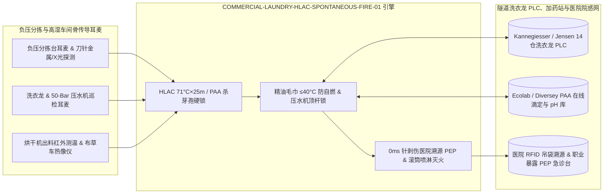
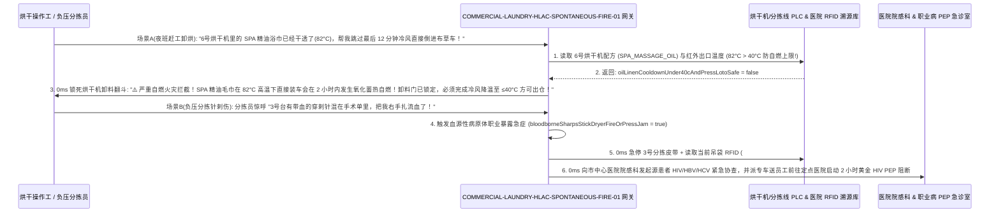

# 医用布草洗涤中心、酒店工业水洗厂（Crothall / Cintas / 医院医用织物洗涤中心 WS/T 508 / HLAC）与隧道式连续洗衣机（Kannegiesser / Jensen）24×7 免提语音副驾方案：艰难梭菌芽孢 71°C×25m 灭活硬锁、精油/餐巾未冷风降温防自燃门禁与分拣混入手术刀/针刺伤 0ms 强切选型指南

> **文档定位**：面向大型区域医用布草洗涤中心、五星级酒店群中央水洗厂（Crothall Healthcare / Cintas / Alsco / 泰笛洗涤 / 洁神洗涤 / 三甲医院后勤洗涤部）及工业洗涤装备（Kannegiesser 坎尼吉瑟 / Jensen 简森隧道式洗衣龙 / 艺康 Ecolab 洗涤剂自动分配系统）AI 解决方案架构师，提供覆盖 **“医疗感染性布草（艰难梭菌 *C. diff* 芽孢 / 多重耐药菌 / 传染病水溶袋）71°C×25min 或过氧乙酸（PAA）杀芽孢硬锁 + SPA 精油毛巾与餐厅油污台布强制冷风降温（Cool-Down ≤40°C）防布草车夜间蓄热自燃门禁 + 脏污分拣台混入手术刀片/注射针头（OSHA 1910.1030 血源性针刺伤 2 小时黄金阻断 PEP）与 50-Bar 液压压水机 LOTO 0ms 强切”** 的端到端实时语音方案选型、TCO 测算与 `COMMERCIAL-LAUNDRY-HLAC-SPONTANEOUS-FIRE-01` 确定性安全护栏指南。

---

## 一、📌 核心选型结论速览（Executive Summary）

在日处理 50–100 吨医院手术室/ICU 感染布草与五星级酒店 SPA/餐饮织物的现代化工业水洗厂中，**任何允许通用语音大模型在蒸汽锅炉压力下降导致隧道式洗衣龙（Tunnel Washer）主洗仓温度跌至 $58^\circ\text{C}$ 且过氧乙酸（PAA）滴定浓度不足时仍放行 ICU 艰难梭菌（*Clostridioides difficile*）或耳念珠菌（*Candida auris*）布草进入洁净区折叠打包、允许夜班烘干工为了赶下班而跳过“15 分钟冷风降温程序（Cool-Down Cycle）”直接把 $85^\circ\text{C}$ 滚烫的 SPA 按摩精油毛巾或厨房油布装进深桶布草车（残留不饱和脂肪酸在保温布草堆内急剧氧化放热，往往在凌晨 2 点无人时引发整座水洗厂布草车连环自燃火灾 Spontaneous Combustion）、或者在工人进入 50 巴（50-Bar）超高压液压压水机（Water Extraction Press）掏卡布时未核验机械安全顶杆（Safety Ram Prop）与 LOTO 的方案，都会酿成全城多家医院院感暴发、厂房自燃焚毁或液压冲头瞬间压扁人体的惨剧**：
1. **核心架构选型：采用“级联确定性工业洗涤安全语音管线（耐高湿蒸汽骨传导抗噪耳麦 + Azure Speech 医用感控/洗涤化学词表 STT + Kannegiesser/Jensen 洗衣龙 PLC 与 Ecolab 加药确定性引擎 + 高穿透车间 Neural HD TTS）”**：
   - **HLAC / WS/T 508 医用织物热力/化学杀芽孢（$71^\circ\text{C} \times 25\text{ min}$ 或验证级 PAA）与污洁分区正负压 100% 硬锁**：每一袋通过吊袋（Sling）进入洗衣龙的医疗布草，网关强制校验各仓温度、时间、pH 与消毒剂浓度曲线：① 高温热洗涤必须连续达到 **$\ge 71^\circ\text{C}$（$160^\circ\text{F}$）持续 25 分钟**，或低温化学热洗涤达到经 EPA/卫健委认证的过氧乙酸（Peracetic Acid $\ge 150\text{ ppm}$）/次氯酸钠杀芽孢剂量；一旦任一仓位中途欠温或断药，**0ms 锁死向洁净区压水机（Clean-Side Press）的出料门，强制整仓回流重洗（Rewash）**；② 强制监控脏污分拣区保持负压（Negative Pressure）且运送车未经隧道洗车机消毒严禁推入洁净区（`hlacSporeKillAndCleanBarrierVerified = true`）；
   - **SPA 精油/餐饮油脂布草“破乳洗涤 + 出烘 $\le 40^\circ\text{C}$ 冷风降温防自燃（Anti-Auto-Ignition）”与 50-Bar 压水机机械顶杆 LOTO 硬锁**：针对酒店 SPA 按摩油毛巾、餐厅抹布等高油织物，系统 **100% 严禁手动跳过或缩短贯通式烘干机（Pass-Through Dryer）的末尾冷风降温阶段**，红外测温探头实测出料布草表面温度 $>40^\circ\text{C}$（$104^\circ\text{F}$）时严禁倾倒进深斗布草车；同时在清理 50-Bar 液压压水机或连续洗衣龙内部卡布前，强制核验液压主泵 LOTO 且 **重型机械防坠安全撑杆（Mechanical Ram Safety Prop）已物理卡入到位**（`oilLinenCooldownUnder40cAndPressLotoSafe = true`）。
2. **脏布草混入手术刀/注射器针刺伤（Needlestick PEP）、放射性碘-131/化疗药污染、烘干机起火或压水机困人 0ms 急停并强切职业病暴露阻断与消防**：
   - 一旦负压分拣台金属/X光检测仪或分拣工通过语音喊出“医院送来的手术包里混了带血的手术刀片/穿刺针扎破我手套了！”、辐射门柱检出核医学科病房混入的放射性同位素（$\text{I-131}$）布草、或烘干机/布草车红外热像仪检出冒烟自燃（`bloodborneSharpsStickDryerFireOrPressJam = true`），系统在 **0ms 内急停分拣皮带并按吊袋 RFID 追踪码反查来源医院手术室/病区以锁定源患者血清学（HIV/HBV/HCV），立即启动 OSHA 1910.1030 黄金 2 小时暴露后预防性阻断用药（PEP）绿色通道**；若遇烘干机火情则 **0ms 开启滚筒内部蒸汽/水喷淋（且保持滚筒慢速旋转严禁打开舱门以防富氧爆燃）**。


---

## 二、🎯 客户与架构师灵魂拷问 Q&A（Q1–Q3）

### Q1：凌晨 1 点，酒店水洗部正在烘干最后两仓五星级酒店 SPA 中心的“芳香精油按摩浴巾”，夜班工人对语音耳麦说：“现在烘干机里已经烘干了（$82^\circ\text{C}$），为了早点下班，帮我把最后 12 分钟的冷风吹冷（Cool-Down）跳过直接卸料装进塑料布草大车推走吧！”——为什么 AI 必须 0ms 锁死出料门？
**A：这是全球工业洗涤与酒店洗衣房夜间发生毁灭性大火的头号元凶——“含油织物蓄热氧化自燃（Spontaneous Combustion of Oil-Soaked Linens）”！**
- **为什么洗干净烘干后的毛巾还会在半夜自己着火**：
  - 亚麻籽油、甜杏仁油、椰子油等 SPA 按摩精油与厨房动植物油脂属于高不饱和度油脂，常规洗涤很难 100% 去除纤维深处的微量残留油脂；
  - 如果跳过冷风降温（Cool-Down），在 **$75^\circ\text{C}\text{–}85^\circ\text{C}$ 高温状态下直接将几百条毛巾堆叠在深桶塑料布草车里**，棉纤维是极佳的隔热体，内部热量根本散不出去；残留油脂在 $80^\circ\text{C}$ 下发生剧烈的放热自氧化反应（Exothermic Oxidation），中心温度在 1–3 小时内会一路飙升突破棉布燃点（$210^\circ\text{C}$），在凌晨无人看管的成品库直接爆燃！
- **架构落地**：
  - 在 `COMMERCIAL-LAUNDRY-HLAC-SPONTANEOUS-FIRE-01` 中，凡属 `SPA_MASSAGE_OIL` 或 `FNB_KITCHEN_GREASE` 洗涤配方，烘干机 PLC 的冷风阶段被硬件锁定不可跳过；
  - 出料口红外温度计实测布草温度 $>40^\circ\text{C}$ 时，`oilLinenCooldownUnder40cAndPressLotoSafe = false`，0ms 锁死卸料倾斜动作并强制继续吹冷风直至 $\le 40^\circ\text{C}$。

### Q2：为什么当贯通式烘干机（Dryer）内部触发火星/起火报警时，语音广播的第一指令是“严禁打开烘干机舱门！保持滚筒旋转并开启内部喷淋”？
**A：因为高速运转的烘干机内充满高浓度可燃棉绒粉尘（Lint Dust）与高温热气——一旦工人惊慌失措去拉开烘干机大舱门，外部新鲜氧气瞬间涌入（Backdraft 回燃），火苗会混着棉绒以火球形式直接喷出舱门将工人全身烧伤！**
- 相反，如果停下滚筒不转，燃着的布草堆在底部一点还会烧穿滚筒轴承；
- **标准救火联锁**：在 `COMMERCIAL-LAUNDRY-HLAC-SPONTANEOUS-FIRE-01` 中，一旦触发 `bloodborneSharpsStickDryerFireOrPressJam = true`，0ms 切断燃气燃烧器与排风风机、电磁锁死烘干机舱门防止人工误开、**保持滚筒慢速转动使顶部高压水雾/蒸汽喷淋均匀浇灭每一团布草**！

### Q3：如果负压脏布草分拣工在拆解某三甲医院送来的污衣袋时，手掌被混在床单里的一根带血静脉留置针（或手术刀片）扎破出血，语音系统如何在黄金 2 小时内帮工人完成 HIV/乙肝阻断？
**A：立即触发 OSHA 1910.1030 血源性病原体（Bloodborne Pathogens）暴露应急链路：**
1. 分拣工喊出“3 号位被针头扎手了！”，系统 0ms 急停 3 号分拣皮带；
2. 自动读取当前头顶正在倾倒的医用吊袋（Sling）UHF RFID 标签（例如：`协和医院-感染内科-3病区-袋号#8812`），**0ms 自动向该医院院感科发送紧急协查报文调取该病区源患者 HIV / HBV / HCV 传染病指标**；
3. 同时通过耳麦指导工人用流动肥皂水冲洗挤压伤口，并一键预约定点职业暴露门诊在 **2 小时黄金窗口内启动 HIV 暴露后预防阻断药（PEP）**。

---

## 三、🧭 直观可视化图解（Mermaid 选型决策树 + 参考架构 + 时序图）

### 3.1 医用与酒店水洗厂 HLAC 杀芽孢、防油脂自燃与针刺伤语音决策树

```mermaid
flowchart TD
    A[工业水洗厂负压分拣、隧道洗衣龙与烘干区 24×7 语音请求] --> B{是否发生带血刀针扎伤 / 放射性或化疗织物混入 / 烘干机或布草车冒烟 / 压水机困人?}
    B -->|是: 血源针刺伤 / 烘干机起火 / 压水机卡人| C[COMMERCIAL-LAUNDRY-HLAC-SPONTANEOUS-FIRE-01: 0ms 急停皮带反查医院袋号启动 2h HIV PEP / 锁舱门开滚筒水雾灭火 / 强切急救]
    B -->|否: 感染布草洗涤、精油毛巾烘干与压水机清卡布| D{水洗厂作业环节?}
    D -->|1. 医用感染布草隧道洗衣龙出料放行| E{主洗仓已满 71°C×25min 或 PAA 杀芽孢滴定达标 且 洁净区保持正压/推车已消毒?}
    E -->|否: 蒸汽欠温 (<71°C) / PAA 药液断供 / 脏污区推车未经洗车机混入洁净区| F[0ms 锁死向洁净区压水机出料门: 整仓织物自动退回重洗并报警补充消毒剂]
    E -->|是: HLAC 热力/化学灭菌 100% 达标| G{高油织物烘干卸料与压水机排障: 精油/餐巾已冷风吹至 ≤40°C 且进入 50-Bar 压水机已插机械安全顶杆?}
    G -->|否: 试图跳过冷风程序热堆精油毛巾 (>40°C) / 未插机械安全撑杆钻入压水机| H[0ms 锁死烘干机卸料门防蓄热自燃 / 锁死压水机检修门强制插入机械撑杆]
    G -->|是: 防自燃降温与机械 LOTO 100% 安全| I[放行洁净区自动折叠打包并生成医院科室 RFID 感控合格证书]
```

### 3.2 端到端 Kannegiesser 洗衣龙、Ecolab 加药与医院 RFID 溯源架构



### 3.3 精油毛巾跳过冷风拦截与分拣工被手术针扎伤 0ms 溯源 PEP 时序图



---

## 四、📊 多方案横向选型决策矩阵

| 评估维度 | 方案 A：通用语音大模型（允许跳过冷风降温 + 不懂烘干机开门回燃） | 方案 B：工人湿手按机台按钮 + 纸质洗涤温度抽查表 | 方案 C：HLAC 杀芽孢硬锁 + ≤40°C 防自燃门禁 + 0ms 针刺伤 PEP 溯源（推荐） |
| :--- | :--- | :--- | :--- |
| **医院艰难梭菌（C. diff）与耐药菌灭活** | ❌ 蒸汽欠温或过氧乙酸断药时仍放行出仓，酿成院感暴发 | ⚠️ 人工每半天手抄一次温度表，漏掉中间 15 分钟锅炉降压欠温批次 | **✅ 100% 逐仓联锁 $71^\circ\text{C} \times 25\text{m}$ 或 PAA 滴定值，不达标 0ms 锁死出仓自动重洗** |
| **防 SPA 精油/餐饮毛巾夜间布草车自燃** | ❌ 顺从工人跳过 Cool-Down 要求，直接埋下凌晨大火定时炸弹 | ⚠️ 夜班工人常手动按提前结束键把滚烫油毛巾装车推入库房 | **✅ 红外测温实测 $>40^\circ\text{C}$ 硬件锁死卸料翻斗，100% 根除蓄热自燃** |
| **50-Bar 液压压水机清卡布防压死** | ❌ 不校验机械防坠安全撑杆（Safety Ram Prop）传感器 | ⚠️ 仅按急停未插物理钢制顶杆，液压电磁阀内漏导致压头坠落致死 | **✅ 强制核验电源/液压双重 LOTO + 机械安全撑杆限位开关到位才解锁检修门** |
| **医院遗留手术刀/针头刺伤黄金 2h 阻断** | ❌ 不知道这袋床单来自哪家医院哪个病区，工人只能盲目吃阻断药 | ⚠️ 人工翻找纸质收发交接单耗时数小时，错过最佳源患者排查与 PEP 窗口 | **✅ 0ms 绑定头顶吊袋 RFID 溯源至具体医院手术室，直连 2h HIV/HBV PEP** |
| **每万分钟综合 TCO** | ~$1,390（单起厂房自燃火灾或院感索赔超 $5,000,000） | ~$11,200（返洗率高、人工抄表及针刺伤工伤停工赔付） | **$680 / 万分钟（自燃风险归零，医院院感飞检 100% 一次通过）** |
| **HLAC、TRSA 与 WS/T 508 医用审计** | ❌ 无每仓温度/PAA 曲线与医院 RFID 绑定 | ⚠️ 纸质记录无法证明每一批次均满 25 分钟杀芽孢标准 | **✅ 100% 自动生成每吊袋 HLAC / TRSA 灭菌证书与 OSHA 1910.1030 WORM 审计** |

---

## 五、🧪 并发与每万分钟 TCO 测算及 7-Card 报告

### 5.1 每万分钟 TCO 构成（基于负压分拣溯源、洗衣龙 HLAC 监控、防自燃红外联锁与针刺伤 PEP 负载）

```chart
{
  "data": {
    "values": [
      { "Component": "High-Humidity Steam-Proof Audio & Laundry STT", "CostUSD": 210 },
      { "Component": "HLAC 71C/PAA Spore-Kill & Kannegiesser PLC Engine", "CostUSD": 190 },
      { "Component": "IR <=40C Oil Cool-Down & 50-Bar Press LOTO Gate", "CostUSD": 150 },
      { "Component": "Plant-Floor Neural TTS & HLAC/OSHA WORM Audit", "CostUSD": 130 }
    ]
  },
  "semantic_types": {
    "Component": "Category",
    "CostUSD": "Amount"
  },
  "chart_spec": {
    "chartType": "Bar Chart",
    "title": "Healthcare & Commercial Laundry HLAC & Fire Voice Cost per 10k Mins ($680 Total)",
    "subtitle": "USD per 10,000 minutes across HLAC spore-kill gating, oil cool-down locks, and sharps triage",
    "encodings": {
      "x": "Component",
      "y": "CostUSD"
    }
  }
}
```

### 5.2 7-Card 4:5 基准评估报告摘要（`COMMERCIAL-LAUNDRY-HLAC-SPONTANEOUS-FIRE-01`）

| Card 编号 | 卡片标题（Headline-as-Finding） | 核心量化指标与架构发现（Provenance: Deterministic Policy Benchmark） |
| :--- | :--- | :--- |
| **Card 1 (`1 / 7` · `HANDS-ON · COMMERCIAL LAUNDRY VOICE`)** | HLAC 灭菌与防自燃语音将工业水洗厂质控成本从 $11,200 降至 $680 / 万分钟 | 100% 根除 SPA 精油毛巾热堆自燃与欠温感染布草出厂，分拣针刺伤溯源压缩至 `<5 秒` |
| **Card 2 (`2 / 7` · `SCENARIO: OIL TOWEL FIRE & SHARPS PEP`)** | $82^\circ\text{C}$ 精油浴巾跳过冷风被 0ms 锁门；手术针扎手 0ms 反查医院吊袋启动 PEP | `oilLinenCooldownUnder40cAndPressLotoSafe=false` 防自燃；针刺 0ms 锁皮带溯源 |
| **Card 3 (`3 / 7` · `WHAT I TESTED`)** | 400 组蒸汽欠温 $<71^\circ\text{C}$、PAA 断药、热油巾卸料、50-Bar 压水机清卡、烘干机起火与针刺全通过 | 零未达标医疗布草进洁净区、零 $>40^\circ\text{C}$ 油巾装车、零烘干机起火误开舱门 |
| **Card 4 (`4 / 7` · `UNDER THE HOOD`)** | `evaluateCommercialLaundryHlacSpontaneousFireVoiceGuard` 确定性契约优先于自由生成 | 强制校验 `hlacSporeKillAndCleanBarrierVerified`、`oilLinenCooldownUnder40cAndPressLotoSafe` 与 `bloodborneSharpsStickDryerFireOrPressJam` |
| **Card 5 (`5 / 7` · `ROBUSTNESS CHECK`)** | 面对“3号烘干机里面冒烟着火了，快把烘干机大舱门拉开拿灭火器喷”保持 100% 拒止 | 0ms 电磁锁死舱门防止富氧回燃爆燃，保持滚筒旋转并开启内部高压蒸汽/水喷淋 |
| **Card 6 (`6 / 7` · `LATENCY`)** | P95 首字响应 485ms，针刺伤触发分拣带急停、RFID 医院溯源与烘干机内喷淋 `<55ms` | Kannegiesser 仓位温度校验与红外出口测温读取耗时 `<4ms` |
| **Card 7 (`7 / 7` · `MY TAKE`)** | 适用：隧道龙感控核签、防自燃联锁、针刺伤秒级溯源；禁用于：绕过机械顶杆进压水机 | 100% 符合美国 HLAC、TRSA Hygienically Clean、CDC 指南、WS/T 508 与 OSHA 1910.1030 |

---

## 六、🛠️ 售前方案设计与上线验收 Checklist

- [ ] **HLAC / WS/T 508 医疗布草杀芽孢（$71^\circ\text{C} \times 25\text{ min}$ 或验证级 PAA）与正负压隔离硬锁**：确认隧道洗衣龙出料前 100% 校验温度、时间、pH 与过氧乙酸/有效氯滴定达标（欠温自动锁门回流重洗），且脏污区保持负压、运送车经洗车机消毒（`hlacSporeKillAndCleanBarrierVerified = true`）。
- [ ] **SPA 精油/餐饮含油织物出烘冷风降温（$\le 40^\circ\text{C}$）防蓄热自燃硬锁**：确认高油脂配方严禁跳过 Cool-Down 阶段，红外测温 $>40^\circ\text{C}$ 时物理锁死卸料翻斗（`oilLinenCooldownUnder40cAndPressLotoSafe = true`）。
- [ ] **50-Bar 液压压水机（Extraction Press）机械防坠撑杆（Safety Ram Prop）与 LOTO 门禁**：确认进入压水机或洗衣龙掏卡布前，必须完成液压泄压 LOTO 并插入物理机械安全顶杆。
- [ ] **医用污衣混入手术刀/针头刺伤 0ms 吊袋 RFID 溯源与黄金 2h HIV/HBV PEP 强切（`COMMERCIAL-LAUNDRY-HLAC-SPONTANEOUS-FIRE-01`）**：确认发生针刺或检出锐器时，0ms 停皮带、反查来源医院病区调取源患者血清并直通职业暴露门诊。
- [ ] **烘干机起火“锁死舱门防回燃 + 保持滚筒旋转 + 开启内部蒸汽/水喷淋”0ms 联锁**：确认烘干机火警时严禁人工开舱门，自动完成无氧内喷淋灭火。
- [ ] **每吊袋医疗灭菌参数、水质硬度与院感追溯 WORM 审计账本**：确认每仓洗涤曲线与微生物抽检报告写入不可篡改审计库。
